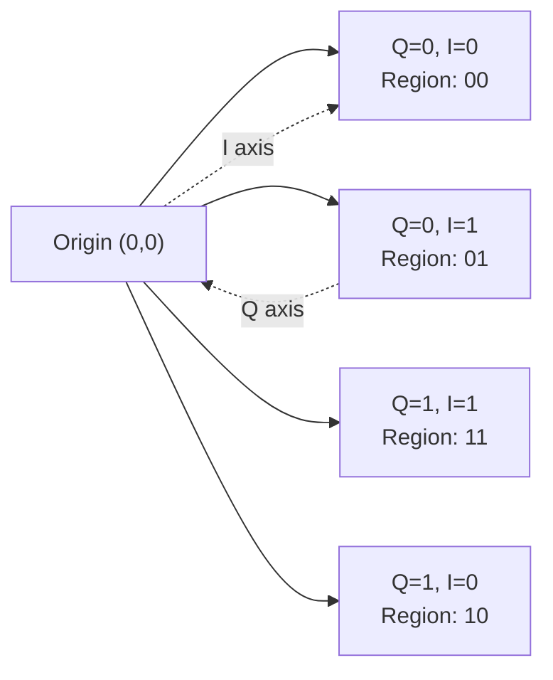
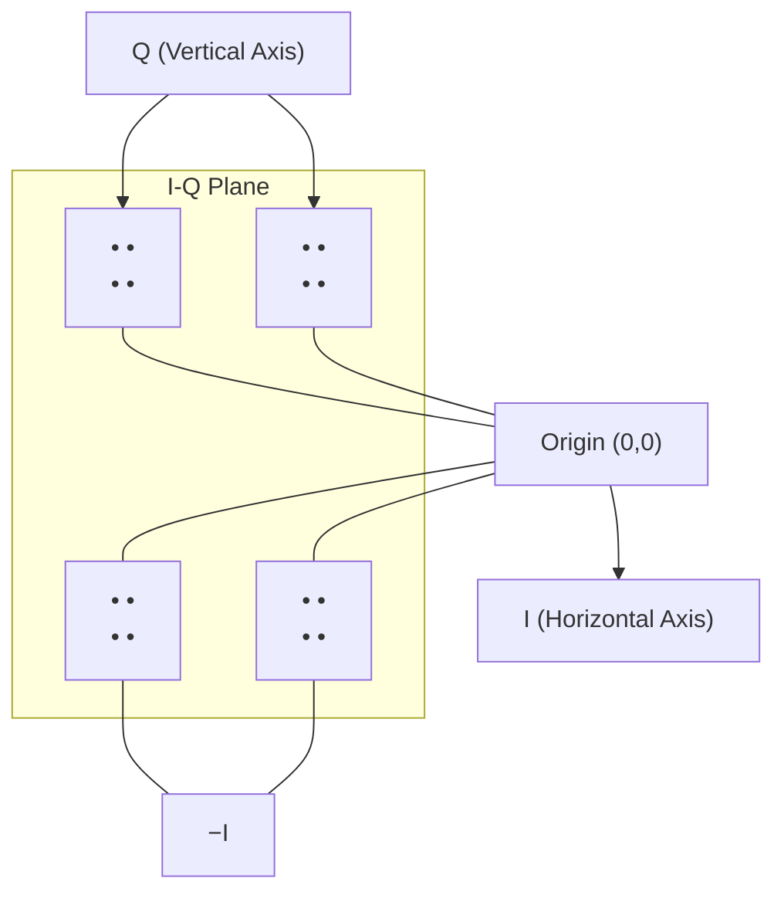

# Lesson 2: Modulation, Demodulation, Digital Encoding Schemes

## 1. First-Principles Intuition & Invariants

The fundamental challenge of wireless communication reduces to a seemingly simple problem: how do we impress discrete digital information onto a continuous-time analog carrier wave that can propagate through free space? The electromagnetic spectrum, governed by Maxwell's equations, provides us with a physical transport medium where sinusoidal waves at specific frequencies can carry energy from transmitter to receiver. Yet these pure sinusoids—whether at 433 MHz for industrial remote controls, 2.4 GHz for WiFi, or 5.8 GHz for modern drone command links—contain no information by themselves. A continuous wave at constant amplitude, frequency, and phase is information-theoretically sterile.

Modulation is the systematic distortion of one or more parameters of this carrier wave to encode digital bits into its time-domain evolution. We possess exactly three degrees of freedom in a sinusoidal carrier: its amplitude $A(t)$, its instantaneous frequency $f(t)$, and its phase $\phi(t)$. Every modulation scheme in existence manipulates some combination of these three parameters according to a predetermined mapping between discrete symbols (groups of bits) and continuous waveform characteristics. The receiver's inverse operation—demodulation—must recover the original bit sequence by observing the received waveform and making optimal decisions about which symbols were transmitted, even in the presence of noise, multipath fading, and Doppler shifts.

The sophistication of modern digital modulation schemes lies in their efficiency metrics. Spectral efficiency, measured in bits per second per Hertz, quantifies how much information we can pack into a given bandwidth allocation. Power efficiency determines how much energy we must radiate per bit to achieve a target bit error rate (BER) at a given signal-to-noise ratio (SNR). These two objectives exist in fundamental tension: higher-order modulation schemes that pack more bits per symbol (like 256-QAM) achieve superior spectral efficiency but require higher SNR to maintain acceptable BER, while simple binary schemes like BPSK sacrifice data rate for robustness in noisy channels.

From a security perspective, understanding modulation at the physical layer is not academic. An adversary with a software-defined radio can intercept, demodulate, and analyze wireless traffic even when cryptographic protections exist at higher layers, because the physical modulation scheme itself often leaks metadata: protocol timing, packet lengths, transmission power profiles, and frequency-hopping patterns. Conversely, an offensive operator can craft precise jamming signals, inject spoofed packets at the physical layer, or exploit modulation-specific vulnerabilities in receiver implementations. The attack surface begins at the analog front-end, before any digital signal processing or cryptographic verification occurs.

The mathematical foundation rests on the analytic signal representation and the concept of complex baseband equivalence. Any real-valued bandpass signal centered at carrier frequency $f_c$ can be represented as:

$$s(t) = A(t) \cos(2\pi f_c t + \phi(t)) = \text{Re}\{A(t) e^{j\phi(t)} e^{j2\pi f_c t}\}$$

The term $A(t) e^{j\phi(t)}$ is the complex baseband envelope, and by working in this baseband representation we can analyze modulation schemes without carrying the high-frequency carrier term through our mathematics. This is precisely what software-defined radio platforms do: they downconvert the received RF signal to baseband using a quadrature mixer, producing in-phase (I) and quadrature (Q) components that represent the real and imaginary parts of the complex envelope. All subsequent demodulation, synchronization, and decoding operate on this complex baseband signal, stored as interleaved 32-bit float pairs in memory.

Channel coding and error correction form the bridge between raw modulated symbols and reliable data delivery. Even with perfect synchronization and demodulation, thermal noise in the receiver front-end causes random bit errors. Forward error correction (FEC) schemes like convolutional codes, Reed-Solomon codes, and modern low-density parity-check (LDPC) codes add structured redundancy to the transmitted bit stream, allowing the receiver to detect and correct errors without retransmission. The interplay between modulation order and coding rate determines the overall spectral efficiency and link budget: a system might use 16-QAM with rate-1/2 convolutional coding, transmitting 4 bits per symbol but adding 100% redundancy, achieving a net 2 bits per symbol delivered to the application layer.

## 2. Core Architecture & Mechanics

Amplitude modulation, the oldest and conceptually simplest scheme, encodes information by varying the carrier amplitude $A(t)$ while maintaining constant frequency and phase. In its binary form, amplitude-shift keying (ASK), we transmit one of two amplitude levels to represent 0 or 1. The transmitted signal for binary ASK is:

$$s(t) = \begin{cases} A_1 \cos(2\pi f_c t) & \text{for bit 1} \\ A_0 \cos(2\pi f_c t) & \text{for bit 0} \end{cases}$$

Typically $A_0 = 0$ for on-off keying (OOK), the simplest possible ASK variant where we literally turn the carrier on and off. This scheme dominates low-cost embedded applications: garage door openers, wireless doorbells, and tire pressure monitoring systems all use OOK at 315 MHz or 433 MHz ISM bands because receiver implementation requires only an envelope detector (essentially a diode and capacitor) rather than coherent phase tracking. The security implications are profound—these devices often transmit fixed codes or use weak rolling code algorithms that can be captured and replayed with trivial SDR equipment.

Frequency modulation encodes information in the instantaneous frequency deviation from the carrier. Frequency-shift keying (FSK) transmits one of several discrete frequencies, each representing a different symbol. Binary FSK (BFSK) uses two frequencies separated by $\Delta f$:

$$s(t) = A \cos(2\pi (f_c \pm \frac{\Delta f}{2}) t)$$

The frequency separation $\Delta f$ relative to the symbol rate $R_s$ determines orthogonality and spectral efficiency. For minimum-shift keying (MSK), a special case of continuous-phase FSK, the frequency deviation equals exactly half the bit rate, yielding $\Delta f = \frac{R_s}{2}$. This produces a constant-envelope signal with excellent spectral containment, making MSK attractive for satellite communications and GSM cellular systems where nonlinear power amplifiers would cause spectral regrowth with amplitude-varying modulations.

Phase modulation directly manipulates the carrier phase $\phi(t)$ to encode symbols. Binary phase-shift keying (BPSK) uses two phase states 180° apart, transmitting $\cos(2\pi f_c t)$ for bit 0 and $\cos(2\pi f_c t + \pi) = -\cos(2\pi f_c t)$ for bit 1. This antipodal signaling achieves the maximum Euclidean distance between symbols for a given signal power, making BPSK the most power-efficient binary modulation scheme. The theoretical bit error rate in additive white Gaussian noise (AWGN) is:

$$P_e = Q\left(\sqrt{\frac{2E_b}{N_0}}\right)$$

where $E_b/N_0$ is the energy per bit to noise power spectral density ratio, and $Q(x)$ is the Gaussian Q-function. At a BER of $10^{-5}$, BPSK requires approximately 9.6 dB $E_b/N_0$, serving as the benchmark against which all other schemes are measured.

Quadrature phase-shift keying (QPSK) extends this to four phase states spaced 90° apart, encoding two bits per symbol. The complex baseband representation maps bit pairs to constellation points:



Each point $(I, Q)$ on this constellation represents a unique two-bit symbol. The transmitter generates:

$$s(t) = I(t) \cos(2\pi f_c t) - Q(t) \sin(2\pi f_c t)$$

where $I(t)$ and $Q(t)$ are the in-phase and quadrature baseband pulse-shaped waveforms. The receiver performs coherent demodulation by mixing with locally generated $\cos(2\pi f_c t)$ and $\sin(2\pi f_c t)$ references, producing baseband I and Q components that are sampled and mapped back to bits based on decision boundaries in the constellation plane.

Quadrature amplitude modulation (QAM) generalizes this framework to arbitrary constellation sizes by varying both amplitude and phase. Common variants include 16-QAM (4 bits per symbol), 64-QAM (6 bits per symbol), and 256-QAM (8 bits per symbol). A 16-QAM constellation arranges 16 points in a square grid:



Higher-order QAM schemes achieve greater spectral efficiency at the cost of reduced Euclidean distance between constellation points, making them more susceptible to noise. 802.11ax WiFi uses up to 1024-QAM in favorable channel conditions, requiring SNR exceeding 35 dB to maintain acceptable BER. The security analyst observing such traffic can infer link quality and distance between transmitter and receiver by monitoring modulation adaptation: a device that drops from 256-QAM to 16-QAM is experiencing channel degradation, potentially indicating increased range, physical obstruction, or intentional jamming.

Symbol mapping and bit-to-symbol encoding employ Gray coding to minimize bit errors when a symbol error occurs. In Gray-coded constellations, adjacent symbols differ by only one bit, so most demodulation errors caused by noise pushing a received sample across a decision boundary result in only a single bit error rather than multiple bits. For 16-QAM, the bit assignments might be:

```text
0000  0001  0011  0010
0100  0101  0111  0110
1100  1101  1111  1110
1000  1001  1011  1010
```

Notice that horizontally or vertically adjacent symbols differ in exactly one bit position. This Gray coding, combined with convolutional or LDPC forward error correction, allows the system to correct most symbol errors without retransmission.

Pulse shaping controls the time-domain waveform of each symbol to limit spectral occupancy and eliminate intersymbol interference (ISI). Without pulse shaping, transmitting rectangular symbol pulses produces a sinc-shaped spectrum with slow-decaying sidelobes that violate regulatory spectral masks and interfere with adjacent channels. The root-raised cosine (RRC) filter is the canonical pulse-shaping function, characterized by its rolloff factor $\alpha$ (typically 0.2 to 0.5). The transmitter applies RRC pulse shaping to the baseband symbols, and the receiver applies a matched RRC filter, yielding a combined raised cosine response that satisfies the Nyquist ISI criterion: the pulse has zero crossings at all symbol sampling instants except its own peak.

In a GNU Radio flowgraph implementing QPSK transmission, the signal path proceeds as:

```text
Random Source → Pack K Bits → Chunks to Symbols → 
RRC Filter → Frequency Xlating FIR Filter → 
USRP/HackRF Sink
```

The `Chunks to Symbols` block performs the constellation mapping, converting groups of two bits into complex I+jQ values. The RRC filter oversamples by a factor of 4 or 8 samples per symbol to ensure smooth time-domain transitions. The frequency-translating filter upconverts from complex baseband to the desired IF or RF frequency before the hardware sink transmits the IQ samples to the SDR's digital-to-analog converters.

Coherent demodulation requires accurate carrier frequency and phase synchronization. The receiver must reconstruct a local oscillator that precisely matches the transmitter's carrier frequency and phase; any offset causes constellation rotation and Inter-Carrier Interference (ICI) in OFDM systems. Costas loops and decision-directed phase-locked loops (PLLs) are the classical solutions. A Costas loop for BPSK generates an error signal by multiplying the in-phase arm output with the sign of the quadrature arm, driving a numerically controlled oscillator (NCO) that adjusts the local carrier phase until the error signal averages to zero. GNU Radio provides `Costas Loop CC` and `Polyphase Clock Sync` blocks that implement these algorithms with configurable loop bandwidths and damping factors.

Symbol timing recovery operates independently, determining the optimal sampling instants for the matched filter output. The Gardner timing error detector computes the timing offset by examining the slope of the pulse at mid-symbol points, generating correction signals that drive an interpolating resampler. The `Symbol Sync` block in GNU Radio combines timing error detection, a loop filter, and interpolation into a single component that outputs exactly one sample per symbol, aligned with the peak of the matched filter response.

Channel coding begins with the encoder at the transmitter. A convolutional encoder with constraint length $K=7$ and rate $r=1/2$ processes input bits through a shift register and generates two output bits for each input bit according to generator polynomials. The state diagram and trellis structure define all valid state transitions. The transmitted bit stream is thus $(c_1, c_2, c_3, c_4, \ldots)$ where consecutive pairs came from the same input bit but different generator polynomials. At the receiver, the Viterbi algorithm performs maximum-likelihood sequence estimation by computing path metrics through the trellis, retaining the most likely path at each state and making hard decisions after a decoding depth of approximately $5K$ symbols.

Reed-Solomon codes provide burst error correction by treating blocks of bits as symbols in a finite field $GF(2^m)$. An RS(255, 223) code takes 223 data bytes, computes 32 parity bytes using polynomial arithmetic, and transmits all 255 bytes. The receiver can correct up to 16 byte errors anywhere in the block. This algebraic structure makes RS codes ideal for correcting errors caused by fading or interference that corrupt consecutive symbols. Nearly all space and satellite links use concatenated coding: an inner convolutional code corrects random bit errors, while an outer RS code handles residual burst errors that punch through the inner code.

Low-density parity-check (LDPC) codes, standardized in 802.11n/ac/ax and 5G NR, approach the Shannon limit through iterative belief propagation decoding. The code is defined by a sparse parity-check matrix where each row represents a parity constraint and each column represents a codeword bit. The decoder passes log-likelihood ratio (LLR) messages between variable nodes and check nodes in a bipartite graph, refining bit beliefs over multiple iterations. GNU Radio's `LDPC Encoder` and `LDPC Decoder` blocks implement these codes for WiFi and DVB-S2 standards, achieving BER performance within 1 dB of theoretical capacity limits.

## 3. High-Performance Optimization & Failure Modes

Real-world demodulation performance degrades in the presence of impairments that ideal AWGN channel models ignore. Carrier frequency offset (CFO) arises from oscillator mismatch and Doppler shifts, rotating the received constellation over time. A 1 kHz CFO on a 2.4 GHz carrier may seem negligible, but over a 1 millisecond packet it accumulates 360 degrees of phase rotation, completely destroying constellation alignment. The Schmidl-Cox algorithm estimates CFO during preamble processing by correlating repeated training sequences and measuring the phase rotation between them. GNU Radio's `Coarse Frequency Comp` block applies this correction before fine frequency tracking via the Costas loop.

Sample rate offset between transmitter and receiver clocks causes symbol timing to drift over long packets. A 100 ppm clock error—typical for inexpensive crystal oscillators—produces one sample slip every 10,000 samples. In a 1 Msps data stream, this drifts one symbol every 10 milliseconds. The Gardner timing error detector adapts continuously, but excessive sample rate offset causes the interpolator to operate at the edge of its range, degrading matched filter performance. Hardware timestamp calibration and GPS-disciplined oscillators eliminate this issue in professional SDR deployments, but attackers targeting consumer IoT devices must tolerate these impairments when reverse-engineering proprietary protocols.

Multipath propagation creates frequency-selective fading where delayed signal replicas interfere destructively at certain frequencies. In a two-ray model with direct and ground-reflected paths, the received signal exhibits periodic nulls in the frequency domain when path length differences equal odd multiples of half wavelengths. OFDM modulation, used in WiFi and LTE, combats this by dividing the wideband channel into many narrowband subcarriers, each experiencing flat fading. A 20 MHz 802.11n channel contains 56 data subcarriers spaced 312.5 kHz apart. Pilot subcarriers at fixed positions allow the receiver to estimate and equalize each subcarrier's complex channel coefficient independently.

Phase noise from the local oscillator causes random constellation jitter, increasing symbol error rate even at high SNR. Phase noise is characterized by its power spectral density at offset frequencies from the carrier, typically specified in dBc/Hz at 10 kHz, 100 kHz, and 1 MHz offsets. Low-cost VCOs in HackRF One exhibit -80 dBc/Hz at 10 kHz offset, adequate for wideband FSK but problematic for 256-QAM where tight constellation packing demands -110 dBc/Hz or better. USRP B200 series with their integrated fractional-N synthesizers achieve -95 dBc/Hz, suitable for 64-QAM but requiring external low-noise PLLs for higher orders.

Automatic gain control (AGC) prevents receiver saturation while maximizing dynamic range utilization. The AGC measures received signal power and adjusts RF and baseband gain stages to maintain the ADC input near full scale. Attack scenarios complicate this: a sophisticated jammer might transmit high-power pulses to drive the victim receiver into AGC compression, then inject low-power spoofed packets during the AGC recovery period when legitimate signals are attenuated. Analyzing AGC behavior requires inspecting RSSI time series alongside demodulated data to detect these transient power manipulations.

Soft-decision decoding improves FEC performance by preserving analog reliability information rather than making hard bit decisions before decoding. Instead of passing 0s and 1s to the Viterbi decoder, the demodulator computes log-likelihood ratios quantifying the probability that each bit is 1 versus 0. An LLR of +3.0 indicates high confidence the bit is 1, while -1.5 suggests weak confidence it is 0. The Viterbi algorithm uses these soft values when computing branch metrics, yielding approximately 2 dB coding gain compared to hard-decision decoding. GNU Radio's `Symbol to LLR` blocks perform this mapping based on received symbol locations relative to constellation decision boundaries and estimated noise variance.

Interleaving spreads coded bits across time or frequency to decorrelate burst errors. A block interleaver with depth $D$ writes coded bits into a $D \times L$ matrix row-by-row and reads them out column-by-column before modulation. If a fade or jammer corrupts consecutive symbols, the deinterleaver at the receiver scatters these errors across multiple codewords, preventing any single codeword from exceeding the error correction capacity. 802.11 uses convolutional interleaving with depth proportional to the codeword length, ensuring that adjacent coded bits are separated by at least the constraint length of the inner convolutional code.

Bit error rate measurement requires careful experiment design to achieve statistically significant results. At a target BER of $10^{-5}$, observing zero errors in 100,000 bits provides only weak confidence; proper validation demands transmitting at least $10^7$ bits to observe hundreds of errors. GNU Radio flowgraphs for BER testing insert a `Throttle` block to control data rate, transmit a known PN sequence, and compare received decoded bits against a synchronized replica using `BER` block. The challenge lies in achieving bit synchronization without reusing the actual data channel—typically solved by transmitting a fixed preamble that the receiver uses to align a local PN generator before the BER measurement begins.

Jamming and anti-jamming techniques operate at the physical layer through modulation diversity and spreading. Frequency-hopping spread spectrum (FHSS) transmits each packet on a pseudo-randomly selected carrier frequency from a hopping set, dwelling for a few milliseconds before hopping to the next frequency. A narrowband jammer can only disrupt a small fraction of hops, allowing the link to maintain throughput. Bluetooth Classic uses adaptive frequency hopping with 79 channels across the 2.4 GHz ISM band, detecting jammed channels and excluding them from the hopping sequence. An SDR-based cognitive jammer counters this by sweeping across the band with sufficient dwell time to detect hop patterns and predict future hop frequencies, then jamming proactively.

Direct-sequence spread spectrum (DSSS) multiplies each data symbol by a high-rate spreading code, expanding the signal bandwidth by the spreading factor. 802.11b uses 11-chip Barker sequences to spread 1 Mbps BPSK into 11 MHz, providing processing gain $G_p = 10\log_{10}(11) \approx 10.4$ dB. The receiver despreads by correlating with the same code, collapsing the signal bandwidth while spreading the jammer's energy across 11 MHz. This processing gain allows the signal to be received below the noise floor (negative SNR) as long as the post-despreading SNR exceeds the demodulation threshold.

Security research scenarios demand physical layer visibility into existing deployments. Capturing and demodulating a target protocol begins with wide-bandwidth spectrum surveillance using an Ettus USRP B210 or YARD Stick One. The analyst tunes to the suspected frequency, records raw IQ samples at 2-4x the occupied bandwidth, and post-processes in Inspectrum or URH (Universal Radio Hacker) to identify symbol rate, modulation type, and packet structure. Autocorrelation of the magnitude spectrum reveals symbol timing, while histogram analysis of IQ samples indicates modulation order. Once these parameters are estimated, a custom GNU Radio flowgraph implements the demodulator chain, iteratively refining filter parameters and synchronization loop bandwidths until clean constellation plots and successful FCS checks confirm correct demodulation.

Offensive operations require precise control over transmitted waveforms to exploit receiver vulnerabilities. Crafting a spoofed packet demands bit-accurate encoding, symbol mapping, pulse shaping, and frequency accuracy within a few hundred Hz. GNU Radio Companion provides this control through the layering of protocol-specific blocks: a `Packet Encoder` applies CRC and whitening, `Chunks to Symbols` maps to the target constellation, and `RRC Filter` applies the spectral mask. The analyst verifies output compliance by loopback testing—connecting TX to RX through a calibrated attenuator and confirming that the receiver accepts the spoofed packets without checksum failures.

Rate adaptation algorithms dynamically adjust modulation and coding scheme (MCS) based on channel quality feedback. 802.11 uses Minstrel rate control, probing higher MCS indices when throughput increases and falling back when packet error rate rises. An adversary can infer device location and channel state by passively observing MCS changes in beacon frames and data transmissions. A device consistently using MCS 0 (BPSK, rate-1/2) operates at the edge of coverage or under interference, while MCS 11 (64-QAM, rate-5/6) indicates line-of-sight conditions with high SNR. This side-channel information supports physical tracking and opportunistic jamming strategies.

Forward error correction performance analysis requires simulating the full transmit-channel-receive chain with calibrated noise injection. GNU Radio's `Channel Model` block applies AWGN, frequency offset, and multipath fading according to standardized models like TGn and TGac for WiFi. Sweeping $E_b/N_0$ from 0 to 15 dB while measuring output BER produces the characteristic waterfall curve, validating that coding gain matches theoretical predictions. Deviations indicate implementation bugs: incorrect Viterbi traceback length, misaligned puncture patterns, or improper LLR scaling. Professional SDR development relies on these closed-loop simulations before hardware deployment to avoid discovering FEC failures in production.
