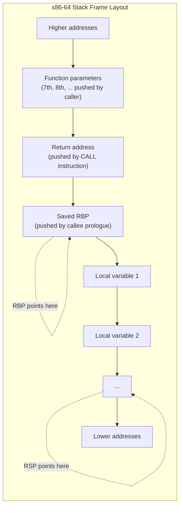
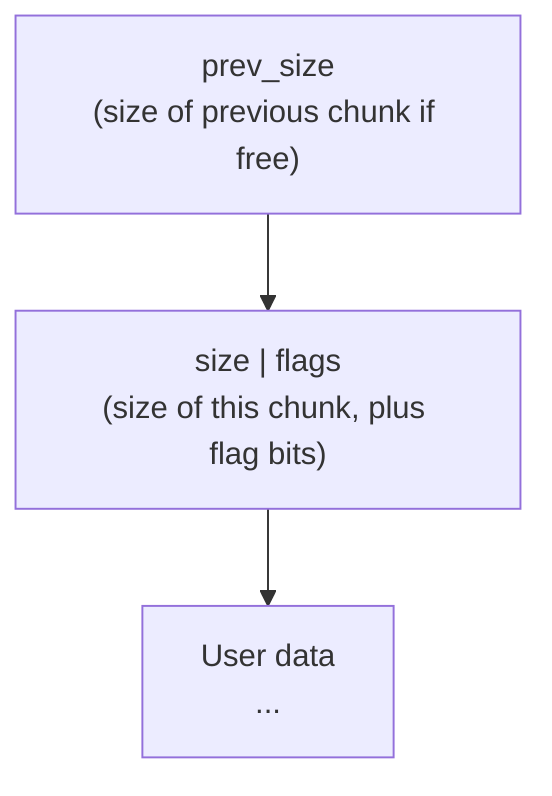
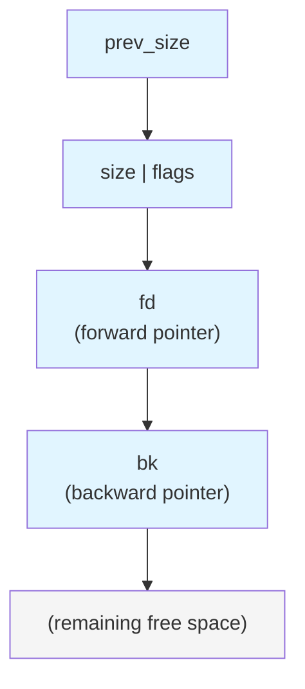

# Lesson 1: Memory Corruption Fundamentals

## 1. First-Principles Intuition & Invariants

Memory corruption exploitation begins with a simple violation of a single invariant: a program writes data to a memory location it should not, or reads from a location whose contents have been manipulated in ways the original developer never anticipated. This breach of spatial or temporal integrity creates a wedge through which an attacker can inject their own logic, redirect execution flow, or exfiltrate privileged information. At its essence, memory corruption is the computational equivalent of a physical lock whose tumblers have been filed down—the mechanism still functions, but now it responds to unauthorized input.

The C programming language, despite its elegant minimalism and direct hardware mapping, provides almost no runtime safety guarantees. When you declare an array of ten integers on the stack, the compiler allocates forty or eighty bytes depending on architecture, but it does not insert bounds-checking logic before every access. If your code writes to the eleventh element, the processor dutifully stores that value into whatever memory happens to sit adjacent to your array. The hardware has no concept of your variable boundaries. It sees only addresses and data buses. The discipline of respecting array bounds, pointer lifetimes, and type contracts exists purely in the programmer's mind and in static analysis tools—not in the runtime execution model.

This absence of enforcement creates a vast attack surface. Every buffer that receives external input, every pointer arithmetic operation, every integer that influences a memory allocation size, becomes a potential vector. The attacker's task reduces to identifying where untrusted data flows into these operations and then crafting input that violates the implicit assumptions baked into the code. A username field that the developer assumed would never exceed thirty-two bytes becomes a vector when the attacker sends two hundred. A length parameter that the code trusts to be positive becomes a weapon when set to a value that, after arithmetic operations, wraps around to a small positive number or even a negative value reinterpreted as unsigned.

The fundamental memory layout of a Unix process establishes the stage for these attacks. At the lowest addresses, typically starting at zero or a small randomized offset, sits the text segment containing executable machine code. This region is marked read-only and executable, a mitigation we will examine later. Above the text segment lies the initialized data segment, holding global and static variables with explicit initial values, followed by the BSS segment for zero-initialized globals. The heap grows upward from the BSS toward higher addresses, managed by `malloc`, `free`, and their allocator cousins. At the top of the address space, the stack grows downward toward the heap, creating a gap in the middle that serves as a safety buffer and as space for memory-mapped regions like shared libraries and memory-mapped files.

Each function call pushes a new stack frame onto this downward-growing structure. The frame contains the return address—the instruction pointer value to which control should return when the function completes—saved register values that the callee must preserve, function parameters beyond the first few passed in registers, and local variables. The precise layout varies by architecture and calling convention, but the invariant remains: the stack is a contiguous region of memory where control flow metadata lives intermingled with application data. When an attacker overwrites a buffer allocated as a local variable, they can reach forward into adjacent stack frames and corrupt the return address. When the function executes its return instruction, the processor loads this corrupted address into the instruction pointer and jumps to attacker-controlled code or an attacker-selected gadget.

The heap presents different opportunities. Heap allocators maintain metadata structures to track which regions are allocated and which are free. These metadata structures—chunk headers, freelist pointers, bin arrays—sit in-band with application data. A heap overflow that corrupts allocator metadata can cause the allocator itself to write arbitrary values to arbitrary addresses when servicing subsequent allocation or deallocation requests. Worse still, heap allocations have no stack discipline; their lifetimes are explicit and programmer-managed. A pointer to a freed object that remains accessible (a use-after-free condition) can be dereferenced after the allocator has returned that memory to a free pool, potentially after that memory has been reallocated to store completely different data. The original pointer now aliases new data, and operations on it produce behavior the developer never considered.

Integer overflows, though not directly memory corruption, serve as force multipliers. An integer overflow occurs when arithmetic produces a result outside the representable range of the type. In C, signed integer overflow is undefined behavior—the compiler may assume it never happens and optimize accordingly. Unsigned overflow is well-defined: it wraps modulo the type's maximum value plus one. But well-defined does not mean safe. When an attacker can cause an integer overflow in a size calculation passed to `malloc`, the resulting buffer is smaller than expected. Subsequent operations that write into this undersized buffer then become heap overflows. Similarly, an integer overflow in a loop bound check can cause the loop to terminate prematurely or never terminate at all, and an overflow in a pointer arithmetic expression can cause the pointer to wrap around the address space.

The contract between developer and machine rests on invariants: this pointer targets valid memory, this buffer has at least N bytes of capacity, this integer will not overflow, this object's lifetime extends through this operation. Memory corruption attacks succeed by violating these invariants through externally controllable data. The developer writes code assuming well-formed input; the attacker provides malformed input specifically designed to break those assumptions. Defense, as we will explore throughout this curriculum, involves either enforcing invariants at runtime, proving their correctness statically, or eliminating the classes of operations that allow violations in the first place.


## 2. Core Architecture & Mechanics

The x86-64 stack frame layout encodes calling convention semantics into memory. When a function is called via the `call` instruction, the processor pushes the return address—the address of the instruction immediately following the `call`—onto the stack and decrements the stack pointer `rsp` by eight bytes. The callee's prologue typically pushes the caller's base pointer `rbp` onto the stack, then copies `rsp` into `rbp`, establishing a new frame base. Local variables are allocated by subtracting their total size from `rsp`, creating space below the saved `rbp`. The canonical stack frame thus appears as:



Consider a vulnerable function containing a fixed-size buffer and a call to an unsafe string copy operation:

```c
#include <string.h>
#include <stdio.h>

void vulnerable_function(const char *input) {
    char buffer[64];
    strcpy(buffer, input);
    printf("Input copied: %s\n", buffer);
}

int main(int argc, char *argv[]) {
    if (argc < 2) return 1;
    vulnerable_function(argv[1]);
    return 0;
}
```

When `vulnerable_function` is called, the stack frame allocates sixty-four bytes for `buffer`. If the attacker provides input longer than sixty-four bytes, `strcpy` writes beyond the buffer's boundary, overwriting the saved `rbp`, then the return address, and potentially data in the caller's frame. When `vulnerable_function` executes its return sequence—`leave` (which restores `rbp` and `rsp`) followed by `ret` (which pops the return address into `rip`)—the processor loads the corrupted return address and transfers control to whatever address the attacker has written.

To demonstrate the mechanical reality, compile the vulnerable program without modern protections and examine its behavior under controlled overflow. First, disable stack canaries, position-independent execution, and non-executable stack:

```bash
gcc -o vuln vuln.c -fno-stack-protector -no-pie -z execstack -g
```

Execute the program with a payload that exceeds the buffer capacity:

```bash
./vuln $(python3 -c "print('A' * 80)")
```

The program will likely crash with a segmentation fault. Use GDB to inspect the crash state:

```bash
gdb ./vuln
(gdb) run $(python3 -c "print('A' * 80)")
(gdb) info registers rip
(gdb) x/20gx $rsp
```

The instruction pointer `rip` will contain a value composed of ASCII 'A' characters (0x4141414141414141), demonstrating that the overflow has overwritten the return address. The attacker now controls where execution resumes.

Heap corruption mechanics differ fundamentally because heap allocators maintain complex internal state. The GNU C Library allocator (glibc malloc) organizes heap memory into chunks. Each allocated chunk has a header containing size metadata and flags. Free chunks additionally contain forward and backward pointers linking them into circular doubly-linked lists called bins. The chunk header for an allocated block looks like:



When a chunk is freed, the allocator writes freelist pointers into the user data region:



A heap overflow that corrupts the `size` field or freelist pointers can hijack the allocator's control flow. Consider a classic unlink exploitation scenario. When two adjacent free chunks are consolidated during coalescing, the allocator removes the second chunk from its freelist using an unlink macro that performs pointer surgery:

```c
#define unlink(P, BK, FD) {
    FD = P->fd;
    BK = P->bk;
    FD->bk = BK;
    BK->fd = FD;
}
```

If an attacker can corrupt the `fd` and `bk` pointers of a free chunk to arbitrary addresses, the unlink operation becomes an arbitrary write primitive: it writes the value of `BK` to address `FD + offset_of_bk` and writes `FD` to address `BK + offset_of_fd`. Modern allocators include safe unlinking checks that verify the chunk's forward and backward pointers are consistent, but these checks can sometimes be bypassed through careful heap layout manipulation.

A heap overflow proof-of-concept demonstrates the vulnerability class:

```c
#include <stdlib.h>
#include <string.h>
#include <stdio.h>

int main(int argc, char *argv[]) {
    char *first = malloc(64);
    char *second = malloc(64);
    
    printf("First chunk:  %p\n", first);
    printf("Second chunk: %p\n", second);
    
    if (argc > 1) {
        strcpy(first, argv[1]);
    }
    
    free(first);
    free(second);
    
    return 0;
}
```

Compile without modern protections:

```bash
gcc -o heap_vuln heap_vuln.c -g
```

If the attacker provides input exceeding sixty-four bytes, the overflow corrupts the second chunk's metadata. When `free(second)` executes, the corrupted size or freelist pointers can cause the allocator to crash or, under precise control, to write attacker-controlled data to an attacker-chosen address.

Use-after-free vulnerabilities exploit temporal safety violations. Once memory is freed, the allocator may return it to satisfy a new allocation request, causing two pointers of potentially different types to alias the same physical memory:

```c
#include <stdlib.h>
#include <stdio.h>
#include <string.h>

struct User {
    char name[32];
    void (*print)(struct User *);
};

void safe_print(struct User *u) {
    printf("User: %s\n", u->name);
}

int main(int argc, char *argv[]) {
    struct User *user = malloc(sizeof(struct User));
    strcpy(user->name, "Alice");
    user->print = safe_print;
    
    free(user);
    
    if (argc > 1) {
        char *exploit = malloc(sizeof(struct User));
        memcpy(exploit, argv[1], sizeof(struct User));
    }
    
    user->print(user);  // use-after-free: user points to reallocated memory
    
    return 0;
}
```

The final call to `user->print(user)` dereferences a freed pointer. If the attacker's second allocation reused the same memory, the function pointer now points to an attacker-controlled address, achieving arbitrary code execution.

Integer overflows in size calculations produce undersized allocations that become heap overflows:

```c
#include <stdlib.h>
#include <string.h>

void process_image(unsigned int width, unsigned int height, const char *data) {
    unsigned int size = width * height * 4;  // potential overflow
    char *buffer = malloc(size);
    
    if (buffer == NULL) return;
    
    memcpy(buffer, data, width * height * 4);
    
    // process buffer...
    
    free(buffer);
}
```

If `width` and `height` are both large enough that their product overflows a 32-bit unsigned integer, `size` wraps to a small value. The `malloc` succeeds and returns a small buffer, but the `memcpy` writes the full (unwrapped) amount of data, producing a massive heap overflow.

To observe integer overflow effects, consider this test:

```c
#include <stdio.h>
#include <stdint.h>

int main(void) {
    uint32_t width = 65536;
    uint32_t height = 65536;
    uint32_t size = width * height * 4;
    
    printf("Width: %u\n", width);
    printf("Height: %u\n", height);
    printf("Expected size: %llu bytes\n", (unsigned long long)width * height * 4);
    printf("Actual size (uint32): %u bytes\n", size);
    
    return 0;
}
```

Compile and execute:

```bash
gcc -o intoverflow intoverflow.c
./intoverflow
```

The output reveals the wrap-around: the expected size exceeds 17 billion bytes, but the 32-bit unsigned multiplication wraps to zero, producing a completely incorrect allocation size.


## 3. High-Performance Optimization & Failure Modes

Exploitation reliability depends on precise control over memory layout and mitigation bypass techniques. Modern operating systems deploy layered defenses that raise the exploitation bar but do not eliminate vulnerabilities. Understanding these mitigations and their weaknesses is essential for both offensive practitioners and defenders designing secure systems.

Address Space Layout Randomization (ASLR) randomizes the base addresses of the stack, heap, libraries, and—when combined with Position-Independent Executables (PIE)—the main executable itself. On Linux, ASLR is controlled by `/proc/sys/kernel/randomize_va_space`. A value of 2 enables full randomization. The randomization entropy varies by architecture and memory region: on x86-64, typical implementations provide 28 bits of entropy for mmap regions (libraries), 30 bits for the heap, and 28 bits for the stack. While this sounds substantial, information disclosure vulnerabilities that leak a single address often reveal the entire memory map. A leaked stack address exposes the stack base, a leaked library function address exposes the library base, and so forth. Attackers chain information disclosure with memory corruption to defeat ASLR.

To bypass ASLR via information disclosure, consider a program with both a format string vulnerability and a stack buffer overflow:

```c
#include <stdio.h>
#include <string.h>

void leak_and_overflow(const char *input) {
    char buffer[64];
    printf(input);  // format string vulnerability
    printf("\n");
    strcpy(buffer, input);  // buffer overflow
}

int main(int argc, char *argv[]) {
    if (argc < 2) return 1;
    leak_and_overflow(argv[1]);
    return 0;
}
```

The format string bug allows the attacker to read stack memory by providing format specifiers without corresponding arguments. The payload `%p %p %p %p %p %p` causes `printf` to walk up the stack, interpreting stack contents as pointer arguments and printing them in hexadecimal. These leaked values reveal code and stack addresses, defeating ASLR. The subsequent buffer overflow can then use these leaked addresses to construct a precise exploit.

Stack canaries provide a probabilistic defense against stack buffer overflows. Before the function prologue completes, the compiler inserts code to read a secret value from Thread-Local Storage and write it to the stack immediately before the saved base pointer. The function epilogue verifies the canary has not changed before executing the return instruction. If the canary is corrupted, the program calls `__stack_chk_fail` and terminates. The canary is typically eight bytes on 64-bit systems, with the least significant byte set to zero to terminate string functions and prevent easy leakage via string disclosure.

However, canaries are not foolproof. If an attacker can read the canary value via an information disclosure bug, they can include the correct canary value in their overflow payload, bypassing the check. Additionally, if the overflow can be executed byte-by-byte with feedback (such as in a brute-force login function that crashes only on incorrect password length), the canary can be guessed byte-by-byte. Finally, canaries do not protect heap metadata or function pointers stored in buffers before the canary.

Non-Executable stack and heap protections, enforced via the NX bit (x86-64) or XN bit (ARM), mark memory regions as non-executable. This defeats classic shellcode injection where the attacker places machine code in a buffer and redirects execution to it. However, NX does not prevent code-reuse attacks. Return-Oriented Programming (ROP) chains together short instruction sequences ending in `ret` instructions, called gadgets, found in existing executable code. By carefully arranging stack contents, the attacker constructs a sequence of return addresses pointing to these gadgets, effectively synthesizing arbitrary computation from legitimate code fragments.

A minimal ROP exploit to invoke `execve("/bin/sh", NULL, NULL)` on x86-64 Linux requires setting up registers and invoking the syscall. The calling convention requires `rax=59` (syscall number), `rdi=/bin/sh address`, `rsi=0`, `rdx=0`. A typical gadget sequence might look like:

```text
pop rdi; ret        # load rdi with address of "/bin/sh"
pop rsi; ret        # load rsi with 0
pop rdx; ret        # load rdx with 0
pop rax; ret        # load rax with 59
syscall; ret        # invoke execve
```

The attacker's stack overflow overwrites the return address with the address of the first gadget, followed by the value to pop into `rdi`, then the address of the second gadget, and so forth. Tools like ROPgadget and ropper automate gadget discovery:

```bash
ROPgadget --binary /lib/x86_64-linux-gnu/libc.so.6 > gadgets.txt
grep "pop rdi" gadgets.txt
```

Modern exploits often use one-gadgets—single addresses in libc that, when jumped to with the stack in a particular state, spawn a shell directly, reducing the complexity of ROP chain construction.

Control Flow Integrity (CFI) mechanisms restrict indirect control transfers (indirect calls, indirect jumps, returns) to a set of valid targets. Coarse-grained CFI implementations, such as those based on return address encryption or shadow stacks, record legitimate return addresses in a separate protected region and verify each return against the shadow stack. Fine-grained CFI computes valid target sets for each indirect call site based on type signatures or points-to analysis. Intel's Control-flow Enforcement Technology (CET) provides hardware support via shadow stacks (for return address protection) and indirect branch tracking (for forward-edge protection). When enabled, CET makes traditional ROP attacks infeasible, though recent research has demonstrated that ROP can be adapted to respect CET constraints, and data-only attacks that corrupt non-control-flow data remain viable.

Heap exploitation under modern allocators requires understanding allocator-specific metadata structures and safe unlinking checks. The glibc ptmalloc2 allocator organizes free chunks into fastbins (for small allocations, using a singly-linked LIFO), small bins and large bins (using doubly-linked lists), and the unsorted bin (a staging area). The tcache (per-thread cache), introduced in glibc 2.26, provides a fast path for small allocations and frees, using a singly-linked list with minimal integrity checks. Tcache poisoning has become a primary heap exploitation technique: by overflowing into a free tcache chunk and corrupting its forward pointer, an attacker can cause a subsequent allocation to return an arbitrary address.

A tcache poisoning proof-of-concept:

```c
#include <stdlib.h>
#include <stdio.h>
#include <stdint.h>

int main(void) {
    uint64_t *chunk1 = malloc(0x40);
    uint64_t *chunk2 = malloc(0x40);
    uint64_t target = 0x4141414141414141;
    
    free(chunk1);
    
    // Overflow from chunk2 into freed chunk1's tcache forward pointer
    chunk2[-2] = (uint64_t)&target;
    
    uint64_t *alloc1 = malloc(0x40);  // returns chunk1
    uint64_t *alloc2 = malloc(0x40);  // returns &target
    
    printf("First allocation:  %p\n", alloc1);
    printf("Second allocation: %p (target was %p)\n", alloc2, &target);
    
    return 0;
}
```

Compile and observe:

```bash
gcc -o tcache_poison tcache_poison.c -g
gdb ./tcache_poison
(gdb) run
```

The second allocation returns the address of `target`, demonstrating arbitrary allocation control. In a real exploit, the attacker would target a function pointer, GOT entry, or other sensitive data structure.

Safe unlinking in modern allocators verifies that the chunk being unlinked has forward and backward pointers that point back to it, preventing trivial unlink exploitation. The check looks like:

```c
if (__builtin_expect(FD->bk != P || BK->fd != P, 0))
    malloc_printerr("corrupted double-linked list");
```

Bypassing this requires constructing a fake chunk whose forward and backward pointers satisfy the constraint, often achievable when the attacker controls adjacent memory regions.

Integer overflow mitigations include compiler-inserted overflow checks (e.g., `-ftrapv` for signed integers, UBSan runtime checks) and using safe arithmetic libraries that detect and handle overflow conditions. At the language level, Rust's default arithmetic operators panic on overflow in debug builds and wrap in release builds, with explicit `checked_*`, `saturating_*`, and `wrapping_*` methods providing overflow semantics as needed. In C, the best practice is to validate operands before arithmetic:

```c
#include <stdint.h>
#include <limits.h>
#include <stdbool.h>

bool safe_multiply(uint32_t a, uint32_t b, uint32_t *result) {
    if (a > UINT32_MAX / b) {
        return false;  // would overflow
    }
    *result = a * b;
    return true;
}
```

Defensive programming patterns that minimize corruption risk include preferring bounded string operations (`strncpy`, `snprintf`) over unbounded ones (`strcpy`, `sprintf`), validating all buffer sizes before operations, using memory-safe languages for non-performance-critical components, and employing static analyzers and fuzzers during development. However, even with all mitigations enabled, subtle logic errors and type confusion vulnerabilities continue to yield exploitable memory corruption. The arms race between exploitation techniques and defense mechanisms defines the modern security landscape, making deep understanding of memory corruption mechanics essential for practitioners on both sides.
