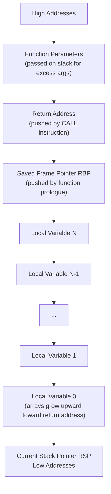
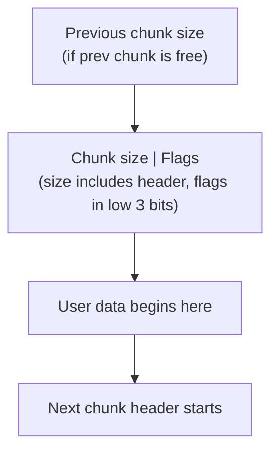
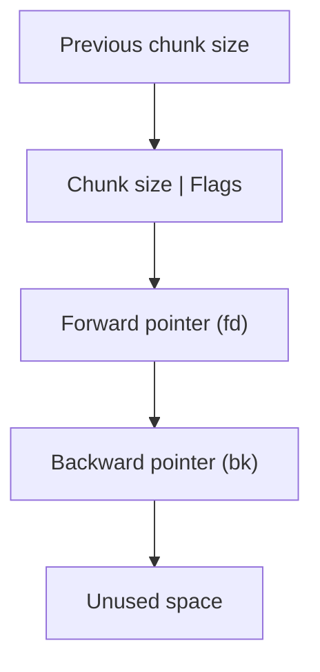
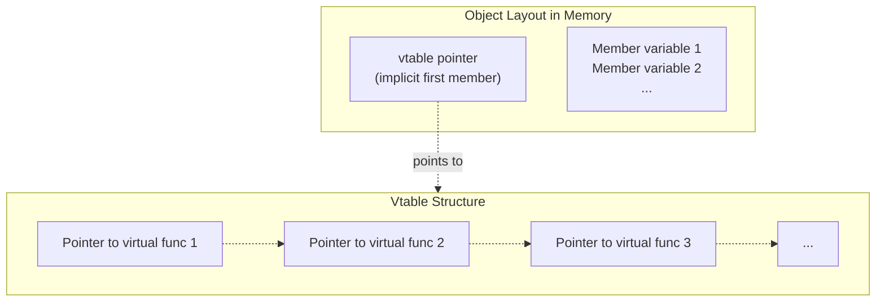
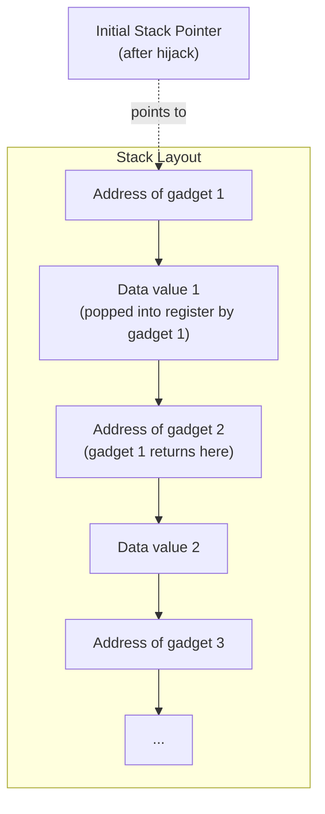

# Lesson 1: Vulnerability Classes, Memory Safety Violations, Type Confusion

## 1. First-Principles Intuition & Invariants

Modern software security rests on a foundation of assumptions that compilers, operating systems, and hardware architectures make about how programs will behave. When these assumptions are violated—whether through programmer error, undefined behavior in language specifications, or deliberate attacker manipulation—the resulting vulnerability classes emerge not as exotic edge cases but as direct consequences of the semantic gap between high-level intent and low-level execution reality.

At the most fundamental level, vulnerability research begins with understanding that every program exists simultaneously in multiple semantic domains. There is the abstract machine model defined by programming language specifications, the concrete machine model implemented by compilers and runtime systems, and the physical machine model enforced by CPU microarchitecture and memory hierarchies. Vulnerabilities arise at the boundaries where these models diverge or where implicit contracts between layers are violated.

Memory safety violations represent the largest and most exploited vulnerability class because they directly expose this semantic gap. The C and C++ languages, which form the foundation of operating systems, embedded firmware, device drivers, and performance-critical applications, provide no automatic enforcement of memory safety invariants. A pointer in C is simply an integer containing a memory address; the language specification imposes no runtime constraints preventing that pointer from referencing arbitrary memory locations, accessing freed heap objects, or indexing beyond array bounds. The programmer is entirely responsible for maintaining spatial safety—ensuring pointers remain within their intended objects—and temporal safety—ensuring pointers are never dereferenced after their target objects have been deallocated.

The distinction between spatial and temporal memory errors is architecturally fundamental. Spatial violations occur when a memory access crosses object boundaries in address space. A buffer overflow writing past the end of a stack-allocated array, a heap overflow corrupting adjacent heap metadata structures, and an out-of-bounds array access all violate spatial safety. The corrupted memory may contain return addresses, function pointers, vtable pointers, or other program data structures whose integrity is critical for correct execution. When an attacker controls the data written beyond the intended bounds, spatial violations become write primitives enabling arbitrary code execution, control flow hijacking, or information disclosure.

Temporal violations occur when memory is accessed after its lifetime has ended, creating a window where the physical memory location may be reused for an object of a different type or size. Use-after-free vulnerabilities emerge when a pointer to a heap-allocated object is dereferenced after that object has been freed and returned to the allocator. The freed memory may be reallocated for a completely different purpose, but the dangling pointer retains the original memory address. If an attacker can control the contents of the reallocated memory—perhaps by forcing another allocation of a controlled size and contents—the original pointer now references attacker-controlled data interpreted as the original object type. This creates type confusion where the program's assumptions about memory layout, function pointer locations, and data semantics no longer hold.

Type confusion vulnerabilities extend beyond temporal safety violations into the broader category of type safety violations. In memory-unsafe languages, type systems exist only at compile time as abstract constraints. At runtime, the CPU operates on raw bytes with no inherent notion of whether a particular memory location contains an integer, a pointer, a floating-point value, or a complex object. C-style unions allow the same memory location to be interpreted as multiple incompatible types without any runtime validation. Improper type casts, especially between pointer types, can reinterpret object layouts in ways that violate the assumptions made by code operating on those objects. When an object intended as one type is accessed through a pointer to an incompatible type, the field offsets, sizes, and semantic meanings no longer align with the underlying memory representation.

The undefined behavior specification in C and C++ compounds these vulnerabilities by allowing compilers to assume that undefined behavior never occurs in valid programs. When a program contains undefined behavior—dereferencing a null pointer, signed integer overflow, accessing uninitialized memory, or performing pointer arithmetic beyond object bounds—the language standard imposes no requirements on program behavior. Compilers exploit this freedom to perform aggressive optimizations that can eliminate security checks, reorder operations in unexpected ways, or generate code that behaves entirely differently than a programmer reading the source would predict. What appears as defensive programming at the source level may be optimized away entirely because the compiler proves that the check would only trigger in cases where undefined behavior has already occurred.

Understanding exploitation primitives requires recognizing that attackers do not simply trigger vulnerabilities in isolation. Modern exploitation chains together multiple primitives to bypass layered defenses. A spatial memory violation may provide a disclosure primitive that leaks memory addresses, defeating Address Space Layout Randomization. A temporal violation may provide a write primitive that corrupts control data structures. Type confusion may allow reinterpreting data objects as code pointers. The fundamental research challenge lies in identifying vulnerability classes that provide useful primitives within the constraints imposed by modern mitigation technologies.

The taxonomy of vulnerability classes must therefore be understood not merely as a classification of bug types but as a mapping from software defects to exploitation primitives. Each class provides different capabilities to an attacker: arbitrary read, arbitrary write, control flow hijacking, or information disclosure. The constraints on each primitive—whether the access is relative or absolute, whether the size and offset are attacker-controlled, whether the corruption is deterministic or probabilistic—determine the primitive's utility in exploitation chains. Vulnerability research focuses on discovering instances of these classes in real-world software and analyzing whether they provide primitives sufficient to construct exploit chains that achieve attacker objectives despite deployed mitigations.

## 2. Core Architecture & Mechanics

The concrete manifestation of vulnerability classes emerges from the interaction between program memory layout, allocator design, and the execution semantics of machine code. To understand exploitation mechanics, we must first establish the memory layout invariants that programs depend upon and that vulnerabilities violate.

### Stack-Based Memory Corruption

The call stack is a contiguous memory region managed by push and pop operations encoded directly in function prologue and epilogue instruction sequences. On x86-64 architectures, the stack grows downward from high addresses toward low addresses. When a function is called, the return address—the instruction pointer value to resume execution after the callee returns—is pushed onto the stack, followed by the previous frame's base pointer. Local variables are then allocated by decrementing the stack pointer to reserve space at lower addresses.

A typical stack frame layout for a function with local variables appears as follows in memory, from high addresses to low addresses:



Buffer overflows on the stack exploit the fact that array indexing and string operations like `strcpy`, `sprintf`, and `gets` perform no bounds checking. When a buffer overflow writes past the end of a local array, the excess data overwrites subsequent stack memory at higher addresses. If the overflow is sufficiently large, it corrupts the saved frame pointer and return address. When the function executes its return instruction, the CPU loads the corrupted return address from the stack into the instruction pointer register, transferring control to an attacker-specified address.

Classic stack-based exploitation constructs a payload structured as padding bytes to fill the vulnerable buffer, followed by a fake return address pointing to attacker-controlled code or to the start of a ROP chain. The critical constraint is that the attacker must control both the data written beyond the buffer bounds and have sufficient knowledge of the stack layout to position the return address corruption at the precise offset where the legitimate return address resides.

Consider a vulnerable function:

```c
#include <string.h>

void vulnerable_function(const char *user_input) {
    char buffer[64];
    strcpy(buffer, user_input);  // No bounds checking
    // Local variables and return address on stack
}
```

When `user_input` exceeds 64 bytes, the overflow corrupts memory beyond the buffer's allocation. The x86-64 ABI dictates that the saved RBP resides immediately above the buffer (at buffer+64 assuming no padding), and the return address resides above that (at buffer+72 for 8-byte addresses). An input of 72 bytes of padding followed by 8 bytes containing a target address will overwrite the return address, redirecting execution when `vulnerable_function` returns.

Modern defenses complicate this attack surface. Stack canaries place a random value between local buffers and control data on the stack; if an overflow corrupts the canary, the runtime detects tampering before the return instruction executes. Non-executable stack pages (NX/DEP) prevent direct code injection by marking stack memory as non-executable, forcing attackers toward return-oriented programming techniques that chain existing code gadgets rather than injecting new code. Address Space Layout Randomization (ASLR) randomizes stack base addresses, heap regions, and library load addresses, requiring attackers to first leak memory addresses before constructing deterministic payloads.

### Heap-Based Memory Corruption

Heap allocators manage dynamically allocated memory regions through complex data structures that track free and allocated chunks. The glibc ptmalloc2 allocator, used by default on most Linux systems, organizes heap memory into chunks with inline metadata headers. Each chunk header contains size information and flags indicating whether adjacent chunks are in use. Free chunks are organized into bins—linked lists indexed by chunk size—to enable efficient allocation and deallocation.

A typical allocated heap chunk structure in ptmalloc2:



When a chunk is freed, the allocator updates metadata and may consolidate adjacent free chunks to reduce fragmentation. Free chunks contain forward and backward pointers forming doubly-linked lists within the freed data region:



Heap overflows exploit the fact that allocated chunks are contiguous in memory. An overflow from one allocation corrupts the metadata of the subsequent chunk. If an attacker overwrites the size field of the next chunk's header, they can manipulate the allocator's perception of chunk boundaries. When the corrupted chunk is subsequently freed, the allocator may consolidate based on falsified size information, or unlink operations that remove chunks from free lists may write attacker-controlled values to attacker-controlled addresses through manipulated forward and backward pointers.

The classic unlink exploit leverages the doubly-linked list structure. When a free chunk is removed from its bin during allocation or consolidation, the allocator performs pointer manipulation:

```c
// Simplified unlink macro
#define unlink(P, BK, FD) {       \
    FD = P->fd;                   \
    BK = P->bk;                   \
    FD->bk = BK;                  \
    BK->fd = FD;                  \
}
```

If an attacker can corrupt a free chunk's `fd` and `bk` pointers before it is unlinked, the macro writes `BK` to `FD->bk` and `FD` to `BK->fd`, resulting in two arbitrary writes. Modern allocators include unlinking checks that verify `FD->bk == P` and `BK->fd == P`, but these can sometimes be bypassed through careful memory layout manipulation.

Use-after-free vulnerabilities arise when code retains and dereferences pointers to freed memory. After `free()` returns a chunk to the allocator, the memory may be reallocated for a completely different purpose. If the original pointer is dereferenced after reallocation, it accesses whatever data now occupies that memory location. The exploitation primitive depends on whether the attacker can control the reallocated contents. Heap spraying and heap feng shui techniques manipulate allocator state to force specific reallocation patterns, placing attacker-controlled data at the address referenced by the dangling pointer.

Consider a simplified use-after-free scenario:

```c
struct object {
    void (*callback)(void);
    int data;
};

struct object *obj = malloc(sizeof(struct object));
obj->callback = &legitimate_function;
obj->data = 42;

free(obj);  // Object freed, but pointer retained

// ... later in code, potentially after attacker-controlled allocations ...

obj->callback();  // Dereferences freed memory
```

If the attacker can force a new allocation of the same size that fills the freed chunk, and if the attacker controls the contents of that allocation, the `callback` function pointer in the overlapping memory region will point to an attacker-specified address. When the dangling pointer is dereferenced and the callback invoked, execution transfers to attacker-controlled code.

Double-free vulnerabilities occur when the same pointer is passed to `free()` multiple times without intervening allocations. The first free returns the chunk to the allocator's free lists. The second free operates on memory that is already free, potentially corrupting free list pointers and enabling later allocations to return overlapping chunks. This can lead to situations where two independent allocations receive the same memory address, allowing writes through one pointer to corrupt data accessed through another pointer. Modern allocators include double-free detection, but these checks can sometimes be bypassed through heap manipulation techniques that reset chunk state between free operations.

### Type Confusion and Object Reinterpretation

Type confusion vulnerabilities exploit the gap between the type system's compile-time guarantees and the runtime reality that all objects are merely byte sequences in memory. In C and C++, casting a pointer from one type to another reinterprets the underlying bytes according to the target type's layout without any validation that the memory actually contains an object of that type.

A simple type confusion example:

```c
struct typeA {
    int tag;
    int value;
};

struct typeB {
    int tag;
    void (*function_ptr)(void);
};

void process(void *generic_ptr, int type_tag) {
    if (type_tag == TYPE_A) {
        struct typeA *a = (struct typeA *)generic_ptr;
        a->value += 10;
    } else {
        struct typeB *b = (struct typeB *)generic_ptr;
        b->function_ptr();
    }
}
```

If an attacker can control the `type_tag` parameter to mismatch the actual type of the pointed-to object, a `typeA` object may be accessed as if it were `typeB`. The integer `value` field at offset 4 would be interpreted as a function pointer and invoked, transferring control to an address controlled by the integer value.

C++ virtual function tables (vtables) provide a particularly rich target for type confusion attacks. Objects of classes with virtual functions contain a hidden pointer to a vtable—an array of function pointers implementing the virtual methods. The compiler generates code that dereferences the vtable pointer and indexes into the vtable to resolve virtual function calls at runtime:



Virtual function dispatch compiles to:

```asm
mov    rax, QWORD PTR [rdi]         ; Load vtable pointer from object
mov    rax, QWORD PTR [rax+offset]  ; Load function pointer from vtable
call   rax                           ; Call virtual function
```

Type confusion between C++ classes allows an attacker to force an object of one class to be interpreted as an incompatible class with different virtual function layouts. When a virtual method is called on the confused object, the vtable pointer may reference attacker-controlled memory (if the original object's first member was an integer or pointer under attacker control), or the offset into the vtable may be incorrect, invoking an unintended function from the legitimate vtable. Combined with memory corruption primitives that allow vtable pointer overwriting, this provides a powerful control flow hijacking primitive.

### Undefined Behavior and Compiler Optimization Interactions

Undefined behavior in the C and C++ language specifications creates a peculiar vulnerability class where the mere presence of certain code constructs permits compilers to generate arbitrary behavior. Security-critical checks may be optimized away entirely when the compiler proves they would only execute in cases where undefined behavior has already occurred.

Signed integer overflow is undefined behavior, allowing compilers to assume it never happens. Consider an integer overflow check:

```c
int32_t add_checked(int32_t a, int32_t b) {
    if (a > 0 && b > INT32_MAX - a) {
        return -1;  // Overflow would occur
    }
    return a + b;
}
```

A sophisticated optimizing compiler may reason that if the overflow check is true, then `a + b` would produce signed overflow, which is undefined behavior. Since the language standard permits the compiler to assume undefined behavior never occurs in valid programs, the compiler may conclude the check is always false and optimize it away entirely, removing the overflow protection.

Pointer arithmetic beyond object bounds is similarly undefined. Even if a pointer is never dereferenced, forming a pointer more than one element past the end of an array invokes undefined behavior. Compilers exploit this to optimize loop bounds checks:

```c
void process_array(int *array, size_t count) {
    for (size_t i = 0; i < count; i++) {
        if (&array[i] < array || &array[i] >= array + count) {
            abort();  // Bounds check
        }
        array[i] = 0;
    }
}
```

The compiler may determine that `&array[i]` for `i < count` invokes undefined behavior if it falls outside the valid object bounds, and therefore optimize away the bounds check on the assumption that valid programs never trigger it.

Uninitialized memory reads represent another undefined behavior class. Local variables in C are not automatically initialized; reading an uninitialized variable before assignment produces an indeterminate value. Compilers may assume uninitialized variables contain arbitrary values and optimize based on that assumption, leading to unpredictable behavior that can vary between optimization levels and compiler versions. From a security perspective, uninitialized memory may contain residual data from previous stack frames or heap allocations, potentially leaking sensitive information like cryptographic keys, passwords, or memory addresses that defeat ASLR.

## 3. High-Performance Optimization & Failure Modes

Vulnerability research at scale requires tooling and methodologies that bridge the gap between theoretical vulnerability classes and their concrete manifestations in millions of lines of production code. The challenge lies in identifying exploitable instances of memory safety violations, type confusion, and undefined behavior in complex software systems where manual code review is intractable.

### Fuzzing and Coverage-Guided Discovery

Fuzzing automates vulnerability discovery by generating malformed or unexpected inputs and monitoring program behavior for crashes, hangs, or memory corruption. Coverage-guided fuzzing instruments the target binary to track which code paths are executed for each input, then uses this feedback to evolve inputs that explore new execution paths. AFL (American Fuzzy Lop) and libFuzzer represent the state of the art in coverage-guided fuzzing, instrumenting programs at compile time to record edge coverage—transitions between basic blocks—during execution.

The core fuzzing loop operates as follows. An initial corpus of seed inputs is executed against the instrumented target, recording the set of edges exercised by each input. The fuzzer then mutates corpus entries through bit flips, byte insertions, arithmetic operations, and dictionary token substitutions, generating candidate inputs. Each candidate is executed and its coverage recorded. If the candidate triggers new edge coverage not previously observed, it is added to the corpus for further mutation. Crashes and hangs are saved for later analysis as potential vulnerabilities.

AFL's instrumentation inserts lightweight probes at basic block boundaries:

```c
// Pseudo-code for AFL edge coverage instrumentation
cur_location = <compile-time constant for this edge>;
shared_mem[cur_location ^ prev_location]++;
prev_location = cur_location >> 1;
```

This compact instrumentation records edge transitions by XORing the current and previous basic block identifiers, creating a unique hash for each control flow edge. The mutation engine prioritizes inputs that maximize edge coverage, efficiently exploring the program's state space.

For vulnerability research, fuzzing effectiveness depends critically on the quality of seed inputs and the ability to reach deep program states where vulnerabilities may reside. Structured input formats—file formats, network protocols, configuration languages—require grammar-aware or structure-aware fuzzing that respects format constraints while mutating semantically relevant fields. AFL's dictionary feature allows specifying tokens relevant to the input format, and grammar-based fuzzers like Nautilus generate inputs according to formal grammar specifications.

Sanitizers complement fuzzing by detecting memory safety violations that may not cause immediate crashes. AddressSanitizer (ASan) instruments memory allocations and accesses to detect buffer overflows, use-after-free, and heap corruption with precise diagnostics identifying the exact location of the invalid access. ASan maintains shadow memory that tracks the allocation state of every byte in the program's address space. Each memory access is instrumented to check the corresponding shadow memory byte, triggering an error if the access is invalid.

ASan shadow memory encoding uses a compact representation where each 8-byte aligned region of application memory is represented by a single shadow byte. Valid shadow values indicate the number of valid bytes in the corresponding region (0-8), while special values indicate freed memory, redzone padding, or stack redzones. Memory accesses are instrumented with inline checks:

```c
// Pseudo-code for ASan memory access instrumentation
shadow_addr = (mem_addr >> 3) + shadow_base_offset;
shadow_value = *shadow_addr;
if (shadow_value != 0) {
    if (slow_path_check(mem_addr, access_size, shadow_value)) {
        report_error();
    }
}
```

UndefinedBehaviorSanitizer (UBSan) detects undefined behavior at runtime, catching signed integer overflow, misaligned pointer accesses, null pointer dereferences, and improper type casts. MemorySanitizer (MSan) tracks the initialization state of memory, detecting reads of uninitialized values that could leak sensitive information or lead to unpredictable behavior.

Combining coverage-guided fuzzing with sanitizer instrumentation creates a powerful vulnerability discovery methodology. The fuzzer explores execution paths while sanitizers detect subtle memory safety violations that might not produce immediate crashes. This approach has discovered thousands of vulnerabilities in widely deployed software including operating system kernels, browsers, media codecs, and network protocol implementations.

### Static Analysis and Symbolic Execution

Static analysis examines source code or binaries without executing them, building abstract models of program behavior to detect vulnerability patterns. Taint analysis tracks the flow of untrusted data from input sources through the program, identifying whether untrusted data reaches sensitive sinks like memory operations, system calls, or SQL queries without proper validation. A taint analysis framework models each variable and memory location as either tainted (derived from untrusted input) or untainted, propagating taint through assignment, arithmetic, and pointer operations.

Interprocedural taint analysis requires tracking data flow across function boundaries, building call graphs and modeling how tainted parameters affect function return values and global state. Path-sensitive analysis maintains separate abstract states for different control flow paths, enabling more precise modeling of sanitization and validation checks that may cleanse tainted data along specific paths.

Symbolic execution explores program paths by representing inputs as symbolic variables rather than concrete values. Constraints on symbolic variables accumulate along each execution path, and a constraint solver determines whether each path is feasible and generates concrete inputs that exercise specific paths. When symbolic execution reaches a potentially vulnerable operation—a memory access, array index, or function pointer dereference—it checks whether constraints allow the operation to violate safety properties.

A simplified symbolic execution trace for a buffer overflow check:

```text
Input: buffer = symbolic_array(64), size = symbolic_int()

Path constraints:
  1. size > 64  (condition to enter overflow path)

At memcpy(buffer, input, size):
  Constraint: size > 64 implies buffer[64..size-1] is out of bounds
  Generate concrete input: size = 65
  Result: Overflow detected
```

The primary challenge in symbolic execution is path explosion: programs with loops and conditional branches have exponentially many paths, making exhaustive exploration intractable. Constraint solver complexity exacerbates this problem as path constraints accumulate symbolic expressions involving arithmetic, bit operations, and memory accesses. Practical symbolic execution systems employ heuristics like prioritizing paths that reach uncovered code, bounding loop iterations, and using concrete execution to resolve complex constraints.

Hybrid approaches combine fuzzing and symbolic execution, using fuzzing to quickly explore shallow paths and symbolic execution to solve complex branch conditions that fuzzing struggles to satisfy. Driller employs this strategy, invoking symbolic execution when fuzzing becomes stuck at a challenging branch condition, generating inputs that satisfy the constraint, then resuming fuzzing with the expanded corpus.

### Exploit Development and Primitive Chaining

Discovering a vulnerability is only the first step in security research; demonstrating exploitability requires constructing exploit primitives within the constraints imposed by modern mitigations. A complete exploit chain typically requires multiple primitives: information disclosure to defeat ASLR, arbitrary write to corrupt control data structures, and control flow hijacking to achieve code execution.

Return-oriented programming (ROP) bypasses non-executable memory protections by chaining together short instruction sequences—gadgets—found in existing executable code. Each gadget performs a small operation like loading a register, performing arithmetic, or dereferencing a pointer, and ends with a return instruction. An attacker constructs a fake stack containing a sequence of gadget addresses interspersed with data values. When the first gadget executes and returns, the return instruction pops the next gadget address from the stack, creating a chain of operations performed by existing code.

A typical ROP chain structure:



Common ROP gadget patterns include:

- Register loading: `pop rdi; ret` to load function arguments
- Memory operations: `mov [rdi], rsi; ret` to write values
- Arithmetic: `add rax, rbx; ret` to compute addresses
- System calls: `syscall; ret` or calls to `execve`, `mprotect`, or `system`

Modern ROP chains often employ the `mprotect` system call to mark memory regions as executable, then copy and execute shellcode in the newly executable region, or invoke `execve` to spawn a shell directly.

Control Flow Integrity (CFI) mitigations attempt to constrain control flow transfers to a predetermined set of valid targets, breaking ROP chains that jump to arbitrary gadget addresses. Coarse-grained CFI enforces that forward edges (indirect calls and jumps) target valid function entry points and that backward edges (returns) target addresses following call instructions. Fine-grained CFI maintains a more precise model of valid control flow transfers, though implementation overhead and compatibility constraints limit deployment.

Stack canaries protect against simple stack overflows but can be bypassed through information disclosure that leaks the canary value, or through partial overwrite attacks that modify only the least significant bytes of a return address without corrupting the canary. On little-endian architectures, an attacker may overwrite the least significant byte of a return address to redirect control flow to a nearby location without touching the canary at a higher stack address.

ASLR randomizes base addresses of executable regions, making it difficult for attackers to construct payloads containing absolute addresses. Defeating ASLR requires information disclosure primitives that leak memory addresses. Uninitialized memory reads, out-of-bounds reads, and format string vulnerabilities all provide potential disclosure primitives. Once a single code or library address is leaked, the attacker can compute the base address of the corresponding memory region and resolve all gadget addresses relative to that base.

### Temporal Exploitation and Race Conditions

Time-of-check-to-time-of-use (TOCTOU) race conditions represent a distinct vulnerability class where the validation of a resource and its subsequent use are separated by a time window during which the resource state may change. File system TOCTOU vulnerabilities occur when a privileged process checks file permissions using one path, then opens the file using the same path after a symbolic link has been replaced to point to a different file. The attacker wins the race by replacing the symlink in the window between the check and the use.

Heap race conditions in concurrent programs arise when multiple threads access shared heap objects without proper synchronization. If one thread frees an object while another thread retains and dereferences a pointer to that object, a use-after-free condition occurs. The exploitation complexity increases because the vulnerability is probabilistic, requiring the attacker to win a race condition. Heap spraying techniques increase success probability by filling the heap with attacker-controlled objects, making it likely that the freed memory is reallocated with controlled contents.

Modern concurrent programming primitives—mutexes, read-write locks, atomic operations—provide synchronization mechanisms to prevent race conditions, but incorrect usage patterns like lock-free programming errors, double-checked locking bugs, and incorrect memory ordering assumptions introduce subtle vulnerabilities. The C11 and C++11 memory models define formal semantics for concurrent accesses, but reasoning about the correctness of lock-free algorithms under weak memory models requires deep understanding of acquire-release semantics, memory barriers, and the happens-before relation.

Exploiting kernel race conditions offers particularly powerful primitives because successful exploitation executes arbitrary code in kernel context with full system privileges. Use-after-free vulnerabilities in kernel memory allocators can be exploited to corrupt kernel data structures, overwrite function pointers in kernel objects, or achieve arbitrary kernel memory reads and writes. Kernel exploit development requires techniques for defeating kernel-specific mitigations like Supervisor Mode Access Prevention (SMAP), which prevents the kernel from accessing user-mode memory, and Supervisor Mode Execution Prevention (SMEP), which prevents the kernel from executing user-mode code.

The research trajectory in vulnerability discovery and exploitation reflects an ongoing arms race between attackers developing new exploitation techniques and defenders deploying mitigations that constrain exploitation primitives. Each new mitigation—stack canaries, NX, ASLR, CFI, kernel isolation—raises the bar for exploitation but does not eliminate vulnerability classes at their root. Memory-unsafe languages continue to power critical infrastructure, and the semantic gap between language specifications and execution reality ensures that vulnerability research remains a vital discipline in understanding and securing modern computing systems.
