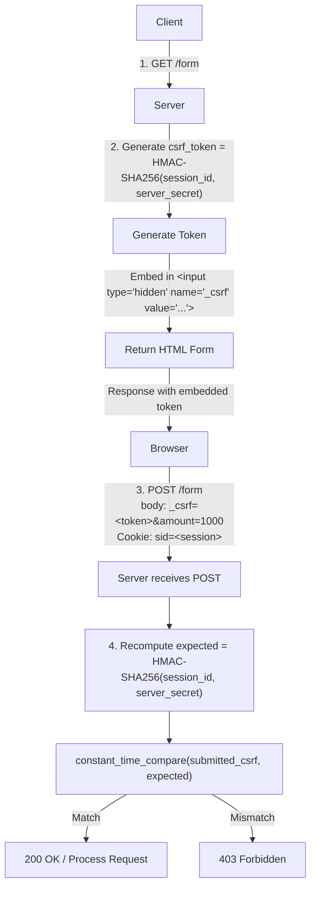
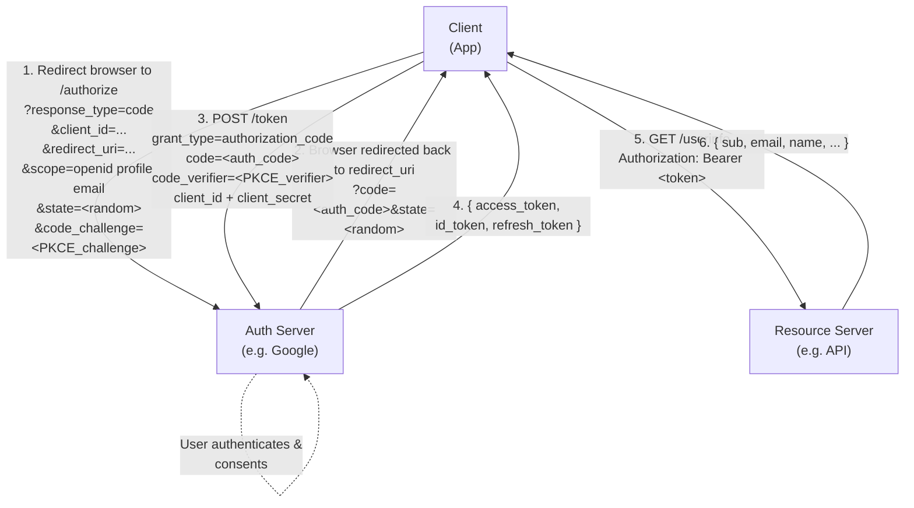

# Lesson 3: Authentication Session Management

## 1. First-Principles Intuition & Invariants

Authentication is not a feature. It is a proof system: a formal claim, backed by evidence, that a principal is who they assert themselves to be. Session management is the mechanism by which that proof is preserved across the stateless boundary of HTTP. Understanding where these two concerns meet — and where they diverge — is the foundation of every serious web security analysis.

The HTTP protocol carries no inherent memory of previous exchanges. Each request arrives as a stranger. The session layer exists to impose continuity atop this amnesia, threading a persistent identity across discrete, independent transactions. This is not merely a convenience; it is a critical security boundary. The object that carries session identity becomes, in a very literal sense, a bearer credential. Whoever holds it authenticates as the associated user. The security of the entire application collapses to the security of that object.

This fact drives the first invariant of authentication engineering: **the token is the identity**. A password is a secret that proves identity once and derives a session. The session token is what you hold for all subsequent requests. Compromising that token does not require knowing the user's password. It does not require breaking your hash function. It requires only extracting or predicting the token itself. This is why session management vulnerabilities — fixation, hijacking, CSRF — are frequently more exploitable in practice than credential attacks. The cryptographic strength of your Argon2 configuration is irrelevant if the resulting session identifier is predictable or transmitted insecurely.

### Credential Storage: The Mechanics of Password Hashing

Before a session can exist, a credential must be verified. How you store that credential determines whether a database compromise becomes a catastrophic exposure or a containable incident.

The naive approach — storing plaintext passwords — fails immediately: a single SQL injection hands an attacker every user's credential. Storing a plain SHA-256 hash of the password is marginally better but remains catastrophically vulnerable. The reason is precomputation. SHA-256 is a general-purpose hash function optimized for throughput: modern GPUs process hundreds of billions of SHA-256 operations per second. An attacker who exfiltrates your hash table can run offline dictionary and rainbow table attacks at that throughput, cracking the majority of real-world passwords within hours.

The correct model has two components: a **work factor** and a **salt**. The salt is a cryptographically random value, unique per credential, prepended or concatenated before hashing. Its purpose is to defeat precomputation entirely: a rainbow table built against unsalted hashes becomes useless because the attacker would need to rebuild it for every unique salt. The work factor deliberately slows the hash computation, making brute force prohibitively expensive even with dedicated hardware.

**bcrypt**, designed by Niels Provos and David Mazières in 1999, was the first widely deployed algorithm to combine both properties. It uses a modified Blowfish cipher setup as its computational core and encodes the salt and cost factor directly in its output string. The cost parameter is a base-2 exponent: cost 12 means 2¹² iterations of key stretching. The critical property is that increasing the cost by 1 doubles the computation time. The bcrypt output format is self-describing:

```
$2b$12$LQv3c1yqBWVHxkd0LHAkCOYz6TtxMQJqhN8/lewdBdXIG97E1Obf2
```

The `$2b$` identifies the variant, `12` is the cost factor, and the remaining 53 characters encode the salt and hash together. This design means you never need to store the salt separately; the verifier parses it back out of the stored string.

**Argon2**, the winner of the Password Hashing Competition in 2015, supersedes bcrypt for new systems. Where bcrypt's memory footprint is fixed and modest (making ASIC and GPU attacks cost-effective), Argon2 is explicitly memory-hard. Its three variants — Argon2d, Argon2i, and Argon2id — parameterize memory usage (m), iteration count (t), and parallelism degree (p). Argon2id is the recommended general-purpose choice because it combines data-dependent memory access (which resists GPU parallelism) with data-independent access patterns in its first pass (which resists side-channel attacks on memory access traces). A production Argon2id configuration should target at minimum 64 MiB memory, 3 iterations, and 4 degrees of parallelism, calibrated so that verification consumes 500ms–1 second on the server hardware.

The following C code illustrates production credential verification using libsodium's Argon2id implementation:

```c
#include <stdio.h>
#include <string.h>
#include <sodium.h>

#define HASH_BYTES  crypto_pwhash_STRBYTES

int store_credential(const char *password, char out_hash[HASH_BYTES]) {
    if (crypto_pwhash_str(
            out_hash,
            password,
            strlen(password),
            crypto_pwhash_OPSLIMIT_SENSITIVE,
            crypto_pwhash_MEMLIMIT_SENSITIVE) != 0) {
        /* Out of memory or computation failed */
        return -1;
    }
    return 0;
}

int verify_credential(const char *password, const char stored_hash[HASH_BYTES]) {
    int result = crypto_pwhash_str_verify(
        stored_hash,
        password,
        strlen(password)
    );
    /* Returns 0 on match, -1 on mismatch */
    return result;
}

int credential_needs_rehash(const char stored_hash[HASH_BYTES]) {
    return crypto_pwhash_str_needs_rehash(
        stored_hash,
        crypto_pwhash_OPSLIMIT_SENSITIVE,
        crypto_pwhash_MEMLIMIT_SENSITIVE
    );
}

int main(void) {
    if (sodium_init() < 0) {
        fprintf(stderr, "libsodium initialization failed\n");
        return 1;
    }

    const char *password = "hunter2_but_longer_and_real";
    char stored[HASH_BYTES];

    if (store_credential(password, stored) != 0) {
        fprintf(stderr, "Hashing failed (insufficient memory?)\n");
        return 1;
    }

    printf("Stored hash: %s\n", stored);

    if (verify_credential(password, stored) == 0) {
        printf("Credential verified successfully.\n");
    } else {
        printf("Credential mismatch.\n");
    }

    if (credential_needs_rehash(stored)) {
        printf("Hash parameters are outdated; rehash on next login.\n");
    }

    return 0;
}
```

The `credential_needs_rehash` check is a critical operational detail that most treatments omit. As your server fleet grows and you raise the Argon2 work factor, existing hashed credentials in the database were computed with older, weaker parameters. By checking this flag on each successful login and silently recomputing the hash with current parameters, you transparently migrate the entire user population to stronger storage without a forced password reset. The user experiences nothing; the attacker who later exfiltrates the database finds all hashes computed with your strongest current parameters.

### The Timing Oracle: Constant-Time Verification

There is a subtler invariant in credential verification that hardware-oriented practitioners understand intuitively but web developers frequently overlook: verification routines must be **constant-time**. A naive string comparison with `strcmp` returns early at the first byte mismatch. This means a request that provides a hash beginning with the correct first byte takes measurably longer to reject than one that fails at byte zero. Over tens of thousands of requests, this timing differential leaks the correct hash byte by byte — a classic timing side-channel attack.

The mitigation is to use a comparison function that always visits all bytes regardless of intermediate results. In C, `crypto_verify_32` from libsodium and `CRYPTO_memcmp` from OpenSSL both guarantee this property. In Python, `hmac.compare_digest` serves the same purpose. The standard `==` operator on strings or byte arrays in virtually every language is not safe for credential comparison.

---

## 2. Core Architecture & Mechanics

### Session Token Generation and the Entropy Requirement

After a successful authentication event, the server must issue a session token. This token's security properties reduce to two requirements: it must be **unguessable**, and it must be **unforgeable**. Both properties require sufficient entropy.

A session token generated from a seeded PRNG, a timestamp, or a user identifier XORed with a process ID fails the unguessability requirement. An attacker who can observe a handful of tokens and reverse-engineer the generator's state can predict future tokens and fabricate valid sessions without ever authenticating. This is not theoretical: PHP's early `session_id()` implementation and several Java application server defaults have been exploited this way historically.

The correct approach is to draw session identifiers from a cryptographically secure pseudorandom number generator (CSPRNG): `/dev/urandom` on Linux, `CryptGenRandom` on Windows, `arc4random` on BSD. The CSPRNG is seeded from hardware entropy sources (CPU jitter, device interrupts, the RDRAND instruction on modern x86) and produces output that is computationally indistinguishable from true randomness.

The minimum entropy for a session token is typically stated as 128 bits. This provides security against birthday attacks even in systems with hundreds of millions of active sessions. At 128 bits of entropy, an attacker attempting to guess tokens at a rate of one billion per second would require approximately 10²² years to achieve a 50% probability of collision. In practice, encoding that entropy as 32 hex characters or as a URL-safe base64 string of approximately 22 characters is standard.

The following produces a cryptographically secure session token in Python:

```python
import secrets
import base64
import hashlib
import time
from dataclasses import dataclass
from typing import Optional


@dataclass
class Session:
    token_hash: str       # SHA-256 of the raw token; stored in DB
    user_id: int
    created_at: float
    last_seen_at: float
    ip_address: str
    user_agent: str


def generate_session_token() -> str:
    """
    Returns a URL-safe base64-encoded token with 256 bits of entropy.
    The raw token is given to the client; only its hash is stored server-side.
    """
    raw = secrets.token_bytes(32)
    return base64.urlsafe_b64encode(raw).rstrip(b'=').decode('ascii')


def hash_token(token: str) -> str:
    """
    One-way hash of the session token for database storage.
    Prevents a database read from directly yielding a usable token.
    """
    return hashlib.sha256(token.encode('ascii')).hexdigest()


def create_session(
    user_id: int,
    ip_address: str,
    user_agent: str
) -> tuple[str, Session]:
    token = generate_session_token()
    session = Session(
        token_hash=hash_token(token),
        user_id=user_id,
        created_at=time.monotonic(),
        last_seen_at=time.monotonic(),
        ip_address=ip_address,
        user_agent=user_agent,
    )
    return token, session


def validate_session(
    token: str,
    db_session: Optional[Session],
    max_idle_seconds: float = 1800.0,
    max_age_seconds: float = 86400.0,
) -> bool:
    if db_session is None:
        return False

    # Constant-time token comparison against stored hash
    import hmac
    expected_hash = hash_token(token)
    if not hmac.compare_digest(expected_hash, db_session.token_hash):
        return False

    now = time.monotonic()
    if (now - db_session.last_seen_at) > max_idle_seconds:
        return False
    if (now - db_session.created_at) > max_age_seconds:
        return False

    return True
```

One architectural decision worth emphasizing: the session token stored in the database is a SHA-256 hash of the raw token, not the token itself. This mirrors the relationship between a password and its bcrypt hash. If an attacker gains read access to the session table (via SQL injection, a backup leak, or a compromised replica), they obtain hashes that cannot be directly replayed. The raw token exists only in the user's browser cookie and in the server's response at issuance time. This is an application of the principle of minimizing the exposure window of sensitive material.

### Cookie Security Attributes: The Delivery Channel

A session token is only as secure as the channel through which it travels and the storage in which the browser holds it. The `Set-Cookie` response header provides four critical security attributes that govern both.

The `Secure` attribute instructs the browser to transmit the cookie only over HTTPS connections. Without it, the cookie travels in plaintext over HTTP, where any network intermediary — a coffee shop router, an ISP performing DPI, a BGP hijacker — can read it. In 2010, Eric Butler's Firesheep tool demonstrated this attack graphically, automating session hijacking against Facebook and Twitter over open Wi-Fi. The `Secure` attribute is non-negotiable for any production system.

The `HttpOnly` attribute prevents JavaScript executing in the page from reading the cookie via `document.cookie`. This is the primary defense against cross-site scripting (XSS) exfiltrating session tokens. An attacker who injects a `<script>` tag that calls `document.cookie` and exfiltrates the result to their server is completely blocked when `HttpOnly` is set. The browser holds the cookie and sends it with requests, but the JavaScript runtime cannot access it. Note carefully that `HttpOnly` does not prevent XSS attacks entirely; it only prevents one common impact. A script injection can still perform authenticated requests on behalf of the user.

The `SameSite` attribute governs when the browser includes the cookie in cross-site requests. Its three values — `Strict`, `Lax`, and `None` — represent different points on the spectrum between security and usability. `Strict` prevents the cookie from being sent on any cross-site request, including navigations triggered by clicking links from external pages. This is the most secure value, but it means users arriving at your application from an external link will appear unauthenticated until they reload, which is disorienting. `Lax` allows the cookie on top-level navigations (clicking a link to your site) but blocks it on cross-site subrequests (images, iframes, fetch calls, form POSTs). `Lax` is the browser default as of 2020 and provides effective CSRF protection for most applications. `None` sends the cookie on all requests and requires the `Secure` attribute to be set simultaneously; it is used only for explicitly cross-site use cases like embedded widgets and federated authentication flows.

The `Domain` and `Path` attributes narrow the scope of cookie delivery. Setting `Domain` to `.example.com` causes the cookie to be sent to all subdomains, which can be dangerous if any subdomain is compromised or accepts user-generated content. The more defensive posture is to omit the `Domain` attribute entirely, which restricts delivery to the exact origin that set the cookie.

A complete `Set-Cookie` header for a production session:

```
Set-Cookie: sid=BRgLJm9q2vY8T1xKfN4pWc; Path=/; Secure; HttpOnly; SameSite=Lax; Max-Age=1800
```

### CSRF: The Confused Deputy Attack

Cross-Site Request Forgery exploits the fact that browsers automatically attach cookies to every request to a given origin, regardless of which page initiated that request. The attack model is straightforward: an attacker crafts a page at `evil.com` containing a form that POSTs to `bank.com/transfer`. When a logged-in bank customer visits `evil.com`, their browser submits the form with their valid session cookie attached. The bank's server sees an authenticated request and processes the transfer.

The `SameSite=Lax` or `SameSite=Strict` cookie attribute prevents this at the browser level by refusing to attach the session cookie to cross-site POST requests. This is the modern primary defense. However, it cannot be the only defense, because browser support varies, users may use older browsers, and the application may have legitimate cross-site interactions that require `SameSite=None`.

The classical defense is the **Synchronizer Token Pattern**. The server generates a CSRF token — a cryptographically random value tied to the user's session — and embeds it in every HTML form as a hidden field. When the form is submitted, the server validates that the submitted CSRF token matches the one associated with the session. An attacker at `evil.com` cannot read the CSRF token from `bank.com`'s HTML because the same-origin policy prevents cross-origin reads of HTML content. The forged form therefore lacks a valid token, and the server rejects it.

The token must be tied to the session, not just be globally valid. A fixed secret shared across all users is useless; an attacker who registers their own account obtains a valid CSRF token and can use it in a forged request targeting any other user. The token must be per-session and validated against the session on the server.

The **Double Submit Cookie** pattern is a stateless alternative that avoids storing CSRF state server-side. The server sets a separate non-`HttpOnly` cookie containing the CSRF token. JavaScript on the page reads this cookie and injects its value as a request header or form parameter. The server validates that the cookie value matches the submitted value. Because `evil.com` cannot read cookies from `bank.com` (same-origin policy), the attacker cannot replicate the matching pair. The weakness of this pattern is that any subdomain that can write cookies for the parent domain can break it; defense requires careful cookie scoping.

The architecture of CSRF token generation and validation looks like this:



Using HMAC over a session identifier rather than a purely random token has a practical advantage: the server does not need to store the CSRF token in the session. It recomputes the expected value on the fly from the session identifier and a server-side secret. As long as the secret is protected, the token is unforgeable.

```python
import hmac
import hashlib
import secrets
import time

CSRF_SECRET = secrets.token_bytes(32)   # Load from environment in production


def generate_csrf_token(session_id: str) -> str:
    mac = hmac.new(CSRF_SECRET, session_id.encode('utf-8'), hashlib.sha256)
    return mac.hexdigest()


def validate_csrf_token(session_id: str, submitted_token: str) -> bool:
    expected = generate_csrf_token(session_id)
    return hmac.compare_digest(expected, submitted_token)
```

### OAuth 2.0: The Delegated Authorization Framework

OAuth 2.0 is frequently misunderstood as an authentication protocol. It is not. It is a **delegated authorization framework**: its purpose is to allow a resource owner (the user) to grant a client application access to resources on a resource server, without sharing their credentials with the client. Authentication of the user to the authorization server is a precondition of OAuth 2.0, but it falls outside the OAuth 2.0 specification itself. OpenID Connect (OIDC) is the thin identity layer built atop OAuth 2.0 that adds authentication semantics through the ID Token.

The Authorization Code flow, the most secure and widely deployed grant type, works through a redirect-based handshake:



Several security invariants govern this flow. The `state` parameter is a CSRF token for the OAuth flow itself: the client generates a random value, stores it in the session, sends it in the authorization request, and validates that the redirect returns the same value. Without this check, an attacker can initiate an OAuth flow, intercept the redirect, and inject their authorization code into the victim's session — a login CSRF attack that authenticates the victim as the attacker.

**PKCE** (Proof Key for Code Exchange, RFC 7636) closes the authorization code interception attack. The client generates a random `code_verifier`, computes `code_challenge = BASE64URL(SHA256(code_verifier))`, and sends the challenge in the authorization request. When exchanging the code for tokens, it sends the verifier. The authorization server independently computes the challenge from the verifier and matches it against what was stored. An attacker who intercepts the authorization code from the redirect URI cannot exchange it without knowing the verifier, which never traverses a redirect. PKCE is mandatory for public clients (native apps, SPAs) and strongly recommended for confidential clients.

The `redirect_uri` must be validated with exact string matching, not prefix matching. A server that validates that the redirect URI starts with `https://app.example.com` can be exploited by registering `https://app.example.com.evil.com` or by exploiting an open redirect at `https://app.example.com/go?url=https://evil.com` to steal authorization codes.

### JWT Structure, Cryptographic Pitfalls, and the None Algorithm

JSON Web Tokens (RFC 7519) are a compact, URL-safe format for representing claims as a JSON object signed or encrypted by a cryptographic key. Their three-part structure — header, payload, signature — is base64url-encoded and dot-separated:

```
BASE64URL(header) . BASE64URL(payload) . BASE64URL(signature)
```

A decoded header specifies the algorithm and token type:

```json
{
  "alg": "RS256",
  "typ": "JWT"
}
```

The payload carries the claims — `sub` (subject), `iss` (issuer), `aud` (audience), `exp` (expiration), `iat` (issued at) — alongside any application-specific claims:

```json
{
  "sub": "user-4821",
  "iss": "https://auth.example.com",
  "aud": "api.example.com",
  "exp": 1700000000,
  "iat": 1699996400,
  "roles": ["user", "admin"]
}
```

The signature over `BASE64URL(header).BASE64URL(payload)` is what prevents tampering. For RS256, this is computed with an RSA private key and verified with the corresponding public key. For HS256, it is an HMAC-SHA256 computed with a shared secret.

The JWT specification contains a vulnerability that has caused widespread real-world exploitation: the `alg` field in the header is **attacker-controlled**. Early JWT libraries read the algorithm from the token's own header and selected the verification function accordingly, rather than requiring the application to specify the expected algorithm. This enabled two attacks.

The first is the **algorithm confusion attack**: an attacker obtains the server's RS256 public key (often published at a `/.well-known/jwks.json` endpoint) and crafts a token with `"alg": "HS256"`. The library, treating this as an HS256 token, verifies the signature using the public key as the HMAC secret. The attacker also has the public key, so they sign the forged token with it. If the library accepts the resulting token, the attacker has forged an arbitrary JWT.

The second is the **none algorithm attack**: a token header with `"alg": "none"` tells a vulnerable library that the token is unsigned. The library skips signature verification and accepts any payload the attacker constructs. This is not a theoretical attack; it was demonstrated against Auth0's SDK in 2015 and has appeared in numerous other JWT libraries since.

The correct posture is to never trust the algorithm declared in the token. The verifying party specifies the algorithm explicitly, and the library rejects any token whose declared algorithm does not match. In Python with PyJWT:

```python
import jwt
import datetime
from cryptography.hazmat.primitives import serialization
from cryptography.hazmat.primitives.asymmetric import rsa
from cryptography.hazmat.backends import default_backend


def load_public_key(pem_path: str):
    with open(pem_path, 'rb') as f:
        return serialization.load_pem_public_key(f.read(), backend=default_backend())


def load_private_key(pem_path: str):
    with open(pem_path, 'rb') as f:
        return serialization.load_pem_private_key(f.read(), password=None, backend=default_backend())


def issue_jwt(user_id: str, private_key) -> str:
    now = datetime.datetime.utcnow()
    payload = {
        "sub": user_id,
        "iss": "https://auth.example.com",
        "aud": "api.example.com",
        "iat": now,
        "exp": now + datetime.timedelta(minutes=15),
    }
    return jwt.encode(payload, private_key, algorithm="RS256")


def verify_jwt(token: str, public_key) -> dict:
    """
    algorithms= is explicit and mandatory.
    PyJWT will raise if the token's alg header does not match.
    Raises jwt.ExpiredSignatureError, jwt.InvalidAudienceError, etc.
    """
    return jwt.decode(
        token,
        public_key,
        algorithms=["RS256"],       # Never pass algorithms=jwt.algorithms.get_default_algorithms()
        audience="api.example.com",
        issuer="https://auth.example.com",
        options={
            "require": ["exp", "iat", "sub", "iss", "aud"],
            "verify_exp": True,
            "verify_iat": True,
        }
    )


def demonstrate_none_algorithm_attack(valid_token: str) -> str:
    """
    Demonstrates the none-algorithm forgery. The forged token is structurally valid
    but will be rejected by any correctly-implemented verifier.
    """
    import base64
    import json

    header_b64, payload_b64, _ = valid_token.split('.')
    decoded_payload = json.loads(base64.urlsafe_b64decode(payload_b64 + '=='))
    decoded_payload['roles'] = ['admin']

    forged_header = base64.urlsafe_b64encode(
        json.dumps({"alg": "none", "typ": "JWT"}).encode()
    ).rstrip(b'=').decode()
    forged_payload = base64.urlsafe_b64encode(
        json.dumps(decoded_payload).encode()
    ).rstrip(b'=').decode()

    # Unsigned: empty signature segment
    return f"{forged_header}.{forged_payload}."
```

A second structural concern with JWTs in session management is **revocation**. A signed JWT is stateless: the server does not look it up in a database on each request. This means a token signed with a valid key and within its expiry window is accepted regardless of whether the user has since logged out, changed their password, or had their account suspended. The standard mitigation is short expiry (15 minutes is common for access tokens) combined with a refresh token rotation scheme. The refresh token is stateful — stored server-side and validated on use — and is used to issue new short-lived access tokens. Logout invalidates the refresh token. The brief window during which a revoked access token remains technically valid is an accepted trade-off in most architectures; applications requiring immediate revocation must maintain a token blocklist and check it on each request, eliminating the stateless advantage.

---

## 3. High-Performance Optimization & Failure Modes

### Scaling Argon2 Without Blocking Your Server

Argon2id's memory-hardness is its security property, but it creates a throughput challenge. At 64 MiB and 500ms per verification, a server handling 100 concurrent login attempts needs 6.4 GB of working memory dedicated to hashing alone. The correct architecture dedicates separate worker processes or goroutines to authentication operations, isolated from the request-handling pool, with a bounded queue. If the queue fills, the response is a 503 with a `Retry-After` header rather than a timeout — this also provides natural defense against credential-stuffing attacks, which require high throughput to be effective.

Measuring your actual throughput ceiling before deployment is essential. The following command calibrates against your hardware:

```bash
argon2 somesalt -id -t 3 -m 16 -p 4 -l 32 <<< "benchmarkpassword"
# -t: time cost (iterations)
# -m: memory in KiB as power of 2 (16 = 65536 KiB = 64 MiB)
# -p: parallelism
```

The acceptable latency target is a parameter you set for your threat model, not a constant. A financial application should accept 1–2 seconds and provision accordingly. A consumer application with a larger user base and tighter latency expectations may target 300ms. The critical invariant is that you measure, not guess.

### Session Fixation: Rotating Tokens at Privilege Escalation

Session fixation is an attack in which the attacker establishes a known session identifier — by inducing the user to click a crafted URL containing a `?sessionid=attacker_chosen_value`, or by exploiting an application that accepts session IDs from query parameters rather than cookies — and then waits for the victim to authenticate. After authentication, if the application reuses the same session identifier, the attacker's known session is now authenticated and they can replay it.

The complete defense is to issue a new session token on every privilege escalation event: on successful authentication, on `sudo`-style elevated operation, and on role change. The old session must be explicitly invalidated. This is not an optimization; it is a correctness requirement. Any session that could have existed before authentication must not persist across the authentication boundary.

```python
def handle_login_success(old_session_id: str, user_id: int, db, request) -> str:
    """
    Invalidate the pre-authentication session and issue a new one.
    Returns the new token to be set as a cookie.
    """
    # Invalidate previous session regardless of whether it was attacker-planted
    db.delete_session(old_session_id)

    # Issue fresh session bound to the now-authenticated identity
    new_token, new_session = create_session(
        user_id=user_id,
        ip_address=request.remote_addr,
        user_agent=request.headers.get('User-Agent', ''),
    )
    db.store_session(new_session)
    return new_token
```

### JWT Clock Skew, Replay Windows, and the `jti` Claim

JWTs carry time-based claims (`exp`, `iat`, `nbf`) that require clock synchronization between the issuer and the verifier. In a distributed system where services run across multiple VMs or Kubernetes pods, clock drift of a few seconds is normal. A JWT issued one second before midnight with a 15-minute expiry will be rejected by a verifier whose clock reads one second past midnight if the verifier applies zero tolerance. The standard mitigation is to allow a small clock skew tolerance, typically no more than 60 seconds, configured in the JWT library.

The more serious concern is the **replay window**. A JWT is a bearer token: any party that holds a valid token can present it. A short `exp` limits replay duration, but within that window, the token is replayable from any IP, any device, and any network. For high-value operations, the application should additionally bind the JWT to a specific client by embedding a proof-of-possession (DPoP, RFC 9449) or by checking a `jti` (JWT ID) claim against a short-lived nonce store that marks tokens as used. The `jti` approach is straightforward: the issuer generates a unique identifier for each token, stores it briefly (for the token's lifetime), and the verifier marks it used on first presentation. Any replay of the same `jti` is rejected.

### Detecting and Responding to Session Anomalies

Operational session management requires monitoring, not just verification. Binding a session to the IP address at creation time and rejecting requests from different IPs provides some protection against token theft, but it creates false positives for mobile users who roam between networks. The more nuanced approach is anomaly scoring: flag sessions that suddenly shift IP geolocation significantly (continent changes are a reliable signal), change user agents, or exhibit access patterns inconsistent with historical behavior. These signals feed an adaptive authentication system that can require step-up authentication without immediately terminating the session.

The minimum logging surface for a production authentication system must capture the user identifier, the action (login attempt, success, failure, logout, password change), the IP address, the user agent, and a timestamp for every event. These logs, retained at minimum 90 days, provide the forensic record needed to reconstruct an account takeover timeline. Without them, the investigation after a breach is conducted blind.

A credential stuffing or password-spray attack produces a characteristic signal: a high volume of failed authentication attempts distributed across many user accounts from a small number of IP addresses or ASNs. Rate limiting per IP address alone is insufficient because attacks are distributed across residential proxy networks. Effective defense layers IP-based rate limiting with per-account lockout (with exponential backoff, not permanent lockout, to avoid denial-of-service), CAPTCHA challenges after a threshold of failures, and ASN-level reputation scoring.

### The Secure Cookie Rotation Pattern

For long-lived authenticated sessions, session tokens should be periodically rotated even without an explicit login event. This limits the window in which a silently stolen token is valid. The rotation strategy issues a new token on each request or on a time interval, invalidates the old one, and returns the new token in a fresh `Set-Cookie` header. This requires care in concurrent environments: if two requests arrive simultaneously with the same token, the rotation must be idempotent for a brief window, otherwise one of the two requests will fail because its token was invalidated by the racing rotation of the other. A common solution is to maintain a brief validity window for the previous token (5–10 seconds) during which the application accepts it but continues serving the new one.

The complete security posture for session management is not any single technique but the composition of all of them: high-entropy tokens drawn from a CSPRNG, stored server-side as hashed values, transmitted only over HTTPS with `HttpOnly`, `Secure`, and `SameSite=Lax`, rotated at privilege boundaries, protected by CSRF tokens on state-mutating operations, with anomaly monitoring on the entire lifecycle. Each layer addresses a distinct attack vector. The failure mode of any individual layer is handled by another. This is defense in depth applied specifically to the identity plane — the layer of your application where, if compromised, every other security control becomes irrelevant.
