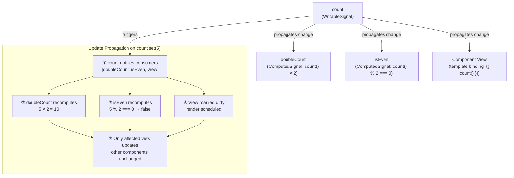

# Lesson 3: Reactive Primitives, RxJS Integration, Signals

## 1. First-Principles Intuition & Invariants

Angular's reactive programming model rests on a fundamental architectural insight: user interfaces are projections of time-varying state into the DOM, and the challenge of modern frontend engineering lies not in computing these projections but in efficiently synchronizing them as application state evolves. Traditional imperative frameworks force developers to manually orchestrate this synchronization through explicit event handlers and DOM manipulation, creating brittle coupling between data sources and visual representations. Angular instead embraces a declarative model grounded in reactive primitives that establish formal producer-consumer relationships between data sources and view components.

At the heart of Angular's reactivity model lie three interconnected abstractions: Observables from RxJS, the async pipe, and the newer Signals API introduced in Angular 16. These primitives share a common philosophical foundation rooted in the Observer pattern, where data producers emit values over time to subscribed consumers without knowledge of those consumers' identities or implementation details. This inversion of control—where consumers register interest rather than producers maintaining explicit recipient lists—enables compositional architectures that scale from simple form inputs to complex multi-service data aggregation pipelines.

Observables represent push-based asynchronous data streams that model everything from HTTP responses to user interactions as sequences of values projected across the time dimension. Unlike Promises, which represent single future values, Observables embrace multiplicity: a mouse movement stream produces hundreds of coordinate pairs per second, a WebSocket connection delivers an unbounded sequence of server messages, and a form field emits validation states on every keystroke. This temporal dimensionality demands different reasoning patterns than synchronous function calls or even Promise chains—developers must think in terms of stream transformations, backpressure management, and subscription lifecycles rather than sequential execution flows.

The async pipe serves as Angular's canonical bridge between Observable streams and template rendering, handling subscription management and change detection triggering automatically. When a template references `data$ | async`, Angular subscribes to the Observable during component initialization, extracts emitted values for binding purposes, marks the component dirty to trigger change detection when new values arrive, and critically unsubscribes during component destruction to prevent memory leaks. This declarative subscription management eliminates entire classes of lifecycle bugs that plague manual subscription handling, where forgotten unsubscribe calls cause detached components to continue processing events and accumulating memory.

Signals introduce a complementary reactivity model inspired by fine-grained reactive systems like SolidJS and Vue's Composition API. While Observables excel at modeling asynchronous event streams with rich composition operators, they impose subscription overhead and require explicit change detection coordination. Signals offer synchronous, zero-overhead reactive primitives that automatically track dependencies during template evaluation and notify exactly those components that depend on changed values. A signal wraps a value behind a getter function that registers consumers during access, building a dependency graph at runtime that enables surgical change detection without zone.js's global monkey-patching of asynchronous APIs.

The reactive invariants that govern Angular's execution model derive from these primitives' mathematical properties. Observables form monads under the `flatMap` operator (also called `mergeMap` or `switchMap` variants), enabling lawful composition of asynchronous operations without callback hell or Promise chains. The async pipe maintains referential transparency by guaranteeing that template expressions depending on Observable values always reflect the most recent emission, never stale cached state. Signals establish DAG-structured dependency graphs where computed values propagate changes in topological order, preventing glitches where intermediate states violate application invariants during multi-signal updates.

Understanding Angular's reactivity model requires recognizing its position in the broader landscape of UI synchronization strategies. React popularized virtual DOM diffing with reconciliation algorithms that compute minimal DOM patch sets by comparing shadow trees. Svelte moved compilation earlier, generating optimal imperative update code at build time that directly manipulates specific DOM nodes without runtime diffing overhead. Angular's zone.js-based change detection occupies a middle ground: it monkey-patches browser APIs to detect asynchronous events, then runs change detection across component trees to identify bindings requiring updates. Signals represent Angular's evolution toward Svelte-like fine-grained reactivity while preserving RxJS's composable stream processing for complex asynchronous workflows.

The tension between Observables and Signals reflects fundamental tradeoffs in reactive system design. Observables provide explicit subscription boundaries and comprehensive composition operators for complex event processing—debouncing search inputs, canceling in-flight requests, coordinating multiple backend calls—at the cost of manual lifecycle management and change detection integration. Signals offer transparent dependency tracking and zero-overhead updates for synchronous state at the cost of limited composition primitives and challenges with asynchronous data sources. Modern Angular applications increasingly adopt a hybrid strategy: Signals for component-local synchronous state, Observables for asynchronous operations and cross-component event buses, with the `toSignal` and `toObservable` interop functions bridging the two models where needed.

## 2. Core Architecture & Mechanics

The Observable contract in RxJS codifies producer-consumer relationships through a formal subscription protocol. An Observable wraps a producer function that receives an Observer object implementing three callbacks: `next` for value emissions, `error` for failure propagation, and `complete` for stream termination. The producer calls these callbacks to push values to the consumer, and the Observable returns a Subscription object whose `unsubscribe` method tears down producer resources—canceling timers, closing connections, removing event listeners. This protocol enables cold Observables that instantiate new producers per subscription (HTTP requests, interval timers) and hot Observables that share a single producer across multiple subscribers (DOM events, WebSocket connections).

```typescript
// Cold Observable: creates new HTTP request per subscription
const userProfile$ = this.http.get<User>('/api/users/123');

// Each subscription triggers independent HTTP request
const sub1 = userProfile$.subscribe(user => console.log('Sub 1:', user));
const sub2 = userProfile$.subscribe(user => console.log('Sub 2:', user));
// Two requests sent, two responses processed independently

// Hot Observable: shares single event source
const clicks$ = fromEvent<MouseEvent>(document, 'click');

// All subscriptions receive events from shared source
const sub3 = clicks$.subscribe(e => console.log('Handler 1:', e.clientX));
const sub4 = clicks$.subscribe(e => console.log('Handler 2:', e.clientX));
// Single click triggers both handlers
```

RxJS operators transform Observables through pure functions that return new Observables, enabling declarative stream pipelines that compose arbitrarily. The `pipe` method chains operators left-to-right, with each operator receiving the upstream Observable and returning a downstream Observable that potentially transforms, filters, or combines emitted values. Critical operators include `map` for value transformation, `filter` for conditional emission, `mergeMap` for flattening nested Observables, `switchMap` for canceling in-flight operations when new values arrive, `debounceTime` for throttling high-frequency events, and `catchError` for error recovery without stream termination.

```typescript
// Search input with debouncing, cancellation, error handling
searchControl.valueChanges.pipe(
  debounceTime(300),        // Wait 300ms after typing stops
  distinctUntilChanged(),   // Ignore duplicate consecutive values
  filter(term => term.length >= 3), // Minimum search length
  switchMap(term =>         // Cancel previous request on new term
    this.searchService.query(term).pipe(
      catchError(error => {
        console.error('Search failed:', error);
        return of([]);      // Return empty results on error
      })
    )
  )
).subscribe(results => this.displayResults(results));
```

The async pipe's implementation interleaves subscription management with Angular's change detection cycle. During template initialization, the pipe subscribes to the provided Observable and stores the subscription internally. When the Observable emits a value, the pipe's internal callback stores that value in a private field and calls `ChangeDetectorRef.markForCheck()`, scheduling change detection for the component's view. During change detection, the pipe's `transform` method returns the cached value for template binding. On component destruction, Angular invokes the pipe's `ngOnDestroy` hook, which calls `unsubscribe()` on the stored subscription, ensuring producer cleanup even if developers forget manual unsubscribe calls.

```typescript
// Async pipe internal mechanics (simplified)
@Pipe({ name: 'async', pure: false })
export class AsyncPipe implements OnDestroy {
  private subscription: Subscription | null = null;
  private latestValue: any = null;

  constructor(private ref: ChangeDetectorRef) {}

  transform<T>(obj: Observable<T>): T | null {
    if (!this.subscription) {
      this.subscription = obj.subscribe({
        next: (value) => {
          this.latestValue = value;
          this.ref.markForCheck(); // Trigger change detection
        },
        error: (e) => { throw e; }
      });
    }
    return this.latestValue;
  }

  ngOnDestroy(): void {
    this.subscription?.unsubscribe();
  }
}
```

Zone.js enables Angular's automatic change detection by monkey-patching all asynchronous browser APIs—setTimeout, Promise.then, addEventListener, XMLHttpRequest—to execute application code within an execution context called a Zone. When asynchronous operations complete inside Angular's NgZone, the framework triggers change detection across the component tree, evaluating bindings to detect changes and updating the DOM where template expressions produce different values. This approach trades performance overhead from tree traversal for developer ergonomics by eliminating manual change detection calls, but it creates challenges when high-frequency events like scroll or mousemove trigger expensive change detection cycles for components unaffected by those events.

The OnPush change detection strategy optimizes performance by limiting when Angular evaluates a component's bindings. Components marked with `ChangeDetectionStrategy.OnPush` skip change detection unless explicitly triggered by three conditions: their input properties receive new references (checked via `Object.is` reference equality), they emit events through output EventEmitters, or code explicitly calls `markForCheck()` on their ChangeDetectorRef. The async pipe exploits this mechanism by calling `markForCheck()` when Observables emit, enabling OnPush components to react to asynchronous data while skipping detection for unrelated application events.

```typescript
@Component({
  selector: 'app-user-profile',
  changeDetection: ChangeDetectionStrategy.OnPush,
  template: `
    <div>
      <h2>{{ (user$ | async)?.name }}</h2>
      <p>{{ (user$ | async)?.email }}</p>
      <button (click)="refresh()">Refresh</button>
    </div>
  `
})
export class UserProfileComponent {
  user$ = this.userService.getCurrentUser();

  constructor(
    private userService: UserService,
    private cdr: ChangeDetectorRef
  ) {}

  refresh(): void {
    this.user$ = this.userService.getCurrentUser();
    // OnPush component skips detection for unrelated events
    // but async pipe triggers it when user$ emits
  }
}
```

Signals introduce a synchronous reactive primitive built on a getter-setter pair that automatically tracks dependencies and notifies consumers. A WritableSignal wraps a mutable value behind a function interface—calling `signal()` returns the current value, while `set()` and `update()` modify it. Computed signals derive values from other signals through pure functions, automatically recomputing when dependencies change. Effect functions register side effects that re-run whenever their accessed signals change, enabling derived DOM updates, logging, or state synchronization without explicit subscription management.

```typescript
// Signal-based counter with derived state
export class CounterComponent {
  // Writable signal for base state
  count = signal(0);
  
  // Computed signal derives from count
  doubleCount = computed(() => this.count() * 2);
  isEven = computed(() => this.count() % 2 === 0);
  
  // Effect runs when count changes
  logEffect = effect(() => {
    console.log('Count changed to:', this.count());
  });
  
  increment(): void {
    this.count.update(n => n + 1);
    // Automatically triggers:
    // 1. doubleCount and isEven recomputation
    // 2. Template re-renders for affected bindings
    // 3. logEffect execution
  }
}
```

Signals build a dependency graph during template evaluation through implicit subscription. When Angular evaluates a template expression like `{{ count() }}`, accessing the signal's value registers the component's view as a consumer. When `count.set()` mutates the underlying value, the signal traverses its consumer list and marks dependent views dirty, scheduling targeted change detection. This fine-grained invalidation enables precise updates without zone.js's global event interception, reducing change detection overhead from O(components) to O(affected components).



The interop between Observables and Signals bridges push-based asynchronous streams with pull-based synchronous reactivity. The `toSignal` function converts an Observable into a Signal by subscribing internally and updating the signal value on each emission, with configurable initial values and error handling strategies. The `toObservable` function creates an Observable that emits whenever a signal changes, enabling signals to participate in RxJS pipelines with operators like `debounceTime` or `switchMap`. This bidirectional conversion enables hybrid architectures where HTTP responses flow through Observables into Signals for template binding, while signal mutations trigger Observable chains for side effects or backend synchronization.

```typescript
export class ProductListComponent {
  private http = inject(HttpClient);
  private searchQuery = signal('');
  
  // Convert signal to Observable for RxJS operators
  private searchQuery$ = toObservable(this.searchQuery);
  
  // Apply debouncing and HTTP via Observable pipeline
  private results$ = this.searchQuery$.pipe(
    debounceTime(300),
    distinctUntilChanged(),
    switchMap(query => 
      query ? this.http.get<Product[]>(`/api/products?q=${query}`) : of([])
    )
  );
  
  // Convert back to Signal for template binding
  products = toSignal(this.results$, { initialValue: [] });
  
  updateSearch(term: string): void {
    this.searchQuery.set(term);
    // Triggers: searchQuery$ emission → debounced HTTP → products update
  }
}
```

Signal equality semantics determine when updates propagate through the dependency graph. By default, signals use `Object.is` reference equality to detect changes—primitive values compare by value, but objects and arrays compare by reference. This default prevents spurious updates when setting a signal to its current value, but it creates subtleties with mutable data structures where mutating an array in place does not trigger updates since the reference remains unchanged. Angular provides `equal` option functions for custom equality checks, enabling deep equality for immutable data structures or content-based hashing for complex objects.

```typescript
// Reference equality pitfall
const items = signal<string[]>([]);

items.update(arr => {
  arr.push('new item');  // Mutates array in place
  return arr;            // Returns same reference
});
// No update triggered! Reference unchanged

// Correct: return new reference
items.update(arr => [...arr, 'new item']);
// Update triggered: new array reference

// Custom equality for immutable structures
const config = signal(
  { theme: 'dark', fontSize: 14 },
  { equal: (a, b) => a.theme === b.theme && a.fontSize === b.fontSize }
);

config.set({ theme: 'dark', fontSize: 14 });
// No update: custom equality returns true despite new object reference
```

## 3. High-Performance Optimization & Failure Modes

Observable subscription leaks represent the most common failure mode in Angular applications, occurring when developers subscribe to Observables manually without corresponding unsubscribe calls. Each dangling subscription retains references to its Observer callbacks, which close over component instances, preventing garbage collection even after components destroy. A leaked subscription continues processing events, causing detached components to execute business logic and trigger change detection on destroyed views, accumulating memory linearly with component lifecycle iterations. Navigation between routed views exacerbates this pathology—each route activation creates new subscriptions, and each deactivation leaks them unless explicitly cleaned up.

```typescript
// ANTI-PATTERN: Subscription leak
export class LeakyComponent implements OnInit {
  data: User[] = [];
  
  ngOnInit(): void {
    // Subscription never cleaned up
    this.userService.getUsers().subscribe(users => {
      this.data = users;
      // Component instance retained in closure
      // Subscription processes events after component destroyed
    });
  }
}

// CORRECT: Subscription cleanup with takeUntilDestroyed
export class SafeComponent implements OnInit {
  private destroyRef = inject(DestroyRef);
  data: User[] = [];
  
  ngOnInit(): void {
    this.userService.getUsers()
      .pipe(takeUntilDestroyed(this.destroyRef))
      .subscribe(users => this.data = users);
    // Automatically unsubscribes on component destruction
  }
}

// PREFERRED: Avoid manual subscription with async pipe
@Component({
  template: `<div *ngFor="let user of users$ | async">...</div>`
})
export class AsyncPipeComponent {
  users$ = this.userService.getUsers();
  // No manual subscription, pipe handles lifecycle
}
```

The `takeUntilDestroyed` operator provides idiomatic subscription cleanup by unsubscribing when Angular destroys the injection context, typically a component or directive. Internally, it registers a cleanup callback with the DestroyRef token, which Angular invokes during destruction. This approach eliminates the boilerplate of storing subscriptions and calling unsubscribe in ngOnDestroy, reducing error surfaces and improving code readability. For pre-Angular 16 codebases without DestroyRef support, the subject-based takeUntil pattern achieves similar lifecycle synchronization by completing a subject in ngOnDestroy and using it to terminate subscriptions.

Flattening operators introduce subtle subscription semantics that profoundly impact application behavior. The `mergeMap` operator subscribes to inner Observables concurrently, allowing multiple in-flight operations simultaneously—useful for parallel HTTP requests but dangerous when inner subscriptions must execute sequentially or when old operations should cancel on new emissions. The `switchMap` operator cancels previous inner subscriptions when new outer values arrive, making it ideal for search inputs where outdated requests should abort when users type additional characters. The `concatMap` operator queues inner subscriptions, executing them sequentially—appropriate for operations requiring ordering guarantees like database writes or API calls with rate limits.

```typescript
// mergeMap: concurrent execution (race conditions possible)
searchInput$.pipe(
  mergeMap(term => this.http.get(`/api/search?q=${term}`))
).subscribe(results => this.display(results));
// Fast typing "cat" → sends "c", "ca", "cat" requests concurrently
// Responses arrive out-of-order: "cat", "c", "ca"
// Display shows wrong results!

// switchMap: cancellation on new input (correct for search)
searchInput$.pipe(
  switchMap(term => this.http.get(`/api/search?q=${term}`))
).subscribe(results => this.display(results));
// Fast typing "cat" → cancels "c" and "ca" requests
// Only "cat" response processes

// concatMap: sequential execution (correct for ordered operations)
saveQueue$.pipe(
  concatMap(data => this.http.post('/api/save', data))
).subscribe(response => console.log('Saved:', response));
// Queues save operations, executes in order
// Second request waits for first to complete
```

Change detection performance degrades when components perform expensive computations in template expressions or getter methods. Angular evaluates bindings during every change detection cycle, and expressions like `{{ computeExpensiveValue() }}` recalculate results even when input data remains unchanged. OnPush change detection mitigates this by skipping components unless inputs change, but it requires immutable update patterns where modified state produces new object references rather than mutating existing objects. Signals obviate this concern by tracking dependencies precisely—computed signals memoize results until dependencies change, eliminating redundant computation regardless of change detection strategy.

```typescript
// ANTI-PATTERN: Expensive computation in template
@Component({
  template: `
    <div>{{ calculateTotal() }}</div>
    <div>{{ formatCurrency(calculateTotal()) }}</div>
  `
})
export class ExpensiveComponent {
  items: Item[] = [...];
  
  calculateTotal(): number {
    // Recalculates every change detection cycle
    return this.items.reduce((sum, item) => sum + item.price * item.quantity, 0);
  }
}

// BETTER: Memoize with computed signal
export class OptimizedComponent {
  items = signal<Item[]>([...]);
  
  total = computed(() => 
    this.items().reduce((sum, item) => sum + item.price * item.quantity, 0)
  );
  // Recalculates only when items changes
}
```

The async pipe's non-pure marking forces Angular to evaluate it during every change detection cycle, checking whether the underlying Observable emitted new values. This polling-style approach ensures templates reflect latest emissions but creates performance overhead in components with many async pipe instances. Each pipe stores subscription state and compares current values against cached values, scaling linearly with pipe count. Applications with dozens of async pipes in deeply nested component trees experience noticeable change detection slowdown, motivating migration to OnPush strategies that limit evaluation frequency or to signals that eliminate polling through dependency tracking.

Subject misuse creates memory leaks and stale state bugs when developers treat subjects as mutable state containers rather than event buses. Subjects maintain subscriber lists internally, and calling `next()` broadcasts values to all subscribers synchronously. If subjects outlive the components that subscribe to them (service-level subjects subscribed by component-level consumers), those components leak unless they unsubscribe. Additionally, subjects do not cache previous values by default—new subscribers receive only values emitted after subscription, causing late-subscribing components to miss initialization data. ReplaySubject and BehaviorSubject address value caching, but they introduce memory overhead by storing emission history.

```typescript
// ANTI-PATTERN: Subject-based state without cleanup
@Injectable({ providedIn: 'root' })
export class UserStateService {
  private userSubject = new Subject<User>();
  user$ = this.userSubject.asObservable();
  
  updateUser(user: User): void {
    this.userSubject.next(user);
  }
}

@Component({...})
export class UserProfileComponent implements OnInit {
  ngOnInit(): void {
    // Component subscribes but never unsubscribes
    // Service outlives component → leak
    this.userState.user$.subscribe(user => this.currentUser = user);
  }
}

// BETTER: Signal-based state (no subscription management)
@Injectable({ providedIn: 'root' })
export class UserStateService {
  private userSignal = signal<User | null>(null);
  user = this.userSignal.asReadonly();
  
  updateUser(user: User): void {
    this.userSignal.set(user);
  }
}

@Component({
  template: `<div>{{ userState.user()?.name }}</div>`
})
export class UserProfileComponent {
  userState = inject(UserStateService);
  // No subscription, no cleanup needed
}
```

Backpressure handling becomes critical when Observable producers emit values faster than consumers process them. User interactions like scroll events or mousemove produce thousands of events per second, overwhelming components that perform expensive operations per event. The `debounceTime` operator introduces artificial delays, emitting only after the source Observable quiets for a specified duration—ideal for search inputs where processing every keystroke wastes resources. The `throttleTime` operator samples values at fixed intervals, emitting the most recent value every N milliseconds—appropriate for scroll position tracking where periodic updates suffice. The `auditTime` operator emits the last value after a specified duration, similar to throttleTime but guaranteeing the final value propagates even if the source stops emitting.

```typescript
// Backpressure strategies for high-frequency events
fromEvent(window, 'scroll').pipe(
  throttleTime(100),  // Sample every 100ms during scrolling
  map(() => window.scrollY)
).subscribe(scrollPos => this.updateScrollIndicator(scrollPos));

fromEvent(searchInput, 'input').pipe(
  debounceTime(300),  // Wait 300ms after user stops typing
  map(e => (e.target as HTMLInputElement).value)
).subscribe(term => this.search(term));

fromEvent(element, 'mousemove').pipe(
  auditTime(50),      // Emit last position every 50ms
  map(e => ({ x: e.clientX, y: e.clientY }))
).subscribe(pos => this.updateTooltipPosition(pos));
```

Signal effects introduce reactive side effects that re-execute when accessed signals change, but they come with destruction timing subtleties. Effects created in component constructors or initialization hooks run within the component's injection context, automatically cleaning up on destruction. Effects created inside asynchronous callbacks or setTimeout closures lose injection context, requiring manual cleanup via the returned EffectRef. Circular dependencies between effects create infinite loops—if effect A writes signal X and effect B reads X then writes signal Y which effect A reads, they trigger each other indefinitely until Angular throws an error. Effects should remain idempotent and avoid modifying signals that they read from.

```typescript
export class ProblematicComponent {
  count = signal(0);
  derived = signal(0);
  
  constructor() {
    // ANTI-PATTERN: Circular effect dependency
    effect(() => {
      const c = this.count();
      this.derived.set(c * 2);  // Writes derived
    });
    
    effect(() => {
      const d = this.derived();
      if (d > 10) {
        this.count.set(0);  // Writes count, triggers first effect
      }
    });
    // Infinite loop until Angular throws error
    
    // ANTI-PATTERN: Effect without injection context
    setTimeout(() => {
      effect(() => console.log(this.count()));
      // Leaks! No automatic cleanup
    }, 1000);
  }
}

// CORRECT: Break circular dependencies
export class FixedComponent {
  count = signal(0);
  derived = computed(() => this.count() * 2);  // One-way dependency
  
  constructor() {
    effect(() => {
      if (this.derived() > 10) {
        // Use untracked to avoid circular read
        untracked(() => this.count.set(0));
      }
    });
  }
}
```

The toSignal function defaults to throwing errors when source Observables error, but asynchronous operations frequently fail from network timeouts, backend errors, or invalid responses. Applications must configure error handling through the `catchError` operator before converting to signals or use toSignal's optional error handling callback. The `initialValue` option prevents template errors during the window between subscription and first emission, critical for Observables representing asynchronous data loads. Without initial values, templates accessing the signal before emission receive undefined, causing null reference errors unless guarded with optional chaining.

```typescript
export class UserDetailComponent {
  private userId = input.required<string>();
  
  // ANTI-PATTERN: No error handling or initial value
  user = toSignal(
    this.http.get<User>(`/api/users/${this.userId()}`)
  );
  // Throws on HTTP error, undefined until response arrives
  
  // CORRECT: Complete error handling
  user = toSignal(
    this.http.get<User>(`/api/users/${this.userId()}`).pipe(
      catchError(error => {
        console.error('Failed to load user:', error);
        return of(null);  // Return fallback value
      })
    ),
    { initialValue: null }
  );
  // Safe: never throws, never undefined
}
```

Combining multiple Observables requires choosing between merge semantics (subscribe to all, emit when any emits), concat semantics (subscribe sequentially, wait for completion), or zip semantics (wait for all to emit, combine into tuples). The `combineLatest` operator emits whenever any source emits after all sources have emitted at least once, making it ideal for combining independent data streams like form controls where changes to any input should trigger validation. The `forkJoin` operator waits for all sources to complete then emits a final combined value, appropriate for loading multiple resources in parallel before rendering. The `merge` operator subscribes to all sources concurrently and emits values as they arrive, suitable for combining event streams like multiple user interaction types.

```typescript
// combineLatest: emit on any change after all emit
const form$ = combineLatest([
  this.nameControl.valueChanges.pipe(startWith('')),
  this.emailControl.valueChanges.pipe(startWith('')),
  this.ageControl.valueChanges.pipe(startWith(0))
]).pipe(
  map(([name, email, age]) => ({ name, email, age }))
);
// Emits new form object whenever any control changes

// forkJoin: wait for all to complete
const pageData$ = forkJoin({
  user: this.http.get<User>('/api/user'),
  settings: this.http.get<Settings>('/api/settings'),
  notifications: this.http.get<Notification[]>('/api/notifications')
});
// Emits once when all three requests complete

// merge: combine event streams
const userActions$ = merge(
  fromEvent(saveButton, 'click').pipe(map(() => 'save')),
  fromEvent(deleteButton, 'click').pipe(map(() => 'delete')),
  fromEvent(cancelButton, 'click').pipe(map(() => 'cancel'))
);
// Emits whenever any button clicked
```

Signals and OnPush change detection combine synergistically to minimize rendering overhead in large-scale applications. OnPush components skip change detection unless inputs change or markForCheck is called, while signals automatically call markForCheck when mutated, enabling selective re-rendering without manual change detector manipulation. Components using only signals for state can adopt OnPush safely, knowing signal mutations trigger detection precisely when needed. This pattern scales to component trees with hundreds of nodes—unchanged branches skip evaluation entirely while signal-driven branches render targeted updates, achieving performance profiles comparable to virtual DOM frameworks with fine-grained reactivity.
