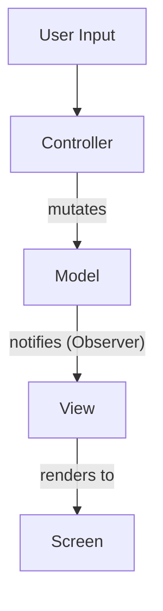
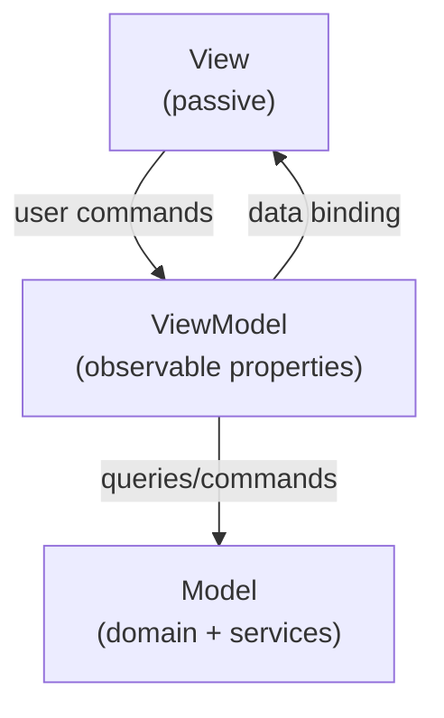
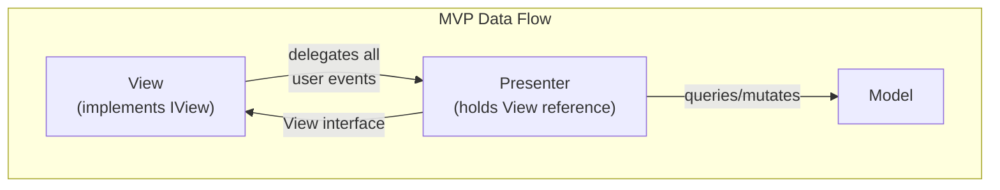
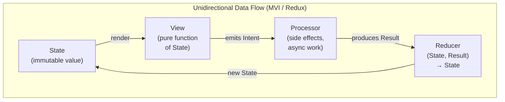

# Lesson 1: Foundational App Architecture Patterns

## 1. First-Principles Intuition & Invariants

Every non-trivial application is, at its core, a system for managing change. Data arrives from a network, a user taps a button, a background process completes, and the visible world of the application must update to reflect a new reality. The central problem of application architecture is therefore not about organizing files or naming classes. It is about defining *who owns state*, *who may mutate it*, and *how those mutations propagate* to every dependent component that cares about them. All of the named patterns — MVC, MVVM, MVP, and their variants — are different answers to this single question, each making different trade-offs between testability, coupling, predictability, and the cognitive load they impose on the engineer who must reason about them under production pressure.

To understand why these patterns exist, you must first appreciate what happens in their absence. Early GUI frameworks in the 1980s and early 1990s — including the original Smalltalk-80 desktop applications and the first generation of Windows Forms programs — frequently collapsed all three concerns into a single object. A button's click handler would directly query a database, transform the result, and push text into a label's property, all in a linear sequence of imperative statements. This arrangement works for trivially small applications, but it fails catastrophically as complexity grows, for a mechanical reason: state becomes implicit and load-bearing. The label's displayed value is not *derived from* a canonical truth somewhere; it *is* the truth, embedded inside a UI widget that cannot be unit-tested without instantiating a full GUI runtime. The database query is not *invoked by* a service boundary; it is *woven into* an event callback that cannot be exercised without synthesizing user input events. The cost of this coupling is paid every time the application needs to change, which is to say, constantly.

The separation of concerns principle, articulated in Dijkstra's 1974 essay "On the role of scientific thought," captures the invariant that underpins every serious architecture pattern: a given module should have *one reason to change*. When display logic, transformation logic, and persistence logic all inhabit the same object, that object has three separate reasons to change — a redesigned UI, a modified business rule, or a new backend API — and each change risks introducing a regression along the other two axes. The named patterns enforce separation by drawing explicit module boundaries and defining the direction of data flow across them. Each pattern draws those boundaries differently, with real consequences for testability, state ownership, and the complexity of the binding layer.

The concept of **lifecycle** cuts across all of these patterns and is frequently underestimated by engineers arriving from pure backend or systems backgrounds. A mobile view or a desktop window is not a simple function call; it is an object that moves through a sequence of states — created, measuring its layout, laid out, visible, partially obscured, destroyed — and the application's state management strategy must be coherent with respect to this lifecycle. If a ViewModel holds a reference to a View that has already been destroyed, you get a memory leak or a null dereference. If a Presenter subscribes to a data stream but fails to unsubscribe when its View is torn down, you get a ghost subscriber that continues processing events and potentially writing to deallocated UI state. These are not academic concerns. They constitute a large fraction of the production bugs filed against mature applications, and they are architectural problems, not implementation bugs. The pattern you choose determines whether these lifecycle hazards are easy or hard to manage correctly.

State management, independent of the specific rendering pattern chosen, obeys a small number of invariants that hold across every serious framework. First, there should be a *single source of truth* for any given piece of state: the user's login status should not exist simultaneously as a boolean on a session object and as a string property on a navigation controller, because those two copies will inevitably diverge. Second, state mutations should flow through *defined channels* rather than being available as ambient side effects. This is the mechanical reason why Redux-style unidirectional architectures became dominant in complex web applications: when the only way to change application state is to dispatch a named action through a pure reducer function, the full history of state transitions is reconstructable from a log of actions, making bugs reproducible deterministically. Third, derived state — any value that can be computed from primary state — should be computed lazily or reactively rather than stored redundantly, because every redundant store is a synchronization hazard.

---

## 2. Core Architecture & Mechanics

### Model-View-Controller

MVC is the oldest of the mainstream patterns, with roots in Smalltalk-80, and it defines three roles. The Model owns domain state and enforces business invariants. The View renders the Model's state to the user. The Controller interprets user input and translates it into mutations on the Model. The critical structural property is that the View observes the Model directly — typically through an Observer or notification mechanism — and updates itself when the Model changes. The Controller does not mediate every display update; it only handles input.



The architectural strength of classical MVC is that the Model is completely independent of the View. You can run the entire domain logic in a headless test harness, exercising state transitions through the Controller interface without instantiating any rendering infrastructure. The weakness, which became pronounced in the web era, is that in practice the View and Controller are tightly coupled — in many frameworks they are literally the same class — and the View's direct observation of the Model means that View logic can subtly reach into Model state in ways that violate the boundary. Apple's UIKit, for instance, nominally follows MVC but in practice produces what practitioners call "Massive View Controller": a ViewController class that accumulates layout code, networking code, data transformation code, and business logic because all three roles have natural gravitational pull toward the same location in the codebase.

The Observer coupling from Model to View also creates a testability hazard that is worth examining mechanically. When a View observes a Model through `NotificationCenter` or a delegate callback, the test for the Controller must either instantiate a live View or mock the notification infrastructure. Neither is trivial. This is the pressure that drove the evolution toward MVVM, which introduces an explicit intermediate object to break the direct Model-to-View observation.

### Model-View-ViewModel

MVVM, introduced by John Gossman at Microsoft in 2005 for WPF, restructures the pattern so the View never observes the Model directly. Instead, a ViewModel — one per View, with a one-to-one or one-to-many correspondence — transforms raw Model data into a representation optimized for display, and the View binds to the ViewModel's exposed properties through a reactive or data-binding mechanism. The ViewModel exposes observable properties or streams, and the binding layer handles propagating changes automatically.



The ViewModel's key mechanical property is that it has *no import of or reference to any View type*. It exposes state as observable values — `LiveData<T>` in Android Jetpack, `@Published` properties in Swift/Combine, `StateFlow<T>` in Kotlin coroutines — and the View subscribes to those streams in its lifecycle-aware setup code. This inversion solves the testability problem cleanly: a unit test for a ViewModel instantiates it in isolation, invokes command methods on it, and asserts on the emitted state values without ever touching a UI thread or a rendering context.

Consider a concrete example in Kotlin using Jetpack ViewModel and `StateFlow`. The pattern below is not illustrative pseudocode — it is the production structure used in Android applications targeting a modern architecture:

```kotlin
// Domain model — pure data, no Android dependencies
data class UserProfile(
    val id: String,
    val displayName: String,
    val avatarUrl: String,
    val isPremium: Boolean
)

// Repository interface — the Model boundary
interface UserRepository {
    suspend fun fetchProfile(userId: String): Result<UserProfile>
    fun observeProfile(userId: String): Flow<UserProfile>
}

// UI state — a sealed hierarchy owned entirely by the ViewModel
sealed interface ProfileUiState {
    data object Loading : ProfileUiState
    data class Success(
        val displayName: String,
        val avatarUrl: String,
        val premiumBadgeVisible: Boolean
    ) : ProfileUiState
    data class Error(val message: String) : ProfileUiState
}

// ViewModel — no View imports, no Context references beyond Application
class ProfileViewModel(
    private val userId: String,
    private val repository: UserRepository
) : ViewModel() {

    private val _uiState = MutableStateFlow<ProfileUiState>(ProfileUiState.Loading)
    val uiState: StateFlow<ProfileUiState> = _uiState.asStateFlow()

    init {
        viewModelScope.launch {
            repository.observeProfile(userId)
                .catch { e -> _uiState.value = ProfileUiState.Error(e.message ?: "Unknown error") }
                .collect { profile ->
                    _uiState.value = ProfileUiState.Success(
                        displayName = profile.displayName,
                        avatarUrl = profile.avatarUrl,
                        premiumBadgeVisible = profile.isPremium
                    )
                }
        }
    }

    fun retryLoad() {
        _uiState.value = ProfileUiState.Loading
        viewModelScope.launch {
            repository.fetchProfile(userId)
                .onSuccess { profile ->
                    _uiState.value = ProfileUiState.Success(
                        displayName = profile.displayName,
                        avatarUrl = profile.avatarUrl,
                        premiumBadgeVisible = profile.isPremium
                    )
                }
                .onFailure { e ->
                    _uiState.value = ProfileUiState.Error(e.message ?: "Unknown error")
                }
        }
    }
}

// View — a Composable that observes state and delegates all logic
@Composable
fun ProfileScreen(viewModel: ProfileViewModel = viewModel()) {
    val uiState by viewModel.uiState.collectAsStateWithLifecycle()

    when (val state = uiState) {
        is ProfileUiState.Loading -> CircularProgressIndicator()
        is ProfileUiState.Error -> {
            Column {
                Text(text = state.message)
                Button(onClick = { viewModel.retryLoad() }) { Text("Retry") }
            }
        }
        is ProfileUiState.Success -> {
            Column {
                AsyncImage(model = state.avatarUrl, contentDescription = "Avatar")
                Text(text = state.displayName)
                if (state.premiumBadgeVisible) {
                    PremiumBadge()
                }
            }
        }
    }
}
```

Several design decisions here carry mechanical weight beyond style preference. `ProfileUiState` is a sealed hierarchy rather than a data class with nullable fields, which forces the View to handle every state transition explicitly through `when` exhaustiveness. The ViewModel exposes `StateFlow<ProfileUiState>` as an immutable `StateFlow` (not `MutableStateFlow`), so the View cannot mutate state directly — the boundary is enforced by the type system, not by convention. `collectAsStateWithLifecycle()` ties collection to the Compose lifecycle, automatically pausing collection when the composable is not visible and resuming it when it returns to the foreground, which prevents the ViewModel from pushing updates to a View that is off-screen.

### Model-View-Presenter

MVP emerged in the late 1990s and was popularized in the context of testable UI on platforms that lacked data-binding infrastructure. Where MVVM relies on a reactive binding layer to connect ViewModel to View, MVP uses an explicit interface contract. The View implements a `View` interface that the Presenter calls imperatively, and the Presenter receives a reference to that interface. The View delegates every user interaction to the Presenter and renders only what the Presenter tells it to render.



The critical difference from MVVM is that the Presenter *calls the View* rather than *emitting observable state for the View to subscribe to*. This makes the Presenter easy to test using a mock of the View interface, but it also means the Presenter holds a reference to a concrete object — the View — which must be managed carefully with respect to lifecycle. When the Activity or Fragment is destroyed and recreated on an Android configuration change, the Presenter must release its View reference or risk holding a stale reference to a destroyed Activity, causing a memory leak.

```swift
// Swift MVP example — illustrating the explicit interface contract

protocol ProfileView: AnyObject {
    func showLoading()
    func showProfile(name: String, avatarURL: URL, showPremiumBadge: Bool)
    func showError(message: String)
}

final class ProfilePresenter {
    private weak var view: ProfileView?
    private let repository: UserRepository
    private let userId: String

    init(view: ProfileView, repository: UserRepository, userId: String) {
        self.view = view
        self.repository = repository
        self.userId = userId
    }

    func viewDidLoad() {
        view?.showLoading()
        Task {
            do {
                let profile = try await repository.fetchProfile(userId: userId)
                await MainActor.run {
                    view?.showProfile(
                        name: profile.displayName,
                        avatarURL: URL(string: profile.avatarUrl)!,
                        showPremiumBadge: profile.isPremium
                    )
                }
            } catch {
                await MainActor.run {
                    view?.showError(message: error.localizedDescription)
                }
            }
        }
    }

    func didTapRetry() {
        viewDidLoad()
    }
}

final class ProfileViewController: UIViewController, ProfileView {
    private var presenter: ProfilePresenter!
    private let loadingIndicator = UIActivityIndicatorView(style: .large)
    private let nameLabel = UILabel()
    private let errorLabel = UILabel()
    private let retryButton = UIButton(type: .system)

    override func viewDidLoad() {
        super.viewDidLoad()
        presenter = ProfilePresenter(
            view: self,
            repository: LiveUserRepository(),
            userId: SessionStore.shared.currentUserId
        )
        setupLayout()
        presenter.viewDidLoad()
    }

    func showLoading() {
        loadingIndicator.startAnimating()
        nameLabel.isHidden = true
        errorLabel.isHidden = true
        retryButton.isHidden = true
    }

    func showProfile(name: String, avatarURL: URL, showPremiumBadge: Bool) {
        loadingIndicator.stopAnimating()
        nameLabel.text = name
        nameLabel.isHidden = false
        errorLabel.isHidden = true
        retryButton.isHidden = true
    }

    func showError(message: String) {
        loadingIndicator.stopAnimating()
        errorLabel.text = message
        errorLabel.isHidden = false
        retryButton.isHidden = false
        nameLabel.isHidden = true
    }

    private func setupLayout() {
        retryButton.setTitle("Retry", for: .normal)
        retryButton.addTarget(self, action: #selector(retryTapped), for: .touchUpInside)
        [loadingIndicator, nameLabel, errorLabel, retryButton].forEach {
            $0.translatesAutoresizingMaskIntoConstraints = false
            view.addSubview($0)
        }
    }

    @objc private func retryTapped() {
        presenter.didTapRetry()
    }
}
```

The `weak var view: ProfileView?` on the Presenter is not stylistic hygiene — it is the mechanical correctness requirement that prevents the retain cycle. The View holds the Presenter strongly (via `presenter` property), and if the Presenter held the View strongly in return, neither object would ever be deallocated. Using `weak` means the Presenter automatically loses its view reference when the ViewController is destroyed, preventing both the retain cycle and stale writes to a deallocated UI.

### Unidirectional Data Flow and State Machines

Modern application architectures on both mobile and web platforms have converged on a fourth model that is not strictly one of the classical three: unidirectional data flow (UDF), exemplified by Redux on the web, The Elm Architecture, and MVI (Model-View-Intent) on Android. The core invariant is that state flows in one direction only: from a central state store, through a pure mapping function, to the View. User events flow back as discrete, named Intent objects that are processed by a pure reducer function to produce the next state. No component has a back-channel to mutate state directly.



The reducer function is the most consequential element of this architecture because it is *pure*: given the same prior state and the same result, it always produces the same next state, with no side effects. This purity is what makes time-travel debugging, state snapshots, and deterministic replay possible. It is also what makes the reducer trivially unit-testable: you call `reduce(state, result)` and assert on the output, with no mocking infrastructure required.

---

## 3. High-Performance Optimization & Failure Modes

### The ViewModel Recomposition Problem

In Compose and SwiftUI, the View is a function of state: every time the observed state changes, the framework re-invokes the composable or body function to compute a new view tree. When the state type is a large data class with many fields, and when unrelated fields change frequently, this causes unnecessary recomposition of subtrees that did not logically change. The mechanical fix is to push observable granularity down to the smallest stable unit.

Consider a feed screen backed by a single `FeedUiState` data class containing a list of posts, a loading flag, a network error, and a pagination cursor. If the pagination cursor is updated on every scroll event, the entire composable tree re-renders on every scroll because the `FeedUiState` instance changes reference identity. The correct structural fix is to decompose the state into stable sub-states and pass each subtree only the slice it observes:

```kotlin
data class PostListState(val posts: List<PostItem>, val isLoadingMore: Boolean)
data class NetworkBannerState(val isOffline: Boolean)
data class FeedScreenState(
    val postList: PostListState,
    val networkBanner: NetworkBannerState,
    val isInitialLoading: Boolean
)

@Composable
fun FeedScreen(viewModel: FeedViewModel = viewModel()) {
    val state by viewModel.screenState.collectAsStateWithLifecycle()

    if (state.isInitialLoading) {
        FullScreenLoader()
        return
    }

    Column {
        // NetworkBanner only recomposes when networkBanner changes
        NetworkBanner(state = state.networkBanner)
        // PostList only recomposes when postList changes
        PostList(
            state = state.postList,
            onLoadMore = viewModel::loadMorePosts
        )
    }
}
```

Jetpack Compose's recomposition engine tracks read operations during composition via snapshot state, so `NetworkBanner` will only recompose when `state.networkBanner` changes, even though both composables read from the same parent `state`. This works because Compose's snapshot system observes individual field reads, not the top-level state container. However, this optimization is fragile: if `FeedScreenState` is an unstable type — meaning Compose cannot guarantee it is immutable — the runtime will pessimistically recompose all children on any parent recomposition. Annotating with `@Stable` or `@Immutable`, or using Kotlin's `@Immutable` marker from the Compose compiler, tells the compiler to skip recomposition of subtrees whose inputs have not changed.

### Lifecycle Mismanagement and Coroutine Scope Leaks

The most common class of production bugs in MVVM applications on Android and iOS involves subscriptions that outlive their intended scope. On Android, `viewModelScope` is correctly scoped to the ViewModel's lifetime and is cancelled automatically when the ViewModel is cleared. The failure mode occurs when engineers use `GlobalScope` or manually created `CoroutineScope` objects to launch work from a ViewModel, bypassing the managed lifecycle entirely.

```kotlin
// WRONG — GlobalScope outlives the ViewModel; the lambda holds a reference
// to the ViewModel and prevents garbage collection
class BrokenViewModel : ViewModel() {
    fun loadData() {
        GlobalScope.launch {           // survives screen destruction
            val result = repository.fetch()
            _state.value = result      // may execute after ViewModel.onCleared()
        }
    }
}

// CORRECT — work is cancelled automatically when the ViewModel is cleared
class CorrectViewModel(private val repository: DataRepository) : ViewModel() {
    private val _state = MutableStateFlow<DataState>(DataState.Loading)
    val state: StateFlow<DataState> = _state.asStateFlow()

    fun loadData() {
        viewModelScope.launch {
            _state.value = DataState.Loading
            runCatching { repository.fetch() }
                .onSuccess { _state.value = DataState.Success(it) }
                .onFailure { _state.value = DataState.Error(it.message ?: "Failed") }
        }
    }
}
```

The equivalent failure on iOS with Combine manifests as an `AnyCancellable` subscription stored in a local variable rather than in a `Set<AnyCancellable>` on the object. When the local variable goes out of scope, the subscription is immediately cancelled, and the publisher emits no further values. The correct pattern stores every `sink` or `assign` subscriber in the ViewController's or ViewModel's `cancellables` set so that cancellation is tied to the owning object's deallocation:

```swift
final class ProfileViewModel: ObservableObject {
    @Published private(set) var uiState: ProfileUiState = .loading
    private var cancellables = Set<AnyCancellable>()
    private let repository: UserRepository

    init(repository: UserRepository, userId: String) {
        self.repository = repository
        repository.profilePublisher(for: userId)
            .receive(on: DispatchQueue.main)
            .sink(
                receiveCompletion: { [weak self] completion in
                    if case .failure(let error) = completion {
                        self?.uiState = .error(message: error.localizedDescription)
                    }
                },
                receiveValue: { [weak self] profile in
                    self?.uiState = .success(
                        displayName: profile.displayName,
                        avatarURL: URL(string: profile.avatarUrl),
                        isPremium: profile.isPremium
                    )
                }
            )
            .store(in: &cancellables)   // tied to self's lifetime, cancelled on deinit
    }
}
```

The `[weak self]` capture in the closure and the `.store(in: &cancellables)` termination work together: `[weak self]` prevents the closure from retaining `self` strongly (breaking a retain cycle with `cancellables`), while `.store(in: &cancellables)` ensures the subscription is cancelled when `self` is deallocated, preventing the publisher from delivering updates to a dead object.

### State Desynchronization in Multi-Source Architectures

A failure mode that emerges specifically in MVVM and MVI applications with multiple data sources is state desynchronization: two observables that are logically related become temporarily inconsistent because they emit on different schedules. Consider a screen that observes a user's profile from a local cache and their subscription status from a network API. If the cache emits first with an old premium status while the API call is in-flight, the View will briefly render the premium badge in the wrong state.

The correct mechanical fix is to combine the sources into a single observable before it reaches the ViewModel's state transformation:

```kotlin
class ProfileViewModel(
    private val userRepo: UserRepository,
    private val subscriptionRepo: SubscriptionRepository,
    private val userId: String
) : ViewModel() {

    val uiState: StateFlow<ProfileUiState> = userRepo.observeProfile(userId)
        .combine(subscriptionRepo.observeSubscription(userId)) { profile, subscription ->
            ProfileUiState.Success(
                displayName = profile.displayName,
                avatarUrl = profile.avatarUrl,
                premiumBadgeVisible = subscription.isActive
            )
        }
        .catch { emit(ProfileUiState.Error("Failed to load profile")) }
        .stateIn(
            scope = viewModelScope,
            started = SharingStarted.WhileSubscribed(stopTimeoutMillis = 5_000),
            initialValue = ProfileUiState.Loading
        )
}
```

The `combine` operator holds the latest value from each upstream and emits a combined value whenever either source emits. This guarantees that the ViewModel's state transformation always has access to the most recent value from both sources simultaneously, eliminating the window in which one source has updated and the other has not. The `SharingStarted.WhileSubscribed(5_000)` parameter keeps the upstream flows active for five seconds after the last subscriber disappears — handling configuration changes on Android, where the Activity is destroyed and recreated within roughly 100 milliseconds, without cancelling and re-initiating the upstream network connection unnecessarily.

### Pattern Selection Trade-offs

The choice between MVC, MVVM, MVP, and UDF is not primarily a matter of preference. Each pattern occupies a specific position in a trade-off space defined by testability, binding infrastructure requirements, predictability of state transitions, and the complexity cost of the boilerplate it introduces.

MVC minimizes boilerplate and mapping layers, making it appropriate for applications with simple, mostly-read state and a framework that already manages the Controller-to-View binding (such as server-rendered web applications). Its weakness is precisely its simplicity: as domain logic grows, the Controller accumulates responsibility because it is the natural junction between the other two roles.

MVVM requires a reactive binding infrastructure — either a framework-provided one like Combine, Kotlin Flows, or LiveData, or a manually implemented observer mechanism — and it requires discipline to prevent the ViewModel from importing View types. When those prerequisites are met, it is the most scalable pattern for single-platform applications because the ViewModel can be tested in complete isolation from the UI runtime, and the binding layer handles lifecycle-safe subscription automatically.

MVP is the correct choice when the platform provides no reactive binding infrastructure and when testability of the presentation layer is a hard requirement. Its explicit View interface makes mock-based testing straightforward, but the Presenter's reference to the View interface creates a lifecycle management burden that MVVM's reactive approach avoids.

UDF and MVI impose the highest initial boilerplate cost — sealed intent hierarchies, explicit reducer functions, side-effect processing layers — but deliver the most predictable state machine semantics and the strongest reproducibility guarantees. They are well-suited to screens with complex, multi-step state transitions (onboarding flows, checkout sequences, multi-stage form validation) where the ability to replay state transitions deterministically has direct value for debugging and testing. For simple CRUD screens, the boilerplate cost outweighs the benefit, and a well-structured MVVM with a sealed `UiState` hierarchy achieves nearly the same result with significantly less ceremony.
