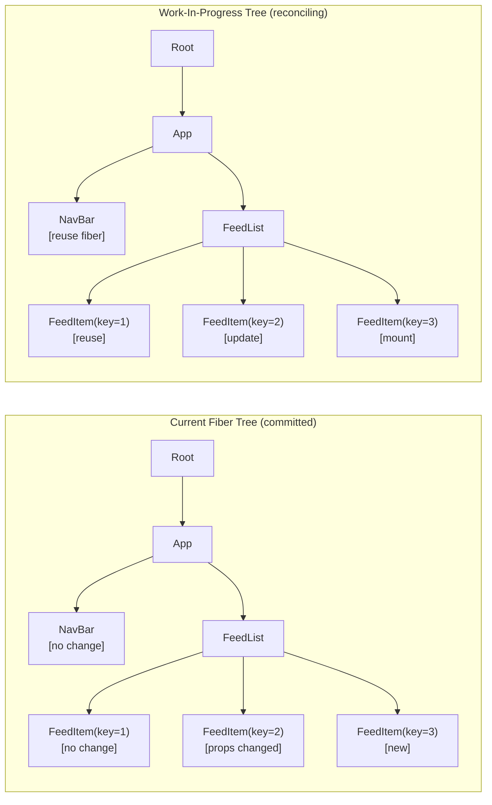
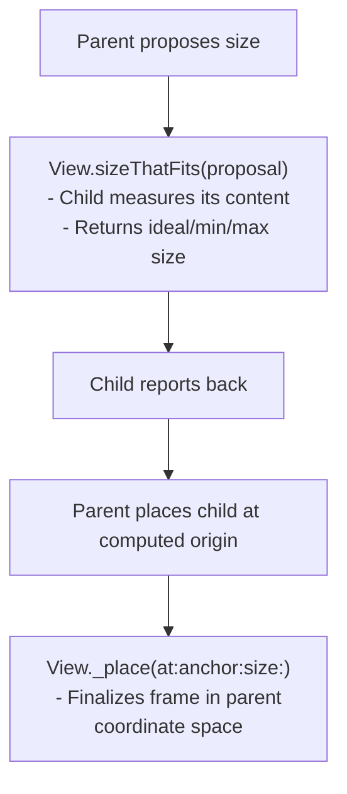
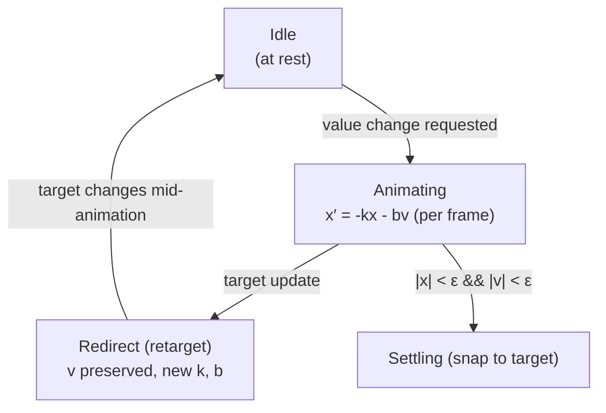

# Lesson 3: UI/UX Implementation Theory

## 1. First-Principles Intuition & Invariants

Every graphical user interface is, at its mechanical core, a function that maps application state to a pixel buffer. That statement sounds reductive, but holding it firmly in mind is what separates engineers who build UIs from engineers who understand them. The entire edifice of modern front-end frameworks, design systems, and platform SDKs exists to manage the complexity hiding inside that mapping: state can change at any time from any thread, the pixel buffer is expensive to recompute, human perception places hard constraints on latency, and the target surface changes shape dynamically. Understanding UI/UX implementation at a senior engineering level means understanding exactly how each layer of that stack addresses those four pressures.

The first invariant to internalize is the **frame budget**. A display refreshing at 60 Hz gives your rendering pipeline exactly 16.67 milliseconds per frame to do all its work: process input events, evaluate state transitions, run layout, paint, composite, and hand the finished buffer to the GPU for scanout. At 120 Hz, that budget halves to 8.33 ms. Any work that exceeds the budget causes the compositor to miss a vsync, and the previous frame is displayed again. The user perceives this as a dropped frame, or "jank." Jank at 60 Hz is noticeable; at 120 Hz it is jarring. This hard physical deadline is the governing constraint around which every architectural decision in a high-performance UI system is organized. It is not a guideline or a best practice; it is a consequence of how display hardware works.

The second invariant is the **rendering pipeline's linearity**. Regardless of platform—whether you are working with Flutter's Skia/Impeller backend, React Native's Fabric renderer, SwiftUI's layout engine, or Jetpack Compose's Compose runtime—the pipeline flows in one direction: state mutation triggers a diff or invalidation, the layout pass computes geometry, the paint pass records draw calls, and the compositor assembles layers and rasterizes them. Each stage depends on the previous stage's output. This means that work you push into an early stage explodes into redundant work in every downstream stage if you are not disciplined. A single spurious state update at the root of a component tree that is not properly memoized will trigger a full layout traversal even when nothing visible changed.

The third invariant is **the separation of logical and physical coordinates**. Every modern platform operates with at least two coordinate systems. The logical coordinate system (points on iOS/macOS, dp on Android, logical pixels in Flutter) is device-independent and is the space in which all layout and geometry calculations happen. The physical coordinate system is the actual framebuffer pixel grid, whose resolution is determined by the device's pixel ratio. A retina display with a 3× pixel ratio maps one logical point to a 3×3 grid of physical pixels. Layout engines work in logical space; rasterizers work in physical space. Conflating the two is a source of blurry assets, misaligned hairlines, and incorrect hit-testing on high-DPI displays. Every asset you ship, every border width you specify, and every touch target you define must be reasoned about in the correct coordinate space.

The fourth invariant governs accessibility. Accessibility is not a feature added after the fact; it is a parallel representation of your UI that assistive technologies consume. Every focusable element, every piece of rendered text, and every interactive control must have a corresponding entry in the **accessibility tree**, a parallel semantic structure that screen readers, switch-access controllers, and voice-control systems traverse. The accessibility tree is not automatically derivable from the visual render tree—a purely decorative icon and a semantic button may be visually indistinguishable but must be represented entirely differently in the accessibility tree. This means accessibility is a design constraint that affects component API design from the beginning: a component that cannot be annotated with a role, a label, and an interaction description is architecturally incomplete regardless of how it looks.

Design systems exist to enforce all four of these invariants consistently across a large codebase and team. A design system is not a UI kit in the marketing sense; it is a **contract** expressed in code and documentation that governs every visual and behavioral primitive used to build product surfaces. It specifies the token layer (the named mapping from semantic intent to concrete value: `color.text.primary`, `spacing.md`, `radius.card`), the component layer (the library of composable primitives built from tokens), and the pattern layer (the documented compositions of components for recurring product scenarios). When a design system is well-engineered, the token layer insulates the product from sweeping visual changes: re-theming the entire application becomes a matter of swapping a token map rather than auditing ten thousand callsites.

---

## 2. Core Architecture & Mechanics

### The Component Model and Its Execution Semantics

Modern UI frameworks converge on a component model in which the UI is a pure function of state. React, SwiftUI, Jetpack Compose, and Flutter all express this in different syntaxes, but the underlying execution model is structurally similar. Each component or composable function declares its visual output as a function of its inputs. The framework is responsible for calling that function when inputs change, diffing the result against the previous output, and surgically updating the render tree.

The critical data structure underpinning this model is the **virtual DOM** (or its equivalents: the Compose Slot Table, SwiftUI's view graph, or Flutter's widget tree). React's reconciler maintains a fiber tree in which each node stores the current and alternate (work-in-progress) representations of a component. During reconciliation, the work-in-progress tree is built by calling render functions and diffing against the current tree using a heuristic O(n) algorithm that bets on two empirically observed properties of UI trees: elements of the same type at the same position in the tree are likely the same conceptual element across renders, and sibling elements can be identified across renders by stable keys.

The work-in-progress tree is built incrementally by React's scheduler, which yields control back to the main thread between units of work using `MessageChannel` or `requestIdleCallback`. This is the architecture behind Concurrent Mode: long reconciliation work is broken into interruptible chunks so that high-priority input events can preempt in-progress rendering work. When a user types in an input field, the keystroke handler can interrupt an ongoing low-priority list reconciliation, process the input synchronously, and let the list reconciliation resume afterward.

React's scheduler assigns each update a **lane**, a bitmask that encodes priority. Input events are assigned `SyncLane` or `InputContinuousLane`; data fetches trigger `DefaultLane`; background prerendering uses `OffscreenLane`. The scheduler selects the highest-priority pending lane and processes it first, interleaving lower-priority work in the gaps. For engineers building components, the practical consequence is that anything blocking the main thread for more than 50 ms (the RAIL model's interaction budget) will cause input latency that the scheduler cannot hide—because interruptibility only helps if there is something to interrupt to.

### Layout Algorithms

The layout pass assigns a position and a size to every node in the render tree. The two dominant layout models in modern UI are the **CSS box model with Flexbox/Grid** (used in web, React Native, and Flutter's web target) and **constraint-based layout** (used in SwiftUI and UIKit/AppKit's Auto Layout). Understanding both from first principles is essential because they make fundamentally different trade-offs.

Flexbox performs a single-direction axis computation. The main-axis algorithm first measures each flex item's unconstrained size, then calculates the remaining free space by subtracting item sizes from the container's main-axis length, and distributes that free space among items according to their `flex-grow` and `flex-shrink` factors. The cross-axis then aligns items according to `align-items`. Crucially, Flexbox is designed to be computed in a single pass with bounded re-measurement. Items are measured once unless they have an `alignSelf: stretch` on the cross-axis or when wrapping is enabled, and even then the measurement count is bounded. The practical implication is that you should avoid deeply nested flex trees where inner containers need to know the outer container's size to compute their own. This creates bidirectional measurement dependencies that Flexbox was not designed for, and frameworks resolve them by re-measuring subtrees, which multiplies the layout cost.

CSS Grid extends Flexbox's model to two axes simultaneously. The grid track sizing algorithm runs in two phases: first it computes `min-content` and `max-content` sizes for each track, then it distributes free space using `fr` units. Grid's declarative placement model—where items can span named areas—means the layout algorithm must solve a placement constraint problem before it even begins sizing, which is more expensive per node than Flexbox. For large, infrequently updated surfaces (data tables, dashboard layouts), this cost is paid once and amortized. For high-churn lists or animated panels, Flexbox's simpler model is preferable.

SwiftUI and UIKit's Auto Layout use a constraint solver based on the **Cassowary linear constraint algorithm**. Each constraint is a linear equality or inequality between layout attributes: `button.leading == container.leading + 16`. The solver maintains a simplex tableau and resolves all constraints simultaneously to find a consistent assignment of values. The algorithm's complexity is O(n) in practice for the typical sparsely-connected constraint graphs found in real UIs, but pathological configurations—where constraints form tightly coupled cycles or introduce contradictions—can cause the solver to fall back to exponential-time behavior or emit unsatisfiable-constraint warnings and silently drop constraints to reach a solution.

SwiftUI's layout protocol is notably more principled than Auto Layout. Rather than a global constraint solver, SwiftUI uses a bottom-up proposal-response protocol: the parent proposes a size, the child responds with what size it actually wants given that proposal, and the parent places the child. Because each view measures itself locally, the system avoids the global constraint-solving overhead. The implication for component authors is that a view implementing `Layout` protocol must be conservative in its measurement: calling `subview.sizeThatFits` with a large variety of different proposals on each layout pass is expensive because it forces the subview to recompute its size for each proposal.

### Gesture Recognition and Input Handling

Gesture recognition is a state machine layered on top of the low-level touch or pointer event stream. The operating system delivers `touchBegan`, `touchMoved`, and `touchEnded` events (or their platform equivalents) to the application. A gesture recognizer subscribes to this stream and transitions through internal states—`possible`, `began`, `changed`, `ended`, `failed`, `cancelled`—as it accumulates evidence that a particular gesture is or is not occurring. The `UIGestureRecognizer` on iOS, `GestureDetector` in Flutter, and `Modifier.pointerInput` in Compose all implement variants of this machine.

The critical engineering challenge is **gesture disambiguation**, which occurs when multiple recognizers are attached to overlapping regions of the view hierarchy and their triggering conditions are not mutually exclusive. A tap recognizer and a long-press recognizer attached to the same view are mutually exclusive in outcome but not in signal: both begin observing the same `touchBegan` event. The system must hold both recognizers in `possible` state until enough evidence has accumulated to definitively confirm one and fail the other. This introduces mandatory latency: a tap recognizer cannot fire at `touchEnded` if a long-press recognizer is simultaneously `possible`, because the system cannot know yet whether the touch is a tap or the beginning of a long press. The typical resolution is a `maximumDuration` threshold: if the touch ends before the long-press threshold, the tap fires; if it exceeds the threshold, the long-press fires and the tap is cancelled.

iOS exposes the resolution mechanism through the `shouldRequireFailureOf` and `shouldBeRequiredToFailBy` delegate methods on `UIGestureRecognizer`. When recognizer A requires the failure of recognizer B, A will not fire until B has explicitly transitioned to its `failed` state. This dependency relationship adds the `maximumDuration` of B as minimum latency to A. Engineers should model the full gesture dependency graph for any interaction surface that hosts multiple gesture recognizers and audit whether the resulting latency is acceptable for each recognizer in the graph.

### Animation Architecture

Animation systems are fundamentally **interpolation engines** that drive property changes as a function of time. The two dominant models are **spring-based physics simulation** and **duration-based easing curves**. Understanding their mechanical differences is essential for choosing correctly and diagnosing animation problems.

An easing curve maps normalized time `t ∈ [0, 1]` to a normalized value `v ∈ [0, 1]` through a cubic Bézier function defined by two control points. The animation driver advances `t` linearly with wall-clock time (divided by the total duration), evaluates the Bézier, and applies the resulting value to the animated property. The critical property of easing-based animation is that it is **time-bounded**: you know at declaration time exactly when it will finish. This predictability is valuable for sequencing animations and for accessibility systems that must know when an animation has completed. The weakness is that easing curves are not physically responsive: if the target value changes mid-animation (because the user dragged a panel partway and released), the curve must be restarted from the current position, which typically produces a velocity discontinuity and a visually jarring jump.

Spring-based animation models the animated property as a mass on a spring with configurable stiffness, damping, and mass. The spring equation `F = -kx - bv` (where `x` is displacement from the target, `v` is velocity, `k` is stiffness, and `b` is damping) is integrated on each frame tick. Spring animations are **not time-bounded** in general: an underdamped spring oscillates around the target with decreasing amplitude indefinitely in theory, and frameworks terminate the animation when both displacement and velocity fall below a threshold. The critical advantage is **velocity continuity**: because the simulation tracks the current velocity, changing the target value mid-animation is simply a parameter update. The spring integrates smoothly from the current velocity toward the new target, producing the fluid, interruptible transitions users associate with high-quality applications.

Flutter's animation system makes the layering explicit. `AnimationController` owns the clock and advances a value from 0.0 to 1.0 over a specified duration using the ticker provided by the widget tree's `TickerProvider`. Curves are applied via `CurvedAnimation`, which wraps the controller and maps its linear output through a `Curve` instance. `Tween` performs the type-safe interpolation between concrete start and end values. This three-layer composition—controller, curve, tween—gives you orthogonal control over timing, easing, and value range, and is the correct model for composing complex multi-property animations.

For the render performance side, the platform's compositing layer is the boundary that separates cheap animations from expensive ones. On iOS, any property that can be animated by Core Animation without involving the CPU—opacity, transform (translate, rotate, scale), and shadow on a CALayer—runs entirely on the render server process and is immune to main-thread jank. On Android, `RenderNode` properties animated via `ObjectAnimator` with hardware acceleration follow the same pattern. Any animation that requires the CPU to re-execute layout or re-rasterize a view cannot be guaranteed to stay within the frame budget. In React Native, animating properties that cannot be natively composed (like `height`, `padding`, or `borderRadius` on older architectures) requires driving the animation from the JavaScript thread, which must post values to the native thread on each frame and is subject to bridge contention.

### The Accessibility Tree and Semantic Annotation

The accessibility tree is built from semantic annotations that the developer applies alongside the visual render tree. On iOS, every `UIView` has an `accessibilityLabel`, `accessibilityHint`, `accessibilityTraits`, and `accessibilityFrame`. VoiceOver traverses this tree in a left-to-right, top-to-bottom order by default, though the order can be overridden using `accessibilityElements` to supply an explicit ordered array. On Android, the `AccessibilityNodeInfo` tree is populated from view attributes: `contentDescription`, `importantForAccessibility`, `accessibilityLiveRegion`, and semantic `AccessibilityDelegate` callbacks.

The engineering discipline required here is to treat the accessibility annotation as a **typed interface** on each component. A custom button component must expose exactly the same semantic surface as a native `UIButton`: a label, an optional hint, the `button` trait, and enabled/disabled state. A custom toggle must expose a `switch` trait and report its value ("on" or "off") as the `accessibilityValue`. When a component composes multiple visual elements that form a single logical interactive unit (a card with a title, subtitle, and inline action), the component must decide whether to expose those as separate accessibility elements or aggregate them into a single element. Aggregation reduces the number of swipes a VoiceOver user must make to navigate past the card, but loses the granularity of the subtitle. This is a product decision with real user-impact consequences, not a default to leave to the framework.

WCAG 2.2 specifies the minimum target size for touch controls as 24×24 CSS pixels (Level AA) with a preference toward 44×44 points on mobile (Apple's Human Interface Guidelines) and 48×48 dp (Material Design). These are physical minimums derived from biomechanics: the average adult fingertip contact area on a touchscreen is approximately 10mm × 10mm, which maps to roughly 40–50 points at typical display densities. Touch targets smaller than this produce measurable miss-rate increases. The correct implementation pattern is to separate the visual bounds of a control from its hit-test region: a 20×20 point icon should have an invisible 44×44 point hit area, implemented via `UIEdgeInsets` on iOS or a `Box` with an expanded `HitTestBehavior` in Flutter.

---

## 3. High-Performance Optimization & Failure Modes

### Virtualization and List Rendering

The single most impactful optimization available for scrolling surfaces is **virtualization**: only creating and maintaining DOM or widget nodes for items that are currently visible in the viewport. Without virtualization, a list of 10,000 items creates 10,000 layout objects, 10,000 paint records, and potentially 10,000 GPU textures. With virtualization, the system maintains a fixed-size pool of approximately `ceil(viewport_height / item_height) + overscan_buffer` nodes and recycles them as the user scrolls.

React's `react-window` and `react-virtual` implement this model correctly. The virtualized list maintains a scroll-offset state and computes which item indices are visible using `floor(scrollTop / itemHeight)` for the start index and `ceil((scrollTop + viewportHeight) / itemHeight)` for the end index. Items outside this range are unmounted. The challenge is **variable-height items**: when item heights are not known in advance, the list cannot compute the total scrollable height or the position of an arbitrary item without measuring all preceding items. `react-virtual` handles this via a measurement cache: items are rendered off-screen to measure their heights, results are stored in a size cache keyed by index, and the scroll position mapping uses the cumulative sum of measured heights. This introduces a first-render measurement pass but amortizes to O(1) per scroll event once the cache is populated.

Flutter's `SliverList` with `SliverChildBuilderDelegate` virtualizes at the framework level. The sliver protocol asks each sliver to provide geometry (scroll extent, paint extent, hit-test extent) given a `SliverConstraints` struct that includes the current `scrollOffset` and `remainingPaintExtent`. The sliver builds only the children whose paint extent intersects with `remainingPaintExtent`. Flutter's `ListView.builder` is backed by this mechanism automatically; the error that engineers make is using `ListView(children: [...all items...])` for large lists, which forces the framework to create all widget nodes eagerly before the first layout pass.

The failure mode to watch for in virtualized lists is **layout thrashing during scroll**. This occurs when item components trigger state updates during their construction (e.g., fetching missing data, logging an impression, or updating a selection model), which enqueues a render during the layout pass itself. On the web, the equivalent is reading a layout property (`offsetHeight`, `getBoundingClientRect`) in the same JavaScript task as a write (setting `style.height`). The browser must flush the pending layout to produce a valid read value, then process the write, triggering another layout. This interleaving can cause dozens of layout computations per frame. The mitigation is to batch reads before writes (or use `requestAnimationFrame` to separate write passes) and to avoid side effects in render functions.

### Memoization and Referential Stability

The React component model is correct by construction but naive without memoization: every state update at a parent will re-render every child unless the child is wrapped in `React.memo` and its props are referentially stable across renders. The two most common sources of referential instability are **inline object literals** and **inline function definitions** in JSX. When a parent renders `<Child style={{ color: 'red' }} onPress={() => handlePress(id)} />`, both `style` and `onPress` are new object/function references on every render, defeating `React.memo`'s shallow equality check even if neither value semantically changed.

The correct pattern is to stabilize references using `useMemo` for derived objects and `useCallback` for event handlers. However, `useMemo` and `useCallback` themselves have a cost: each call requires storing the dependency array and the computed value in the fiber's hook list, and comparing the dependency array on every render. For cheap computations, the memoization overhead can exceed the cost of the work being avoided. The heuristic is to apply `useMemo` when the computation is demonstrably expensive (measured via profiling, not assumed) or when referential identity is required by a downstream dependency (a context value, a virtualized list's `renderItem`, or an effect's dependency array).

Jetpack Compose's `@Composable` function recomposition model has an analogous mechanism: Compose's compiler inserts stability checks around composable calls and skips recomposing a function if all its parameters are **stable** (primitives, immutable value types annotated with `@Stable` or `@Immutable`, or composable lambdas). The failure mode here is using an `ArrayList` or any mutable type as a composable parameter: Compose's stability inference marks mutable types as unstable, which forces every recomposition of the parent to also recompose the child unconditionally. The solution is to use Kotlin's `kotlinx.collections.immutable` persistent collections, which carry the `@Immutable` annotation, or to use a `@StableMarker`-annotated wrapper.

### GPU Layer Promotion and Compositing Budgets

The GPU compositing layer model works as follows: the CPU rasterizes portions of the UI into bitmaps, uploads those bitmaps to GPU textures, and then issues draw calls that composite those textures into the final framebuffer. If a visual element is promoted to its own compositing layer, it can be transformed, faded, or clipped by the GPU without the CPU needing to rasterize again. This is why CSS `transform` and `opacity` animations are cheaper than animating `width` or `background-color`: the GPU can apply a matrix multiplication or alpha blend to an already-uploaded texture, while changing `width` requires re-layout and re-rasterization.

The failure mode is **layer explosion**: creating too many compositing layers. Each layer requires its own GPU texture, which consumes GPU memory proportional to `width × height × bytes_per_pixel`. A 1920×1080 RGBA layer occupies approximately 7.9 MB of GPU memory. On a mobile device with 2–4 GB of total RAM, aggressively promoting dozens of layers to the GPU can exhaust texture memory, causing the compositor to evict textures and re-upload them, which is worse than not compositing at all. The CSS property `will-change: transform` and Flutter's `RepaintBoundary` widget both force layer promotion; they should be applied surgically to elements that are actively animating, not as a blanket performance heuristic.

Profiling the layer tree requires platform-specific tooling. On the web, Chrome DevTools' Layers panel shows the full compositing layer tree with memory cost per layer and the reason each layer was promoted. On Android, enabling "Show GPU view updates" in developer options highlights regions of the screen that are being redrawn each frame in red. Flutter's `debugRepaintRainbowEnabled` flag overlays shifting colors on widgets that repaint, making spurious repaints immediately visible. On iOS, Core Animation's Instruments template shows layer count, offscreen render passes, and blended layers.

### Responsive Layout and Adaptive Design Implementation

Responsive layout is not about CSS media queries alone; it is about building components that express their layout constraints in terms of **available space rather than viewport size**. The architectural error most commonly made is querying the global viewport width inside a component to decide its own layout. This creates a coupling between the component and its deployment context that breaks the moment the component is used inside a sidebar, a modal, or a split-view panel where the available width differs from the viewport width.

The correct model is **container queries** (now baseline in modern browsers) or the equivalent platform primitive. A card component that switches from a vertical to a horizontal layout should do so when its own allocated width exceeds a threshold, not when the viewport exceeds a breakpoint. In Flutter, `LayoutBuilder` provides this model: it calls its builder callback with the `BoxConstraints` that the parent has imposed on the widget, allowing the widget to make layout decisions based on the actual available space rather than global metrics.

The adaptive design pattern for multi-platform applications extends this further. SwiftUI's `adaptiveGridItem(minimum:maximum:)` and `AdaptiveView` idioms, along with Android's `WindowSizeClass` API (compact/medium/expanded, based on the current window width in dp), provide first-class platform vocabulary for expressing layout behavior across phone, tablet, and desktop form factors within a single codebase. The engineering discipline is to map every screen in the product to a **canonical layout matrix**: a table whose rows are `WindowSizeClass` combinations and whose columns are the layout decisions (single-pane vs. dual-pane, bottom nav vs. navigation rail vs. navigation drawer) that apply to each combination. This matrix becomes the specification that the layout component must implement and that UI tests must cover.

### Platform Design Language Compliance

Each platform ships with a **design language** that encodes its conventions for interaction, hierarchy, motion, and visual style: Apple's Human Interface Guidelines manifest as UIKit and SwiftUI's default component behaviors; Google's Material Design 3 manifests as Jetpack Compose's Material theme system. Compliance with platform design language is not an aesthetic preference; it is an engineering contract with the user's mental model.

Users of iOS applications expect swipe-back navigation because every native UIKit navigation controller supports it. If a React Native or Flutter application implements its own navigation stack that breaks this gesture, the application feels foreign and unreliable in proportion to how often users attempt and fail the gesture. The engineering implication is that cross-platform frameworks must either implement the full platform navigation contract natively (as React Native's `react-navigation` does by bridging to `UINavigationController` on iOS and `FragmentManager` on Android) or accept the UX cost of non-native behavior consciously and explicitly.

Material 3's theming system in Jetpack Compose is built on a **color scheme** derived from a single seed color via the HCT (Hue, Chroma, Tone) color space and the material-color-utilities algorithm. The color scheme produces 29 named roles (`primary`, `onPrimary`, `primaryContainer`, `onPrimaryContainer`, and so on) that all Material components reference internally. When you provide a `MaterialTheme(colorScheme = ...)` at the root of your Compose tree, every `Button`, `Card`, `NavigationBar`, and `Surface` downstream automatically uses the correct role colors. The practical engineering contract is that custom components built for a Material 3 application must consume `MaterialTheme.colorScheme.primary` (and its peers) rather than hardcoding color literals, so that the application correctly supports dynamic color (Android 12+, where the scheme is derived from the user's wallpaper) and dark/light mode switching without any component-level conditional logic.

The deepest level of platform compliance is **motion compliance**. Apple's platform rhythm is built around spring animations with specific stiffness and damping values that iOS's `UIView.animate(withDuration:delay:usingSpringWithDamping:...)` and SwiftUI's `Animation.spring(response:dampingFraction:)` encode. Material Design 3 specifies five standard easing curves (Emphasized, Emphasized Decelerate, Emphasized Accelerate, Standard, and Standard Decelerate) and duration tokens mapped to spatial distance and hierarchy depth. When custom animations deviate from these rhythms without purpose, the UI does not feel slow or fast; it feels subtly wrong in a way users cannot articulate but register viscerally. This is the engineering cost of treating animation as decoration rather than as a communication medium: the animation's timing carries semantic information about the nature of the transition (entering vs. leaving the hierarchy, persistent vs. transient elements, responding to direct touch vs. indirect action), and misapplied timing destroys that signal.

The final integration point for platform compliance in production is **automated testing**. Snapshot testing with tools like `iOSSnapshotTestCase`, `Paparazzi` (Android), or `flutter_golden_toolkit` captures rendered output and fails the build when visual output changes unexpectedly. Accessibility auditing can be automated: `AccessibilityInspector` on iOS, Android's `AccessibilityTestFramework` via Espresso, and `axe-core` on the web can be integrated into CI pipelines and will catch missing labels, insufficient contrast ratios, and invalid trait assignments on every pull request. The engineering culture around UI/UX quality at senior level is one where the frame budget, the accessibility tree, and the platform design contract are all treated as invariants protected by automated checks—not aspirations reviewed in quarterly audits.
