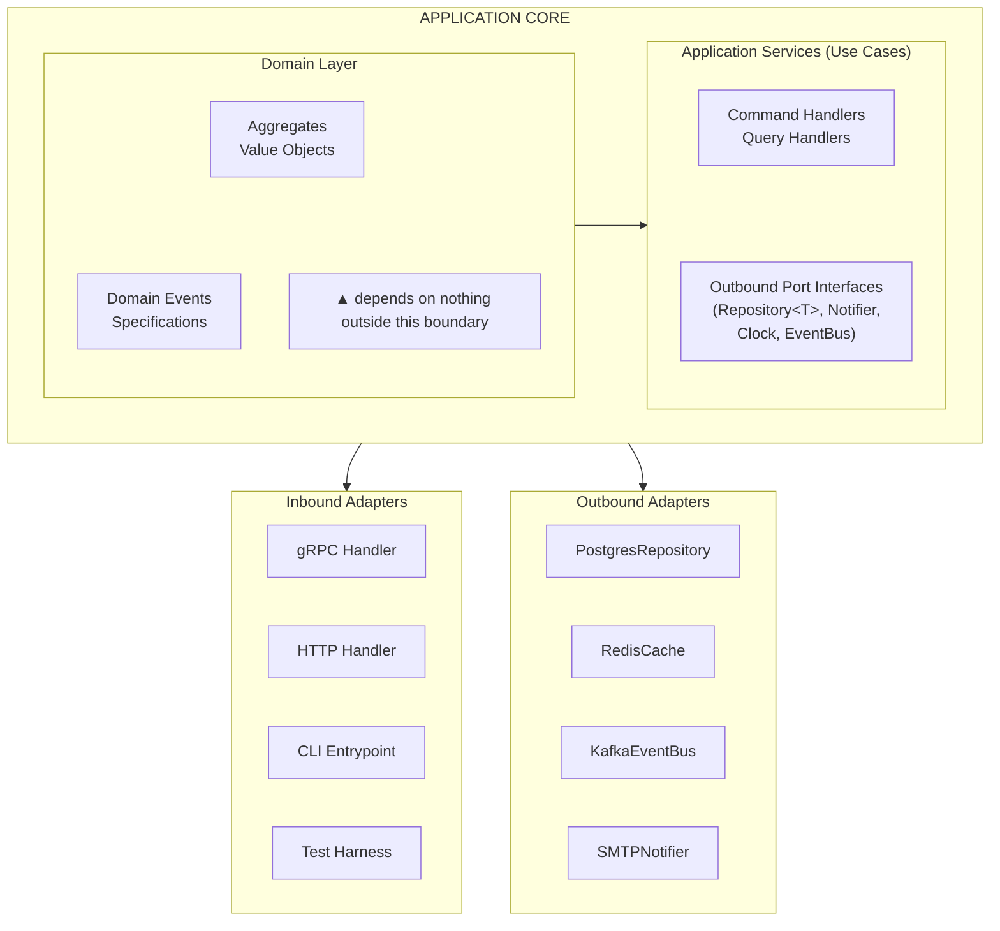

# Lesson 1: Foundational Design Principles

## 1. First-Principles Intuition & Invariants

Every software system that has survived the pressures of production—teams scaling from three engineers to three hundred, requirements shifting under regulatory winds, hardware generations turning over—shares a structural quality that is difficult to point at directly but immediately recognizable in its absence. That quality is *architectural soundness*: a disciplined organization of responsibilities such that the system can be reasoned about, modified, and extended without each change propagating destructively into unrelated parts. The goal of this lesson is to build a first-principles model of what architectural soundness actually means at the level of mechanism, not metaphor.

The intuition begins with a physical observation. A processor cache line is 64 bytes on every major modern architecture—x86-64, ARM64, RISC-V. The hardware prefetcher operates on the assumption that memory accesses are spatially and temporally local: data that belongs together is fetched together and evicted together. When software violates that assumption—scattering logically related fields across heap allocations, jumping between cold code paths, or touching unrelated subsystems to accomplish a single operation—the hardware pays a measurable penalty in cache misses and pipeline stalls. The architectural principle of *cohesion* is, at its deepest level, the same invariant expressed in software terms: things that change together, that are used together, that reason about the same domain concept, should live together. This is not an aesthetic preference. It is an empirical observation about how both cognitive load and runtime cost accumulate when related behavior is fragmented.

The complementary invariant is *coupling*, and understanding it requires distinguishing between two fundamentally different kinds. *Afferent coupling* (Ca) measures how many modules depend on a given module—it is a measure of responsibility and stability. *Efferent coupling* (Ce) measures how many external modules a given component depends on—it is a measure of fragility and volatility. Robert Martin formalized the relationship between these in the *Instability* metric, defined as $I = C_e / (C_a + C_e)$, where $I = 0$ denotes a maximally stable component that nothing depends on externally, and $I = 1$ denotes a maximally unstable component that depends heavily on others but is depended upon by nothing. Sound architecture pushes stable abstractions—your domain model, your core interfaces, your type system—toward $I = 0$, and confines volatile details—database drivers, HTTP transports, third-party clients—to components near $I = 1$. The violation of this gradient is one of the most common failure modes in real production codebases: a business-critical rule is implemented directly against a database schema, making the rule as volatile as the persistence layer.

*Separation of concerns* is the organizing principle that makes the coupling gradient achievable. Its canonical statement—that each module should address one concern—is so often repeated that engineers begin treating it as a slogan rather than a constraint. The operative word is *concern*, not *function*. A concern is a cross-cutting dimension of change: persistence is a concern, authentication is a concern, serialization is a concern, rate limiting is a concern. A module that conflates two concerns is not merely verbose; it creates a *dependency on two independent axes of change*, which means that a change to either axis forces a recompile, retest, and re-review of the same module. Over time, modules that conflate concerns become the most expensive to touch, because every change to them is a potential regression for unrelated behavior.

The third invariant governing structural decomposition is the *abstraction boundary*. An abstraction boundary is a surface through which one part of a system communicates with another using a contract that conceals the implementation on the other side. The contract is the only thing either party is allowed to depend on. This sounds straightforward until you encounter the two ways it is routinely violated. The first is *leaky abstraction*, where implementation details bleed through the contract surface—a function that returns an `sql.Rows` cursor from a repository interface, a cache that exposes its eviction policy through its public API, a parser that propagates internal token types into calling code. Each leak creates an invisible coupling between the caller and the implementation, defeating the purpose of the boundary entirely. The second violation is *phantom abstraction*: an interface with a single implementation that exists solely to satisfy a dependency injection framework, adding indirection without adding isolation. Sound abstraction boundaries represent genuine points of substitutability, not bureaucratic ceremony.

These three invariants—cohesion, coupling direction, and abstraction fidelity—interact with each other in a way that makes them more useful understood together than separately. High cohesion within a module tends to reduce its efferent coupling, because a module with a single, well-defined concern needs fewer external collaborators to fulfill it. Low efferent coupling makes abstraction boundaries easier to define cleanly, because the surface area of dependency is small and well-understood. Clean abstraction boundaries, in turn, enable high cohesion by allowing each module to reason entirely within its own domain without needing to know how other modules implement theirs. The three form a closed reinforcing loop, and the goal of architectural design is to find decompositions that push all three into their virtuous regime simultaneously.

Before moving to mechanics, it is worth naming the governing meta-principle that unifies all of this: *change locality*. A well-architected system is one in which any foreseeable change—a new persistence backend, a new authentication protocol, a new serialization format—touches the minimum number of modules necessary to implement that change, and those modules form a contiguous, comprehensible cluster. Measuring change locality is not purely theoretical. You can audit it empirically by examining your version control history: modules that appear together in commits across unrelated feature changes are architecturally coupled regardless of what the import graph claims. This historical coupling is often more truthful than any diagram.

---

## 2. Core Architecture & Mechanics

To move from principle to structure, consider the architecture of a production-grade service with a non-trivial domain. The design challenge is not selecting a pattern name—hexagonal, clean, onion—but understanding the *mechanical reason* each boundary exists and what invariant it enforces.

The core structural model that best expresses the invariants above is the *dependency inversion principle*: high-level policy modules should not depend on low-level detail modules; both should depend on abstractions. The direction of source-code dependency must be the inverse of the direction of control flow wherever a volatile detail needs to be isolated from stable policy. This gives rise to what is commonly called a *ports and adapters* structure, whose internal mechanics are worth examining precisely.



The critical mechanical detail here is the direction of the arrows. The domain layer depends on nothing. The application services depend only on the domain layer and on *interfaces* defined within the application boundary itself—the outbound ports. The adapters depend on those interfaces. At runtime, a dependency injection container or manual wiring inverts control so that a `PostgresRepository` struct implementing the `Repository[T]` interface is injected into the command handler—but at compile time, the application core has zero import of `github.com/lib/pq` or any database driver. The boundary is enforced not by convention but by the import graph, which the compiler validates on every build.

This is not theoretical neatness. Consider what happens to the Go import graph when this invariant is maintained:

```go
// domain/order.go — zero external imports
package domain

import "time"

type OrderID string
type CustomerID string

type OrderStatus int

const (
    OrderStatusPending   OrderStatus = iota
    OrderStatusConfirmed
    OrderStatusShipped
    OrderStatusCancelled
)

type Order struct {
    id         OrderID
    customerID CustomerID
    items       []LineItem
    status      OrderStatus
    placedAt   time.Time
    version    int
}

// NewOrder enforces the invariant that an order must have at least one line item.
// This is a domain rule, not a validation rule, and belongs here unconditionally.
func NewOrder(id OrderID, customerID CustomerID, items []LineItem, now time.Time) (*Order, error) {
    if len(items) == 0 {
        return nil, ErrOrderMustHaveItems
    }
    return &Order{
        id:         id,
        customerID: customerID,
        items:       items,
        status:      OrderStatusPending,
        placedAt:   now,
        version:    1,
    }, nil
}

func (o *Order) Confirm() error {
    if o.status != OrderStatusPending {
        return ErrOrderNotConfirmable
    }
    o.status = OrderStatusConfirmed
    o.version++
    return nil
}

func (o *Order) ID() OrderID           { return o.id }
func (o *Order) CustomerID() CustomerID { return o.customerID }
func (o *Order) Status() OrderStatus   { return o.status }
func (o *Order) Version() int          { return o.version }
func (o *Order) Items() []LineItem      { return o.items }
```

```go
// domain/repository.go — the outbound port, defined in the domain's vocabulary
package domain

import "context"

// OrderRepository is the abstraction boundary between the application core
// and any persistence mechanism. It speaks only in domain types.
type OrderRepository interface {
    Save(ctx context.Context, order *Order) error
    FindByID(ctx context.Context, id OrderID) (*Order, error)
    FindByCustomer(ctx context.Context, customerID CustomerID) ([]*Order, error)
}
```

```go
// application/place_order.go — depends on domain, depends on port interface
package application

import (
    "context"
    "time"

    "yourorg/orders/domain"
)

type IDGenerator interface {
    NewOrderID() domain.OrderID
}

type Clock interface {
    Now() time.Time
}

type PlaceOrderCommand struct {
    CustomerID domain.CustomerID
    Items      []domain.LineItem
}

type PlaceOrderHandler struct {
    orders domain.OrderRepository
    ids    IDGenerator
    clock  Clock
}

func NewPlaceOrderHandler(
    orders domain.OrderRepository,
    ids IDGenerator,
    clock Clock,
) *PlaceOrderHandler {
    return &PlaceOrderHandler{orders: orders, ids: ids, clock: clock}
}

func (h *PlaceOrderHandler) Handle(ctx context.Context, cmd PlaceOrderCommand) (domain.OrderID, error) {
    id := h.ids.NewOrderID()
    order, err := domain.NewOrder(id, cmd.CustomerID, cmd.Items, h.clock.Now())
    if err != nil {
        return "", err
    }
    if err := h.orders.Save(ctx, order); err != nil {
        return "", err
    }
    return order.ID(), nil
}
```

```go
// adapters/postgres/order_repository.go — depends on domain port, depends on pg driver
package postgres

import (
    "context"
    "database/sql"
    "fmt"

    _ "github.com/lib/pq"
    "yourorg/orders/domain"
)

type OrderRepository struct {
    db *sql.DB
}

func NewOrderRepository(db *sql.DB) *OrderRepository {
    return &OrderRepository{db: db}
}

func (r *OrderRepository) Save(ctx context.Context, order *domain.Order) error {
    query := `
        INSERT INTO orders (id, customer_id, status, placed_at, version)
        VALUES ($1, $2, $3, $4, $5)
        ON CONFLICT (id) DO UPDATE
            SET status  = EXCLUDED.status,
                version = EXCLUDED.version
        WHERE orders.version = $5 - 1
    `
    result, err := r.db.ExecContext(ctx, query,
        string(order.ID()),
        string(order.CustomerID()),
        int(order.Status()),
        order.PlacedAt(),
        order.Version(),
    )
    if err != nil {
        return fmt.Errorf("postgres: save order: %w", err)
    }
    rows, err := result.RowsAffected()
    if err != nil {
        return fmt.Errorf("postgres: save order rows affected: %w", err)
    }
    if rows == 0 {
        return domain.ErrOptimisticLockConflict
    }
    return nil
}

func (r *OrderRepository) FindByID(ctx context.Context, id domain.OrderID) (*domain.Order, error) {
    row := r.db.QueryRowContext(ctx,
        `SELECT id, customer_id, status, placed_at, version FROM orders WHERE id = $1`,
        string(id),
    )
    return scanOrder(row)
}

func (r *OrderRepository) FindByCustomer(ctx context.Context, customerID domain.CustomerID) ([]*domain.Order, error) {
    rows, err := r.db.QueryContext(ctx,
        `SELECT id, customer_id, status, placed_at, version FROM orders WHERE customer_id = $1`,
        string(customerID),
    )
    if err != nil {
        return nil, fmt.Errorf("postgres: find by customer: %w", err)
    }
    defer rows.Close()

    var orders []*domain.Order
    for rows.Next() {
        order, err := scanOrder(rows)
        if err != nil {
            return nil, err
        }
        orders = append(orders, order)
    }
    return orders, rows.Err()
}

type scannable interface {
    Scan(dest ...any) error
}

func scanOrder(s scannable) (*domain.Order, error) {
    var (
        id         string
        customerID string
        status     int
        placedAt   sql.NullTime
        version    int
    )
    if err := s.Scan(&id, &customerID, &status, &placedAt, &version); err != nil {
        if err == sql.ErrNoRows {
            return nil, domain.ErrOrderNotFound
        }
        return nil, fmt.Errorf("postgres: scan order: %w", err)
    }
    return domain.RehydrateOrder(
        domain.OrderID(id),
        domain.CustomerID(customerID),
        domain.OrderStatus(status),
        placedAt.Time,
        version,
    ), nil
}
```

The structural discipline enforced here is worth making explicit. The `adapters/postgres` package imports `domain` and `database/sql`. The `application` package imports `domain` only. The `domain` package imports nothing but the standard library. The Go compiler enforces this graph on every build—there is no way to accidentally introduce a database import into the domain layer without the build failing. This is what it means to use the type system and module system as an *architectural enforcement mechanism*, not merely as a documentation aid.

Notice also the `RehydrateOrder` constructor in the postgres adapter. Persistence requires reconstructing an aggregate from stored fields, bypassing the creation invariants that `NewOrder` enforces—you are loading an existing order, not creating a new one. Providing a separate `RehydrateOrder` function in the domain package acknowledges this honestly, rather than abusing `NewOrder` with sentinel values or exposing all fields publicly for the adapter to set directly. The abstraction boundary between domain and persistence is maintained precisely because we acknowledge the two distinct operations: construction and reconstitution.

The dependency injection wiring that connects these layers at runtime is the final structural piece:

```go
// cmd/server/main.go — the composition root
package main

import (
    "database/sql"
    "log"
    "net/http"

    "yourorg/orders/adapters/postgres"
    "yourorg/orders/adapters/rest"
    "yourorg/orders/application"
    "yourorg/orders/infrastructure"
)

func main() {
    db, err := sql.Open("postgres", mustEnv("DATABASE_URL"))
    if err != nil {
        log.Fatalf("open db: %v", err)
    }
    defer db.Close()

    orderRepo  := postgres.NewOrderRepository(db)
    idGen      := infrastructure.NewULIDGenerator()
    clock      := infrastructure.NewSystemClock()
    placeOrder := application.NewPlaceOrderHandler(orderRepo, idGen, clock)

    srv := rest.NewServer(placeOrder)
    log.Fatal(http.ListenAndServe(mustEnv("LISTEN_ADDR"), srv))
}
```

The composition root is the only place in the entire codebase where all packages are imported simultaneously. It is the architectural seam where runtime wiring is performed without polluting any individual layer with knowledge of the others. Every `New*` constructor takes only interfaces, and those interfaces are defined in the layer that uses them, not the layer that implements them—this is the dependency inversion principle expressed in code rather than prose.

---

## 3. High-Performance Optimization & Failure Modes

The boundary discipline described above pays compounding returns at scale, but it also introduces specific failure modes that engineers must actively manage. Understanding these failure modes is as important as understanding the principles themselves.

**The Abstraction Tax and When to Pay It**

Every abstraction boundary imposes indirection. In Go and Rust, an interface dispatch involves a vtable lookup; in C, a function pointer dereference. At the scale of millions of calls per second in a hot path—say, a codec processing audio frames or a serializer running in a request-handling loop—this indirection can displace code from the instruction cache and prevent inlining, with measurable throughput consequences. The correct response is not to abandon abstraction boundaries but to *locate them deliberately*. Boundaries belong at integration seams—the edges between subsystems, between domain logic and infrastructure, between network layers. They do not belong inside tight computational kernels. A well-architected system places its interface boundaries at the entry and exit points of its hot paths, allowing the internal implementation to be a single concrete type that the compiler can inline and optimize freely.

Benchmarking this tradeoff is straightforward in Go using `testing.B`:

```go
// benchmark/dispatch_test.go
package benchmark

import "testing"

type Processor interface {
    Process(data []byte) int
}

type ConcreteProcessor struct{}

func (p *ConcreteProcessor) Process(data []byte) int {
    n := 0
    for _, b := range data {
        n += int(b)
    }
    return n
}

var payload = make([]byte, 4096)

// BenchmarkConcrete measures direct struct dispatch — compiler can inline.
func BenchmarkConcrete(b *testing.B) {
    p := &ConcreteProcessor{}
    b.ResetTimer()
    for i := 0; i < b.N; i++ {
        _ = p.Process(payload)
    }
}

// BenchmarkInterface measures interface dispatch — vtable indirection prevents inlining.
func BenchmarkInterface(b *testing.B) {
    var p Processor = &ConcreteProcessor{}
    b.ResetTimer()
    for i := 0; i < b.N; i++ {
        _ = p.Process(payload)
    }
}
```

Run this with `go test -bench=. -benchmem -count=5 ./benchmark/` and examine the ns/op difference. On a modern x86-64 processor the gap is typically small for this workload because the branch predictor learns the monomorphic dispatch site, but in polymorphic dispatch scenarios with multiple concrete types in rotation, the indirect branch misprediction rate rises sharply and the gap widens significantly. The lesson is to *measure before placing a boundary inside a hot path*, not to avoid boundaries wholesale.

**Cohesion Drift Under Organizational Pressure**

The most common and least dramatic failure mode in production systems is not a dramatic architectural mistake but *cohesion drift*: the gradual accumulation of responsibilities in modules that began well-designed. A `UserService` starts by managing user lifecycle. It acquires authentication logic because "it already knows about users." Then notification preferences, because those are user attributes. Then audit logging. Then rate limiting per user. Each addition is locally defensible. Collectively, they transform the module into a dependency magnet with $C_a$ approaching the total module count of the codebase—a maximally stable but maximally bloated component that becomes the most expensive file to change because every change is an implicit regression risk for all its clients.

The diagnostic tool for cohesion drift is not a linter but a *change history analysis*. The following shell pipeline extracts co-change frequency from a Git log to surface hidden coupling:

```bash
# Identify files that changed together most frequently in the last 500 commits.
# This reveals historical coupling that the import graph may not show.
git log --name-only --pretty=format: -500 \
  | grep -v '^$' \
  | sort \
  | uniq -c \
  | sort -rn \
  | head -40
```

For pairwise co-change frequency between specific files:

```bash
# Count how many commits touched both user_service.go and order_service.go
git log --oneline --all \
  | awk '{print $1}' \
  | xargs -I{} git diff-tree --no-commit-id -r --name-only {} \
  | awk 'prev && /order_service/ && prev ~ /user_service/ { count++ } { prev=$0 } END { print count }'
```

A module appearing in commits alongside many unrelated modules is exhibiting historical coupling regardless of what its type signature claims. This is the signal to extract: take the concern that co-changes most with external modules and give it its own cohesive home.

**The Leaky Abstraction Failure Mode in Type Systems**

In statically typed languages, abstraction leaks are often invisible until a substitution is attempted. The canonical pattern is an interface method that returns a concrete type from the implementing library:

```go
// BAD: leaks the sql package through the port interface.
// Every caller of OrderRepository now transitively imports database/sql.
type OrderRepository interface {
    FindByID(ctx context.Context, id OrderID) (*sql.Row, error)
}
```

```go
// CORRECT: the port returns a domain type. sql.Row is an implementation detail
// of whatever adapter implements this interface.
type OrderRepository interface {
    FindByID(ctx context.Context, id OrderID) (*Order, error)
}
```

The corrected version ensures that swapping the postgres adapter for an in-memory test double requires touching zero files in the application or domain layers. Run `go build ./...` after any interface change and inspect which packages require recompilation: if packages outside the adapter recompile when you change the adapter's internal implementation, you have a leak.

**Optimistic Locking as an Architectural Invariant**

The `Save` implementation above includes a version-based optimistic lock enforced at the SQL level. This is not an incidental detail—it is an architectural invariant that prevents the aggregate from being overwritten by a stale write in a concurrent system. The domain model increments `version` on every state transition. The persistence adapter includes a `WHERE version = $expected` predicate in the update. If the row was modified by another writer between the read and the write, zero rows are affected and the domain error `ErrOptimisticLockConflict` propagates to the application service, which can retry or surface the conflict to the caller.

The architectural principle at work is that *concurrency control belongs to the domain model*, not to the database transaction isolation level. Relying on `SERIALIZABLE` transaction isolation for correctness creates an invisible coupling between the domain logic and the database's concurrency model—a lock that only works with one class of persistence backend and that generates transaction retry errors with no domain meaning. Version-based optimistic locking is portable, explicit, and expressible in every persistence technology from PostgreSQL to DynamoDB to in-memory maps.

**Measuring Structural Health with Static Analysis**

Go's `golang.org/x/tools/cmd/deadcode` and the `go-critic` linter suite provide automated coupling metrics, but the most targeted tool for detecting abstraction boundary violations is a custom analysis pass using `golang.org/x/tools/go/analysis`. The following pass detects imports of adapter packages from the domain or application layers, failing the build on violation:

```go
// analysis/boundarycheck/analyzer.go
package boundarycheck

import (
    "go/ast"
    "strings"

    "golang.org/x/tools/go/analysis"
    "golang.org/x/tools/go/analysis/passes/inspect"
    "golang.org/x/tools/go/ast/inspector"
)

var Analyzer = &analysis.Analyzer{
    Name:     "boundarycheck",
    Doc:      "Rejects imports of adapter packages from domain or application packages.",
    Requires: []*analysis.Analyzer{inspect.Analyzer},
    Run:      run,
}

var forbiddenPrefixes = []string{
    "yourorg/orders/adapters",
    "yourorg/orders/infrastructure",
}

func run(pass *analysis.Pass) (interface{}, error) {
    pkg := pass.Pkg.Path()

    isDomainOrApp := strings.Contains(pkg, "/domain") ||
        strings.Contains(pkg, "/application")

    if !isDomainOrApp {
        return nil, nil
    }

    insp := pass.ResultOf[inspect.Analyzer].(*inspector.Inspector)
    nodeFilter := []ast.Node{(*ast.ImportSpec)(nil)}

    insp.Preorder(nodeFilter, func(n ast.Node) {
        spec := n.(*ast.ImportSpec)
        path := strings.Trim(spec.Path.Value, `"`)
        for _, prefix := range forbiddenPrefixes {
            if strings.HasPrefix(path, prefix) {
                pass.Reportf(spec.Pos(),
                    "boundary violation: %s must not import adapter package %s",
                    pkg, path,
                )
            }
        }
    })

    return nil, nil
}
```

Integrate this analyzer into your CI pipeline via `go vet -vettool=$(which boundarycheck) ./...`. The build fails the moment a domain or application package acquires an adapter import, turning the architectural invariant from a convention documented in a README into a machine-enforced contract. This is the highest-value application of static analysis in architectural work: not catching bugs, but making structural violations impossible to merge.

The cumulative lesson of this chapter is that the foundational principles—cohesion, coupling direction, abstraction fidelity—are not philosophical preferences but engineering constraints with measurable mechanical consequences. They determine how quickly your team can move, how often your CI pipeline turns red on unrelated changes, how much of the codebase must be held in working memory to safely modify any single module. Building the habit of enforcing these invariants at the type system and module boundary level, rather than in design documents and code reviews, is the difference between a system that ages gracefully and one that becomes archaeologically complex within eighteen months of its first production deployment.
