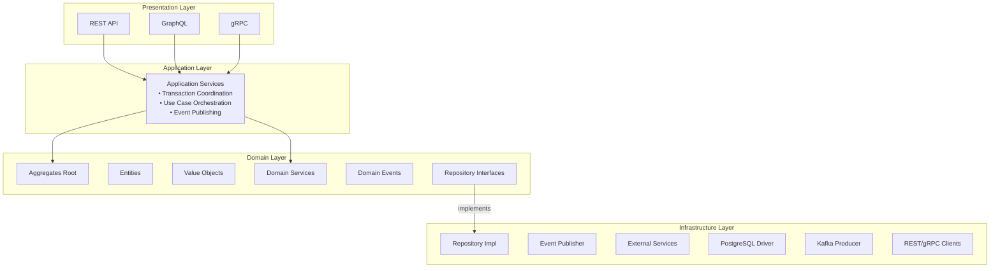

# Lesson 3: Domain-Driven Design

## 1. First-Principles Intuition & Invariants

Software architecture confronts a fundamental epistemological problem: the semantic gap between business intent and executable machine code. Every enterprise system spans a chasm between domain experts who understand business rules and software engineers who understand data structures, type systems, and transaction boundaries. Domain-Driven Design, articulated by Eric Evans in his seminal 2003 text, addresses this gap through a radical proposition—that software architecture must be grounded in an explicit, shared model of the business domain itself, expressed in a language that both domain experts and engineers can manipulate with precision.

The traditional layered architecture approach treats the business domain as a thin veneer atop persistence and infrastructure concerns. Database schemas drive entity design; ORM frameworks dictate aggregate boundaries; and business logic scatters across service layers, controllers, and stored procedures. Domain-Driven Design inverts this relationship. The domain model becomes the central organizing principle, an invariant kernel around which all technical concerns orbit. Persistence mechanisms, API surface areas, and user interface representations become projections and translations of the core model rather than its foundation.

This inversion rests on three foundational invariants. First, the principle of ubiquitous language establishes that every term, concept, and relationship within a bounded context must possess a single, unambiguous definition shared by both business stakeholders and the engineering team. Ambiguity in naming—whether a "Customer" includes prospects, whether an "Order" encompasses quotes, whether "Inventory" means physical stock or available-to-promise—represents not merely communication friction but architectural fragmentation. The ubiquitous language forms a bidirectional contract: domain experts learn to speak with the precision required for executable semantics, while engineers learn to model with the conceptual richness required for business fidelity.

Second, the bounded context principle recognizes that semantic coherence cannot scale globally across an entire enterprise. The term "Account" carries radically different meanings within a billing context, an authentication context, and a general ledger context. Attempting to unify these meanings into a single canonical model produces either an anemic lowest-common-denominator abstraction or a bloated entity carrying the union of all contexts' concerns. Bounded contexts establish explicit boundaries within which a particular model holds complete semantic authority. Across these boundaries, translation layers perform explicit context mapping, acknowledging that semantic impedance mismatches are fundamental rather than incidental.

Third, the aggregate pattern enforces transactional consistency boundaries that align with business invariants rather than technical convenience. In classical database-centric design, foreign keys and normalization rules drive entity relationships, often producing fine-grained object graphs traversable through lazy-loading proxies. Aggregates instead cluster entities and value objects around a single root entity, ensuring that all mutations flow through the root and that all business invariants can be enforced within the aggregate boundary without distributed transactions. An Order aggregate, for instance, might contain OrderLine entities and enforce the invariant that total line item amounts match the order total, but it would not directly contain the Product entities—those belong to a separate Catalog aggregate, referenced only by ProductId value objects.

The interplay between these invariants produces a fourth emergent property: strategic design emerges from tactical modeling. By mapping bounded contexts to team boundaries, service boundaries, and deployment boundaries, Domain-Driven Design provides a systematic decomposition strategy for large systems. The classic Big Ball of Mud antipattern—where every module depends on every other module through a tangled web of cyclic dependencies—arises precisely when bounded contexts blur together. Maintaining strict context boundaries, with carefully designed context maps specifying Shared Kernel, Customer-Supplier, Conformist, or Anticorruption Layer relationships, transforms system evolution from an NP-complete dependency puzzle into a set of localized, independently evolvable models.

The mathematical structure underlying Domain-Driven Design resembles categorical algebra more than set theory. A bounded context forms a category where objects are domain entities and morphisms are domain operations, equipped with composition and identity laws. Functors translate between contexts, preserving structure while potentially collapsing or expanding granularity. Aggregates establish monoidal consistency boundaries—operations within an aggregate compose associatively, and the aggregate root serves as the identity element for external interactions. This algebraic perspective clarifies why certain patterns recur: repository interfaces abstract over persistence as a monad, domain events form an event algebra with projection and folding operations, and sagas coordinate distributed transactions through compensating actions that form an inverse semigroup.

Understanding Domain-Driven Design requires distinguishing between strategic and tactical patterns. Strategic patterns—bounded contexts, context mapping, and subdomains—address the large-scale decomposition problem. Tactical patterns—entities, value objects, aggregates, repositories, domain services, and domain events—address the fine-grained modeling problem within a single context. Both layers matter, but strategic design drives architectural boundaries while tactical design drives code organization. A microservices architecture without clear bounded contexts simply distributes a monolithic model across network boundaries, amplifying rather than resolving coupling. Conversely, exquisite tactical modeling within a single sprawling context produces a beautifully structured monolith that cannot evolve independently across teams or business capabilities.

The failure modes of Domain-Driven Design cluster around semantic drift and boundary erosion. Semantic drift occurs when the ubiquitous language diverges between code and domain experts, typically through gradual vocabulary shifts or the introduction of technical jargon that obscures business meaning. An "OrderProcessor" class that orchestrates workflow bears a superficially domain-oriented name, yet "processor" belongs to technical vocabulary rather than business language. Boundary erosion manifests when aggregates grow too large, encompassing too many entities to load efficiently, or when bounded contexts leak abstractions across their borders, creating hidden dependencies that undermine independent evolution.

## 2. Core Architecture & Mechanics

The internal architecture of a Domain-Driven Design system organizes around a layered dependency structure where the domain model occupies the innermost layer, insulated from infrastructure concerns through carefully designed interfaces. The canonical four-layer architecture positions the domain layer at the core, wrapped by an application layer that coordinates use cases, an infrastructure layer that implements technical concerns like persistence and messaging, and a presentation layer that handles user interface or API contracts. Dependency arrows point exclusively inward—the domain layer depends on nothing external, the application layer depends only on the domain, and outer layers depend on inner abstractions.

Within the domain layer itself, entities represent objects with persistent identity that spans beyond their attribute values. An Order entity possesses an OrderId that remains stable even as line items, shipping addresses, and payment methods change over its lifecycle. The implementation of entity identity determines equality semantics and hash code behavior, critical for correct behavior in collections and caches. In strongly-typed languages, the entity base class or trait typically carries generic type parameters for the identity type, allowing OrderId to be a distinct type from CustomerId, preventing accidental misuse.

```rust
use std::collections::HashMap;
use std::hash::{Hash, Hasher};

// Strongly-typed identity wrapper preventing type confusion
#[derive(Debug, Clone, Copy, PartialEq, Eq, Hash)]
pub struct OrderId(uuid::Uuid);

#[derive(Debug, Clone, Copy, PartialEq, Eq, Hash)]
pub struct CustomerId(uuid::Uuid);

impl OrderId {
    pub fn new() -> Self {
        Self(uuid::Uuid::new_v4())
    }
    
    pub fn from_string(s: &str) -> Result<Self, uuid::Error> {
        Ok(Self(uuid::Uuid::parse_str(s)?))
    }
}

// Entity with explicit identity semantics
pub struct Order {
    id: OrderId,
    customer_id: CustomerId,
    lines: Vec<OrderLine>,
    status: OrderStatus,
    version: u64, // Optimistic locking
}

impl Order {
    pub fn place_order(id: OrderId, customer_id: CustomerId, lines: Vec<OrderLine>) -> Result<Self, DomainError> {
        if lines.is_empty() {
            return Err(DomainError::EmptyOrder);
        }
        
        let total = lines.iter().map(|l| l.total()).sum::<Money>();
        if total.amount() <= 0 {
            return Err(DomainError::InvalidTotal);
        }
        
        Ok(Self {
            id,
            customer_id,
            lines,
            status: OrderStatus::Pending,
            version: 0,
        })
    }
    
    pub fn add_line(&mut self, line: OrderLine) -> Result<(), DomainError> {
        if !self.status.allows_modification() {
            return Err(DomainError::OrderNotModifiable);
        }
        self.lines.push(line);
        self.version += 1;
        Ok(())
    }
    
    pub fn confirm(&mut self) -> Result<OrderConfirmed, DomainError> {
        if self.status != OrderStatus::Pending {
            return Err(DomainError::InvalidStateTransition);
        }
        self.status = OrderStatus::Confirmed;
        self.version += 1;
        Ok(OrderConfirmed {
            order_id: self.id,
            confirmed_at: chrono::Utc::now(),
        })
    }
    
    pub fn id(&self) -> OrderId {
        self.id
    }
    
    pub fn total(&self) -> Money {
        self.lines.iter().map(|l| l.total()).sum()
    }
}

// Entities compare by identity, not by attribute values
impl PartialEq for Order {
    fn eq(&self, other: &Self) -> bool {
        self.id == other.id
    }
}

impl Eq for Order {}

impl Hash for Order {
    fn hash<H: Hasher>(&self, state: &mut H) {
        self.id.hash(state);
    }
}

#[derive(Debug, Clone, PartialEq, Eq)]
pub enum OrderStatus {
    Pending,
    Confirmed,
    Shipped,
    Delivered,
    Cancelled,
}

impl OrderStatus {
    pub fn allows_modification(&self) -> bool {
        matches!(self, OrderStatus::Pending)
    }
}
```

Value objects contrast sharply with entities by lacking persistent identity. Two Money instances with identical currency and amount are interchangeable; two Address instances with identical street, city, and postal code represent the same location. Value objects are immutable, and equality is structural rather than referential. This immutability makes value objects inherently thread-safe and cacheable, suitable for sharing across aggregate boundaries without defensive copying. The implementation of value objects leverages the type system to encode business rules: a negative Money amount might be a separate Debit type, a malformed email address cannot be constructed, and a date range enforces that the end date follows the start date.

```rust
use std::fmt;

// Value object with structural equality and validation invariants
#[derive(Debug, Clone, Copy, PartialEq, Eq, Hash)]
pub struct Money {
    amount_cents: i64,
    currency: Currency,
}

impl Money {
    pub fn new(amount_cents: i64, currency: Currency) -> Result<Self, DomainError> {
        if amount_cents < 0 {
            return Err(DomainError::NegativeAmount);
        }
        Ok(Self { amount_cents, currency })
    }
    
    pub fn amount(&self) -> i64 {
        self.amount_cents
    }
    
    pub fn add(&self, other: &Money) -> Result<Money, DomainError> {
        if self.currency != other.currency {
            return Err(DomainError::CurrencyMismatch);
        }
        Ok(Money {
            amount_cents: self.amount_cents + other.amount_cents,
            currency: self.currency,
        })
    }
}

impl std::iter::Sum for Money {
    fn sum<I: Iterator<Item = Money>>(mut iter: I) -> Self {
        let first = iter.next().unwrap_or(Money { amount_cents: 0, currency: Currency::USD });
        iter.fold(first, |acc, m| acc.add(&m).unwrap())
    }
}

#[derive(Debug, Clone, Copy, PartialEq, Eq, Hash)]
pub enum Currency {
    USD,
    EUR,
    GBP,
}

#[derive(Debug, Clone, PartialEq, Eq)]
pub struct EmailAddress(String);

impl EmailAddress {
    pub fn new(email: String) -> Result<Self, DomainError> {
        // Simplified validation - production would use proper RFC 5322 parser
        if !email.contains('@') || email.len() < 3 {
            return Err(DomainError::InvalidEmail);
        }
        Ok(Self(email))
    }
    
    pub fn as_str(&self) -> &str {
        &self.0
    }
}

impl fmt::Display for EmailAddress {
    fn fmt(&self, f: &mut fmt::Formatter<'_>) -> fmt::Result {
        write!(f, "{}", self.0)
    }
}
```

Aggregates cluster entities and value objects into consistency boundaries, designating one entity as the aggregate root through which all external access flows. The root enforces invariants across the entire cluster. External entities hold references only to the root, never to internal entities, preventing bypass of invariant enforcement. This boundary alignment produces crucial performance and scalability properties: aggregates define the unit of optimistic locking, the unit of serialization for event sourcing, and the granularity of caching. An aggregate that grows too large becomes a concurrency bottleneck, as every mutation requires exclusive access to the entire graph. An aggregate that spans too few entities fails to protect invariants, requiring distributed transactions to maintain consistency.

```rust
// Aggregate root enforcing cross-entity invariants
pub struct ShoppingCart {
    id: CartId,
    customer_id: CustomerId,
    items: HashMap<ProductId, CartItem>,
    discount: Option<DiscountCode>,
    version: u64,
}

impl ShoppingCart {
    pub fn new(id: CartId, customer_id: CustomerId) -> Self {
        Self {
            id,
            customer_id,
            items: HashMap::new(),
            discount: None,
            version: 0,
        }
    }
    
    pub fn add_item(&mut self, product_id: ProductId, quantity: u32, unit_price: Money) -> Result<(), DomainError> {
        if quantity == 0 {
            return Err(DomainError::InvalidQuantity);
        }
        
        self.items
            .entry(product_id)
            .and_modify(|item| item.increase_quantity(quantity))
            .or_insert_with(|| CartItem::new(product_id, quantity, unit_price));
        
        self.version += 1;
        Ok(())
    }
    
    pub fn apply_discount(&mut self, code: DiscountCode) -> Result<(), DomainError> {
        let subtotal = self.subtotal();
        if !code.is_valid_for_amount(subtotal) {
            return Err(DomainError::DiscountNotApplicable);
        }
        self.discount = Some(code);
        self.version += 1;
        Ok(())
    }
    
    pub fn remove_item(&mut self, product_id: ProductId) -> Result<(), DomainError> {
        if self.items.remove(&product_id).is_none() {
            return Err(DomainError::ItemNotFound);
        }
        // Revalidate discount when cart contents change
        if let Some(ref discount) = self.discount {
            if !discount.is_valid_for_amount(self.subtotal()) {
                self.discount = None;
            }
        }
        self.version += 1;
        Ok(())
    }
    
    pub fn subtotal(&self) -> Money {
        self.items.values().map(|item| item.total()).sum()
    }
    
    pub fn total(&self) -> Money {
        let subtotal = self.subtotal();
        match &self.discount {
            Some(code) => code.apply(subtotal).unwrap_or(subtotal),
            None => subtotal,
        }
    }
    
    pub fn checkout(self) -> Result<Order, DomainError> {
        if self.items.is_empty() {
            return Err(DomainError::EmptyCart);
        }
        
        let lines = self.items.into_iter()
            .map(|(_, item)| item.to_order_line())
            .collect();
        
        Order::place_order(
            OrderId::new(),
            self.customer_id,
            lines,
        )
    }
}

#[derive(Debug, Clone, Copy, PartialEq, Eq, Hash)]
pub struct CartId(uuid::Uuid);

#[derive(Debug, Clone, Copy, PartialEq, Eq, Hash)]
pub struct ProductId(uuid::Uuid);

// Internal entity within Cart aggregate - not directly accessible from outside
#[derive(Debug, Clone)]
struct CartItem {
    product_id: ProductId,
    quantity: u32,
    unit_price: Money,
}

impl CartItem {
    fn new(product_id: ProductId, quantity: u32, unit_price: Money) -> Self {
        Self { product_id, quantity, unit_price }
    }
    
    fn increase_quantity(&mut self, amount: u32) {
        self.quantity += amount;
    }
    
    fn total(&self) -> Money {
        Money::new(
            self.unit_price.amount() * self.quantity as i64,
            Currency::USD,
        ).unwrap()
    }
    
    fn to_order_line(self) -> OrderLine {
        OrderLine::new(self.product_id, self.quantity, self.unit_price)
    }
}

#[derive(Debug, Clone)]
pub struct OrderLine {
    product_id: ProductId,
    quantity: u32,
    unit_price: Money,
}

impl OrderLine {
    pub fn new(product_id: ProductId, quantity: u32, unit_price: Money) -> Self {
        Self { product_id, quantity, unit_price }
    }
    
    pub fn total(&self) -> Money {
        Money::new(
            self.unit_price.amount() * self.quantity as i64,
            Currency::USD,
        ).unwrap()
    }
}

#[derive(Debug, Clone)]
pub struct DiscountCode {
    code: String,
    percentage: u8,
    minimum_amount: Money,
}

impl DiscountCode {
    pub fn is_valid_for_amount(&self, amount: Money) -> bool {
        amount.amount() >= self.minimum_amount.amount()
    }
    
    pub fn apply(&self, amount: Money) -> Result<Money, DomainError> {
        let discount = amount.amount() * self.percentage as i64 / 100;
        Money::new(amount.amount() - discount, Currency::USD)
    }
}

#[derive(Debug)]
pub enum DomainError {
    EmptyOrder,
    EmptyCart,
    InvalidTotal,
    InvalidQuantity,
    OrderNotModifiable,
    InvalidStateTransition,
    NegativeAmount,
    CurrencyMismatch,
    InvalidEmail,
    DiscountNotApplicable,
    ItemNotFound,
}
```

Repositories abstract persistence mechanisms, providing collection-like interfaces for aggregate retrieval and storage. The repository interface belongs to the domain layer, declaring the contract in terms of domain concepts, while the implementation resides in the infrastructure layer, translating between domain aggregates and storage representations. This inversion of control allows domain logic to remain ignorant of whether aggregates persist in a relational database, document store, or event stream. Repository interfaces typically provide methods like `find_by_id`, `save`, and domain-specific query methods like `find_orders_for_customer`, but avoid exposing generic query builders that leak persistence concerns into the domain.

```rust
use async_trait::async_trait;

// Repository interface in domain layer - no persistence details
#[async_trait]
pub trait OrderRepository {
    async fn find_by_id(&self, id: OrderId) -> Result<Option<Order>, RepositoryError>;
    async fn find_by_customer(&self, customer_id: CustomerId) -> Result<Vec<Order>, RepositoryError>;
    async fn save(&self, order: &Order) -> Result<(), RepositoryError>;
    async fn next_id(&self) -> OrderId;
}

#[async_trait]
pub trait ShoppingCartRepository {
    async fn find_by_id(&self, id: CartId) -> Result<Option<ShoppingCart>, RepositoryError>;
    async fn find_by_customer(&self, customer_id: CustomerId) -> Result<Option<ShoppingCart>, RepositoryError>;
    async fn save(&self, cart: &ShoppingCart) -> Result<(), RepositoryError>;
}

#[derive(Debug)]
pub enum RepositoryError {
    NotFound,
    ConcurrencyConflict,
    ConnectionFailed,
    SerializationError,
}

// Infrastructure implementation using PostgreSQL
pub struct PostgresOrderRepository {
    pool: sqlx::PgPool,
}

impl PostgresOrderRepository {
    pub fn new(pool: sqlx::PgPool) -> Self {
        Self { pool }
    }
}

#[async_trait]
impl OrderRepository for PostgresOrderRepository {
    async fn find_by_id(&self, id: OrderId) -> Result<Option<Order>, RepositoryError> {
        let result = sqlx::query!(
            r#"
            SELECT id, customer_id, status, version
            FROM orders
            WHERE id = $1
            "#,
            id.to_string()
        )
        .fetch_optional(&self.pool)
        .await
        .map_err(|_| RepositoryError::ConnectionFailed)?;
        
        let Some(row) = result else {
            return Ok(None);
        };
        
        let lines = sqlx::query!(
            r#"
            SELECT product_id, quantity, unit_price_cents
            FROM order_lines
            WHERE order_id = $1
            "#,
            id.to_string()
        )
        .fetch_all(&self.pool)
        .await
        .map_err(|_| RepositoryError::ConnectionFailed)?;
        
        // Reconstruct aggregate from relational representation
        let order_lines: Vec<OrderLine> = lines
            .into_iter()
            .map(|row| {
                OrderLine::new(
                    ProductId::from_uuid(uuid::Uuid::parse_str(&row.product_id).unwrap()),
                    row.quantity as u32,
                    Money::new(row.unit_price_cents as i64, Currency::USD).unwrap(),
                )
            })
            .collect();
        
        // Reconstitution bypasses factory validation since data already validated
        Ok(Some(Order::reconstitute(
            OrderId::from_string(&row.id).unwrap(),
            CustomerId::from_string(&row.customer_id).unwrap(),
            order_lines,
            OrderStatus::from_string(&row.status),
            row.version as u64,
        )))
    }
    
    async fn save(&self, order: &Order) -> Result<(), RepositoryError> {
        let mut tx = self.pool.begin().await
            .map_err(|_| RepositoryError::ConnectionFailed)?;
        
        // Optimistic locking check
        let existing_version = sqlx::query_scalar!(
            r#"SELECT version FROM orders WHERE id = $1"#,
            order.id().to_string()
        )
        .fetch_optional(&mut *tx)
        .await
        .map_err(|_| RepositoryError::ConnectionFailed)?;
        
        if let Some(version) = existing_version {
            if version as u64 != order.version() - 1 {
                return Err(RepositoryError::ConcurrencyConflict);
            }
        }
        
        sqlx::query!(
            r#"
            INSERT INTO orders (id, customer_id, status, version)
            VALUES ($1, $2, $3, $4)
            ON CONFLICT (id) DO UPDATE
            SET status = $3, version = $4
            "#,
            order.id().to_string(),
            order.customer_id().to_string(),
            order.status().to_string(),
            order.version() as i64,
        )
        .execute(&mut *tx)
        .await
        .map_err(|_| RepositoryError::ConnectionFailed)?;
        
        tx.commit().await
            .map_err(|_| RepositoryError::ConnectionFailed)?;
        
        Ok(())
    }
    
    async fn find_by_customer(&self, customer_id: CustomerId) -> Result<Vec<Order>, RepositoryError> {
        // Implementation elided for brevity
        Ok(vec![])
    }
    
    async fn next_id(&self) -> OrderId {
        OrderId::new()
    }
}

impl ProductId {
    pub fn from_uuid(uuid: uuid::Uuid) -> Self {
        Self(uuid)
    }
}

impl CustomerId {
    pub fn from_string(s: &str) -> Result<Self, uuid::Error> {
        Ok(Self(uuid::Uuid::parse_str(s)?))
    }
    
    pub fn to_string(&self) -> String {
        self.0.to_string()
    }
}

impl OrderId {
    pub fn to_string(&self) -> String {
        self.0.to_string()
    }
}

impl Order {
    // Bypass validation for reconstitution from trusted storage
    pub fn reconstitute(
        id: OrderId,
        customer_id: CustomerId,
        lines: Vec<OrderLine>,
        status: OrderStatus,
        version: u64,
    ) -> Self {
        Self { id, customer_id, lines, status, version }
    }
    
    pub fn version(&self) -> u64 {
        self.version
    }
    
    pub fn customer_id(&self) -> CustomerId {
        self.customer_id
    }
    
    pub fn status(&self) -> &OrderStatus {
        &self.status
    }
}

impl OrderStatus {
    pub fn from_string(s: &str) -> Self {
        match s {
            "Pending" => OrderStatus::Pending,
            "Confirmed" => OrderStatus::Confirmed,
            "Shipped" => OrderStatus::Shipped,
            "Delivered" => OrderStatus::Delivered,
            "Cancelled" => OrderStatus::Cancelled,
            _ => OrderStatus::Pending,
        }
    }
    
    pub fn to_string(&self) -> String {
        format!("{:?}", self)
    }
}
```

Domain services handle operations that do not naturally belong to a single entity or value object, typically involving coordination across multiple aggregates or external systems. A pricing service might compute order totals considering complex discount rules, tax calculations, and currency conversions. A transfer service might orchestrate moving funds between accounts, loading both source and destination aggregates, validating invariants, and persisting both within a transaction. Domain services differ from application services: domain services contain business logic expressed in the ubiquitous language, while application services orchestrate use cases, managing transactions and coordinating between domain objects, repositories, and infrastructure concerns.

```rust
// Domain service encapsulating multi-aggregate business logic
pub struct OrderPricingService {
    tax_calculator: Box<dyn TaxCalculator>,
    currency_converter: Box<dyn CurrencyConverter>,
}

impl OrderPricingService {
    pub fn calculate_total(
        &self,
        order: &Order,
        customer: &Customer,
        shipping_address: &Address,
    ) -> Result<OrderTotal, DomainError> {
        let subtotal = order.total();
        
        // Apply customer-specific discounts
        let discount = self.calculate_customer_discount(customer, subtotal)?;
        let discounted = subtotal.add(&Money::new(-discount.amount(), Currency::USD)?)?;
        
        // Calculate tax based on shipping jurisdiction
        let tax = self.tax_calculator.calculate(discounted, shipping_address)?;
        
        // Convert to customer's preferred currency if needed
        let final_total = if customer.preferred_currency() != Currency::USD {
            self.currency_converter.convert(
                discounted.add(&tax)?,
                Currency::USD,
                customer.preferred_currency(),
            )?
        } else {
            discounted.add(&tax)?
        };
        
        Ok(OrderTotal {
            subtotal,
            discount,
            tax,
            total: final_total,
        })
    }
    
    fn calculate_customer_discount(&self, customer: &Customer, amount: Money) -> Result<Money, DomainError> {
        let percentage = match customer.loyalty_tier() {
            LoyaltyTier::Bronze => 0,
            LoyaltyTier::Silver => 5,
            LoyaltyTier::Gold => 10,
            LoyaltyTier::Platinum => 15,
        };
        Money::new(amount.amount() * percentage / 100, Currency::USD)
    }
}

pub trait TaxCalculator: Send + Sync {
    fn calculate(&self, amount: Money, address: &Address) -> Result<Money, DomainError>;
}

pub trait CurrencyConverter: Send + Sync {
    fn convert(&self, amount: Money, from: Currency, to: Currency) -> Result<Money, DomainError>;
}

pub struct OrderTotal {
    pub subtotal: Money,
    pub discount: Money,
    pub tax: Money,
    pub total: Money,
}

pub struct Customer {
    id: CustomerId,
    loyalty_tier: LoyaltyTier,
    preferred_currency: Currency,
}

impl Customer {
    pub fn loyalty_tier(&self) -> LoyaltyTier {
        self.loyalty_tier
    }
    
    pub fn preferred_currency(&self) -> Currency {
        self.preferred_currency
    }
}

#[derive(Debug, Clone, Copy)]
pub enum LoyaltyTier {
    Bronze,
    Silver,
    Gold,
    Platinum,
}

pub struct Address {
    street: String,
    city: String,
    state: String,
    postal_code: String,
    country: String,
}
```

Domain events capture significant state transitions within aggregates, enabling temporal decoupling between bounded contexts and providing an audit trail of business-level changes. When an order transitions to confirmed status, the aggregate produces an OrderConfirmed event. External contexts subscribe to these events without direct coupling to the Order aggregate. The inventory context might reserve stock upon receiving OrderConfirmed, the shipping context might schedule fulfillment, and the analytics context might update sales projections. Events are immutable facts, named in past tense, carrying sufficient information for subscribers to react without additional queries. The event payload includes the aggregate identity, timestamp, and relevant state snapshots, but avoids embedding entire aggregate graphs.

```rust
use chrono::{DateTime, Utc};
use serde::{Deserialize, Serialize};

// Domain events are immutable facts in past tense
#[derive(Debug, Clone, Serialize, Deserialize)]
pub struct OrderConfirmed {
    pub order_id: OrderId,
    pub confirmed_at: DateTime<Utc>,
}

#[derive(Debug, Clone, Serialize, Deserialize)]
pub struct OrderShipped {
    pub order_id: OrderId,
    pub tracking_number: String,
    pub shipped_at: DateTime<Utc>,
}

#[derive(Debug, Clone, Serialize, Deserialize)]
pub struct CartCheckedOut {
    pub cart_id: CartId,
    pub order_id: OrderId,
    pub customer_id: CustomerId,
    pub total: Money,
    pub checked_out_at: DateTime<Utc>,
}

// Aggregates accumulate events during command processing
impl Order {
    pub fn ship(&mut self, tracking_number: String) -> Result<OrderShipped, DomainError> {
        if self.status != OrderStatus::Confirmed {
            return Err(DomainError::InvalidStateTransition);
        }
        self.status = OrderStatus::Shipped;
        self.version += 1;
        Ok(OrderShipped {
            order_id: self.id,
            tracking_number,
            shipped_at: Utc::now(),
        })
    }
}

// Application service publishes events to message bus
pub struct OrderApplicationService<R: OrderRepository, E: EventPublisher> {
    repository: R,
    event_publisher: E,
}

impl<R: OrderRepository, E: EventPublisher> OrderApplicationService<R, E> {
    pub async fn confirm_order(&self, order_id: OrderId) -> Result<(), ApplicationError> {
        let mut order = self.repository
            .find_by_id(order_id)
            .await?
            .ok_or(ApplicationError::OrderNotFound)?;
        
        let event = order.confirm()?;
        
        self.repository.save(&order).await?;
        self.event_publisher.publish(DomainEvent::OrderConfirmed(event)).await?;
        
        Ok(())
    }
    
    pub async fn ship_order(&self, order_id: OrderId, tracking_number: String) -> Result<(), ApplicationError> {
        let mut order = self.repository
            .find_by_id(order_id)
            .await?
            .ok_or(ApplicationError::OrderNotFound)?;
        
        let event = order.ship(tracking_number)?;
        
        self.repository.save(&order).await?;
        self.event_publisher.publish(DomainEvent::OrderShipped(event)).await?;
        
        Ok(())
    }
}

#[derive(Debug, Clone, Serialize, Deserialize)]
pub enum DomainEvent {
    OrderConfirmed(OrderConfirmed),
    OrderShipped(OrderShipped),
    CartCheckedOut(CartCheckedOut),
}

#[async_trait]
pub trait EventPublisher: Send + Sync {
    async fn publish(&self, event: DomainEvent) -> Result<(), PublishError>;
}

#[derive(Debug)]
pub enum ApplicationError {
    OrderNotFound,
    DomainError(DomainError),
    RepositoryError(RepositoryError),
    PublishError(PublishError),
}

impl From<DomainError> for ApplicationError {
    fn from(e: DomainError) -> Self {
        ApplicationError::DomainError(e)
    }
}

impl From<RepositoryError> for ApplicationError {
    fn from(e: RepositoryError) -> Self {
        ApplicationError::RepositoryError(e)
    }
}

impl From<PublishError> for ApplicationError {
    fn from(e: PublishError) -> Self {
        ApplicationError::PublishError(e)
    }
}

#[derive(Debug)]
pub struct PublishError;
```

The relationship between bounded contexts requires explicit context mapping, a strategic design technique that makes integration patterns visible and intentional. The partnership pattern establishes a shared kernel where two contexts agree on a common model subset, typically used when teams work closely and can coordinate breaking changes. The customer-supplier pattern creates an upstream-downstream relationship where the supplier context defines the integration contract and the customer context adapts to it, useful when consuming stable platform services. The conformist pattern accepts the upstream model without translation, appropriate when the upstream context provides a well-designed model that fits downstream needs. The anticorruption layer pattern interposes a translation boundary that protects the downstream context from upstream model changes, essential when integrating with legacy systems or external APIs that do not align with internal domain concepts.

```rust
// Anticorruption layer translating external API to domain model
pub struct PaymentGatewayAdapter {
    client: reqwest::Client,
    base_url: String,
}

impl PaymentGatewayAdapter {
    pub async fn charge(&self, order: &Order) -> Result<PaymentResult, PaymentError> {
        // External API uses different terminology and structure
        let request = ExternalChargeRequest {
            merchant_reference: order.id().to_string(),
            amount_minor_units: order.total().amount(),
            currency_code: "USD".to_string(),
            card_token: "placeholder".to_string(), // In real system, from separate flow
        };
        
        let response: ExternalChargeResponse = self.client
            .post(format!("{}/v1/charges", self.base_url))
            .json(&request)
            .send()
            .await
            .map_err(|_| PaymentError::NetworkFailure)?
            .json()
            .await
            .map_err(|_| PaymentError::DeserializationFailure)?;
        
        // Translate external response to domain concept
        Ok(PaymentResult {
            transaction_id: TransactionId::new(response.charge_id),
            status: match response.status.as_str() {
                "succeeded" => PaymentStatus::Completed,
                "pending" => PaymentStatus::Pending,
                "failed" => PaymentStatus::Failed,
                _ => PaymentStatus::Unknown,
            },
            authorized_at: chrono::Utc::now(),
        })
    }
}

// External API schema - isolated from domain model
#[derive(Serialize)]
struct ExternalChargeRequest {
    merchant_reference: String,
    amount_minor_units: i64,
    currency_code: String,
    card_token: String,
}

#[derive(Deserialize)]
struct ExternalChargeResponse {
    charge_id: String,
    status: String,
}

// Domain model of payment - independent of external API
pub struct PaymentResult {
    pub transaction_id: TransactionId,
    pub status: PaymentStatus,
    pub authorized_at: DateTime<Utc>,
}

#[derive(Debug, Clone)]
pub struct TransactionId(String);

impl TransactionId {
    pub fn new(id: String) -> Self {
        Self(id)
    }
}

#[derive(Debug, Clone, Copy, PartialEq, Eq)]
pub enum PaymentStatus {
    Pending,
    Completed,
    Failed,
    Unknown,
}

#[derive(Debug)]
pub enum PaymentError {
    NetworkFailure,
    DeserializationFailure,
    InsufficientFunds,
}
```

The architecture diagram below illustrates the dependency flow and component relationships in a canonical Domain-Driven Design implementation:



## 3. High-Performance Optimization & Failure Modes

The primary performance bottleneck in Domain-Driven Design systems emerges from the impedance mismatch between aggregate boundaries and database access patterns. Aggregates enforce transactional consistency within a boundary, requiring the entire aggregate graph to be loaded, modified, and persisted atomically. Large aggregates produce excessive database round trips when hydrating deep object graphs, while fine-grained aggregates scatter related data across multiple transactions, sacrificing consistency. The optimal aggregate size balances invariant enforcement against performance characteristics, typically converging on root plus two to three levels of child entities.

Event sourcing addresses this mismatch by persisting aggregates as sequences of domain events rather than current-state snapshots. The event store appends events to an immutable log, eliminating update anomalies and lock contention. Aggregate reconstitution replays events through a left-fold operation, rebuilding current state from the event history. This approach trades write amplification for perfect auditability and temporal query capabilities. The system can reconstruct aggregate state at any historical point, project multiple read models from the same event stream, and implement sophisticated debugging by replaying events with modified business logic.

```rust
// Event-sourced aggregate stores events instead of current state
pub struct EventSourcedOrder {
    id: OrderId,
    uncommitted_events: Vec<OrderEvent>,
    // Cached state derived from events
    state: OrderState,
}

#[derive(Debug, Clone, Serialize, Deserialize)]
pub enum OrderEvent {
    OrderPlaced {
        order_id: OrderId,
        customer_id: CustomerId,
        lines: Vec<OrderLine>,
        timestamp: DateTime<Utc>,
    },
    OrderLineAdded {
        order_id: OrderId,
        line: OrderLine,
        timestamp: DateTime<Utc>,
    },
    OrderConfirmed {
        order_id: OrderId,
        timestamp: DateTime<Utc>,
    },
    OrderShipped {
        order_id: OrderId,
        tracking_number: String,
        timestamp: DateTime<Utc>,
    },
}

struct OrderState {
    customer_id: CustomerId,
    lines: Vec<OrderLine>,
    status: OrderStatus,
}

impl EventSourcedOrder {
    // Reconstitute from event history
    pub fn from_events(id: OrderId, events: Vec<OrderEvent>) -> Self {
        let state = events.iter().fold(
            OrderState {
                customer_id: CustomerId::from_string("00000000-0000-0000-0000-000000000000").unwrap(),
                lines: vec![],
                status: OrderStatus::Pending,
            },
            |mut state, event| {
                state.apply(event);
                state
            },
        );
        
        Self {
            id,
            uncommitted_events: vec![],
            state,
        }
    }
    
    pub fn place_order(id: OrderId, customer_id: CustomerId, lines: Vec<OrderLine>) -> Result<Self, DomainError> {
        if lines.is_empty() {
            return Err(DomainError::EmptyOrder);
        }
        
        let event = OrderEvent::OrderPlaced {
            order_id: id,
            customer_id,
            lines: lines.clone(),
            timestamp: Utc::now(),
        };
        
        let mut order = Self {
            id,
            uncommitted_events: vec![event.clone()],
            state: OrderState {
                customer_id,
                lines,
                status: OrderStatus::Pending,
            },
        };
        
        order.state.apply(&event);
        Ok(order)
    }
    
    pub fn confirm(&mut self) -> Result<(), DomainError> {
        if self.state.status != OrderStatus::Pending {
            return Err(DomainError::InvalidStateTransition);
        }
        
        let event = OrderEvent::OrderConfirmed {
            order_id: self.id,
            timestamp: Utc::now(),
        };
        
        self.uncommitted_events.push(event.clone());
        self.state.apply(&event);
        Ok(())
    }
    
    pub fn uncommitted_events(&self) -> &[OrderEvent] {
        &self.uncommitted_events
    }
    
    pub fn mark_events_committed(&mut self) {
        self.uncommitted_events.clear();
    }
}

impl OrderState {
    fn apply(&mut self, event: &OrderEvent) {
        match event {
            OrderEvent::OrderPlaced { customer_id, lines, .. } => {
                self.customer_id = *customer_id;
                self.lines = lines.clone();
                self.status = OrderStatus::Pending;
            }
            OrderEvent::OrderLineAdded { line, .. } => {
                self.lines.push(line.clone());
            }
            OrderEvent::OrderConfirmed { .. } => {
                self.status = OrderStatus::Confirmed;
            }
            OrderEvent::OrderShipped { .. } => {
                self.status = OrderStatus::Shipped;
            }
        }
    }
}

// Event store repository appends events and reconstitutes aggregates
pub struct EventStoreOrderRepository {
    pool: sqlx::PgPool,
}

#[async_trait]
impl OrderRepository for EventStoreOrderRepository {
    async fn find_by_id(&self, id: OrderId) -> Result<Option<Order>, RepositoryError> {
        let events = sqlx::query!(
            r#"
            SELECT event_type, event_data, sequence
            FROM order_events
            WHERE aggregate_id = $1
            ORDER BY sequence ASC
            "#,
            id.to_string()
        )
        .fetch_all(&self.pool)
        .await
        .map_err(|_| RepositoryError::ConnectionFailed)?;
        
        if events.is_empty() {
            return Ok(None);
        }
        
        let domain_events: Vec<OrderEvent> = events
            .into_iter()
            .map(|row| serde_json::from_value(row.event_data).unwrap())
            .collect();
        
        let es_order = EventSourcedOrder::from_events(id, domain_events);
        
        // Convert to standard Order representation if needed
        // In practice, might work directly with EventSourcedOrder
        Ok(Some(self.to_order(es_order)))
    }
    
    async fn save(&self, order: &Order) -> Result<(), RepositoryError> {
        // Implementation would extract uncommitted events and append
        Ok(())
    }
    
    async fn find_by_customer(&self, _customer_id: CustomerId) -> Result<Vec<Order>, RepositoryError> {
        Ok(vec![])
    }
    
    async fn next_id(&self) -> OrderId {
        OrderId::new()
    }
}

impl EventStoreOrderRepository {
    fn to_order(&self, _es_order: EventSourcedOrder) -> Order {
        // Conversion logic - simplified for example
        Order::reconstitute(
            OrderId::new(),
            CustomerId::from_string("00000000-0000-0000-0000-000000000000").unwrap(),
            vec![],
            OrderStatus::Pending,
            0,
        )
    }
}
```

Read model projection separates query optimization from transactional consistency concerns. While aggregates optimize for write-side invariant enforcement, read models optimize for specific query patterns, denormalizing data across aggregate boundaries. A customer order history view might join orders, line items, product names, and shipment tracking into a flat table indexed for rapid customer-based retrieval. Projections consume domain events asynchronously, maintaining eventual consistency between the write-side event store and read-side query models. This architectural pattern, formalized as Command Query Responsibility Segregation (CQRS), permits independent scaling of read and write workloads and specialized storage technologies for each concern.

```rust
// Read model optimized for query patterns - separate from write-side aggregates
#[derive(Debug, Clone, Serialize)]
pub struct OrderSummaryView {
    pub order_id: String,
    pub customer_id: String,
    pub customer_name: String,
    pub total_amount: i64,
    pub status: String,
    pub created_at: DateTime<Utc>,
    pub item_count: i32,
}

// Projection handler consumes events and updates read models
pub struct OrderSummaryProjection {
    pool: sqlx::PgPool,
}

impl OrderSummaryProjection {
    pub async fn handle(&self, event: &OrderEvent) -> Result<(), ProjectionError> {
        match event {
            OrderEvent::OrderPlaced { order_id, customer_id, lines, timestamp } => {
                // Denormalize across aggregates for efficient querying
                let customer_name = self.fetch_customer_name(*customer_id).await?;
                let total: i64 = lines.iter().map(|l| l.total().amount()).sum();
                
                sqlx::query!(
                    r#"
                    INSERT INTO order_summary_view
                    (order_id, customer_id, customer_name, total_amount, status, created_at, item_count)
                    VALUES ($1, $2, $3, $4, $5, $6, $7)
                    "#,
                    order_id.to_string(),
                    customer_id.to_string(),
                    customer_name,
                    total,
                    "Pending",
                    timestamp,
                    lines.len() as i32,
                )
                .execute(&self.pool)
                .await
                .map_err(|_| ProjectionError::DatabaseError)?;
            }
            OrderEvent::OrderConfirmed { order_id, .. } => {
                sqlx::query!(
                    r#"UPDATE order_summary_view SET status = 'Confirmed' WHERE order_id = $1"#,
                    order_id.to_string()
                )
                .execute(&self.pool)
                .await
                .map_err(|_| ProjectionError::DatabaseError)?;
            }
            OrderEvent::OrderShipped { order_id, .. } => {
                sqlx::query!(
                    r#"UPDATE order_summary_view SET status = 'Shipped' WHERE order_id = $1"#,
                    order_id.to_string()
                )
                .execute(&self.pool)
                .await
                .map_err(|_| ProjectionError::DatabaseError)?;
            }
            _ => {}
        }
        Ok(())
    }
    
    async fn fetch_customer_name(&self, customer_id: CustomerId) -> Result<String, ProjectionError> {
        let result = sqlx::query_scalar!(
            r#"SELECT name FROM customers WHERE id = $1"#,
            customer_id.to_string()
        )
        .fetch_one(&self.pool)
        .await
        .map_err(|_| ProjectionError::DatabaseError)?;
        
        Ok(result)
    }
}

#[derive(Debug)]
pub enum ProjectionError {
    DatabaseError,
}

// Query service reads from denormalized view
pub struct OrderQueryService {
    pool: sqlx::PgPool,
}

impl OrderQueryService {
    pub async fn get_customer_orders(&self, customer_id: CustomerId) -> Result<Vec<OrderSummaryView>, QueryError> {
        let results = sqlx::query_as!(
            OrderSummaryView,
            r#"
            SELECT order_id, customer_id, customer_name, total_amount, status, created_at, item_count
            FROM order_summary_view
            WHERE customer_id = $1
            ORDER BY created_at DESC
            "#,
            customer_id.to_string()
        )
        .fetch_all(&self.pool)
        .await
        .map_err(|_| QueryError::DatabaseError)?;
        
        Ok(results)
    }
}

#[derive(Debug)]
pub enum QueryError {
    DatabaseError,
}
```

Concurrency control in Domain-Driven Design systems typically relies on optimistic locking rather than pessimistic database locks. Each aggregate carries a version number incremented on every state change. The repository checks the current version during save operations, rejecting updates if another process modified the aggregate concurrently. This approach avoids distributed locks and permits horizontal scaling, but requires retry logic at the application layer. For high-contention aggregates, domain modeling might be wrong—contention suggests that the aggregate boundary encompasses too much or that invariants might actually be eventual rather than transactional.

Saga patterns coordinate distributed transactions across aggregate boundaries when business processes span multiple bounded contexts. Unlike two-phase commit protocols that require distributed locking and suffer from coordinator failures, sagas decompose long-lived transactions into sequences of local transactions, each publishing an event upon completion. Compensating actions undo prior steps when later steps fail. An order fulfillment saga might reserve inventory, charge payment, and schedule shipment as separate steps, with compensating actions that release inventory if payment fails or refund payment if shipment cannot be scheduled. The saga coordinator maintains state machines tracking process progress, typically implemented as a dedicated aggregate or a durable workflow engine.

```rust
// Saga coordinator managing distributed transaction across aggregates
#[derive(Debug, Clone)]
pub struct OrderFulfillmentSaga {
    saga_id: SagaId,
    order_id: OrderId,
    state: SagaState,
    steps_completed: Vec<SagaStep>,
}

#[derive(Debug, Clone, Copy, PartialEq, Eq, Hash)]
pub struct SagaId(uuid::Uuid);

#[derive(Debug, Clone, Copy, PartialEq, Eq)]
pub enum SagaState {
    Started,
    InventoryReserved,
    PaymentCharged,
    ShipmentScheduled,
    Completed,
    Compensating,
    Failed,
}

#[derive(Debug, Clone, Copy, PartialEq, Eq)]
pub enum SagaStep {
    ReserveInventory,
    ChargePayment,
    ScheduleShipment,
}

impl OrderFulfillmentSaga {
    pub fn start(order_id: OrderId) -> Self {
        Self {
            saga_id: SagaId(uuid::Uuid::new_v4()),
            order_id,
            state: SagaState::Started,
            steps_completed: vec![],
        }
    }
    
    pub async fn execute<I, P, S>(
        &mut self,
        inventory: &I,
        payment: &P,
        shipping: &S,
    ) -> Result<(), SagaError>
    where
        I: InventoryService,
        P: PaymentService,
        S: ShippingService,
    {
        // Step 1: Reserve inventory
        match inventory.reserve(self.order_id).await {
            Ok(_) => {
                self.state = SagaState::InventoryReserved;
                self.steps_completed.push(SagaStep::ReserveInventory);
            }
            Err(_) => {
                self.state = SagaState::Failed;
                return Err(SagaError::InventoryUnavailable);
            }
        }
        
        // Step 2: Charge payment
        match payment.charge(self.order_id).await {
            Ok(_) => {
                self.state = SagaState::PaymentCharged;
                self.steps_completed.push(SagaStep::ChargePayment);
            }
            Err(_) => {
                self.state = SagaState::Compensating;
                self.compensate_inventory(inventory).await?;
                self.state = SagaState::Failed;
                return Err(SagaError::PaymentFailed);
            }
        }
        
        // Step 3: Schedule shipment
        match shipping.schedule(self.order_id).await {
            Ok(_) => {
                self.state = SagaState::ShipmentScheduled;
                self.steps_completed.push(SagaStep::ScheduleShipment);
                self.state = SagaState::Completed;
            }
            Err(_) => {
                self.state = SagaState::Compensating;
                self.compensate_payment(payment).await?;
                self.compensate_inventory(inventory).await?;
                self.state = SagaState::Failed;
                return Err(SagaError::ShipmentFailed);
            }
        }
        
        Ok(())
    }
    
    async fn compensate_inventory<I: InventoryService>(&self, inventory: &I) -> Result<(), SagaError> {
        if self.steps_completed.contains(&SagaStep::ReserveInventory) {
            inventory.release(self.order_id).await
                .map_err(|_| SagaError::CompensationFailed)?;
        }
        Ok(())
    }
    
    async fn compensate_payment<P: PaymentService>(&self, payment: &P) -> Result<(), SagaError> {
        if self.steps_completed.contains(&SagaStep::ChargePayment) {
            payment.refund(self.order_id).await
                .map_err(|_| SagaError::CompensationFailed)?;
        }
        Ok(())
    }
}

#[async_trait]
pub trait InventoryService: Send + Sync {
    async fn reserve(&self, order_id: OrderId) -> Result<(), InventoryError>;
    async fn release(&self, order_id: OrderId) -> Result<(), InventoryError>;
}

#[async_trait]
pub trait PaymentService: Send + Sync {
    async fn charge(&self, order_id: OrderId) -> Result<(), PaymentError>;
    async fn refund(&self, order_id: OrderId) -> Result<(), PaymentError>;
}

#[async_trait]
pub trait ShippingService: Send + Sync {
    async fn schedule(&self, order_id: OrderId) -> Result<(), ShippingError>;
}

#[derive(Debug)]
pub enum SagaError {
    InventoryUnavailable,
    PaymentFailed,
    ShipmentFailed,
    CompensationFailed,
}

#[derive(Debug)]
pub struct InventoryError;

#[derive(Debug)]
pub struct ShippingError;
```

The most insidious failure mode in Domain-Driven Design emerges from anemic domain models where entities become mere data containers with getters and setters, while business logic migrates into service layers. This antipattern undermines the core value proposition—encapsulating business rules within domain objects that enforce invariants through carefully designed interfaces. An anemic Order entity with public setters for status allows external code to transition from Pending to Shipped without passing through Confirmed, bypassing validation logic. Rich domain models prevent invalid states through construction constraints and expose business operations as intention-revealing methods like `confirm()` and `ship()` rather than generic property mutations.

Another critical failure mode involves over-engineering through premature extraction of bounded contexts and excessive tactical pattern application. A small application might not benefit from separate contexts for every subdomain, and forcing aggregate boundaries onto every entity graph produces unnecessary complexity. The decision to introduce Domain-Driven Design patterns should follow from genuine business complexity rather than architectural aesthetics. When business rules fit comfortably in a few service classes with straightforward CRUD operations, tactical patterns add ceremony without value. Domain-Driven Design shines when confronting irreducible business complexity, multiple perspectives on shared concepts, and evolving requirements that resist simple entity-relationship modeling.

Testing Domain-Driven Design systems requires strategies aligned with architectural boundaries. Domain logic tests operate purely on aggregates and domain services without infrastructure dependencies, verifying business rules through unit tests. Application service tests use test doubles for repositories and external services, verifying transaction coordination and event publishing. Integration tests exercise complete use cases against real infrastructure, validating that persistence mappings preserve aggregate invariants through reconstitution. Event sourcing particularly demands robust testing of event handlers and projections, ensuring that replaying event sequences produces correct aggregate state and that read models accurately reflect write-side changes.

```rust
#[cfg(test)]
mod tests {
    use super::*;
    
    // Domain logic tests - no infrastructure dependencies
    #[test]
    fn test_order_confirms_from_pending_state() {
        let order_id = OrderId::new();
        let customer_id = CustomerId::from_string("12345678-1234-1234-1234-123456789012").unwrap();
        let lines = vec![
            OrderLine::new(
                ProductId::from_uuid(uuid::Uuid::new_v4()),
                2,
                Money::new(1000, Currency::USD).unwrap(),
            ),
        ];
        
        let mut order = Order::place_order(order_id, customer_id, lines).unwrap();
        assert_eq!(order.status(), &OrderStatus::Pending);
        
        let result = order.confirm();
        assert!(result.is_ok());
        assert_eq!(order.status(), &OrderStatus::Confirmed);
    }
    
    #[test]
    fn test_order_rejects_confirmation_from_non_pending_state() {
        let order_id = OrderId::new();
        let customer_id = CustomerId::from_string("12345678-1234-1234-1234-123456789012").unwrap();
        let lines = vec![
            OrderLine::new(
                ProductId::from_uuid(uuid::Uuid::new_v4()),
                1,
                Money::new(1000, Currency::USD).unwrap(),
            ),
        ];
        
        let mut order = Order::place_order(order_id, customer_id, lines).unwrap();
        order.confirm().unwrap();
        
        // Second confirmation should fail
        let result = order.confirm();
        assert!(matches!(result, Err(DomainError::InvalidStateTransition)));
    }
    
    #[test]
    fn test_shopping_cart_applies_discount_correctly() {
        let cart_id = CartId(uuid::Uuid::new_v4());
        let customer_id = CustomerId::from_string("12345678-1234-1234-1234-123456789012").unwrap();
        let mut cart = ShoppingCart::new(cart_id, customer_id);
        
        let product_id = ProductId::from_uuid(uuid::Uuid::new_v4());
        cart.add_item(product_id, 2, Money::new(5000, Currency::USD).unwrap()).unwrap();
        
        let discount = DiscountCode {
            code: "SAVE10".to_string(),
            percentage: 10,
            minimum_amount: Money::new(10000, Currency::USD).unwrap(),
        };
        
        cart.apply_discount(discount).unwrap();
        
        let total = cart.total();
        assert_eq!(total.amount(), 9000); // 10000 - 10% = 9000
    }
    
    #[test]
    fn test_aggregate_enforces_invariants() {
        let order_id = OrderId::new();
        let customer_id = CustomerId::from_string("12345678-1234-1234-1234-123456789012").unwrap();
        
        // Cannot create order with empty lines
        let result = Order::place_order(order_id, customer_id, vec![]);
        assert!(matches!(result, Err(DomainError::EmptyOrder)));
    }
}
```

Performance profiling of Domain-Driven Design systems focuses on aggregate loading patterns, event stream replay efficiency, and read model staleness. Aggregate hydration from relational stores shows up as N+1 query patterns when loading child entities separately; batch loading or join queries address this at the repository layer. Event sourcing replay performance degrades linearly with event count per aggregate; snapshotting at periodic intervals bounds replay time by storing aggregate state checkpoints and replaying only subsequent events. Read model lag measures the duration between event publication and projection update, critical for user-facing queries that expect near-real-time consistency. Monitoring these metrics guides decisions about aggregate sizing, snapshot frequency, and projection parallelism.
