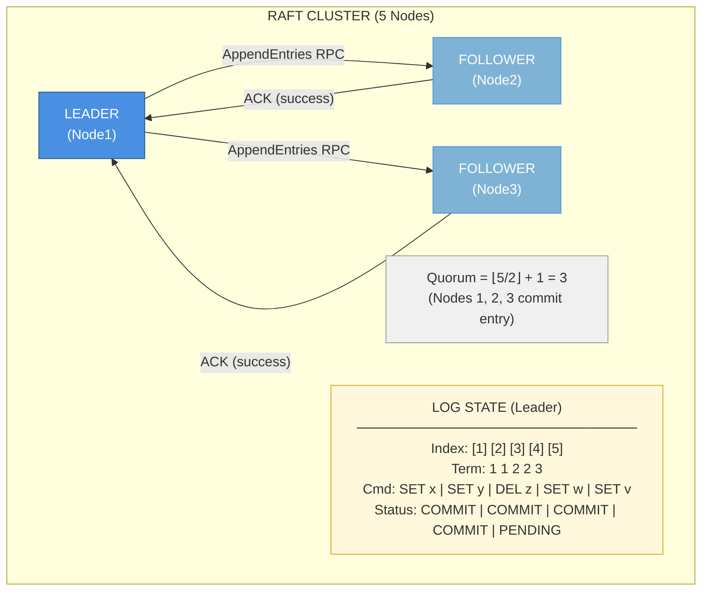
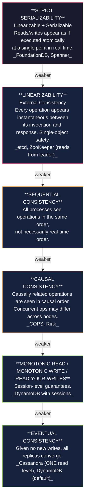

# Lesson 4: Distributed Systems Fundamentals

## 1. First-Principles Intuition & Invariants

The fundamental problem of distributed computation can be stated with disarming simplicity: how do multiple independent processes, communicating only through unreliable message passing, reach agreement about anything at all? This question haunted researchers for decades before yielding its formal answers, and those answers turned out to be far more restrictive than early practitioners imagined. The constraints are not engineering deficiencies waiting to be engineered away. They are mathematical theorems with proofs, as immutable as the laws of thermodynamics, and understanding them from first principles is the difference between an architect who debugs production incidents and one who creates them.

The intuition begins with a thought experiment. Imagine two data centers, one in Virginia and one in Oregon, each holding a replica of a database. A write request arrives at Virginia, updating a user's account balance from $100 to $150. Fifty milliseconds later, a read request arrives at Oregon. What should Oregon return? If the network link between the two data centers is operating normally, Oregon might have already received the update. But if the link is partitioned — severed by a fiber cut, a misconfigured BGP route, or a datacenter-level failure — Oregon has no way to know the account was modified. It can either refuse to answer (sacrificing availability) or return $100 (sacrificing consistency). There is no third option. This is not a failure of creativity; it is a logical consequence of physics and asynchrony.

Eric Brewer formalized this intuition in 2000 as the CAP conjecture, which Seth Gilbert and Nancy Lynch proved as a formal theorem in 2002. The theorem states that any system sharing data across a network can satisfy at most two of three properties simultaneously: Consistency (every read receives the most recent write or an error), Availability (every request receives a non-error response), and Partition Tolerance (the system continues operating despite arbitrary message loss between nodes). The practical implication, since network partitions are not hypothetical in production systems but rather scheduled occurrences in any realistic fault model, is that the real choice architects make is between CP systems and AP systems. You accept partitions. The question is what you sacrifice when they occur.

The CAP theorem, however, is a blunt instrument. It describes a binary cliff edge — total consistency versus any availability at all — but real systems operate on a spectrum. The more nuanced framework that emerged from practical distributed systems work is the PACELC model, introduced by Daniel Abadi in 2012. PACELC extends CAP by observing that even in the absence of a partition, there is a fundamental latency-consistency tradeoff: to make a write consistent, you must replicate it to a quorum of nodes before acknowledging it, which introduces latency proportional to the slowest node in that quorum. PACELC makes explicit what CAP obscures — that consistency costs latency even when the network is healthy, and that every distributed database makes a continuous tradeoff along both axes at all times.

Before the formal proofs, the distributed systems community was already confronting these constraints empirically. The Lamport clock, introduced by Leslie Lamport in his 1978 paper "Time, Clocks, and the Ordering of Events in a Distributed System," was one of the first formal tools for reasoning about causality in a world without a shared global clock. Lamport observed that in a distributed system, the concept of simultaneous events is meaningless unless you can synchronize clocks to sub-microsecond precision — which you cannot, in general. What you can reason about instead is the happens-before relationship: event A happens before event B if A causally influenced B, either directly (A sent a message that B received) or transitively (A influenced C, which influenced B). A Lamport clock assigns a monotonically increasing integer to each event and propagates it through messages so that if A happens-before B, then `clock(A) < clock(B)`. The converse is not guaranteed, which is what makes Lamport clocks insufficient for some applications, but the vector clock — a generalization that tracks one counter per process — provides a full partial order over events and underpins causal consistency in modern systems like Riak and DynamoDB's optional causal mode.

The impossibility results do not stop at CAP. Fischer, Lynch, and Paterson published the FLP impossibility result in 1985, proving that in a purely asynchronous distributed system — one with no bounds on message delay — there is no deterministic algorithm that can achieve consensus even with a single faulty process. This is an extraordinary result. It says that if you cannot bound message delays, you cannot build a correct consensus protocol. Every practical consensus system — Paxos, Raft, Zab — escapes FLP not by defeating it, but by introducing timeouts and randomness to break the deadlock conditions the proof constructs. The timeout is not an optimization; it is a logical requirement for liveness.

Understanding these invariants is not academic theater for a senior engineer. When a team debates whether to adopt an eventually consistent store for their user profile service, or whether to use optimistic locking versus serializable transactions for their inventory system, or whether their Kafka consumer groups can tolerate at-least-once versus exactly-once delivery, they are navigating this theoretical landscape whether or not they can name the theorems. The engineer who can name them makes better tradeoffs faster, debugs consistency anomalies more systematically, and writes runbooks that survive contact with reality.

---

## 2. Core Architecture & Mechanics

### The Consensus Problem and the Raft Protocol

Raft is the consensus algorithm most practicing engineers encounter first, partly because its author, Diego Ongaro, designed it explicitly for understandability and published an interactive visualization alongside the paper. Its correctness model is equivalent to Multi-Paxos, but its structure maps cleanly onto the state machine replication pattern that underpins etcd, CockroachDB, TiKV, and Consul.

The core idea in Raft is leader-based replication with strong invariants around term numbers and log completeness. At any given time, the cluster elects a single leader, which is the only node permitted to accept client writes. The leader appends entries to its log and replicates them to followers. An entry is considered committed once a quorum — a majority of nodes — has persisted it. The quorum requirement is what gives Raft its safety guarantee: because any two majorities in a cluster of N nodes must overlap by at least one member, any quorum that commits an entry and any quorum that elects a new leader must share at least one node that knows about that committed entry.

The term is Raft's logical clock. It is a monotonically increasing integer that advances each time an election begins. Every RPC in Raft carries the sender's current term. If a node receives a message with a higher term, it immediately demotes itself to follower. If it receives a message with a lower term, it rejects it. This prevents split-brain scenarios where a deposed leader continues issuing commands that the cluster has already moved past.



Election works through a randomized timeout mechanism that sidesteps the FLP impossibility result. Each follower maintains an election timer, reset whenever it receives a valid heartbeat from the leader. If the timer expires without a heartbeat — indicating the leader has failed or the network has partitioned — the follower transitions to candidate, increments its term, votes for itself, and broadcasts a `RequestVote` RPC. A node grants its vote to the first candidate it hears from in a given term, provided the candidate's log is at least as up-to-date as its own. The randomization of the election timeout (typically spread over a range like 150–300ms) ensures that multiple candidates rarely compete simultaneously, minimizing split votes.

The following Go implementation captures the essential state machine of a Raft node, stripped to the core invariants without the full implementation overhead of a production system. It is designed to be read and compiled, demonstrating the data structures and transitions that make the algorithm correct:

```go
package raft

import (
	"math/rand"
	"sync"
	"sync/atomic"
	"time"
)

type NodeState int32

const (
	Follower  NodeState = 0
	Candidate NodeState = 1
	Leader    NodeState = 2
)

type LogEntry struct {
	Term    uint64
	Index   uint64
	Command []byte
}

type Node struct {
	mu sync.Mutex

	id          uint64
	peers       []uint64
	state       NodeState
	currentTerm uint64
	votedFor    int64 // -1 means none
	log         []LogEntry

	commitIndex uint64
	lastApplied uint64

	// Leader volatile state
	nextIndex  map[uint64]uint64
	matchIndex map[uint64]uint64

	electionTimeout  time.Duration
	heartbeatTimeout time.Duration
	lastHeartbeat    time.Time

	applyNotify chan struct{}
	stopCh      chan struct{}
}

func NewNode(id uint64, peers []uint64) *Node {
	n := &Node{
		id:               id,
		peers:            peers,
		state:            Follower,
		currentTerm:      0,
		votedFor:         -1,
		log:              []LogEntry{{Term: 0, Index: 0}}, // sentinel entry
		commitIndex:      0,
		lastApplied:      0,
		nextIndex:        make(map[uint64]uint64),
		matchIndex:       make(map[uint64]uint64),
		electionTimeout:  randomElectionTimeout(),
		heartbeatTimeout: 50 * time.Millisecond,
		lastHeartbeat:    time.Now(),
		applyNotify:      make(chan struct{}, 1),
		stopCh:           make(chan struct{}),
	}
	return n
}

func randomElectionTimeout() time.Duration {
	return time.Duration(150+rand.Intn(150)) * time.Millisecond
}

// AppendEntriesArgs is sent by the leader to replicate log entries and serve as heartbeat.
type AppendEntriesArgs struct {
	Term         uint64
	LeaderID     uint64
	PrevLogIndex uint64
	PrevLogTerm  uint64
	Entries      []LogEntry
	LeaderCommit uint64
}

type AppendEntriesReply struct {
	Term          uint64
	Success       bool
	ConflictIndex uint64
	ConflictTerm  uint64
}

// AppendEntries implements the core Raft log replication RPC handler on followers.
// The invariants enforced here are the foundation of Raft's log matching property.
func (n *Node) AppendEntries(args AppendEntriesArgs, reply *AppendEntriesReply) {
	n.mu.Lock()
	defer n.mu.Unlock()

	reply.Term = n.currentTerm
	reply.Success = false

	// Rule 1: reject any RPC from a stale term.
	if args.Term < n.currentTerm {
		return
	}

	// Rule 2: seeing a higher term means we must update and revert to follower.
	if args.Term > n.currentTerm {
		n.currentTerm = args.Term
		n.votedFor = -1
		atomic.StoreInt32((*int32)(&n.state), int32(Follower))
	}

	n.lastHeartbeat = time.Now()
	atomic.StoreInt32((*int32)(&n.state), int32(Follower))

	// Log consistency check: the entry at PrevLogIndex must match PrevLogTerm.
	if args.PrevLogIndex >= uint64(len(n.log)) {
		reply.ConflictIndex = uint64(len(n.log))
		reply.ConflictTerm = 0
		return
	}

	if n.log[args.PrevLogIndex].Term != args.PrevLogTerm {
		reply.ConflictTerm = n.log[args.PrevLogIndex].Term
		// Find the first index with this conflicting term for fast rollback.
		for i := uint64(1); i < uint64(len(n.log)); i++ {
			if n.log[i].Term == reply.ConflictTerm {
				reply.ConflictIndex = i
				break
			}
		}
		return
	}

	// Append new entries, truncating any conflicting suffix.
	insertIdx := args.PrevLogIndex + 1
	for i, entry := range args.Entries {
		idx := insertIdx + uint64(i)
		if idx < uint64(len(n.log)) {
			if n.log[idx].Term != entry.Term {
				// Conflict: truncate the log from this point forward.
				n.log = n.log[:idx]
				n.log = append(n.log, args.Entries[i:]...)
				break
			}
		} else {
			n.log = append(n.log, args.Entries[i:]...)
			break
		}
	}

	// Advance commit index if the leader's commit is ahead of ours.
	if args.LeaderCommit > n.commitIndex {
		lastNewIndex := args.PrevLogIndex + uint64(len(args.Entries))
		if args.LeaderCommit < lastNewIndex {
			n.commitIndex = args.LeaderCommit
		} else {
			n.commitIndex = lastNewIndex
		}
		// Signal the apply goroutine to push committed entries to the state machine.
		select {
		case n.applyNotify <- struct{}{}:
		default:
		}
	}

	reply.Success = true
}

type RequestVoteArgs struct {
	Term         uint64
	CandidateID  uint64
	LastLogIndex uint64
	LastLogTerm  uint64
}

type RequestVoteReply struct {
	Term        uint64
	VoteGranted bool
}

// RequestVote implements the Raft leader election RPC, enforcing the
// log completeness property that prevents data loss during elections.
func (n *Node) RequestVote(args RequestVoteArgs, reply *RequestVoteReply) {
	n.mu.Lock()
	defer n.mu.Unlock()

	reply.Term = n.currentTerm
	reply.VoteGranted = false

	if args.Term < n.currentTerm {
		return
	}

	if args.Term > n.currentTerm {
		n.currentTerm = args.Term
		n.votedFor = -1
		atomic.StoreInt32((*int32)(&n.state), int32(Follower))
	}

	// A node votes for a candidate only if it hasn't already voted this term
	// and the candidate's log is at least as up-to-date as the voter's log.
	alreadyVoted := n.votedFor != -1 && n.votedFor != int64(args.CandidateID)
	if alreadyVoted {
		return
	}

	lastIdx := uint64(len(n.log) - 1)
	lastTerm := n.log[lastIdx].Term

	// Log completeness check: the candidate must have seen all committed entries.
	logUpToDate := args.LastLogTerm > lastTerm ||
		(args.LastLogTerm == lastTerm && args.LastLogIndex >= lastIdx)

	if logUpToDate {
		n.votedFor = int64(args.CandidateID)
		reply.VoteGranted = true
		n.lastHeartbeat = time.Now()
	}
}
```

This implementation makes the invariants tangible. The `AppendEntries` handler's conflict detection logic — where it returns both a conflicting term and the first index in that term — is an optimization that allows the leader to skip entire terms when rolling back a follower's divergent log, rather than decrementing `nextIndex` by one per RPC. In a cluster recovering from a prolonged partition, this optimization reduces catch-up time from O(diverged entries) RPCs to O(diverged terms) RPCs.

### Consistency Models as a Spectrum

Consistency models are contracts between a distributed storage system and its clients. They form a strict hierarchy: each model in the following diagram is strictly weaker than the one above it, meaning every execution that satisfies a stronger model also satisfies every weaker model, but not vice versa.



Linearizability is the strongest single-object consistency model and the one most practitioners mean when they casually say "consistent." A linearizable system behaves as if there is exactly one copy of the data, and every operation takes effect atomically at some point between the moment the client sends the request and the moment the client receives the response. This real-time ordering requirement is what makes linearizability expensive: to satisfy it, a system must coordinate with a quorum before returning any read, not just any write. A system that handles writes through quorum but serves reads from a single replica is not linearizable, because that replica's view of the world might lag behind a completed write.

The distinction between linearizability and serializability trips up many engineers. Serializability is a property of transactions spanning multiple objects: a serializable database guarantees that the result of executing concurrent transactions is equivalent to some serial order of those transactions. It says nothing about which serial order, and nothing about real-time ordering. Strict serializability combines both: transactions appear to execute atomically at some point in real time, in a serial order. This is the gold standard that Google Spanner achieves through TrueTime — GPS and atomic clocks — to bound clock uncertainty and assign globally consistent timestamps without round-trip coordination.

Causal consistency is weaker than linearizability but stronger than eventual consistency, and in many real applications it provides the right balance. The key insight is that most application-level consistency requirements are really causality requirements: if Alice posts a comment and Bob replies to it, every user who sees Bob's reply must also see Alice's comment. But there is no causal relationship between Alice's comment and a concurrent post by Carol, so it is acceptable for different users to see those in different orders. COPS (Clusters of Order-Preserving Servers), published by Lloyd et al. in 2011, demonstrated how causal consistency can be implemented across geo-distributed data centers with reads that never block and writes that require only local datacenter coordination, achieving dramatic latency advantages over strongly consistent systems at the cost of ruling out cross-object atomic operations.

### Two-Phase Commit and Its Discontents

Two-phase commit (2PC) is the standard protocol for achieving atomicity across multiple participants in a distributed transaction. In phase one, a coordinator sends a `PREPARE` message to all participants, each of which persists a prepared record to durable storage and votes yes or no. In phase two, if all votes are yes, the coordinator sends `COMMIT` to all participants; if any vote is no, it sends `ABORT`. The correctness of 2PC rests on the durability of the prepared state: once a participant votes yes, it has promised to commit if the coordinator orders it to, regardless of intervening failures.

The critical flaw in 2PC is that the coordinator is a single point of failure during phase two. If the coordinator crashes after some participants have committed but before others have received the commit message, those remaining participants are blocked. They have voted yes and cannot unilaterally decide to abort (another participant may have already committed), and they cannot unilaterally commit (the coordinator may have decided to abort before crashing). They must wait for the coordinator to recover, which can be an unbounded wait. This is the 2PC blocking problem, and it is why production systems either accept it (most relational databases in a single datacenter, where coordinator recovery is fast) or replace 2PC with a Paxos-based protocol like those used in Spanner and CockroachDB, where the coordinator state is itself replicated and can be recovered without human intervention.

Three-phase commit (3PC) was proposed as a non-blocking alternative, but it only achieves non-blocking under the assumption of no network partitions. Under partitions — which are the exact scenario where non-blocking matters most — 3PC can still reach an indeterminate state. This is why 3PC has not found wide adoption in systems designed for partition tolerance.

---

## 3. High-Performance Optimization & Failure Modes

### Write Path Optimization: Batching, Pipelining, and Leader Leases

The latency of a Raft write is bounded below by the round-trip time to a quorum majority. For a cluster with nodes in the same datacenter, that RTT is on the order of 0.5–2ms, giving a theoretical throughput ceiling of 500–2000 operations per second if each operation is committed independently. Production systems like etcd, TiKV, and CockroachDB break through this ceiling through three interrelated techniques.

Log batching groups multiple client writes that arrive within a configurable time window (typically 1–10ms) into a single `AppendEntries` RPC. The savings are significant: batching 100 writes into one RPC incurs one quorum RTT rather than 100, reducing the per-write amortized latency by two orders of magnitude at high throughput. The tradeoff is that individual writes experience slightly higher latency at low throughput, since they may wait for the batch window before being dispatched. Production systems typically use adaptive batching: dispatch immediately when the pipeline is idle, accumulate when the pipeline is saturated.

Pipelining decouples the act of sending `AppendEntries` from waiting for acknowledgment before sending the next batch. A leader using pipelining sends batch N+1 to followers while still waiting for the quorum acknowledgment for batch N. This keeps the network path saturated and allows throughput to scale with batch size rather than RTT. The leader must track the last confirmed `matchIndex` per follower and backfill on negative acknowledgment, but the common case is that followers are caught up and all batches succeed in order.

Leader leases are an optimization that eliminates the quorum round-trip for reads. By default, a linearizable read in Raft must go through the log — the leader appends a no-op and waits for it to commit, confirming it is still the leader before serving the read. With leader leases, the leader records the time it last received a quorum of heartbeat acknowledgments. If less than the election timeout has elapsed since that quorum acknowledgment, no other node can have been elected leader (because a new election requires a timeout to expire first), and the leader can serve reads from its local state without a round-trip. The correctness of this optimization depends critically on the election timeout being larger than the maximum clock drift between nodes — a constraint that must be enforced operationally, not just assumed.

The following Go snippet demonstrates a production-pattern batching write loop that feeds a Raft pipeline, using a channel to coalesce concurrent client proposals:

```go
package raft

import (
	"sync"
	"time"
)

// Proposal carries a client command and the channel to signal completion.
type Proposal struct {
	Command  []byte
	ResultCh chan error
}

// BatchedWriter collects proposals into batches and submits them to Raft
// in a single AppendEntries round, amortizing per-write quorum latency.
type BatchedWriter struct {
	proposalCh  chan Proposal
	maxBatch    int
	batchWindow time.Duration
	node        *Node
	wg          sync.WaitGroup
	stopCh      chan struct{}
}

func NewBatchedWriter(node *Node, maxBatch int, window time.Duration) *BatchedWriter {
	bw := &BatchedWriter{
		proposalCh:  make(chan Proposal, 4096),
		maxBatch:    maxBatch,
		batchWindow: window,
		node:        node,
		stopCh:      make(chan struct{}),
	}
	bw.wg.Add(1)
	go bw.runLoop()
	return bw
}

// Propose submits a command for replication and blocks until the leader commits it.
func (bw *BatchedWriter) Propose(cmd []byte) error {
	resultCh := make(chan error, 1)
	bw.proposalCh <- Proposal{Command: cmd, ResultCh: resultCh}
	return <-resultCh
}

func (bw *BatchedWriter) runLoop() {
	defer bw.wg.Done()
	batch := make([]Proposal, 0, bw.maxBatch)
	timer := time.NewTimer(bw.batchWindow)
	defer timer.Stop()

	flush := func() {
		if len(batch) == 0 {
			return
		}

		entries := make([]LogEntry, len(batch))
		for i, p := range batch {
			entries[i] = LogEntry{
				Term:    bw.node.currentTerm,
				Index:   uint64(len(bw.node.log)) + uint64(i),
				Command: p.Command,
			}
		}

		// In a real implementation this would dispatch AppendEntries RPCs
		// to followers and wait for quorum. Here we signal success directly
		// to illustrate the batching structure.
		var appendErr error
		for _, p := range batch {
			p.ResultCh <- appendErr
		}
		batch = batch[:0]

		if !timer.Stop() {
			select {
			case <-timer.C:
			default:
			}
		}
		timer.Reset(bw.batchWindow)
	}

	for {
		select {
		case <-bw.stopCh:
			flush()
			return
		case p := <-bw.proposalCh:
			batch = append(batch, p)
			if len(batch) >= bw.maxBatch {
				flush()
			}
		case <-timer.C:
			flush()
			timer.Reset(bw.batchWindow)
		}
	}
}

func (bw *BatchedWriter) Stop() {
	close(bw.stopCh)
	bw.wg.Wait()
}
```

### Failure Modes and Their Mitigations

Distributed systems fail in a richer vocabulary than single-process systems. The taxonomy of failure modes is itself an important design tool, because different protocols offer different fault coverage, and conflating them leads to systems that are robust against the wrong failure class.

A fail-stop failure is the simplest: a node stops executing and sends no further messages. Most consensus protocols are designed around this model. A crash-recovery failure — the more realistic model — means a node may crash and restart with durable state intact, potentially rejoining the cluster with an outdated log. Raft handles crash-recovery correctly because it persists `currentTerm`, `votedFor`, and the log to stable storage before responding to any RPC; the protocol's correctness proofs assume these durability guarantees.

Byzantine failures, where a node continues operating but sends arbitrary or malicious messages, are categorically harder. Standard Raft and Paxos cannot tolerate Byzantine faults; they require a strict two-thirds quorum and explicit message authentication, as in PBFT or the HotStuff protocol underlying modern blockchain consensus. For most infrastructure systems — databases, distributed caches, coordination services — Byzantine fault tolerance is unnecessary because all nodes are under the same administrative control. The engineering cost of PBFT (message complexity of O(N²) per round) is not worth buying protection against a threat model that is better addressed by access control, TLS mutual authentication, and supply chain security.

Network partitions are the fault mode that motivates most of the theoretical machinery above. A partition is not simply node failure — both sides of the partition remain operational and may continue to accept client requests. In a CP system, the minority side of a partition must stop accepting writes (and reads, to maintain linearizability) until the partition heals. In an AP system, both sides continue operating, and the system must later reconcile the diverged state. The reconciliation problem — how to merge concurrent writes that happened during the partition — is where most of the practical complexity of AP systems lives.

Last-write-wins (LWW) is the simplest reconciliation strategy: each write carries a timestamp, and the write with the highest timestamp wins. It is used by default in Cassandra and optional in Riak. Its failure mode is data loss: if two writes are concurrent, the lower-timestamped write is silently discarded. When the write being discarded is a critical update — a financial transaction, an inventory decrement, a medical record modification — LWW is not acceptable.

Conflict-free Replicated Data Types (CRDTs) are a family of data structures designed so that all concurrent operations commute — their application order does not affect the final state. A grow-only counter (G-Counter) is the canonical example: each node maintains a vector of per-node counts, and merging two replicas takes the element-wise maximum. The result is always the same regardless of merge order. More complex CRDTs exist for sets (OR-Set, 2P-Set), registers (Multi-Value Register, as used by Riak), sequences (RGA, Logoot), and maps. The engineering constraint is that not all data types have natural CRDT representations — arbitrary update-in-place semantics are not expressible without semantic knowledge of the application's merge intent.

The following Rust implementation demonstrates a production-grade G-Counter CRDT with a vector clock, illustrating the core mechanics of state-based CRDT merging:

```rust
use std::collections::HashMap;

/// A G-Counter (grow-only counter) CRDT.
///
/// Each node tracks its own contribution to the total count. The global
/// count is the sum of all per-node counters. Merging two replicas takes
/// the element-wise maximum of each node's counter vector, which is
/// associative, commutative, and idempotent — the three properties that
/// make state-based CRDT replication correct regardless of delivery order.
#[derive(Debug, Clone, PartialEq)]
pub struct GCounter {
    /// Maps node_id -> this node's local increment count.
    counters: HashMap<u64, u64>,
    /// The local node's identifier, used to attribute increments.
    node_id: u64,
}

impl GCounter {
    pub fn new(node_id: u64) -> Self {
        Self {
            counters: HashMap::new(),
            node_id,
        }
    }

    /// Increments the counter at this node by the given delta.
    /// Only the owning node may increment its own slot, preserving
    /// the invariant that each slot is a monotonically increasing
    /// sequence written by exactly one node.
    pub fn increment(&mut self, delta: u64) {
        let entry = self.counters.entry(self.node_id).or_insert(0);
        *entry = entry.saturating_add(delta);
    }

    /// Returns the global count across all replicas seen so far.
    pub fn value(&self) -> u64 {
        self.counters.values().sum()
    }

    /// Merges another replica's state into this one using element-wise max.
    ///
    /// The merge is idempotent: merging the same state twice produces
    /// the same result as merging it once. It is commutative: merge(A, B)
    /// == merge(B, A). And it is associative: merge(merge(A, B), C) ==
    /// merge(A, merge(B, C)). These three properties guarantee eventual
    /// consistency regardless of network delivery order.
    pub fn merge(&mut self, other: &GCounter) {
        for (&node_id, &other_count) in &other.counters {
            let entry = self.counters.entry(node_id).or_insert(0);
            *entry = (*entry).max(other_count);
        }
    }

    /// Returns true if every counter in `other` is less than or equal
    /// to the corresponding counter in `self`. This is the partial order
    /// relation on G-Counter states; `self` has "seen more" than `other`.
    pub fn dominates(&self, other: &GCounter) -> bool {
        for (&node_id, &other_count) in &other.counters {
            let self_count = self.counters.get(&node_id).copied().unwrap_or(0);
            if self_count < other_count {
                return false;
            }
        }
        true
    }
}

#[cfg(test)]
mod tests {
    use super::*;

    #[test]
    fn test_merge_commutativity() {
        let mut a = GCounter::new(1);
        let mut b = GCounter::new(2);
        a.increment(10);
        b.increment(5);

        let mut a_then_b = a.clone();
        a_then_b.merge(&b);

        let mut b_then_a = b.clone();
        b_then_a.merge(&a);

        assert_eq!(a_then_b.value(), b_then_a.value());
        assert_eq!(a_then_b.value(), 15);
    }

    #[test]
    fn test_merge_idempotency() {
        let mut a = GCounter::new(1);
        let b = GCounter::new(2);
        let mut b_copy = b.clone();
        b_copy.increment(7);

        a.merge(&b_copy);
        let after_first = a.value();
        a.merge(&b_copy);
        let after_second = a.value();

        assert_eq!(after_first, after_second);
    }

    #[test]
    fn test_dominance_ordering() {
        let mut a = GCounter::new(1);
        let mut b = GCounter::new(1);
        a.increment(10);
        b.increment(5);
        b.merge(&a);
        // After merge, b has seen everything a has seen and more.
        assert!(b.dominates(&a));
        assert!(!a.dominates(&b));
    }
}
```

### Diagnosing Consistency Violations in Production

The most insidious property of consistency bugs is that they are intermittent and hard to reproduce under test conditions. A system that behaves perfectly at low concurrency and low latency may exhibit anomalies under load, during failover, or when a follower is slightly behind the leader. The practical diagnostic toolkit for distributed systems rests on a few key techniques.

Linearizability checking through Jepsen and Knossos is the gold standard for black-box testing of distributed systems. Kyle Kingsbury's Jepsen framework injects network partitions, clock skew, and node failures into a running cluster while recording every client operation's invocation time, completion time, and result. Knossos then attempts to find a linearizable history consistent with the observed operations. If no such history exists, the system has a consistency violation. Reading the published Jepsen analyses of databases like MongoDB, Cassandra, and Elasticsearch gives an extraordinary education in how real systems fail under adversarial conditions. The findings have directly shaped the correctness of production databases over the past decade.

Distributed tracing with consistent timestamps exposes causality violations at the application level. When a service emits a trace span for every operation with a monotonic wall clock reading anchored to a time synchronization source (NTP with sub-millisecond accuracy, or PTP with microsecond accuracy), you can retrospectively reconstruct the happens-before graph for any observed anomaly. A read that returns a stale value will appear in the trace as a span whose timestamp postdates the write span that should have been visible. Without distributed tracing, you are debugging ghosts — anomalies that have no artifact in any single node's local logs.

The choice between eventual and strong consistency is not a one-time architectural decision but a per-operation choice in most mature systems. CockroachDB exposes this through transaction isolation levels (serializable by default, with snapshot isolation as a weaker option). Cassandra exposes it through read and write consistency levels (ALL, QUORUM, LOCAL_QUORUM, ONE). The operational discipline of choosing the right consistency level for each operation — strong reads for inventory checks, eventual reads for analytics, linearizable transactions for financial transfers — is what separates architects who understand the theoretical constraints from those who paper over them with retry logic and hope.

Tail latency is the operational fingerprint of quorum coordination. Because a quorum write must wait for the slowest node in the majority, the P99 latency of a write is determined not by the median node but by the slowest node in any randomly selected majority. For a 5-node cluster where node 5 occasionally experiences a 50ms GC pause, roughly 60% of writes will be in a majority that includes node 5, and those writes will have P99 latency of 50ms even if the other nodes respond in 1ms. This is the hedged read problem applied to writes: you cannot hedge by sending the write to only fast nodes without sacrificing quorum coverage. The practical solutions are heterogeneous hardware avoidance (keep all nodes on identical hardware with similar memory pressure), adaptive slow follower detection (the leader temporarily routes reads away from lagging followers while keeping them in the write quorum), and careful tuning of JVM or runtime GC parameters to minimize stop-the-world pauses on nodes that participate in hot write paths.

The engineer who has internalized these mechanics — the relationship between quorum size and tail latency, the cost of linearizable reads, the CRDT merge contract, the FLP escape hatch through timeouts, and the precise semantics of every consistency level offered by every data store in their stack — is not simply a more knowledgeable engineer. They reason differently. Where another engineer sees a production incident as a surprising anomaly, they see the inevitable consequence of a tradeoff that was made, perhaps unknowingly, years before. That shift in perspective is the practical payoff of mastering distributed systems fundamentals at this level of depth.
