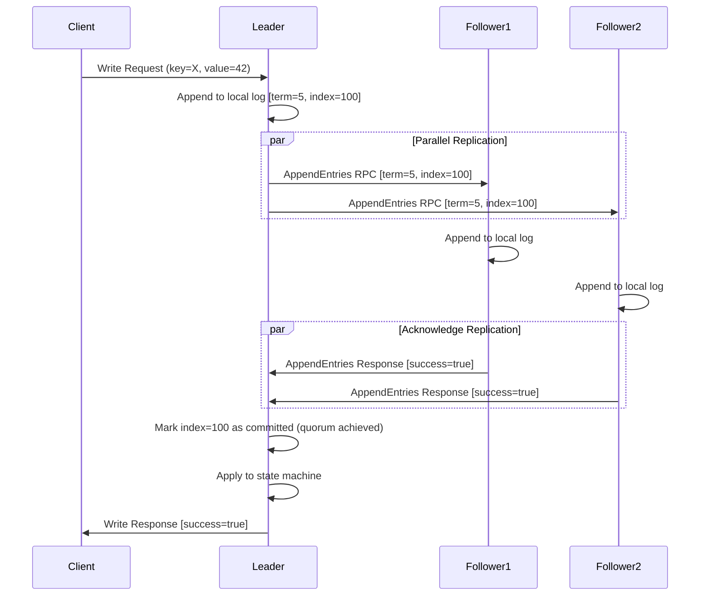
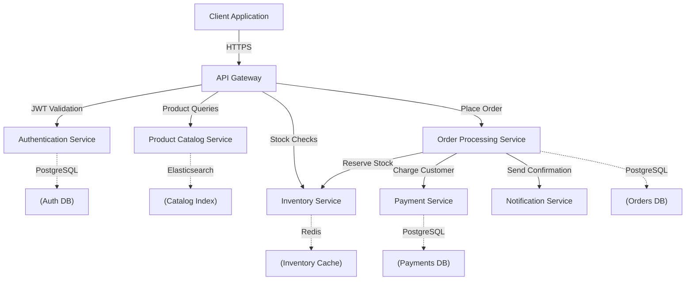

# Lesson 6: Scalability, Resilience, Evolution

## 1. First-Principles Intuition & Invariants

Software architecture exists in perpetual tension between the abstract elegance of design and the brutal realities of operational physics. A system that gracefully handles ten concurrent users may collapse catastrophically under ten thousand, not because the underlying algorithms are incorrect, but because assumptions about resource availability, failure independence, and temporal ordering break down under load. Scalability is not a feature that can be retrofitted through clever optimizations alone—it is a fundamental architectural invariant that must be designed into the system's core data flows, state management strategies, and failure boundaries from inception.

The classical decomposition of scaling strategies into vertical and horizontal dimensions provides a useful starting taxonomy, but obscures the deeper truth: all scalability is ultimately about managing shared mutable state and minimizing coordination overhead. Vertical scaling—adding more CPU cores, RAM, or faster storage to a single machine—delays the inevitable but cannot escape the physical limits of cache coherence protocols, memory bandwidth saturation, and the serialization imposed by Amdahl's Law. When a thread contends for a mutex protecting a critical section, every other thread waiting on that lock contributes zero marginal throughput regardless of how many cores the machine possesses. The speedup of a parallel program is thus bounded by $S(N) = \frac{1}{(1-P) + \frac{P}{N}}$, where $P$ represents the fraction of the program that can be parallelized and $N$ is the number of processors. As $N$ approaches infinity, the speedup converges to $\frac{1}{1-P}$, demonstrating that even a small sequential bottleneck—a global lock, a single-threaded event loop, a centralized coordinator—can completely eliminate the benefits of additional hardware.

Horizontal scaling—distributing work across multiple independent machines—sidesteps these hardware limits but introduces a far more insidious challenge: distributed systems must reconcile the fundamental impossibility of simultaneously guaranteeing consistency, availability, and partition tolerance under network failures. The CAP theorem is not a menu of trade-offs from which architects can freely choose; it is a constraint imposed by the physical impossibility of instantaneous information propagation. When a network partition separates two datacenters, any system that continues to accept writes on both sides has chosen availability over consistency, accepting that conflicting state will emerge and must later be reconciled through application-specific merge logic or last-write-wins timestamps. Conversely, a system that refuses writes until the partition heals has chosen consistency over availability, accepting downtime in exchange for never exposing stale or divergent data to clients.

The third dimension of scaling—functional decomposition—recognizes that not all components of a system exhibit identical growth characteristics or failure modes. A monolithic application where authentication, business logic, data access, and static asset serving all execute within a single process boundary scales as a unit, forcing operators to provision resources for the most demanding component even when others remain idle. Functional decomposition through microservices or service-oriented architecture allows each component to scale independently, but introduces new failure modes: cascading failures where one slow service creates backpressure that exhausts connection pools and thread pools upstream, distributed transactions that require expensive two-phase commit protocols or eventual consistency windows, and operational complexity as the number of deployment units, configuration surfaces, and inter-service communication paths grows quadratically with the number of services.

Resilience and fault tolerance are not synonymous. A fault-tolerant system continues to operate correctly in the presence of specific, enumerated failure modes—Byzantine failures in distributed consensus, single-node crashes in replicated databases, transient network partitions in eventually-consistent stores. Resilience is a broader property: the system's ability to maintain acceptable performance and functionality under unanticipated stress, whether from adversarial attack, cascading failures, correlated hardware degradation, or operational error. Resilient systems employ defense in depth—circuit breakers that halt traffic to failing dependencies before resource exhaustion, bulkheads that isolate thread pools and connection pools to prevent one component's failure from starving others, rate limiters that shed load gracefully rather than thrashing under overload, and graceful degradation strategies that continue to provide reduced functionality when full service becomes impossible.

Architectural evolution is the process by which systems adapt to changing requirements, scale, and operational constraints without requiring complete rewrites. The strangler fig pattern—incrementally replacing components of a legacy system by intercepting requests at the boundary and routing a growing fraction to the new implementation—allows teams to deliver value continuously while managing risk. The fundamental invariant governing successful evolution is that the system must remain operational throughout the migration: there is no maintenance window long enough to rewrite a large production system from scratch, and attempting to do so risks catastrophic failure when the cutover reveals unanticipated behavioral differences between old and new implementations. Evolution requires careful management of interface contracts, data schema migrations, and dual-write periods where both old and new systems must be kept in sync until the migration completes.

## 2. Core Architecture & Mechanics

### Vertical Scaling and Hardware Resource Exhaustion

Vertical scaling exploits the parallelism available within a single machine, whether through multi-core CPU architectures, increased memory capacity, or faster storage subsystems. Modern processors achieve instruction-level parallelism through pipelining, out-of-order execution, and speculative execution, but these optimizations break down in the presence of data dependencies. Consider a simple request handler that increments a global counter protected by a mutex:

```c
#include <pthread.h>
#include <stdatomic.h>

typedef struct {
    pthread_mutex_t lock;
    uint64_t counter;
} SharedState;

void handle_request(SharedState *state) {
    pthread_mutex_lock(&state->lock);
    state->counter++;
    pthread_mutex_unlock(&state->lock);
    // Process request using state->counter
}
```

Under low concurrency, the mutex overhead is negligible compared to actual request processing. As thread count increases, however, the lock becomes a serialization point: threads queue waiting for access, and the CPU spends increasing cycles on context switches and lock contention rather than useful work. The cache line containing the mutex experiences false sharing as multiple cores attempt to acquire exclusive ownership, forcing expensive cache coherence traffic across the processor's interconnect fabric.

A more scalable approach eliminates shared mutable state entirely through per-thread accumulators and periodic aggregation:

```c
typedef struct {
    _Alignas(64) atomic_uint_fast64_t counter;
} PerThreadState;

typedef struct {
    PerThreadState *thread_states;
    size_t num_threads;
} ScalableState;

void handle_request_lockless(ScalableState *state, size_t thread_id) {
    atomic_fetch_add_explicit(
        &state->thread_states[thread_id].counter,
        1,
        memory_order_relaxed
    );
    // Process request
}

uint64_t read_total_counter(ScalableState *state) {
    uint64_t total = 0;
    for (size_t i = 0; i < state->num_threads; i++) {
        total += atomic_load_explicit(
            &state->thread_states[i].counter,
            memory_order_relaxed
        );
    }
    return total;
}
```

The `_Alignas(64)` directive ensures each per-thread counter occupies its own cache line, eliminating false sharing. Atomic operations with relaxed memory ordering avoid expensive memory fences while maintaining atomicity guarantees. The trade-off is that reading the global counter requires aggregation across all threads, but this operation typically occurs far less frequently than increments, making the asymmetric cost profile acceptable.

### Horizontal Scaling and Distributed Consensus

Horizontal scaling distributes work across multiple machines, requiring coordination protocols to maintain consistency invariants. The challenge is that distributed systems cannot rely on shared memory or atomic operations—all coordination must occur through unreliable network communication subject to arbitrary delays, reordering, and message loss. The Raft consensus algorithm provides a formally verified foundation for building replicated state machines that remain consistent despite node failures and network partitions.

Raft organizes nodes into a cluster where one node acts as leader and others as followers. Clients send write requests to the leader, which appends entries to its local log and replicates them to followers. An entry is considered committed when a majority quorum ($\lfloor N/2 \rfloor + 1$ nodes) acknowledge its replication. The leader then applies committed entries to its state machine and responds to clients. If the leader fails, followers detect the absence of heartbeats and initiate a new election round, incrementing the term number and requesting votes. A candidate becomes leader if it receives votes from a majority quorum, guaranteeing that at most one leader exists per term.



The critical insight is that Raft sacrifices availability during partitions to maintain strong consistency: if a leader becomes partitioned from the majority quorum, it cannot commit new entries and must reject client writes until the partition heals. This design choice prevents split-brain scenarios where two leaders independently accept conflicting writes, at the cost of unavailability during network failures.

### Functional Decomposition and Service Mesh Architecture

Functional decomposition separates concerns into independently deployable services, each responsible for a bounded domain. A typical e-commerce platform might decompose into authentication, product catalog, inventory management, order processing, payment processing, and notification services. Each service exposes a well-defined API and maintains its own data store, avoiding shared database anti-patterns that create coupling through schema dependencies.



This decomposition enables independent scaling: the product catalog might deploy read replicas to handle high query volume while the payment service maintains a small, highly secure footprint with strict PCI compliance. However, distributed transactions now span multiple services, each with independent failure modes. If the payment service successfully charges a customer but the notification service fails to send a confirmation email, the system must handle partial success through compensating transactions or eventual consistency patterns.

Service mesh infrastructure like Istio or Linkerd provides transparent reliability primitives by deploying sidecar proxies alongside each service instance. The proxy intercepts all inbound and outbound traffic, implementing circuit breakers, retries with exponential backoff, request timeouts, and mutual TLS authentication without requiring application-level changes:

```rust
// Conceptual circuit breaker implementation
use std::sync::atomic::{AtomicU64, AtomicU8, Ordering};
use std::time::{Duration, Instant};

const STATE_CLOSED: u8 = 0;
const STATE_OPEN: u8 = 1;
const STATE_HALF_OPEN: u8 = 2;

struct CircuitBreaker {
    state: AtomicU8,
    failure_count: AtomicU64,
    last_failure_time: AtomicU64,
    failure_threshold: u64,
    timeout: Duration,
}

impl CircuitBreaker {
    fn new(failure_threshold: u64, timeout: Duration) -> Self {
        Self {
            state: AtomicU8::new(STATE_CLOSED),
            failure_count: AtomicU64::new(0),
            last_failure_time: AtomicU64::new(0),
            failure_threshold,
            timeout,
        }
    }
    
    fn call<F, T, E>(&self, f: F) -> Result<T, CircuitBreakerError<E>>
    where
        F: FnOnce() -> Result<T, E>,
    {
        let state = self.state.load(Ordering::Acquire);
        
        match state {
            STATE_OPEN => {
                let last_failure = self.last_failure_time.load(Ordering::Acquire);
                let elapsed = Duration::from_millis(
                    Instant::now().elapsed().as_millis() as u64 - last_failure
                );
                
                if elapsed >= self.timeout {
                    // Transition to half-open, allow one request through
                    self.state.store(STATE_HALF_OPEN, Ordering::Release);
                    self.execute_with_transition(f)
                } else {
                    Err(CircuitBreakerError::Open)
                }
            }
            STATE_HALF_OPEN => self.execute_with_transition(f),
            STATE_CLOSED => {
                match f() {
                    Ok(result) => {
                        self.failure_count.store(0, Ordering::Release);
                        Ok(result)
                    }
                    Err(e) => {
                        let failures = self.failure_count.fetch_add(1, Ordering::AcqRel) + 1;
                        if failures >= self.failure_threshold {
                            self.state.store(STATE_OPEN, Ordering::Release);
                            self.last_failure_time.store(
                                Instant::now().elapsed().as_millis() as u64,
                                Ordering::Release
                            );
                        }
                        Err(CircuitBreakerError::Failure(e))
                    }
                }
            }
            _ => unreachable!(),
        }
    }
    
    fn execute_with_transition<F, T, E>(&self, f: F) -> Result<T, CircuitBreakerError<E>>
    where
        F: FnOnce() -> Result<T, E>,
    {
        match f() {
            Ok(result) => {
                self.state.store(STATE_CLOSED, Ordering::Release);
                self.failure_count.store(0, Ordering::Release);
                Ok(result)
            }
            Err(e) => {
                self.state.store(STATE_OPEN, Ordering::Release);
                self.last_failure_time.store(
                    Instant::now().elapsed().as_millis() as u64,
                    Ordering::Release
                );
                Err(CircuitBreakerError::Failure(e))
            }
        }
    }
}

enum CircuitBreakerError<E> {
    Open,
    Failure(E),
}
```

The circuit breaker maintains three states: closed (normal operation), open (all requests immediately fail without attempting the downstream call), and half-open (allowing a single probe request to test if the downstream service has recovered). This prevents cascading failures where a slow or failing service exhausts connection pools and thread pools in all upstream callers.

### Load Balancing and Request Distribution

Horizontal scaling requires distributing incoming requests across multiple service instances. The simplest approach, round-robin load balancing, cycles through available backends in order. While easy to implement, round-robin ignores backend health and current load, potentially routing traffic to overloaded or failing instances. Least-connections load balancing tracks active connections per backend and routes new requests to the backend with the fewest active connections, providing better load distribution when request processing times vary significantly.

More sophisticated algorithms incorporate latency measurements and health checks. The power-of-two-choices algorithm randomly selects two backend instances and routes the request to the one with lower load, providing near-optimal distribution with minimal coordination overhead. Consistent hashing assigns requests to backends based on a hash of the request key (user ID, session token, cache key), ensuring that requests for the same key always route to the same backend when the cluster topology is stable. This property is critical for maintaining cache affinity and session locality.

```rust
use std::collections::BTreeMap;
use std::hash::{Hash, Hasher};
use std::collections::hash_map::DefaultHasher;

struct ConsistentHashRing<T> {
    ring: BTreeMap<u64, T>,
    virtual_nodes: usize,
}

impl<T: Clone> ConsistentHashRing<T> {
    fn new(virtual_nodes: usize) -> Self {
        Self {
            ring: BTreeMap::new(),
            virtual_nodes,
        }
    }
    
    fn add_node(&mut self, node: T)
    where
        T: Hash,
    {
        for i in 0..self.virtual_nodes {
            let mut hasher = DefaultHasher::new();
            node.hash(&mut hasher);
            i.hash(&mut hasher);
            let hash = hasher.finish();
            self.ring.insert(hash, node.clone());
        }
    }
    
    fn remove_node(&mut self, node: &T)
    where
        T: Hash + PartialEq,
    {
        for i in 0..self.virtual_nodes {
            let mut hasher = DefaultHasher::new();
            node.hash(&mut hasher);
            i.hash(&mut hasher);
            let hash = hasher.finish();
            self.ring.remove(&hash);
        }
    }
    
    fn get_node(&self, key: &str) -> Option<&T> {
        if self.ring.is_empty() {
            return None;
        }
        
        let mut hasher = DefaultHasher::new();
        key.hash(&mut hasher);
        let hash = hasher.finish();
        
        // Find the first node whose hash is >= the key hash
        self.ring.range(hash..).next()
            .or_else(|| self.ring.iter().next())
            .map(|(_, node)| node)
    }
}
```

The consistent hashing ring maps both nodes and keys onto a 64-bit hash space. Each physical node appears at multiple points on the ring (virtual nodes) to improve distribution uniformity. When looking up the node for a key, we hash the key and find the first node clockwise from that position. Adding or removing a node only affects keys in the range between that node and its predecessor, minimizing cache invalidation compared to naive modulo-based hashing where adding a node changes the assignment of all keys.

### Database Replication and Sharding

Persistent state presents the most challenging scalability problem because writes cannot be trivially parallelized without sacrificing consistency guarantees. Database replication distributes read traffic across multiple replicas while directing writes to a primary node that asynchronously propagates changes to replicas. This approach scales read-heavy workloads but introduces replication lag: clients reading from replicas may observe stale data until the primary's writes propagate. Applications must tolerate eventual consistency or implement read-your-writes consistency by routing reads that depend on recent writes to the primary.

Sharding partitions data across multiple independent databases, each responsible for a disjoint subset of the keyspace. A user database might shard by user ID modulo the number of shards, ensuring all data for a given user resides on a single shard. This approach scales both reads and writes but complicates queries that span multiple shards: computing aggregate statistics across all users requires scatter-gather queries to all shards followed by client-side aggregation. Cross-shard transactions require distributed coordination protocols like two-phase commit, sacrificing availability during failures.

```sql
-- Schema for sharded user data with shard routing metadata
CREATE TABLE shard_metadata (
    shard_id INTEGER PRIMARY KEY,
    connection_string TEXT NOT NULL,
    min_user_id BIGINT NOT NULL,
    max_user_id BIGINT NOT NULL,
    status TEXT NOT NULL CHECK (status IN ('active', 'draining', 'offline'))
);

-- On each shard, store only the subset of users assigned to this shard
CREATE TABLE users (
    user_id BIGINT PRIMARY KEY,
    username TEXT NOT NULL UNIQUE,
    email TEXT NOT NULL,
    created_at TIMESTAMP NOT NULL DEFAULT CURRENT_TIMESTAMP,
    CHECK (user_id >= ? AND user_id < ?)  -- shard boundaries enforced
);

CREATE INDEX idx_users_created ON users(created_at);
```

The shard routing table maintains metadata mapping user ID ranges to physical database instances. Client libraries consult this metadata to route queries to the appropriate shard. When a shard reaches capacity, operators split it by creating two new shards, updating routing metadata, and migrating half the data. During migration, writes are dual-written to both old and new shards while reads are directed to the old shard, then the cutover happens atomically by updating routing metadata.

## 3. High-Performance Optimization & Failure Modes

### Connection Pool Exhaustion and Backpressure

Every network service maintains connection pools to downstream dependencies—databases, caches, message queues, and other services. These pools have finite capacity, typically configured based on expected load and the downstream service's capacity. When a downstream service slows down, active connections remain open longer, reducing the available pool capacity. If the pool exhausts, incoming requests queue waiting for an available connection. If the queue fills, the service must either block new requests (applying backpressure) or reject them with errors.

The failure mode occurs when multiple upstream services all exhaust their connection pools simultaneously, creating cascading backpressure that propagates to user-facing services. A database slowdown might exhaust connection pools in ten application servers, which in turn cause connection pool exhaustion in five API gateway instances, eventually manifesting as user-visible timeouts. Circuit breakers mitigate this by failing fast once a dependency is known to be unhealthy, preventing healthy services from wasting resources on doomed requests.

```rust
use std::sync::Arc;
use tokio::sync::{Semaphore, SemaphorePermit};
use std::time::Duration;

struct ConnectionPool<T> {
    connections: Vec<T>,
    semaphore: Arc<Semaphore>,
    max_wait_time: Duration,
}

impl<T> ConnectionPool<T> {
    fn new(connections: Vec<T>, max_wait_time: Duration) -> Self {
        let size = connections.len();
        Self {
            connections,
            semaphore: Arc::new(Semaphore::new(size)),
            max_wait_time,
        }
    }
    
    async fn acquire(&self) -> Result<PooledConnection<T>, PoolError> {
        let permit = tokio::time::timeout(
            self.max_wait_time,
            self.semaphore.acquire()
        ).await
            .map_err(|_| PoolError::Timeout)?
            .map_err(|_| PoolError::Closed)?;
        
        // In a real implementation, retrieve a connection from the pool
        // For simplicity, we just hold the permit
        Ok(PooledConnection {
            _permit: permit,
        })
    }
}

struct PooledConnection<'a, T> {
    _permit: SemaphorePermit<'a>,
}

enum PoolError {
    Timeout,
    Closed,
}
```

The semaphore-based connection pool limits concurrency by requiring callers to acquire a permit before obtaining a connection. The timeout ensures that callers don't block indefinitely during downstream slowdowns, allowing them to fail fast and return errors to their own callers rather than accumulating blocked threads that exhaust resources.

### Cache Coherence and Thundering Herd

Caching is a fundamental scaling technique that trades freshness for throughput by serving repeated requests from fast in-memory storage rather than hitting expensive databases or APIs. The classic cache-aside pattern has the application check the cache before querying the backing store, populating the cache on miss. This approach suffers from several failure modes under high concurrency.

When a popular cache entry expires or is evicted, multiple concurrent requests may simultaneously detect the cache miss and query the backing store, creating a thundering herd that can overload the database. The first request to complete will populate the cache, but by then dozens of redundant queries may already be in flight. Request coalescing solves this by tracking in-flight cache-population requests and having subsequent callers wait for the first to complete rather than issuing duplicate queries.

```rust
use std::collections::HashMap;
use std::sync::Arc;
use tokio::sync::{RwLock, Mutex, oneshot};

type CacheKey = String;
type CacheValue = Vec<u8>;

struct CoalescingCache<F>
where
    F: Fn(&CacheKey) -> Result<CacheValue, String>,
{
    cache: Arc<RwLock<HashMap<CacheKey, CacheValue>>>,
    in_flight: Arc<Mutex<HashMap<CacheKey, oneshot::Receiver<Result<CacheValue, String>>>>>,
    fetch_fn: Arc<F>,
}

impl<F> CoalescingCache<F>
where
    F: Fn(&CacheKey) -> Result<CacheValue, String> + Send + Sync + 'static,
{
    fn new(fetch_fn: F) -> Self {
        Self {
            cache: Arc::new(RwLock::new(HashMap::new())),
            in_flight: Arc::new(Mutex::new(HashMap::new())),
            fetch_fn: Arc::new(fetch_fn),
        }
    }
    
    async fn get(&self, key: &CacheKey) -> Result<CacheValue, String> {
        // Fast path: check cache under read lock
        {
            let cache = self.cache.read().await;
            if let Some(value) = cache.get(key) {
                return Ok(value.clone());
            }
        }
        
        // Slow path: coordinate cache population
        let mut in_flight = self.in_flight.lock().await;
        
        if let Some(receiver) = in_flight.get_mut(key) {
            // Another request is already fetching this key
            // Wait for it to complete rather than issuing duplicate fetch
            drop(in_flight);  // Release lock while waiting
            
            // This will fail if the sender is dropped, which is fine
            // In that case, fall through to retry
            if let Ok(result) = receiver.await {
                return result;
            }
        }
        
        // We need to fetch this key
        let (tx, rx) = oneshot::channel();
        in_flight.insert(key.clone(), rx);
        drop(in_flight);
        
        let fetch_fn = Arc::clone(&self.fetch_fn);
        let key_owned = key.clone();
        let cache = Arc::clone(&self.cache);
        let in_flight_handle = Arc::clone(&self.in_flight);
        
        tokio::spawn(async move {
            let result = fetch_fn(&key_owned);
            
            if let Ok(ref value) = result {
                let mut cache_lock = cache.write().await;
                cache_lock.insert(key_owned.clone(), value.clone());
            }
            
            let mut in_flight = in_flight_handle.lock().await;
            in_flight.remove(&key_owned);
            
            let _ = tx.send(result);
        });
        
        // Wait for our spawned task to complete
        // If this fails, another request will retry
        match in_flight.lock().await.get_mut(key) {
            Some(receiver) => receiver.await.unwrap_or_else(|_| {
                Err("fetch cancelled".to_string())
            }),
            None => Err("race condition".to_string()),
        }
    }
}
```

Request coalescing maintains a map of in-flight cache-population requests. When a cache miss occurs, the first request creates a oneshot channel and spawns a task to fetch the value. Subsequent requests for the same key detect the in-flight operation and await the channel rather than spawning duplicate fetches. Once the fetch completes, the result is broadcast to all waiting callers and the cache is updated.

### Rate Limiting and Adaptive Load Shedding

Unconstrained request admission leads to thrashing under overload: the system accepts more work than it can process, resources become saturated, and throughput collapses as contention overhead dominates useful work. Rate limiting bounds the request admission rate to prevent overload. The token bucket algorithm is a classic approach that accumulates tokens at a fixed rate and requires each request to consume a token. When the bucket empties, new requests are rejected until tokens replenish.

```rust
use std::sync::atomic::{AtomicU64, Ordering};
use std::time::{Duration, Instant};

struct TokenBucketRateLimiter {
    tokens: AtomicU64,
    capacity: u64,
    refill_rate: f64,  // tokens per millisecond
    last_refill: AtomicU64,
}

impl TokenBucketRateLimiter {
    fn new(capacity: u64, refill_rate_per_sec: f64) -> Self {
        Self {
            tokens: AtomicU64::new(capacity),
            capacity,
            refill_rate: refill_rate_per_sec / 1000.0,
            last_refill: AtomicU64::new(
                Instant::now().elapsed().as_millis() as u64
            ),
        }
    }
    
    fn try_acquire(&self, tokens_needed: u64) -> bool {
        let now_ms = Instant::now().elapsed().as_millis() as u64;
        let last_refill_ms = self.last_refill.load(Ordering::Acquire);
        let elapsed_ms = now_ms.saturating_sub(last_refill_ms);
        
        // Calculate tokens to add based on elapsed time
        let tokens_to_add = ((elapsed_ms as f64) * self.refill_rate) as u64;
        
        if tokens_to_add > 0 {
            // Attempt to update last_refill timestamp
            let _ = self.last_refill.compare_exchange(
                last_refill_ms,
                now_ms,
                Ordering::AcqRel,
                Ordering::Acquire,
            );
            
            // Refill tokens, capped at capacity
            let current = self.tokens.load(Ordering::Acquire);
            let new_tokens = (current + tokens_to_add).min(self.capacity);
            self.tokens.store(new_tokens, Ordering::Release);
        }
        
        // Try to acquire tokens
        loop {
            let current = self.tokens.load(Ordering::Acquire);
            if current < tokens_needed {
                return false;
            }
            
            let new_value = current - tokens_needed;
            if self.tokens.compare_exchange(
                current,
                new_value,
                Ordering::AcqRel,
                Ordering::Acquire,
            ).is_ok() {
                return true;
            }
            // CAS failed due to concurrent modification, retry
        }
    }
}
```

Token bucket rate limiting provides smooth rate control with burst tolerance: if the system has been idle, the bucket fills to capacity and allows a burst of requests before reverting to the steady-state rate. This matches real-world traffic patterns better than fixed-window rate limiters that reset abruptly at window boundaries, potentially allowing double the intended rate at boundary transitions.

Adaptive load shedding goes further by dynamically adjusting admission based on observed system health. If request latency or error rates exceed thresholds, the system reduces admission rate automatically, preventing overload without requiring operators to manually tune static limits. The challenge is distinguishing legitimate traffic spikes from pathological overload: an e-commerce site during a flash sale should scale up capacity rather than shedding load, while a denial-of-service attack should trigger aggressive rejection.

### Graceful Degradation and Feature Flags

Complex systems often have critical core functionality and less-critical peripheral features. When capacity is constrained, graceful degradation prioritizes core functionality by disabling peripheral features. An e-commerce site under load might disable product recommendations and reviews while maintaining search, cart, and checkout functionality. Feature flags provide runtime control over which features are enabled, allowing operators to toggle features without redeploying code.

```rust
use std::collections::HashMap;
use std::sync::Arc;
use tokio::sync::RwLock;

struct FeatureFlagManager {
    flags: Arc<RwLock<HashMap<String, bool>>>,
}

impl FeatureFlagManager {
    fn new() -> Self {
        Self {
            flags: Arc::new(RwLock::new(HashMap::new())),
        }
    }
    
    async fn is_enabled(&self, flag_name: &str) -> bool {
        let flags = self.flags.read().await;
        flags.get(flag_name).copied().unwrap_or(false)
    }
    
    async fn set_flag(&self, flag_name: String, enabled: bool) {
        let mut flags = self.flags.write().await;
        flags.insert(flag_name, enabled);
    }
}

// Example usage in request handler
async fn handle_product_request(
    product_id: u64,
    flags: Arc<FeatureFlagManager>,
) -> ProductResponse {
    let product = fetch_product_details(product_id).await;
    
    let recommendations = if flags.is_enabled("product_recommendations").await {
        Some(fetch_recommendations(product_id).await)
    } else {
        None
    };
    
    let reviews = if flags.is_enabled("product_reviews").await {
        Some(fetch_reviews(product_id).await)
    } else {
        None
    };
    
    ProductResponse {
        product,
        recommendations,
        reviews,
    }
}

struct ProductResponse {
    product: Product,
    recommendations: Option<Vec<Product>>,
    reviews: Option<Vec<Review>>,
}

// Placeholder types
struct Product;
struct Review;
async fn fetch_product_details(_: u64) -> Product { Product }
async fn fetch_recommendations(_: u64) -> Vec<Product> { vec![] }
async fn fetch_reviews(_: u64) -> Vec<Review> { vec![] }
```

Feature flags enable A/B testing, canary deployments, and emergency shutoff of problematic features. During incidents, operators can disable expensive or failing features immediately through a control plane API rather than rolling back deployments. The trade-off is increased code complexity: every feature-flagged code path must be tested with the flag both enabled and disabled, and flag state must be consistent across distributed service instances to avoid confusing user experiences where features appear and disappear unpredictably.

### Schema Migration and Zero-Downtime Deployments

Evolving a running system requires careful coordination of schema changes, code deployments, and data migrations. The fundamental challenge is that old and new code versions may need to interoperate during deployment windows. A naive approach that deploys new code expecting a new database schema before the schema migration completes will cause runtime errors as the new code queries for columns that don't yet exist.

The expand-contract migration pattern solves this through three-phase rollout. In the expand phase, add new schema elements (tables, columns, indexes) without removing old ones, deploy code that writes to both old and new schema, and backfill historical data. In the contract phase, once all code is migrated and data is backfilled, remove writes to the old schema while maintaining reads for safety. Finally, after confirming no old code remains deployed, drop the old schema elements. This approach maintains backward and forward compatibility throughout the migration.

```sql
-- Phase 1: Expand - Add new column while keeping old one
ALTER TABLE users ADD COLUMN email_normalized TEXT;
CREATE INDEX idx_users_email_normalized ON users(email_normalized);

-- Application code now writes to both email and email_normalized
-- Backfill historical data
UPDATE users SET email_normalized = LOWER(email) WHERE email_normalized IS NULL;

-- Phase 2: Migrate - Deploy code that reads from email_normalized
-- Verify all queries use email_normalized

-- Phase 3: Contract - Remove old column
-- Wait for confirmation that no old code remains deployed
ALTER TABLE users DROP COLUMN email;
```

Zero-downtime deployments extend this principle to rolling updates where new code versions are deployed incrementally while old versions continue serving traffic. Load balancers gradually shift traffic to new instances as they pass health checks, and old instances are gracefully drained before shutdown. Graceful shutdown requires that when an instance receives a termination signal, it stops accepting new requests, allows in-flight requests to complete (with a timeout to prevent indefinite blocking), then exits. Kubernetes implements this through Pod lifecycle hooks and the terminationGracePeriodSeconds parameter.

```rust
use tokio::signal;
use tokio::sync::Notify;
use std::sync::Arc;
use std::sync::atomic::{AtomicBool, Ordering};

struct GracefulServer {
    shutdown_signal: Arc<Notify>,
    accepting_requests: Arc<AtomicBool>,
}

impl GracefulServer {
    fn new() -> Self {
        Self {
            shutdown_signal: Arc::new(Notify::new()),
            accepting_requests: Arc::new(AtomicBool::new(true)),
        }
    }
    
    async fn run(&self) {
        let shutdown_signal = Arc::clone(&self.shutdown_signal);
        let accepting_requests = Arc::clone(&self.accepting_requests);
        
        // Spawn signal handler
        tokio::spawn(async move {
            signal::ctrl_c().await.expect("Failed to listen for SIGINT");
            println!("Shutdown signal received, entering graceful shutdown");
            accepting_requests.store(false, Ordering::Release);
            shutdown_signal.notify_waiters();
        });
        
        // Main server loop
        loop {
            tokio::select! {
                _ = self.shutdown_signal.notified() => {
                    println!("Shutdown signal detected, finishing in-flight requests");
                    break;
                }
                _ = self.accept_request() => {
                    if !self.accepting_requests.load(Ordering::Acquire) {
                        break;
                    }
                }
            }
        }
        
        println!("All requests completed, shutting down");
    }
    
    async fn accept_request(&self) {
        // Simulate request handling
        tokio::time::sleep(tokio::time::Duration::from_millis(100)).await;
    }
}
```

The server maintains an atomic flag indicating whether it's accepting new requests. When a shutdown signal arrives, the flag is set to false and the shutdown notification is triggered. The main loop completes any in-flight requests using `tokio::select!` to concurrently process requests and watch for the shutdown signal. Once shutdown is triggered, no new requests are accepted, and the server waits for existing requests to drain before exiting.

### Monitoring, Observability, and Incident Response

Scalable systems generate vast amounts of operational data—metrics, logs, traces—that must be aggregated, stored, and analyzed to maintain system health. The challenge is distinguishing signal from noise: a sudden spike in error rate may indicate a critical failure requiring immediate response, or it may reflect a batch job processing malformed legacy data. Effective observability requires semantic context that transforms raw telemetry into actionable insights.

The RED method (Rate, Errors, Duration) provides a minimal set of metrics for every service: request rate measures throughput, error rate tracks failure frequency, and duration (latency) histogram captures response time distribution. These three metrics, instrumented at every service boundary, enable rapid triage during incidents. If a service's error rate spikes, operators can immediately determine whether errors are concentrated in specific endpoints, correlate with changes in upstream services, or coincide with infrastructure events.

Distributed tracing instruments requests as they traverse multiple services, propagating trace context through every RPC call. Each service records spans representing local work, annotated with metadata like database queries, cache operations, and external API calls. The resulting trace shows the complete request path, latency breakdown by component, and causal relationships between operations. When a request times out, the trace reveals whether the latency stems from slow database queries, cache misses, or downstream service calls.

```rust
use std::time::Instant;
use uuid::Uuid;

struct Span {
    trace_id: Uuid,
    span_id: Uuid,
    parent_span_id: Option<Uuid>,
    operation_name: String,
    start_time: Instant,
    duration: Option<std::time::Duration>,
    tags: std::collections::HashMap<String, String>,
}

impl Span {
    fn new(
        trace_id: Uuid,
        parent_span_id: Option<Uuid>,
        operation_name: String,
    ) -> Self {
        Self {
            trace_id,
            span_id: Uuid::new_v4(),
            parent_span_id,
            operation_name,
            start_time: Instant::now(),
            duration: None,
            tags: std::collections::HashMap::new(),
        }
    }
    
    fn finish(&mut self) {
        self.duration = Some(self.start_time.elapsed());
    }
    
    fn set_tag(&mut self, key: String, value: String) {
        self.tags.insert(key, value);
    }
}

// Example: instrumenting a service call
async fn process_order(order_id: u64, trace_id: Uuid, parent_span: Option<Uuid>) {
    let mut span = Span::new(trace_id, parent_span, "process_order".to_string());
    span.set_tag("order_id".to_string(), order_id.to_string());
    
    // Perform work
    let inventory_result = check_inventory(order_id, trace_id, Some(span.span_id)).await;
    span.set_tag("inventory_available".to_string(), inventory_result.to_string());
    
    if inventory_result {
        charge_payment(order_id, trace_id, Some(span.span_id)).await;
    }
    
    span.finish();
    // In a real system, report span to tracing backend (Jaeger, Zipkin, etc.)
}

async fn check_inventory(order_id: u64, trace_id: Uuid, parent_span: Option<Uuid>) -> bool {
    let mut span = Span::new(trace_id, parent_span, "check_inventory".to_string());
    span.set_tag("order_id".to_string(), order_id.to_string());
    
    // Simulate inventory check
    tokio::time::sleep(tokio::time::Duration::from_millis(50)).await;
    
    span.finish();
    true
}

async fn charge_payment(order_id: u64, trace_id: Uuid, parent_span: Option<Uuid>) {
    let mut span = Span::new(trace_id, parent_span, "charge_payment".to_string());
    span.set_tag("order_id".to_string(), order_id.to_string());
    
    // Simulate payment processing
    tokio::time::sleep(tokio::time::Duration::from_millis(200)).await;
    
    span.finish();
}
```

Each span carries a trace ID that uniquely identifies the distributed request and a parent span ID that links child spans to their parent, forming a tree structure. When the trace is visualized, operators see the complete call graph, latency attribution, and tagged metadata like SQL queries or cache keys. This level of detail is essential for debugging complex distributed failures where the root cause may be buried deep in a dependency chain.

Incident response processes formalize how teams detect, mitigate, and resolve production failures. On-call engineers are paged when automated alerting detects anomalies—elevated error rates, latency percentile violations, or service health check failures. The first priority is mitigation: restore service by rolling back recent deployments, increasing capacity, or disabling problematic features through feature flags. Only after service is restored does the team conduct root cause analysis to understand the underlying failure and implement preventive measures.

Post-incident reviews capture learnings without assigning blame, documenting the incident timeline, contributing factors, and action items to prevent recurrence. Common failure patterns emerge: cascading failures from missing circuit breakers, data corruption from schema migration errors, capacity exhaustion from unexpected traffic spikes, and configuration errors from manual deployment steps. Each class of failure motivates architectural improvements: automated deployment pipelines with canary analysis, comprehensive integration testing, capacity planning based on traffic forecasts, and chaos engineering experiments that deliberately inject failures to validate resilience mechanisms.
