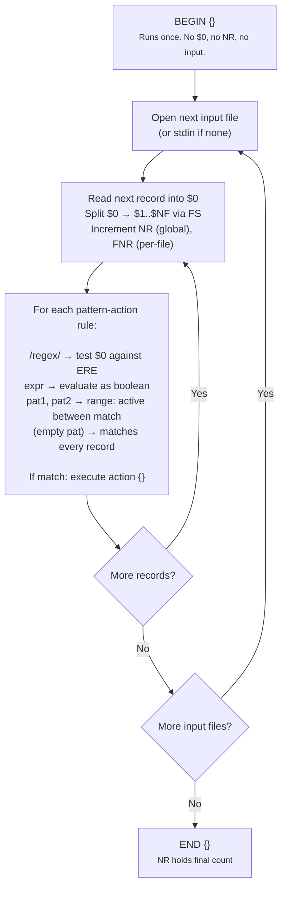

# Lesson 1: Awk Primitives and Execution Model

## 1. First-Principles Intuition & Invariants

There is a category of tool that earns its place not through feature accumulation but through conceptual economy — where every capability falls out naturally from a single, well-chosen abstraction. Awk is exactly such a tool. Created at Bell Labs in 1977 by Alfred Aho, Peter Weinberger, and Brian Kernighan, it was designed to close a gap that neither `sed` nor shell could cleanly address: structured, field-oriented text processing with real arithmetic, real variables, and real control flow. Fifty years later, it remains the fastest path from raw columnar data to a computed result, and understanding *why* requires examining the execution model at the level of its fundamental invariant.

That invariant is disarmingly simple: **for every record in the input, evaluate every pattern against that record, and execute the corresponding action if the pattern matches.** Everything else — field splitting, built-in variables, associative arrays, arithmetic coercion — is scaffolding built on top of this loop. The engineer who internalizes this model stops thinking of awk as a command with flags and starts reading an awk program the way a compiler engineer reads a grammar: as a set of declarative production rules whose evaluation order is determined by the runtime, not the programmer.

The pattern-action paradigm has deep roots in formal language theory. Each `pattern { action }` pair is structurally analogous to a production rule in a PEG or CFG, but awk's "parser" is not recursive: it is a linear scan over a sequence of records, applying all rules in textual order against each input unit. This makes awk's evaluation model closer to a Datalog-style bottom-up rule engine than to a traditional imperative program. The consequence is significant for systems programmers who habitually think in terms of control flow: in awk, **you describe what to do when a condition is true across a stream, not how to iterate over that stream**. The iteration is implicit and owned by the runtime.

The concept of a *record* is where awk diverges most sharply from byte-stream tools like `grep` or `sed`. Awk interposes a layer of structure between the raw byte sequence and your program. The input stream is first split into records by the record separator `RS`, which defaults to the newline character `\n`. Each record is then independently split into *fields* by the field separator `FS`, which defaults to any run of whitespace (a subtlety with important consequences, discussed below). The result is a two-dimensional logical view of the input: a sequence of rows, each row a sequence of typed cells. Awk is, in this precise sense, an in-process streaming relational engine whose schema is inferred dynamically from the data.

This automatic structuring is not cosmetic. It eliminates the most common class of shell scripting error: manual string splitting via `cut`, `IFS` manipulation, and subshell invocation. When a systems programmer reaches for awk over shell to parse `/proc/net/dev` or the output of `ss -tunp`, they are not choosing a different syntax; they are choosing a different *execution contract* — one where field access is O(1) by index and the runtime handles separator logic entirely.

The language's type system deserves careful attention because it is a source of both power and subtle bugs. Awk is *dynamically typed with implicit coercion between strings and numbers*, but the coercion rules are deterministic and specified. A variable used in an arithmetic context is converted to a number by stripping leading whitespace and parsing as many digits as possible — equivalent to C's `strtod`. The same variable used in a string context is treated as its string representation. The *type* of a variable at any given moment is therefore a function of how it was last assigned or how the current expression context uses it. For engineers accustomed to Rust's type system or even C's static types, this feels dangerous. In practice, the danger is confined to a narrow set of comparison operations, where the string `"10"` and the integer `10` may compare differently depending on context. Knowing the rule — if both operands look like numbers, compare numerically; otherwise compare as strings — makes this manageable.

The `BEGIN` and `END` blocks are not special patterns in the same sense as a regex or relational expression. They are *phase markers* that execute outside the record loop entirely. `BEGIN` fires once before any input is read, making it the natural location for variable initialization, separator configuration, and header printing. `END` fires once after all input is exhausted, making it the right place to emit aggregated results. The mental model is that of a three-phase pipeline: initialization, per-record processing, finalization. This maps precisely onto the structure of a streaming aggregation operator in a database query plan, and experienced engineers should read it that way.

---

## 2. Core Architecture & Mechanics

### The Record Processing Loop

To understand awk's mechanics concretely, it helps to model its execution as pseudocode. The following is a faithful representation of what gawk (GNU awk) does for a program containing `k` pattern-action rules:

```
open_next_input_file()
while read_next_record() into $0:
    split($0, fields[], FS)          # populate $1..$NF
    NF = length(fields[])
    NR += 1; FNR += 1
    for i in 0..k:
        if rules[i].pattern.matches($0, fields[]):
            execute(rules[i].action)
emit_END_blocks()
```

This loop is the entire runtime. There is no event loop, no callback registration, no virtual dispatch table beyond the per-rule evaluation. The simplicity is what makes awk fast for the workloads it was designed for: single-pass, record-at-a-time streaming over text with moderate per-record computation.

The field array is not built from scratch on every record in a naive implementation. Gawk uses a lazy evaluation strategy: `$0` is stored as a raw string, and fields are split only when a field variable is first accessed. This matters for programs that test only `$0` with a regex — the split is avoided entirely on non-matching records. Conversely, assigning to a field variable (e.g., `$2 = "new"`) triggers *reconstruction* of `$0` by joining all fields with the current value of `OFS` (output field separator). This is a critical invariant: **modifying a field mutates `$0`**, and the reconstructed `$0` uses `OFS`, not the original separator characters. This catches engineers who set `FS=":"` to parse `/etc/passwd`, then assign a field, and are surprised to find `$0` now contains spaces.

```
Input record:  "root:x:0:0:root:/root:/bin/bash"
FS = ":"
$1 = "root", $2 = "x", $3 = "0" ... $7 = "/bin/bash"

$1 = "superuser"          # assign to field 1
$0 is now reconstructed:
  "superuser x 0 0 root /root /bin/bash"   (OFS defaults to " ")
```

Setting `OFS=":"` before the assignment would preserve the colon-delimited structure. This is not a bug; it is the specified behavior, and it makes awk a coherent tool for structured field transformation.

### Field Splitting Semantics and FS

The default value of `FS` — a single space character `" "` — has special semantics that differ from every other single-character separator. When `FS` is a single space, awk strips leading and trailing whitespace from the record and splits on runs of whitespace of any length. This is designed to handle the ragged columnar output of tools like `ps`, `df`, `netstat`, and `ls -l`, where columns are aligned with variable numbers of spaces or tabs.

When `FS` is any other single character (e.g., `":"` or `","`), it is a *literal* character separator. Consecutive separators produce empty fields — `"a::b"` with `FS=":"` yields `$1="a"`, `$2=""`, `$3="b"`. When `FS` is a string of two or more characters, it is interpreted as a POSIX extended regular expression (ERE). This allows complex delimiters: `FS="[,;]+"` splits on any run of commas or semicolons. POSIX awk mandates this ERE interpretation; gawk extends it further with multi-character literal separators accessible via the `--posix` flag behavior, though in practice ERE-as-FS is the portable and preferred mechanism.

The variable `RS` follows analogous but not identical rules. By default it is `"\n"`, making each line a record. Setting `RS=""` activates *paragraph mode*: records are separated by one or more blank lines, and within each record, newlines act as an additional field separator alongside `FS`. This is invaluable for processing structured blocks of text — think `strace` output grouped by syscall, or multi-line log entries. Setting `RS` to a multi-character string or regex is a gawk extension (not POSIX), so portable programs must avoid it.

### Execution Flow Diagram

The following diagram models the full execution lifecycle of an awk program against multiple input files:



### Built-In Variables as Execution State

Awk's built-in variables are not merely convenient shorthands; they are *the exposed state of the execution engine*. Reading them gives you a window into the runtime's current position and configuration; writing them actively changes runtime behavior. This bidirectionality is unusual among scripting tools and deserves explicit treatment.

`NR` (Number of Records) is a monotonically increasing counter across all input files. It never resets between files. `FNR` (File Number of Records) resets to 1 at the start of each new input file. The pattern `FNR == 1` therefore fires at the first record of *each* file — the correct way to emit per-file headers when processing multiple files in a single awk invocation.

`NF` (Number of Fields) reflects the field count of the *current* record. It can be assigned. Assigning a value smaller than the current `NF` truncates the record — fields beyond the new `NF` are deleted and `$0` is reconstructed. Assigning a value larger than the current `NF` creates empty fields up to the new count. This makes `NF--` an idiomatic way to strip the last field from a record.

`FILENAME` holds the name of the currently open input file. It is undefined (empty string) when reading from stdin. For tools that need to annotate output with its source file, `FILENAME` is the correct mechanism — preferable to passing the filename as an awk variable via `-v`.

`OFMT` controls the format used when printing floating-point numbers that result from implicit string conversion of numeric values. It defaults to `"%.6g"`. Engineers printing high-precision floats — from profiling data, timing measurements, or financial calculations — must set `OFMT` explicitly in `BEGIN` to avoid silent rounding in output.

### Pattern Types and Range Patterns

Awk supports four distinct pattern forms, and the distinction between them has consequences for performance and correctness. A *regex pattern* (`/ERE/`) tests `$0` against a compiled regular expression. A *relational expression* (`NR > 10`, `$3 ~ /error/`) evaluates an arbitrary boolean expression, where `~` is the regex match operator and `!~` is its negation. The absence of a pattern is an unconditional match — every record triggers the action, equivalent to `1 { action }` or `true { action }`.

The *range pattern* `pat1, pat2` is semantically distinct from all others. It introduces a stateful toggle: once `pat1` matches a record, the range becomes *active*, and all subsequent records trigger the action until `pat2` matches (inclusive). The state is maintained inside the runtime as a per-rule boolean flag. This makes range patterns the correct tool for extracting structured blocks from log files or configuration files — start of a stanza, end of a stanza — without requiring the programmer to maintain explicit state variables. A range pattern between two line-number expressions, `NR==10, NR==20`, is the idiomatic awk equivalent of `sed -n '10,20p'` but with full field access and arithmetic available inside the action.

One important subtlety: the two patterns in a range are tested against the *same* record. If `pat1` and `pat2` both match record N, the range activates and immediately deactivates on that single record. The action fires exactly once, for that record. This is correct behavior per the POSIX specification, but it surprises engineers who expect `pat2` to be tested only *after* `pat1` has already fired.

---

## 3. High-Performance Optimization & Failure Modes

### Separator Configuration as the First Optimization

The single most impactful optimization available in an awk program costs zero lines of code: choosing `FS` correctly. When `FS` is left at its default single-space value, awk must scan each record for whitespace runs, handling the leading/trailing strip as well. For fixed-delimiter formats like CSV, TSV, `/etc/passwd`, or structured log files, setting `FS` to the literal delimiter character eliminates the whitespace-scanning overhead and, more importantly, makes field boundaries deterministic regardless of content.

For TSV specifically, `FS="\t"` is the correct and fast choice. The common mistake of using `FS=" "` with tab-separated data produces silently wrong field counts when any cell contains spaces, because whitespace-mode FS treats all whitespace as equivalent. This is not a performance issue; it is a correctness failure that produces no error and no warning.

For high-throughput processing of large files, the choice between gawk, mawk, and nawk matters. Mawk (Mike Brennan's awk) consistently outperforms gawk on pure throughput benchmarks involving simple field extraction and arithmetic, because mawk compiles awk programs to bytecode with a tighter interpreter loop and uses less memory per record. Gawk's advantages lie in extensions: `PROCINFO`, TCP/IP coprocesses, true multidimensional arrays, and the `@include` preprocessing directive. For a 50 GB log file being filtered and aggregated in a CI pipeline, running mawk instead of gawk can reduce wall-clock time by 30–50%. This is not theoretical; it is measurable with `time` and a representative workload sample.

### Avoiding Recompilation of Regular Expressions

POSIX awk compilers are permitted to compile a regex literal at program load time if it appears as a constant in the source. Gawk does this for regex literals used in pattern position and in `~` comparisons against a literal. However, a regex stored in a variable — `FS="/pattern/"` or `if ($0 ~ var)` — is recompiled on every evaluation. When a hot loop tests thousands of records against a user-supplied pattern, and that pattern is stored in a variable, gawk cannot cache the compiled automaton. The workaround is to structure the program so that dynamically constructed patterns are tested with `match()` only when necessary, and to prefer constant regex literals in tight loops.

A concrete example arises when processing compiler error logs. If you are scanning `make` output to extract and count error types, the regex `/^.*error:.*$/` as a literal pattern is compiled once at program start. A variant that builds the pattern from a command-line `-v` variable is recompiled for every record. For a 10,000-line build log, the difference is negligible. For a 10-million-line CI artifact aggregator running in a hot path, it is not.

### The Associative Array and Memory Accumulation

Awk's associative arrays are hash maps with string keys, and they are dynamically sized. There is no fixed upper bound on their size other than available memory. This makes them ideal for in-stream aggregation — counting unique IPs, summing request sizes by endpoint, tracking error rates by service — but it also means that programs accumulating unbounded unique keys will exhaust memory silently. A production awk program counting unique user agents from an nginx access log with millions of unique bots will grow its array until the process is OOM-killed.

The mitigation is not to avoid associative arrays but to understand their scope. For genuinely unbounded cardinality problems, awk is the wrong final tool — a probabilistic data structure (HyperLogLog) or an external key-value store is appropriate. For bounded cardinality problems with known upper limits (HTTP status codes, log severity levels, a finite set of service names), awk arrays are entirely safe and highly efficient.

Deleting array elements with `delete arr[key]` is O(1) amortized. Deleting an entire array with `delete arr` (a gawk extension; POSIX requires iterating and deleting keys individually) is O(n) in the number of keys. Neither operation shrinks the hash table's underlying bucket array in gawk's current implementation — the memory footprint remains high-water-mark. For programs that intentionally cycle through large arrays across multiple input phases, this is worth knowing: memory usage will not decrease between phases even after `delete`.

### Field Assignment Side Effects and Reconstruction Cost

The rule that assigning any field variable reconstructs `$0` via `OFS` has a performance implication in hot loops. If a program modifies `$2` on every record of a 100-million-line file, awk performs 100 million string concatenation operations to reconstruct `$0`, even if the program never uses `$0` after the assignment. In gawk, this reconstruction is lazy — `$0` is flagged as dirty and not physically reconstructed until `$0` is read. This means that programs which assign fields but never subsequently use `$0` (they use only specific field variables or call `print $1, $3`) pay no reconstruction cost in gawk. Mawk reconstructs eagerly in some versions. The practical lesson: if you are transforming specific fields and printing them individually with `print $1, $2, $3`, do not use `print $0` to emit the modified record unless you understand that the full concatenation will occur.

### Failure Mode: NF Mutation and Phantom Fields

A subtle failure mode arises when programs conditionally append fields by assigning to `$(NF+1)`. This extends the record by one field, incrementing `NF` and triggering `$0` reconstruction. If this assignment occurs inside a loop or a pattern that fires on most records, the program creates a feedback loop: on the next iteration, `NF` is larger, `$(NF+1)` creates yet another field, and the record grows unboundedly. This does not cause an error; awk silently allocates more fields. The output is simply wrong — records have unexpected trailing fields. The fix is to capture `NF` in a local variable at the start of the action block if you intend to reference the original field count after any mutation:

```awk
{
    orig_nf = NF
    # ... modifications ...
    $(orig_nf + 1) = "appended"
    print
}
```

### Portability Boundaries Between awk Implementations

POSIX awk (as defined in IEEE Std 1003.1-2017) is the common substrate, but the three dominant implementations — gawk, mawk, and nawk — diverge in precisely the places that systems programs most often need. `delete arr` to delete an entire array is gawk-only; POSIX requires `for (k in arr) delete arr[k]`. `gensub()` for capture-group-aware substitution is gawk-only; POSIX programs must use `sub()` and `gsub()`, which cannot reference capture groups. The `PROCINFO` array for runtime metadata is gawk-only. Setting `RS` to a regex is gawk-only. TCP socket coprocesses (`|& "host:port"`) are gawk-only.

For programs that must run on macOS (which ships BSD nawk, not gawk), on Alpine Linux containers (which may have only busybox awk), or in POSIX-strict environments, the safe practice is to write to the POSIX subset and test against mawk. Mawk's stricter POSIX adherence will surface gawk extensions earlier than gawk itself, since gawk emits no warnings for its own extensions. A CI step that runs the same awk program against gawk, mawk, and busybox awk on a representative dataset is a cheap and effective portability gate for infrastructure tooling.

### Benchmarking and Profiling awk Programs

Gawk includes a built-in profiler activated with `--profile[=file]`. It produces an annotated version of the source program with execution counts per rule and per statement. For programs exhibiting unexpected slowness — common when a program has accumulated many pattern-action rules over time — the profiler immediately reveals which patterns fire most frequently, which actions account for the most execution time, and whether any `getline` calls are becoming I/O bottlenecks.

For microbenchmarking, the idiomatic approach is to generate a representative input with a known record count and measure wall-clock time with `time`, varying one parameter at a time. Comparing `FS=" "` against `FS="\t"` for a TSV file, or regex patterns against relational expressions for a known-distribution input, produces actionable numbers in under a minute. The discipline of measuring before optimizing applies to awk exactly as it does to any other computational system: the execution model is simple enough that intuitions about performance are often correct, but simple enough that measurement is also cheap, and measurement should always win over intuition.
