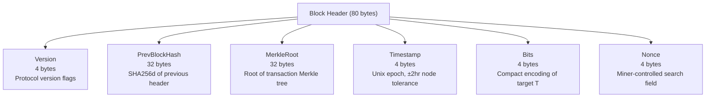
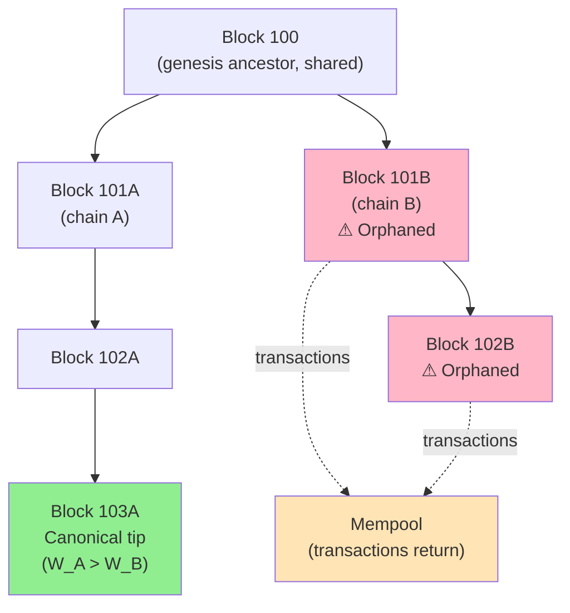

# Lesson 2: Proof of Work Consensus

## 1. First-Principles Intuition & Invariants

The fundamental problem every distributed consensus system must solve is deceptively simple to state and fiendishly difficult to resolve: how do a set of mutually distrustful nodes agree on a single, canonical history of events, when any participant might be lying, slow, or adversarially malicious? Classical distributed systems answers to this question — Paxos, Raft, PBFT — all rely on a closed, permissioned membership model. You know who the participants are, you can assign them identities, and you can reason about quorums mathematically. Bitcoin's breakthrough insight, formalized in Satoshi Nakamoto's 2008 whitepaper, was that you can achieve Byzantine fault tolerant consensus in a *permissionless*, open network if you replace identity-based voting with physical work. You cannot fake computation. You cannot Sybil-attack thermodynamics.

The invariant at the heart of Proof of Work is what cryptographers call a *preimage resistance* asymmetry: a one-way function exists such that computing a valid output requires brute-force iteration over an enormous input space, while verifying that an output is valid requires a single function evaluation. SHA-256, the hash function at Bitcoin's core, is a Merkle–Damgård construction operating over 512-bit message blocks, producing a 256-bit digest through sixty-four rounds of bitwise permutation, modular addition, and nonlinear mixing. Its avalanche property guarantees that flipping a single input bit randomizes approximately half the output bits, making the output space indistinguishable from uniform randomness. There is no known shortcut. The only strategy an adversary possesses is exhaustive search.

Mining is the operationalization of that asymmetry. A miner's goal is to find a nonce — a 32-bit field embedded in the block header — such that when the entire 80-byte header is double-SHA-256 hashed, the resulting digest is numerically less than a protocol-defined *target* value. The target is a 256-bit integer, and "less than the target" means the hash must begin with a sufficient number of leading zero bits. At the time of writing, the Bitcoin network requires roughly 76 leading zero bits in a valid block hash. The probability of any single hash attempt succeeding is therefore approximately $2^{-76}$, meaning the expected number of hashes required per block is on the order of $10^{23}$. The global network currently executes this search at roughly 500 exahashes per second — $5 \times 10^{20}$ SHA-256 double-hash evaluations every second — consuming the electrical output of a mid-sized nation-state.

This is not incidental waste. It is the protocol's security budget. The computational expenditure is precisely what makes the ledger tamper-evident: to rewrite a block buried $k$ blocks deep in the chain, an attacker must redo not just the work for that block, but for every block appended since, all while the honest network continues extending the chain forward. The deeper the block, the more irreversible it becomes. This property, *probabilistic finality through accumulated work*, is Bitcoin's fundamental security guarantee, and it trades the clean mathematical finality of BFT protocols for an economic finality grounded in thermodynamics.

The network self-regulates its difficulty through an automatic adjustment algorithm executing every 2016 blocks (approximately two weeks of real time). If the previous 2016-block epoch was mined in less than two weeks, the target shrinks, making each subsequent hash less likely to succeed. If mining was slower, the target expands. The invariant being maintained is a ten-minute average inter-block interval — a deliberate choice balancing propagation latency (a block must reach all nodes before the next one is found) against throughput. This difficulty adjustment is the negative feedback loop that keeps the system stable under arbitrary changes in total network hash rate, whether from new ASIC generations coming online or entire mining operations shutting down.

---

## 2. Core Architecture & Mechanics

### The Block Header as a State Machine

Every piece of work in the PoW consensus protocol is anchored to an 80-byte block header. Understanding its structure at the byte level is prerequisite to understanding both the mining loop and the chain selection rule.



The `PrevBlockHash` field is what chains blocks together cryptographically. Any modification to any transaction in a historical block changes its Merkle root, which changes its header hash, which invalidates the `PrevBlockHash` field in every descendant block, requiring all descendant proof-of-work to be recomputed. This chain-of-hashes structure is why the data structure is called a blockchain, and it is the technical mechanism by which the protocol enforces append-only history.

The `Bits` field is a compact floating-point encoding of the current target threshold $T$. It encodes a 3-byte mantissa and a 1-byte exponent in a format where the actual 256-bit target is reconstructed as:

$$T = \text{mantissa} \times 2^{8 \times (\text{exponent} - 3)}$$

The relationship between `Bits` and the more intuitively grasped *difficulty* $D$ is:

$$D = \frac{D_{\text{genesis}}}{T} = \frac{0x00000000FFFF \times 2^{208}}{T}$$

where $D_{\text{genesis}} = 1$ by definition. Difficulty thus measures how many times harder mining is compared to the network's initial state in January 2009.

### The Mining Loop in C

The inner loop of a Bitcoin miner is architecturally simple: serialize the block header into an 80-byte buffer and double-SHA-256 it repeatedly, incrementing the nonce on each attempt. The following is a fully functional reference implementation in C, using OpenSSL's EVP API for the hash computation:

```c
#include <stdio.h>
#include <stdint.h>
#include <string.h>
#include <arpa/inet.h>
#include <openssl/evp.h>

#define HEADER_SIZE 80
#define HASH_SIZE   32

typedef struct __attribute__((packed)) {
    uint32_t version;
    uint8_t  prev_hash[32];
    uint8_t  merkle_root[32];
    uint32_t timestamp;
    uint32_t bits;
    uint32_t nonce;
} block_header_t;

static void sha256d(const uint8_t *data, size_t len, uint8_t *out) {
    uint8_t mid[HASH_SIZE];
    unsigned int md_len = HASH_SIZE;

    EVP_MD_CTX *ctx = EVP_MD_CTX_new();
    EVP_DigestInit_ex(ctx, EVP_sha256(), NULL);
    EVP_DigestUpdate(ctx, data, len);
    EVP_DigestFinal_ex(ctx, mid, &md_len);

    EVP_DigestInit_ex(ctx, EVP_sha256(), NULL);
    EVP_DigestUpdate(ctx, mid, HASH_SIZE);
    EVP_DigestFinal_ex(ctx, out, &md_len);
    EVP_MD_CTX_free(ctx);
}

/*
 * Expand compact 'bits' encoding into a 32-byte target array (big-endian).
 * Returns the target threshold for numeric comparison against a hash.
 */
static void expand_target(uint32_t bits, uint8_t *target_out) {
    memset(target_out, 0, HASH_SIZE);
    uint32_t exponent = (bits >> 24) & 0xff;
    uint32_t mantissa = bits & 0x007fffff;

    if (exponent <= 3) {
        mantissa >>= 8 * (3 - exponent);
        target_out[HASH_SIZE - 3] = (mantissa >> 16) & 0xff;
        target_out[HASH_SIZE - 2] = (mantissa >>  8) & 0xff;
        target_out[HASH_SIZE - 1] = (mantissa      ) & 0xff;
    } else {
        int byte_index = (int)HASH_SIZE - (int)exponent;
        if (byte_index >= 0 && byte_index + 2 < HASH_SIZE) {
            target_out[byte_index    ] = (mantissa >> 16) & 0xff;
            target_out[byte_index + 1] = (mantissa >>  8) & 0xff;
            target_out[byte_index + 2] = (mantissa      ) & 0xff;
        }
    }
}

/*
 * Returns 1 if hash <= target (valid proof of work), 0 otherwise.
 * Comparison is big-endian byte-by-byte, most significant byte first.
 */
static int hash_meets_target(const uint8_t *hash, const uint8_t *target) {
    for (int i = 0; i < HASH_SIZE; i++) {
        if (hash[i] < target[i]) return 1;
        if (hash[i] > target[i]) return 0;
    }
    return 1; /* exact equality also satisfies target */
}

/*
 * Brute-force PoW search over the full 32-bit nonce space.
 * Returns the winning nonce, or -1 if the nonce space is exhausted.
 * In production miners, the coinbase's extra-nonce field is incremented
 * when the 32-bit space is exhausted, changing the Merkle root and
 * restarting the inner loop — this reference omits that outer loop
 * for clarity.
 */
int64_t mine_block(block_header_t *header) {
    uint8_t hash[HASH_SIZE];
    uint8_t target[HASH_SIZE];
    expand_target(header->bits, target);

    for (uint64_t nonce = 0; nonce <= 0xFFFFFFFFULL; nonce++) {
        header->nonce = (uint32_t)nonce;

        /* SHA-256d over the 80-byte header in little-endian wire format */
        sha256d((const uint8_t *)header, HEADER_SIZE, hash);

        if (hash_meets_target(hash, target)) {
            printf("[+] Valid nonce found: 0x%08X\n", (uint32_t)nonce);
            printf("[+] Block hash: ");
            for (int i = 0; i < HASH_SIZE; i++) printf("%02x", hash[i]);
            printf("\n");
            return (int64_t)nonce;
        }
    }
    return -1; /* nonce space exhausted; caller must increment extra-nonce */
}

int main(void) {
    /*
     * Bitcoin genesis block header values (all fields little-endian on wire).
     * This reproduces block #0 for reference; real miners receive a block
     * template from a node via the getblocktemplate RPC.
     */
    block_header_t header;
    memset(&header, 0, sizeof(header));

    header.version   = htole32(1);
    header.timestamp = htole32(1231006505);  /* 2009-01-03 18:15:05 UTC */
    header.bits      = htole32(0x1d00ffff);  /* genesis difficulty = 1 */
    header.nonce     = 0;
    /* prev_hash and merkle_root omitted for brevity; zero-initialized */

    int64_t result = mine_block(&header);
    if (result < 0)
        fprintf(stderr, "[-] Nonce space exhausted. Increment extra-nonce.\n");
    return 0;
}
```

Compile and run with `gcc -O2 -o miner miner.c -lssl -lcrypto && ./miner`. At difficulty 1 (the genesis target), a modern CPU will find a valid nonce in milliseconds. At current mainnet difficulty, the same code would run for longer than the age of the universe on a single core — which is precisely the point.

### The Merkle Tree and Transaction Commitment

The `MerkleRoot` field commits the entire set of transactions in the block to the header without including their full data in the 80 bytes being hashed. The construction is a binary hash tree where leaf nodes are double-SHA-256 hashes of serialized transactions, and each internal node is the double-SHA-256 of the concatenation of its two children. The root is the single 32-byte value at the apex.

```text
        MerkleRoot
           H(AB || CD)
          /           \
      H(A || B)     H(C || D)
      /       \     /       \
    H(TxA)  H(TxB) H(TxC)  H(TxD)
```

This construction enables Simplified Payment Verification (SPV): a lightweight client can verify that transaction TxA is included in a confirmed block by requesting only the sibling hashes along the path from the leaf to the root — a Merkle proof of $O(\log n)$ hashes — rather than downloading the full block. At the time of writing, the typical Bitcoin block contains two to three thousand transactions, so an SPV proof requires roughly twelve hashes (32 bytes each), not several megabytes of transaction data.

### Chain Selection: The Heaviest Chain Rule

The canonical chain selection rule in Bitcoin is frequently described as "longest chain," but this is a simplification that becomes materially misleading when you need to reason about forks. The actual rule selects the chain with the greatest *accumulated proof of work*, measured as the sum of difficulties of all blocks in the chain. Difficulty is not uniform across time — it adjusts every 2016 blocks — so a chain with more blocks is not necessarily the chain with more work.

The accumulated work for a single block at difficulty $D$ is:

$$W_{\text{block}} = \frac{2^{256}}{T} \approx D \times 2^{32}$$

The expected number of hash operations needed to produce a valid block at difficulty $D$ is $D \times 2^{32}$, and the cumulative chain work is the sum of these values across all blocks. When a node receives a competing chain tip, it computes `chainWork` for both chains and adopts the one with the higher value, discarding the other as a stale fork.

This diagram shows the fork resolution flow:



Nodes do not vote. They do not coordinate. Each independently evaluates accumulated work and converges on the same tip probabilistically — a statistical consensus that emerges from the physics of computation rather than from message passing.

### Difficulty Adjustment Implementation

Every 2016 blocks, full nodes independently recompute the target using identical inputs, so the adjustment requires no coordination:

```c
#include <stdint.h>

#define RETARGET_INTERVAL     2016
#define TARGET_TIMESPAN_SEC   1209600   /* 14 days in seconds */
#define MIN_TIMESPAN_SEC       302400   /* 1/4 of target: prevents sudden collapse */
#define MAX_TIMESPAN_SEC      4838400   /* 4x  of target: prevents sudden explosion */

/*
 * Compute the new target for the next 2016-block epoch.
 * actual_timespan: seconds elapsed during the previous 2016 blocks
 * old_target:      the 32-byte big-endian target active during that epoch
 * new_target:      output buffer for the adjusted target
 *
 * The clamping of actual_timespan to [MIN, MAX] prevents difficulty from
 * changing by more than a factor of 4 in a single adjustment period,
 * a safeguard against sudden hash rate changes destabilizing the network.
 */
void adjust_difficulty(uint32_t actual_timespan,
                       const uint8_t *old_target,
                       uint8_t *new_target) {
    if (actual_timespan < MIN_TIMESPAN_SEC) actual_timespan = MIN_TIMESPAN_SEC;
    if (actual_timespan > MAX_TIMESPAN_SEC) actual_timespan = MAX_TIMESPAN_SEC;

    /*
     * new_target = old_target * actual_timespan / TARGET_TIMESPAN_SEC
     *
     * In production Bitcoin Core, this arithmetic is performed with
     * 256-bit big integer types (arith_uint256) to avoid overflow.
     * This reference uses 64-bit arithmetic on the last 8 bytes of
     * the target for illustrative purposes — suitable only for low
     * difficulty values where the significant bytes fit in 64 bits.
     */
    uint64_t t = 0;
    for (int i = 24; i < 32; i++) {
        t = (t << 8) | old_target[i];
    }

    t = t * (uint64_t)actual_timespan / (uint64_t)TARGET_TIMESPAN_SEC;

    for (int i = 31; i >= 24; i--) {
        new_target[i] = (uint8_t)(t & 0xff);
        t >>= 8;
    }
    for (int i = 0; i < 24; i++) {
        new_target[i] = old_target[i]; /* upper bytes unchanged in low-difficulty regime */
    }
}
```

---

## 3. High-Performance Optimization & Failure Modes

### From CPU to ASIC: The Hardware Evolution of the Mining Loop

The reference implementation above executes on a general-purpose CPU, performing roughly 10–50 million double-SHA-256 operations per second per core on modern hardware. The Bitcoin network's current 500 exahash/second throughput is achieved entirely through Application-Specific Integrated Circuits — custom silicon fabricated at 5nm and 3nm process nodes that implement the SHA-256 round function in pure combinational logic, pipelined across dozens of parallel hashing engines on a single die. Modern ASIC miners such as the Bitmain Antminer S21 achieve roughly 200 terahashes per second at 17.5 joules per terahash, a figure that is roughly $10^{10}$ times more efficient than the CPU reference code in terms of hashes per watt.

Understanding why requires going to the register-transfer level. A single SHA-256 round computes:

$$T_1 = h + \Sigma_1(e) + \text{Ch}(e,f,g) + K_j + W_j$$
$$T_2 = \Sigma_0(a) + \text{Maj}(a,b,c)$$

where $\Sigma_0$, $\Sigma_1$ are fixed-rotation operations and $\text{Ch}$, $\text{Maj}$ are bitwise selection functions. On a CPU, each round is a sequential sequence of integer instructions. On an ASIC, the entire round is a single combinational logic stage with propagation delay measured in picoseconds, allowing thousands of rounds to complete per clock cycle across hundreds of parallel pipelines. The inner mining loop, which on a CPU is a software loop over 64 rounds × 2 passes × billions of nonces, becomes entirely unrolled combinational logic on silicon. The nonce space iteration becomes a simple counter feeding independent pipeline lanes.

For systems programmers implementing mining pool software or block template construction, the performance-critical path is not the hash computation itself (which is outsourced to ASICs via the Stratum protocol) but the latency of block template propagation. When a new block is found anywhere in the network, every mining pool must immediately switch its ASICs to build on the new tip. Stale work — hashes submitted for a block height that has already been solved — wastes hardware capacity and directly degrades pool revenue. The Stratum V2 protocol addresses this with binary framing and aggressive push-notification semantics, reducing template switching latency from hundreds of milliseconds to under ten milliseconds.

### The Extra-Nonce Pattern and Merkle Root Grinding

The 32-bit nonce field in the block header provides only $2^{32} \approx 4.3 \times 10^9$ distinct header states. At 500 exahashes/second globally, the entire nonce space for a single Merkle root is exhausted in roughly 8 nanoseconds by the network as a whole, and in a few seconds even by a single high-end ASIC miner. The nonce space was exhausted in Bitcoin's early years, before ASICs, when CPU miners routinely needed to vary the coinbase transaction to generate a fresh Merkle root and restart the nonce search.

The coinbase transaction — the first transaction in every block, which creates new Bitcoin and pays the block reward to the miner — contains an arbitrary data field called the `coinbase` scriptSig. Miners embed an *extra-nonce* counter here, typically 4–8 bytes. Each increment of the extra-nonce produces a different coinbase transaction serialization, a different coinbase transaction hash, a different leaf at position zero of the Merkle tree, and therefore a different Merkle root in the header. The miner now has an effectively unlimited search space: for each extra-nonce value, it exhausts the 32-bit header nonce, then increments the extra-nonce and recomputes the Merkle root. The two-level search is:

```text
outer loop: extra_nonce from 0 to 2^64
    coinbase_tx.extra_nonce = extra_nonce
    merkle_root = compute_merkle_root(coinbase_tx, other_transactions)
    block_header.merkle_root = merkle_root
    inner loop: nonce from 0 to 2^32
        block_header.nonce = nonce
        hash = sha256d(block_header)
        if hash < target: broadcast block; break outer
```

The Merkle root recomputation in the outer loop is not entirely free: it requires recomputing the path from the coinbase leaf to the root, which is $O(\log n)$ hashes where $n$ is the transaction count. For a block with 2048 transactions, that is eleven hash operations per extra-nonce increment, amortized over four billion inner-loop iterations — a negligible cost, but one that ASIC control boards must implement in their firmware rather than in ASIC silicon, since it requires a small general-purpose processor.

### Selfish Mining: A Strategic Failure Mode

The naive assumption about PoW consensus is that rational miners maximize revenue by immediately broadcasting valid blocks they find. In 2013, Ittay Eyal and Emin Gün Sirer demonstrated that this assumption is wrong: a miner with more than roughly 25–33% of network hash rate can increase its revenue share beyond its proportional contribution through *selfish mining*, a strategy that withholds found blocks and forces honest miners to waste work on stale branches.

The mechanism operates as follows. The selfish miner finds block $N+1$ and withholds it, continuing to mine block $N+2$ in private. The honest network is still mining on block $N$. When the honest network finds block $N+1'$, the selfish miner immediately publishes its private block $N+1$, forcing a fork. If the selfish miner finds $N+2$ quickly (within the network propagation window of the honest block), it publishes both $N+1$ and $N+2$ simultaneously, winning the fork because its chain has more work. The honest miners' block $N+1'$ becomes an orphan, and the work that produced it is entirely wasted. The selfish miner has essentially turned the honest network's hash rate into a tool that amplifies its own revenue.

The selfish mining strategy is a pure software concern for pool operators and node operators. Defenses include the "tie-breaking" heuristic: when a node receives two valid blocks at the same height simultaneously, it preferentially propagates the one it received first, reducing the window during which the selfish miner can exploit propagation asymmetry. Some proposals suggest randomized tie-breaking, selecting one of two competing blocks uniformly at random, which degrades the selfish miner's advantage toward zero as the randomization approaches perfect fairness.

### The 51% Attack: Economics and Practical Thresholds

A 51% attack — more precisely, a *majority hash rate attack* — allows an attacker who controls more than 50% of network hash rate to execute *double-spend* attacks with high probability. The attacker spends coins in a transaction included in the public chain, waits for a merchant to accept the payment after some number of confirmations, then privately mines an alternative chain from before the payment that omits the spend transaction and redirects the coins back to themselves. Because the attacker controls the majority of hash rate, their private chain accumulates work faster than the public chain in expectation, and they eventually publish it, reorganizing the chain and reversing the merchant's confirmation.

The probability that an attacker with hash rate fraction $q < 0.5$ can catch up from $k$ blocks behind is a classic Gambler's Ruin problem. Let $p = 1 - q$ be the honest fraction. The probability $P(k)$ that the attacker overcomes a $k$-confirmation lead is:

$$P(k) = \left(\frac{q}{p}\right)^k$$

For $q = 0.3$ (30% hash rate) and $k = 6$ confirmations: $P(6) = (0.3/0.7)^6 \approx 0.0028$. For $q = 0.49$: $P(6) = (0.49/0.51)^6 \approx 0.78$. At $q \geq 0.5$, the attacker's expected lead grows without bound and success is guaranteed with probability 1 given sufficient time.

The economic deterrent is the cost of acquiring majority hash rate. For the Bitcoin network at current prices and hardware costs, a 51% attack would require capital expenditure on the order of tens of billions of dollars in ASIC hardware, plus ongoing electricity costs in the hundreds of millions per hour of attack, all to execute double-spends against merchants who accept unconfirmed or under-confirmed transactions. The attack is simultaneously technically possible and economically irrational against a network of Bitcoin's scale — the attack cost exceeds the plausible double-spend revenue, and the attack itself would likely crash the value of the coins being stolen. This is the economic security argument for Bitcoin: the protocol's security grows with the market value of the asset it secures, because rising asset prices attract more mining investment, which raises the attack cost.

Smaller PoW networks with the same algorithm as Bitcoin face a qualitatively different threat: an attacker can rent hash rate from NiceHash or similar marketplaces to temporarily acquire majority power over a small network without purchasing hardware, execute a double-spend in minutes, and release the rented hash rate before the community can respond. Bitcoin Gold, Ethereum Classic, and Vertcoin have all suffered confirmed 51% attacks executed this way. The defense for smaller networks is either to adopt merge-mining (mining alongside a larger network simultaneously, inheriting its security budget), or to change the proof-of-work algorithm to one that cannot be rented cheaply.

### Mining Pool Architecture and Variance Reduction

Solo mining at current difficulty is statistically comparable to winning a lottery: the expected time for a single ASIC to find a valid block is tens of thousands of years. Mining pools aggregate the hash rate of thousands of participants, distributing rewards proportionally to submitted *shares* — block headers that meet a much lower difficulty threshold (a *pool target*) than the actual network target, used to measure each miner's contribution probabilistically. When any pool participant finds a hash meeting the actual network difficulty, the pool claims the block reward and distributes it.

The Stratum V1 protocol, which mediates communication between ASICs and pool servers, operates over a persistent TCP connection with JSON-RPC messaging. The pool pushes a `mining.notify` message containing a block template, and miners push `mining.submit` messages when they find shares. Pool software (open-source implementations include ckpool and p2pool) must handle share validation at millions of submissions per second from large farms, maintain per-miner accounting, and switch all workers to a new template within milliseconds of a new block being announced.

The choice of pool payout scheme has non-trivial economic implications for miners. Under *Pay Per Share* (PPS), the pool pays a fixed rate per share regardless of whether the pool finds blocks, absorbing variance at the cost of collecting a larger fee. Under *Pay Per Last N Shares* (PPLNS), the payout window is a sliding function of the most recent $N$ shares, rewarding miners who maintain sustained participation and penalizing pool hopping. The PPLNS scheme aligns the miner's incentive with the pool's block-finding probability over time, reducing the advantage of short-term opportunistic switching between pools.

### Transaction Fee Market and the Post-Subsidy Security Budget

Bitcoin's block reward halves every 210,000 blocks (roughly four years). Beginning from 50 BTC per block at genesis, the subsidy in 2024 is 3.125 BTC per block. By approximately 2140, the subsidy approaches zero and miners will be compensated exclusively by transaction fees included in each block. This creates a long-horizon economic question for the security of the protocol: will transaction fee revenue be sufficient to maintain the hash rate — and therefore the attack cost — that Bitcoin's security model currently relies upon?

The answer is not settled. Fee revenue is volatile, spiky, and driven by block space demand. In periods of high transaction throughput, fee markets clear at significant rates; in quiet periods they collapse. The systems engineering implication for anyone building Bitcoin infrastructure is that full nodes must correctly implement the mempool fee estimation algorithms — Bitcoin Core's `estimatesmartfee` RPC uses an exponentially weighted moving average of historical fee-to-confirmation-time data — and that wallets and exchange systems must dynamically adjust fee rates to avoid transactions that remain stuck in the mempool for hours or days during congestion events. The Replace-by-Fee (RBF) protocol extension, specified in BIP 125, allows a sender to broadcast a higher-fee replacement for an unconfirmed transaction, providing an escape hatch when initial fee estimates prove too low. Supporting RBF correctly in a payment processing system requires the application layer to never treat an unconfirmed transaction as final, even one that has been visible in the mempool for minutes.
