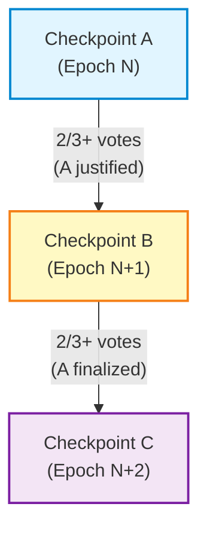

# Lesson 3: Proof of Stake Consensus

## 1. First-Principles Intuition & Invariants

The fundamental problem of distributed consensus is deceptively simple to state: how do a set of mutually distrusting nodes agree on a canonical ordering of events, without a central authority, in the presence of arbitrary failures and adversarial actors? Bitcoin's Proof of Work answered this question by converting raw computational expenditure into voting power. The elegance of PoW lies in its physicality: mining burns real kilowatts, and that thermodynamic cost is verifiable, non-replayable, and sybil-resistant because you cannot fake electricity consumption. But PoW's energy budget is not a bug; it is the security model itself. Every joule spent is a joule that an attacker must also spend to rewrite history. The community spent roughly a decade asking whether that physical anchoring could be replaced with something equally unforgeable but far cheaper to run. Proof of Stake is the answer the ecosystem converged on, and understanding it demands that you internalize what it replaces and what guarantees it provides in its stead.

The core substitution PoS makes is elegant: instead of spending computation to earn the right to propose blocks, validators lock up capital. The locked capital—called stake—is the collateral that makes honest behavior rational and dishonest behavior economically ruinous. Where PoW miners fear no punishment beyond the opportunity cost of wasted electricity, PoS validators fear *slashing*: the protocol-enforced confiscation of their locked principal. This shift from energy cost to capital cost changes the security model at a deep level, and every architectural decision in a mature PoS system flows from understanding that change.

There are three invariants that every serious PoS design must hold simultaneously, and no production system violates them without eventually paying the price.

The **sybil-resistance invariant** requires that influence over consensus be proportional to verifiable, protocol-visible stake. An adversary who wants to control 33% of votes must actually lock 33% of the staked supply. Because on-chain stake is auditable and registration is permissioned by the protocol itself, spinning up a million validator identities is useless unless each is backed by real capital. This is what distinguishes PoS from naive reputation systems: stake is not a soft signal; it is a hard cryptographic commitment recorded in the protocol's state machine.

The **safety invariant** (borrowed directly from classical BFT theory) requires that no two honest nodes ever finalize conflicting blocks. Finality in a PoS context means that a block has accumulated enough validator signatures—weighted by stake—that rolling it back would require the protocol to slash more than one-third of the total staked supply. This is the connection point between Byzantine Fault Tolerance theory and economic security: the BFT safety threshold of `f < N/3` Byzantine nodes maps directly to `f < 1/3` of stake. If an attacker controlled 34% of stake and caused a safety failure, the slashing mechanism would destroy their entire position. The question every security researcher must ask is whether the value of what can be stolen exceeds the value of what would be burned. When the answer is "no," the safety invariant holds not by theorem but by rational self-interest.

The **liveness invariant** requires that the protocol continues making progress even when some fraction of validators are offline or unresponsive. Liveness and safety exist in fundamental tension, formalized by the CAP theorem and elaborated for async networks by the FLP impossibility result. No protocol can guarantee both simultaneously under a fully asynchronous network. PoS systems resolve this tension pragmatically: they provide safety under synchrony assumptions (messages arrive within known bounds) and add inactivity leak mechanisms that slowly drain the stake of offline validators until the online supermajority can finalize again. Ethereum's Casper FFG, for instance, implements exactly this: if the chain fails to finalize for more than roughly four epochs, validators who are not attesting begin hemorrhaging stake at a rate proportional to their time offline, eventually shrinking the denominator enough that the remaining honest validators can finalize.

Understanding PoS also requires breaking free from the monolithic mental model of PoW, where proposing and finalizing are fused into a single act. Most production PoS systems decompose consensus into two distinct layers: a **block proposal layer** that selects a validator pseudorandomly each slot to propose a new block, and a **finality layer** where the full committee of validators votes on the proposed block using a BFT-derived protocol. This decomposition is not incidental; it is a deliberate engineering choice that lets you tune liveness and safety independently.

---

## 2. Core Architecture & Mechanics

### Validator Registration and the Deposit Contract

Before a validator can participate in consensus, it must commit capital to the protocol through a mechanism that is both publicly verifiable and subject to a time-lock that prevents immediate withdrawal. In Ethereum's design, this takes the form of a deposit contract on the execution layer: a validator deposits 32 ETH, publishing its BLS public key, withdrawal credentials, and a BLS signature proving key ownership. The deposit is then processed by the consensus layer (the Beacon Chain), which queues the validator through an activation pipeline. The activation queue imposes a maximum churn rate—a fixed number of validators can join or exit per epoch—preventing adversarial stake manipulation through rapid entry and exit.

The data structure that represents a validator at the consensus layer is a fixed-size record that the Beacon Chain maintains in its global state:

```rust
// Rust representation of an Ethereum Beacon Chain validator record
// Source: ethereum/consensus-specs (simplified for exposition)
#[derive(Debug, Clone, PartialEq)]
pub struct Validator {
    pub pubkey: BlsPublicKey,              // 48-byte BLS12-381 G1 point
    pub withdrawal_credentials: Hash256,   // ETH1 or BLS withdrawal address hash
    pub effective_balance: Gwei,           // Rounded down to nearest ETH, capped at 32 ETH
    pub slashed: bool,                     // Tombstone flag; slashed validators cannot un-slash
    pub activation_eligibility_epoch: Epoch,
    pub activation_epoch: Epoch,
    pub exit_epoch: Epoch,
    pub withdrawable_epoch: Epoch,         // Funds locked until this epoch post-exit
}
```

The `effective_balance` field is worth examining closely. It is not the validator's raw balance; it is quantized to the nearest ETH and capped at 32 ETH, with hysteresis applied to prevent constant recomputation from minor reward fluctuations. This quantization simplifies the committee weight calculations that happen every epoch, trading marginal precision for computational efficiency at the scale of hundreds of thousands of validators.

### Randomness, Slot Assignment, and RANDAO

Validator selection must be unpredictable by any single participant. If a validator knew in advance that it would propose block N, it could selectively include transactions, censor others, or time an attack. The randomness source must therefore be both unpredictable before the reveal and unbiasable after commitment.

Ethereum's production solution is RANDAO: a commit-reveal scheme where every block proposer mixes their BLS signature over the current epoch number into an accumulator stored in the Beacon Chain state. The accumulated value after all slots in an epoch serves as the randomness seed for the next epoch's shuffles. The BLS signature is used rather than an arbitrary nonce because it is deterministic given a private key—a validator cannot compute multiple valid signatures over the same message and pick the most advantageous one. The RANDAO accumulation is simply:

```
randao_mix[epoch + 1] = RANDAO_mix[epoch] XOR BLSSig(proposer_key, epoch)
```

This scheme has a known weakness: the final block proposer in an epoch has one bit of bias—they can choose to reveal their contribution or skip proposing (taking the inactivity penalty) to influence the next epoch's seed. This is the **last-revealer attack**. Ethereum mitigates this by mixing RANDAO with VDF (Verifiable Delay Function) output in its roadmap, though the current deployment accepts the residual bias as tolerable given the economic cost of exercising it.

Using the RANDAO seed, the protocol runs a Fisher-Yates shuffle over the active validator set to produce a **permuted index list**, then partitions this list into committees for each slot in the epoch. This shuffle is deterministic given the seed, so any node can independently recompute which validators are assigned to which slot without coordination.

```python
# Simplified committee computation (spec-faithful Python pseudocode)
def compute_committee(indices: list[ValidatorIndex], seed: Bytes32,
                       index: int, count: int) -> list[ValidatorIndex]:
    start = (len(indices) * index) // count
    end   = (len(indices) * (index + 1)) // count
    return [indices[compute_shuffled_index(i, len(indices), seed)]
            for i in range(start, end)]
```

The shuffled indices ensure that an adversary who controls `k` validators cannot predict which of their validators will land in the same committee until the epoch begins, limiting their ability to coordinate an intra-committee attack.

### BLS Signature Aggregation

A naive design where every validator broadcasts its individual vote would generate O(N) messages and O(N) signature verifications per slot, which at 500,000 validators becomes catastrophically expensive. The architectural solution is **BLS12-381 signature aggregation**: because BLS signatures form a group homomorphism, a set of individual signatures over the same message can be aggregated into a single constant-size signature by multiplying the elliptic curve points together. The aggregate signature is then verifiable with a single pairing operation against the aggregate of the signers' public keys.

The practical implication is that an entire committee's attestations collapse into a 96-byte aggregate signature and a bitfield indicating which validators participated. This compresses what would be megabytes of signature data per slot into a few hundred bytes, making it feasible to include attestations from thousands of validators in every block.

```rust
// BLS aggregate verification (using blst library bindings)
use blst::min_pk::{AggregatePublicKey, AggregateSignature, PublicKey, Signature};

pub fn verify_aggregate_attestation(
    pubkeys: &[&PublicKey],
    message: &[u8],
    aggregate_sig: &Signature,
) -> bool {
    let agg_pk = AggregatePublicKey::aggregate(pubkeys, false)
        .expect("non-empty pubkey slice");
    let result = aggregate_sig.fast_aggregate_verify(
        true,
        message,
        b"BLS_SIG_BLS12381G2_XMD:SHA-256_SSWU_RO_POP_",
        &[&agg_pk.to_public_key()],
    );
    result == blst::BLST_ERROR::BLST_SUCCESS
}
```

### The Fork Choice Rule: LMD-GHOST

Once blocks are proposed and attested, nodes must agree on the canonical chain tip. In a PoW system, the heaviest chain (most accumulated work) is canonical by definition. In Ethereum's PoS, the fork choice rule is **LMD-GHOST**: Latest Message Driven Greedy Heaviest Observed SubTree.

The algorithm works by tracking, for each validator, its most recent attestation message—the block it most recently voted for. Starting from the genesis block, at each fork it recursively selects the branch whose subtree has accumulated the most stake-weighted votes from the latest messages of all validators. The "latest message" qualifier is critical: it prevents old votes from influencing the present fork choice, which would allow an attacker to store up old attestations and replay them to cause a chain reorg.

```
LMD-GHOST(store, justified_checkpoint):
    head = justified_checkpoint.block
    loop:
        children = get_children(store, head)
        if children is empty: return head
        head = argmax over children of:
                   sum(effective_balance(v) for v in validators
                       if latest_message(v) is in subtree(child))
```

LMD-GHOST provides liveness under asynchronous conditions—the chain can keep producing blocks even if finality stalls—but it does not, by itself, provide finality. That requires a second protocol layered on top.

### Casper FFG: Finality via Supermajority Links

Casper the Friendly Finality Gadget (FFG) runs as an overlay on top of LMD-GHOST, operating in terms of **checkpoints** rather than individual blocks. A checkpoint is any block at the first slot of an epoch. Validators cast **FFG votes** as part of their attestations, each vote being a tuple `(source, target)` where source is a previously justified checkpoint and target is the current epoch's checkpoint.

A checkpoint becomes **justified** when validators representing at least 2/3 of total effective balance have cast votes with that checkpoint as their target. A checkpoint becomes **finalized** when it is justified and the checkpoint in the immediately following epoch is also justified, creating a justified-to-justified supermajority link. Once a block is finalized, no honest validator will ever build on a chain that excludes it, and doing so would trigger slashing.



The 2/3 threshold is not arbitrary; it is the minimum fraction that guarantees that any two supermajority sets must overlap by at least 1/3, which is the BFT condition that prevents two conflicting checkpoints from both accumulating enough votes to be finalized simultaneously.

---

## 3. High-Performance Optimization & Failure Modes

### Slashing: The Mechanism and Its Implementation

Slashing is the enforcement mechanism that makes the economic security model operational. It is not merely a penalty; it is a protocol-enforced confiscation triggered by provably dishonest behavior, executed by any node that broadcasts the proof. The incentive to submit a slashing proof is non-zero: the submitter receives a small reward from the slashed validator's balance, creating a network of economically motivated "slashing watchers."

There are two categories of slashable offenses, each corresponding to a formal safety violation.

**Proposer slashing** occurs when a validator signs two distinct blocks for the same slot. This is a direct attempt to create a fork, and the slash condition requires only that two valid, signed block headers for the same slot number be presented on-chain. The validator is immediately slashed and queued for forced exit with a withdrawal delay of `EPOCHS_BEFORE_SLASHING_WITHDRAWAL` (roughly 36 days on Ethereum mainnet), ensuring the slashed stake cannot be recovered before the community has time to react.

**Attester slashing** covers two violations derived directly from Casper FFG's safety conditions. The first is a **double vote**: casting two FFG votes with the same target epoch but different source or target blocks. The second is a **surround vote**: casting a vote `(s2, t2)` that "surrounds" a previously cast vote `(s1, t1)`, meaning `s1 > s2` and `t1 < t2`. A surround vote is an attempt to rewrite history by casting a vote whose span contains an already-committed vote, which could allow a finalized checkpoint to be rolled back if enough validators colluded.

The slashing penalty has two components. The base penalty is proportional to the slashed validator's effective balance, scaled by the total number of validators slashed within a 36-day window. This **correlation penalty** is the most consequential design decision in the slashing architecture: if only one validator is slashed in isolation (likely a misconfiguration), the penalty is small—roughly 1/32 of stake. If 1/3 of the network is slashed simultaneously (likely a coordinated attack), the penalty approaches 100% of each slashed validator's stake. This non-linear scaling means the protocol punishes systemic failures harshly while being forgiving of individual accidents.

```rust
/// Compute the slashing penalty for a validator given the total slashed balance
/// in the surrounding window. Returns the amount to slash in Gwei.
/// Implements EIP-7251 (MaxEB)-agnostic version for pedagogical clarity.
pub fn compute_slashing_penalty(
    validator_effective_balance: u64,
    total_slashed_balance: u64,
    total_active_balance: u64,
    min_slashing_penalty_quotient: u64,
) -> u64 {
    // Base penalty: a fixed fraction of the validator's stake
    let base_penalty = validator_effective_balance / min_slashing_penalty_quotient;

    // Correlation penalty: scales with the fraction of total stake slashed
    // Uses integer arithmetic with saturation to avoid overflow
    let adjusted_total_slashed = total_slashed_balance.saturating_mul(3);
    let correlation_numerator = validator_effective_balance
        .saturating_mul(adjusted_total_slashed.min(total_active_balance));
    let correlation_penalty = correlation_numerator / total_active_balance;

    base_penalty.max(correlation_penalty)
}
```

A validator operator running production infrastructure must therefore treat slashing avoidance as a hard safety constraint, not a soft preference. The most common source of real-world slashings is not malicious intent but **double signing from redundant hot standby nodes**: two instances of the same validator key both coming online after a failover, both attesting to the same slot with conflicting messages. The correct architecture uses a **remote signer with a slashing protection database** (the EIP-3076 interchange format) that records every signing request and refuses to sign any message that would create a slashable pair. Web3Signer and Dirk implement this pattern in production.

### The Nothing-at-Stake Problem and Its Resolution

Early critiques of PoS centered on the **nothing-at-stake problem**: in a PoW system, a miner choosing to extend two competing forks must split their hash rate, so rational miners converge on one chain. In a naive PoS system, validators can vote on every competing fork for free, because signing a message costs nothing beyond the CPU time for the cryptographic operation. If rational validators vote on all forks, forks never resolve, and the protocol has no liveness.

Slashing resolves this directly. Because attesting to two competing chains at the same height constitutes a double vote, validators who vote on all forks are provably slashable. The economic rationality argument flips: it is no longer free to vote on competing forks; it is catastrophically expensive. The nothing-at-stake problem is not a fundamental objection to PoS; it is an objection to PoS without slashing, which no production system deploys.

### Long-Range Attacks and Weak Subjectivity

Slashing resolves fork ambiguity within the validator's current bonding period, but PoS faces an attack class with no PoW analogue: the **long-range attack**. An adversary who once controlled a large fraction of stake—say, in the genesis validator set—can retain their old private keys even after withdrawing. With those old keys, they can construct an entirely alternative history from genesis, signing blocks cheaply (since the keys are no longer locked), and present a new node joining the network with a competing chain of equal length. Because the new node has no prior knowledge of which chain is canonical, it cannot distinguish the authentic history from the adversarial one through cryptographic means alone.

PoW does not have this problem because rewriting history requires re-spending all the energy that was originally spent, which is physically impossible to forge retroactively. PoS history can be rewritten with old keys at zero marginal cost.

The solution is **weak subjectivity**: nodes are not expected to be able to verify chain authenticity purely from genesis without any trusted input. Instead, every node must obtain a **weak subjectivity checkpoint**—a finalized block hash and state root from a trusted source (a friend, a block explorer, the client team's official announcement)—that is no older than the weak subjectivity period. This period is calculated as a function of the minimum validator unbonding delay; because withdrawn validators cannot be slashed after the unbonding period, old keys represent a security risk only within the last unbonding window. Any checkpoint within that window is safe to use as a trust anchor.

This is a philosophical concession from PoW's trustless-from-genesis model, and it is worth being honest about. PoS with weak subjectivity requires that nodes sync from a checkpoint obtained through an out-of-band social layer. The practical impact is minimal for nodes that stay online continuously (they simply follow the canonical chain they already know), but it is a genuine difference for nodes rejoining after a long offline period.

### MEV, Proposer-Builder Separation, and Stake-Weighted Centralization

Maximal Extractable Value (MEV) is the profit a block proposer can capture by reordering, inserting, or censoring transactions within a block. In a PoS system, the proposer is a single validator selected pseudorandomly, and the value of a slot with high MEV (a large arbitrage opportunity, a liquidation cascade) can vastly exceed the standard block reward. This creates a centralizing pressure: large staking pools can invest in sophisticated MEV extraction infrastructure—searchers, builders, private order flow agreements—that individual validators cannot match, compounding their advantage over time.

**Proposer-Builder Separation (PBS)** is the architectural response. PBS separates the roles of block building (selecting and ordering transactions to maximize extractable value) from block proposal (committing a header to the chain). Proposers outsource block construction to a competitive market of specialized builders and earn the highest bid rather than needing to run extraction infrastructure themselves. The winning builder's block is committed via a commitment scheme—the proposer commits to including the builder's block before seeing its contents, preventing the proposer from stealing the MEV while still guaranteeing the builder payment.

Ethereum's current production deployment uses `mev-boost`, an out-of-protocol middleware that implements this separation through trusted relays. The in-protocol version (ePBS, enshrined PBS) is an active area of specification work. The engineering implication for validator operators today is that running `mev-boost` with a diverse set of relays is the dominant strategy for revenue maximization, and solo validators who opt out leave substantial rewards on the table compared to pools.

### Liveness Failures and Inactivity Leaks

A scenario that systems engineers must plan for explicitly is the case where more than 1/3 of stake goes offline simultaneously, preventing the 2/3 supermajority required for finality. This can happen from a correlated infrastructure failure (a major cloud provider outage affecting validators clustered in the same availability zone), a client software bug causing a mass crash, or a coordinated network partition.

Ethereum's response is the inactivity leak: a quadratic drain applied to validators who are not attesting during a finality-stalling period. The penalty for a validator that has been inactive for `d` slots scales as `d²`, growing faster than linearly to quickly erode the stake of offline validators. As their effective balances shrink, the total staked supply shrinks, and the 2/3 threshold (applied to the now-smaller denominator) becomes achievable by the online validators. The chain can then finalize again, and the inactivity penalties stop.

The quadratic scaling is a deliberate engineering choice. A linear drain would recover finality too slowly for large outages; a faster-than-quadratic drain would punish brief outages excessively. The quadratic rate is calibrated so that a full 50% of validators going offline for approximately 18 days would leak enough stake to restore finality.

```python
# Inactivity leak penalty calculation per validator per epoch
# Ref: Ethereum consensus spec process_inactivity_updates
def compute_inactivity_penalty_delta(
    base_reward: int,
    inactivity_score: int,  # accumulates at +4/epoch offline, -1/epoch online
    inactivity_penalty_quotient: int = 2**24,  # ~16.7M for Bellatrix
) -> int:
    # Penalty scales with effective_balance * inactivity_score
    # This is the quadratic component: score grows linearly, penalty grows proportionally
    return (effective_balance * inactivity_score) // inactivity_penalty_quotient
```

Validator operators with large deployments must architect for correlated failure avoidance as a first-order concern. This means distributing validator keys across multiple client implementations (client diversity), multiple cloud providers and bare-metal hosts, and multiple geographic regions. The worst-case scenario for a large operator is not losing a single node; it is triggering the inactivity leak for their entire fleet during a prolonged outage, compounding the revenue loss with the quadratic stake drain.

### Stake-Weighted Voting: Governance and Attack Vectors

The economic security of PoS is anchored to the assumption that honest validators control at least 2/3 of staked supply. This is not a cryptographic guarantee; it is an economic and social assumption. An adversary accumulating 34% of stake—the **34% attack**—can prevent finality by simply going offline or refusing to attest, triggering the inactivity leak against the honest majority as well as themselves. With 51% of stake, an attacker can fully control LMD-GHOST and choose which blocks get included. With 67%, an attacker can finalize fraudulent blocks.

The cost of a 34% attack is bounded by the market capitalization of the staked supply, which makes large networks like Ethereum extremely expensive to attack in absolute terms. But the attack surface is not purely financial. Governance attacks exploit the fact that validators are also often token holders who participate in protocol governance. A well-capitalized adversary who cannot afford to buy 34% of circulating supply outright might instead pursue regulatory capture, protocol governance manipulation to lower the minimum stake threshold, or social engineering of the client development teams to introduce a subtle consensus bug.

The deepest defense against these attack vectors is not technical but structural: maximizing client diversity (so no single client team can unilaterally alter consensus behavior), maintaining geographic and jurisdictional validator distribution, and treating the validator entry queue's churn limit as a security parameter rather than merely a performance dial. These are engineering decisions that compound over years, and they represent the domain where systems architects building on PoS infrastructure have the most leverage.
