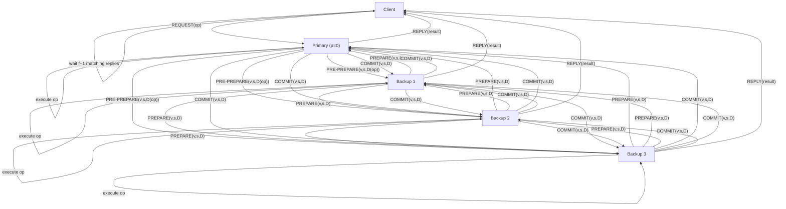
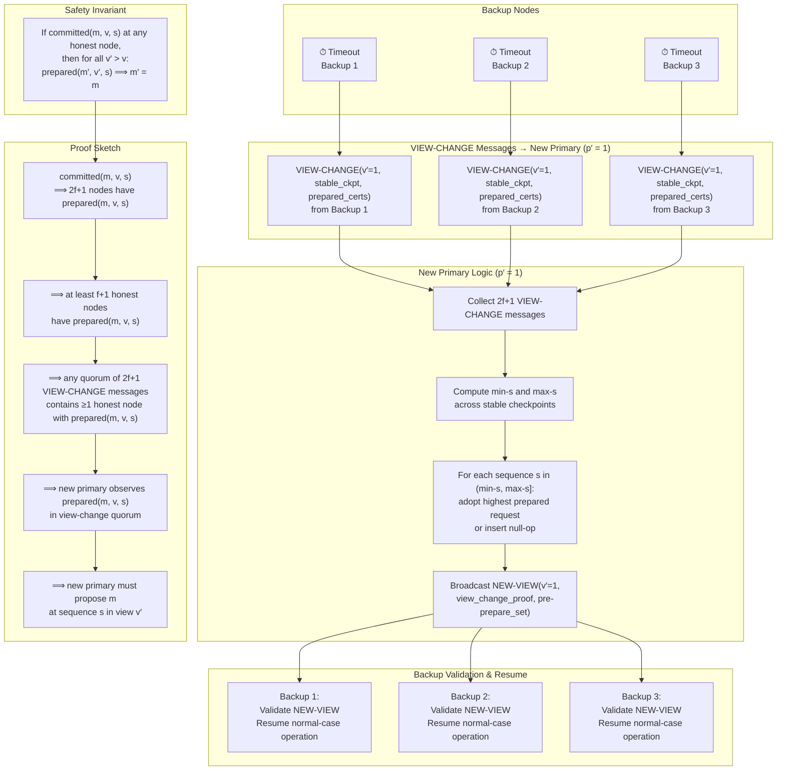

# Lesson 4: Byzantine Fault Tolerance Algorithms

## 1. First-Principles Intuition & Invariants

The Byzantine Generals Problem, articulated by Lamport, Shostak, and Pease in 1982, crystallizes the fundamental challenge of distributed consensus in adversarial environments: how do independent processes reach agreement when some subset may exhibit arbitrary malicious behavior? Unlike crash-fault-tolerant systems where nodes fail by halting, Byzantine fault tolerance confronts a universe where compromised nodes can lie, equivocate, selectively withhold messages, or collude to subvert protocol invariants. This distinction transforms consensus from a liveness and safety problem under benign failure into a cryptographic and game-theoretic challenge where protocol correctness must survive deliberate adversarial manipulation.

Classical consensus algorithms such as Paxos and Raft assume a fail-stop model where nodes either operate correctly or cease operation entirely. Byzantine algorithms operate under a strictly weaker synchrony assumption and a strictly stronger adversary model. The adversary controls up to $f$ nodes in a network of $n$ total participants and can program these compromised nodes with arbitrary malicious behavior. The impossibility result derived by Fischer, Lynch, and Paterson demonstrates that deterministic consensus is impossible in fully asynchronous networks even with a single crash failure. Byzantine consensus tightens these constraints further: achieving safety and liveness requires both a minimum network size threshold and partial synchrony assumptions that bound message delivery delays.

The seminal lower bound for Byzantine consensus establishes that $n \geq 3f + 1$ nodes are necessary to tolerate $f$ Byzantine faults. This threshold emerges from an information-theoretic argument. Consider a partition scenario where the network splits into three groups of size $f$: the adversary can simulate inconsistent views to two honest groups by controlling the middle partition, causing them to commit to conflicting values. With $3f + 1$ nodes, any two quorums of size $2f + 1$ intersect in at least $f + 1$ nodes, guaranteeing at least one honest node in the intersection. This structural overlap ensures that inconsistent quorums cannot both certify conflicting state without detection.

Byzantine fault tolerance protocols enforce two critical safety properties. Agreement demands that all honest nodes eventually commit to the same value, preventing chain forks or divergent state. Validity requires that committed values originated from honest nodes, excluding scenarios where the adversary injects arbitrary fabricated data. Liveness, the complementary property, ensures that the protocol eventually terminates and honest proposals eventually commit, preventing denial-of-service through infinite stalling. These properties must hold even when Byzantine nodes send conflicting messages to different subsets of honest participants, attempting to fracture consensus.

The design space for Byzantine consensus algorithms spans synchrony assumptions, communication complexity, and cryptographic primitives. Synchronous protocols assume strict upper bounds on message latency and processor speeds, enabling timeout-based detection of Byzantine behavior. Asynchronous protocols make no timing assumptions but sacrifice deterministic termination, often resorting to randomization or external oracles to break symmetry. Practical Byzantine Fault Tolerance operates in the partially synchronous model introduced by Dwork, Lynch, and Stockmeyer, where the network eventually stabilizes but the stabilization time is unknown. This model reflects real-world distributed systems where transient network partitions and clock skew are common but catastrophic permanent asynchrony is rare.

Cryptographic authentication transforms the adversary model by preventing impersonation and forgery. In authenticated Byzantine consensus, the adversary cannot forge signatures from honest nodes, reducing the problem to one of equivocation detection rather than arbitrary message corruption. Digital signatures enable non-repudiation: once a node signs a message, all recipients possess cryptographic proof of authorship that can be shared and verified by third parties. This property eliminates entire classes of attacks where Byzantine nodes send different messages to different recipients while denying their actions. The consequence is a relaxation of the $n \geq 3f + 1$ bound to $n \geq 2f + 1$ for authenticated protocols in synchronous networks, though PBFT maintains the stronger threshold to achieve safety in partially synchronous environments.

The commitment mechanism in Byzantine consensus employs multi-phase voting protocols where nodes exchange signed messages across structured communication rounds. A quorum certificate aggregates signatures from at least $2f + 1$ distinct nodes attesting to a specific proposal, providing irrefutable proof that a supermajority endorsed the value. Because any two quorums intersect in at least $f + 1$ nodes and at most $f$ are Byzantine, at least one honest node participates in both quorums. This honest witness ensures that conflicting quorum certificates cannot exist simultaneously, preserving safety. The protocol progresses by collecting these certificates across multiple rounds, each refining the consensus state until finality is achieved.

View changes handle the failure or Byzantine behavior of designated leader nodes. When progress stalls due to leader equivocation or network partitions, nodes trigger a timeout and initiate a view change protocol that elects a new leader. The view change must preserve safety by ensuring that any value committed in the previous view remains committed in the new view. Nodes exchange signed state summaries proving the highest certified value they observed, allowing the new leader to safely initialize the next view without contradicting prior commitments. This mechanism converts liveness failures into leader rotation, ensuring the protocol eventually makes progress once network conditions stabilize and an honest leader is elected.

The formal correctness of Byzantine consensus protocols rests on three proof obligations: safety under all execution traces including adversarial schedules, liveness under partial synchrony once the global stabilization time passes, and non-triviality ensuring that honest proposals can commit. Safety proofs typically proceed by induction over view numbers, demonstrating that quorum intersection guarantees prevent conflicting commits. Liveness proofs invoke the partial synchrony assumption, showing that after the unknown global stabilization time, honest nodes synchronize their views and certificate collections, eventually enabling a commit. These proofs must account for all possible adversarial strategies including message reordering, selective delivery, and Byzantine collusion.

Practical Byzantine Fault Tolerance, introduced by Castro and Liskov in 1999, concretized these theoretical foundations into a deployable state machine replication protocol achieving throughput comparable to unreplicated systems. PBFT demonstrated that Byzantine consensus could be practical for real-world applications by minimizing cryptographic overhead, reducing communication rounds, and optimizing the common case where the leader is honest and the network is stable. The protocol operates through a deterministic sequence of three-phase commits orchestrated by a rotating primary node, with view changes triggered by timeouts when progress stalls. Understanding PBFT requires dissecting its message flow, certificate structures, and the subtle invariants that preserve safety across view changes and concurrent proposals.

## 2. Core Architecture & Mechanics

PBFT operates as a replicated state machine where $n = 3f + 1$ nodes execute deterministic operations against a shared state, processing client requests in a globally consistent order. Each node maintains a local replica of the state and applies operations sequentially according to the consensus protocol. Clients submit requests to all replicas and await matching responses from $f + 1$ distinct nodes, ensuring at least one honest node confirmed the operation. The protocol proceeds through a sequence of views, each identified by a monotonically increasing view number $v$. Within each view, a designated primary node $p = v \bmod n$ orchestrates consensus by proposing operation sequences and coordinating the three-phase commit protocol.

The three-phase structure—pre-prepare, prepare, and commit—ensures that once an operation commits, no conflicting operation can commit in any subsequent view. The pre-prepare phase initiates when the primary assigns a sequence number $s$ to a client request $m$ and multicasts a `PRE-PREPARE` message containing the view number, sequence number, digest of the request, and the primary's signature. Backup nodes accept this pre-prepare if the signature is valid, the view number matches their current view, the sequence number falls within a bounded window, and they have not accepted a different request for the same sequence number in this view. This last condition prevents the Byzantine primary from equivocating by proposing different operations at the same sequence slot to different subsets of replicas.

Upon accepting a pre-prepare, a backup node multicasts a `PREPARE` message signed with its own identity, echoing the view number, sequence number, and request digest. The prepare phase implements an all-to-all broadcast where each node collects prepare messages from other replicas. A node achieves the prepared state for a request when it possesses the pre-prepare from the primary and matching prepare messages from $2f$ distinct backup nodes, totaling $2f + 1$ certificates including its own acceptance. The prepared predicate establishes a critical invariant: if an honest node prepares a request $m$ at sequence number $s$ in view $v$, then no honest node can prepare a different request $m'$ at the same sequence number in the same view. This follows from quorum intersection—any two sets of $2f + 1$ nodes share at least $f + 1$ nodes, and at least one is honest, preventing conflicting prepared certificates.

The commit phase elevates the prepared state to committed finality. Once a node reaches the prepared state, it multicasts a `COMMIT` message signed with its identity. A node achieves the committed state when it collects commit messages from $2f + 1$ distinct nodes, including itself, for the same view, sequence, and digest. The committed predicate guarantees cross-view safety: if an honest node commits $m$ at sequence $s$ in view $v$, then any request that prepares or commits at sequence $s$ in any view $v' \geq v$ must be $m$. This invariant ensures that committed operations remain committed across view changes and prevents the adversary from rolling back finalized state.

The certificate aggregation process leverages threshold signatures or explicit signature collection depending on implementation constraints. In the original PBFT design, each message carries a full digital signature, and nodes accumulate vectors of signatures to form certificates. Modern implementations employ BLS signature aggregation where $2f + 1$ signatures combine into a single compact proof, reducing storage and verification overhead from linear to constant complexity. The verification logic checks that the aggregate signature corresponds to a valid quorum of distinct signers, rejecting duplicates or signatures from non-participants. This cryptographic compression accelerates certificate validation and reduces bandwidth consumption in message-heavy phases.

Sequence number assignment enforces total ordering of operations across the replicated state machine. The primary maintains a monotonically increasing counter and assigns consecutive sequence numbers to incoming requests. Backup nodes enforce a low and high water mark window $[h, H]$ where $H = h + k$ for some constant $k$, typically $k = 100$ to $200$ operations. This bounded window prevents memory exhaustion from malicious primaries that assign arbitrarily large sequence numbers. Nodes reject pre-prepare messages with sequence numbers outside this window and trigger garbage collection once a checkpoint spanning sequence number $s$ is stable, advancing the low water mark to $s$.

Checkpointing provides a mechanism for state compression and recovery, enabling nodes to discard accumulated message logs once a stable state snapshot is established. Periodically, every $K$ sequence numbers where $K$ divides the window size, nodes generate a cryptographic hash of their current state and multicast a `CHECKPOINT` message containing the sequence number and state digest. When a node collects $2f + 1$ matching checkpoint messages for sequence number $s$, the checkpoint becomes stable. Nodes can then safely discard all message logs for sequence numbers below $s$ and advance the low water mark. Stable checkpoints also serve as synchronization points for view changes and replica recovery, providing a consistent baseline from which to resume operation.

View changes address liveness failures when the primary node is Byzantine or network conditions prevent progress. Each backup node runs a local timeout that triggers when expected progress does not occur within a bounded interval after the global stabilization time. Upon timeout expiration, a node increments its view number, multicasts a `VIEW-CHANGE` message, and suspends normal case operation until the new view is established. The view change message includes the node's current stable checkpoint, the set of all prepared certificates above that checkpoint, and cryptographic proofs validating these claims. The new primary, determined by $p' = v' \bmod n$, collects $2f + 1$ view change messages from distinct nodes, constructs a `NEW-VIEW` message proving the legitimacy of the view transition, and multicasts this message to resume normal operation.

The new primary must determine the correct state to initialize the new view, ensuring that any operation committed in the prior view remains committed. The primary examines all prepared certificates reported in the $2f + 1$ view change messages and identifies the highest sequence number at which any operation prepared. For each sequence number in the new view's initial window, the primary either adopts the request that prepared in the previous view or, if no operation prepared at that slot, proposes a no-op. This selection strategy ensures safety: if an honest node committed operation $m$ at sequence $s$ in the old view, at least $f + 1$ honest nodes prepared $m$ at $s$, and at least one of these honest nodes participates in the view change quorum, forcing the new primary to adopt $m$ for sequence $s$.

Replica state encompasses several data structures maintained in memory and periodically persisted to stable storage. The message log accumulates all pre-prepare, prepare, and commit messages indexed by sequence number and view, enabling certificate validation and view change reconstruction. The checkpoint log stores stable checkpoints and associated proof certificates. The view change log retains view change and new view messages for the current and recent views. The client table tracks the latest request and reply for each client, implementing exactly-once semantics by rejecting duplicate requests and replaying cached replies. These structures collectively enable a replica to participate in consensus, recover from crashes, and provide state transfer to lagging or recovering peers.

State transfer addresses scenarios where a node falls behind the rest of the network due to transient failures, message loss, or prolonged Byzantine behavior in earlier views. A lagging node detects its deficit when it observes stable checkpoint messages for sequence numbers beyond its current state. The node suspends normal operation, requests missing state from other replicas, and validates received state against the stable checkpoint certificate. Upon successful validation, the node installs the checkpoint, discards stale logs, and resumes participation. This mechanism prevents unbounded state divergence and enables recovery without replaying the entire operation history from genesis.

Optimizations for the common case when the primary is honest and the network is stable significantly reduce latency and message complexity. Tentative execution allows replicas to speculatively execute operations after the prepared state without waiting for commit phase completion, reducing client-perceived latency by one message round trip. Replies sent after prepared execution include a flag indicating tentative status, and clients wait for $f + 1$ matching tentative replies or a single committed reply. This optimization exploits the fact that prepared certificates already guarantee safety—the commit phase serves primarily to propagate finality information. Read-only operations can bypass the three-phase protocol entirely if clients collect $2f + 1$ signed state proofs from distinct replicas, leveraging quorum intersection without write coordination.

Batching amortizes cryptographic and network costs across multiple client requests. The primary accumulates incoming requests over a short time window and assigns a single sequence number to the entire batch, reducing the number of consensus instances and consequently the total message volume. Signature aggregation via BLS or threshold signatures compresses certificate sizes from linear in the quorum size to constant, enabling efficient validation and reducing bandwidth consumption. Pipeline parallelism allows multiple sequence numbers to progress through different phases concurrently, saturating network and CPU resources to maximize throughput. These techniques, combined, enable PBFT implementations to achieve tens of thousands of transactions per second on modern hardware.

## 3. High-Performance Optimization & Failure Modes

Performance optimization in Byzantine consensus balances throughput, latency, and fault tolerance under adversarial conditions. The primary bottleneck in traditional PBFT implementations stems from quadratic communication complexity—each of the three phases requires all-to-all message exchange among $n$ nodes, generating $O(n^2)$ messages per consensus instance. This scaling penalty becomes prohibitive in large networks, motivating architectural refinements that reduce communication overhead while preserving safety and liveness guarantees. Hierarchical quorum structures, multicast tree topologies, and cryptographic accumulators transform the cost model from quadratic to logarithmic or linear in network size.

Signature aggregation through BLS pairing-based cryptography compresses quorum certificates from vectors of $2f + 1$ individual signatures to a single constant-size aggregate signature. Each node signs messages using its private key derived from a distributed key generation ceremony, and aggregation proceeds via elliptic curve point addition. The verifier checks the aggregate signature against the combined public keys of the claimed signers in a single pairing operation. This reduction eliminates per-signature verification loops and shrinks message payloads, particularly for prepare and commit phases where every node multicasts signed attestations. The tradeoff involves increased computational cost per signature operation—BLS signing and verification are slower than ECDSA or Ed25519—but the asymptotic gain in communication efficiency dominates in multi-node deployments.

Threshold signatures extend this concept by distributing signing authority across a quorum such that any subset of $2f + 1$ nodes can collectively generate a single signature on behalf of the entire group without revealing individual shares. This approach eliminates explicit certificate collection: nodes exchange signature shares, and once a node accumulates $2f + 1$ shares, it reconstructs the threshold signature locally. The result is a shift from explicit quorum collection to implicit threshold computation, reducing message complexity from quadratic to linear. Threshold signature schemes based on BLS or Schnorr enable non-interactive aggregation where shares combine without coordination, preserving the fault tolerance properties of explicit quorum certificates while improving efficiency.

Pipelining consensus instances exploits parallelism across sequence numbers to saturate network and CPU resources. Rather than completing all phases for sequence $s$ before initiating sequence $s + 1$, nodes process multiple sequence numbers concurrently, interleaving message rounds. The primary multicasts pre-prepare messages for sequences $s, s+1, \ldots, s+k$ in rapid succession, and backups process incoming messages for different sequences in parallel. This pipelining converts the protocol from a sequential state machine to a concurrent pipeline where steady-state throughput approaches the bandwidth and cryptographic verification capacity of the replicas. The depth of the pipeline is bounded by the low-high water mark window to prevent memory exhaustion.

Batching client requests aggregates multiple operations into a single consensus instance, amortizing the fixed overhead of cryptographic operations and message rounds across many transactions. The primary buffers incoming client requests for a bounded time interval $\Delta t$ or until a batch size threshold $B$ is reached, then assigns a single sequence number to the entire batch. The pre-prepare message contains digests of all batched operations, and nodes execute the batch atomically after committing. This optimization leverages the observation that the marginal cost of adding an operation to an existing batch is negligible compared to the cost of initiating a new consensus instance. Careful tuning of $\Delta t$ and $B$ balances throughput—larger batches increase efficiency—against latency—longer buffering delays individual operation completion.

Speculative execution allows replicas to apply operations to their state machines after reaching the prepared state without waiting for commit phase completion. Because the prepared predicate guarantees that no conflicting operation can prepare at the same sequence number in the same view, and view changes preserve prepared operations, executing speculatively is safe. Nodes mark speculative state as tentative and commit it only after collecting the full commit certificate. If a view change occurs before the commit phase completes, nodes either roll back tentative state and re-execute under the new view's leadership or validate that the new primary's proposal matches the speculatively executed operation. This optimization reduces client-perceived latency by one full message round, a critical improvement for interactive applications.

Read-only query optimization bypasses the full three-phase protocol for operations that do not modify state. Clients issue read requests to all replicas and collect $2f + 1$ signed state proofs attesting to the result at a specific sequence number. Quorum intersection ensures that at least $f + 1$ honest nodes confirm the read, guaranteeing that the result reflects committed state. This mechanism enables linearizable reads without write coordination, preserving safety while eliminating unnecessary message rounds. Nodes must include sequence number and state version metadata in replies to prevent stale reads from reflecting outdated state that has been superseded by subsequent commits.

Leader rotation strategies balance load and mitigate Byzantine primary attacks. In the standard PBFT protocol, the primary rotates deterministically via $p = v \bmod n$ upon each view change, ensuring that Byzantine primaries eventually yield to honest leaders after timeout-triggered view changes. Randomized leader selection schemes use verifiable random functions or multi-party coin flips to elect primaries unpredictably, preventing adaptive adversaries from targeting known future leaders. Reputation-based rotation tracks node performance metrics such as proposal latency and message delivery consistency, preferentially electing high-performing replicas as primaries to maximize throughput. Each strategy trades off predictability, fairness, and resilience against different adversarial tactics.

Byzantine primary attacks exploit the primary's unique role in proposing operations and assigning sequence numbers. A malicious primary can censor transactions by refusing to propose them, propose operations out-of-order to violate causal dependencies, or equivocate by sending different pre-prepare messages to different subsets of replicas. Censorship is detectable by timeouts—if a client's request does not commit within the expected interval, backups trigger a view change to elect a new primary. Equivocation is prevented by the prepare phase: nodes reject conflicting pre-prepare messages for the same sequence number, and any attempt to fork the protocol fails because no honest node will prepare both branches. The combination of timeouts and cryptographic authentication bounds the damage a Byzantine primary can inflict to temporary liveness degradation, not safety violations.

Network partition scenarios challenge partial synchrony assumptions by creating disjoint subsets of replicas that cannot communicate. If a partition splits the network such that no subset contains $2f + 1$ nodes, progress halts because no quorum can form. The protocol remains safe—no conflicting operations commit—but liveness is lost until the partition heals. If one partition contains $2f + 1$ or more nodes, that partition can continue making progress while the minority partition stalls. Upon partition recovery, lagging nodes detect their deficit via checkpoint comparison and invoke state transfer to synchronize. This behavior reflects the fundamental CAP theorem tradeoff: Byzantine consensus prioritizes consistency and partition tolerance over availability during partitions.

Byzantine replica attacks include equivocation, selective message delivery, and collusion. Equivocation involves sending different messages to different recipients, attempting to fracture consensus by presenting inconsistent views. Cryptographic signatures prevent impersonation, but Byzantine nodes can still sign and send conflicting messages. The protocol defends against equivocation through quorum intersection and explicit certificate collection: honest nodes only accept messages that are consistent with previously accepted messages at the same sequence number. Selective delivery, where a Byzantine node participates correctly with some peers while ignoring others, degrades liveness but not safety because quorum thresholds ensure that honest nodes always form a majority. Collusion among Byzantine nodes bounded by $f < \frac{n}{3}$ cannot compromise safety due to the quorum intersection property, but can degrade liveness by coordinating view change delays.

Client replay attacks attempt to resubmit old requests to cause duplicate execution or rollback committed state. PBFT defends against replays by requiring clients to include monotonically increasing timestamps or sequence numbers in requests. Replicas maintain a client table storing the latest request timestamp and cached reply for each client. When a replica receives a request, it checks whether the timestamp is greater than the last recorded timestamp; if not, the replica rejects the request or returns the cached reply. This mechanism implements exactly-once semantics, ensuring that each client operation executes precisely one time even if the client resends the request due to network duplication or timeout retries.

Checkpoint stability and garbage collection manage memory consumption by discarding old message logs once state snapshots are finalized. Nodes checkpoint every $K$ sequence numbers and exchange checkpoint messages to establish stable checkpoints with $2f + 1$ certificates. Once a checkpoint at sequence $s$ is stable, nodes advance the low water mark to $s$ and discard all message logs, client table entries, and certificates for sequence numbers below $s$. This garbage collection prevents unbounded memory growth while retaining sufficient history to support view changes and state transfer. The checkpoint interval $K$ trades off memory overhead—smaller intervals increase checkpoint frequency—against protocol efficiency—larger intervals reduce checkpoint message volume.

State transfer and replica recovery enable nodes that fall behind or crash to rejoin the network and synchronize with current state. A recovering node requests the latest stable checkpoint and corresponding state snapshot from $f + 1$ replicas, ensuring at least one honest replica provides correct state. The node validates the received state against the checkpoint certificate, verifying that $2f + 1$ nodes attested to the same state digest. After installing the checkpoint, the node discards its stale logs, resets its sequence number, and resumes normal operation. This mechanism bounds recovery time to the state transfer latency rather than requiring replay of the entire operation history, enabling practical recovery even in long-running systems with large state.

Formal verification of PBFT implementations employs model checking, theorem proving, and automated test generation to validate correctness under all possible execution interleavings. Model checkers like TLA+ and spin exhaustively explore the state space of the protocol, verifying that safety invariants—no two honest nodes commit different values at the same sequence number—hold in all reachable states. Theorem provers such as Coq and Isabelle/HOL encode the protocol as a formal state machine and prove safety and liveness properties via inductive invariants. Automated fuzz testing generates random message sequences and adversarial schedules, searching for execution traces that violate correctness. These techniques complement traditional testing by providing mathematical guarantees that the implementation adheres to the protocol specification.

Monitoring and observability in deployed PBFT systems tracks view changes, certificate formation latency, message drop rates, and replica state divergence. Metrics such as time-to-prepare and time-to-commit per sequence number quantify protocol performance and identify bottlenecks. View change frequency indicates liveness issues caused by Byzantine primaries, network instability, or misconfigured timeouts. Message authentication failure rates reveal potential adversarial activity or implementation bugs. State divergence detection compares checkpoint digests across replicas, flagging inconsistencies that may indicate Byzantine behavior or software defects. Comprehensive instrumentation enables operators to diagnose performance degradation and security incidents in production deployments.

Practical deployments of PBFT-based systems include Hyperledger Fabric's orderer service, which implements a permissioned blockchain using a variant of PBFT for transaction ordering, and Tendermint, which extends PBFT concepts with a gossip-based block propagation layer. These systems demonstrate that Byzantine consensus can achieve production-grade performance and reliability when implemented with careful optimizations and robust engineering. Operational experience reveals that the primary failure modes in practice are configuration errors—incorrect quorum thresholds or timeout values—network partitions that exceed partial synchrony assumptions, and software bugs in certificate validation logic. Understanding these failure modes and their mitigations is essential for deploying Byzantine fault-tolerant systems that meet real-world reliability and security requirements.
