# Lesson 2: Rendering Pipeline Architecture

## 1. First-Principles Intuition & Invariants

The rendering pipeline is, at its core, a carefully staged transformation machine. Its purpose is to answer a deceptively simple question: given a mathematical description of geometry in some abstract coordinate space, and a description of how light interacts with surfaces, what color should each pixel on the screen be? Everything in the pipeline—every matrix multiply, every interpolation, every depth comparison—exists in service of that question.

To appreciate why the pipeline is structured the way it is, consider the alternative. A naïve renderer might iterate over every triangle in the scene and ask "does this triangle contribute to any pixel?" A rasterizer inverts this: it iterates over every pixel and asks "which triangle is visible here?" Neither approach alone is sufficient for real-time performance. The modern pipeline is neither pure triangle-centric nor pixel-centric; it is a hybrid that separates concerns into stages, each of which can be accelerated by dedicated, massively parallel hardware or by compiler-driven SIMD execution on the CPU.

The first invariant to internalize is that the pipeline is a function composition. You can describe the entire transform chain as a sequence of functions applied to a homogeneous position vector: from object space (where a mesh is defined in its own local coordinate frame), through world space (where all objects are placed in a shared scene), into view space (where the camera sits at the origin looking down the negative Z axis), through clip space (the output of the projection transform), and finally into normalized device coordinates (NDC) and screen space. Every stage in the pipeline has a mathematically well-defined input domain and output range, and correctness depends on preserving those contracts across the boundary between stages.

The second invariant is that the pipeline is a producer-consumer graph with fixed throughput bottlenecks. Each stage produces work for the next. Vertex shading produces transformed vertices; primitive assembly produces triangles; rasterization produces fragments; fragment shading produces color values. If any stage is slower than its neighbors, it throttles the entire pipeline. This is why performance analysis in graphics is not about finding the slowest function—it is about finding the stage whose throughput limits the system, which requires a fundamentally different kind of profiling intuition than general systems programming.

The third invariant is the distinction between fixed-function and programmable stages. Early GPU hardware implemented every stage in fixed silicon: the vertex transform was a hardwired matrix multiply, the texture sampling was a hardwired bilinear filter. Modern GPUs replaced many of these with programmable shader cores, which are small SIMD processors that execute user-provided programs (shaders) written in GLSL, HLSL, MSL, or SPIR-V. But fixed-function stages never disappeared entirely—they were retained precisely where the computation is too regular and performance-critical to justify programmability. Rasterization itself, the scan conversion of a triangle into fragments, remains fixed-function in every major GPU architecture today. Understanding which stages are programmable and which are not is the foundation of knowing where to invest optimization effort and where to accept hardware constraints.

---

## 2. Core Architecture & Mechanics

### The Coordinate Space Chain

Before examining individual pipeline stages, it is worth laying out the full coordinate space transform chain in explicit mathematical terms, because every stage either operates within one of these spaces or is responsible for the transition between them.

A vertex defined in **object space** carries a position $\mathbf{p}_{obj} = (x, y, z, 1)^T$ in homogeneous coordinates. The model matrix $\mathbf{M}$ places the object in the scene, transforming the vertex into **world space**: $\mathbf{p}_{world} = \mathbf{M} \cdot \mathbf{p}_{obj}$. The view matrix $\mathbf{V}$—the inverse of the camera's own model matrix—transforms from world space into **camera/view space**, where the camera is at the origin, looking down $-Z$, with $+Y$ pointing up: $\mathbf{p}_{view} = \mathbf{V} \cdot \mathbf{p}_{world}$. These two transforms are typically pre-multiplied into a single matrix $\mathbf{MV}$ to reduce per-vertex operations.

The projection matrix $\mathbf{P}$ is where the geometry acquires its perspective. For a perspective projection, it encodes the field of view, the aspect ratio, and the near and far clip planes into a matrix that maps the view-space frustum into a canonical clip-space volume. After multiplication, $\mathbf{p}_{clip} = \mathbf{P} \cdot \mathbf{p}_{view}$, the vertex occupies **clip space**: a 4D homogeneous space where the $w$ component carries the original view-space depth. This is the space in which clipping against the view frustum is performed, because the math is cheaper here than in NDC.

After clipping, the hardware performs the **perspective divide**: $\mathbf{p}_{NDC} = (x/w, y/w, z/w)$, collapsing the 4D clip-space position to a 3D **normalized device coordinate**. In OpenGL conventions, NDC spans $[-1, 1]^3$; in Direct3D and Vulkan the Z range is $[0, 1]$. The final step is the **viewport transform**, which scales and offsets the NDC XY coordinates to pixel coordinates in screen space, and maps the NDC depth to the framebuffer depth range.

The pipeline can be visualized as follows:

```mermaid
flowchart TD
    OS["Object Space"]
    WS["World Space"]
    VS["View / Camera Space"]
    CS["Clip Space"]
    CC["Clipping & Culling"]
    NDC["NDC Space"]
    SS["Screen / Window Space"]
    FS["Fragment Space"]
    FB["Framebuffer"]

    OS -->|"Model Matrix (M)"| WS
    WS -->|"View Matrix (V)"| VS
    VS -->|"Projection Matrix (P)"| CS
    CS -->|"Perspective Divide (÷w)"| NDC
    CS -->|""| CC
    NDC -->|"Viewport Transform"| SS
    SS -->|"Rasterization"| FS
    FS -->|"Fragment Shader + Tests"| FB
```

### Vertex Processing

The vertex shader executes once per vertex, in parallel across all vertices submitted in a draw call. Its contract is strict: it must write `gl_Position` (the clip-space position) and may write any number of user-defined output varyings (texture coordinates, normals, colors, tangent vectors) that will be interpolated across the primitive and delivered to the fragment shader.

A minimal but production-valid vertex shader in GLSL 4.6 looks like this:

```glsl
#version 460 core

layout(location = 0) in vec3 a_Position;
layout(location = 1) in vec3 a_Normal;
layout(location = 2) in vec2 a_TexCoord;

layout(std140, binding = 0) uniform FrameUniforms {
    mat4 u_ModelViewProjection;
    mat4 u_ModelView;
    mat3 u_NormalMatrix;
};

out VS_OUT {
    vec3 v_ViewNormal;
    vec2 v_TexCoord;
    vec3 v_ViewPos;
} vs_out;

void main() {
    vec4 viewPos    = u_ModelView * vec4(a_Position, 1.0);
    vs_out.v_ViewPos    = viewPos.xyz;
    vs_out.v_ViewNormal = normalize(u_NormalMatrix * a_Normal);
    vs_out.v_TexCoord   = a_TexCoord;
    gl_Position         = u_ModelViewProjection * vec4(a_Position, 1.0);
}
```

Notice several production details here. The normal matrix `u_NormalMatrix` is the transpose of the inverse of the upper-left 3×3 of the model-view matrix. This is necessary because normals are contravariant vectors—they transform by the inverse-transpose, not the forward transform. If the model matrix contains non-uniform scale, applying the model-view matrix directly to normals will shear them, producing incorrect lighting. This is one of the most common first-year correctness bugs in graphics programming, and it manifests as normals that appear to "lean" or "pull" when an object is scaled along one axis.

Uniforms bound via `std140` layout follow strict packing rules: `vec3` fields are padded to 16 bytes, and matrices are stored column-major. Getting this wrong silently corrupts data because the CPU's struct layout and the GPU's std140 layout diverge. Use `std430` for SSBOs when you want tighter packing.

### Primitive Assembly and Clipping

After all vertices in a draw call have been processed by the vertex shader, the primitive assembler groups them into geometric primitives according to the draw mode: `GL_TRIANGLES` groups every three consecutive vertices, `GL_TRIANGLE_STRIP` forms a strip with shared edges, `GL_TRIANGLE_FAN` fans from a fixed origin vertex. The assembler also handles indexed draws, pulling vertices out of a vertex buffer in the order specified by an element buffer object (EBO), which is the standard way to avoid duplicating shared vertices.

The assembled triangles are then submitted to the clipper. The clipper's job is to discard or trim geometry that lies outside the view frustum, expressed in clip space as the six half-spaces defined by $-w \le x \le w$, $-w \le y \le w$, $-w \le z \le w$ (OpenGL) or $0 \le z \le w$ (Vulkan/D3D). A triangle entirely inside all six planes passes through unchanged. A triangle entirely outside any single plane is culled entirely. A triangle that straddles a plane must be clipped: the clipper computes the intersection points of the triangle edges with the clipping plane and emits new vertices and new triangles (up to two output triangles for a single input triangle that straddles one plane).

The near-plane clip deserves special attention. If a triangle's vertex has $w \le 0$ or $w \approx 0$, the perspective divide produces coordinates that go to infinity or change sign, causing catastrophic visual artifacts. A guard-band clipper handles most of this transparently, but applications should never allow geometry to have vertices exactly at $w = 0$, which is why the near clip plane must always be set to a small positive value (commonly 0.1 to 1.0 scene units). Setting near to 0.0 is a correctness bug, not just a precision concern.

After clipping, back-face culling is performed in clip or screen space. The signed area of the projected triangle is computed, and if it is negative (for counter-clockwise front-face convention) or positive (clockwise), the triangle is discarded before rasterization. This culls roughly half of all triangles in a typical closed mesh at essentially zero cost, making it one of the highest-value fixed-function features in the pipeline.

### Rasterization

Rasterization is the stage that transforms a 2D projected triangle into a set of **fragments**, each corresponding to a pixel (or sub-pixel sample) that the triangle covers. This is a fixed-function stage in all production GPUs, implemented in dedicated silicon, and understanding its mechanics is critical to predicting aliasing behavior, fill-rate cost, and the semantics of interpolation.

The core algorithm is edge walking. The rasterizer computes the three edge equations for the projected triangle. For an edge from vertex $\mathbf{v}_0 = (x_0, y_0)$ to $\mathbf{v}_1 = (x_1, y_1)$, the edge equation is:

$$E(x, y) = (x - x_0)(y_1 - y_0) - (y - y_0)(x_1 - x_0)$$

A point $(x, y)$ is inside the triangle if $E_0(x,y) \ge 0$, $E_1(x,y) \ge 0$, and $E_2(x,y) \ge 0$ (for counter-clockwise vertex order). The rasterizer evaluates these three linear functions over all pixel centers within the triangle's bounding box. Because the edge equations are linear, they can be evaluated incrementally: stepping one pixel right increments $E$ by $(y_1 - y_0)$, and stepping one pixel up increments it by $-(x_1 - x_0)$. Modern hardware evaluates 2×2 blocks of pixels (quads) in parallel to enable efficient derivative computation in fragment shaders.

The **top-left fill rule** determines which fragments are generated for pixels that lie exactly on a triangle edge. Without a consistent tie-breaking rule, two adjacent triangles sharing an edge would double-generate fragments on that edge, causing overdraw and incorrect blending. The rule states that a fragment is generated if the pixel center lies inside the edge, or on a horizontal top edge, or on a left (non-horizontal) edge. This guarantees exactly-once coverage for any two adjacent triangles sharing an edge, with no gaps and no double coverage.

Interpolation of varyings (vertex outputs) across a rasterized triangle requires **perspective-correct interpolation**. Naïve linear interpolation in screen space is incorrect because the perspective divide is nonlinear: equal steps in screen space correspond to unequal steps in view space. The correct formula weights each vertex attribute by $1/w$ before interpolation and divides by the interpolated $1/w$ at the end. This is performed automatically by the hardware, but its implication is that the `w` value from each vertex must be correctly propagated through the pipeline. If you manipulate `gl_Position.w` in the vertex shader for custom projection effects, you must understand that this will affect all varying interpolation, not just the depth value.

### Fragment Processing

The fragment shader executes once per fragment generated by the rasterizer. It receives the interpolated varyings and produces one or more color output values, optionally writing a custom depth value.

A production physically-based fragment shader implementing GGX specular and Lambertian diffuse:

```glsl
#version 460 core

in VS_OUT {
    vec3 v_ViewNormal;
    vec2 v_TexCoord;
    vec3 v_ViewPos;
} fs_in;

layout(binding = 0) uniform sampler2D u_AlbedoMap;
layout(binding = 1) uniform sampler2D u_RoughnessMetallicMap;

layout(std140, binding = 1) uniform LightUniforms {
    vec3  u_LightViewPos;
    float u_LightIntensity;
    vec3  u_LightColor;
    float _pad0;
};

out vec4 FragColor;

const float PI = 3.14159265359;

float DistributionGGX(vec3 N, vec3 H, float roughness) {
    float a    = roughness * roughness;
    float a2   = a * a;
    float NdotH = max(dot(N, H), 0.0);
    float denom = (NdotH * NdotH * (a2 - 1.0) + 1.0);
    return a2 / (PI * denom * denom);
}

float GeometrySchlickGGX(float NdotV, float roughness) {
    float r = roughness + 1.0;
    float k = (r * r) / 8.0;
    return NdotV / (NdotV * (1.0 - k) + k);
}

float GeometrySmith(vec3 N, vec3 V, vec3 L, float roughness) {
    float NdotV = max(dot(N, V), 0.0);
    float NdotL = max(dot(N, L), 0.0);
    return GeometrySchlickGGX(NdotV, roughness) *
           GeometrySchlickGGX(NdotL, roughness);
}

vec3 FresnelSchlick(float cosTheta, vec3 F0) {
    return F0 + (1.0 - F0) * pow(clamp(1.0 - cosTheta, 0.0, 1.0), 5.0);
}

void main() {
    vec4  albedoSample = texture(u_AlbedoMap, fs_in.v_TexCoord);
    vec3  albedo       = pow(albedoSample.rgb, vec3(2.2)); // sRGB to linear
    vec2  rmSample     = texture(u_RoughnessMetallicMap, fs_in.v_TexCoord).gb;
    float roughness    = rmSample.x;
    float metallic     = rmSample.y;

    vec3 N = normalize(fs_in.v_ViewNormal);
    vec3 V = normalize(-fs_in.v_ViewPos);
    vec3 L = normalize(u_LightViewPos - fs_in.v_ViewPos);
    vec3 H = normalize(V + L);

    float dist        = length(u_LightViewPos - fs_in.v_ViewPos);
    float attenuation = u_LightIntensity / (dist * dist);
    vec3  radiance    = u_LightColor * attenuation;

    vec3 F0  = mix(vec3(0.04), albedo, metallic);
    vec3 F   = FresnelSchlick(max(dot(H, V), 0.0), F0);
    float D  = DistributionGGX(N, H, roughness);
    float G  = GeometrySmith(N, V, L, roughness);

    float NdotL = max(dot(N, L), 0.0);
    float NdotV = max(dot(N, V), 0.0);

    vec3 numerator   = D * G * F;
    float denominator = 4.0 * NdotV * NdotL + 0.0001;
    vec3 specular    = numerator / denominator;

    vec3 kD = (vec3(1.0) - F) * (1.0 - metallic);
    vec3 Lo = (kD * albedo / PI + specular) * radiance * NdotL;

    vec3 ambient = vec3(0.03) * albedo;
    vec3 color   = ambient + Lo;

    // Reinhard tone mapping + gamma correction
    color = color / (color + vec3(1.0));
    color = pow(color, vec3(1.0 / 2.2));

    FragColor = vec4(color, albedoSample.a);
}
```

After the fragment shader executes, the fragment passes through a series of **per-fragment tests**. The scissor test discards fragments outside a user-defined rectangle. The stencil test reads the stencil buffer and discards fragments based on a configurable compare operation. The depth test compares the fragment's depth value against the value already in the depth buffer and discards the fragment if it fails (by default, `GL_LESS`). If the fragment passes all tests, it writes its color to the framebuffer, potentially blended with the existing color using the configured blend equation (for transparency). The order of these tests matters: the depth test is a pure discard operation, so placing it before the fragment shader executes (early-Z) saves significant shader execution cost on fragments that will be occluded.

### The Complete Pipeline Data-Flow

```mermaid
flowchart TD
    CPU["<b>CPU</b><br/>glDrawElements(GL_TRIANGLES, count, GL_UNSIGNED_INT, 0)"]

    VF["<b>Vertex Fetch</b> · Fixed-Function<br/>Reads VBO at layout(location=N) attrs"]

    VS["<b>Vertex Shader</b> · Programmable<br/>In: attribute slots<br/>Out: gl_Position (clip space), user varyings"]

    TESS["<b>Tessellation Shaders</b> · Optional<br/>Control Shader → Evaluation Shader"]

    GS["<b>Geometry Shader</b> · Optional<br/>Emits 0..N primitives per input primitive"]

    PA["<b>Primitive Assembly</b> · Fixed-Function<br/>Groups vertices → triangles / lines / points"]

    CLIP["<b>Clipping</b> · Fixed-Function<br/>Sutherland-Hodgman on 6 frustum planes<br/>Perspective divide → NDC<br/>Back-face culling"]

    VP["<b>Viewport Transform</b> · Fixed-Function<br/>NDC → window / screen coordinates"]

    RAST["<b>Rasterization</b> · Fixed-Function<br/>Edge equations → fragment coverage<br/>MSAA sub-sample evaluation<br/>Perspective-correct varying interpolation"]

    EZ["<b>Early-Z / Early Depth Test</b> · HW Optimization<br/>Discards occluded fragments before Fragment Shader"]

    FS["<b>Fragment Shader</b> · Programmable<br/>Reads textures, uniforms, varyings<br/>Writes: color outputs, optional depth"]

    PFT["<b>Per-Fragment Tests</b> · Fixed-Function<br/>Scissor → Stencil → Depth → Blend"]

    FB["<b>Framebuffer</b>"]

    CPU -->|" "| VF
    VF -->|"per-vertex attribute structs"| VS
    VS -->|"clip-space vertices"| TESS
    TESS -->|" "| GS
    GS -->|"assembled primitives"| PA
    PA -->|" "| CLIP
    CLIP -->|"NDC triangles"| VP
    VP -->|" "| RAST
    RAST -->|"fragments (x, y, z, varyings)"| EZ
    EZ -->|" "| FS
    FS -->|"output color(s)"| PFT
    PFT -->|" "| FB

    classDef programmable fill:#1a3a5c,stroke:#4a9eff,color:#e8f4ff
    classDef fixed fill:#1a2e1a,stroke:#4aaa4a,color:#e8ffe8
    classDef optional fill:#3a2a1a,stroke:#cc8833,color:#fff0d8
    classDef hw fill:#2a1a3a,stroke:#9955cc,color:#f0e8ff
    classDef cpu fill:#2a1a1a,stroke:#cc4444,color:#ffe8e8
    classDef fb fill:#1a1a2a,stroke:#8888cc,color:#e8e8ff

    class CPU cpu
    class VF,PA,CLIP,VP,RAST,PFT fixed
    class VS,FS programmable
    class TESS,GS optional
    class EZ hw
    class FB fb
```



---

## 3. High-Performance Optimization & Failure Modes

### Identifying and Eliminating the Bottleneck Stage

Pipeline optimization begins with identifying which stage limits throughput. GPU profilers (RenderDoc, Nsight Graphics, Xcode Metal Debugger) expose per-stage occupancy and timing. Broadly, bottlenecks fall into four categories: vertex-bound (too many vertices or expensive vertex shader), geometry-bound (tessellation or geometry shader overuse), fragment-bound (expensive fragment shader or high overdraw), and bandwidth-bound (excessive texture reads or framebuffer traffic). The intervention for each is different, and applying the wrong optimization—say, reducing vertex count on a fragment-bound workload—produces no measurable benefit.

**Vertex-bound** workloads benefit from the post-transform vertex cache. GPU hardware maintains a small FIFO cache (typically 16 to 32 entries) of recently processed vertices identified by their index. If an indexed draw call references the same vertex index twice within the cache window, the second reference reuses the cached transformed vertex rather than invoking the vertex shader again. The metric that captures cache efficiency is the **average cache miss ratio** (ACMR), reported by tools like AMD's `Tootle` or `meshoptimizer`. For a well-optimized mesh, ACMR should be close to 1.0 (meaning, on average, each vertex is processed just once). Randomly ordered index buffers can push ACMR above 2.0, meaning you are processing each vertex twice on average. The fix is triangle reordering: `meshoptimizer::meshopt_optimizeVertexCache` reorders index buffers for optimal GPU cache utilization and is a standard preprocessing step for any production asset pipeline.

```c
#include "meshoptimizer.h"
#include <stdlib.h>

// Reorder index buffer for post-transform vertex cache efficiency.
// vertex_count: total unique vertices in vertex buffer.
// index_count:  number of indices (must be divisible by 3 for triangles).
void optimize_mesh_for_gpu(
    unsigned int* indices,
    size_t        index_count,
    size_t        vertex_count)
{
    unsigned int* temp = (unsigned int*)malloc(index_count * sizeof(unsigned int));
    if (!temp) return;

    // Forsyth/Tipsy-style cache-optimized reorder.
    meshopt_optimizeVertexCache(temp, indices, index_count, vertex_count);

    // Overdraw optimization: minimize pixel overdraw while
    // preserving ~95% of cache efficiency.
    meshopt_optimizeOverdraw(
        indices, temp, index_count,
        /* vertex positions */ NULL, vertex_count,
        sizeof(float) * 3,
        /* threshold: allow up to 5% cache efficiency loss */ 1.05f);

    free(temp);
}
```

**Fragment-bound** workloads are addressed first by reducing overdraw. Overdraw occurs when multiple fragments are shaded for the same pixel, with all but the final survivor discarded by the depth test. For opaque geometry, drawing front-to-back ensures the depth test rejects most occluded fragments before the fragment shader runs (leveraging early-Z). Sorting opaque draw calls by depth requires only a CPU-side sort of the draw list by the camera-space Z of each object's bounding sphere center; this is cheap relative to the GPU savings. Transparent geometry cannot use early-Z and must be sorted back-to-front to produce correct blending results, which is why transparency remains expensive in real-time rendering and is handled through techniques like order-independent transparency (OIT) with linked lists in image-load-store buffers.

The **geometry shader** is a common performance trap. Despite appearing in the programmable pipeline between vertex processing and rasterization, the geometry shader has a throughput model that is fundamentally different from vertex and fragment shaders: it can emit a variable number of primitives, which requires the hardware to buffer output in a serialized stream before rasterization can proceed. On most GPU architectures, this serialization prevents the geometry shader from saturating the downstream raster hardware. For the common use cases—cube map rendering, billboarding, cascade shadow map layer selection—instancing and vertex shader layer writes (`gl_Layer` via `ARB_shader_viewport_layer_array`) consistently outperform the geometry shader by a factor of two to ten. The geometry shader should be treated as a last resort, not a convenient shortcut.

### Precision Failures: Depth Buffer Conflicts and Z-Fighting

Z-fighting is the visible flickering that occurs when two coplanar or nearly-coplanar surfaces compete for depth buffer ownership. Its root cause is that the depth buffer has finite precision, and the mapping from view-space depth to depth buffer values is nonlinear for a traditional perspective projection. The standard projection maps view-space Z through $z_{NDC} = \frac{f+n}{f-n} - \frac{2fn}{(f-n) \cdot z_{view}}$, which distributes depth buffer precision exponentially: half the total representable values are consumed in the first 1% of the view frustum depth range. This means that at large view distances, two surfaces separated by meters of real geometry may map to the same integer depth value.

The correct long-term mitigation is the **reversed-Z depth buffer**, combined with a floating-point depth buffer format (`GL_DEPTH_COMPONENT32F`). By inverting the depth range—near maps to 1.0, far maps to 0.0—and using a floating-point buffer, the natural distribution of floating-point precision (which concentrates representable values near zero) aligns with the distribution of scene geometry (which concentrates depth complexity near the camera). The setup requires:

```cpp
// 1. Reverse the depth range mapping.
glClipControl(GL_LOWER_LEFT, GL_ZERO_TO_ONE);  // OpenGL 4.5+

// 2. Clear to 0.0 (which now represents far).
glClearDepth(0.0f);

// 3. Invert the depth test: closer = larger depth value.
glDepthFunc(GL_GREATER);

// 4. Build a reversed-Z projection matrix.
// near=0.1, far=10000.0, fovY=1.0472 rad (60 degrees), aspect=16/9
glm::mat4 ReversedZProjection(float fovY, float aspect, float near) {
    // Infinite far plane reversed-Z:
    float f = 1.0f / tanf(fovY * 0.5f);
    return glm::mat4(
        f / aspect, 0.0f,  0.0f,  0.0f,
        0.0f,          f,  0.0f,  0.0f,
        0.0f,       0.0f,  0.0f, -1.0f,
        0.0f,       0.0f,  near,  0.0f
    );
}
```

The infinite far plane (achieved by taking the limit as $f \to \infty$) has a surprising property: it does not meaningfully increase z-fighting at large distances compared to a finite far plane with reversed-Z, while eliminating far-plane clipping artifacts entirely. This combination—infinite far plane, reversed-Z, 32-bit float depth—is considered production standard for any application with view distances beyond a few hundred meters.

### Clipping Precision and the Near Plane

A second class of precision failure originates from an overly small near clip plane. Because the perspective projection compresses all of Z-space between near and far, pushing near toward zero catastrophically reduces the precision available between the near plane and the first meter of scene geometry. With a 24-bit integer depth buffer and near=0.001, far=10000, more than 90% of the representable depth values are consumed in the first 0.1 meters of the frustum. The scene geometry located at typical interaction distances (1–100 meters) is left with almost no precision, and z-fighting becomes severe.

With reversed-Z and a float32 depth buffer, the sensitivity to near plane placement is dramatically reduced, but it remains a correctness constraint: the near plane must be positive. Any mesh vertex that transforms to $w \le 0$ in clip space triggers undefined behavior in the perspective divide and must be handled by the clipper before the divide occurs. Ensuring the near plane is at least 0.01 scene units is a safe lower bound for most applications; cinematic camera effects that require near=0 must use a custom near-plane clipping shader trick that reconstructs position from depth rather than relying on hardware clipping.

### Texture Bandwidth and Cache Coherence

Texture sampling is frequently the dominant memory bandwidth consumer in a fragment-bound workload. GPU texture caches are small (typically 32–64 KB L1 per shader multiprocessor) and are optimized for 2D spatial locality: fragments from adjacent pixels are expected to sample nearby texels. This locality is precisely the structure that mipmapping exploits. Without mipmaps, sampling a texture at a minified scale causes each fragment to sample a texel far from its neighbors in texture space, thrashing the cache and producing aliasing in a single failure.

Mipmaps must always be generated for any texture that will be sampled at variable scale. For compressed texture formats (BC7/BPTC for color, BC5 for normal maps, BC4 for single-channel data), mipmaps should be generated from the source image before compression, not from the compressed base level, because decompressing and recompressing at each mip level propagates quantization error. The asset pipeline call sequence is: load full-resolution linear-light source image, generate mip chain at full precision, compress each mip level independently.

Anisotropic filtering (`GL_TEXTURE_MAX_ANISOTROPY`) addresses the complementary problem: when a surface is viewed at a steep angle, the screen-space footprint of a pixel is a thin elongated ellipse in texture space rather than a circle. Standard trilinear filtering blurs such surfaces because it selects a mip level based on the larger axis of the ellipse. Anisotropic filtering samples multiple texels along the minor axis, recovering sharpness at oblique angles. Setting anisotropy to 8× or 16× is essentially free on modern hardware for most workloads and should be the default for all surface textures.

### Shader Compilation and Pipeline State Objects

A subtle but practically devastating failure mode is **shader compilation stutter**: the visible frame rate drop that occurs when a new shader program or pipeline state is compiled on the main thread during gameplay. In OpenGL, shader compilation is implementation-defined and may happen lazily on first draw. In Vulkan and Direct3D 12, pipeline state objects (PSOs) are compiled at explicit creation time, but that compilation can still be expensive enough to cause dropped frames if triggered at runtime.

The solution is pipeline state pre-warming: enumerate all required shader variant combinations at load time and compile them on background threads (using `VkPipelineCache` with `VK_PIPELINE_CREATE_FAIL_ON_PIPELINE_COMPILE_REQUIRED_BIT` for cache misses in Vulkan, or multi-threaded `glLinkProgram` via `ARB_parallel_shader_compile` in OpenGL). Vulkan's pipeline cache object can be serialized to disk and reloaded on subsequent application launches, amortizing compilation cost across sessions. Any production Vulkan renderer that does not serialize and reload its pipeline cache is burning startup time for no reason on every execution after the first.

The practical implication is that the rendering pipeline is not just a GPU execution model—it is a resource management problem that extends from asset preprocessing through PSO compilation through per-frame draw call submission. Each stage's performance characteristics are determined by decisions made long before the frame begins, and the engineers who understand those upstream decisions are the ones who build renderers that perform correctly at scale.
