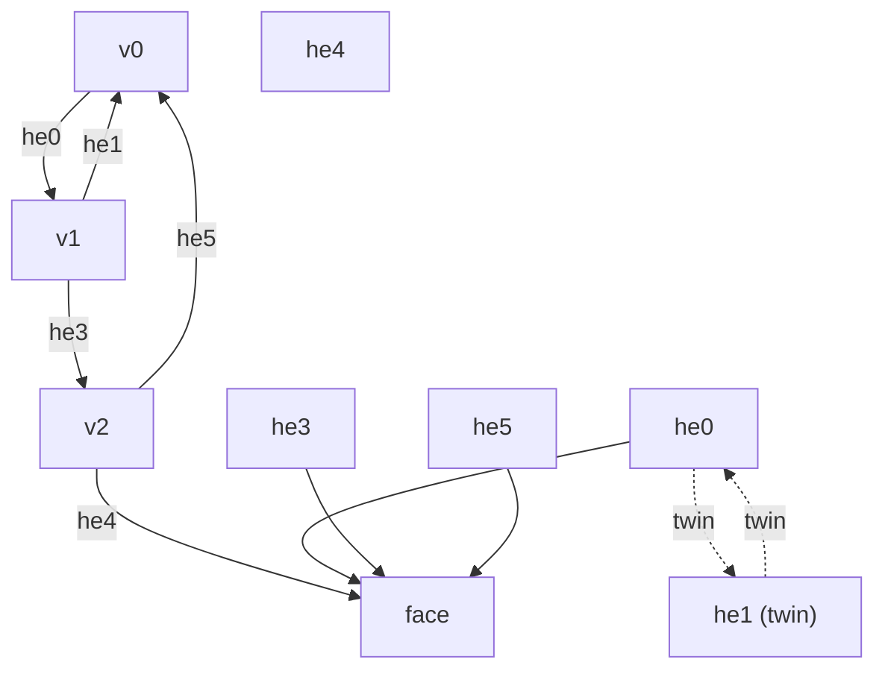

# Lesson 3: Geometric Primitives Representation

## 1. First-Principles Intuition & Invariants

Every rendered image begins with a question that is deceptively simple: how do you describe the shape of something? A sphere, a human hand, the crumpled hood of a crashed car — before a single pixel is shaded, before any ray is cast or rasterizer fires, the geometry must exist as a precise mathematical description that a computer can store, query, and transform. The discipline of geometric representation is therefore the bedrock of all real-time and offline rendering, and the choices made at this layer propagate upward through the entire graphics stack with the force of physical law.

The fundamental tension in geometric representation is between two irreconcilable pressures: compactness and exactness. A perfect sphere is fully described by a center point and a radius — four floating-point scalars, 16 bytes, and not a single approximation. Yet a GPU rasterizer cannot directly shade an implicit surface equation. It demands triangles. The moment you tessellate that sphere into triangles, you introduce approximation, topology, and a combinatorial data structure orders of magnitude larger than the original equation. Every representation scheme in graphics is a negotiated truce between mathematical idealism and hardware practicality, and understanding where each truce breaks down is what separates engineers who merely use geometry from those who architect rendering systems.

**The Three Representation Paradigms.** At the highest level, geometric representations split into three intellectual families. *Boundary representations* (B-rep) describe a solid by its enclosing surface — a triangle mesh is the canonical example. *Implicit representations* describe a solid as the set of points satisfying some inequality $f(\mathbf{x}) \leq 0$, which inverts the problem: instead of enumerating surface points, you evaluate a predicate. *Parametric representations* describe a surface as the image of a continuous map from a low-dimensional parameter domain, $\mathbf{S}(u, v) : \mathbb{R}^2 \to \mathbb{R}^3$, which is the mathematical home of splines and NURBS.

These three families are not interchangeable. Each has a distinct set of operations it performs in $O(1)$ and others it makes prohibitively expensive. Implicit surfaces make inside/outside testing trivially cheap — evaluate $f(\mathbf{x})$ and inspect the sign — but extracting an explicit triangle mesh requires a marching cubes pass over a volumetric grid, which is $O(N^3)$ in the grid resolution. Parametric curves make arc-length parameterization and curvature estimation natural but make arbitrary point membership queries hard. Triangle meshes are ideal for rasterization and ray-triangle intersection but are pathologically awkward for smooth surface modification: moving one vertex creates a visible crease unless you reconstruct the entire neighborhood. Knowing which representation to reach for is the first architectural decision in any geometry pipeline.

**Manifold Topology and Why It Matters.** A well-formed triangle mesh is not merely a bag of triangles. It represents a 2-manifold surface: at every interior point, the local neighborhood is homeomorphic to a disk $\mathbb{R}^2$, and at every edge, exactly two faces meet. The *Euler characteristic* $\chi = V - E + F$ is a topological invariant that encodes genus: for a closed mesh without holes, $\chi = 2(1 - g)$ where $g$ is the number of handles. A sphere has $g = 0$ and $\chi = 2$; a torus has $g = 1$ and $\chi = 0$. This is not academic trivia. Subdivision surfaces require manifold input to converge to a smooth limit surface. Boolean CSG operations produce non-manifold intermediate geometry as a matter of course, and your geometry kernel must detect and repair it. Mesh parameterization algorithms, UV unwrappers, and remeshers all require manifold topology as a precondition, and they will produce silently incorrect output — or crash — when fed T-intersections, non-manifold edges, or inconsistently wound faces.

The winding order of face vertices encodes the surface normal direction via the right-hand rule: given a triangle $(v_0, v_1, v_2)$, the outward normal is $\mathbf{n} = (v_1 - v_0) \times (v_2 - v_0)$, normalized. A mesh where some faces are wound clockwise and others counter-clockwise will produce normals that point inward on some faces, breaking backface culling, shadow maps, and physically-based shading. The invariant that all faces must be consistently wound is enforced nowhere automatically — it is the responsibility of every geometry-producing code path.

---

## 2. Core Architecture & Mechanics

### Triangle Mesh Data Structures

The naive triangle mesh — an array of `(x, y, z)` triples, three per triangle — is called a *triangle soup*. It is compact in layout but destroys topology: given two triangles that should share an edge, the soup stores four independent vertices with no structural link between them. Modifying a shared vertex requires finding all triangles that reference it, which costs $O(N)$ per update. Welding vertices and building an index buffer gives you an *indexed mesh*, the standard GPU representation: a vertex buffer (VBO) of unique positions and a face buffer (IBO) of integer triples indexing into it.

The indexed mesh is what you send to the GPU, but it is still topologically impoverished. It tells you which vertices form a face but not which faces surround a vertex, nor which edge connects two specific faces. For algorithms that require this adjacency — subdivision, smoothing, loop-cut operations, geodesic path finding — you need a *half-edge data structure*.



In the half-edge structure, every undirected edge is split into two directed *half-edges* pointing in opposite directions, called twins. Each half-edge stores four pointers: `next` (the next half-edge around the same face), `prev` (previous), `twin` (the opposing half-edge on the adjacent face), and `vertex` (the destination vertex). Each face stores one representative half-edge. Each vertex stores one outgoing half-edge. This seemingly redundant structure makes every topological query O(1): to traverse all faces around a vertex, you follow `twin->next` until you return to the starting half-edge. To find the two faces sharing an edge, you follow `twin->face`. To split an edge, you insert two new half-edges and update four pointer fields.

The practical implementation in C looks like this:

```c
#include <stdint.h>
#include <stddef.h>
#include <stdlib.h>
#include <math.h>
#include <assert.h>

typedef struct {
    float x, y, z;
} Vec3;

typedef struct HalfEdge HalfEdge;
typedef struct Vertex   Vertex;
typedef struct Face     Face;

struct HalfEdge {
    HalfEdge *twin;
    HalfEdge *next;
    HalfEdge *prev;
    Vertex   *vertex;   /* destination vertex */
    Face     *face;     /* face this half-edge borders */
};

struct Vertex {
    Vec3      position;
    HalfEdge *outgoing;  /* one outgoing half-edge */
    uint32_t  index;
};

struct Face {
    HalfEdge *he;        /* one half-edge of this face */
    uint32_t  index;
};

typedef struct {
    Vertex   *vertices;
    HalfEdge *halfedges;
    Face     *faces;
    uint32_t  vertex_count;
    uint32_t  halfedge_count;
    uint32_t  face_count;
} HEMesh;

/* Iterate all half-edges around vertex v using the twin->next cycle. */
static inline void vertex_one_ring(const Vertex *v,
                                   void (*callback)(HalfEdge *, void *),
                                   void *userdata)
{
    HalfEdge *start = v->outgoing;
    HalfEdge *he    = start;
    do {
        callback(he, userdata);
        he = he->twin->next;
    } while (he != start);
}

/* Compute the valence (degree) of vertex v. */
static uint32_t vertex_valence(const Vertex *v) {
    uint32_t  count = 0;
    HalfEdge *start = v->outgoing;
    HalfEdge *he    = start;
    do {
        ++count;
        he = he->twin->next;
    } while (he != start);
    return count;
}

/* Compute the area-weighted vertex normal by accumulating cross products
   of each face triangle and normalizing the sum. */
static Vec3 vertex_normal(const Vertex *v) {
    Vec3      sum   = {0.0f, 0.0f, 0.0f};
    HalfEdge *start = v->outgoing;
    HalfEdge *he    = start;
    do {
        Vec3 a = he->vertex->position;
        Vec3 b = he->next->vertex->position;
        Vec3 o = v->position;

        Vec3 u = {a.x - o.x, a.y - o.y, a.z - o.z};
        Vec3 w = {b.x - o.x, b.y - o.y, b.z - o.z};

        sum.x += u.y * w.z - u.z * w.y;
        sum.y += u.z * w.x - u.x * w.z;
        sum.z += u.x * w.y - u.y * w.x;

        he = he->twin->next;
    } while (he != start);

    float len = sqrtf(sum.x*sum.x + sum.y*sum.y + sum.z*sum.z);
    if (len > 1e-8f) {
        sum.x /= len; sum.y /= len; sum.z /= len;
    }
    return sum;
}
```

This `vertex_one_ring` traversal is the kernel of Laplacian smoothing, Loop subdivision, and cotangent-weight parameterization. Every algorithm that touches vertex neighborhoods returns to this exact loop.

### Implicit Surfaces and Signed Distance Fields

An implicit surface is defined as the zero level set of a scalar field $f : \mathbb{R}^3 \to \mathbb{R}$, with the convention that $f(\mathbf{x}) < 0$ inside the object and $f(\mathbf{x}) > 0$ outside. The surface is the locus where $f(\mathbf{x}) = 0$. The most practically important subclass is the *signed distance field* (SDF), where $f(\mathbf{x}) = d$ and $|d|$ is the Euclidean distance from $\mathbf{x}$ to the nearest surface point.

SDFs compose beautifully. The union of two SDFs $f_A$ and $f_B$ is $\min(f_A, f_B)$. The intersection is $\max(f_A, f_B)$. The difference $A \setminus B$ is $\max(f_A, -f_B)$. These are the *min/max* CSG operators. They are not, strictly speaking, exact SDFs after composition (the min/max of two SDFs is only an exact SDF at points equidistant from both surfaces), but they are correct implicit functions and they enable constructive solid geometry entirely in a fragment shader — no geometry preprocessing, no boolean mesh operations, no polygon clipping.

The following GLSL fragment shader demonstrates a ray marcher that renders a CSG scene of two spheres and a plane using SDF composition:

```glsl
#version 460 core

out vec4 frag_color;

uniform vec2  u_resolution;
uniform float u_time;
uniform vec3  u_camera_pos;
uniform mat3  u_camera_rot;

/* ---- SDF primitives ---- */

float sdf_sphere(vec3 p, vec3 center, float radius) {
    return length(p - center) - radius;
}

float sdf_plane(vec3 p, vec3 normal, float d) {
    return dot(p, normalize(normal)) - d;
}

float sdf_box(vec3 p, vec3 center, vec3 half_extents) {
    vec3 q = abs(p - center) - half_extents;
    return length(max(q, 0.0)) + min(max(q.x, max(q.y, q.z)), 0.0);
}

/* ---- smooth min for blending (k controls blend radius) ---- */
float smin(float a, float b, float k) {
    float h = clamp(0.5 + 0.5 * (b - a) / k, 0.0, 1.0);
    return mix(b, a, h) - k * h * (1.0 - h);
}

/* ---- scene SDF: CSG union of sphere-box intersection and plane ---- */
float scene(vec3 p) {
    float sphere = sdf_sphere(p, vec3(0.0, 0.5, 0.0), 0.75);
    float box    = sdf_box(p, vec3(0.0, 0.5, 0.0), vec3(0.55));
    float ground = sdf_plane(p, vec3(0.0, 1.0, 0.0), -0.1);

    /* CSG intersection of sphere and box, then union with ground plane */
    float solid = max(sphere, box);  /* intersection */
    return min(solid, ground);       /* union with ground */
}

/* ---- central differences normal estimation ---- */
vec3 scene_normal(vec3 p) {
    const float eps = 0.001;
    return normalize(vec3(
        scene(p + vec3(eps, 0.0, 0.0)) - scene(p - vec3(eps, 0.0, 0.0)),
        scene(p + vec3(0.0, eps, 0.0)) - scene(p - vec3(0.0, eps, 0.0)),
        scene(p + vec3(0.0, 0.0, eps)) - scene(p - vec3(0.0, 0.0, eps))
    ));
}

/* ---- sphere tracing (ray marching) ---- */
float raymarch(vec3 ro, vec3 rd) {
    float t = 0.0;
    for (int i = 0; i < 128; ++i) {
        float d = scene(ro + t * rd);
        if (d < 0.0001) return t;
        if (t > 100.0)  break;
        t += d;
    }
    return -1.0;
}

void main() {
    vec2 uv = (gl_FragCoord.xy - 0.5 * u_resolution) / u_resolution.y;

    vec3 ro = u_camera_pos;
    vec3 rd = normalize(u_camera_rot * vec3(uv, 1.5));

    float t = raymarch(ro, rd);
    if (t < 0.0) {
        frag_color = vec4(0.08, 0.08, 0.1, 1.0);
        return;
    }

    vec3  hit    = ro + t * rd;
    vec3  normal = scene_normal(hit);
    vec3  light  = normalize(vec3(1.0, 2.0, 1.5));
    float diff   = max(dot(normal, light), 0.0);
    float spec   = pow(max(dot(reflect(-light, normal), -rd), 0.0), 32.0);

    vec3 color = vec3(0.6, 0.65, 0.7) * diff + vec3(1.0) * spec * 0.4 + vec3(0.05);
    frag_color = vec4(color, 1.0);
}
```

The key insight in sphere tracing, as Hart originally formalized it in 1996, is that when $f(\mathbf{x})$ is a valid SDF, the value $f(\mathbf{x})$ gives you a guaranteed safe step size along the ray: you cannot possibly cross a surface in fewer than $f$ world-space units from your current position. This converts the naive ray marcher — which uses a fixed step size and misses thin features — into a convergent root-finding algorithm. The loop terminates in at most $O(1/\epsilon)$ iterations for any scene where the SDF is Lipschitz-1, which all true SDFs are by definition.

### Parametric Curves and Splines

A parametric curve is a function $\mathbf{P}(t) : [0,1] \to \mathbb{R}^3$ that traces a path through 3-space as the scalar parameter $t$ varies. The engineering problem is representing this function in a form that is compact, efficiently evaluable, and geometrically intuitive — meaning that an artist or engineer can predict what the curve will do when they move a control point.

**Bézier Curves.** A degree-$n$ Bézier curve is defined by $n+1$ control points $\mathbf{P}_0, \ldots, \mathbf{P}_n$ and evaluated by the Bernstein polynomial basis:

$$\mathbf{B}(t) = \sum_{i=0}^{n} \binom{n}{i} t^i (1-t)^{n-i} \mathbf{P}_i$$

The geometric interpretation is that the curve lies entirely within the convex hull of its control points (the *convex hull property*), passes through $\mathbf{P}_0$ at $t=0$ and $\mathbf{P}_n$ at $t=1$, and is tangent to the first and last control polygon edges at the endpoints (*endpoint interpolation* and *tangent property*). The curve does not in general pass through intermediate control points — they are weights, not interpolants. This is the fundamental trade-off of approximating splines versus interpolating splines.

The de Casteljau algorithm evaluates a Bézier curve without computing Bernstein polynomials directly, using a recursive linear interpolation scheme that is numerically stable and easily differentiable:

```c
#include <stdint.h>
#include <string.h>

typedef struct { float x, y, z; } Vec3;

static Vec3 lerp3(Vec3 a, Vec3 b, float t) {
    return (Vec3){
        a.x + (b.x - a.x) * t,
        a.y + (b.y - a.y) * t,
        a.z + (b.z - a.z) * t
    };
}

/*
 * Evaluate a degree-n Bézier curve at parameter t using de Casteljau.
 * control_points: array of (n+1) Vec3 values.
 * n:              degree of the curve (not point count).
 * Returns the point on the curve at parameter t in [0, 1].
 */
Vec3 bezier_evaluate(const Vec3 *control_points, uint32_t n, float t) {
    Vec3 scratch[16
```
