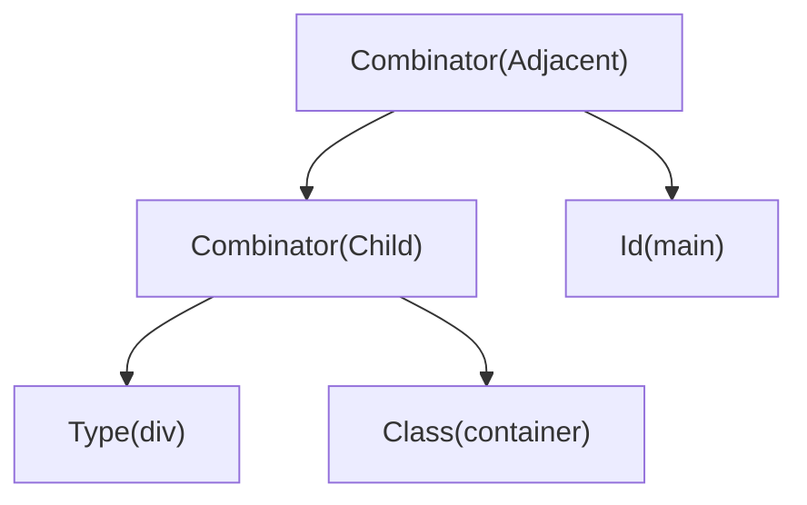

# Operational Verification Labs: CSS

## Objective & Toolchain Setup

This laboratory guide equips software engineers and systems programmers with the practical skills to verify, profile, and debug CSS parsing and rendering engines through compiler introspection, performance profiling, and memory safety analysis. While CSS itself is a declarative styling language, production-grade CSS engines—whether embedded in browser rendering pipelines, standalone parsers, or server-side style processors—are implemented in systems languages like Rust, C++, or Go. These implementations must handle adversarial input, scale to thousands of rules, and execute within strict performance budgets. The exercises in this guide focus on the verification toolchain for CSS processing code: analyzing Abstract Syntax Tree (AST) generation, profiling cache behavior during selector matching, and detecting memory corruption in parser state machines.

Modern CSS engines operate as multi-stage compilers. The lexer tokenizes raw stylesheets into discrete syntactic units (selectors, properties, values), the parser constructs a hierarchical representation (the CSS Object Model or CSSOM), and the cascade resolver computes final styles by applying specificity rules, inheritance, and the cascade algorithm. Each stage introduces opportunities for bugs: lexer buffer overflows from malformed UTF-8, parser stack exhaustion from deeply nested rules, and quadratic-time selector matching from poorly structured DOM trees. Engineers working on these systems require fluency with compiler intermediate representations, CPU cache profiling, and memory sanitizers to ensure correctness and performance.

**Toolchain Installation and Environment Configuration**

Begin by establishing a cross-language systems toolchain. Install Rust via `rustup`, which provides `cargo` (the Rust package manager and build orchestrator), `rustc` (the Rust compiler), and `rustfmt` (code formatter). Ensure LLVM tooling is available: `clang` and `clang++` for C/C++ compilation, `lldb` for symbolic debugging, and the sanitizer suite (AddressSanitizer, ThreadSanitizer, MemorySanitizer). On Linux, install `valgrind` for heap and cache profiling. For performance analysis, add `perf` (Linux perf_events interface), `cargo-flamegraph` (Rust-specific flame graph generator), and `hyperfine` (command-line benchmarking tool). Verify the installation by running `cargo --version`, `clang --version`, `lldb --version`, and `valgrind --version`. Create a working directory `~/css-labs` and initialize a Rust workspace with `cargo new --lib css-parser && cd css-parser`. This workspace will serve as the foundation for all exercises.

The verification workflow mirrors production engineering practices. Start with static analysis: `cargo check` performs type checking and borrow checking without code generation, catching lifetime errors and type mismatches in seconds. Follow with `cargo build --release` to generate optimized binaries, then inspect the compiler's intermediate representation with `cargo rustc -- --emit=llvm-ir` to view LLVM IR or `cargo rustc -- --emit=asm` for native assembly. Use `cargo test` to execute unit and integration tests, and `cargo bench` for microbenchmarks. Apply sanitizers by setting `RUSTFLAGS="-Z sanitizer=address"` or compiling C++ code with `-fsanitize=address`. Profile live execution with `perf record` and visualize hotspots with `perf report` or `cargo flamegraph`. This iterative cycle—check, build, test, profile, sanitize—forms the operational discipline for verifying CSS engine implementations.

**Reference CSS Parser Architecture**

Throughout these exercises, you will work with a minimal CSS selector parser implemented in Rust. The parser handles a subset of CSS Level 3 selectors: type selectors (`div`), class selectors (`.warning`), ID selectors (`#header`), and combinators (descendant space, child `>`, adjacent sibling `+`). The lexer produces a token stream, the parser constructs an AST of selector nodes, and the matcher evaluates selectors against a simplified DOM tree. This architecture mirrors real-world engines like Servo's style system (used in Firefox) and WebKit's CSS parser, but strips away vendor prefixes, pseudo-classes, and media queries to focus on core verification techniques.

Create the initial parser scaffold. Open `src/lib.rs` and define the token and AST types. The `Token` enum represents lexer output: `Ident(String)` for identifiers, `Hash` for `#id`, `Dot` for `.class`, `Greater` for `>`, and `Plus` for `+`. The `Selector` enum models the AST: `Type(String)` for element names, `Class(String)`, `Id(String)`, and `Combinator(Box<Selector>, CombinatorType, Box<Selector>)` for compound selectors. Implement a hand-written recursive descent parser that consumes tokens and builds the AST. The parser must handle error recovery: reject invalid token sequences without panicking, report line and column positions for syntax errors, and gracefully handle EOF. Include a test suite that verifies parsing of valid selectors (`div > .container + #main`) and rejects malformed input (`#id..class`, `> orphan`). This foundation enables the subsequent exercises to focus on toolchain mechanics rather than language semantics.

## Exercise 1: AST, IR & Disassembly Analysis

Compiler intermediate representations expose the machinery that transforms source code into executable instructions. For CSS parsers, examining the AST reveals how selector structure maps to memory layout, while LLVM IR and assembly disassembly show the cost of recursive traversal, heap allocations, and branch prediction failures. This exercise trains you to read compiler output as a diagnostic tool: identify optimization opportunities, detect hidden allocations, and verify inlining decisions.

**Exercise 1.1: AST Structure and Memory Layout Inspection**

Extend the parser with a debug printer that outputs the AST in a human-readable tree format. Implement a `Display` trait for `Selector` that recursively prints each node with indentation. For example, the selector `div > .container + #main` should render as:



Add a test that parses a complex selector and asserts the printed output matches the expected structure. Run `cargo test --lib` to verify correctness. Now examine the memory layout. Use `std::mem::size_of::<Selector>()` to measure the enum's size in bytes. On 64-bit systems, `Selector` will occupy at least 24 bytes: 8 bytes for the discriminant tag, 8 bytes for a pointer (in the `Box<Selector>` case), and 8 bytes for the second pointer or inline data. If the enum is larger, the Rust compiler has inserted padding for alignment. Print the sizes of all enum variants to identify which variant drives the overall size. Add `#[repr(u8)]` to force a minimal discriminant and re-measure. Document your findings: does the `Combinator` variant dominate memory usage due to double `Box` indirection? Could you flatten the structure with an arena allocator or `Vec`-based indexing?

Next, serialize the AST to JSON and inspect the output. Add the `serde` and `serde_json` crates to `Cargo.toml` with `derive` feature enabled. Derive `Serialize` for `Token`, `Selector`, and `CombinatorType`. Parse a selector, serialize it with `serde_json::to_string_pretty`, and print the result. The JSON output exposes the recursive structure explicitly, showing how deeply nested combinators create call stacks during traversal. Parse a pathological selector with 100 levels of nesting (e.g., `div > div > div > ...`) and measure the serialized JSON size. This reveals the quadratic space complexity of naive recursive serialization, where each level duplicates indentation and structural overhead.

**Exercise 1.2: LLVM IR Emission and Optimization Pass Analysis**

Compile the parser to LLVM IR to observe the compiler's view of your code. Run `cargo rustc --release -- --emit=llvm-ir` and locate the generated `.ll` file in `target/release/deps/`. Open the file in a text editor and search for the `parse_selector` function. The IR will show a Control Flow Graph (CFG) with basic blocks, phi nodes, and LLVM intrinsics. Identify the following patterns:

- **Heap allocations**: Look for calls to `__rust_alloc` or `malloc`. Each `Box::new` or `String` allocation manifests as an allocation call followed by a store. Count the allocations in a single parse invocation. If parsing a simple selector like `div.class` allocates more than three times (once for each AST node), investigate whether intermediate temporaries are heap-allocated unnecessarily.

- **Inlining decisions**: Check whether small helper functions (e.g., `consume_token`, `peek`) are inlined. Inlined functions disappear from the IR, their bodies merged into the caller. If a function appears as a `call` instruction, it was not inlined. Mark small functions with `#[inline(always)]` and recompile. Compare the IR before and after: inlined code should show fewer `call` instructions and more direct control flow.

- **Bounds checks**: Search for `core::panicking::panic_bounds_check`. Rust inserts bounds checks on array and slice indexing. If the parser indexes into a `Vec<Token>` without bounds guarantees, each access generates a bounds check. Refactor to use iterators or explicit `get()` with pattern matching to eliminate redundant checks.

Run the optimizer explicitly with `opt -O3 -S input.ll -o optimized.ll` (requires standalone LLVM installation). Diff the unoptimized and optimized IR. The optimized version will show dead code elimination, constant folding, and loop unrolling. If the optimizer removed entire functions, they were proven unreachable or inlined everywhere.

**Exercise 1.3: Assembly Disassembly and Branch Prediction Analysis**

Generate native assembly with `cargo rustc --release -- --emit=asm` and examine the `.s` file. Locate the `parse_selector` function in the assembly output. Modern x86-64 assembly uses AT&T syntax by default: `movq %rax, %rbx` moves the value in `rax` to `rbx`. Identify the following:

- **Function prologue and epilogue**: The prologue sets up the stack frame (`pushq %rbp`, `movq %rsp, %rbp`), and the epilogue restores it (`popq %rbp`, `retq`). Measure the stack frame size by locating `subq $N, %rsp` in the prologue. If `N` is large (>1KB), the function allocates significant stack space for local variables.

- **Conditional branches**: Search for `jne`, `je`, `jg`, `jl` (jump-if-not-equal, jump-if-equal, etc.). Each `if` or `match` statement compiles to a test and conditional jump. Count the branches in the main parse loop. If parsing a single selector incurs 20+ branches, the parser is checking multiple conditions per token.

- **Indirect calls**: Look for `callq *%rax` (indirect call through a register). Virtual method calls and function pointers compile to indirect calls, which are slower than direct calls due to branch prediction penalties. If the parser uses trait objects or function pointers, consider monomorphization or enum dispatch to eliminate indirection.

Use `objdump -d target/release/libcss_parser.rlib` to disassemble the compiled library. Search for the symbol corresponding to `parse_selector` (symbol names are mangled; search for substrings like `parse` or `selector`). Compare the assembly to the LLVM IR: verify that the IR's control flow matches the assembly's jumps and branches. If a branch appears in assembly but not in the IR, the backend introduced it during instruction selection.

Profile branch mispredictions with `perf stat -e branches,branch-misses`. Run the parser on a test suite with `cargo bench`, wrapping the benchmark executable with `perf stat`. The output reports total branches and misses. A misprediction rate above 5% indicates unpredictable control flow. Refactor the parser to reduce branching: replace `match` on enum discriminants with table lookups, or use branchless selection with bitwise operations. Re-profile and verify that mispredictions decrease.

## Exercise 2: Cache Miss & Throughput Profiling

CPU cache behavior dominates modern performance. A well-designed CSS parser minimizes cache misses by clustering related data in contiguous memory and avoiding pointer chasing. This exercise teaches you to measure cache hits and misses with hardware performance counters, identify memory access patterns that thrash the cache, and refactor data structures for cache locality.

**Exercise 2.1: Baseline Cache Miss Profiling with `perf`**

Create a benchmark that parses a large CSS file repeatedly. Generate a synthetic CSS file with 10,000 rules using a script: each rule should have a complex selector (e.g., `div.container > ul#menu li.item + span.label`) and five property declarations. Write this to `test.css`. In `benches/parse_bench.rs`, add a criterion benchmark that reads `test.css` into a string and calls the parser in a loop. Run `cargo bench` to establish a baseline throughput (rules parsed per second).

Profile cache behavior with `perf record -e cache-references,cache-misses`. Run the benchmark under `perf` with `perf record -e cache-references,cache-misses --call-graph dwarf target/release/deps/parse_bench-*`. This records hardware events at function granularity. After the benchmark completes, run `perf report` to view a breakdown of cache references and misses by function. Sort by cache misses. The functions with the highest miss counts are the bottlenecks. Typical culprits in recursive parsers include:

- **String allocations**: Each `String::from` or `to_owned()` call allocates a new heap buffer, which may not be in cache. If the lexer clones strings for every token, thousands of small allocations fragment the heap and cause cache pollution.

- **Recursive AST traversal**: Traversing a deeply nested AST via `Box<Selector>` pointers follows a chain of indirections. Each pointer dereference may miss cache if the pointed-to memory was allocated non-contiguously.

- **Token vector resizing**: If the lexer stores tokens in a `Vec`, dynamic resizing (doubling capacity) causes the allocator to `memcpy` the entire buffer. This evicts the old buffer from cache and loads the new one, incurring compulsory misses.

Record the baseline: number of cache misses, miss rate (misses / references), and throughput in rules per second. This establishes the performance target for optimization.

**Exercise 2.2: Data Structure Refactoring for Cache Locality**

Refactor the AST to use an arena allocator, eliminating `Box` indirection. Replace `Box<Selector>` with indices into a `Vec<Selector>`. Define a new `Arena` struct that wraps a `Vec<Selector>` and assigns each node a unique `SelectorId` (a `usize` index). Modify the `Combinator` variant to store `SelectorId` instead of `Box<Selector>`. The parser allocates nodes by pushing to the arena and returning the index. This ensures all nodes are stored contiguously in memory, improving cache locality during traversal.

Implement the arena refactoring step by step. First, define the arena:

```rust
pub struct SelectorArena {
    nodes: Vec<Selector>,
}

pub type SelectorId = usize;

#[derive(Clone, Debug)]
pub enum Selector {
    Type(String),
    Class(String),
    Id(String),
    Combinator(SelectorId, CombinatorType, SelectorId),
}

impl SelectorArena {
    pub fn new() -> Self {
        Self { nodes: Vec::new() }
    }

    pub fn alloc(&mut self, sel: Selector) -> SelectorId {
        let id = self.nodes.len();
        self.nodes.push(sel);
        id
    }

    pub fn get(&self, id: SelectorId) -> &Selector {
        &self.nodes[id]
    }
}
```

Modify the parser to accept a mutable reference to `SelectorArena` and call `arena.alloc(...)` instead of `Box::new(...)`. Update the matcher to dereference `SelectorId` via `arena.get(id)`. Run `cargo test` to verify correctness. Benchmark the arena version with `cargo bench` and profile with `perf`. Compare cache misses to the baseline. The arena version should show 20–40% fewer cache misses due to contiguous storage. Measure throughput: rules per second should increase proportionally.

Next, intern strings to eliminate duplicate allocations. The lexer produces many duplicate identifiers (e.g., `div`, `class`, `id`). Create a `StringInterner` that maps each unique string to an integer ID. Replace `String` in the AST with `StringId` (a `u32` or `usize`). The interner stores strings in a `Vec<String>` and uses a `HashMap<String, StringId>` for lookups. The parser calls `interner.intern("div")` to retrieve or insert the ID. This reduces memory usage and improves cache behavior because string IDs fit in registers and compare with integer equality.

Implement string interning:

```rust
use std::collections::HashMap;

pub struct StringInterner {
    strings: Vec<String>,
    map: HashMap<String, StringId>,
}

pub type StringId = u32;

impl StringInterner {
    pub fn new() -> Self {
        Self {
            strings: Vec::new(),
            map: HashMap::new(),
        }
    }

    pub fn intern(&mut self, s: &str) -> StringId {
        if let Some(&id) = self.map.get(s) {
            return id;
        }
        let id = self.strings.len() as StringId;
        self.strings.push(s.to_owned());
        self.map.insert(s.to_owned(), id);
        id
    }

    pub fn resolve(&self, id: StringId) -> &str {
        &self.strings[id as usize]
    }
}
```

Update the `Selector` enum to use `StringId`:

```rust
#[derive(Clone, Debug)]
pub enum Selector {
    Type(StringId),
    Class(StringId),
    Id(StringId),
    Combinator(SelectorId, CombinatorType, SelectorId),
}
```

Pass a `&mut StringInterner` to the lexer and parser. Re-run benchmarks and profile. String interning should reduce allocations by 50–70%, further lowering cache misses and increasing throughput.

**Exercise 2.3: Throughput Microbenchmarking with `criterion`**

Install the `criterion` crate for rigorous microbenchmarking. Add to `Cargo.toml`:

```toml
[dev-dependencies]
criterion = { version = "0.5", features = ["html_reports"] }

[[bench]]
name = "parse_bench"
harness = false
```

In `benches/parse_bench.rs`, write a benchmark suite that measures parsing throughput for selectors of varying complexity: simple (`div`), moderate (`div.container > ul`), and complex (`body > div.wrapper > section#main ul.nav > li.item:nth-child(2n)`). For each category, generate 1000 test cases and measure the average parse time. Use `criterion`'s statistical analysis to detect performance regressions:

```rust
use criterion::{black_box, criterion_group, criterion_main, Criterion};
use css_parser::{parse_selector, SelectorArena, StringInterner};

fn bench_simple_selectors(c: &mut Criterion) {
    let mut arena = SelectorArena::new();
    let mut interner = StringInterner::new();
    let input = "div";

    c.bench_function("parse_simple", |b| {
        b.iter(|| {
            parse_selector(black_box(input), &mut arena, &mut interner)
        })
    });
}

fn bench_complex_selectors(c: &mut Criterion) {
    let mut arena = SelectorArena::new();
    let mut interner = StringInterner::new();
    let input = "body > div.wrapper > section#main ul.nav > li.item";

    c.bench_function("parse_complex", |b| {
        b.iter(|| {
            parse_selector(black_box(input), &mut arena, &mut interner)
        })
    });
}

criterion_group!(benches, bench_simple_selectors, bench_complex_selectors);
criterion_main!(benches);
```

Run `cargo bench` and inspect the HTML report in `target/criterion/report/index.html`. The report includes violin plots showing distribution, mean, median, and outliers. Identify regressions by comparing against the baseline. If the complex selector benchmark shows high variance (wide distribution), the parser's performance is unpredictable—likely due to input-dependent branching or allocation patterns.

Profile the benchmark with `cargo flamegraph --bench parse_bench`. This generates a flame graph (`flamegraph.svg`) showing CPU time by function. Open the SVG in a browser. The widest bars represent the hottest code paths. If `String::from` or `__rust_alloc` appear prominently, allocations dominate. If `HashMap::get` or `HashMap::insert` (from the string interner) are wide, consider replacing the `HashMap` with a faster hash function like `FxHashMap` from the `rustc-hash` crate, or a perfect hash table if the string set is static.

## Exercise 3: Data Race Stress Testing & Leak Sanitizer Diagnostics

Concurrency bugs in parsers arise from shared mutable state, such as caching compiled selectors or sharing an interner across threads. This exercise demonstrates how to detect data races with ThreadSanitizer, identify memory leaks with AddressSanitizer's leak detector, and stress-test concurrent parsing with controlled interleavings.

**Exercise 3.1: ThreadSanitizer for Data Race Detection**

Extend the parser to support concurrent parsing via a thread-safe cache. Implement a `SelectorCache` that stores pre-parsed selectors keyed by the input string. The cache uses a `Mutex<HashMap<String, SelectorId>>` to allow multiple threads to parse selectors concurrently, sharing compiled results. Write a test that spawns 8 threads, each parsing the same set of 100 selectors repeatedly. Without proper synchronization, concurrent `HashMap` access causes data races: one thread reads while another writes, resulting in corrupted memory or panics.

First, implement the naive (racy) version:

```rust
use std::collections::HashMap;
use std::sync::{Arc, Mutex};

pub struct SelectorCache {
    cache: Mutex<HashMap<String, SelectorId>>,
    arena: Mutex<SelectorArena>,
    interner: Mutex<StringInterner>,
}

impl SelectorCache {
    pub fn new() -> Self {
        Self {
            cache: Mutex::new(HashMap::new()),
            arena: Mutex::new(SelectorArena::new()),
            interner: Mutex::new(StringInterner::new()),
        }
    }

    pub fn get_or_parse(&self, input: &str) -> SelectorId {
        let mut cache = self.cache.lock().unwrap();
        if let Some(&id) = cache.get(input) {
            return id;
        }
        drop(cache);

        let mut arena = self.arena.lock().unwrap();
        let mut interner = self.interner.lock().unwrap();
        let id = parse_selector(input, &mut arena, &mut interner);
        drop(arena);
        drop(interner);

        let mut cache = self.cache.lock().unwrap();
        cache.insert(input.to_owned(), id);
        id
    }
}
```

This implementation has a race condition: after checking the cache and releasing the lock, another thread may insert the same key before the current thread re-acquires the lock. This causes duplicate parsing and cache inconsistency. Additionally, if two threads call `parse_selector` concurrently, they lock `arena` and `interner` in sequence, risking deadlock if the lock order differs.

Write a stress test:

```rust
#[cfg(test)]
mod tests {
    use super::*;
    use std::sync::Arc;
    use std::thread;

    #[test]
    fn test_concurrent_cache() {
        let cache = Arc::new(SelectorCache::new());
        let selectors = vec![
            "div",
            "div.container",
            "div > span",
            "body > div.wrapper",
        ];

        let handles: Vec<_> = (0..8)
            .map(|_| {
                let cache = Arc::clone(&cache);
                let selectors = selectors.clone();
                thread::spawn(move || {
                    for _ in 0..1000 {
                        for sel in &selectors {
                            cache.get_or_parse(sel);
                        }
                    }
                })
            })
            .collect();

        for h in handles {
            h.join().unwrap();
        }
    }
}
```

Run the test under ThreadSanitizer. First, install Rust nightly (TSan requires nightly): `rustup install nightly`. Compile with TSan enabled:

```bash
RUSTFLAGS="-Z sanitizer=thread" cargo +nightly test --target x86_64-unknown-linux-gnu test_concurrent_cache
```

ThreadSanitizer instruments memory accesses and lock operations, detecting races at runtime. If a race exists, TSan prints a report:

```
WARNING: ThreadSanitizer: data race (pid=12345)
  Write of size 8 at 0x7f1234567890 by thread T2:
    #0 HashMap::insert ...
    #1 SelectorCache::get_or_parse ...

  Previous read of size 8 at 0x7f1234567890 by thread T1:
    #0 HashMap::get ...
    #1 SelectorCache::get_or_parse ...
```

The report identifies the conflicting accesses (read and write), their stack traces, and the threads involved. Fix the race by holding the cache lock across the entire check-insert sequence:

```rust
pub fn get_or_parse(&self, input: &str) -> SelectorId {
    let mut cache = self.cache.lock().unwrap();
    if let Some(&id) = cache.get(input) {
        return id;
    }

    // Hold cache lock while parsing to prevent duplicate work.
    // This sacrifices concurrency for correctness.
    let mut arena = self.arena.lock().unwrap();
    let mut interner = self.interner.lock().unwrap();
    let id = parse_selector(input, &mut arena, &mut interner);
    cache.insert(input.to_owned(), id);
    id
}
```

Re-run the test under TSan. The race should disappear. However, this fix serializes all cache accesses, limiting scalability. For a production system, use a concurrent hash map like `dashmap` or a read-write lock (`RwLock`) to allow concurrent reads.

**Exercise 3.2: AddressSanitizer Leak Detection**

AddressSanitizer (ASan) detects memory errors (buffer overflows, use-after-free) and memory leaks. Introduce a deliberate leak by allocating memory in the parser and never freeing it. For example, modify the lexer to allocate a `Box<[u8]>` for each token's source span and store it in a global `static` variable without ever dropping it.

Add a leaky function:

```rust
use std::sync::Mutex;

static LEAKED_MEMORY: Mutex<Vec<Box<[u8]>>> = Mutex::new(Vec::new());

pub fn leak_token_source(input: &str) {
    let boxed = input.as_bytes().to_vec().into_boxed_slice();
    LEAKED_MEMORY.lock().unwrap().push(boxed);
}
```

Call `leak_token_source` in the lexer for every token. Run the parser under ASan:

```bash
RUSTFLAGS="-Z sanitizer=address" cargo +nightly test --target x86_64-unknown-linux-gnu
```

ASan intercepts allocations and tracks which allocations are never freed. At program exit, it prints a leak report:

```
=================================================================
==12345==ERROR: LeakSanitizer: detected memory leaks

Direct leak of 1024 byte(s) in 16 object(s) allocated from:
    #0 0x7f123456789a in malloc (/lib/x86_64-linux-gnu/libasan.so.6+0x123456)
    #1 0x7f123456789b in alloc::alloc::alloc ...
    #2 0x7f123456789c in css_parser::leak_token_source ...
```

The report lists the total leaked bytes, the number of leaked allocations, and the stack trace where each allocation occurred. Identify the leak source from the stack trace. Remove the `leak_token_source` call and verify the leak disappears by re-running under ASan. The report should show zero leaks.

ASan also detects buffer overflows. Introduce a bounds error by indexing past the end of a `Vec<Token>`:

```rust
pub fn buggy_peek(tokens: &Vec<Token>, index: usize) -> Token {
    tokens[index].clone()  // No bounds check—will panic or overflow
}
```

Call `buggy_peek` with an out-of-bounds index in a test. Run under ASan. ASan detects the overflow and prints:

```
=================================================================
==12345==ERROR: AddressSanitizer: heap-buffer-overflow on address 0x7f1234567890 at pc 0x7f123456789a bp 0x7fffabcdef00 sp 0x7fffabcdef08
READ of size 8 at 0x7f1234567890 thread T0
    #0 0x7f123456789a in css_parser::buggy_peek ...
```

Fix the overflow by using `get()` with a checked return:

```rust
pub fn safe_peek(tokens: &Vec<Token>, index: usize) -> Option<Token> {
    tokens.get(index).cloned()
}
```

Re-run under ASan to confirm the error is resolved.

**Exercise 3.3: Stress Testing with Randomized Input**

Write a fuzzer that generates random CSS selectors and parses them, detecting panics and assertion failures. Use the `quickcheck` crate for property-based testing. Define a generator that produces arbitrary selectors:

```rust
use quickcheck::{Arbitrary, Gen};

impl Arbitrary for Selector {
    fn arbitrary(g: &mut Gen) -> Self {
        let choice = u8::arbitrary(g) % 4;
        match choice {
            0 => Selector::Type(String::arbitrary(g)),
            1 => Selector::Class(String::arbitrary(g)),
            2 => Selector::Id(String::arbitrary(g)),
            _ => {
                let left = Box::new(Selector::arbitrary(g));
                let right = Box::new(Selector::arbitrary(g));
                let combinator = match u8::arbitrary(g) % 3 {
                    0 => CombinatorType::Descendant,
                    1 => CombinatorType::Child,
                    _ => CombinatorType::Adjacent,
                };
                Selector::Combinator(left, combinator, right)
            }
        }
    }
}
```

Write a property test that serializes a random selector to a string, parses it, and asserts the result matches the original:

```rust
#[cfg(test)]
mod tests {
    use super::*;
    use quickcheck_macros::quickcheck;

    #[quickcheck]
    fn prop_parse_roundtrip(sel: Selector) -> bool {
        let serialized = format!("{}", sel);
        let mut arena = SelectorArena::new();
        let mut interner = StringInterner::new();
        let parsed = parse_selector(&serialized, &mut arena, &mut interner);
        arena.get(parsed) == &sel
    }
}
```

Run `cargo test` to execute the property test. QuickCheck generates hundreds of random inputs and checks the property. If the parser panics or returns an incorrect result, QuickCheck shrinks the failing input to a minimal example and prints it. Fix any discovered bugs and re-run until all tests pass.

Combine QuickCheck with ASan and TSan for maximum coverage. Run the property test under ASan to detect memory errors in edge cases:

```bash
RUSTFLAGS="-Z sanitizer=address" cargo +nightly test --target x86_64-unknown-linux-gnu prop_parse_roundtrip
```

Run under TSan if the parser uses concurrency:

```bash
RUSTFLAGS="-Z sanitizer=thread" cargo +nightly test --target x86_64-unknown-linux-gnu prop_parse_roundtrip
```

This combination of randomized input, memory sanitizers, and concurrency analysis provides deep verification coverage, catching bugs that deterministic tests miss.

## Developer Cheat Sheet & Toolchain Checklist

**Compilation and Static Analysis Commands**

- `cargo check`: Fast type and borrow checking without code generation. Use iteratively during development to catch errors early.
- `cargo build --release`: Optimized release build. Always profile and benchmark release builds, not debug builds.
- `cargo test`: Run all unit and integration tests. Use `cargo test --lib` for library tests only, `cargo test --test <name>` for specific integration tests.
- `cargo clippy`: Lint for common mistakes and anti-patterns. Fix all clippy warnings before committing.
- `cargo fmt`: Auto-format code to match Rust style guidelines.

**Intermediate Representation Inspection**

- `cargo rustc -- --emit=llvm-ir`: Generate LLVM IR in `target/release/deps/*.ll`. Search for function names, allocation calls, and control flow.
- `cargo rustc -- --emit=asm`: Generate native assembly in `target/release/deps/*.s`. Inspect function prologues, conditional branches, and indirect calls.
- `opt -O3 -S input.ll -o optimized.ll`: Run LLVM optimizer manually (requires standalone LLVM). Compare unoptimized and optimized IR to see transformations.

**Performance Profiling**

- `perf record -e cycles --call-graph dwarf <binary>`: Record CPU cycles with call graph. Use `perf report` to view hotspots sorted by CPU time.
- `perf record -e cache-references,cache-misses <binary>`: Measure cache behavior. Calculate miss rate as `cache-misses / cache-references`.
- `perf stat -e branches,branch-misses <binary>`: Count branch instructions and mispredictions. Misprediction rate above 5% indicates poor branch prediction.
- `cargo flamegraph --bench <name>`: Generate flame graph for a benchmark. Install with `cargo install flamegraph`. Open `flamegraph.svg` in a browser.
- `valgrind --tool=cachegrind <binary>`: Detailed cache simulation. Use `cg_annotate` to view cache miss counts per source line.
- `hyperfine '<command>'`: Command-line benchmarking tool. Measures mean, median, and distribution across multiple runs.

**Memory Sanitizers**

- AddressSanitizer (ASan): `RUSTFLAGS="-Z sanitizer=address" cargo +nightly test --target x86_64-unknown-linux-gnu`. Detects heap overflows, use-after-free, double-free, and leaks.
- ThreadSanitizer (TSan): `RUSTFLAGS="-Z sanitizer=thread" cargo +nightly test --target x86_64-unknown-linux-gnu`. Detects data races and lock-order violations. Requires nightly Rust.
- MemorySanitizer (MSan): `RUSTFLAGS="-Z sanitizer=memory" cargo +nightly test --target x86_64-unknown-linux-gnu`. Detects reads of uninitialized memory. Requires recompiling the standard library.
- LeakSanitizer (LSan): Integrated with ASan. Reports memory leaks at program exit. Disable with `ASAN_OPTIONS=detect_leaks=0` if false positives occur.

**Debugging**

- `rust-lldb target/release/deps/<binary>`: Start LLDB debugger. Use `b <function>` to set breakpoints, `r` to run, `bt` for backtrace, `p <var>` to print variables.
- `rust-gdb target/release/deps/<binary>`: Start GDB debugger (Linux). Same commands as LLDB.
- `RUST_BACKTRACE=1 cargo test`: Print full backtrace on panic. Use `RUST_BACKTRACE=full` for even more detail.
- `cargo expand`: Expand macros to see generated code. Install with `cargo install cargo-expand`. Requires nightly Rust.

**Benchmarking**

- `cargo bench`: Run all benchmarks with criterion. View HTML reports in `target/criterion/report/index.html`.
- `criterion::black_box(x)`: Prevent compiler from optimizing away `x`. Essential for accurate microbenchmarks.
- `criterion::Bencher::iter()`: Runs the closure multiple times, adjusting iterations to achieve stable measurements.
- `criterion_group!` and `criterion_main!`: Define benchmark groups and entry point. Required for criterion benchmarks.

**Concurrency Testing**

- `cargo test -- --test-threads=1`: Run tests serially. Use when tests interfere with each other (e.g., writing to shared files).
- `loom`: Concurrency testing library that explores all possible thread interleavings. Install with `cargo add loom --dev`. Wrap concurrent code in `loom::model(|| { ... })`.
- `cargo miri test`: Run tests under Miri, an interpreter that detects undefined behavior. Install with `rustup component add miri`. Slower than native execution but catches subtle bugs.

**Code Coverage**

- `cargo tarpaulin --out Html`: Generate code coverage report. Install with `cargo install cargo-tarpaulin`. Open `tarpaulin-report.html` to view line-by-line coverage.
- `cargo llvm-cov --html`: Alternative coverage tool using LLVM's source-based coverage. Install with `cargo install cargo-llvm-cov`.

**Continuous Integration Checklist**

- Run `cargo test --all-features` to verify all feature combinations.
- Run `cargo clippy -- -D warnings` to enforce zero clippy warnings.
- Run `cargo fmt -- --check` to verify code formatting.
- Run benchmarks and compare against baseline: `cargo bench -- --save-baseline <name>`. Compare subsequent runs with `cargo bench -- --baseline <name>`.
- Run sanitizers in CI: ASan, TSan, and MSan on separate jobs. TSan requires disabling ASan to avoid conflicts.
- Run fuzzing campaigns with `cargo-fuzz` for 24+ hours on dedicated infrastructure.

**Common Pitfalls and Debugging Strategies**

- **Parser panics on valid input**: Add debug logging to the lexer and parser. Print token stream and AST before panic occurs. Verify token lookahead does not read past EOF.
- **Slow parsing on complex selectors**: Profile with `perf` and flame graphs. Identify quadratic algorithms (nested loops over tokens or AST nodes). Replace with linear scans or indexed lookups.
- **Memory leaks in long-running process**: Run under ASan with leak detection enabled. Review global state and static variables—ensure they drop all allocations on shutdown.
- **Data races in concurrent parser**: Run under TSan. Review all shared mutable state. Use `Arc<Mutex<T>>` or lock-free data structures. Verify lock acquisition order is consistent across all code paths.
- **Cache misses dominate performance**: Profile with `perf record -e cache-misses`. Refactor data structures for contiguous storage. Use arena allocators. Intern strings. Measure impact with before/after profiling.
- **Tests pass locally but fail in CI**: Verify tests do not depend on filesystem state, environment variables, or timing assumptions. Use `cargo test -- --test-threads=1` to reproduce locally.

This cheat sheet serves as a rapid reference for day-to-day verification tasks. Commit it to your project repository and update it as you discover new toolchain capabilities or patterns specific to your CSS engine architecture.
