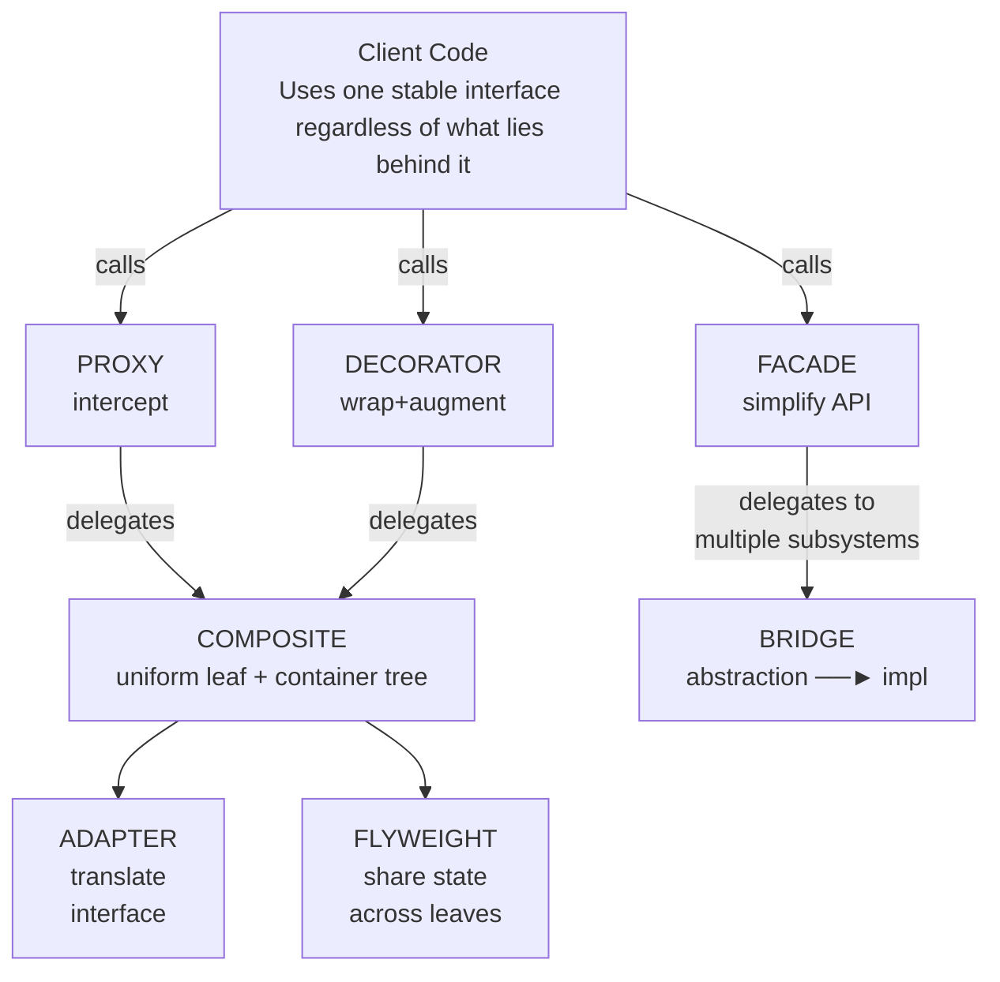

# Lesson 3: Structural Patterns

## 1. First-Principles Intuition & Invariants

Every non-trivial software system eventually confronts the same fundamental tension: the components you have are not shaped like the components you need. You inherit a library with an inconvenient interface. You discover that an abstraction you thought was atomic actually has two orthogonal dimensions of variation that have silently coupled together. You need a tree of objects to behave like a single object. You want to add capabilities to an instance without polluting an entire class hierarchy. These are not failures of design—they are the natural consequence of building software over time, across teams, against specifications that change. Structural patterns exist to resolve this tension without resorting to the blunt instruments of copy-paste inheritance or monolithic rewrites.

The seven structural patterns catalogued in the Gang of Four—Adapter, Bridge, Composite, Decorator, Facade, Flyweight, and Proxy—share a common philosophical core: they manage relationships between objects by controlling how objects are connected and how those connections are traversed, rather than by changing the objects' internal logic. Where creational patterns govern object construction and behavioral patterns govern communication protocols between objects, structural patterns govern the *topology* of an object graph. They are the load-bearing architecture of a system, the steel frame behind the drywall.

Understanding these patterns from first principles requires understanding why naive alternatives fail. The most common naive alternative is inheritance. Inheritance is a seductive tool because it feels like composition: a `LoggingList` extends `ArrayList`, and suddenly every method is "enhanced." But inheritance couples the subclass to the superclass's implementation in ways that are difficult to predict and painful to change. When `ArrayList` changes its internal storage strategy, `LoggingList` may silently break. When you need a `CachingLoggingList`, you are forced into a brittle diamond of multiple inheritance or a chain so deep it defeats comprehension. The structural patterns—especially Decorator and Bridge—exist precisely because inheritance conflates interface extension with implementation inheritance, and that conflation is the source of most large-scale structural debt.

The invariant that runs through all seven patterns is **interface stability with implementation freedom**. Each pattern creates at least one seam—a point in the object graph where the caller's view of a contract is decoupled from the callee's implementation of it. The seam is typically realized as a pointer to an interface or abstract type, and the pattern's value comes entirely from which seam is introduced and where. The Adapter introduces a seam between a client's expected interface and a third-party implementation. The Bridge introduces a seam between an abstraction and its platform-specific realization. The Proxy introduces a seam between a caller and the actual target, intercepting the call path. Getting these seams in the right places is the entire art.

A second invariant is **delegation over inheritance**. Every structural pattern replaces an `is-a` relationship with a `has-a` relationship at least once. A Decorator *has* a component rather than *being* one; a Proxy *has* a subject; a Flyweight *has* intrinsic state shared across instances rather than storing it redundantly per instance. Delegation gives you runtime flexibility that compile-time inheritance cannot: you can swap the delegate without recompiling the wrapper.

The third invariant concerns **transparency**. Many structural patterns—particularly Composite, Decorator, and Proxy—are most powerful when they are *transparent* to the caller. The caller interacts with the wrapper through the same interface it would use with the real object, and it cannot tell the difference. This transparency property is what allows these patterns to compose: a Proxy wrapping a Decorator wrapping a real component presents the same interface at every layer, and the caller remains unaware of the depth of the stack.

---

## 2. Core Architecture & Mechanics

### The Adapter: Impedance Matching at the Interface Boundary

The Adapter pattern is the most mechanically straightforward of the seven, and yet it appears more frequently in production systems than any other structural pattern, precisely because it is the pattern you reach for every time you integrate code you did not write. Its job is to translate between two incompatible interfaces without modifying either.

Consider a systems programming context: you have written a high-performance message router that expects all event sources to implement an `EventSource` interface exposing a `poll(timeout_ms: u64) -> Option<Event>` method. You need to integrate a third-party hardware driver library whose callback mechanism uses a registration model: `register_handler(fn(*const RawEvent) -> void)`. The two are fundamentally incompatible. The Adapter bridges this gap by wrapping the driver library behind your `EventSource` interface, internally buffering callbacks into a queue that `poll()` drains.

```rust
use std::collections::VecDeque;
use std::sync::{Arc, Mutex};
use std::time::{Duration, Instant};

// Your stable domain interface
pub trait EventSource {
    fn poll(&mut self, timeout_ms: u64) -> Option<Event>;
}

#[derive(Debug, Clone)]
pub struct Event {
    pub id: u32,
    pub payload: Vec<u8>,
}

// Third-party driver interface (you do not control this)
pub struct ThirdPartyDriver {
    handler: Option<Box<dyn Fn(*const RawDriverEvent) + Send>>,
}

#[repr(C)]
pub struct RawDriverEvent {
    pub event_id: u32,
    pub data: [u8; 64],
    pub data_len: usize,
}

impl ThirdPartyDriver {
    pub fn new() -> Self {
        ThirdPartyDriver { handler: None }
    }

    pub fn register_handler(&mut self, f: Box<dyn Fn(*const RawDriverEvent) + Send>) {
        self.handler = Some(f);
    }

    // Simulates hardware firing an event
    pub fn fire_event(&self, raw: &RawDriverEvent) {
        if let Some(ref h) = self.handler {
            h(raw as *const RawDriverEvent);
        }
    }
}

// The Adapter: wraps ThirdPartyDriver, exposes EventSource
pub struct DriverAdapter {
    driver: ThirdPartyDriver,
    buffer: Arc<Mutex<VecDeque<Event>>>,
}

impl DriverAdapter {
    pub fn new(mut driver: ThirdPartyDriver) -> Self {
        let buffer: Arc<Mutex<VecDeque<Event>>> = Arc::new(Mutex::new(VecDeque::new()));
        let buf_clone = Arc::clone(&buffer);

        driver.register_handler(Box::new(move |raw_ptr| {
            // Safety: pointer is valid for the duration of the callback frame
            let raw = unsafe { &*raw_ptr };
            let event = Event {
                id: raw.event_id,
                payload: raw.data[..raw.data_len].to_vec(),
            };
            buf_clone.lock().unwrap().push_back(event);
        }));

        DriverAdapter { driver, buffer }
    }
}

impl EventSource for DriverAdapter {
    fn poll(&mut self, timeout_ms: u64) -> Option<Event> {
        let deadline = Instant::now() + Duration::from_millis(timeout_ms);
        loop {
            {
                let mut buf = self.buffer.lock().unwrap();
                if let Some(event) = buf.pop_front() {
                    return Some(event);
                }
            }
            if Instant::now() >= deadline {
                return None;
            }
            std::thread::sleep(Duration::from_micros(100));
        }
    }
}
```

There are two classical variants of the Adapter. The *object adapter* (shown above) uses composition and delegation—the adapter holds a reference to the adaptee. The *class adapter* uses multiple inheritance (as in C++) to inherit from both the target interface and the adaptee. The object adapter is almost universally preferable because it permits the adaptee to be substituted at runtime and does not require compile-time knowledge of the adaptee's concrete type.

The key mechanical property is that the Adapter introduces exactly one translation point. If your system has multiple consumers needing the same adaptee, the Adapter should be instantiated once and shared, not duplicated across each consumer. When you find yourself duplicating adaptation logic, it is a signal that the adaptation belongs inside a single wrapper class, not scattered across call sites.

### The Bridge: Separating Abstraction from Realization

Where the Adapter reconciles an incompatibility that already exists, the Bridge is a *proactive* structural decision: you recognize early that an abstraction has two independent dimensions of variation, and you deliberately separate them before they become entangled.

The classic failure mode Bridge prevents is the *class explosion* problem. Suppose you are building a cross-platform rendering system with two window toolkits (X11 and Wayland on Linux, plus Win32 on Windows) and three shape types (Circle, Rectangle, Polygon). Without Bridge, you end up with a class for every combination: `X11Circle`, `WaylandCircle`, `Win32Circle`, `X11Rectangle`, and so on. With three shapes and four platforms, that is twelve classes. Add a fourth shape and you need four more. The growth is multiplicative because the two dimensions—shape and platform—are entangled in the same class hierarchy.

Bridge solves this by decomposing the hierarchy into two independent hierarchies connected by a pointer. The *abstraction* side (`Shape` and its subclasses) holds a pointer to the *implementor* side (`Renderer` and its subclasses). When a shape needs to draw, it delegates to its renderer. Adding a new shape requires one class. Adding a new platform requires one renderer implementation. Growth becomes additive.

```c
#include <stdio.h>
#include <stdlib.h>
#include <math.h>

/* ── Implementor side (platform renderers) ───────────────────────────── */

typedef struct Renderer Renderer;

typedef struct RendererVtbl {
    void (*draw_circle)(Renderer *self, float x, float y, float r);
    void (*draw_rect)(Renderer *self, float x, float y, float w, float h);
    void (*destroy)(Renderer *self);
} RendererVtbl;

struct Renderer {
    const RendererVtbl *vt;
};

/* X11 renderer */
typedef struct { Renderer base; int display_fd; } X11Renderer;

static void x11_draw_circle(Renderer *self, float x, float y, float r) {
    (void)self;
    printf("[X11] XFillArc(display, window, gc, %.1f, %.1f, r=%.1f)\n", x, y, r);
}
static void x11_draw_rect(Renderer *self, float x, float y, float w, float h) {
    (void)self;
    printf("[X11] XFillRectangle(display, %.1f, %.1f, %.1f x %.1f)\n", x, y, w, h);
}
static void x11_destroy(Renderer *self) { free(self); }

static const RendererVtbl X11_VTBL = { x11_draw_circle, x11_draw_rect, x11_destroy };

Renderer *new_x11_renderer(int fd) {
    X11Renderer *r = malloc(sizeof(X11Renderer));
    r->base.vt = &X11_VTBL;
    r->display_fd = fd;
    return (Renderer *)r;
}

/* Wayland renderer */
typedef struct { Renderer base; void *wl_surface; } WaylandRenderer;

static void wl_draw_circle(Renderer *self, float x, float y, float r) {
    (void)self;
    printf("[Wayland] wl_surface_damage(surface, %.1f, %.1f, r=%.1f)\n", x, y, r);
}
static void wl_draw_rect(Renderer *self, float x, float y, float w, float h) {
    (void)self;
    printf("[Wayland] wl_surface_damage(surface, %.1f, %.1f, %.1f x %.1f)\n", x, y, w, h);
}
static void wl_destroy(Renderer *self) { free(self); }

static const RendererVtbl WL_VTBL = { wl_draw_circle, wl_draw_rect, wl_destroy };

Renderer *new_wayland_renderer(void *surface) {
    WaylandRenderer *r = malloc(sizeof(WaylandRenderer));
    r->base.vt = &WL_VTBL;
    r->wl_surface = surface;
    return (Renderer *)r;
}

/* ── Abstraction side (shapes) ───────────────────────────────────────── */

typedef struct Shape Shape;

typedef struct ShapeVtbl {
    void (*draw)(Shape *self);
    void (*resize)(Shape *self, float factor);
    void (*destroy)(Shape *self);
} ShapeVtbl;

struct Shape {
    const ShapeVtbl *vt;
    Renderer *renderer;   /* THE BRIDGE: pointer to implementor */
};

/* Circle shape */
typedef struct { Shape base; float x, y, radius; } Circle;

static void circle_draw(Shape *self) {
    Circle *c = (Circle *)self;
    c->base.renderer->vt->draw_circle(c->base.renderer, c->x, c->y, c->radius);
}
static void circle_resize(Shape *self, float factor) {
    ((Circle *)self)->radius *= factor;
}
static void circle_destroy(Shape *self) { free(self); }
static const ShapeVtbl CIRCLE_VTBL = { circle_draw, circle_resize, circle_destroy };

Shape *new_circle(Renderer *r, float x, float y, float radius) {
    Circle *c = malloc(sizeof(Circle));
    c->base.vt = &CIRCLE_VTBL;
    c->base.renderer = r;
    c->x = x; c->y = y; c->radius = radius;
    return (Shape *)c;
}

/* Rectangle shape */
typedef struct { Shape base; float x, y, w, h; } Rect;

static void rect_draw(Shape *self) {
    Rect *rect = (Rect *)self;
    rect->base.renderer->vt->draw_rect(rect->base.renderer, rect->x, rect->y, rect->w, rect->h);
}
static void rect_resize(Shape *self, float factor) {
    Rect *rect = (Rect *)self; rect->w *= factor; rect->h *= factor;
}
static void rect_destroy(Shape *self) { free(self); }
static const ShapeVtbl RECT_VTBL = { rect_draw, rect_resize, rect_destroy };

Shape *new_rect(Renderer *r, float x, float y, float w, float h) {
    Rect *rect = malloc(sizeof(Rect));
    rect->base.vt = &RECT_VTBL;
    rect->base.renderer = r;
    rect->x = x; rect->y = y; rect->w = w; rect->h = h;
    return (Shape *)rect;
}

int main(void) {
    Renderer *x11 = new_x11_renderer(3);
    Renderer *wl  = new_wayland_renderer(NULL);

    Shape *shapes[] = {
        new_circle(x11, 10.0f, 20.0f, 5.0f),
        new_rect(wl,   30.0f, 40.0f, 100.0f, 50.0f),
        new_circle(wl, 55.0f, 60.0f, 15.0f),
    };

    for (int i = 0; i < 3; i++) {
        shapes[i]->vt->draw(shapes[i]);
        shapes[i]->vt->resize(shapes[i], 2.0f);
        shapes[i]->vt->draw(shapes[i]);
        shapes[i]->vt->destroy(shapes[i]);
    }

    x11->vt->destroy(x11);
    wl->vt->destroy(wl);
    return 0;
}
```

The Bridge's architectural signature is two parallel vtable chains connected by a pointer. Notice that neither side knows the concrete type of the other side—only the interface. This is the decoupling the pattern promises. You can swap the renderer at runtime by simply reassigning `self->renderer`, which is not possible in an inheritance-based design.

### The Composite: Uniform Trees

The Composite pattern addresses a specific and recurring structural problem: a system contains both atomic objects and collections of those objects, and operations need to apply uniformly to both without the caller knowing which kind it has. File systems are the textbook example, but the pattern appears wherever you have recursive aggregation: syntax trees in compilers, scene graphs in renderers, widget hierarchies in UI toolkits, bill-of-materials in manufacturing systems.

The pattern works by making both the leaf node and the container node implement the same interface. The container node holds a list of children that implement the same interface, and when an operation is called on the container, it delegates to its children in a recursive traversal.

```rust
use std::fmt;

pub trait AstNode: fmt::Debug {
    fn emit(&self, indent: usize) -> String;
    fn child_count(&self) -> usize;
    fn token_count(&self) -> usize;
}

// ── Leaf nodes ────────────────────────────────────────────────────────

#[derive(Debug)]
pub struct Identifier {
    pub name: String,
}

impl AstNode for Identifier {
    fn emit(&self, indent: usize) -> String {
        format!("{}{}", " ".repeat(indent), self.name)
    }
    fn child_count(&self) -> usize { 0 }
    fn token_count(&self) -> usize { 1 }
}

#[derive(Debug)]
pub struct IntLiteral {
    pub value: i64,
}

impl AstNode for IntLiteral {
    fn emit(&self, indent: usize) -> String {
        format!("{}{}", " ".repeat(indent), self.value)
    }
    fn child_count(&self) -> usize { 0 }
    fn token_count(&self) -> usize { 1 }
}

// ── Composite nodes ───────────────────────────────────────────────────

#[derive(Debug)]
pub struct BinaryExpr {
    pub op: String,
    pub left: Box<dyn AstNode>,
    pub right: Box<dyn AstNode>,
}

impl AstNode for BinaryExpr {
    fn emit(&self, indent: usize) -> String {
        let pad = " ".repeat(indent);
        format!(
            "{}({}\n{}\n{}{})",
            pad,
            self.op,
            self.left.emit(indent + 2),
            self.right.emit(indent + 2),
            pad
        )
    }
    fn child_count(&self) -> usize { 2 }
    fn token_count(&self) -> usize {
        1 + self.left.token_count() + self.right.token_count()
    }
}

#[derive(Debug)]
pub struct Block {
    pub statements: Vec<Box<dyn AstNode>>,
}

impl Block {
    pub fn new() -> Self { Block { statements: Vec::new() } }
    pub fn push(&mut self, node: Box<dyn AstNode>) { self.statements.push(node); }
}

impl AstNode for Block {
    fn emit(&self, indent: usize) -> String {
        let pad = " ".repeat(indent);
        let body = self.statements
            .iter()
            .map(|s| s.emit(indent + 2))
            .collect::<Vec<_>>()
            .join(";\n");
        format!("{}Block {{\n{};\n{}}}", pad, body, pad)
    }
    fn child_count(&self) -> usize { self.statements.len() }
    fn token_count(&self) -> usize {
        self.statements.iter().map(|s| s.token_count()).sum()
    }
}

fn main() {
    let mut block = Block::new();

    // x + 42
    block.push(Box::new(BinaryExpr {
        op: "+".to_string(),
        left:  Box::new(Identifier { name: "x".to_string() }),
        right: Box::new(IntLiteral { value: 42 }),
    }));

    // (a * b) + (c - 1)
    block.push(Box::new(BinaryExpr {
        op: "+".to_string(),
        left: Box::new(BinaryExpr {
            op: "*".to_string(),
            left:  Box::new(Identifier { name: "a".to_string() }),
            right: Box::new(Identifier { name: "b".to_string() }),
        }),
        right: Box::new(BinaryExpr {
            op: "-".to_string(),
            left:  Box::new(Identifier { name: "c".to_string() }),
            right: Box::new(IntLiteral { value: 1 }),
        }),
    }));

    println!("{}", block.emit(0));
    println!("Total tokens: {}", block.token_count());
}
```

The design decision that matters most in a Composite implementation is whether to place child-management methods (`add`, `remove`, `get_child`) on the component interface or only on the composite class. Putting them on the interface achieves maximum uniformity but forces leaves to implement no-op stubs or panic handlers. Keeping them on the composite class preserves type safety but forces callers to downcast when they need to build the tree. For compiler ASTs, the safer choice is to keep the interface narrow—only operations that make semantic sense for all nodes—and use a typed builder to construct the tree.

### The Decorator: Dynamic Capability Stacking

The Decorator is one of the most intellectually satisfying patterns in the catalog because it solves a real problem—adding behavior to individual objects without subclassing—with a mechanism that is both elegant and genuinely composable. The core idea is to wrap an object in another object that implements the same interface, adding behavior before or after delegation.

The pattern's power comes from its composability. If `LoggingReader`, `CompressionReader`, and `EncryptionReader` all implement `Reader` and all accept a `Reader` in their constructor, you can compose them in any order: `EncryptionReader(CompressionReader(LoggingReader(raw_file)))`. Each decorator in the chain has no knowledge of the others. This is the property that inheritance cannot replicate, because inheritance bakes the composition order into the class definition at compile time.

```rust
use std::io::{self, Read, BufReader};
use std::time::Instant;

// ── Core trait ────────────────────────────────────────────────────────

pub trait DataReader {
    fn read_chunk(&mut self, buf: &mut [u8]) -> io::Result<usize>;
    fn source_name(&self) -> &str;
}

// ── Concrete component ────────────────────────────────────────────────

pub struct FileReader {
    inner: BufReader<std::fs::File>,
    name: String,
}

impl FileReader {
    pub fn open(path: &str) -> io::Result<Self> {
        let f = std::fs::File::open(path)?;
        Ok(FileReader {
            inner: BufReader::new(f),
            name: path.to_string(),
        })
    }
}

impl DataReader for FileReader {
    fn read_chunk(&mut self, buf: &mut [u8]) -> io::Result<usize> {
        self.inner.read(buf)
    }
    fn source_name(&self) -> &str { &self.name }
}

// ── Decorator: metrics instrumentation ───────────────────────────────

pub struct MetricsReader<R: DataReader> {
    inner: R,
    total_bytes: usize,
    total_calls: u64,
    total_ns: u128,
}

impl<R: DataReader> MetricsReader<R> {
    pub fn new(inner: R) -> Self {
        MetricsReader { inner, total_bytes: 0, total_calls: 0, total_ns: 0 }
    }

    pub fn report(&self) {
        println!(
            "[MetricsReader] source='{}' calls={} bytes={} total_time={}µs avg_latency={:.1}µs",
            self.inner.source_name(),
            self.total_calls,
            self.total_bytes,
            self.total_ns / 1_000,
            if self.total_calls > 0 {
                (self.total_ns as f64 / self.total_calls as f64) / 1_000.0
            } else { 0.0 }
        );
    }
}

impl<R: DataReader> DataReader for MetricsReader<R> {
    fn read_chunk(&mut self, buf: &mut [u8]) -> io::Result<usize> {
        let t0 = Instant::now();
        let n = self.inner.read_chunk(buf)?;
        self.total_ns += t0.elapsed().as_nanos();
        self.total_bytes += n;
        self.total_calls += 1;
        Ok(n)
    }
    fn source_name(&self) -> &str { self.inner.source_name() }
}

// ── Decorator: checksumming ───────────────────────────────────────────

pub struct ChecksumReader<R: DataReader> {
    inner: R,
    checksum: u32,
}

impl<R: DataReader> ChecksumReader<R> {
    pub fn new(inner: R) -> Self {
        ChecksumReader { inner, checksum: 0 }
    }

    pub fn finalize(&self) -> u32 { self.checksum }
}

impl<R: DataReader> DataReader for ChecksumReader<R> {
    fn read_chunk(&mut self, buf: &mut [u8]) -> io::Result<usize> {
        let n = self.inner.read_chunk(buf)?;
        // Adler-32 running accumulation over bytes read
        for &byte in &buf[..n] {
            self.checksum = self.checksum.wrapping_add(byte as u32);
            self.checksum ^= self.checksum >> 16;
        }
        Ok(n)
    }
    fn source_name(&self) -> &str { self.inner.source_name() }
}

fn process(reader: &mut dyn DataReader) -> io::Result<usize> {
    let mut total = 0;
    let mut buf = vec![0u8; 4096];
    loop {
        let n = reader.read_chunk(&mut buf)?;
        if n == 0 { break; }
        total += n;
    }
    Ok(total)
}

fn main() -> io::Result<()> {
    // Compose: ChecksumReader wraps MetricsReader wraps FileReader
    // The order is deliberate: checksums are taken after metrics timing,
    // so checksum overhead appears inside the metrics window.
    let file   = FileReader::open("/etc/hostname")?;
    let metered = MetricsReader::new(file);
    let mut checked = ChecksumReader::new(metered);

    let total = process(&mut checked)?;

    println!("Total bytes read: {}", total);
    println!("Final checksum: 0x{:08X}", checked.finalize());
    checked.inner.report();
    Ok(())
}
```

One important subtlety in Rust's implementation of Decorator is the tension between static dispatch (generics, as above) and dynamic dispatch (`Box<dyn DataReader>`). The generic version gives zero-cost abstraction—the full decorator chain is monomorphized at compile time, and the compiler can inline across decorator boundaries. The `Box<dyn>` version allows the chain to be built from runtime configuration but pays a vtable indirection per call. For hot I/O paths, the static form is strictly preferable when the chain composition is known at compile time. For plugin architectures or configuration-driven pipelines, the dynamic form is unavoidable.

### The Facade: Cognitive Load Reduction

The Facade pattern occupies a different position from the others because its value is fundamentally social and organizational rather than technical. A Facade does not add functionality and does not enable anything that was impossible before. What it provides is a simplified, opinionated interface over a subsystem that has grown too complex to use directly.

Consider a compiler backend that exposes register allocation, instruction selection, peephole optimization, and code emission as separate subsystems with twenty configuration options each. Any team using this backend must understand the sequencing constraints, the data flow between phases, and the valid configuration combinations. A `CompileToObjectFile(ir_module, target, options)` facade encapsulates all of that sequencing and exposes one function. The subsystems remain accessible for expert use, but the common case requires no subsystem knowledge.

```rust
// Low-level subsystems (simplified)
mod codegen {
    pub struct IrModule { pub name: String, pub functions: Vec<String> }
    pub struct TargetTriple { pub arch: String, pub os: String }
    pub struct ObjectFile { pub bytes: Vec<u8>, pub path: String }
    pub struct RegAllocPass;
    pub struct InstrSelector;
    pub struct PeepholeOptimizer;
    pub struct Emitter;

    impl RegAllocPass {
        pub fn run(&self, m: &IrModule) -> Vec<u8> {
            println!("[RegAlloc] Allocating registers for '{}'", m.name);
            vec![0xDE, 0xAD]
        }
    }
    impl InstrSelector {
        pub fn run(&self, t: &TargetTriple, allocated: &[u8]) -> Vec<u8> {
            println!("[InstrSel] Selecting instructions for {}-{}", t.arch, t.os);
            allocated.to_vec()
        }
    }
    impl PeepholeOptimizer {
        pub fn run(&self, selected: &[u8]) -> Vec<u8> {
            println!("[Peephole] Optimizing {} instruction bytes", selected.len());
            selected.to_vec()
        }
    }
    impl Emitter {
        pub fn emit(&self, t: &TargetTriple, optimized: &[u8], out_path: &str) -> ObjectFile {
            println!("[Emitter] Writing {}-{} object to '{}'", t.arch, t.os, out_path);
            ObjectFile { bytes: optimized.to_vec(), path: out_path.to_string() }
        }
    }
}

// ── Facade ────────────────────────────────────────────────────────────

pub struct CompilerOptions {
    pub optimize: bool,
    pub output_path: String,
}

impl Default for CompilerOptions {
    fn default() -> Self {
        CompilerOptions { optimize: true, output_path: "output.o".to_string() }
    }
}

pub struct CompilerFacade {
    reg_alloc: codegen::RegAllocPass,
    instr_sel: codegen::InstrSelector,
    peephole:  codegen::PeepholeOptimizer,
    emitter:   codegen::Emitter,
}

impl CompilerFacade {
    pub fn new() -> Self {
        CompilerFacade {
            reg_alloc: codegen::RegAllocPass,
            instr_sel: codegen::InstrSelector,
            peephole:  codegen::PeepholeOptimizer,
            emitter:   codegen::Emitter,
        }
    }

    pub fn compile(
        &self,
        module: &codegen::IrModule,
        target: &codegen::TargetTriple,
        opts: &CompilerOptions,
    ) -> codegen::ObjectFile {
        let allocated  = self.reg_alloc.run(module);
        let selected   = self.instr_sel.run(target, &allocated);
        let final_code = if opts.optimize {
            self.peephole.run(&selected)
        } else {
            selected
        };
        self.emitter.emit(target, &final_code, &opts.output_path)
    }
}

fn main() {
    let module = codegen::IrModule {
        name: "main".to_string(),
        functions: vec!["main".to_string(), "add".to_string()],
    };
    let target = codegen::TargetTriple {
        arch: "x86_64".to_string(),
        os: "linux".to_string(),
    };

    let facade = CompilerFacade::new();
    let obj = facade.compile(&module, &target, &CompilerOptions::default());
    println!("Produced {} bytes at '{}'", obj.bytes.len(), obj.path);
}
```

The Facade is architecturally significant at module and crate boundaries. When you expose a library crate, the public API surface is your facade. Everything that does not need to be public should be `pub(crate)` or private. The discipline of facade thinking applied to API design is the reason well-designed libraries feel simple to use even when their internals are complex. The standard library's `std::fs::read_to_string` is a perfect real-world facade: it hides file opening, buffering, encoding handling, and resource cleanup behind a single function call.

### The Flyweight: Sharing Intrinsic State

The Flyweight pattern is a memory optimization that is relevant whenever a system instantiates very large numbers of objects that share significant state. The pattern works by identifying the *intrinsic* state of an object—the state that is the same across many instances and can be shared—and separating it from the *extrinsic* state, which is unique per instance and passed in at the point of use.

The canonical systems programming example is a text rendering engine. If you are rendering a document with ten thousand characters, allocating a full object per character—including font metrics, glyph bitmap cache, Unicode properties, and kerning tables—is prohibitively expensive. But all characters with the same code point, font, and size share the same glyph metrics. The Flyweight stores those shared properties once and passes per-character position information as extrinsic state.

```rust
use std::collections::HashMap;

// Intrinsic (shared) state: expensive to compute, same for all instances of a glyph
#[derive(Debug)]
pub struct GlyphData {
    pub code_point: char,
    pub advance_width: f32,  // in font units
    pub ascent: f32,
    pub descent: f32,
    pub bitmap: Vec<u8>,     // rasterized glyph (expensive allocation)
}

// Flyweight factory: ensures at most one GlyphData per code point
pub struct GlyphCache {
    cache: HashMap<char, std::rc::Rc<GlyphData>>,
}

impl GlyphCache {
    pub fn new() -> Self { GlyphCache { cache: HashMap::new() } }

    pub fn get(&mut self, ch: char) -> std::rc::Rc<GlyphData> {
        self.cache.entry(ch).or_insert_with(|| {
            println!("[GlyphCache] Rasterizing U+{:04X} '{}'", ch as u32, ch);
            std::rc::Rc::new(GlyphData {
                code_point: ch,
                advance_width: 10.5,  // placeholder; real impl queries freetype
                ascent: 14.0,
                descent: -3.0,
                bitmap: vec![0u8; 16 * 16],  // 16x16 glyph bitmap
            })
        }).clone()
    }

    pub fn resident_count(&self) -> usize { self.cache.len() }
    pub fn memory_bytes(&self) -> usize {
        self.cache.values().map(|g| std::mem::size_of::<GlyphData>() + g.bitmap.len()).sum()
    }
}

// Extrinsic state: unique per character placement on the page
pub struct CharInstance {
    pub glyph: std::rc::Rc<GlyphData>,
    pub x: f32,
    pub y: f32,
    pub color: u32,  // ARGB
}

impl CharInstance {
    pub fn render(&self) {
        // In a real renderer, blit self.glyph.bitmap at (self.x, self.y)
        let _ = (&self.glyph.bitmap, self.x, self.y, self.color);
    }
}

fn main() {
    let text = "hello, world! hello again.";
    let mut cache = GlyphCache::new();
    let mut instances: Vec<CharInstance> = Vec::with_capacity(text.len());

    let mut x_cursor = 0.0f32;
    for ch in text.chars() {
        let glyph = cache.get(ch);
        let advance = glyph.advance_width;
        instances.push(CharInstance { glyph, x: x_cursor, y: 0.0, color: 0xFF000000 });
        x_cursor += advance;
    }

    for inst in &instances { inst.render(); }

    println!(
        "\n{} characters rendered using {} unique glyphs ({} bytes in glyph cache)",
        instances.len(),
        cache.resident_count(),
        cache.memory_bytes()
    );
}
```

The memory arithmetic is the entire argument for the Flyweight. For twenty-six distinct lowercase letters rendered ten thousand times each, a naive approach allocates 260,000 `GlyphData` objects. With Flyweight, only 26 `GlyphData` objects exist, and 259,974 `CharInstance` objects hold only a pointer plus position data. If `GlyphData` is 512 bytes, the naive approach costs 133 MB; the Flyweight approach costs 13 KB for glyphs plus the extrinsic state per instance. The tradeoff is conceptual complexity and the requirement that you correctly identify the intrinsic/extrinsic boundary—if you accidentally include mutable per-instance state in the shared flyweight, you introduce a data race or a correctness bug.

### The Proxy: Controlled Access at the Call Site

The Proxy interposes a surrogate object between caller and subject, sharing the subject's interface while adding a cross-cutting concern at the call level: access control, lazy initialization, remote transparency, caching, or reference counting. Because the proxy presents the same interface as the subject, the caller requires no modification.

The four classical proxy variants each solve a distinct problem. A *virtual proxy* defers the construction of an expensive object until it is first used. A *protection proxy* enforces authorization before forwarding calls. A *remote proxy* marshals arguments across a process or network boundary, making a remote service appear local. A *caching proxy* stores return values and returns cached results for repeated identical calls, amortizing the cost of expensive computations or I/O.

```rust
use std::collections::HashMap;
use std::time::{Duration, Instant};

pub trait DatabaseQuery: Send + Sync {
    fn execute(&self, sql: &str) -> Vec<String>;
}

// Real subject: expensive, slow database
pub struct PostgresClient {
    connection_string: String,
}

impl PostgresClient {
    pub fn new(cs: &str) -> Self {
        println!("[Postgres] Connecting to '{}'", cs);
        PostgresClient { connection_string: cs.to_string() }
    }
}

impl DatabaseQuery for PostgresClient {
    fn execute(&self, sql: &str) -> Vec<String> {
        println!("[Postgres] Executing: '{}'", sql);
        // Simulate network latency
        std::thread::sleep(Duration::from_millis(50));
        vec![format!("row_1_for_{}", sql), format!("row_2_for_{}", sql)]
    }
}

// ── Caching Proxy ─────────────────────────────────────────────────────

struct CacheEntry {
    result: Vec<String>,
    cached_at: Instant,
}

pub struct CachingQueryProxy {
    real: Box<dyn DatabaseQuery>,
    cache: HashMap<String, CacheEntry>,
    ttl: Duration,
    hits: u64,
    misses: u64,
}

impl CachingQueryProxy {
    pub fn new(real: Box<dyn DatabaseQuery>, ttl: Duration) -> Self {
        CachingQueryProxy {
            real,
            cache: HashMap::new(),
            ttl,
            hits: 0,
            misses: 0,
        }
    }

    pub fn stats(&self) {
        let total = self.hits + self.misses;
        let ratio = if total > 0 { self.hits as f64 / total as f64 * 100.0 } else { 0.0 };
        println!("[CachingProxy] hits={} misses={} hit_rate={:.1}%", self.hits, self.misses, ratio);
    }
}

impl DatabaseQuery for CachingQueryProxy {
    fn execute(&self, sql: &str) -> Vec<String> {
        // Safety: interior mutability via raw pointer cast (acceptable in single-threaded demo;
        // production code would use a Mutex or DashMap)
        let this = unsafe { &mut *(self as *const Self as *mut Self) };

        if let Some(entry) = this.cache.get(sql) {
            if entry.cached_at.elapsed() < this.ttl {
                this.hits += 1;
                println!("[CachingProxy] Cache HIT for '{}'", sql);
                return entry.result.clone();
            }
        }

        this.misses += 1;
        println!("[CachingProxy] Cache MISS for '{}'", sql);
        let result = this.real.execute(sql);
        this.cache.insert(sql.to_string(), CacheEntry {
            result: result.clone(),
            cached_at: Instant::now(),
        });
        result
    }
}

fn run_queries(db: &dyn DatabaseQuery) {
    let queries = [
        "SELECT * FROM users WHERE id = 1",
        "SELECT * FROM users WHERE id = 2",
        "SELECT * FROM users WHERE id = 1",  // should hit cache
        "SELECT * FROM users WHERE id = 1",  // should hit cache
        "SELECT * FROM products LIMIT 10",
        "SELECT * FROM products LIMIT 10",   // should hit cache
    ];
    for q in &queries {
        let rows = db.execute(q);
        println!("  -> {} rows", rows.len());
    }
}

fn main() {
    let postgres = PostgresClient::new("postgres://localhost:5432/prod");
    let proxy = CachingQueryProxy::new(Box::new(postgres), Duration::from_secs(30));
    run_queries(&proxy);
    proxy.stats();
}
```

The virtual proxy variant deserves particular attention in systems programming because it is the mechanism behind lazy initialization patterns used throughout high-performance libraries. When a resource is expensive to acquire—a large memory-mapped file, a GPU texture, a TLS connection—a virtual proxy holds the construction parameters and allocates the resource only on first access. This converts an eager upfront cost into a demand-driven cost, which is especially valuable in servers that initialize many potential connections at startup but serve only a subset of them under any given load pattern.

---

Here is the structural relationship between all seven patterns in the context of a layered system:



The diagram illustrates a layered reading of the patterns: Proxy, Decorator, and Facade operate at the boundary between the client and the system; Composite operates within the system to build recursive structures; Bridge decouples the abstraction from its platform realization; and Adapter and Flyweight operate at the leaves, handling impedance mismatches and memory efficiency respectively.

---

## 3. High-Performance Optimization & Failure Modes

### Virtual Dispatch Overhead and Static Monomorphization

Every pattern in this lesson relies on indirection—either a vtable pointer for dynamic dispatch or a function pointer for C-style polymorphism. For cold paths and I/O-bound code, this cost is irrelevant. For hot loops—tight rendering loops, packet processing paths, protocol parsers—the cost of an indirect call through a vtable can exceed the cost of the work being dispatched.

The first line of attack is Rust's generic monomorphization. When a Decorator is parameterized as `MetricsReader<ChecksumReader<FileReader>>`, the compiler generates a single concrete type with fully inlined call chains. The resulting machine code has no vtable, no indirect branches, and is fully open to inlining. The tradeoff is binary size: each unique instantiation generates separate code. For a program with five decorator combinations, monomorphization generates five copies of each decorator method body. In practice, the binary size cost is usually acceptable and the performance gain significant.

When you must use dynamic dispatch—because the composition is determined at runtime—the critical optimization is to minimize vtable dereferences on the critical path. One technique is *devirtualization*: if a profiler shows that a given virtual call site is always dispatching to the same concrete type at runtime (a monomorphic call site), you can restructure the code to pass the concrete type directly on the hot path and fall back to the virtual path only for the minority of cases that use a different type. LLVM's Profile-Guided Optimization (PGO) performs this transformation automatically when you compile with profiling data.

For the Composite pattern on large ASTs, recursive tree traversal can generate deep call stacks. A hundred-thousand-node AST with a fully recursive `emit()` traversal can overflow the default 8 MB stack on deeply nested expressions. The mitigation is to convert the recursive traversal to an explicit stack using a `Vec` as a work queue, which moves the traversal state from the call stack to the heap and eliminates the overflow risk entirely.

```rust
pub fn emit_iterative(root: &dyn AstNode) -> String {
    let mut result = String::new();
    let mut stack: Vec<(&dyn AstNode, usize)> = vec![(root, 0)];
    while let Some((node, indent)) = stack.pop() {
        // For a real implementation you would push children in reverse order
        // to maintain left-to-right emission order.
        result.push_str(&node.emit(indent));
        result.push('\n');
    }
    result
}
```

### Cache Locality and Object Layout

The Flyweight pattern is typically applied to reduce heap allocation count, but it also has secondary cache effects. When intrinsic state is shared via `Rc<GlyphData>`, accessing the shared data through the reference indirection can cause a cache miss if the flyweight object has been evicted from L1/L2 since the last access. This is the hidden cost of sharing via pointer indirection: you trade memory consumption for potential cache pressure.

For read-heavy flyweight usage where the flyweight object is small (less than a cache line, typically 64 bytes), consider embedding the intrinsic data directly in each instance rather than using a pointer. The break-even depends on your access pattern: if each unique flyweight is accessed many times in rapid succession, the shared pointer approach keeps data warm in cache through sharing. If accesses interleave randomly across many unique flyweights, embedding the data avoids the pointer chase and may be faster despite higher memory consumption. This decision is empirical—benchmark with `perf stat` before committing.

### Proxy Memory Leaks and Cycle Detection

The caching proxy's `HashMap<String, CacheEntry>` is an unbounded cache. In a long-running server process, this will grow without bound if the query space is large or adversarially supplied. The mitigation is a bounded LRU cache with a configurable capacity, using a structure like `linked-hash-map` in Rust or `java.util.LinkedHashMap` with `removeEldestEntry` in Java. Without this bound, the proxy becomes a memory leak vector.

A subtler failure mode in Proxy and Decorator implementations involves reference cycles. If a proxy holds a strong reference to its subject and the subject holds a reference back to the proxy (which can happen when callbacks or event subscriptions are involved), neither object will be freed even after all external references drop. In Rust, the solution is to hold the back-reference as a `Weak<T>` rather than an `Rc<T>`. In C++, `std::weak_ptr` serves the same purpose. In garbage-collected languages, this is less immediately dangerous but still causes GC-visible memory pressure.

### Adapter Overhead at High Frequency

The DriverAdapter shown earlier buffers callbacks into a `VecDeque` protected by a `Mutex`. Under high interrupt rates—a hardware event source firing at ten thousand events per second—the mutex becomes a bottleneck. Every callback acquisition contends with every `poll()` call. The correct fix for this case is a lock-free MPSC (multi-producer, single-consumer) queue such as the `crossbeam-channel` unbounded channel or a custom ring buffer. The lock-free variant eliminates contention entirely at the cost of slightly more complex memory ordering semantics.

### Bridge Anti-Pattern: Accidental Reintroduction of Coupling

The most common failure mode of the Bridge pattern is accidental coupling re-introduction: a developer adds a method to the `Shape` abstraction that calls a method that only exists on `X11Renderer`, requiring a downcast. As soon as one side of the bridge knows about a concrete type on the other side, the decoupling guarantee evaporates. The discipline required is strict: methods on the `Shape` side must only call methods declared on the `Renderer` interface, and the `Renderer` interface must express operations in domain terms (draw circle, draw rectangle) rather than platform terms (XFillArc, wl_surface_damage). If you find yourself needing to access platform-specific capabilities, the correct response is to extend the `Renderer` interface, not to downcast.

### Facade as a Maintenance Anti-Pattern

A Facade that grows too large and absorbs too much logic crosses the line from convenience wrapper to God Object. When a facade begins to implement business logic rather than simply orchestrating subsystems, it becomes a maintenance liability. The rule of thumb is that a facade method should read like a recipe: call this, then call that, with these arguments. If a facade method contains significant conditional logic or data transformation, that logic belongs in the subsystems themselves or in a dedicated policy object, and the facade should delegate to it.

The diagnostic symptom of an overgrown facade is test complexity: if testing the facade requires mocking more than three or four subsystems, the facade is doing too much. A well-designed facade can be tested end-to-end against its subsystems with no mocks needed, because the facade itself contains no logic to test—only ordering and routing.

### Decorator Ordering Bugs

Because decorators compose freely, the order in which you stack them has semantic consequences that are not enforced by the type system. `EncryptionReader(CompressionReader(raw))` and `CompressionReader(EncryptionReader(raw))` are both type-correct, but only one makes cryptographic sense: you must compress before encrypting, because encrypting first produces high-entropy output that compression cannot reduce. Neither the compiler nor the runtime will catch the reversed order.

The mitigation is a *builder with ordering constraints*. A `ReaderPipelineBuilder` can enforce through its API that certain decorators must precede others:

```rust
pub struct ReaderPipelineBuilder {
    encrypted: bool,
    compressed: bool,
    metered: bool,
}

impl ReaderPipelineBuilder {
    pub fn new() -> Self {
        ReaderPipelineBuilder { encrypted: false, compressed: false, metered: false }
    }
    pub fn with_metrics(mut self) -> Self { self.metered = true; self }
    pub fn with_compression(mut self) -> Self { self.compressed = true; self }
    pub fn with_encryption(mut self) -> Self { self.encrypted = true; self }

    pub fn build(self, source: FileReader) -> Box<dyn DataReader> {
        // Enforce correct ordering: metrics -> compression -> encryption
        // regardless of the order the caller called the builder methods.
        let mut reader: Box<dyn DataReader> = Box::new(source);
        if self.metered {
            reader = Box::new(MetricsReader::new(reader));
        }
        if self.compressed {
            // placeholder: reader = Box::new(CompressionReader::new(reader));
        }
        if self.encrypted {
            // placeholder: reader = Box::new(EncryptionReader::new(reader));
        }
        reader
    }
}
```

The builder centralizes the composition logic, encodes the correct ordering as a policy, and prevents callers from accidentally constructing semantically invalid pipelines. This is the mature production form of Decorator usage: free composition for library internals, builder-constrained composition at API boundaries.

---

The seven structural patterns form a complete vocabulary for managing the topology of object relationships in a production system. They do not compete with one another; they address different axes of structural complexity and are most powerful when applied in concert. The codebase that uses Bridge to decouple platform from abstraction, Decorator to add capabilities without subclassing, and Proxy to control access at subsystem boundaries is a codebase that can be changed one dimension at a time, tested one seam at a time, and reasoned about by engineers who did not write it. That is the ultimate measure of a structural pattern's value: not elegance in isolation, but the degree to which it makes the system easier to change correctly under conditions the original author did not anticipate.
