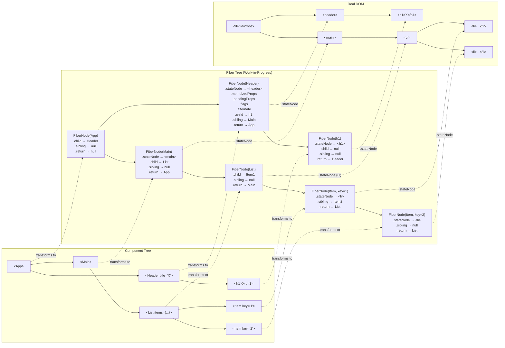
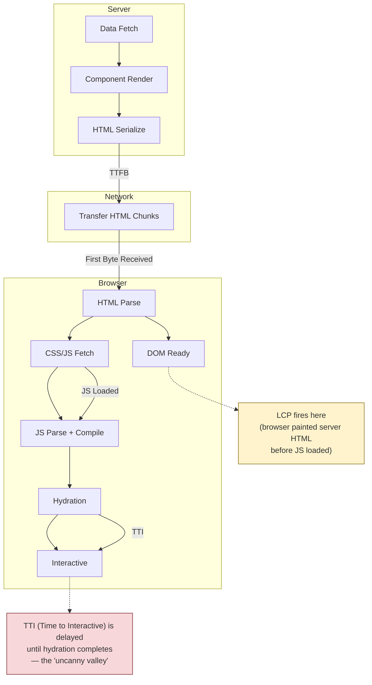

# Lesson 2: Client-Side Rendering, Server-Side Rendering, Static Generation, Hydration Mechanics

## 1. First-Principles Intuition & Invariants

Every web application is ultimately a negotiation between two resources: network bandwidth and CPU cycles. Where you spend those resources — on the server, on the client, or split across both — determines the user's first perceived interaction, the search engine's ability to index your content, the operational cost of your infrastructure, and the developer's ability to reason about data flow. The four rendering strategies explored in this lesson are not competing philosophies but rather points on a continuous design space, each optimal for a specific intersection of latency requirements, data freshness, and computational constraints.

To build genuine intuition here, you must start with what a browser actually receives and what it must do with that data. When a TCP connection completes and the first HTTP response bytes arrive, the browser begins parsing HTML. The HTML parser is a streaming state machine defined by the WHATWG HTML specification, and it constructs the Document Object Model incrementally as bytes arrive. The DOM is not a visual artifact — it is a tree of `Node` objects resident in the browser's C++ heap, each carrying properties, attributes, event listener registrations, and parent-child pointers. A `div` element in your React component tree maps to a C++ `HTMLDivElement` instance inside Blink or Gecko, and every mutation you make through JavaScript crosses the JavaScript-engine-to-DOM bridge, which carries non-trivial serialization and garbage-collection overhead.

The fundamental tension is this: constructing DOM nodes is expensive, JavaScript parsing and execution is expensive, and network round-trips to a server carry latency measured in tens to hundreds of milliseconds. Each rendering strategy makes a different bet about which of these costs is most tolerable for a given workload.

**Client-Side Rendering (CSR)** bets that the network is fast enough to deliver a small HTML shell and a large JavaScript bundle quickly, and that the client CPU can construct the entire DOM from JavaScript execution without the user noticing the gap. The server's only responsibility is to deliver static assets from a CDN edge node. This model dominated from roughly 2013 to 2019, driven by the success of AngularJS, React, and Vue as single-page application (SPA) frameworks. Its invariant is that the server transmits minimal HTML — typically an empty `<div id="root"></div>` — and the entire document structure is computed at runtime by JavaScript. The first contentful paint is therefore gated on the JavaScript bundle's download, parse, compile, and execution phases, all of which occur sequentially.

**Server-Side Rendering (SSR)** inverts this bet. The server executes the same component tree logic that CSR would run in the browser, but it does so on Node.js (or Deno, or a Rust-based runtime) before the response is sent. The client receives fully-formed HTML, so the browser's HTML parser can construct the DOM immediately and display content without waiting for any JavaScript. The invariant here is that time-to-first-byte (TTFB) increases relative to CSR because the server must await data fetches and component rendering before it can close the response, but time-to-first-contentful-paint (FCP) and Largest Contentful Paint (LCP) typically improve dramatically because HTML parsing is orders of magnitude faster than JavaScript execution.

**Static Generation (SSG)** pushes the computation even further left in time — to the build phase. Rather than rendering on the server at request time, a build tool like Next.js, Gatsby, or Astro executes the component tree during CI/CD, persisting the resulting HTML to disk. At runtime, the server is nothing more than a file server or CDN edge cache returning pre-computed HTML. The invariant is zero per-request server CPU cost, predictable infinite scalability, and the fastest possible TTFB from a CDN cache hit. The price is data staleness: content is frozen at build time and can only be updated by triggering a new build.

**Hydration** is the mechanism by which SSR and SSG close the interactivity gap. After the browser has received and parsed the server-rendered HTML, it has a complete, visible DOM, but that DOM has no event listeners, no React fiber tree, no Vue reactive proxies attached to it. Hydration is the process of attaching the JavaScript application's mental model — its virtual DOM, its component instances, its reactive bindings — to the existing DOM nodes without destroying and recreating them. This requires a precise structural match between what the server rendered and what the client-side JavaScript would have rendered independently. Any mismatch is a hydration error, and the consequences range from silently incorrect UI to full DOM replacement that eliminates any performance advantage of SSR.

Understanding hydration mechanics requires understanding what a virtual DOM actually is. The virtual DOM is not magic; it is an in-memory JavaScript object tree that mirrors the shape of the real DOM. React calls these objects `ReactElement` instances — plain JavaScript objects with a `type` field (string for HTML elements, function/class for components), a `props` field containing children and attributes, and an internal `key` for reconciliation hinting. The fiber architecture introduced in React 16 replaces the original recursive reconciler with a linked-list of `FiberNode` objects that can be interrupted and resumed, enabling React's concurrent rendering features. Each `FiberNode` holds a reference to the corresponding real DOM node (`stateNode`), its current props and pending props, its effect flags, and its position in the work-in-progress tree. During hydration, React walks the server-rendered DOM and the fiber tree simultaneously, associating each DOM node with its corresponding fiber rather than creating new DOM nodes from scratch.

Vue 3's reactivity system takes a fundamentally different architectural approach. Rather than diffing a virtual DOM tree on every state change and batching DOM mutations, Vue wraps component state in `Proxy` objects at initialization time. When a component's template renders, Vue's reactive runtime tracks which reactive properties were accessed during that render by recording them in an active effect scope — this is the dependency tracking phase. When a reactive property is later mutated, the proxy's `set` trap fires, which notifies all recorded dependent effects, scheduling a re-render of only the components that actually depend on the changed data. This fine-grained reactivity means Vue can skip reconciling components whose dependencies have not changed, whereas React's default behavior re-renders all children of a component that re-renders unless explicitly memoized with `React.memo` or `useMemo`.

Both models converge on the same invariant when hydrating server-rendered HTML: they must reconstruct their internal bookkeeping — fiber trees or reactive dependency graphs — in the browser without touching the DOM nodes the server already delivered. The cost of this bookkeeping construction is the **hydration overhead**, and it is a fixed cost paid on every page load regardless of what SSR gained you in FCP.

---

## 2. Core Architecture & Mechanics

### The DOM as a Mutable C++ Object Graph

Before examining framework-level mechanics, the physical reality of DOM mutation deserves careful attention, because every rendering strategy ultimately serializes to DOM writes, and every virtual DOM, reactive proxy, or compiled template is an optimization strategy for minimizing those writes.

The DOM lives in the browser's renderer process, in C++ heap memory managed by the browser engine. JavaScript runs in a separate V8 (or SpiderMonkey, or JavaScriptCore) isolate. Accessing `document.getElementById('foo').textContent = 'bar'` crosses this process boundary through Blink's binding layer — a generated C++ shim that converts V8 values to C++ types and vice versa. Layout and paint are triggered lazily: the browser batches DOM mutations within a task and computes layout in the next frame if any geometry-affecting properties changed. Triggering a layout read (querying `offsetWidth`, `getBoundingClientRect`) immediately after a write forces a synchronous layout computation — this is the "layout thrashing" problem, and it is the primary reason frameworks batch DOM writes through a scheduler rather than applying them synchronously.

React's scheduler (`packages/scheduler` in the monorepo) models work as units of varying priority mapped to `MessageChannel` callbacks, allowing the browser to process input events and paint frames between units of React reconciliation work. Vue 3's scheduler similarly defers watcher effects to a microtask queue flushed after the current synchronous execution completes, using `Promise.then` or `queueMicrotask`. Both avoid blocking the main thread's event loop during reconciliation, though the actual DOM write phase is always synchronous because partial DOM mutations would leave the UI in an inconsistent visible state.

### Virtual DOM Reconciliation: The Diffing Algorithm

React's reconciler implements a heuristic O(n) tree diffing algorithm rather than the theoretical O(n³) optimal tree edit distance algorithm, which is computationally prohibitive for trees of practical size. The heuristics are: elements of different types produce entirely different trees (no subtree reuse across type boundaries), and the `key` prop on list items provides stable identity hints to the reconciler across re-renders.

The reconciliation pass during a re-render compares the "current" fiber tree (representing the last committed state) against a "work-in-progress" fiber tree (representing the pending state). React performs this comparison incrementally, fiber node by fiber node, in a depth-first traversal. For each fiber, it computes whether the node requires creation, update, or deletion, recording its decision as an effect flag (`Placement`, `Update`, `Deletion`, `ChildDeletion`). After the entire work-in-progress tree is built, the commit phase applies all recorded effects to the real DOM in a single synchronous pass. The two-phase design — render phase (interruptible) and commit phase (synchronous, non-interruptible) — is the foundation of React's concurrent mode.

The following diagram illustrates how a component tree maps to fiber nodes and how those nodes connect to real DOM nodes during the commit phase:



When a list item's `key` changes, React treats it as a new element entirely and schedules a `Deletion` for the old fiber and a `Placement` for the new one. When a `key` is absent from dynamic lists, React falls back to positional matching, which causes incorrect component state reuse when items are reordered — a subtle but serious correctness bug that manifests as state being "stuck" on the wrong item.

### SSR HTML Serialization and the Hydration Contract

Server-side rendering in Next.js (using React's server rendering APIs) calls `renderToPipeableStream`, which is React 18's streaming SSR primitive. Unlike the older `renderToString`, which blocked until the entire component tree was serialized, `renderToPipeableStream` wraps `Suspense` boundaries and flushes HTML to the response stream as each boundary resolves. The browser can begin parsing and rendering above-the-fold content while the server is still computing the data-dependent sections below. The network transport for this is HTTP chunked transfer encoding (`Transfer-Encoding: chunked`), which allows the HTTP/1.1 or HTTP/2 response body to be delivered in multiple frames without a known `Content-Length`.

The serialized HTML carries inline `<script>` tags containing serialized React server data — the `__NEXT_DATA__` JSON blob in Next.js — which the client-side React runtime uses to reconstruct the initial props without issuing redundant network requests. The hydration contract is strict: the React component tree executing in the browser must produce a virtual DOM that is structurally identical to the HTML the server produced. React 18 verifies this during the hydration pass, and when a mismatch is detected, it logs a warning and falls back to client-side rendering for the mismatched subtree, defeating the entire purpose of SSR for that component.

The following diagram shows the temporal relationship between server work, network transmission, browser parsing, and hydration:



The gap between LCP and Time-to-Interactive (TTI) is the defining performance characteristic of SSR. The user sees fully-rendered content but cannot interact with it. Click events during this window are either lost or queued by frameworks that implement event replay (Next.js does not replay events by default; this is a known footgun).

### Static Generation Build Pipeline

In a Next.js static generation pipeline, `getStaticProps` executes at build time in a Node.js worker. The build orchestrator runs multiple parallel workers, each responsible for a subset of the statically-generated page routes. For each route, the worker executes `getStaticProps`, passes the returned props to the page component, calls `renderToString`, and writes the resulting HTML and a JSON props file to the `.next/static` output directory. At deployment, these files are uploaded to a CDN and served with aggressive `Cache-Control: public, max-age=31536000, immutable` headers.

Incremental Static Regeneration (ISR), introduced in Next.js 9.5, adds a stale-while-revalidate layer. The `revalidate` field in `getStaticProps` specifies a TTL in seconds. After the TTL expires, the CDN or Next.js edge runtime serves the stale page immediately (keeping latency low) while triggering a background regeneration on the server. The regenerated page atomically replaces the stale version. This is implemented as a modification to the CDN's cache behavior — in Vercel's infrastructure it uses an edge function that checks the page's revalidation timestamp — and it represents a pragmatic middle ground between pure SSG and SSR.

### Vue 3 Reactive Hydration

Vue 3's SSR hydration path in `packages/runtime-core/src/hydration.ts` walks the server-rendered DOM tree and the virtual node (vnode) tree simultaneously using a recursive `hydrateNode` function. For each vnode, Vue locates the corresponding DOM node, sets the vnode's `el` property to point to it, attaches event listeners, and initializes reactive state. Critically, Vue does not create new DOM nodes during this process — it adopts existing ones. The reactive `Proxy` wrappers for component `data` and `setup()` return values are created fresh in the browser, but they immediately point to the DOM nodes the server rendered.

The `createApp` function used for browser-side mounting differs from `createSSRApp` for hydration. Using `createApp` on a server-rendered page destroys and replaces the existing DOM, forfeiting all SSR benefits. Using `createSSRApp` triggers the hydration path and preserves the existing DOM nodes. This is a common misconfiguration in Vue SSR setups, particularly when scaffolding an application that began as a client-only SPA and later added SSR.

---

## 3. High-Performance Optimization & Failure Modes

### Measuring Rendering Strategy Impact with Real Tooling

Before optimizing, you need ground truth measurements. The Chrome DevTools Performance panel records a flame chart that distinguishes parsing time, scripting time, rendering (layout + style recalculation), and painting. For SSR pages, you will see a large initial HTML parse phase followed by a scripting phase representing hydration. For CSR pages, you will see a minimal parse phase followed by a substantially larger scripting phase representing both application bootstrap and initial render. The `performance.mark` and `performance.measure` APIs let you instrument hydration boundaries with custom timeline entries.

For Node.js SSR servers, the critical metrics are TTFB and server-side rendering duration per request. Use `clinic.js` or `0x` to flame-profile your Next.js server in production-equivalent conditions. A common finding is that `getServerSideProps` awaiting multiple independent data fetches serially is the dominant latency source — the fix is `Promise.all` to parallelize them, which requires no framework knowledge and is a pure JavaScript optimization.

```javascript
// Failure mode: serial data fetching adds latency proportional to N fetches
export async function getServerSideProps(context) {
  const user = await fetchUser(context.params.id);       // 120ms
  const posts = await fetchPosts(context.params.id);     // 95ms
  const comments = await fetchComments(context.params.id); // 80ms
  // Total: ~295ms of sequential I/O before HTML can be generated
  return { props: { user, posts, comments } };
}

// Correct: parallel data fetching reduces latency to the slowest single fetch
export async function getServerSideProps(context) {
  const [user, posts, comments] = await Promise.all([
    fetchUser(context.params.id),       // 120ms
    fetchPosts(context.params.id),      // 95ms (concurrent)
    fetchComments(context.params.id),   // 80ms (concurrent)
  ]);
  // Total: ~120ms (bounded by the slowest independent fetch)
  return { props: { user, posts, comments } };
}
```

### Hydration Performance and the "Uncanny Valley"

The uncanny valley problem — where the page looks complete but is not interactive — worsens as the JavaScript bundle grows. For large applications, hydration can consume 2–8 seconds of main thread time on a mid-tier Android device, during which the UI is visually complete but click and input events are silently discarded. The mitigation strategies exist on a spectrum from framework-level to architectural.

**Code splitting and lazy hydration** defer the hydration of below-the-fold components until they enter the viewport. React's `lazy` with `Suspense` enables component-level code splitting, which reduces the initial JavaScript needed for hydration. The `IntersectionObserver` API enables viewport-triggered hydration, where a component boundary begins hydrating only when it scrolls into view. The following implementation pattern demonstrates this in React with a custom hook:

```typescript
import React, {
  useRef,
  useState,
  useEffect,
  Suspense,
  ComponentType,
} from "react";

function useLazyHydration(): [React.RefObject<HTMLDivElement>, boolean] {
  const ref = useRef<HTMLDivElement>(null);
  const [shouldHydrate, setShouldHydrate] = useState(false);

  useEffect(() => {
    if (!ref.current) return;

    // If the element is already in the viewport on mount, hydrate immediately.
    // This handles above-the-fold SSR components correctly.
    const observer = new IntersectionObserver(
      ([entry]) => {
        if (entry.isIntersecting) {
          setShouldHydrate(true);
          observer.disconnect();
        }
      },
      { rootMargin: "200px" } // Begin hydration 200px before the element enters
    );

    observer.observe(ref.current);
    return () => observer.disconnect();
  }, []);

  return [ref, shouldHydrate];
}

interface LazyHydrateProps {
  children: React.ReactNode;
  fallback?: React.ReactNode;
}

export function LazyHydrate({ children, fallback = null }: LazyHydrateProps) {
  const [containerRef, shouldHydrate] = useLazyHydration();

  return (
    <div ref={containerRef}>
      {shouldHydrate ? (
        <Suspense fallback={fallback}>{children}</Suspense>
      ) : (
        // Render a placeholder that matches the SSR output's dimensions
        // to avoid layout shift when hydration triggers.
        <div style={{ minHeight: "inherit" }} suppressHydrationWarning />
      )}
    </div>
  );
}
```

**Partial hydration** (also called islands architecture, popularized by Astro and Marko) takes the approach further by designating entire component subtrees as static — they are rendered to HTML on the server and never hydrated at all. The page ships zero JavaScript for static content, and only "island" components that require interactivity receive a JavaScript payload. The HTML `<astro-island>` custom element serves as the container that the Astro runtime hydrates based on a `client:*` directive. This architecture is architecturally superior for content-heavy sites where the majority of the page is static and only a sidebar search box or a header navigation menu requires event handling.

### React Server Components: Eliminating the Hydration Cost Entirely

React Server Components (RSC), stabilized in React 18 and deployed via Next.js App Router, represent a more fundamental rethinking of the boundary between server and client rendering than SSR alone. A Server Component executes exclusively on the server — it can directly `await` database queries or file system reads — and its output is not HTML but a serialized React component tree in a JSON-like wire format called the RSC payload. Critically, Server Components never appear in the client JavaScript bundle, they are never hydrated, and they carry no runtime cost on the client beyond parsing the HTML they produce.

The RSC wire format encodes the component tree as a sequence of rows, each identified by an integer row ID, allowing streaming transmission and out-of-order resolution of Suspense boundaries. Client Components (marked with `"use client"`) are embedded within the RSC tree as references that the client runtime resolves against its local module registry. This means the page ships JavaScript only for the interactive fragments, not for the data-fetching and layout components that constitute the majority of most page structures.

```typescript
// app/ProductPage/page.tsx — this is a Server Component.
// It runs only on the server. Zero JavaScript is sent to the browser for this module.
// It can directly await database or CMS calls without useEffect or SWR.
import { getProduct } from "@/lib/db";
import { AddToCartButton } from "./AddToCartButton"; // This is a Client Component

interface PageProps {
  params: { id: string };
}

export default async function ProductPage({ params }: PageProps) {
  // Direct async/await — no useEffect, no loading state, no client-side fetch.
  // This runs at request time on the server (or at build time with generateStaticParams).
  const product = await getProduct(params.id);

  return (
    <article>
      <h1>{product.name}</h1>
      <p>{product.description}</p>
      <span>${product.price.toFixed(2)}</span>
      {/* AddToCartButton is a Client Component — it ships JS and is hydrated.
          The product prop is serialized into the RSC payload and passed through. */}
      <AddToCartButton productId={product.id} price={product.price} />
    </article>
  );
}
```

```typescript
// app/ProductPage/AddToCartButton.tsx — this is a Client Component.
// "use client" marks the boundary: this module and its imports enter the JS bundle.
"use client";

import { useState } from "react";
import { addToCart } from "@/lib/cart-actions";

interface AddToCartButtonProps {
  productId: string;
  price: number;
}

export function AddToCartButton({ productId, price }: AddToCartButtonProps) {
  const [adding, setAdding] = useState(false);

  async function handleClick() {
    setAdding(true);
    await addToCart(productId, price);
    setAdding(false);
  }

  return (
    <button onClick={handleClick} disabled={adding}>
      {adding ? "Adding…" : "Add to Cart"}
    </button>
  );
}
```

The boundary between Server and Client Components is a one-way membrane: Server Components can import and render Client Components, passing serializable props across the boundary, but Client Components cannot import Server Components because they execute in the browser where server-only imports (database drivers, file system modules) are unavailable. Attempting to import a Server Component from a Client Component is a compile-time error in the Next.js bundler.

### Reconciliation Failure Modes and Key Instability

The most common reconciliation performance failure is key instability in lists — using array indices as keys when items can be reordered, filtered, or deleted. When an item is removed from the middle of a list keyed by index, every item after the removal point receives a new key because its array position has shifted. React interprets each key change as a deletion and insertion, discarding component state and triggering `componentDidMount` or `useEffect` cleanup and re-setup for every affected item. For a list of 500 items, removing one item from position 10 triggers 490 spurious unmount-remount cycles.

The correct invariant is that keys must be stable, unique identifiers derived from the data itself — typically a database primary key or a UUID. The key must be unique among siblings, not globally unique. Generating keys with `Math.random()` or `Date.now()` inside the render function is equivalent to having no keys at all, because a new random key is generated on every render, forcing React to unmount and remount every list item on every state change.

A more subtle failure involves component type instability — defining a component type inside another component's render function. Each render creates a new function reference with a new identity, so React's reconciler sees a different component type at the same tree position on every render, destroying and recreating the entire subtree including its state.

```typescript
// Failure mode: defining a component inside a render function
function ParentComponent({ items }: { items: string[] }) {
  // This creates a new function reference on every render of ParentComponent.
  // React sees a different type at this position each render and unmounts/remounts
  // the entire subtree, destroying all child state.
  const ItemRow = ({ label }: { label: string }) => <li>{label}</li>;

  return (
    <ul>
      {items.map((item) => (
        <ItemRow key={item} label={item} />
      ))}
    </ul>
  );
}

// Correct: define the component at module scope so its reference is stable
const ItemRow = ({ label }: { label: string }) => <li>{label}</li>;

function ParentComponent({ items }: { items: string[] }) {
  return (
    <ul>
      {items.map((item) => (
        <ItemRow key={item} label={item} />
      ))}
    </ul>
  );
}
```

### Choosing the Right Rendering Strategy

The selection of a rendering strategy follows directly from first-principles analysis of your application's data characteristics. Pure static generation is optimal for content that changes on the timescale of deployments — documentation, marketing pages, blog posts. Incremental Static Regeneration extends this to content that changes periodically but can tolerate bounded staleness — product catalogs, news feeds, pricing pages. Server-side rendering is appropriate for content that is both frequently changing and personalized — authenticated dashboards, real-time inventory, user-specific recommendations. Client-side rendering remains the right choice for highly interactive, authenticated application views where SEO is irrelevant — admin panels, data visualization workbenches, collaborative editing tools — because it eliminates server round-trip latency for in-session navigation entirely.

The emerging consensus for large production applications is a hybrid strategy: use the RSC model to default all leaf data-fetching to the server, use static generation with ISR for public-facing content, use SSR for personalized pages, and reserve client components strictly for interactive boundaries. This minimizes the total JavaScript shipped, eliminates unnecessary hydration, and preserves the developer ergonomics of component-based composition throughout the stack.
