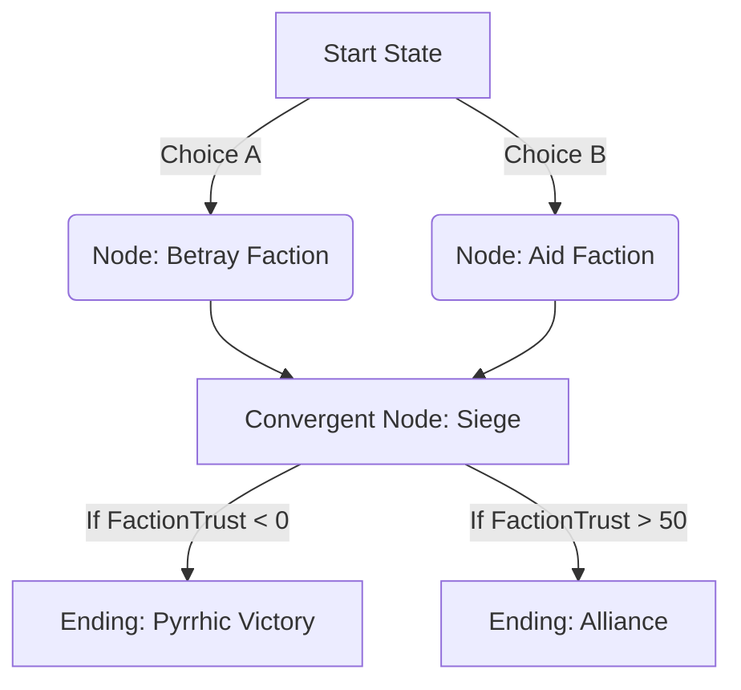

# Lesson 3: Narrative Architecture, Player Agency, Branching Structures

## 1. First-Principles Intuition & Invariants

In the architecture of interactive systems, narrative is not a script to be read; it is a projection of the game state over time. When a senior engineer approaches narrative design, the creative vocabulary of writers must be translated into the rigid formalism of state machines, directed graphs, and deterministic logic. The fundamental invariant of this domain is that the game engine and the narrative engine are not separate entities communicating via fragile bridges, but rather a single unified system where mechanics are the physics of the world, and narrative is the semantic meaning of those physics. Ludonarrative harmony occurs when the state transitions driven by player input—moving, shooting, jumping, trading—map isomorphically to the narrative graph’s definition of consequence. When the mechanics allow the player to kill a critical character, but the narrative assumes that character is alive, the simulation crashes into the narrative, resulting in a class of bugs known as ludonarrative dissonance.

To build these systems correctly, we must discard the illusion of infinite choice. A branching narrative is a combinatorial explosion waiting to happen. If a game tracks ten binary choices, the state space contains $2^{10} = 1024$ unique permutations. If the narrative must account for every permutation with bespoke dialogue or level geometry, the production cost scales exponentially while the asset reuse remains linear. The architectural solution is not to build a tree, but to build a convergent directed acyclic graph (DAG). Meaningful choice does not require infinite endpoints; it requires that the topology of the graph makes the player feel the weight of their specific path. We achieve this by separating the simulation state (variables like `reputation`, `is_king_dead`, `ammo_count`) from the narrative projections (dialogue lines, camera angles, level geometry). The simulation state is a sparse vector; the narrative engine is an interpreter that maps that vector to a specific output at runtime.

Player agency, from a systems perspective, is the capacity for the player to alter the state vector in a way that persists and is later respected by the narrative interpreter. If a choice does not mutate persistent state, it is a button press, not a decision. The core invariant of agency is: *Every choice must map to a state mutation, and every state mutation must have at least one future narrative projection that reads it*. If a variable is written but never read, the choice was an illusion. If a narrative projection reads a variable that was never written, the narrative is non-deterministic. The architect’s job is to enforce this read/write contract across the entire lifecycle of the game state.

## 2. Core Architecture & Mechanics

The internal structure of a branching narrative engine is best modeled as a declarative state machine. Rather than hardcoding narrative flow in imperative scripts—a fragile approach that leads to spaghetti logic and desync—we define the narrative as a graph of nodes (Beats) and edges (Transitions). The engine is a continuous reconciliation loop that evaluates the current state vector against the available transitions, presenting the valid ones to the player and applying the mutations upon selection.

Consider the following topology. We define a narrative not as a tree that doubles in size at every step, but as a graph that converges. Major plot points act as "sinks" that drain the combinatorial explosion, funneling disparate player paths back into a manageable set of core scenarios, while preserving the localized consequences of the player's specific journey.



To implement this in production, we treat the narrative as a data-driven system. We define the `Beat` as the atomic unit of narrative progression. It contains the output to render, the available choices, and the preconditions that gate those choices. The `GameState` holds the variables that choices mutate. The following Rust implementation provides a complete, memory-safe architecture for a branching narrative engine. It leverages Rust’s ownership model to ensure that state mutations are explicit and that narrative data is immutable.

```rust
use std::collections::HashMap;

/// The simulation state vector. 
/// Keys are string identifiers, values are 64-bit integers.
/// This is the single source of truth for the game's world state.
#[derive(Debug, Clone)]
pub struct GameState {
    pub variables: HashMap<String, i64>,
}

impl GameState {
    pub fn new() -> Self {
        let mut vars = HashMap::new();
        // Initialize default state
        vars.insert("player_health".to_string(), 100);
        vars.insert("faction_trust".to_string(), 50);
        vars.insert("is_alive".to_string(), 1);
        Self { variables: vars }
    }

    pub fn get(&self, key: &str) -> i64 {
        *self.variables.get(key).unwrap_or(&0)
    }

    pub fn apply_mutation(&mut self, key: &str, value: i64) {
        self.variables.insert(key.to_string(), value);
    }
}

/// A condition that must be met for a choice to be available.
/// We use a simple greater-than-or-equal for demonstration.
#[derive(Debug, Clone)]
pub struct Condition {
    pub variable: String,
    pub required_value: i64,
}

/// A transition between narrative beats.
#[derive(Debug, Clone)]
pub struct Choice {
    pub id: u32,
    pub text: String,
    pub target_beat_id: u32,
    pub precondition: Option<Condition>,
    pub mutation: Option<(String, i64)>, // (key, value) to set if chosen
}

/// The atomic unit of narrative.
#[derive(Debug, Clone)]
pub struct Beat {
    pub id: u32,
    pub text: String,
    pub choices: Vec<Choice>,
    pub is_end_state: bool,
}

/// The narrative graph interpreter.
pub struct NarrativeEngine {
    pub beats: HashMap<u32, Beat>,
    pub state: GameState,
    pub current_beat_id: u32,
}

impl NarrativeEngine {
    pub fn new(beats: Vec<Beat>, initial_state: GameState, start_beat: u32) -> Self {
        let mut beat_map = HashMap::new();
        for beat in beats {
            beat_map.insert(beat.id, beat);
        }
        Self {
            beats: beat_map,
            state: initial_state,
            current_beat_id: start_beat,
        }
    }

    /// Evaluates the current beat and returns valid choices based on state.
    pub fn get_current_state(&self) -> (&Beat, Vec<&Choice>) {
        let beat = self.beats.get(&self.current_beat_id)
            .expect("Critical: Missing beat in graph");
        
        let valid_choices: Vec<&Choice> = beat.choices.iter()
            .filter(|c| {
                match &c.precondition {
                    Some(cond) => self.state.get(&cond.variable) >= cond.required_value,
                    None => true, // No precondition means always available
                }
            })
            .collect();
        
        (beat, valid_choices)
    }

    /// Processes a player's choice, mutating state and advancing the graph.
    /// Returns Ok if successful, Err if the choice is invalid or state is broken.
    pub fn process_choice(&mut self, choice_id: u32) -> Result<(), &'static str> {
        let current_beat = self.beats.get(&self.current_beat_id)
            .ok_or("Invalid current beat")?;

        let choice = current_beat.choices.iter()
            .find(|c| c.id == choice_id)
            .ok_or("Invalid choice ID for current beat")?;

        // 1. Validate Precondition (Defense in Depth)
        if let Some(cond) = &choice.precondition {
            if self.state.get(&cond.variable) < cond.required_value {
                return Err("Precondition validation failed: State desync detected");
            }
        }

        // 2. Apply Mutation
        if let Some((key, value)) = &choice.mutation {
            self.state.apply_mutation(key, *value);
        }

        // 3. Advance State
        self.current_beat_id = choice.target_beat_id;

        Ok(())
    }
}
```

This architecture separates the narrative data (the `Beat` and `Choice` structs) from the execution logic (`NarrativeEngine`). The engine acts as a pure function evaluator. Given a state vector and a set of inputs, it produces a deterministic output. The read/write contract is enforced structurally: `Choice` owns its `mutation`, and `Condition` owns its read. The engine verifies the read before allowing the write, preventing the system from entering an illegal state.

## 3. High-Performance Optimization & Failure Modes

The primary failure mode of a branching narrative engine is the combinatorial explosion of state. If an engineer attempts to author bespoke reactions for every minor permutation of the state vector, the project will stall under the weight of its own content. The architectural mitigation is **State Abstraction and Convergence**. Instead of querying individual boolean flags (`did_kill_guard_a`, `did_steal_gold`), the system should aggregate granular states into macro-states. A `faction_trust` integer abstracts dozens of binary decisions into a single continuous spectrum. The narrative interpreter then reads only the macro-state, allowing dozens of different player journeys to converge on the same narrative output, significantly reducing the content authoring burden while preserving the player's perception of agency.

A critical failure mode in these systems is the "Dead State" or "Unreachable Ending." If a designer sets a precondition requiring `faction_trust >= 80`, but no sequence of choices in the graph can actually raise `faction_trust` above 50, the narrative contains a logic bug analogous to a memory leak. The system compiles, but the feature is unreachable. In production, we mitigate this by building a static analysis pass that runs over the narrative graph before the game is ever executed. This pass performs a depth-first search (DFS) across the state space, simulating all possible paths to verify that every `Beat` is reachable and that every `is_end_state` can be achieved. This is equivalent to a compiler performing dead code elimination.

Finally, the handling of save/load cycles introduces a severe integrity risk. If the narrative graph is updated in a patch, the serialized state vector might no longer map cleanly to the new graph. The robust mitigation is **Event Sourcing**. Rather than serializing the raw `HashMap<String, i64>` state vector—which is brittle and opaque—we serialize the sequence of `Choice` IDs the player made. When the save is loaded, the engine initializes a blank `GameState` and replays the choice IDs through the (potentially updated) logic. This guarantees the state is always derived from the rules, not stored alongside them.

Below is a production-grade validation routine that checks for narrative integrity, ensuring no authored choice drives the state into an unrecoverable failure.

```rust
impl NarrativeEngine {
    /// Static analysis: Verifies that all end states are reachable from 
    /// the initial state without violating preconditions.
    /// This should run in the build pipeline, not at runtime.
    pub fn validate_graph_integrity(&self, start_beat_id: u32) -> Result<(), String> {
        let mut visited_beats = std::collections::HashSet::new();
        let mut reachable_endings = std::collections::HashSet::new();
        
        // Recursive DFS to map the state space
        fn traverse(
            engine: &NarrativeEngine,
            beat_id: u32, 
            state: GameState, 
            visited: &mut std::collections::HashSet<u32>,
            endings: &mut std::collections::HashSet<u32>,
            depth: u32
        ) {
            // Depth limit to prevent infinite loops in cyclic graphs
            if depth > 1000 { return; }

            let beat = match engine.beats.get(&beat_id) {
                Some(b) => b,
                None => return,
            };

            // Track unique beat visitations
            visited.insert(beat_id);

            if beat.is_end_state {
                endings.insert(beat_id);
                return; // End states have no choices
            }

            for choice in &beat.choices {
                // Check if precondition is met in this specific state branch
                let mut valid = true;
                if let Some(cond) = &choice.precondition {
                    if state.get(&cond.variable) < cond.required_value {
                        valid = false;
                    }
                }

                if valid {
                    let mut next_state = state.clone();
                    if let Some((key, val)) = &choice.mutation {
                        next_state.apply_mutation(key, *val);
                    }
                    traverse(engine, choice.target_beat_id, next_state, visited, endings, depth + 1);
                }
            }
        }

        traverse(self, start_beat_id, self.state.clone(), &mut visited_beats, &mut reachable_endings, 0);

        if reachable_endings.is_empty() {
            return Err("Validation Failed: No reachable end states from start beat.".to_string());
        }

        // Check for orphaned beats (defined but never reachable)
        if visited_beats.len() != self.beats.len() {
            let orphans: Vec<u32> = self.beats.keys()
                .filter(|k| !visited_beats.contains(k))
                .cloned()
                .collect();
            return Err(format!("Validation Failed: Orphaned beats detected: {:?}", orphans));
        }

        Ok(())
    }
}
```

By treating narrative as a topology problem and choices as state mutations, we transform the ambiguous art of game design into a verifiable engineering discipline. The engine becomes a compiler for player intent, and the narrative becomes a deterministic projection of the player's journey through the state space.
