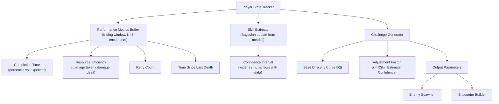

# Lesson 4: User Experience, Onboarding, Difficulty Curves

## 1. First-Principles Intuition & Invariants

Game design exists at the intersection of computational systems and human cognitive architecture. While we engineer software systems to be deterministic, predictable, and formally verifiable, games demand that we architect experiences that deliberately manipulate human attention, working memory capacity, and reward prediction. The software engineer approaching game design must internalize a fundamental paradigm shift: the program's internal correctness is necessary but insufficient. The cognitive state machine executing inside the player's brain becomes the primary compilation target.

Human working memory operates under severe architectural constraints documented across six decades of cognitive psychology research. George Miller's seminal 1956 work established that short-term memory maintains approximately seven discrete chunks of information, later refined to four chunks by more conservative models accounting for rehearsal interference. When a player loads your game, their prefrontal cortex allocates a bounded attention buffer. Every UI element, every game mechanic, every tutorial prompt competes for slots in this severely constrained resource pool. The game designer's primary optimization problem becomes cognitive load management: engineering information flow such that working memory never thrashes, never context-switches without deliberate cause, and never encounters cache misses that break immersion.

Flow theory, formalized by psychologist Mihaly Csikszentmihalyi, provides the equilibrium equation governing engagement. Flow emerges when perceived challenge matches perceived skill along a continuous temporal axis. Mathematically, we model this as a dynamical system where anxiety manifests when challenge exceeds skill by threshold δ, and boredom emerges when skill exceeds challenge by threshold ε. The game designer constructs a difficulty curve function D(t) mapping elapsed time or completed objectives to challenge magnitude, while simultaneously estimating a player skill curve S(t) rising through practice and mastery. Engagement maximizes in the narrow corridor where |D(t) - S(t)| remains below perceptual thresholds, creating what we term the flow channel.

The onboarding sequence constitutes the most critical architectural component of any game system. Players arrive with zero internal state: no compiled mental model of mechanics, no cached keybindings, no predicted reward structures. The tutorial must bootstrap this entire cognitive runtime environment without triggering working memory overflow. Classical game design theory distinguishes between explicit teaching through textual instructions versus implicit teaching through mechanical interaction. Modern game architecture strongly favors the latter: players learn by executing verbs within the game's physics and rules engine, with environmental constraints acting as compiler errors that provide immediate negative feedback.

Teaching through mechanics exploits the brain's procedural memory systems, which encode motor patterns and causal relationships through basal ganglia circuits distinct from declarative memory's hippocampal encoding. When a player discovers that pressing the jump button near a wall initiates a wall-jump, they encode this as procedural knowledge: context-action-outcome triplets that compile into fast, automatic subroutines. Textual tutorials, conversely, engage declarative systems requiring conscious retrieval and explicit translation into motor commands, introducing latency and cognitive overhead.

Accessibility principles demand that game systems account for variance in human perceptual and motor capabilities. Colorblindness affects approximately eight percent of males and point-five percent of females, requiring that critical information never rely solely on hue differentiation. Motor disabilities span a continuous spectrum from subtle fine motor control degradation to complete inability to execute rapid input sequences. Cognitive disabilities range from working memory deficits to processing speed limitations to attention regulation disorders. The systems-level game architect must therefore construct adaptive interface layers and difficulty models that degrade gracefully across this heterogeneous player population, much as network protocols handle heterogeneous link capacities through adaptive bitrate streaming.

The fundamental invariant governing all game UX architecture emerges clearly: every system must maintain the illusion of agency while secretly constraining the possibility space to prevent cognitive overload and maintain flow equilibrium. Players must feel they exercise meaningful choice while the underlying state machine guides them through carefully orchestrated learning gradients. This tension between perceived freedom and actual constraint defines the game designer's optimization landscape.


## 2. Core Architecture & Mechanics

The cognitive load management architecture decomposes into three distinct subsystems: intrinsic load, extraneous load, and germane load. Intrinsic load stems from the inherent complexity of the game's mechanical systems—the number of unique verbs, the branching factor of strategic decision trees, the state space cardinality. A fighting game with ten special moves per character and frame-perfect input windows carries higher intrinsic load than a turn-based puzzle game with three action types. Extraneous load originates from poor information design: unclear UI, inconsistent visual language, ambiguous feedback signals. Germane load represents productive cognitive effort directed toward schema construction and skill mastery.

Optimal game architecture minimizes extraneous load to zero, moderates intrinsic load through staged revelation, and maximizes germane load within working memory constraints. Consider the onboarding architecture for a real-time strategy game. The complete mechanical system encompasses resource harvesting, unit production, technology trees, tactical combat, map control, and economic optimization—easily exceeding working memory capacity if presented simultaneously. The tutorial architecture must therefore construct a staged revelation pipeline:

```text
Stage 1: Movement & Selection
  Intrinsic: 2 verbs (move, select)
  Duration: 60-90 seconds
  Success Metric: Player executes 5 movement commands
  
Stage 2: Resource Collection
  Intrinsic: +1 verb (harvest), +1 entity type (worker)
  Duration: 120 seconds
  Success Metric: Collect 100 resources
  
Stage 3: Unit Production
  Intrinsic: +1 verb (build), +1 entity type (barracks)
  Duration: 180 seconds
  Success Metric: Produce 5 combat units
  
Stage 4: Basic Combat
  Intrinsic: +1 verb (attack), +combat resolution rules
  Duration: 240 seconds
  Success Metric: Defeat enemy force
```

Each stage introduces mechanical complexity only after the player demonstrates procedural encoding of previous mechanics through successful task completion. The working memory budget never exceeds four to five concurrent concepts. The staged pipeline functions analogously to instruction pipelining in CPU microarchitecture: we fill the cognitive pipeline incrementally, avoiding hazards where new instructions depend on incomplete execution of previous instructions.

Teaching through mechanics exploits environmental constraints as implicit instruction sets. Consider designing a platformer's first level. Rather than displaying text explaining "Press A to jump," the level architecture itself becomes the tutorial:

```text
Spatial Layout (side view):

Player Spawn → [===========] gap [===========] → Progress
                     ↓
              (impassable without jump)
```

The player confronts an environmental constraint that admits only one solution: executing the jump verb. The gap width calibrates to ensure success on first attempt—approximately sixty to seventy percent of maximum jump distance—preventing failure-induced frustration during mechanic discovery. Once the player traverses the gap, they've encoded the jump mechanic through successful execution rather than textual instruction.

Advanced teaching architectures layer mechanics through compositional challenge design. After establishing jump individually, introduce moving platforms to combine movement prediction with jump timing. Then introduce enemies requiring jump evasion. Each composition adds one new constraint to previously mastered mechanics, maintaining working memory bounds while expanding the mechanical vocabulary.

Difficulty curve architecture models player skill progression as a learning curve S(t) following a logarithmic or power-law growth function. Empirical game analytics data consistently demonstrates that skill improvement follows a power law: S(t) = S₀ + α·t^β, where β typically ranges from 0.2 to 0.4. Early gameplay exhibits rapid skill gains as players encode fundamental mechanics; later gameplay shows diminishing returns as optimization shifts toward strategic refinement.

The challenge function D(t) must track this curve while maintaining the flow corridor. Naive linear difficulty scaling—incrementing enemy health or damage per level by fixed amounts—inevitably breaks flow as the linear function diverges from the logarithmic skill curve. Optimal difficulty architectures implement one of several adaptive models:

**Time-Based Progression with Pacing Cycles:**
The challenge curve oscillates around the skill curve with periodic relaxation phases. Every three to four high-intensity challenges, insert a recovery segment at lower difficulty, allowing consolidation of learned patterns and preventing sustained anxiety states. This mirrors CPU thermal throttling strategies that alternate burst performance with cool-down periods.

**Performance-Based Dynamic Difficulty Adjustment (DDA):**
The game's analytics subsystem tracks performance metrics—completion time, resource efficiency, health remaining, retry count—and computes a rolling skill estimate. The challenge generator adjusts parameters in real-time to maintain target performance bands. If player health remains above ninety percent across three consecutive encounters, increment enemy damage by ten percent. If retry count exceeds three attempts, reduce enemy count by fifteen percent.

**Explicit Difficulty Selection with Granular Tuning:**
Expose multiple difficulty presets (Easy, Normal, Hard) but implement each as a parameter vector spanning dozens of mechanical variables. Easy mode might reduce enemy health by thirty percent, increase player damage by twenty percent, extend invincibility frames by fifty percent, and decrease enemy aggression timers by forty percent. This multidimensional tuning preserves mechanical depth while accommodating skill variance.

The internal state machine governing difficulty adjustment operates continuously:



Accessibility architecture requires constructing orthogonal configuration spaces that decouple mechanical challenge from perceptual and motor demands. A comprehensive accessibility options menu exposes controls spanning multiple dimensions:

**Visual Accessibility Layer:**
Color blindness modes remap hue-dependent information onto luminance channels or redundant symbols. Critical UI elements carry both color and shape/icon differentiation. Text rendering supports scalable fonts from one hundred percent to two hundred percent base size. High-contrast modes increase luminance differential between foreground and background to at least 7:1 ratio per WCAG AAA standards.

**Motor Accessibility Layer:**
Input remapping allows arbitrary keybinding reconfiguration, accommodating alternative input devices and one-handed play. Toggle modes replace held buttons with press-to-activate, press-to-deactivate state machines, eliminating sustained motor effort requirements. Rapid-fire sequences admit configurable input buffering windows or automatic execution modes. Analog stick dead zones and sensitivity curves expose tuning parameters accommodating tremor or reduced fine motor control.

**Cognitive Accessibility Layer:**
Adjustable game speed from fifty percent to one hundred fifty percent of base rate allows players to match information flow rate to processing speed. Optional UI elements provide explicit numerical feedback (damage values, cooldown timers) for players who benefit from concrete data over implicit learning. Tutorial pacing admits player-controlled advancement: next stage unlocks only on explicit confirmation rather than automatic time-based progression.

The accessibility architecture must avoid difficulty conflation: making a game accessible does not mean making it easy. A player with motor disabilities may desire high cognitive and strategic challenge while requiring reduced execution demands. The parameter space must therefore span independent axes, allowing a player to enable aim assist and extended input windows while facing enemy AI operating at maximum strategic sophistication.


## 3. High-Performance Optimization & Failure Modes

Onboarding optimization hinges on minimizing time-to-first-dopamine: the elapsed time between application launch and the player experiencing their first moment of genuine satisfaction through mechanical mastery. Industry analytics demonstrate catastrophic drop-off curves: fifteen percent of players abandon within the first five minutes, thirty percent within fifteen minutes. The critical path through early gameplay must therefore ruthlessly prioritize interactive engagement over narrative exposition or mechanical completeness.

Anti-pattern: front-loading cinematics, narrative setup, or lengthy tutorial text before granting player agency. Player attention depletes as a exponential decay function during passive information consumption. Optimal architecture inverts this: grant agency within fifteen seconds of launch, introduce narrative context through environmental storytelling during active play, and distribute mechanical teaching across the first thirty to forty-five minutes through staged revelation rather than concentrated tutorial blocks.

The tutorial completion rate metric provides direct measurement of onboarding effectiveness. Completion rates below seventy percent indicate systematic failure: cognitive overload, insufficient feedback clarity, or frustration-inducing difficulty spikes. Instrument the tutorial pipeline with analytics telemetry capturing abandonment points, retry counts per segment, and completion times. Abandonment clustering at specific segments indicates local failure modes requiring architectural revision.

Difficulty curve failure modes manifest as catastrophic divergence between challenge and skill curves. The first failure mode, premature plateau, occurs when challenge scaling decelerates below skill growth rate. Players enter boredom states as they execute over-learned patterns without novel cognitive demands. Symptoms include declining session length, reduced engagement metrics, and explicit player feedback reporting repetitiveness. Mitigation requires injecting mechanical complexity: introduce new enemy types forcing adaptation of existing strategies, layer environmental hazards requiring spatial awareness, or unlock advanced techniques expanding the mechanical vocabulary.

The second failure mode, cliff transitions, emerges when challenge increments discontinuously while skill grows continuously. A difficulty spike exceeding two standard deviations above the player's demonstrated performance capacity triggers anxiety states and retry loops. Players perceive the spike as unfair or broken rather than challenging. Mitigation requires smoothing the challenge gradient through micro-adjustments: if Level 5 proves too difficult, interpolate an intermediate challenge at Level 4.5 that bridges the gap.

Dynamic difficulty adjustment systems face a pernicious failure mode termed reward devaluation. If players detect that the game reduces challenge in response to poor performance, mastery loses meaning. The perception of achievement depends on believing success resulted from genuine skill expression against consistent environmental constraints. Overly aggressive DDA destroys this illusion, converting challenge into a rubber-band system that patronizes rather than respects player effort.

Mitigation strategies employ stealth adjustment: modify parameters that affect challenge indirectly and imperceptibly. Rather than reducing enemy health (obvious and detectable), adjust enemy aggression timers, spawn rates, or patrol patterns. Rather than increasing player damage, adjust enemy miss rates or critical hit probabilities. The statistical outcome changes—player performance improves—but individual moment-to-moment interactions feel consistent with previous experience.

Accessibility implementation carries performance and architectural costs that demand careful optimization. Supporting arbitrary UI scaling requires resolution-independent vector rendering or high-resolution texture atlases that increase memory footprint. Implementing input remapping necessitates abstracting all input handling through an indirection layer, adding CPU overhead. Adjustable game speed complicates physics integration, requiring careful timestep management to prevent simulation instability.

The optimal architecture constructs accessibility as a first-class compilation target rather than post-facto accommodation. Design core game loops around turn-based or pausable real-time systems that naturally support speed adjustment. Implement UI rendering through retained-mode scene graphs supporting arbitrary transformations rather than immediate-mode pixel-perfect layouts. Abstract input through semantic action bindings from the initial implementation rather than refactoring later.

Cognitive load measurement during development remains challenging due to the subjective nature of perceived difficulty. Quantitative telemetry captures completion rates, death counts, and time metrics, but fails to distinguish productive challenge from frustration. Qualitative playtesting with think-aloud protocols provides richer data: observing where playtesters pause to think, verbalize confusion, or exhibit motor uncertainty reveals cognitive bottlenecks invisible to analytics dashboards.

Effective playtesting methodology instruments the entire first-time user experience. Recruit participants matching target audience demographics but lacking domain expertise. Observe silently without intervention as they navigate onboarding independently. Record sessions for frame-by-frame analysis of hesitation points, UI scan patterns, and facial affect. Post-session interviews probe specific moments: "At timestamp 3:42 you paused for eight seconds—what were you thinking?" This qualitative data grounds architectural revisions in actual player cognitive models rather than designer assumptions.

The flow channel maintenance problem resembles real-time control system design: we observe system state (player performance metrics), estimate internal state (skill level), and adjust control inputs (challenge parameters) to maintain target equilibrium. Classical control theory provides applicable frameworks. PID controllers tracking error between target and actual performance can drive DDA systems: proportional term responds to current performance deviation, integral term corrects sustained bias, derivative term anticipates trend changes. Tuning PID coefficients trades responsiveness against stability, preventing oscillation where difficulty adjusts too rapidly in response to statistical noise.

Advanced difficulty architectures implement multi-armed bandit algorithms for challenge selection. Model each encounter type as an arm with unknown reward distribution. The system adaptively samples encounters, measuring player engagement and performance. Arms yielding optimal flow states receive higher selection probability. Over thousands of players, the system converges on encounter distributions maximizing aggregate engagement while adapting to individual skill profiles through contextual bandits incorporating player state features.

The accessibility parameter explosion problem demands UI/UX engineering discipline. Exposing fifty independent accessibility options creates paradox-of-choice cognitive overhead and interaction complexity discouraging engagement. Optimal architectures provide smart presets: "Motor Accessibility Profile" enables a curated bundle of related settings (toggle controls, extended input windows, reduced rapid-fire requirements) while preserving granular override capability. Presets reduce configuration space from O(2^n) to O(n), making accessibility discoverable rather than buried.

Internationalization and localization compound accessibility challenges. Tutorial sequences relying on textual instruction require translation and cultural adaptation. Mechanical teaching through environmental constraints proves more robust: spatial puzzles and physical cause-effect relationships transcend language barriers. When text proves necessary, implement comprehensive localization covering not just translation but culturally appropriate metaphors, measurement units, and input conventions. Support right-to-left text rendering, double-byte character sets, and variable-width fonts without layout corruption.

The ultimate optimization target remains player retention and long-term engagement. First-session experience predicts thirty-day retention with surprising accuracy: players completing the tutorial exhibit sixty to seventy percent thirty-day retention versus fifteen to twenty percent for tutorial abandonment. The onboarding pipeline therefore constitutes the highest-leverage architectural investment. Allocating thirty percent of total development resources to the first hour of gameplay yields asymmetric returns compared to late-game content that only five percent of players experience.

Modern game architecture increasingly adopts progressive disclosure at systemic scale: launching with core mechanical loops polished to exceptional quality while deferring secondary systems to post-launch content updates. This inverts traditional development prioritization of breadth over depth. A roguelike launching with four character classes, each exhibiting deep mechanical complexity and twenty hours of mastery curve, outperforms fifty shallow classes. Players form strong procedural encoding and intrinsic motivation before complexity expansion, building skill foundation supporting later elaboration.

The measurement framework closing this optimization loop tracks cohort retention curves, session length distributions, and sentiment analysis from player feedback channels. A/B testing alternative onboarding sequences quantifies architectural decisions: does tutorial A's completion rate of seventy-five percent and thirty-day retention of sixty percent outperform tutorial B's eighty percent completion but fifty-five percent retention? Multi-armed bandit assignment dynamically allocates players to variants, accelerating convergence on optimal designs while maintaining statistical power.

Game design ultimately emerges as applied cognitive systems engineering: architecting computational state machines that drive human neural state machines toward target attractors in motivation space. The software engineer's formal methods training—state machine verification, performance profiling, API design—transfers directly to game UX architecture once we recognize the player's brain as the runtime environment and engagement as the primary performance metric. Mastery demands integrating cognitive psychology's empirical findings with software engineering's systematic methodology, producing systems that respect both silicon constraints and neural constraints with equal rigor.
