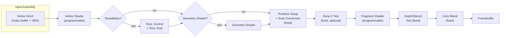

# Lesson 2: Rendering Pipeline

## 1. First-Principles Intuition & Invariants

The real-time rendering pipeline is a streaming state machine that transforms three-dimensional geometric descriptions into a two-dimensional raster image, sixty or more times per second. Every frame, the GPU ingests vertex buffers, index buffers, textures, and shader programs, subjects them to a sequence of programmable and fixed-function stages, and writes the result into a framebuffer that the display controller scans out to your monitor. To understand this pipeline at the level a systems engineer needs—not the level of a hobbyist pasting together tutorial code—you must understand what the pipeline is approximating, why it is structured the way it is, and where its approximations break down.

The ground truth of image synthesis is the rendering equation, formulated by Kajiya in 1986. It states that the outgoing radiance at a surface point in a given direction equals the emitted radiance plus the hemispherical integral of incoming radiance weighted by the bidirectional reflectance distribution function (BRDF) and the cosine of the angle between the incoming light direction and the surface normal. In its full form, it is a recursive Fredholm integral equation of the second kind: every surface point reflects light that arrived from every other surface point, each of which in turn reflects light from every other point, and so on to infinite bounces. Solving this equation exactly is computationally intractable in real time. Offline renderers such as those used in feature film production approximate it with Monte Carlo path tracing, shooting millions of rays per pixel and accumulating samples over hours. Real-time graphics cannot afford that budget.

The rendering pipeline is the compromise that makes real-time interactive graphics possible. Rather than tracing rays backward from the camera through every pixel into the scene and recursively sampling light transport, the pipeline projects geometry forward onto the screen through matrix transforms, rasterizes triangles into fragments, and shades each fragment with a local approximation of the rendering equation restricted to direct illumination from a small number of explicit light sources. Indirect light—the global illumination that gives scenes their sense of spatial coherence—is handled by separate passes that precompute or approximate light transport at coarser granularity: ambient occlusion terms baked into vertex attributes or textures, precomputed radiance transfer spherical harmonics, screen-space approximations like screen-space ambient occlusion, or increasingly, hardware-accelerated ray tracing for reflections, shadows, and diffuse global illumination.

This design choice—forward projection and rasterization rather than backward ray tracing—stems from a fundamental architectural property of GPU hardware. GPUs are massively parallel SIMT (Single Instruction, Multiple Thread) machines. A modern GPU contains dozens of streaming multiprocessors, each hosting hundreds of CUDA cores or equivalent ALUs, and each multiprocessor executes threads in groups called warps (NVIDIA) or wavefronts (AMD), typically 32 or 64 threads wide. All threads in a warp execute the same instruction in lockstep; divergence within a warp serializes execution and halves throughput. Rasterization maps naturally onto this model: every triangle generates hundreds or thousands of fragments, each independently shaded by a fragment shader invocation, and the GPU schedules these invocations in massive batches that keep every ALU fed. Ray tracing, by contrast, involves per-ray traversal of an acceleration structure where neighboring rays may hit different primitives and diverge wildly, which is why hardware ray tracing units (NVIDIA's RT cores, AMD's ray accelerators) exist as fixed-function traversal engines layered on top of the SIMT shader cores.

The framebuffer is the terminal accumulator of this pipeline. It is a region of GPU memory organized as a two-dimensional array of color samples, typically backed by one or more color attachments (RGBA formats) and a depth-stencil attachment. The color attachment stores the final pixel values that will be resolved and presented to the swapchain. The depth attachment stores per-pixel depth values used for hidden surface removal through the z-buffer algorithm: for each fragment, the pipeline compares the fragment's interpolated depth against the stored depth value, and the fragment is discarded or written depending on the configured comparison function. The stencil attachment provides an additional per-pixel integer mask for arbitrary masking operations, used for effects like silhouette outlines, planar reflections, or shadow volumes.

The fundamental invariant of the pipeline, then, is this: given the same vertex data, shader programs, uniform state, and rasterization configuration, the output framebuffer is deterministic and reproducible. The pipeline is a pure function from input state to output pixels, and modern explicit APIs like Vulkan, Direct3D 12, and Metal are designed to make this contract as explicit as possible, removing the hidden driver state and implicit synchronization that made earlier APIs unpredictable and difficult to reason about.

## 2. Core Architecture & Mechanics

### 2.1 Graphics Abstraction Layers: From OpenGL to Explicit APIs

Three generations of graphics API design shape the modern landscape. The first generation, exemplified by OpenGL (1992) and Direct3D 9, hid pipeline state behind a global context object. You enabled depth testing with a single call to `glEnable(GL_DEPTH_TEST)`, bound a shader program with `glUseProgram`, bound a texture with `glBindTexture`, and issued draw calls. The driver tracked all of this state, validated it, and compiled the pipeline configuration into GPU commands at draw time. This was convenient but opaque: the driver made decisions about memory layout, synchronization, and pipeline compilation that the application could not control, and draw calls were expensive because each one triggered validation and state diffing in the driver.

The second generation—OpenGL 3.3+ with ARB extensions, Direct3D 11—introduced explicit state objects for shaders and samplers but still left synchronization and memory management to the driver. The third generation—Vulkan (2016), Direct3D 12 (2015), Metal (2014)—moved all of that responsibility to the application. The driver became a thin command encoder. The application records commands into command buffers that are submitted to queues, manages its own synchronization through semaphores and fences, allocates and manages GPU memory directly, and pre-bakes pipeline state into immutable Pipeline State Objects (PSOs) that are expensive to create but cheap to use at draw time.

The key architectural shift is the Pipeline State Object. In Vulkan, a PSO is created through `vkCreateGraphicsPipelines`, which takes a `VkGraphicsPipelineCreateInfo` struct that bakes together vertex input layout, input assembly topology, rasterization state, multisampling configuration, depth-stencil state, color blend state, dynamic state flags, shader modules, and pipeline layout (descriptor binding schema). The driver compiles and optimizes this configuration once, at creation time, producing a GPU-specific binary. At draw time, binding a PSO is a single command that switches the entire pipeline state atomically, with no validation overhead because the configuration was already validated at creation. This front-loads the cost of state changes: PSO creation can take hundreds of milliseconds, but binding one takes microseconds.

The following Vulkan code creates a complete graphics pipeline for PBR rendering with reversed-Z depth, demonstrating the full explicit state model:

```cpp
#include <vulkan/vulkan.h>

VkDescriptorSetLayout create_descriptor_set_layout(VkDevice device) {
    VkDescriptorSetLayoutBinding bindings[3] = {};
    bindings[0].binding = 0;
    bindings[0].descriptorType = VK_DESCRIPTOR_TYPE_UNIFORM_BUFFER;
    bindings[0].descriptorCount = 1;
    bindings[0].stageFlags = VK_SHADER_STAGE_VERTEX_BIT | VK_SHADER_STAGE_FRAGMENT_BIT;
    bindings[1].binding = 1;
    bindings[1].descriptorType = VK_DESCRIPTOR_TYPE_COMBINED_IMAGE_SAMPLER;
    bindings[1].descriptorCount = 1;
    bindings[1].stageFlags = VK_SHADER_STAGE_FRAGMENT_BIT;
    bindings[2].binding = 2;
    bindings[2].descriptorType = VK_DESCRIPTOR_TYPE_COMBINED_IMAGE_SAMPLER;
    bindings[2].descriptorCount = 1;
    bindings[2].stageFlags = VK_SHADER_STAGE_FRAGMENT_BIT;

    VkDescriptorSetLayoutCreateInfo layout_info = {};
    layout_info.sType = VK_STRUCTURE_TYPE_DESCRIPTOR_SET_LAYOUT_CREATE_INFO;
    layout_info.bindingCount = 3;
    layout_info.pBindings = bindings;

    VkDescriptorSetLayout layout;
    vkCreateDescriptorSetLayout(device, &layout_info, nullptr, &layout);
    return layout;
}

VkPipelineLayout create_pipeline_layout(VkDevice device,
                                         VkDescriptorSetLayout desc_layout) {
    VkPushConstantRange push_range = {};
    push_range.stageFlags = VK_SHADER_STAGE_VERTEX_BIT;
    push_range.offset = 0;
    push_range.size = sizeof(float) * 16;

    VkPipelineLayoutCreateInfo info = {};
    info.sType = VK_STRUCTURE_TYPE_PIPELINE_LAYOUT_CREATE_INFO;
    info.setLayoutCount = 1;
    info.pSetLayouts = &desc_layout;
    info.pushConstantRangeCount = 1;
    info.pPushConstantRanges = &push_range;

    VkPipelineLayout layout;
    vkCreatePipelineLayout(device, &info, nullptr, &layout);
    return layout;
}

VkPipeline create_graphics_pipeline(VkDevice device,
                                     VkRenderPass render_pass,
                                     VkPipelineLayout pipeline_layout,
                                     VkShaderModule vert_module,
                                     VkShaderModule frag_module) {
    VkPipelineShaderStageCreateInfo vert_stage = {};
    vert_stage.sType = VK_STRUCTURE_TYPE_PIPELINE_SHADER_STAGE_CREATE_INFO;
    vert_stage.stage = VK_SHADER_STAGE_VERTEX_BIT;
    vert_stage.module = vert_module;
    vert_stage.pName = "main";

    VkPipelineShaderStageCreateInfo frag_stage = {};
    frag_stage.sType = VK_STRUCTURE_TYPE_PIPELINE_SHADER_STAGE_CREATE_INFO;
    frag_stage.stage = VK_SHADER_STAGE_FRAGMENT_BIT;
    frag_stage.module = frag_module;
    frag_stage.pName = "main";

    VkPipelineShaderStageCreateInfo shader_stages[] = {vert_stage, frag_stage};

    VkVertexInputBindingDescription binding_desc = {};
    binding_desc.binding = 0;
    binding_desc.stride = 8 * sizeof(float);
    binding_desc.inputRate = VK_VERTEX_INPUT_RATE_VERTEX;

    VkVertexInputAttributeDescription attr_descs[3] = {};
    attr_descs[0].location = 0;
    attr_descs[0].binding = 0;
    attr_descs[0].format = VK_FORMAT_R32G32B32_SFLOAT;
    attr_descs[0].offset = 0;
    attr_descs[1].location = 1;
    attr_descs[1].binding = 0;
    attr_descs[1].format = VK_FORMAT_R32G32B32_SFLOAT;
    attr_descs[1].offset = 3 * sizeof(float);
    attr_descs[2].location = 2;
    attr_descs[2].binding = 0;
    attr_descs[2].format = VK_FORMAT_R32G32_SFLOAT;
    attr_descs[2].offset = 6 * sizeof(float);

    VkPipelineVertexInputStateCreateInfo vertex_input = {};
    vertex_input.sType = VK_STRUCTURE_TYPE_PIPELINE_VERTEX_INPUT_STATE_CREATE_INFO;
    vertex_input.vertexBindingDescriptionCount = 1;
    vertex_input.pVertexBindingDescriptions = &binding_desc;
    vertex_input.vertexAttributeDescriptionCount = 3;
    vertex_input.pVertexAttributeDescriptions = attr_descs;

    VkPipelineInputAssemblyStateCreateInfo input_assembly = {};
    input_assembly.sType = VK_STRUCTURE_TYPE_PIPELINE_INPUT_ASSEMBLY_STATE_CREATE_INFO;
    input_assembly.topology = VK_PRIMITIVE_TOPOLOGY_TRIANGLE_LIST;
    input_assembly.primitiveRestartEnable = VK_FALSE;

    VkPipelineViewportStateCreateInfo viewport_state = {};
    viewport_state.sType = VK_STRUCTURE_TYPE_PIPELINE_VIEWPORT_STATE_CREATE_INFO;
    viewport_state.viewportCount = 1;
    viewport_state.scissorCount = 1;

    VkPipelineRasterizationStateCreateInfo rasterizer = {};
    rasterizer.sType = VK_STRUCTURE_TYPE_PIPELINE_RASTERIZATION_STATE_CREATE_INFO;
    rasterizer.depthClampEnable = VK_FALSE;
    rasterizer.rasterizerDiscardEnable = VK_FALSE;
    rasterizer.polygonMode = VK_POLYGON_MODE_FILL;
    rasterizer.cullMode = VK_CULL_MODE_BACK_BIT;
    rasterizer.frontFace = VK_FRONT_FACE_COUNTER_CLOCKWISE;
    rasterizer.depthBiasEnable = VK_FALSE;
    rasterizer.lineWidth = 1.0f;

    VkPipelineMultisampleStateCreateInfo multisampling = {};
    multisampling.sType = VK_STRUCTURE_TYPE_PIPELINE_MULTISAMPLE_STATE_CREATE_INFO;
    multisampling.sampleShadingEnable = VK_FALSE;
    multisampling.rasterizationSamples = VK_SAMPLE_COUNT_1_BIT;

    VkPipelineDepthStencilStateCreateInfo depth_stencil = {};
    depth_stencil.sType = VK_STRUCTURE_TYPE_PIPELINE_DEPTH_STENCIL_STATE_CREATE_INFO;
    depth_stencil.depthTestEnable = VK_TRUE;
    depth_stencil.depthWriteEnable = VK_TRUE;
    depth_stencil.depthCompareOp = VK_COMPARE_OP_GREATER;
    depth_stencil.depthBoundsTestEnable = VK_FALSE;
    depth_stencil.stencilTestEnable = VK_FALSE;

    VkPipelineColorBlendAttachmentState blend_attachment = {};
    blend_attachment.blendEnable = VK_FALSE;
    blend_attachment.colorWriteMask = VK_COLOR_COMPONENT_R_BIT |
                                      VK_COLOR_COMPONENT_G_BIT |
                                      VK_COLOR_COMPONENT_B_BIT |
                                      VK_COLOR_COMPONENT_A_BIT;

    VkPipelineColorBlendStateCreateInfo color_blend = {};
    color_blend.sType = VK_STRUCTURE_TYPE_PIPELINE_COLOR_BLEND_STATE_CREATE_INFO;
    color_blend.logicOpEnable = VK_FALSE;
    color_blend.attachmentCount = 1;
    color_blend.pAttachments = &blend_attachment;

    VkDynamicState dynamic_states[] = {
        VK_DYNAMIC_STATE_VIEWPORT,
        VK_DYNAMIC_STATE_SCISSOR,
    };
    VkPipelineDynamicStateCreateInfo dynamic_state = {};
    dynamic_state.sType = VK_STRUCTURE_TYPE_PIPELINE_DYNAMIC_STATE_CREATE_INFO;
    dynamic_state.dynamicStateCount = 2;
    dynamic_state.pDynamicStates = dynamic_states;

    VkGraphicsPipelineCreateInfo pipeline_info = {};
    pipeline_info.sType = VK_STRUCTURE_TYPE_GRAPHICS_PIPELINE_CREATE_INFO;
    pipeline_info.stageCount = 2;
    pipeline_info.pStages = shader_stages;
    pipeline_info.pVertexInputState = &vertex_input;
    pipeline_info.pInputAssemblyState = &input_assembly;
    pipeline_info.pViewportState = &viewport_state;
    pipeline_info.pRasterizationState = &rasterizer;
    pipeline_info.pMultisampleState = &multisampling;
    pipeline_info.pDepthStencilState = &depth_stencil;
    pipeline_info.pColorBlendState = &color_blend;
    pipeline_info.pDynamicState = &dynamic_state;
    pipeline_info.layout = pipeline_layout;
    pipeline_info.renderPass = render_pass;
    pipeline_info.subpass = 0;

    VkPipeline pipeline;
    vkCreateGraphicsPipelines(device, VK_NULL_HANDLE, 1,
                              &pipeline_info, nullptr, &pipeline);
    return pipeline;
}
```

Every state object in this function is a decision the driver used to make for you in the OpenGL era. The `depthCompareOp` is set to `VK_COMPARE_OP_GREATER` rather than `VK_COMPARE_OP_LESS` because this pipeline uses reversed-Z depth, a technique that counteracts the non-linear depth distribution of perspective projection and distributes depth precision more evenly across the view frustum. The cull mode, front face winding, polygon fill mode, sample count, blend state, and even the viewport dimensions (which we mark as dynamic to avoid creating a new PSO when the window resizes) are all baked into the immutable pipeline object.

### 2.2 The Pipeline Stages

The graphics pipeline is a sequence of stages, some programmable and some fixed-function, that transform vertex data into framebuffer writes. The following diagram shows the full programmable pipeline with optional tessellation and geometry stages:



### 2.3 Vertex Processing

The vertex shader is the first programmable stage and the only one that is mandatory. It runs once per vertex and its primary responsibility is to transform vertex positions from model space into clip space by applying the model-view-projection (MVP) matrix chain. The model matrix transforms vertices from the object's local coordinate system into world space, accounting for the object's position, rotation, and scale. The view matrix transforms from world space into camera (view) space, effectively applying the inverse of the camera's transform to the entire world. The projection matrix transforms from view space into clip space, applying the perspective or orthographic projection that maps the 3D frustum onto a 2D cuboid.

After the vertex shader writes to `gl_Position`, the hardware performs the perspective divide: clip-space coordinates (x, y, z, w) are divided by w to produce normalized device coordinates (NDC), where the visible volume is the cube [-1,1]³ in OpenGL or [0,1] in z for Vulkan. The viewport transform then maps NDC to pixel coordinates in the framebuffer, and the rasterizer takes over.

The following GLSL vertex shader is written for Vulkan (GLSL 450, SPIR-V target) and demonstrates the full MVP transform plus passing of attributes for PBR shading:

```glsl
#version 450

layout(set = 0, binding = 0) uniform CameraBuffer {
    mat4 view;
    mat4 proj;
} camera;

layout(push_constant) uniform PushConstants {
    mat4 model;
} pc;

layout(location = 0) in vec3 in_position;
layout(location = 1) in vec3 in_normal;
layout(location = 2) in vec2 in_texcoord;

layout(location = 0) out vec3 frag_world_pos;
layout(location = 1) out vec3 frag_normal;
layout(location = 2) out vec2 frag_texcoord;

void main() {
    vec4 world_pos = pc.model * vec4(in_position, 1.0);
    frag_world_pos = world_pos.xyz;
    frag_normal = mat3(transpose(inverse(pc.model))) * in_normal;
    frag_texcoord = in_texcoord;
    gl_Position = camera.proj * camera.view * world_pos;
}
```

The normal matrix—`mat3(transpose(inverse(model)))`—deserves explanation. When a model matrix contains non-uniform scaling, normals are no longer perpendicular to the surface after transformation by the upper 3×3 of the model matrix. The correct transform for normals is the inverse transpose of the model matrix, which preserves orthogonality. For uniform scaling or rotation only, this reduces to the upper 3×3 of the model matrix itself, but the general case requires the full inverse transpose. Computing `inverse()` in a vertex shader is expensive; in production engines, this matrix is precomputed on the CPU and passed as a separate uniform.

### 2.4 Rasterization

After vertex processing, the pipeline assembles vertices into primitives (triangles, lines, or points based on the input assembly topology) and rasterizes them into fragments. Rasterization is the process of determining which pixels (or samples, in MSAA) are covered by a triangle and computing per-fragment interpolated attributes.

The fundamental algorithm is the edge function. Given a triangle with screen-space vertices $v_0$, $v_1$, $v_2$, and a sample point $p$, the edge function for an edge from $a$ to $b$ evaluated at $p$ is:

$$E(a, b, p) = (p_x - a_x)(b_y - a_y) - (p_y - a_y)(b_x - a_x)$$

This is the signed cross product of the edge vector and the vector from the edge start to the point, and it equals twice the signed area of the triangle formed by $a$, $b$, and $p$. A point is inside the triangle if all three edge functions have the same sign (the sign depends on winding order). The edge function values, normalized by the total triangle area, give barycentric coordinates, which are used to interpolate vertex attributes across the triangle.

The following C++ function implements a complete, working software rasterizer for a single triangle with depth testing. It is not production code—it lacks clipping, scissor testing, multisampling, and perspective-correct interpolation—but it demonstrates the exact algorithm that GPU rasterizers implement in hardware:

```cpp
#include <cmath>
#include <cstdint>
#include <algorithm>

struct Vec2 { float x, y; };
struct Vec3 { float x, y, z; };

static inline float edge_function(Vec2 a, Vec2 b, Vec2 p) {
    return (p.x - a.x) * (b.y - a.y) - (p.y - a.y) * (b.x - a.x);
}

void rasterize_triangle(
    Vec2 v0, float z0, Vec3 c0,
    Vec2 v1, float z1, Vec3 c1,
    Vec2 v2, float z2, Vec3 c2,
    float* depth_buffer, uint8_t* color_buffer,
    int width, int height)
{
    int min_x = std::max(0, (int)std::floor(std::min({v0.x, v1.x, v2.x})));
    int max_x = std::min(width - 1, (int)std::ceil(std::max({v0.x, v1.x, v2.x})));
    int min_y = std::max(0, (int)std::floor(std::min({v0.y, v1.y, v2.y})));
    int max_y = std::min(height - 1, (int)std::ceil(std::max({v0.y, v1.y, v2.y})));

    float area = edge_function(v0, v1, v2);
    if (std::abs(area) < 1e-6f) return;

    for (int y = min_y; y <= max_y; y++) {
        for (int x = min_x; x <= max_x; x++) {
            Vec2 p{(float)x + 0.5f, (float)y + 0.5f};
            float e0 = edge_function(v1, v2, p);
            float e1 = edge_function(v2, v0, p);
            float e2 = edge_function(v0, v1, p);

            if (e0 < 0.0f || e1 < 0.0f || e2 < 0.0f) continue;

            float b0 = e0 / area;
            float b1 = e1 / area;
            float b2 = e2 / area;

            float z = b0 * z0 + b1 * z1 + b2 * z2;

            int idx = y * width + x;
            if (z < depth_buffer[idx]) {
                depth_buffer[idx] = z;
                Vec3 color{
                    c0.x * b0 + c1.x * b1 + c2.x * b2,
                    c0.y * b0 + c1.y * b1 + c2.y * b2,
                    c0.z * b0 + c1.z * b1 + c2.z * b2,
                };
                color_buffer[idx * 3 + 0] = (uint8_t)(color.x * 255.0f);
                color_buffer[idx * 3 + 1] = (uint8_t)(color.y * 255.0f);
                color_buffer[idx * 3 + 2] = (uint8_t)(color.z * 255.0f);
            }
        }
    }
}
```

This rasterizer performs linear interpolation of depth and color in screen space. That is correct for color but incorrect for depth when perspective projection is involved. Perspective-correct interpolation requires dividing each attribute by the vertex's clip-space w component before interpolation, then multiplying by the interpolated inverse-w to recover the correct value: the attribute $A$ at a fragment with barycentric coordinates $(\alpha, \beta, \gamma)$ is computed as $A = (\alpha A_0/w_0 + \beta A_1/w_1 + \gamma A_2/w_2) / (\alpha/w_0 + \beta/w_1 + \gamma/w_2)$. The hardware handles this automatically; the software rasterizer above does not, which is noted for completeness.

On mobile GPUs and Apple Silicon, rasterization follows a tile-based deferred rendering (TBDR) architecture. The framebuffer is divided into tiles (typically 32×32 or 16×16 pixels), and the GPU processes one tile at a time. All geometry that touches a tile is tiled into a per-tile list during a first pass, then the fragment shader runs for each tile with the G-buffer or color attachment resident in on-chip tile memory (SRAM) rather than main memory. This dramatically reduces bandwidth: the depth buffer and color attachments never leave the GPU's SRAM during shading, and only the final resolved tile is written back to main memory. Vulkan exposes this through render passes and subpass dependencies, which let the driver keep intermediate results in tile memory across subpasses (for example, G-buffer → lighting → post-processing) without round-tripping through VRAM.

### 2.5 Fragment Shading and Per-Fragment Operations

A fragment is not a pixel. A fragment is a candidate pixel: it has a position, a depth value, and a set of interpolated attributes, but it may be discarded before it ever reaches the framebuffer. The fragment shader runs once per fragment and computes the final color (and optionally a modified depth) based on interpolated vertex attributes, uniform state, and texture fetches. After the fragment shader completes, the per-fragment operations stage performs the depth test, stencil test, blending, and color write mask before writing to the framebuffer.

The distinction between fragments and pixels matters because of overdraw: when multiple triangles cover the same pixel, each generates a fragment, and each fragment may run the full fragment shader before the depth test discards it. The early-z optimization (early depth test) addresses this by performing the depth test before the fragment shader runs, discarding occluded fragments before wasting shading cycles on them. This is only possible when the fragment shader does not modify depth (no writing to `gl_FragDepth` in GLSL, or `layout(early_fragment_tests)` in Vulkan) and when blending is disabled. When the fragment shader writes to depth or uses side effects like discard (alpha testing), the early-z optimization is automatically disabled by the hardware because the final depth value is not known until the shader completes.

### 2.6 Camera Systems

The camera is the first stage of the transformation chain and the source of the view and projection matrices that the vertex shader applies. The view matrix encodes the camera's position and orientation in the world, and the projection matrix encodes the camera's field of view, aspect ratio, and near/far clipping planes.

The view matrix is constructed from a look-at operation: given the camera's eye position, a target point it looks at, and an up vector, the function computes three orthonormal basis vectors (forward, right, up) and assembles them into a rotation matrix, then translates by the negated eye position to move the camera to the origin. The projection matrix applies a frustum mapping: for perspective projection, it scales x and y by the cotangent of half the field of view (divided by aspect ratio for x) and maps z non-linearly into clip space. The non-linearity of the z mapping is the source of depth precision problems: because perspective division distributes most precision near the camera, distant objects have very little depth resolution, leading to z-fighting on coplanar surfaces far from the camera.

The reversed-Z technique inverts this distribution. By swapping the near and far planes in the projection matrix and reversing the depth comparison function (from `LESS` to `GREATER`), the depth buffer stores 1.0 at the near plane and 0.0 at the far plane, which counteracts the perspective projection's non-linearity and distributes precision more evenly. This is particularly important with floating-point depth buffers (`VK_FORMAT_D32_SFLOAT`), where the reversed-Z mapping approximates a logarithmic distribution of precision.

The following C++ implements a complete camera system with look-at view matrix construction, standard and reversed-Z perspective projection, and an FPS-style controller with yaw/pitch rotation and movement:

```cpp
#include <cmath>
#include <algorithm>

struct Vec3 {
    float x, y, z;
    Vec3 operator+(const Vec3& o) const { return {x + o.x, y + o.y, z + o.z}; }
    Vec3 operator-(const Vec3& o) const { return {x - o.x, y - o.y, z - o.z}; }
    Vec3 operator*(float s) const { return {x * s, y * s, z * s}; }
    Vec3 operator/(float s) const { return {x / s, y / s, z / s}; }
};

static inline float dot(Vec3 a, Vec3 b) { return a.x*b.x + a.y*b.y + a.z*b.z; }
static inline Vec3 cross(Vec3 a, Vec3 b) {
    return {a.y*b.z - a.z*b.y, a.z*b.x - a.x*b.z, a.x*b.y - a.y*b.x};
}
static inline float vec3_length(Vec3 v) { return std::sqrt(dot(v, v)); }
static inline Vec3 normalize(Vec3 v) {
    float len = vec3_length(v);
    return len > 0.0f ? v / len : Vec3{0, 0, 0};
}

struct Mat4 { float m[16]; };

static const float PI_F = 3.14159265358979323846f;

static inline Mat4 look_at_rh(Vec3 eye, Vec3 target, Vec3 up) {
    Vec3 f = normalize(target - eye);
    Vec3 s = normalize(cross(f, up));
    Vec3 u = cross(s, f);
    return Mat4{{
        s.x, u.x, -f.x, 0.0f,
        s.y, u.y, -f.y, 0.0f,
        s.z, u.z, -f.z, 0.0f,
        -dot(s, eye), -dot(u, eye), dot(f, eye), 1.0f,
    }};
}

static inline Mat4 perspective_vk(float fovy_rad, float aspect,
                                   float z_near, float z_far) {
    float f = 1.0f / std::tan(fovy_rad * 0.5f);
    return Mat4{{
        f / aspect, 0.0f, 0.0f,                       0.0f,
        0.0f,       f,    0.0f,                       0.0f,
        0.0f,       0.0f, z_far / (z_near - z_far),    -1.0f,
        0.0f,       0.0f, (z_far * z_near) / (z_near - z_far), 0.0f,
    }};
}

static inline Mat4 perspective_reversed_z_vk(float fovy_rad, float aspect,
                                              float z_near, float z_far) {
    float f = 1.0f / std::tan(fovy_rad * 0.5f);
    return Mat4{{
        f / aspect, 0.0f, 0.0f,                        0.0f,
        0.0f,       f,    0.0f,                        0.0f,
        0.0f,       0.0f, z_near / (z_far - z_near),    -1.0f,
        0.0f,       0.0f, (z_far * z_near) / (z_far - z_near), 0.0f,
    }};
}

class FpsCamera {
public:
    Vec3 position{0.0f, 0.0f, 5.0f};
    float yaw   = 0.0f;
    float pitch = 0.0f;

    float fov_deg   = 60.0f;
    float aspect    = 16.0f / 9.0f;
    float z_near    = 0.1f;
    float z_far     = 1000.0f;
    bool reversed_z = true;

    Vec3 forward() const {
        float cp = std::cos(pitch);
        return {cp * std::sin(yaw), std::sin(pitch), -cp * std::cos(yaw)};
    }

    Vec3 right() const {
        return normalize(cross(forward(), {0.0f, 1.0f, 0.0f}));
    }

    void move(float fwd, float strafe, float vertical, float dt) {
        Vec3 f = forward();
        Vec3 r = right();
        position = position + f * fwd + r * strafe + Vec3{0, 1, 0} * vertical;
    }

    void look(float dy_yaw, float dy_pitch) {
        yaw   += dy_yaw;
        pitch += dy_pitch;
        float limit = 1.55334f;
        pitch = std::clamp(pitch, -limit, limit);
    }

    Mat4 view_matrix() const {
        return look_at_rh(position, position + forward(),
                          {0.0f, 1.0f, 0.0f});
    }

    Mat4 projection_matrix() const {
        float fov_rad = fov_deg * (PI_F / 180.0f);
        if (reversed_z) {
            return perspective_reversed_z_vk(fov_rad, aspect, z_near, z_far);
        }
        return perspective_vk(fov_rad, aspect, z_near, z_far);
    }
};
```

The `perspective_vk` function produces a projection matrix for Vulkan's depth range of [0, 1], which differs from OpenGL's [-1, 1]. The `perspective_reversed_z_vk` function swaps the sign of the z-row so that the near plane maps to depth 1.0 and the far plane maps to depth 0.0. When using reversed-Z, the depth comparison function in the PSO must be set to `VK_COMPARE_OP_GREATER` (as shown in the Vulkan pipeline code above), and the depth buffer should be cleared to 0.0 instead of 1.0 at the start of each frame.

### 2.7 Lighting Models: From Phong to Physically-Based Rendering

The Phong reflection model, introduced by Bui Tuong Phong in 1975, was the standard real-time lighting model for three decades. It decomposes surface reflectance into three terms: ambient (a constant approximation of indirect light), diffuse (Lambertian reflectance proportional to the cosine of the angle between the surface normal and the light direction), and specular (a specular highlight whose intensity is proportional to the cosine of the angle between the reflected light direction and the view direction, raised to a shininess exponent). The model is simple, fast, and physically wrong: the ambient term is a constant that cannot capture directional occlusion, the specular term is not energy-conserving (it can reflect more light than it receives at grazing angles), and the shininess exponent has no physical meaning.

Blinn-Phong, introduced by James Blinn in 1977, replaces the reflection vector with a halfway vector (the normalized sum of the light and view directions) and computes the specular term as the dot product of the halfway vector and the surface normal, raised to the shininess exponent. This is cheaper to compute (no reflection vector needed) and produces highlights that are more visually plausible for rough surfaces, but it inherits all the physical incorrectness of the original Phong model.

Physically-based rendering (PBR) replaces the empirical Phong model with the microfacet theory of surface reflectance. The core insight is that real surfaces are not perfectly smooth at the microscopic level: they are covered in tiny microfacets, each a perfect mirror, whose orientations follow a statistical distribution determined by the surface's roughness. The Cook-Torrance BRDF models this microfacet reflectance with three terms: the normal distribution function (NDF), which describes the fraction of microfacets oriented to reflect light from the light direction toward the view direction; the geometry function, which accounts for microfacet shadowing and masking (microfacets occluding each other); and the Fresnel equation, which describes how reflectance varies with the angle of incidence.

The most widely used NDF in real-time PBR is the Trowbridge-Reitz distribution, also known as GGX, because it has longer tails than the Beckmann distribution and produces more realistic soft highlights on rough surfaces. Its formula is:

$$D(h) = \frac{\alpha^2}{\pi ((n \cdot h)^2 (\alpha^2 - 1) + 1)^2}$$

where $\alpha = \text{roughness}^2$ and $h$ is the halfway vector. The geometry function uses Smith's method with the Schlick-GGX approximation, and the Fresnel term uses the Schlick approximation with F0, the reflectance at normal incidence, which is 0.04 for dielectrics and the albedo for metals.

The complete Cook-Torrance specular BRDF is:

$$f_s(l, v) = \frac{D(h) \cdot G(l, v, h) \cdot F(v, h)}{4 (n \cdot l) (n \cdot v)}$$

The diffuse term uses Lambert's model, $f_d = \frac{k_d \cdot \text{albedo}}{\pi}$, where $k_d = 1 - k_s$ and $k_s = F$ (the Fresnel term) to ensure energy conservation: the total reflected energy (diffuse + specular) cannot exceed the incident energy. For metallic surfaces, $k_d = 0$ because metals have no diffuse component—they reflect all light specularly.

The following GLSL fragment shader implements the complete Cook-Torrance PBR model with four point lights, sampled material textures, Reinhard HDR tonemapping, and gamma correction:

```glsl
#version 450

#define MAX_LIGHTS 4

layout(set = 0, binding = 0) uniform CameraBuffer {
    mat4 view;
    mat4 proj;
    vec4 cam_pos;
} camera;

layout(set = 0, binding = 1) uniform LightBuffer {
    vec4 light_pos[MAX_LIGHTS];
    vec4 light_color[MAX_LIGHTS];  // rgb = color, a = intensity
} lights;

layout(set = 1, binding = 0) uniform sampler2D albedo_map;
layout(set = 1, binding = 1) uniform sampler2D normal_map;
layout(set = 1, binding = 2) uniform sampler2D metallic_map;
layout(set = 1, binding = 3) uniform sampler2D roughness_map;
layout(set = 1, binding = 4) uniform sampler2D ao_map;

layout(location = 0) in vec3 frag_world_pos;
layout(location = 1) in vec3 frag_normal;
layout(location = 2) in vec2 frag_texcoord;

layout(location = 0) out vec4 out_color;

const float PI = 3.14159265359;

float distribution_ggx(vec3 N, vec3 H, float roughness) {
    float a  = roughness * roughness;
    float a2 = a * a;
    float NdotH  = max(dot(N, H), 0.0);
    float NdotH2 = NdotH * NdotH;
    float denom  = NdotH2 * (a2 - 1.0) + 1.0;
    denom        = PI * denom * denom;
    return a2 / max(denom, 0.0001);
}

float geometry_schlick_ggx(float NdotV, float roughness) {
    float r = roughness + 1.0;
    float k = (r * r) / 8.0;
    return NdotV / (NdotV * (1.0 - k) + k);
}

float geometry_smith(vec3 N, vec3 V, vec3 L, float roughness) {
    float NdotV = max(dot(N, V), 0.0);
    float NdotL = max(dot(N, L), 0.0);
    return geometry_schlick_ggx(NdotV, roughness)
         * geometry_schlick_ggx(NdotL, roughness);
}

vec3 fresnel_schlick(float cos_theta, vec3 F0) {
    return F0 + (1.0 - F0) * pow(clamp(1.0 - cos_theta, 0.0, 1.0), 5.0);
}

void main() {
    vec3 albedo     = pow(texture(albedo_map, frag_texcoord).rgb, vec3(2.2));
    float metallic  = texture(metallic_map, frag_texcoord).r;
    float roughness = texture(roughness_map, frag_texcoord).r;
    float ao        = texture(ao_map, frag_texcoord).r;

    vec3 N = normalize(frag_normal);
    vec3 V = normalize(camera.cam_pos.xyz - frag_world_pos);

    vec3 F0 = mix(vec3(0.04), albedo, metallic);

    vec3 Lo = vec3(0.0);
    for (int i = 0; i < MAX_LIGHTS; i++) {
        vec3 light_pos = lights.light_pos[i].xyz;
        vec3 light_col = lights.light_color[i].rgb;
        float light_intensity = lights.light_color[i].a;

        vec3 L = normalize(light_pos - frag_world_pos);
        vec3 H = normalize(V + L);
        float distance = length(light_pos - frag_world_pos);
        float attenuation = 1.0 / (distance * distance + 0.0001);
        vec3 radiance = light_col * attenuation * light_intensity;

        float NDF = distribution_ggx(N, H, roughness);
        float G   = geometry_smith(N, V, L, roughness);
        vec3  F   = fresnel_schlick(max(dot(H, V), 0.0), F0);

        vec3 numerator = NDF * G * F;
        float denominator = 4.0 * max(dot(N, V), 0.0)
                          * max(dot(N, L), 0.0) + 0.0001;
        vec3 specular = numerator / denominator;

        vec3 kS = F;
        vec3 kD = (1.0 - kS) * (1.0 - metallic);

        float NdotL = max(dot(N, L), 0.0);
        Lo += (kD * albedo / PI + specular) * radiance * NdotL;
    }

    vec3 ambient = vec3(0.03) * albedo * ao;
    vec3 color   = ambient + Lo;

    color = color / (color + vec3(1.0));
    color = pow(color, vec3(1.0 / 2.2));

    out_color = vec4(color, 1.0);
}
```

Two details in this shader merit attention. First, the albedo texture sample is raised to the power of 2.2 on line reading `pow(texture(albedo_map, frag_texcoord).rgb, vec3(2.2))`, which converts the texture from sRGB gamma space to linear space. All lighting calculations must be performed in linear space; computing lighting in gamma space produces results that look plausible but are physically incorrect, with highlights that are too sharp and colors that shift hue under different light intensities. The final output is raised to 1/2.2 to convert back to sRGB for display. Vulkan handles this conversion automatically if the texture format is specified as `VK_FORMAT_R8G8B8A8_SRGB` and the swapchain format is sRGB, but doing it manually in the shader is valid when working with raw linear formats. Second, the Reinhard tonemapping operator `color / (color + 1.0)` compresses high-dynamic-range values above 1.0 into the [0, 1] range. This is the simplest HDR tonemapping operator; production engines typically use the ACES filmic tonemapping curve, which has a more filmic response with crushed shadows and rolled-off highlights:

```glsl
vec3 aces_tonemap(vec3 x) {
    const float a = 2.51;
    const float b = 0.03;
    const float c = 2.43;
    const float d = 0.59;
    const float e = 0.14;
    return clamp((x * (a * x + b)) / (x * (c * x + d) + e), 0.0, 1.0);
}
```

### 2.8 Rasterization versus Ray Tracing

Rasterization and ray tracing approach the visibility problem from opposite directions. Rasterization projects geometry forward: for each triangle, find the pixels it covers. Ray tracing projects rays backward: for each pixel, find the triangle it hits. The forward approach is efficient for dense geometry because it processes each triangle exactly once and maps to SIMT execution. The backward approach is efficient for sparse, reflective, or refractive scenes because it naturally handles secondary rays (reflections, refractions, shadows, global illumination) that rasterization can only approximate with screen-space techniques or precomputed probes.

Pure ray tracing in real time remains impractical for primary visibility of complex scenes. A 4K frame has roughly 8 million pixels; casting a ray for each and traversing a bounding volume hierarchy (BVH) containing millions of triangles is expensive even with hardware acceleration. The practical approach is hybrid rendering: rasterize the G-buffer (position, normal, albedo, material) in a first pass, then trace rays only where secondary effects are needed—shadows, reflections, diffuse global illumination—using the G-buffer as the ray origin and shading context. This is the architecture used by Unreal Engine 5's Lumen system, by NVIDIA's DLSS-RT, and by most modern AAA engines.

Hardware ray tracing APIs (DXR in Direct3D 12, VK_EXT_ray_tracing in Vulkan) expose the acceleration structure and ray tracing pipeline through shader stages: the ray generation shader (equivalent to a compute kernel that launches rays per pixel), the closest-hit shader (runs when a ray hits geometry), the miss shader (runs when a ray escapes the scene), and the any-hit shader (runs for every hit along the ray, used for alpha-tested geometry). The acceleration structure is a two-level BVH: a top-level AS containing instances (transforms) and a bottom-level AS containing the triangle geometry of each mesh. The GPU's ray tracing hardware traverses this BVH in fixed function, executing shader stages only at hit points.

The following GLSL ray generation shader, written for Vulkan's ray tracing extension, demonstrates primary ray generation from camera parameters:

```glsl
#version 460
#extension GL_EXT_ray_tracing : require

layout(set = 0, binding = 0) uniform accelerationStructureEXT topLevelAS;
layout(set = 0, binding = 1, rgba32f) uniform image2D outputImage;
layout(set = 0, binding = 2) uniform CameraData {
    vec4 position;
    vec4 forward;
    vec4 right;
    vec4 up;
    float fov_tan_half;
    float aspect;
};

layout(location = 0) rayPayloadEXT vec3 hitColor;

void main() {
    ivec2 pixel = ivec2(gl_LaunchIDEXT.xy);
    ivec2 resolution = ivec2(gl_LaunchSizeEXT.xy);

    vec2 uv = (vec2(pixel) + vec2(0.5)) / vec2(resolution);
    uv = uv * 2.0 - 1.0;
    uv.x *= aspect;

    vec3 ray_dir = normalize(
        forward.xyz + right.xyz * uv.x * fov_tan_half
                    + up.xyz * uv.y * fov_tan_half
    );

    float tmin = 0.001;
    float tmax = 10000.0;

    traceRayEXT(topLevelAS,
                gl_RayFlagsOpaqueEXT,
                0xFF,
                0, 0, 0,
                position.xyz, tmin, ray_dir, tmax, 0);

    imageStore(outputImage, pixel, vec4(hitColor, 1.0));
}
```

The closest-hit shader runs for the nearest geometry intersection:

```glsl
#version 460
#extension GL_EXT_ray_tracing : require

layout(location = 0) rayPayloadInEXT vec3 hitColor;
layout(set = 0, binding = 3) uniform sampler2D albedo_tex;

void main() {
    vec3 base_color = texture(albedo_tex, vec2(0.0)).rgb;
    vec3 light_dir = normalize(vec3(0.5, 1.0, 0.3));
    float diff = max(dot(normalize(-gl_WorldRayDirectionEXT), light_dir), 0.0);
    hitColor = base_color * (0.2 + 0.8 * diff);
}
```

The miss shader provides a sky color for rays that escape the scene:

```glsl
#version 460
#extension GL_EXT_ray_tracing : require

layout(location = 0) rayPayloadInEXT vec3 hitColor;

void main() {
    vec3 dir = normalize(gl_WorldRayDirectionEXT);
    float t = 0.5 * (dir.y + 1.0);
    hitColor = mix(vec3(1.0), vec3(0.1, 0.2, 0.5), t);
}
```

These three shaders constitute a minimal ray tracer: ray generation launches primary rays, the closest-hit shader performs Lambertian shading, and the miss shader returns a gradient sky. In a production system, the closest-hit shader would trace shadow rays toward light sources, trace reflection rays for specular surfaces, and possibly trace additional rays for diffuse global illumination, each requiring additional traceRayEXT calls that recurse through the same pipeline.

### 2.9 Frame Composition: From Fragments to Final Output

The final stage of the pipeline composes the shaded fragments into the framebuffer. For a simple forward renderer with a single render target, this is straightforward: fragments pass the depth test, the color blend state mixes them with the existing framebuffer contents (or replaces them if blending is disabled), and the result is written to the color attachment. When the render pass completes, the color attachment is presented to the swapchain for display.

Deferred rendering complicates this by splitting the pipeline into two phases. The geometry phase writes to multiple render targets simultaneously (Multiple Render Targets, MRT) to produce a G-buffer: typically a position/depth buffer, a normal buffer, an albedo buffer, and a material parameter buffer (metallic, roughness, AO). The lighting phase runs as a full-screen compute or fragment shader that reads the G-buffer and evaluates the lighting equation per pixel, using the stored position, normal, and material to compute the final color. Deferred rendering decouples lighting cost from geometry complexity—shading is O(pixels × lights) rather than O(fragments × lights)—but it cannot handle transparency (the G-buffer stores one surface per pixel) and it requires significant bandwidth for the G-buffer reads and writes. Transparency is typically handled in a separate forward pass after the deferred lighting pass, or through order-independent transparency techniques like per-pixel linked lists.

The HDR pipeline adds a tonemapping and post-processing chain between the lighting pass and the final output. The scene is rendered into a floating-point render target (R16G16B16A16_SFLOAT or R32G32B32A32_SFLOAT) to preserve the full dynamic range of the lighting calculation, which can easily produce values far above 1.0 for bright light sources and specular highlights. Post-processing effects—bloom, screen-space reflections, depth of field, motion blur, chromatic aberration, tone mapping, anti-aliasing (TAA, SMAA, FXAA)—are applied as a sequence of full-screen passes that read and write intermediate render targets. The final pass applies tonemapping to compress the HDR range to [0, 1], applies gamma correction to convert from linear to sRGB space, and writes to the swapchain image for presentation.

## 3. High-Performance Optimization & Failure Modes

The primary bottleneck in real-time rendering is rarely compute. Modern GPUs execute trillions of floating-point operations per second, and even a complex PBR fragment shader with four lights costs only a few hundred ALU cycles per fragment. The real constraints are memory bandwidth, draw call overhead, overdraw, and frame pacing.

Draw call overhead is a CPU-side problem. Each draw call in an explicit API requires the application to bind a pipeline, bind descriptor sets, set dynamic state (viewport, scissor, push constants), and record the draw command. While each individual command is cheap (a few hundred nanoseconds), a complex scene with 10,000 draw calls produces 10,000 × N command recordings, which adds up to milliseconds of CPU time per frame. The standard mitigations are instancing and indirect draws. Instancing (`vkCmdDrawIndexed` with `instanceCount > 1`) renders the same mesh multiple times with per-instance data pushed through a vertex buffer or instance buffer, collapsing thousands of draw calls into one. Indirect draws (`vkCmdDrawIndexedIndirect`) read draw parameters from a GPU buffer, allowing the GPU to generate draw calls itself, which is essential for GPU-driven rendering where culling and LOD selection happen in compute shaders that write indirect draw counts without CPU round trips.

Overdraw is the ratio of fragment shader invocations to visible pixels. A scene with 5× overdraw runs the fragment shader five times for every pixel that appears in the final image. The depth pre-pass (z-prepass) mitigates this: render the scene once with a trivial or disabled fragment shader and depth writes enabled, populating the depth buffer. Then render the scene again with the full fragment shader. Because the depth buffer already contains the nearest depth at each pixel, the early-z test discards occluded fragments before the fragment shader runs, reducing overdraw to near 1× for the second pass. The cost is a full scene render with minimal shading plus the bandwidth of a depth pre-pass, but for scenes with expensive fragment shaders and high overdraw, the savings far outweigh the cost.

Texture bandwidth is the second major bottleneck. A PBR material samples five textures (albedo, normal, metallic, roughness, AO) per fragment, each at mipmapped resolution. At 4K with 5× overdraw, that is 40 million fragments × 5 textures × 4 bytes per texel = 800 MB per frame just for texture reads, before counting the texture cache misses that amplify this by the texture fetch footprint. GPU texture compression formats—BC1 through BC7 on desktop (DirectX Texture Compression, originally S3TC), ASTC on mobile—reduce this by 4:1 to 8:1. BC1 compresses RGB textures to 0.5 bytes per pixel (4:1 over RGBA8), BC7 provides high-quality RGBA compression at 1 byte per pixel (4:1), and ASTC offers flexible block sizes from 4×4 to 12×12, trading quality for compression ratio. The decompression is handled in hardware by the texture sampling unit, transparent to the shader.

Frame pacing is the final concern. The swapchain presents rendered frames to the display at a fixed refresh rate (60 Hz, 120 Hz, 144 Hz). VSync synchronizes the present operation with the display's vertical blank interval, preventing tearing (the display showing parts of two different frames simultaneously). When the GPU cannot finish a frame within one refresh interval, the present operation stalls until the next vblank, which means a frame that takes 17 ms to render at 60 Hz (where one refresh interval is 16.67 ms) will present at 30 FPS, not 35 FPS—the frame is held for a full extra vblank. Triple buffering with a mailbox or FIFO-relaxed present mode mitigates this by allowing the GPU to start rendering the next frame while the previous frame waits for presentation, but it adds one frame of latency. Adaptive sync technologies (FreeSync, G-Sync, Variable Refresh Rate in HDMI 2.1) eliminate the fixed refresh rate constraint, letting the display present as soon as a frame is ready, which eliminates both tearing and the stall-then-double-frame pattern of fixed VSync.

The most common rendering failure mode is z-fighting, the visual artifact where two coplanar or nearly coplanar surfaces flicker between each other because their depth values are too close for the depth buffer to distinguish. The standard depth buffer format is `VK_FORMAT_D24_UNORM_S8_UINT` (24-bit unsigned normalized depth), which provides approximately 16 million discrete depth values. After the perspective divide, these values are distributed non-linearly: roughly 90% of the precision is in the near 10% of the frustum, leaving distant surfaces with very few discrete depth levels. The reversed-Z technique with a floating-point depth buffer (`VK_FORMAT_D32_SFLOAT`) is the strongest mitigation: the floating-point representation naturally provides more precision near 0.0 (where the far plane is in reversed-Z), and the reversed mapping ensures that precision is distributed more evenly across the frustum. For cases where reversed-Z is not available, increasing the near plane distance is the most effective fix, as the near plane has a disproportionate effect on depth precision: doubling the near plane from 0.1 to 0.2 can double the effective precision at distant surfaces.

Pipeline stalls occur when the CPU waits for the GPU. The most common cause is mapping a buffer for CPU access while the GPU is still reading from it, which forces the driver to stall the CPU thread until the GPU finishes. The standard mitigation is N-buffering (also called frames in flight): allocate N copies of all per-frame resources (uniform buffers, command buffers, descriptor sets) and cycle through them, so the CPU records frame N+1's commands into buffers that the GPU is not currently reading from for frame N. Vulkan enforces this through fences: the CPU waits on the fence from frame N-K before reusing frame N-K's resources, where K is the number of frames in flight (typically 2 or 3). This keeps the CPU and GPU running in parallel without stalls, at the cost of K frames of latency and K× the per-frame memory allocation.

Debugging the rendering pipeline requires tools that can inspect GPU state at each stage. RenderDoc captures a frame's worth of Vulkan or D3D12 commands and lets you step through draw calls one at a time, inspecting bound resources, shader source and disassembly, render target contents at each stage, and the texture pipeline state. NVIDIA Nsight Graphics and AMD Radeon Developer Tool Suite add GPU-side performance counters: shader execution time, texture cache hit rates, memory bandwidth utilization, and primitive throughput. These tools are essential for diagnosing performance bottlenecks because the bottleneck is rarely where you expect it: a scene that appears GPU-bound may actually be CPU-bound on command recording, and a scene that appears fill-rate-bound may actually be bandwidth-bound on texture fetches.
