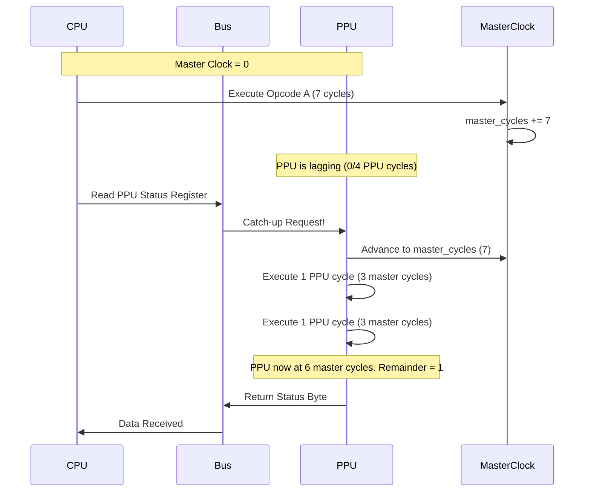

# Lesson 3: Timing Synchronization Models

## 1. First-Principles Intuition & Invariants

Emulation is fundamentally an act of temporal translation. We take a physical system composed of silicon, crystals, and analog circuitry operating at a specific frequency and map its deterministic state transitions onto a sequential, Von Neumann host architecture. The central paradox of this translation is that while the host machine is thousands of times faster than the guest, it must simulate the guest at exactly the guest's original speed, synchronizing multiple asynchronous hardware components to each other and to the external world. If the emulation runs too fast, the audio crackles and the gameplay becomes an unplayable blur. If it runs too slow, the host falls behind real-time, causing input lag and dropped frames. Managing this temporal mapping requires us to build a software-defined clock domain architecture.

To understand timing synchronization, we must first distinguish between functional accuracy and cycle accuracy. Functional accuracy ensures that a game produces the correct output eventually. If an instruction moves a value from one register to another, functional accuracy only cares that the destination register eventually holds the value. Cycle accuracy demands that the state transition occurs at the exact clock cycle the physical hardware would have performed it. Cycle accuracy is critical because hardware components share a system bus and run concurrently. A CPU might read a video status register in the middle of a scanline. If the video processor has not processed the exact number of cycles corresponding to the CPU's current state, the CPU will read stale or premature data, corrupting the game state.

The foundational invariant of cycle-accurate emulation is determinism through monotonic time. Every hardware component in the guest system derives its clock from a single master oscillator. For example, the NTSC Nintendo Entertainment System relies on a 21.477272 MHz crystal. The CPU divides this by 12 to run at roughly 1.79 MHz, while the Picture Processing Unit (PPU) divides it by 4 to run at roughly 5.37 MHz. Because they share a root clock, their phases are fixed. If the CPU executes an instruction lasting three cycles, exactly nine PPU cycles have elapsed. The emulation must preserve this rigid ratio. We enforce this by maintaining a global master cycle counter. The master counter never decreases and dictates the absolute timeline of the emulated system.

When the CPU and PPU interact, they do so across this shared timeline. If the CPU executes a batch of instructions and then writes to a PPU register, the PPU must process all the cycles that elapsed during that CPU batch before applying the write. We call this catching up the target component. This brings us to the second invariant: event causality. A bus read or write must reflect the exact state of the target component at the moment of the access, not the state at the beginning or end of an instruction. Violating this invariant breaks games that rely on precise raster effects, where the CPU changes video registers mid-scanline to alter background colors or scroll positions.

## 2. Core Architecture & Mechanics

Achieving cycle accuracy naively by stepping every component one master cycle at a time destroys host performance. A tight loop executing `cpu_step(1); ppu_step(3); apu_step(1);` prevents the host CPU from utilizing instruction pipelining and branch prediction effectively, as the guest state machines thrash the host's branch predictor. The industry standard solution is cycle-stealing, an event-driven catch-up architecture. 

In a cycle-stealing architecture, we let the CPU run ahead, executing whole instructions and accumulating its elapsed cycles in the global master clock. The PPU and Audio Processing Unit (APU) remain idle until an event requires their synchronization. This event occurs when the CPU reads or writes a hardware register, or when a component needs to trigger a CPU interrupt. At that moment, the emulator catches up the target component by executing all its pending logic in a tight, optimized batch.

The following diagram illustrates the catch-up mechanism. The CPU executes two instructions, advancing the master clock by 12 and 7 master cycles respectively. The PPU lags behind. When the CPU attempts to read the PPU status register, the emulator forces the PPU to process all 19 elapsed master cycles, yielding 4 PPU cycles, before returning the status byte.



To implement this, we construct an emulator context that holds the global master clock and the internal cycle counters for each component. The following C code defines the core data structures and the catch-up logic for a generic 8-bit system with a 12:4 master clock division ratio.

```c
#include <stdint.h>
#include <stdbool.h>
#include <stdlib.h>
#include <string.h>

#define CPU_DIVISOR 12
#define PPU_DIVISOR 4

typedef struct {
    // Global absolute time
    uint64_t master_cycles;
    
    // Component internal state
    struct {
        uint64_t cycles;
        int scanline;
        int pixel;
        bool vblank;
        bool nmi_pending;
    } ppu;
    
    struct {
        uint64_t cycles;
        int16_t sample;
    } apu;
    
} EmulatorContext;

// Advances the PPU state machine by a specific number of PPU cycles.
// In a full emulator, this would calculate pixels, trigger VBLANK, etc.
static void ppu_run_cycles(EmulatorContext* ctx, uint64_t ppu_cycles_to_run) {
    uint64_t target_cycles = ctx->ppu.cycles + ppu_cycles_to_run;
    while (ctx->ppu.cycles < target_cycles) {
        ctx->ppu.cycles++;
        // Simulate scanline rendering
        ctx->ppu.pixel++;
        if (ctx->ppu.pixel >= 341) { // 341 pixels per scanline
            ctx->ppu.pixel = 0;
            ctx->ppu.scanline++;
            if (ctx->ppu.scanline == 241) {
                ctx->ppu.vblank = true;
                ctx->ppu.nmi_pending = true; // Trigger CPU interrupt
            }
            if (ctx->ppu.scanline >= 262) {
                ctx->ppu.scanline = 0;
                ctx->ppu.vblank = false;
            }
        }
    }
}

// Catches up the PPU to the current global master clock.
static void ppu_catch_up(EmulatorContext* ctx) {
    // Calculate how many PPU cycles correspond to the elapsed master cycles
    uint64_t expected_ppu_cycles = ctx->master_cycles / PPU_DIVISOR;
    
    if (ctx->ppu.cycles < expected_ppu_cycles) {
        uint64_t cycles_to_run = expected_ppu_cycles - ctx->ppu.cycles;
        ppu_run_cycles(ctx, cycles_to_run);
    }
}

// CPU reads a PPU register
uint8_t cpu_read_ppu_register(EmulatorContext* ctx, uint16_t address) {
    // MUST catch up the PPU before reading its state!
    ppu_catch_up(ctx);
    
    if (address == 0x2002) { // PPUSTATUS register
        uint8_t status = 0;
        if (ctx->ppu.vblank) status |= 0x80; // Bit 7 is VBlank flag
        // Reading PPUSTATUS clears the VBlank flag
        ctx->ppu.vblank = false;
        return status;
    }
    return 0; // Other registers omitted for clarity
}

// Simulates a single CPU instruction. 
// In a real emulator, this would be a massive switch statement or function pointer table.
// We assume the instruction took 7 cycles for this example.
void cpu_step(EmulatorContext* ctx) {
    // CPU execution logic goes here...
    // For demonstration, we just advance the master clock by the instruction's cycle count.
    uint8_t instruction_cycles = 7; 
    
    // Advance the global master clock
    ctx->master_cycles += (instruction_cycles * CPU_DIVISOR);
    
    // Check if the PPU generated an interrupt while we were executing
    // We catch up the PPU to see if an NMI should be triggered
    ppu_catch_up(ctx);
    
    if (ctx->ppu.nmi_pending) {
        ctx->ppu.nmi_pending = false;
        // Trigger CPU Non-Maskable Interrupt (NMI)
        // This would push PC and Status to stack and jump to interrupt vector
    }
}
```

The catch-up mechanism solves internal guest synchronization, but we must also synchronize the guest to the host's audio and video outputs. Audio synchronization relies on a lock-free Single-Producer Single-Consumer (SPSC) ring buffer. The emulator's APU catch-up routine generates samples and pushes them to the buffer. The host's audio driver thread continuously pulls samples from this buffer. If the emulator runs too fast, the buffer overflows, causing audio popping. If it runs too slow, the buffer empties, causing silence gaps.

The following C code implements a high-performance, allocation-free lock-free ring buffer suitable for audio synchronization. It uses `atomic_size_t` for indices, ensuring that the producer (emulator thread) and consumer (audio thread) never require mutex locks, which would introduce latency jitter.

```c
#include <stdatomic.h>

#define AUDIO_BUFFER_SIZE 16384 // Must be power of 2
#define AUDIO_MASK (AUDIO_BUFFER_SIZE - 1)

typedef struct {
    int16_t buffer[AUDIO_BUFFER_SIZE * 2]; // Stereo interleaved
    atomic_size_t write_idx;
    atomic_size_t read_idx;
} AudioRingBuffer;

void audio_ring_init(AudioRingBuffer* rb) {
    atomic_store(&rb->write_idx, 0);
    atomic_store(&rb->read_idx, 0);
}

// Called by the emulator thread (producer)
void audio_ring_push(AudioRingBuffer* rb, int16_t left, int16_t right) {
    size_t write = atomic_load_explicit(&rb->write_idx, memory_order_relaxed);
    size_t read = atomic_load_explicit(&rb->read_idx, memory_order_acquire);
    
    // Check if buffer is full. Leave one slot empty to distinguish full from empty.
    if (((write - read) & AUDIO_MASK) == AUDIO_MASK) {
        return; // Buffer overflow, drop sample
    }
    
    rb->buffer[write * 2] = left;
    rb->buffer[write * 2 + 1] = right;
    
    atomic_store_explicit(&rb->write_idx, (write + 1) & AUDIO_MASK, memory_order_release);
}

// Called by the host audio thread (consumer)
bool audio_ring_pop(AudioRingBuffer* rb, int16_t* out_left, int16_t* out_right) {
    size_t read = atomic_load_explicit(&rb->read_idx, memory_order_relaxed);
    size_t write = atomic_load_explicit(&rb->write_idx, memory_order_acquire);
    
    if (read == write) {
        return false; // Buffer empty
    }
    
    *out_left = rb->buffer[read * 2];
    *out_right = rb->buffer[read * 2 + 1];
    
    atomic_store_explicit(&rb->read_idx, (read + 1) & AUDIO_MASK, memory_order_release);
    return true;
}

// Utility to measure buffer fill percentage for dynamic pacing
float audio_ring_fill_level(AudioRingBuffer* rb) {
    size_t write = atomic_load(&rb->write_idx);
    size_t read = atomic_load(&rb->read_idx);
    size_t fill = (write - read) & AUDIO_MASK;
    return (float)fill / (float)AUDIO_BUFFER_SIZE;
}
```

## 3. High-Performance Optimization & Failure Modes

Internal hardware synchronization guarantees determinism, but it does not prevent the emulator from running out of sync with the physical world. A frame pacing governor is required to ensure the host presents frames at the guest's native refresh rate, typically 59.94 Hz for NTSC systems. If we simply run the emulator loop as fast as possible, it will consume 100% of a host CPU core and desynchronize from the host display's vertical blank. We must sleep the emulator thread between frames. However, standard host OS sleep functions, like `usleep` or `Sleep`, are imprecise due to OS scheduler granularity, often rounding up to the nearest millisecond. 

A robust frame pacing governor combines a high-precision timer with dynamic audio buffer monitoring. We calculate the target time for the next frame based on the monotonic clock. If the emulator finishes a frame early, it calculates the remaining time and sleeps. To correct for OS scheduling jitter, we monitor the audio ring buffer's fill level. If the buffer is draining too fast, the host is running slow, and we should skip the sleep to catch up. If the buffer is overfilling, the host is running fast, and we should increase the sleep duration slightly.

The following C code demonstrates a production-grade frame pacing governor using `clock_gettime` on POSIX systems. It adjusts the sleep duration dynamically based on the audio buffer's fill level, targeting a 50% watermark to absorb scheduling spikes.

```c
#include <time.h>

#define TARGET_FPS_NUM 60000
#define TARGET_FPS_DEN 1001 // NTSC 59.94 Hz exact rational
#define FRAME_TIME_NS (1000000000ULL * TARGET_FPS_DEN / TARGET_FPS_NUM)
#define AUDIO_WATERMARK_TARGET 0.50f

typedef struct {
    uint64_t next_frame_time_ns;
    struct timespec start_time;
} FrameGovernor;

void governor_init(FrameGovernor* gov) {
    clock_gettime(CLOCK_MONOTONIC, &gov->start_time);
    gov->next_frame_time_ns = (uint64_t)gov->start_time.tv_sec * 1000000000ULL + 
                              (uint64_t)gov->start_time.tv_nsec + FRAME_TIME_NS;
}

static uint64_t get_monotonic_ns() {
    struct timespec now;
    clock_gettime(CLOCK_MONOTONIC, &now);
    return (uint64_t)now.tv_sec * 1000000000ULL + (uint64_t)now.tv_nsec;
}

static void precise_sleep(uint64_t target_ns) {
    struct timespec req;
    req.tv_sec = target_ns / 1000000000ULL;
    req.tv_nsec = target_ns % 1000000000ULL;
    // nanosleep is more precise than usleep, though still OS-dependent.
    // A busy-wait loop using get_monotonic_ns can be used for the last 100us.
    nanosleep(&req, NULL);
}

void governor_sync(FrameGovernor* gov, AudioRingBuffer* audio_rb) {
    uint64_t current_time = get_monotonic_ns();
    
    // Calculate how much time we have until the next frame is due
    int64_t sleep_ns = (int64_t)(gov->next_frame_time_ns - current_time);
    
    // Dynamic audio adjustment: 
    // If audio buffer is >50% full, we are running fast, increase sleep.
    // If audio buffer is <50% full, we are running slow, decrease sleep (or skip).
    float audio_fill = audio_ring_fill_level(audio_rb);
    float fill_diff = audio_fill - AUDIO_WATERMARK_TARGET;
    
    // Scale the adjustment. 10ms max adjustment based on audio drift.
    int64_t audio_adjust_ns = (int64_t)(fill_diff * 10000000.0f); 
    
    sleep_ns += audio_adjust_ns;
    
    if (sleep_ns > 0) {
        precise_sleep((uint64_t)sleep_ns);
    }
    
    // Advance the next frame time. 
    // If we slept too long due to OS scheduling, we don't want to accumulate latency.
    // We set the target to the absolute future, ensuring we never drift permanently.
    current_time = get_monotonic_ns();
    while (gov->next_frame_time_ns < current_time) {
        gov->next_frame_time_ns += FRAME_TIME_NS;
    }
}
```

Even with precise pacing, emulators face failure modes rooted in edge cases of hardware design. One critical failure mode involves dynamic cycle injection during CPU interrupt handling. When a hardware interrupt occurs, the CPU requires additional cycles to push the program counter and status register to the stack. If our `cpu_step` function assumes a static cycle count per instruction, it will fail to advance the master clock for these stack operations. This causes the PPU to lag behind, breaking cycle accuracy and corrupting scanline timing. The solution requires the CPU execution loop to return dynamically, allowing the scheduler to account for interrupt latency.

Another failure mode arises from integer overflow in cycle counters. While a 32-bit integer can count over 4 billion cycles, at 21 MHz, this rolls over in roughly 200 seconds. If an emulator relies on 32-bit cycle counters without modular arithmetic, it will crash or desynchronize after a few minutes of play. All master and component cycle counters must be 64-bit unsigned integers. At 21 MHz, a 64-bit counter will not overflow for over 27,000 years.

Finally, host scheduling preemption remains an unavoidable failure mode. If the host OS preempts the emulator thread for 50 milliseconds, the audio buffer will underrun, producing a audible pop. We mitigate this by sizing the audio ring buffer to hold enough samples to survive typical OS scheduling latency. At a 44.1 kHz sample rate, 50 milliseconds requires roughly 2,205 samples. Setting the `AUDIO_BUFFER_SIZE` to 16384 provides a massive safety margin, though it introduces a slight input-to-audio latency. The tradeoff between buffer size, latency, and stability is a constant tension in emulator design, resolved only by careful tuning to the target host platform.
