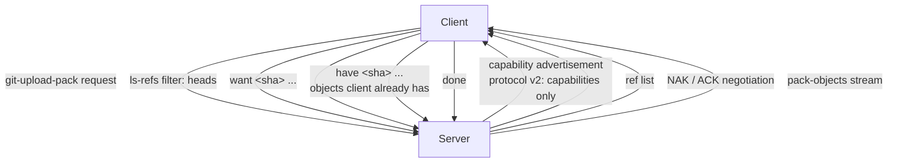

# Lesson 4: Distributed Workflows and Network Protocols

## 1. First-Principles Intuition & Invariants

Git is not a synchronization tool. This distinction, easy to dismiss as semantic pedantry, is in fact the foundational invariant from which every networking behavior in Git flows. A synchronization tool assumes a canonical truth and propagates it. Git instead models a universe of independent content-addressable object stores, each complete and authoritative in its own right, connected by a voluntary transfer protocol that moves only what is strictly necessary. Understanding why Git works the way it does across a network requires first internalizing this: every repository is a peer, and "remote" is a naming convention, not an architectural privilege.

The object model is what makes distributed operation tractable. Because every object — blob, tree, commit, tag — is identified by the SHA-1 or SHA-256 hash of its content, two repositories that contain an object with the same hash contain identical data, with mathematical certainty. This content-addressability is the network protocol's load-bearing invariant. When two Git processes negotiate a transfer, they are solving a set-difference problem: given two sets of object hashes, compute the minimal set of objects that one side has and the other side lacks, then transmit only those objects. No timestamps, no sequence numbers, no distributed locks, and no central authority are required. The hashes are the consensus mechanism.

This architecture descends directly from the problem Linus Torvalds was solving in 2005. The Linux kernel development model involved hundreds of contributors operating in parallel across time zones, maintaining local patch queues, and exchanging changesets through email and BitKeeper. The catastrophic lesson from that period was that any system requiring a central server for correctness — or even for performance — would become a single point of failure both technically and socially. Git's design encodes the assumption of network unreliability and organizational distrust at the protocol level. A repository is not degraded by being offline; it is merely temporarily isolated. When it reconnects, the merge algorithm operates on the same mathematical objects regardless of how much time elapsed during the partition.

The concept of a "remote" in Git is therefore a local configuration artifact, not a network topology fact. When you run `git remote add origin https://github.com/user/repo.git`, you are writing three things into `.git/config`: a name (`origin`), a URL, and a default refspec mapping. No network connection is established, no handshake occurs, and the remote repository is not notified. The remote is a memo to your local Git instance about where to find another object store and how to map its reference namespace onto your own. This distinction becomes critical when reasoning about fetch and push semantics.

A refspec is the most underappreciated primitive in Git's distributed model. It is a mapping rule with the form `[+]<src>:<dst>`, where `src` is a pattern in the source repository's reference namespace and `dst` is a pattern in the destination namespace. The optional `+` prefix means "allow non-fast-forward updates" — it is the refspec-level equivalent of `--force`. The default fetch refspec installed by `git remote add` is `+refs/heads/*:refs/remotes/origin/*`, which maps every branch on the remote into your local `refs/remotes/origin/` namespace, with force-update semantics. This is not a shorthand or a convention; it is the literal instruction Git evaluates when you run `git fetch origin`. The remote-tracking references you see as `origin/main` are not copies of branches — they are local references in a separate namespace that record the last known state of the remote's branches at the time of the last fetch. They are historical facts, not live pointers.

The pack file is the second load-bearing primitive. Git's object store can represent objects individually as loose files, but transmitting thousands of individual objects across a network would be both inefficient and slow to assemble at the receiving end. The pack format solves this by collecting a set of objects into a single binary stream with delta compression applied across the object graph. When Git decides which objects to send, it doesn't just compress each object independently. It identifies base objects and stores subsequent objects as binary deltas against those bases, using a sliding window heuristic to find the best delta candidates regardless of whether those candidates are ancestral commits or entirely different files of similar size. The result is a pack file whose compression ratio regularly exceeds what gzip achieves on the raw objects, because the delta algorithm operates semantically on object content rather than blindly on byte streams.

## 2. Core Architecture & Mechanics

### The Transport and Reference Discovery Handshake

Git supports three transport families: the dumb HTTP protocol (deprecated but historically significant), the smart HTTP protocol, the SSH transport, and the Git wire protocol over a direct TCP connection to `git-daemon`. The smart HTTP and SSH transports both ultimately speak the same Git pack protocol; the transport layer is merely the tunnel.

When you execute `git fetch origin`, the following sequence of operations unfolds. Your local Git process establishes a connection to the remote URL and invokes the `git-upload-pack` process on the server side. The server immediately advertises all of its references — every branch, every tag, every note ref — along with their current SHA hashes. In protocol version 0 and 1, this advertisement was unconditional and unbounded, which created a significant scalability problem for repositories with tens of thousands of branches (a common situation in large monorepo deployments at Google, Meta, and Microsoft). Protocol version 2, introduced in Git 2.18 and now the default, inverts this model: the server advertises its capabilities first, and the client then issues a filtered `ls-refs` command specifying exactly which reference prefixes it wants to see. This lazy reference advertisement reduces the initial round-trip cost from O(total refs) to O(requested refs).



The `want`/`have` negotiation is the heart of the fetch protocol and deserves close examination. After receiving the remote's reference list, the client identifies the tip commits it wants (the `want` set) and begins advertising the commit hashes it already has (the `have` set). The goal is for the server to identify the greatest common ancestor set — the boundary commits that both sides share — so it knows exactly which objects to include in the pack file it will send. The client sends `have` lines in a round-trip loop, walking back through its commit history from all local branch tips in a breadth-first traversal. The server responds with `ACK <sha>` when it recognizes a commit the client has, allowing the client to prune that subtree from further advertisement. When the client has exhausted its history advertisement or the server signals sufficient common ground, the client sends `done`, and the server sends the pack file containing exactly the objects the client needs to reach the requested tips from the acknowledged common ancestors.

This negotiation protocol has a subtle but important property: it is monotonically convergent. Each round of `have` lines transmitted moves both sides closer to agreement on the common boundary. It cannot oscillate or diverge because the commit graph is a DAG with a finite number of nodes, and the breadth-first walk guarantees that every reachable commit will eventually be advertised as a `have`. In the worst case — a completely disconnected clone with no common history — the negotiation degenerates to a full pack of all remote objects, which is precisely what `git clone` performs on first contact.

### Pack File Construction and Delta Compression

The server-side `git pack-objects` process constructs the pack file once the common ancestor boundary is established. It first enumerates all reachable objects from the `want` tips that are not reachable from the boundary commits (the "thin" pack boundary), then sorts those objects by a heuristic that groups similar objects together to maximize delta compression opportunities. The sorting criterion is a combination of object type, file path extension, and object size, because objects of similar type and similar name tend to have similar content and therefore yield better deltas.

Delta compression applies a binary diff between a base object and a target object, producing an instruction stream of copy operations (`copy N bytes from offset O in base`) and insert operations (`insert these N literal bytes`). The delta search runs a sliding window of configurable depth (default 10, tunable via `pack.window` and `pack.depth`) over the sorted object list, attempting to find the best base for each object within the window. The resulting pack format stores objects as either non-deltified raw zlib-compressed content or as `OBJ_OFS_DELTA` / `OBJ_REF_DELTA` entries pointing to their base. The pack index file (`.idx`) maps SHA hashes to byte offsets within the pack, enabling O(log n) random access to any object without decompressing the entire pack.

```text
Pack File Layout (v2):

┌─────────────────────────────────────────────────────┐
│ Magic: "PACK"  │ Version: 4 bytes │ Obj Count: 4 bytes│
├─────────────────────────────────────────────────────┤
│ Object 0:                                           │
│   [type+size varint] [compressed data or delta]     │
├─────────────────────────────────────────────────────┤
│ Object 1:                                           │
│   [OBJ_OFS_DELTA] [negative offset to base]         │
│   [compressed delta instructions]                   │
├─────────────────────────────────────────────────────┤
│ ...                                                 │
├─────────────────────────────────────────────────────┤
│ SHA-1 checksum of entire pack (20 bytes)            │
└─────────────────────────────────────────────────────┘
```

The receiving `git index-pack` process validates the pack by verifying the trailing checksum, resolving all delta chains to confirm object integrity, and constructing the index. It then atomically moves the validated pack into `.git/objects/pack/`, after which the fetched objects are durably available. Only then does `git fetch` update the remote-tracking references in `.git/refs/remotes/origin/` and append the fetch result to `FETCH_HEAD`.

### Push Protocol and Reference Update Atomicity

The push protocol is structurally symmetric to fetch but runs `git-receive-pack` on the server side instead of `git-upload-pack`. The critical asymmetry is authorization and atomicity: the server enforces reference update rules, and Git 2.x introduced atomic pushes that apply all reference updates as a single transaction or none at all.

When you execute `git push origin main`, the client first performs a reference discovery handshake identical to fetch to learn the current state of the remote's references. It then computes which local commits are not yet present on the remote by comparing the remote's current tip against the local branch tip. It transmits a pack file containing those commits, then sends a reference update command: `<old-sha> <new-sha> refs/heads/main`. The server validates that this update is a fast-forward (the old SHA is an ancestor of the new SHA) unless force is specified. If the server supports atomic pushes, the client can send multiple update commands and request that they be applied atomically, which is essential for maintaining consistency when pushing to multiple branches simultaneously — for example, when updating both a release branch and a tracking tag in a single operation.

The push's force-safety check is not advisory; it is a hard protocol-level rejection. The server responds with `ng refs/heads/main non-fast-forward` if the client's old-SHA does not match the server's current tip, meaning another push occurred between the client's discovery and its update attempt. This is a classic TOCTOU race condition mitigated by the protocol's compare-and-swap semantics: the update command carries the old SHA the client observed, and the server rejects the update if that SHA is no longer current. This is as close to a distributed lock as Git's protocol gets, and it is intentionally narrow in scope — it protects only the specific reference being updated, not the entire repository.

### Remote-Tracking Branches and Upstream Configuration

Remote-tracking references occupy the `refs/remotes/<name>/` namespace and serve as a local cache of the remote's reference state at the time of the last fetch. They are updated atomically at the end of a successful fetch, reflect the remote's history faithfully, and are never modified by local commits. This namespace separation is what allows `git log origin/main..main` to show you exactly what commits you have locally that the remote has not yet seen, without any network access, by comparing two local reference pointers.

The upstream tracking relationship between a local branch and a remote-tracking branch is configured in `.git/config` as `branch.<name>.remote` and `branch.<name>.merge`. These two keys together tell Git which remote and which remote branch a local branch is "tracking." The tracking relationship drives the `@{upstream}` syntax and the ahead/behind count shown by `git status`. When you run `git branch --set-upstream-to=origin/main main`, Git writes these two config keys. The relationship is strictly local — it exists only in your `.git/config` and has no effect on the remote repository.

```ini
[branch "main"]
    remote = origin
    merge = refs/heads/main

[remote "origin"]
    url = git@github.com:user/repo.git
    fetch = +refs/heads/*:refs/remotes/origin/*
```

The `merge` key stores a full refspec source (not the remote-tracking ref but the remote's actual branch ref), because `git pull` uses it to construct the merge or rebase command after fetching. This is why `git pull` without arguments merges `refs/heads/main` from `origin` rather than the local `refs/remotes/origin/main` — it fetches the remote ref into the remote-tracking namespace, then merges the remote ref's tip, now locally available, into the current branch.

## 3. High-Performance Optimization & Failure Modes

### Partial Clone, Sparse Checkout, and Blobless Repositories

The default clone model fetches every object reachable from every advertised reference, which is correct for a small repository but pathological for a large one. The Linux kernel repository, as of 2024, contains over one million commits and several gigabytes of history. A full clone takes many minutes even on a fast connection, and most of that data — old blobs representing files that have not changed recently — is irrelevant to a developer's daily work.

Git's partial clone feature, stabilized in Git 2.22, allows the client to defer fetching blob objects until they are actually needed. You invoke it with `git clone --filter=blob:none <url>`, which instructs the server (via the protocol v2 object filter capability) to omit all blob objects from the initial pack. The resulting clone contains the complete commit and tree graph — meaning all history metadata and directory structure is intact — but actual file content is absent for historical commits. When you check out a branch, Git fetches only the blobs needed for that tree on demand, in a single batched request using the `git fetch --filter` mechanism. The practical result for a repository like the Linux kernel is that the initial clone drops from several gigabytes to a few hundred megabytes, with no degradation in `git log`, `git blame`, or history traversal performance.

The `--filter=tree:0` variant goes further, omitting both blobs and trees for commits not being checked out, reducing the clone to essentially a list of commit objects with their metadata. This "treeless" clone is useful for CI systems that need to traverse commit history for changelog generation or bisection without ever needing to read file content.

Sparse checkout complements partial clone at the working tree level. After a blobless clone, `git sparse-checkout set path/to/module` restricts the working tree to a subtree, and Git fetches blobs only for objects within that cone. The sparse-checkout cone mode (enabled with `git sparse-checkout init --cone`) uses an optimized path prefix matching algorithm that avoids reading tree objects for excluded directories, making `git checkout` on a cone-mode sparse repository operate in time proportional to the size of the included cone rather than the full tree.

```bash
# Establish a blobless sparse clone of a large monorepo
git clone --filter=blob:none --sparse git@github.com:org/monorepo.git
cd monorepo

# Restrict working tree to a single service directory
git sparse-checkout set services/payments

# Fetch and check out the working tree; only payment service blobs are fetched
git checkout main
```

### Refspec Manipulation and Multi-Remote Workflows

In a fork-based pull request workflow — the dominant collaboration pattern on GitHub, GitLab, and similar platforms — a developer maintains a personal fork, pushes feature branches to it, and opens a pull request against the upstream repository. The naive configuration uses two separate remotes: `origin` for the fork and `upstream` for the canonical repository. However, refspec customization allows more sophisticated configurations that reduce operational friction.

One powerful pattern is configuring a custom fetch refspec to track pull request references that the upstream exposes but does not advertise as branches. GitHub's servers expose every pull request's head and merge commits under `refs/pull/<number>/head` and `refs/pull/<number>/merge`. Adding the following to `.git/config` causes `git fetch upstream` to materialize all pull requests as local references:

```ini
[remote "upstream"]
    url = git@github.com:torvalds/linux.git
    fetch = +refs/heads/*:refs/remotes/upstream/*
    fetch = +refs/pull/*/head:refs/remotes/upstream/pr/*
```

After fetching, `git checkout upstream/pr/12345` creates a local detached HEAD at the exact commit a pull request submitter pushed, without navigating GitHub's web interface or installing any third-party tooling. For reviewers who need to build, test, or instrument contributor code locally, this workflow is significantly faster than the GitHub UI's checkout suggestion.

The `git push` refspec is equally configurable. Pushing to a different destination ref than the source is legal and occasionally necessary. When working with Gerrit code review, for example, all patches are pushed to the magic `refs/for/<branch>` reference rather than directly to `refs/heads/<branch>`. The push refspec `HEAD:refs/for/main` accomplishes this explicitly. You can embed this in the remote configuration to make `git push` Just Work without the developer needing to remember Gerrit's reference naming convention.

### Bundle Files and Offline Distribution

Git bundles solve a problem that the standard network protocol cannot: transferring repository history when the two endpoints cannot establish a direct TCP or SSH connection. A bundle file is a pack file with a bundle header prepended, encoding the reference tips and prerequisite boundary commits the pack satisfies. You create one with `git bundle create repo.bundle --all` and clone from it with `git clone repo.bundle destination`. The receiver treats the bundle file as a read-only transport exactly like a remote URL.

Incremental bundles are especially useful in air-gapped environments. If you created a full bundle last week and need to transfer this week's commits, `git bundle create incremental.bundle origin/main ^<last-bundle-tip>` produces a pack containing only the new commits, with the old tip as a prerequisite boundary. The receiver can then fetch from the incremental bundle with `git fetch incremental.bundle`, provided their repository already contains the prerequisite commits. If not, Git rejects the bundle with a clear error indicating the missing boundary objects.

### Failure Modes: Divergent History and Forced Updates

The most operationally dangerous failure mode in distributed Git workflows is a force push to a shared branch. When a developer rewrites history on a branch — through interactive rebase, `git commit --amend`, or `git reset` — and then force-pushes, they replace the branch tip with a new commit whose parent chain diverges from the previous tip. Any collaborator who had already fetched the old tip now has commits in their local history that are no longer reachable from the remote branch. `git pull` will not cleanly merge these because the reflog records show a non-fast-forward divergence. The collaborator must run `git fetch` to update their remote-tracking reference, then inspect the divergence with `git log --oneline --left-right HEAD...origin/main`, and finally decide whether to rebase their work onto the new history or hard-reset their local branch.

Git 2.38 introduced `--force-if-includes` as a safer alternative to `--force-with-lease`. The `--force-with-lease` flag, available since Git 1.8.5, refuses the force push if the remote's current tip differs from what the client observed at the time of its last fetch — it is a client-side optimistic lock. However, it has a subtle failure mode: if a background `git fetch` (triggered by IDE tooling or `fetch.writeCommitGraph`) runs between the rebase and the push, it updates the remote-tracking reference without the developer noticing, and `--force-with-lease` accepts the force push even though another developer may have pushed commits in the interim. The `--force-if-includes` flag closes this gap by additionally verifying that the remote-tracking ref tip is reachable from the current branch's reflog, ensuring the developer has actually integrated whatever the remote-tracking ref points to.

```bash
# Safe force push pattern after interactive rebase
git fetch origin main
git rebase origin/main
git push --force-if-includes --force-with-lease=main origin main
```

### Pack Maintenance, Bitmap Indexes, and Reachability Queries

As a repository accumulates objects from repeated fetch operations, the object store can degrade into thousands of loose objects and multiple pack files, each representing a separate fetch or local repack. Reading an object that spans multiple packs requires searching each pack's index sequentially until the object is found. `git gc` consolidates all loose objects and existing packs into a single pack file and rebuilds the pack index, but on large repositories this operation can take hours and must be scheduled carefully to avoid blocking concurrent fetch operations.

Commit-graph files and pack bitmap indexes are the two principal performance tools for reachability queries at scale. The commit-graph file (`.git/objects/info/commit-graph`) is a binary representation of the commit DAG that caches each commit's parent SHAs, tree SHA, author date, and generation number, enabling O(1) random access to commit metadata without decompressing pack objects. Generation numbers enable significant speedups in graph algorithms: determining whether commit A is an ancestor of commit B requires walking the graph only until reaching a commit whose generation number is less than A's generation, rather than traversing the entire reachable history. Git writes this file automatically on `git fetch` when `fetch.writeCommitGraph=true` (the default since Git 2.29).

Pack bitmaps store a precomputed reachability bitmask for a selected set of commits — typically all branch tips and recent commits — in a `.bitmap` file alongside the pack index. When `git pack-objects` needs to enumerate objects reachable from a commit that has a bitmap, it performs bitwise OR operations across bitmaps rather than traversing the object graph. For repositories with millions of objects, bitmap-accelerated pack computation reduces `git clone` server-side overhead from minutes to seconds. GitHub and GitLab both maintain bitmaps on all hosted repositories as a core infrastructure requirement. You can generate bitmaps locally with `git repack -Adb`, which creates a single pack with a bitmap file, enabling fast object enumeration for all subsequent clone and fetch operations served from that repository.

The interaction between partial clone filters and bitmap indexes introduces one additional subtlety: a bitmap computed over a full object set is not directly usable to answer filtered object queries, because the bitmap encodes reachability without regard to object type. Git 2.38 added `--filter` support to bitmap traversal so that blobless clone requests against a bitmapped repository can still benefit from bitmap acceleration, applying the type filter as a post-processing step over the bitmap result rather than falling back to a full graph walk. For teams operating self-hosted Git servers under heavy clone load — a common situation during CI pipeline scaling — enabling both bitmaps and partial clone filters is the highest-leverage infrastructure configuration available without moving to a dedicated Git hosting platform with custom object storage backends.
