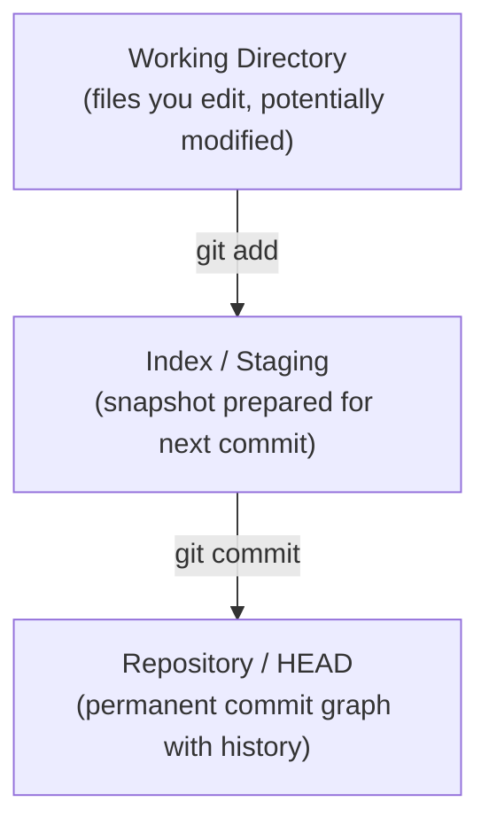

# Lesson 1: Version Control Foundations

## 1. First-Principles Intuition & Invariants

Version control systems exist because software development is fundamentally a collaborative process of managing change across time and people. At its core, Git solves a deceptively simple problem: how do we track every meaningful modification to a codebase, preserve the complete history of decisions, and enable multiple engineers to work concurrently without destroying each other's work? The answer lies in treating source code not as mutable files on disk, but as an immutable directed acyclic graph of snapshots, each cryptographically identified and permanently preserved.

Git's design departs radically from earlier centralized version control systems like Subversion or CVS. Where those systems tracked deltas—the line-by-line differences between file versions—Git operates as a content-addressable filesystem. Every piece of data, whether a single source file, a directory tree, or a complete commit with metadata, receives a unique identifier computed from its content through SHA-1 hashing. This means identical content always produces identical identifiers, enabling automatic deduplication and creating a natural defense against data corruption. The hash becomes both the storage key and the integrity check, forming what cryptographers call a Merkle tree structure where each node's identity depends on the cryptographic hash of its children.

The fundamental invariant of Git's data model is immutability. Once an object enters the object database, it never changes. Commits don't get modified; they get replaced by new commits that reference the old ones. Branches aren't containers that hold commits; they're lightweight pointers that move as new commits arrive. This immutability enables aggressive local caching, trivial rollback to any historical state, and the confidence that pulling changes from a remote repository cannot silently corrupt your existing history. The entire system becomes eventually consistent across distributed repositories because cryptographic hashes provide a universal, content-derived naming scheme that's identical everywhere.

Understanding Git requires internalizing four object types that form its storage primitives: blobs, trees, commits, and tags. A blob stores the raw content of a single file without any metadata—no filename, no permissions, just compressed bytes. A tree object represents a directory, mapping names to either blobs (for files) or other trees (for subdirectories), along with Unix permission bits. A commit object ties together a tree representing the complete project state at one moment, references to zero or more parent commits establishing causality, and metadata including author, timestamp, and commit message. Tags provide human-readable aliases for specific commits, optionally with GPG signatures for cryptographic verification of releases.

The directed acyclic graph emerges naturally from commit parent pointers. Each commit records who came before it, creating edges that flow backward through time. Most commits have exactly one parent, representing linear development. Merge commits have two or more parents, recording where branches converged. The graph is acyclic because commits can only point to ancestors, never creating cycles. This structure enables Git to efficiently answer questions like "what's the common ancestor of these two branches?" through graph traversal algorithms, typically the recursive three-way merge or the more sophisticated Myers diff algorithm for detecting file moves and copies.

Branches in Git are nothing more than files containing 40-character SHA-1 hashes, stored under `.git/refs/heads/`. When you commit on a branch, Git writes a new commit object, then updates the branch file to point at that new commit's hash. The special `HEAD` reference tracks which branch you currently have checked out, typically by containing `ref: refs/heads/main` rather than a direct hash. This indirection means switching branches is instantaneous—just update one pointer—and branches cost essentially nothing in storage. You can create thousands without penalty, enabling workflows like Git Flow or GitHub Flow where short-lived feature branches become the primary unit of work isolation.

## 2. Core Architecture & Mechanics

Git's architecture centers on the object database, a content-addressable store where every object lives in `.git/objects/`. When you add a file to the staging area and commit it, Git performs a precise sequence of operations. First, it compresses the file content using zlib deflate compression. Then it prepends a header consisting of the object type ("blob"), a space, the uncompressed size in ASCII decimal, and a null byte. It computes the SHA-1 hash of this header plus compressed content combination, yielding a 40-character hexadecimal string like `e69de29bb2d1d6434b8b29ae775ad8c2e48c5391`. Git uses the first two characters as a subdirectory name and the remaining 38 as the filename, storing the object at `.git/objects/e6/9de29bb2d1d6434b8b29ae775ad8c2e48c5391`.

The tree object format encodes directory structure through a simple binary protocol. Each entry consists of the Unix permission mode in ASCII (typically "100644" for regular files or "040000" for subdirectories), a space, the filename as UTF-8 bytes, a null byte, and the 20-byte binary SHA-1 hash of the referenced blob or tree. Entries are sorted lexicographically by name with a special rule: directory entries sort as if they had a trailing slash. This canonical ordering ensures that identical directory structures always produce identical tree hashes, regardless of the order files were added.

```text
100644 blob a906cb2a4a904a152e80877d4088654daad0c859    README.md
100644 blob 8f94139338f9404f26296befa88755fc2598c289    main.c
040000 tree 99f1a6d12cb4b6f19c8655fca46c3ecf317074e0    src
```

The commit object ties everything together through a structured text format that's both human-readable and precisely parseable. It begins with a line identifying the root tree hash, then zero or more parent lines for merge commits, followed by author and committer lines with timestamps encoded as Unix epoch seconds plus timezone offset, a blank line, and finally the commit message. Git stores this as a blob with type "commit" rather than "blob", enabling different handling by porcelain commands.

```text
tree 99f1a6d12cb4b6f19c8655fca46c3ecf317074e0
parent 3a0874c6f8b5e6d9a2c8b7f1e5d4c3b2a1098765
author Alice Engineer <alice@example.com> 1704931200 -0800
committer Alice Engineer <alice@example.com> 1704931200 -0800

Implement binary search tree with O(log n) lookup

Refactored the search algorithm to use balanced BST instead of
linear scan, reducing worst-case complexity from O(n) to O(log n).
Added comprehensive unit tests covering edge cases.
```

Reference resolution follows a precise search order when you specify a commit. If you provide a full 40-character SHA-1, Git looks directly in the object database. For abbreviated hashes, it searches for unique prefixes, failing if ambiguous. For branch names like `main`, Git checks `.git/refs/heads/main`. For tags, it examines `.git/refs/tags/`. The special `HEAD` reference typically contains `ref: refs/heads/main`, requiring one level of indirection. Remote-tracking branches live under `.git/refs/remotes/origin/main`. Git also supports relative references: `HEAD^` means the first parent of HEAD, `HEAD~3` means three generations back following first parents, and `HEAD^2` means the second parent of a merge commit.

Packfiles provide Git's mechanism for efficient storage and network transfer. When the object database grows large with thousands of loose objects, Git consolidates them into packfiles—single binary files containing multiple compressed objects with delta compression between similar objects. The pack format uses a sophisticated algorithm that identifies similar files across history, storing one complete version and subsequent versions as binary diffs. The accompanying index file (`.idx`) provides fast hash-to-offset lookups without scanning the entire pack. This compression achieves remarkable density: a repository with 50,000 commits might have hundreds of megabytes of loose objects but compress to under 50 MB in packfile form.

The index, also called the staging area, deserves detailed examination because it's Git's most frequently misunderstood component. The `.git/index` file is a binary structure that caches metadata about every file in the working directory that Git tracks. Each entry records the pathname, file size, modification timestamp, inode number, and the SHA-1 hash of the file's content as it exists in the staging area. This allows Git to detect changes instantly: when you run `git status`, Git stats each tracked file, compares the timestamp and size against the index, and only recalculates hashes for files that might have changed. The index also enables three-way merges by simultaneously tracking the current HEAD commit, the merge target, and local modifications.



Branching mechanics reveal Git's efficiency. Creating a branch writes one 41-byte file (40 hex characters plus newline) containing the commit hash where the branch starts. Switching branches updates HEAD to point at the new branch reference, then replaces working directory contents to match that branch's tree. Git performs this through a three-way operation: it compares the current HEAD tree, the target branch tree, and the index to determine which files need updating, which are locally modified, and which would conflict. For clean checkouts, this operation touches only changed files, preserving inode numbers and timestamps where possible to avoid triggering unnecessary rebuilds.

Merge strategies determine how Git combines divergent branches. The default recursive strategy finds the best common ancestor between the two branch tips using lowest-common-ancestor graph traversal, then performs a three-way merge comparing base, ours, and theirs for every file. When the same region of a file changed on both branches, Git marks a conflict and requires human resolution. The octopus strategy handles merges with more than two parents, useful for pulling multiple feature branches simultaneously. The ours strategy takes all changes from the current branch, ignoring the merge target—useful for marking branches as integrated without actually incorporating their changes. The subtree strategy enables merging a repository as a subdirectory of another project.

Fast-forward merges represent a special case where the target branch is a direct ancestor of the current branch. Instead of creating a merge commit, Git simply updates the current branch pointer to match the target. This preserves linear history and avoids unnecessary merge commits for simple pull operations. The `--no-ff` flag forces creation of a merge commit even when fast-forward is possible, useful for maintaining explicit records of feature branch integration in Git Flow workflows.

## 3. High-Performance Optimization & Failure Modes

Performance optimization in Git begins with understanding repository topology. Linear histories with infrequent merges allow Git to optimize many operations through first-parent traversal, examining only the main line of development. Heavily branched repositories with thousands of merge commits force Git to explore exponentially more of the graph. The `git log --first-parent` and `git merge --no-ff` commands provide explicit control over this tradeoff, letting teams balance between preserving detailed branch history and maintaining fast graph operations.

Large repositories require conscious attention to object database growth. The `git gc` command consolidates loose objects into packfiles, prunes unreachable objects older than two weeks, and rebuilds the commit-graph file that accelerates ancestor queries. Automatic garbage collection triggers when loose object counts exceed thresholds (typically 6,700 objects), but manual invocation with `git gc --aggressive` applies more expensive delta compression for maximum space savings. This operation can take minutes on repositories with millions of objects but reduces storage by 90% or more.

The commit-graph feature, enabled by default in modern Git versions, precomputes and caches graph topology to accelerate operations like `git log --graph`, `git merge-base`, and `git branch --contains`. The `.git/objects/info/commit-graph` file stores parent relationships and generation numbers—the distance from each commit to a root commit—enabling constant-time reachability queries. Repositories with complex merge topology see 10× speedups on `git log` operations after building this cache with `git commit-graph write --reachable`.

Partial clone capabilities introduced in Git 2.17 allow cloning repositories without downloading all historical file content. The `--filter=blob:none` option downloads only commit and tree objects initially, fetching individual blobs on demand when checking out branches. This transforms clone times from minutes to seconds for large repositories. Similarly, `--filter=tree:0` downloads only commits, fetching trees lazily. These filters work through the object database's natural content-addressable design: when Git needs a missing object, it requests it by hash from the remote, which can serve it without any special coordination.

Shallow clones created with `--depth=1` download only recent commits, severing the complete history. This dramatically reduces clone size but sacrifices the ability to compare arbitrary historical commits or push to branches that diverged before the shallow boundary. Shallow clones work by marking specific commits as graft points where history terminates, stored in `.git/shallow`. Commands like `git fetch --unshallow` convert shallow clones back to full depth by downloading missing history.

Reference transaction failures represent one of Git's most critical failure modes. When multiple processes simultaneously attempt to update the same branch reference, Git uses filesystem-level locking through `.git/refs/heads/main.lock` files. If a process crashes while holding a lock, the stale lockfile prevents all future updates until manually removed. Production Git servers must monitor for stale locks and implement cleanup automation. The ref transaction system ensures atomicity: either all reference updates in a transaction succeed or none do, preventing partial failures that would corrupt the repository state.

Corrupted object detection relies on SHA-1 integrity checks. The `git fsck` command walks the entire object graph, verifying that every object's stored hash matches its content hash and that all referenced objects exist. When corruption occurs—typically from disk failures or interrupted writes—Git can often recover by fetching missing objects from a remote. The reflog, stored under `.git/logs/`, records all reference movements even after commits become unreachable through normal graph traversal, providing a safety net for recovering from accidentally reset branches or deleted commits within the 30-90 day reflog retention window.

Large file problems plague repositories that commit binary assets or database dumps. Git's delta compression fails on files that change completely between versions, causing packfile bloat. The solution is Git LFS (Large File Storage), which replaces large blobs with pointer files containing hashes and delegates actual storage to a separate HTTP server. When you `git add` a file matching LFS patterns, Git stores only a 125-byte pointer in the repository while uploading the real content to the LFS server. Clones download pointers by default and fetch actual content only when checking out branches, preventing repository size growth from media assets.

Merge conflict resolution workflows benefit from understanding the index's three stages. During a conflict, the index stores three versions of each conflicted file: stage 0 for the common ancestor, stage 1 for "ours" (current HEAD), and stage 2 for "theirs" (the merge target). The `git checkout --ours <file>` and `git checkout --theirs <file>` commands select one side entirely. The `git show :1:src/main.c` syntax extracts specific stages for manual three-way diff tools. Tools like `vimdiff` or `meld` that display all three versions simultaneously enable more intelligent conflict resolution than editing conflict markers in isolation.

Rebase operations require careful consideration because they rewrite history by creating new commits with identical content but different parent pointers, thus different hashes. When you `git rebase main` on a feature branch, Git finds the common ancestor, generates patches for each commit since that ancestor, switches to the target branch, and applies patches one by one. Conflicts at any step require resolution before continuing. The danger comes from rebasing shared branches: if others have pulled your commits, rewriting them creates duplicate commits with different hashes, leading to confusing merge graphs. The golden rule is to rebase only private branches that haven't been pushed or to use `git push --force-with-lease`, which fails if the remote has been updated since your last fetch, preventing accidental overwrites.

Performance monitoring should track several key metrics. The object count reported by `git count-objects -v` indicates when garbage collection is needed. The packfile count and size reveal storage efficiency. The `git rev-list --all --count` command reports total commits, which affects operations like `git log --all --graph`. Repositories exceeding 100,000 commits or 10 GB of packfile content benefit from advanced techniques like commit-graph, multi-pack indices, and pruning old reflog entries. The `git maintenance start` command, new in Git 2.30, automates these optimizations through scheduled background tasks that keep repositories performant without manual intervention.
