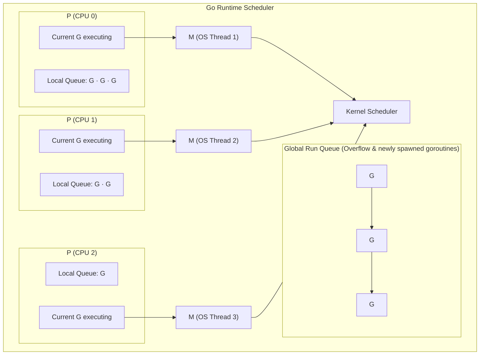

# Lesson 1: Language Fundamentals with Goroutines

## 1. First-Principles Intuition & Invariants

Go emerged in 2009 from Google's Systems Infrastructure group with a singular mandate: to reconcile the mechanical sympathy of C—direct memory control, predictable performance, static compilation—with the ergonomic abstractions of high-level languages while embedding concurrency as a first-class primitive rather than a library afterthought. The language's designers, Robert Griesemer, Rob Pike, and Ken Thompson, inherited decades of distributed systems experience from Plan 9, Inferno, and Newsqueak, and they distilled that knowledge into a type system and concurrency model optimized for multi-core server workloads where thousands of simultaneous operations must coexist without collapsing under coordination overhead.

At its foundation, Go's type system enforces static structural contracts with compile-time verification but eschews the complexity of parametric polymorphism that dominates modern language design. There are no generics in the original specification—only interface satisfaction through structural subtyping, where any concrete type implicitly satisfies an interface if it implements the required method set. This design choice reflects a deliberate trade: the language sacrifices abstract expressiveness to gain compile-time simplicity, fast toolchain iteration, and a shallow cognitive load for reading unfamiliar code. The absence of inheritance hierarchies, exceptions as control flow, and implicit conversions produces a linguistic surface area small enough that a competent systems programmer can internalize the entire specification in days rather than months.

Go's memory model sits atop a runtime-managed heap with concurrent mark-sweep garbage collection, but unlike Java or C#, the runtime does not interpose a virtual machine or JIT compiler. Every Go program compiles to a single static binary embedding the runtime scheduler, memory allocator, and garbage collector as ordinary machine code linked directly into the executable. This architectural decision eliminates deployment dependencies and warm-up latency while retaining deterministic startup performance, a critical property for containerized microservices that must reach steady-state throughput within milliseconds of receiving traffic.

The garbage collector itself has evolved through multiple algorithmic generations, converging on a concurrent tri-color mark-sweep design with sub-millisecond stop-the-world pause targets. The allocator partitions memory into size-segregated spans managed by per-processor caches to minimize lock contention, and it employs a hybrid approach where small objects land in thread-local arenas while large allocations bypass the span infrastructure entirely. Escape analysis during compilation determines whether a variable's lifetime remains stack-confined or requires heap promotion, and the compiler ruthlessly inlines and devirtualizes interface calls when static analysis proves the concrete type, collapsing abstraction overhead to zero in hot paths.

Concurrency in Go rests on two primitives that together form a complete model for structured parallelism: goroutines, which are lightweight user-space threads scheduled cooperatively by the runtime, and channels, which provide typed, synchronized message-passing semantics with optional buffering. These primitives implement Communicating Sequential Processes, a formal concurrency algebra introduced by Tony Hoare in 1978, where independent processes coordinate through explicit message exchange rather than shared memory and locks. The CSP model eliminates entire classes of race conditions and deadlocks by construction, but it demands a shift in reasoning from mutual exclusion and condition variables to dataflow and synchronization points.

A goroutine begins life as a modest 2-kilobyte stack allocation, contrasting starkly with the megabyte-scale fixed stacks imposed by POSIX threads. This economy allows a single process to host tens of thousands of concurrent goroutines without exhausting virtual address space, a feat impossible with traditional one-to-one threading models. The runtime scheduler multiplexes these goroutines across a pool of OS threads using a work-stealing algorithm originally derived from the Cilk runtime, balancing load across processor cores while preserving cache locality. The scheduler operates without preemption in early Go versions, relying instead on cooperative yielding at function prologues and channel operations, though later releases introduced asynchronous preemption via signal-based interrupts to prevent pathological monopolization by tight loops.

The memory model specifies a partial order of happens-before relationships that govern when writes in one goroutine become visible to reads in another. Channel sends and receives establish synchronization edges, as do mutex locks and atomic operations, but unsynchronized access to shared memory produces undefined behavior even on x86 architectures with strong total-store-order guarantees. This deliberate underspecification grants the compiler and hardware freedom to reorder operations for performance, but it imposes a discipline: correct concurrent programs must employ explicit synchronization primitives to sequence operations across goroutines, never relying on timing or instruction ordering for correctness.

Understanding Go's type system requires recognizing that every value belongs to a static type known at compile time, and that type determines both the memory layout and the operations available on that value. Basic types—integers, floats, booleans, strings—map directly to machine representations with specified sizes and alignment. Composite types—arrays, slices, maps, structs, pointers—build atop these primitives with defined semantics for initialization, copying, and comparison. The slice, a triplet of pointer, length, and capacity, encapsulates a view into an underlying array and serves as Go's primary sequence abstraction, replacing error-prone pointer arithmetic with bounds-checked indexing. Maps provide amortized constant-time lookup through runtime-managed hash tables, but they offer no ordering guarantees and no safe concurrent access without external synchronization.

Interfaces introduce dynamic dispatch through a two-word representation: one word points to the concrete value, the other to a method table describing how to invoke each interface method on that value. This indirection enables polymorphism without inheritance, but it carries performance implications. Interface method calls cannot be inlined unless the compiler proves the concrete type through whole-program analysis, and boxing a value into an interface often forces a heap allocation if the value exceeds the size of a pointer. Recognizing when interface conversions occur and understanding their cost separates performant Go code from abstractions that collapse under production load.

The initialization order of package-level variables follows a topological sort of their dependency graph, resolving cycles by reporting a compile-time error. The `init` function, if present, runs after all variable initializers complete but before `main` begins, providing a hook for side-effecting setup that must precede normal execution. This deterministic initialization model contrasts with the undefined order of C++ static constructors and eliminates a notorious source of subtle bugs in large codebases.

Function values in Go capture their lexical environment, creating closures that heap-allocate the captured variables and extend their lifetimes beyond the creating function's return. This mechanism enables elegant abstractions like iterators and callbacks, but it introduces aliasing that escape analysis must track to determine allocation strategy. A closure that never outlives its parent can remain stack-allocated, but one that escapes into a channel or global variable forces its captured state onto the heap, creating garbage collection pressure invisible in the source text.

Defer statements schedule cleanup actions that execute when the surrounding function returns, providing a disciplined alternative to error-prone manual resource release. Each defer pushes a record onto a per-goroutine stack, and the runtime unwinds this stack in LIFO order during return, even if the function panics. This model ensures that locks release, files close, and invariants restore regardless of control flow, but it imposes overhead: deferred calls in tight loops can dominate execution time, and optimizing them requires either hoisting the defer outside the loop or replacing it with explicit cleanup logic.

Panic and recover implement Go's exception mechanism, but the language strongly discourages their use for ordinary error handling. A panic unwinds the call stack, running deferred functions until a recover call intercepts it or the program terminates. Unlike exceptions in Java or C++, panics do not carry type information and cannot be caught selectively; recover either captures the panic value or returns nil. This design nudges programmers toward explicit error returns, reserving panics for truly unrecoverable faults like out-of-bounds array access or nil pointer dereference, where continuing execution would violate program invariants.

## 2. Core Architecture & Mechanics

The Go runtime scheduler implements an M:N threading model where M goroutines multiplex onto N OS threads, with the runtime dynamically adjusting N to match available parallelism. This architecture rests on three core structures: G, the goroutine descriptor; M, the machine thread; and P, the processor, an abstract execution context that mediates between goroutines and threads. The scheduler maintains per-P run queues of runnable goroutines and a global queue for overflow, employing work stealing to balance load when local queues drain.



Each P maintains a bounded local run queue holding up to 256 goroutines, and when that queue fills, the scheduler pushes half the entries to the global queue to redistribute work. When a P's local queue empties, the scheduler attempts work stealing by randomly selecting another P and transferring half of its queue, ensuring that idle threads quickly discover work without centralized coordination. This decentralized design minimizes lock contention and scales to hundreds of cores, but it trades strict fairness for throughput: a goroutine might wait in the global queue while others execute repeatedly if local queues remain populated.

A goroutine begins in the runnable state after creation via the `go` keyword. The runtime allocates its initial stack from a pool of 2KB spans and initializes its program counter to the target function's entry point. The scheduler then enqueues it onto the current P's local queue or, if that queue overflows, onto the global queue. The goroutine remains runnable until a P selects it for execution, at which point it transitions to running. A running goroutine may yield voluntarily by calling a blocking function, such as channel operations, sleep, or I/O, transitioning to waiting. The runtime parks the goroutine, freeing the P to execute other work, and unparks it when the blocking condition resolves, returning it to runnable.

Goroutine stacks grow dynamically through a mechanism called stack splitting, later refined to contiguous stacks. When a function prologue detects insufficient stack space—by comparing the current stack pointer against the goroutine's stack limit—the runtime allocates a larger stack, copies the existing frames, adjusts all internal pointers, and resumes execution. This copying strategy avoids the fragmentation inherent in segmented stacks while maintaining the small initial allocation that enables massive concurrency. Stack shrinking occurs during garbage collection when the runtime detects underutilized capacity, reclaiming memory without requiring explicit programmer intervention.

Channels implement synchronized communication through a runtime-managed structure containing a circular buffer for buffered channels or a direct handoff mechanism for unbuffered channels. A send operation on an unbuffered channel blocks until a corresponding receive executes, providing a rendezvous synchronization point. Buffered channels decouple send and receive by allowing a fixed number of elements to queue, but once the buffer fills, sends block until space becomes available. The channel implementation maintains separate queues for waiting senders and receivers, waking them in FIFO order to preserve message ordering.

```go
package main

import (
	"fmt"
	"runtime"
	"sync"
	"sync/atomic"
	"time"
)

// Demonstrating goroutine lifecycle, channel synchronization, and scheduler behavior

// Worker represents a concurrent task with instrumentation
type Worker struct {
	id       int
	tasks    <-chan Task
	results  chan<- Result
	wg       *sync.WaitGroup
	executed int64
}

type Task struct {
	id      int
	payload int
}

type Result struct {
	taskID   int
	workerID int
	value    int
}

func (w *Worker) Run() {
	defer w.wg.Done()
	
	// Each goroutine binds to the current P, which may migrate across Ms
	// Query the current goroutine ID through stack introspection
	initialP := runtime.GOMAXPROCS(0)
	fmt.Printf("Worker %d started on system with GOMAXPROCS=%d\n", w.id, initialP)
	
	for task := range w.tasks {
		// Simulate computation with varying intensity to trigger scheduler decisions
		result := w.process(task)
		
		// Channel send creates a synchronization edge in the memory model
		// If the receiver isn't ready, this goroutine parks and yields the P
		w.results <- result
		
		atomic.AddInt64(&w.executed, 1)
		
		// Cooperative yield point: allows scheduler to preempt if needed
		// In Go 1.14+, async preemption reduces reliance on explicit yields
		runtime.Gosched()
	}
	
	fmt.Printf("Worker %d completed %d tasks\n", w.id, atomic.LoadInt64(&w.executed))
}

func (w *Worker) process(t Task) Result {
	// Simulate variable workload to demonstrate work stealing
	compute := t.payload
	sum := 0
	for i := 0; i < compute*1000; i++ {
		sum += i
	}
	return Result{
		taskID:   t.id,
		workerID: w.id,
		value:    sum % 1000000,
	}
}

// Coordinator demonstrates channel-based fan-out/fan-in patterns
type Coordinator struct {
	numWorkers int
	tasks      chan Task
	results    chan Result
	wg         sync.WaitGroup
}

func NewCoordinator(numWorkers, bufferSize int) *Coordinator {
	return &Coordinator{
		numWorkers: numWorkers,
		tasks:      make(chan Task, bufferSize),
		results:    make(chan Result, bufferSize),
	}
}

func (c *Coordinator) Start() {
	// Spawn worker pool: each goroutine costs ~2KB initially
	// With 10000 workers, memory footprint is ~20MB before heap allocations
	for i := 0; i < c.numWorkers; i++ {
		c.wg.Add(1)
		worker := &Worker{
			id:      i,
			tasks:   c.tasks,
			results: c.results,
			wg:      &c.wg,
		}
		go worker.Run()
	}
}

func (c *Coordinator) SubmitTasks(count int) {
	for i := 0; i < count; i++ {
		// Unbuffered send would block if no worker is ready
		// Buffered channel decouples producer from consumer up to capacity
		c.tasks <- Task{
			id:      i,
			payload: (i % 10) + 1, // Variable complexity
		}
	}
	close(c.tasks) // Signal completion: workers will exit when drained
}

func (c *Coordinator) CollectResults() []Result {
	// Close results channel after all workers complete
	go func() {
		c.wg.Wait()
		close(c.results)
	}()
	
	var collected []Result
	for result := range c.results {
		collected = append(collected, result)
	}
	return collected
}

// Demonstrating select for multiplexing and timeouts
func selectExample() {
	ch1 := make(chan string)
	ch2 := make(chan string)
	done := make(chan struct{})
	
	go func() {
		time.Sleep(100 * time.Millisecond)
		ch1 <- "from goroutine 1"
	}()
	
	go func() {
		time.Sleep(50 * time.Millisecond)
		ch2 <- "from goroutine 2"
	}()
	
	go func() {
		time.Sleep(200 * time.Millisecond)
		close(done)
	}()
	
	// Select multiplexes multiple channel operations
	// Case selection is pseudo-random when multiple are ready
	for {
		select {
		case msg := <-ch1:
			fmt.Println("Received on ch1:", msg)
		case msg := <-ch2:
			fmt.Println("Received on ch2:", msg)
		case <-done:
			fmt.Println("Timeout: exiting select loop")
			return
		case <-time.After(300 * time.Millisecond):
			fmt.Println("No activity for 300ms")
			return
		}
	}
}

// Memory model demonstration: happens-before relationships
func memoryModelExample() {
	var data int
	ready := make(chan struct{})
	
	// Writer goroutine
	go func() {
		data = 42 // Write occurs before channel send
		close(ready) // Channel send synchronizes-with channel receive
	}()
	
	// Reader goroutine
	<-ready // Channel receive happens-before subsequent reads
	fmt.Println("Data:", data) // Guaranteed to see 42 due to happens-before edge
}

// Race condition illustration: unsynchronized access
func raceExample() {
	counter := 0
	var wg sync.WaitGroup
	
	for i := 0; i < 1000; i++ {
		wg.Add(1)
		go func() {
			defer wg.Done()
			// RACE: multiple goroutines increment without synchronization
			// Use `go run -race` to detect this with the race detector
			counter++ // Read-modify-write is not atomic
		}()
	}
	
	wg.Wait()
	// counter will likely be less than 1000 due to lost updates
	fmt.Println("Final counter (racey):", counter)
}

// Atomic operations provide lock-free synchronization
func atomicExample() {
	var counter int64
	var wg sync.WaitGroup
	
	for i := 0; i < 1000; i++ {
		wg.Add(1)
		go func() {
			defer wg.Done()
			// Atomic increment provides sequential consistency
			atomic.AddInt64(&counter, 1)
		}()
	}
	
	wg.Wait()
	fmt.Println("Final counter (atomic):", atomic.LoadInt64(&counter))
}

// Context propagation for cancellation and deadlines
func contextExample() {
	// Contexts provide a standard way to propagate cancellation signals
	// and deadlines across goroutine boundaries
	parent := context.Background()
	ctx, cancel := context.WithTimeout(parent, 100*time.Millisecond)
	defer cancel()
	
	results := make(chan int)
	
	go func() {
		// Long-running operation that respects cancellation
		select {
		case <-time.After(200 * time.Millisecond):
			results <- 42
		case <-ctx.Done():
			fmt.Println("Operation cancelled:", ctx.Err())
			return
		}
	}()
	
	select {
	case result := <-results:
		fmt.Println("Result:", result)
	case <-ctx.Done():
		fmt.Println("Timeout exceeded")
	}
}

func main() {
	// Configure runtime to use all available cores
	numCPU := runtime.NumCPU()
	runtime.GOMAXPROCS(numCPU)
	fmt.Printf("Running with GOMAXPROCS=%d\n\n", numCPU)
	
	// Demonstrate worker pool with channel-based coordination
	coord := NewCoordinator(10, 50)
	coord.Start()
	
	taskCount := 100
	start := time.Now()
	coord.SubmitTasks(taskCount)
	results := coord.CollectResults()
	elapsed := time.Since(start)
	
	fmt.Printf("\nProcessed %d tasks in %v\n", len(results), elapsed)
	fmt.Printf("Throughput: %.2f tasks/sec\n\n", float64(taskCount)/elapsed.Seconds())
	
	// Memory model and synchronization examples
	fmt.Println("=== Memory Model Example ===")
	memoryModelExample()
	
	fmt.Println("\n=== Race Condition Example ===")
	raceExample()
	
	fmt.Println("\n=== Atomic Operations Example ===")
	atomicExample()
	
	fmt.Println("\n=== Select Multiplexing Example ===")
	selectExample()
	
	fmt.Println("\n=== Context Cancellation Example ===")
	contextExample()
	
	// Runtime statistics for observability
	var memStats runtime.MemStats
	runtime.ReadMemStats(&memStats)
	fmt.Printf("\n=== Runtime Statistics ===\n")
	fmt.Printf("Goroutines: %d\n", runtime.NumGoroutine())
	fmt.Printf("Heap Alloc: %d MB\n", memStats.HeapAlloc/1024/1024)
	fmt.Printf("Total Alloc: %d MB\n", memStats.TotalAlloc/1024/1024)
	fmt.Printf("Sys: %d MB\n", memStats.Sys/1024/1024)
	fmt.Printf("NumGC: %d\n", memStats.NumGC)
}
```

The select statement multiplexes communication across multiple channels, blocking until at least one case becomes ready and pseudo-randomly selecting among ready cases to prevent starvation. A select with a default case never blocks, providing non-blocking channel operations useful for polling or try-send semantics. This construct enables elegant patterns like timeouts, cancellation propagation, and fair multiplexing that would require complex condition variable logic in traditional threading models.

The context package standardizes cancellation and deadline propagation across goroutine boundaries. A context carries a cancellation signal, a deadline, and request-scoped values, forming a tree where parent cancellation transitively cancels all descendants. Functions accepting a context parameter respect cancellation by periodically checking `ctx.Done()` and returning early if the channel closes. This discipline prevents goroutine leaks in long-lived server processes where abandoned operations must terminate cleanly when clients disconnect or timeouts expire.

The sync package provides traditional mutual exclusion primitives for cases where shared-memory concurrency outperforms message passing. A `sync.Mutex` implements an uncontended fast path through atomic compare-and-swap and a contended slow path that parks goroutines in a wait queue, balancing throughput against fairness. Read-write mutexes allow multiple concurrent readers or a single writer, appropriate for read-heavy workloads where contention on a plain mutex would serialize access unnecessarily. Condition variables coordinate complex synchronization protocols where goroutines must wait for arbitrary predicates, but they demand careful reasoning to avoid lost wakeups and spurious signals.

The atomic package exposes lock-free operations on integer and pointer types, providing sequential consistency guarantees sufficient for counters, flags, and simple coordination without mutex overhead. Atomic loads and stores establish synchronization edges in the memory model, ensuring that updates become visible across goroutines without acquiring locks. However, atomic operations compose poorly—multiple atomic operations do not form an atomic transaction—so they suit narrowly scoped use cases where single-word updates suffice.

WaitGroups coordinate goroutine lifetime by tracking a counter incremented before spawning work and decremented when each unit completes. The `Wait` method blocks until the counter reaches zero, providing a barrier synchronization primitive. This pattern dominates fan-out/fan-in scenarios where a coordinator spawns many workers and must await their collective completion before proceeding. Misuse, such as copying a WaitGroup after first use or calling `Add` from the wrong goroutine, produces subtle races that manifest intermittently under load.

The Go type system distinguishes named types from underlying types, where a named type declared via `type` is distinct from its underlying representation even if structurally identical. This distinction enables method attachment and type safety: a `UserID int` and `ProductID int` prevent accidental mixing despite sharing an `int` representation. Conversions between named types and their underlying types require explicit syntax, forcing programmers to acknowledge semantic boundaries that the compiler cannot infer.

Struct field alignment follows the target architecture's requirements, with the compiler inserting padding to satisfy alignment constraints. A struct containing an `int32` followed by an `int64` occupies 16 bytes on 64-bit platforms due to 4 bytes of padding inserted between fields. Reordering fields from largest to smallest often eliminates padding, reducing memory footprint and improving cache efficiency. The `unsafe.Sizeof` and `unsafe.Offsetof` functions expose these layout details, but relying on them sacrifices portability and type safety.

Interfaces introduce dynamic dispatch overhead, but the compiler employs devirtualization to recover static call performance when whole-program analysis proves the concrete type. A method call through a known interface type compiles to a table lookup followed by an indirect jump, but if escape analysis proves the interface value never escapes a local scope and type assertions or switches enumerate all possibilities, the compiler inlines the concrete method directly. Understanding when devirtualization succeeds allows programmers to structure hot paths for maximum throughput.

Empty interfaces, written `interface{}`, match any type and serve as Go's universal type placeholder before generics. Storing a value in an empty interface boxes it, allocating a descriptor containing the type information and the value or a pointer to it. This boxing cost dominates performance in tight loops, and replacing `interface{}` with concrete types or type parameters eliminates it. Reflection through the `reflect` package operates on boxed interface values, inspecting their dynamic type and manipulating their contents, but reflection remains orders of magnitude slower than static dispatch and should remain confined to initialization paths and serialization boundaries.

## 3. High-Performance Optimization & Failure Modes

Optimizing Go programs begins with understanding allocation behavior. The escape analysis phase determines whether variables remain stack-allocated or require heap promotion, and the compiler reports these decisions via `go build -gcflags='-m'`. Heap allocations trigger garbage collection pressure, so confining hot-path data to the stack directly improves throughput. Small functions with local variables that never escape remain stack-allocated, but returning pointers, storing values in globals, or capturing them in closures that outlive their parent forces heap allocation.

Slices and maps introduce subtle allocation patterns. Appending to a slice with insufficient capacity triggers reallocation, copying existing elements to a larger backing array. Preallocating slices via `make([]T, 0, capacity)` eliminates repeated reallocations when the final size is known or bounded. Maps allocate buckets incrementally as they grow, but frequent resizing fragments memory and stalls progress during garbage collection. Preallocating map capacity via `make(map[K]V, size)` amortizes this cost, particularly for maps built once and queried repeatedly.

String concatenation in loops exemplifies a common performance trap. Each concatenation allocates a new string, copying both operands, yielding quadratic time complexity for building a string from many fragments. The `strings.Builder` type accumulates fragments into a growable buffer, performing a single allocation at the end, reducing complexity to linear. Similarly, excessive small allocations in tight loops overwhelm the allocator's thread-local caches, forcing synchronization on central structures. Batching allocations or pooling reusable objects via `sync.Pool` mitigates this contention.

Goroutine leaks arise when goroutines block indefinitely on channels that never close or wait on conditions that never signal. A server handling requests via goroutines must ensure that every spawned goroutine terminates, either through normal completion or context cancellation. Failure to do so accumulates unbounded goroutines, exhausting memory and degrading scheduler performance. The `runtime.NumGoroutine()` function exposes current goroutine count, and production services should monitor this metric for unexpected growth.

Channel deadlocks occur when all goroutines block on channel operations with no pending sends or receives to unblock them. An unbuffered channel requires a sender and receiver to rendezvous simultaneously; if one side never arrives, the program halts. The Go runtime detects global deadlocks—situations where no goroutine remains runnable—and panics with a diagnostic message, but partial deadlocks involving external I/O or timers evade detection and manifest as hangs. Careful protocol design ensures that every blocking operation has a corresponding unblocking event, often enforced through context deadlines or explicit timeouts.

Select statements with multiple ready cases choose pseudo-randomly, but programmers sometimes assume deterministic ordering, introducing subtle race conditions. A select receiving from a data channel and a cancellation channel might process stale data after cancellation if the data case wins the race. Structuring the select to prioritize cancellation via explicit checking before blocking or using a two-stage receive pattern ensures correct cancellation semantics. The `context` package standardizes this discipline, propagating cancellation consistently across API boundaries.

The race detector, enabled via `go test -race` or `go run -race`, instruments memory accesses to detect unsynchronized concurrent operations. It tracks happens-before relationships established by synchronization primitives and reports violations where a write races with another read or write. The detector imposes significant runtime overhead—typically 10x slowdown and 10x memory usage—making it impractical for production but essential during testing. Continuous integration pipelines should include race-detector-enabled test runs to catch concurrency bugs before deployment.

Lock contention degrades performance when multiple goroutines serialize on the same mutex. Profiling via `pprof` exposes contention hotspots through the `mutex` profile, identifying locks that dominate wait time. Mitigation strategies include sharding data structures to reduce contention scope, replacing locks with lock-free algorithms where feasible, or redesigning the architecture to favor message-passing over shared memory. In read-heavy workloads, upgrading from `sync.Mutex` to `sync.RWMutex` allows concurrent readers, but write operations still serialize, so the benefit depends on read-write ratios.

Garbage collection pauses, though sub-millisecond in modern Go releases, still perturb latency-sensitive applications. The collector runs concurrently with application code but requires brief stop-the-world phases for stack scanning and write barrier synchronization. Tuning the `GOGC` environment variable adjusts the heap growth threshold that triggers collection: higher values reduce collection frequency at the cost of increased memory usage, while lower values reduce peak memory but increase CPU overhead. For ultra-low-latency systems, minimizing allocation rate through object pooling and stack-confinement reduces collection frequency more effectively than tuning parameters.

Interface conversions and type assertions carry runtime costs proportional to the interface method set size and the complexity of the type graph. A type assertion `v.(ConcreteType)` checks the dynamic type and either succeeds or panics, while the two-value form `v, ok := v.(ConcreteType)` returns a boolean instead of panicking. Type switches amortize multiple assertions by compiling to a hash table lookup when the case count exceeds a threshold, but they still incur overhead compared to static dispatch. Hot paths should avoid repeated assertions by caching the result or restructuring to use concrete types.

Defer overhead manifests in tight loops where deferring a cleanup operation executes thousands of times per second. Each defer allocates a record on a per-goroutine stack, and the runtime unwinds this stack during return. For critical paths, hoisting the defer outside the loop or replacing it with explicit cleanup reduces this cost, but at the expense of error-handling clarity. Go 1.14 introduced open-coded defers that inline deferred calls when escape analysis proves they do not escape, eliminating much of the overhead for simple cases.

Channel operations carry synchronization overhead that exceeds simple atomic operations but remains cheaper than mutex contention. An unbuffered channel send or receive involves acquiring an internal lock, updating sender/receiver queues, and potentially parking the goroutine, costing hundreds of nanoseconds. Buffered channels reduce this cost when space or data is available, avoiding the parking path. For high-frequency coordination, lock-free queues or batched channel operations improve throughput, though they sacrifice the elegant semantics of synchronous message passing.

Memory ordering and cache coherence become visible in high-contention scenarios where multiple goroutines update adjacent memory locations. False sharing occurs when variables accessed by different goroutines reside in the same cache line, forcing expensive cache coherence traffic despite logical independence. Padding structures to ensure hot fields occupy separate cache lines eliminates this overhead. The `unsafe` package allows precise control over layout, but safe alternatives like aligning slices to cache boundaries or distributing counters across an array often suffice.

Profiling production systems through `runtime/pprof` exposes CPU hotspots, memory allocation patterns, and goroutine blocking behavior. The `net/http/pprof` package embeds an HTTP server exposing these profiles, enabling continuous profiling with minimal overhead. CPU profiles identify functions consuming execution time, while heap profiles reveal allocation-heavy code paths. Block profiles expose synchronization bottlenecks where goroutines spend time waiting on mutexes or channels. Flame graphs generated from these profiles visualize call stacks, making performance bottlenecks immediately apparent.

Compiler optimizations, including inlining, escape analysis, and dead code elimination, profoundly impact generated code quality. The `-gcflags` flag exposes compiler decisions, with `-m` printing optimization choices and `-S` emitting assembly. Inline budgets limit function size eligible for inlining, and exceeding this budget forces call overhead. The `//go:noinline` directive suppresses inlining for benchmarking or debugging, while `//go:nosplit` prevents stack growth checks, useful in runtime-internal functions. Understanding these pragmas and their implications allows fine-grained control over code generation.

Stack growth triggers when a function prologue detects insufficient space, copying the entire stack to a larger allocation. This copying invalidates pointers into the stack, requiring the runtime to rewrite references, a process transparent to Go code but visible in stack traces and debugger sessions. Functions with large local arrays or deep recursion may trigger frequent growth, and rewriting them to heap-allocate large buffers or restructure recursion into iteration avoids this overhead.

The scheduler's cooperative nature in early Go versions meant tight loops could monopolize a P, starving other goroutines. Go 1.14 introduced asynchronous preemption via signal-based interrupts, allowing the runtime to preempt goroutines even in compute-bound loops. However, preemption imposes overhead, so long-running computations should still periodically yield via `runtime.Gosched()` or blocking operations to improve responsiveness. System calls block the executing OS thread, detaching the P to allow other goroutines to run, a mechanism invisible to user code but critical for maintaining throughput in I/O-heavy workloads.

Network I/O integrates with the scheduler through the runtime's netpoller, which uses platform-specific APIs like `epoll` on Linux and `kqueue` on BSD. A goroutine performing network I/O blocks on a channel, parking itself, while the netpoller registers the file descriptor with the kernel. When the kernel signals readiness, the netpoller unparks the goroutine, allowing it to proceed. This model provides blocking semantics to user code while multiplexing thousands of connections onto a handful of threads, achieving the scalability of async I/O with the simplicity of synchronous programming.

Large-scale production systems require telemetry to diagnose runtime behavior under load. The `runtime/metrics` package exposes detailed runtime statistics—GC cycles, heap sizes, scheduler events—through a stable API suitable for continuous monitoring. Exporting these metrics to Prometheus or similar systems enables correlation between application-level performance and runtime behavior, surfacing issues like excessive GC overhead or thread exhaustion. Custom metrics via `expvar` supplement runtime telemetry, providing application-specific observability into goroutine pool sizes, request rates, and error counts.

Tuning GOMAXPROCS adjusts the number of OS threads the runtime uses for parallel execution. By default, it equals the number of logical CPUs, but reducing it can improve cache locality in memory-bound workloads, while increasing it beyond CPU count makes sense only when goroutines frequently block on system calls, allowing the scheduler to overprovision threads for throughput. Setting GOMAXPROCS too low serializes execution, while setting it too high increases context-switch overhead without corresponding throughput gains.

Error handling in Go follows an explicit return-value convention, where functions return an error as the final result, forcing callers to check and handle failures. This discipline prevents exception-based control flow and makes error paths visible in the source, but it also introduces verbosity. The `errors` package provides error wrapping via `fmt.Errorf` with the `%w` verb, preserving causal chains that calling code can inspect via `errors.Is` and `errors.As`. Sentinel errors—predefined package-level variables like `io.EOF`—enable identity checking, but wrapping complicates equality testing, requiring unwrapping logic.

Panics represent unrecoverable errors that should terminate the program, such as out-of-bounds array access or nil pointer dereference. Library code should avoid panicking, preferring to return errors, but application code may panic in response to configuration errors or initialization failures detected at startup. Deferred functions execute during panic unwinding, allowing cleanup, and calling `recover` within a defer intercepts the panic, returning control to the caller. This mechanism enables centralized error recovery in request handlers, logging panics and returning error responses rather than crashing the server.

Building high-performance Go systems demands disciplined attention to allocation, synchronization, and API boundaries. Stack allocation, precomputed capacities, object pooling, and lock-free algorithms form the foundation of low-latency code. Channel-based orchestration excels at coarse-grained parallelism and structured concurrency, while lock-free techniques suit fine-grained coordination in hot paths. Profiling identifies bottlenecks, the race detector catches concurrency bugs, and disciplined use of contexts and WaitGroups prevents leaks. Together, these practices yield systems that scale from single-core prototypes to massively parallel production deployments without architectural rewrites, fulfilling Go's design promise of simplicity at scale.
