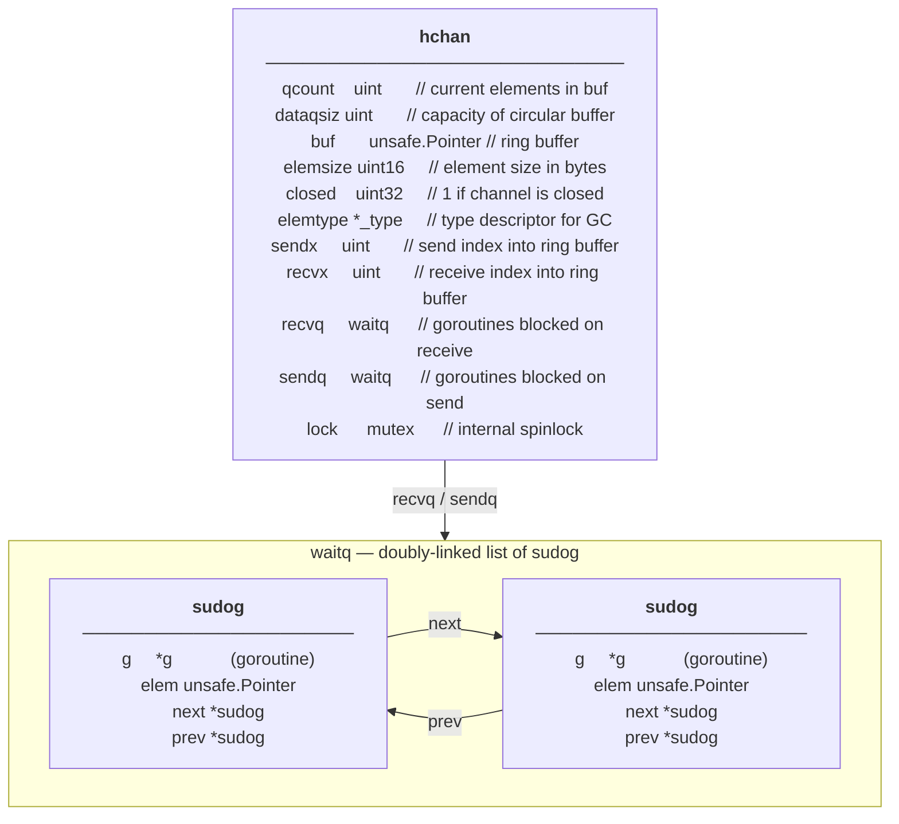

# Lesson 4: Concurrent Systems Design with Channels, Mutexes, Synchronization

## 1. First-Principles Intuition & Invariants

Concurrency is not parallelism. Rob Pike stated this plainly, and the distinction carries real mechanical weight. Parallelism is the simultaneous execution of independent computations on multiple processors. Concurrency is the *composition* of independently executing processes—a structural property of the program itself, independent of whether two goroutines ever literally run at the same instant. A single-core machine can run a maximally concurrent Go program; it simply time-slices rather than overlaps execution. Getting this distinction wrong leads engineers to reach for goroutines as a performance tool when they are fundamentally a *design* tool, and from that confusion all the classic mistakes follow.

Go's memory model defines the problem space precisely. The language specification guarantees that within a single goroutine, statements execute in the order they appear. Across goroutines, no such guarantee exists unless the program establishes an explicit *happens-before* relationship. If goroutine A writes to variable `x` and goroutine B reads `x`, and there is no synchronization event between those two operations, the read in B may observe any value—not just a stale one, but a partially written one, or even a value reordered by the CPU's memory subsystem or the compiler's optimizer. This is not a theoretical risk; x86-64 has a relatively strong memory model, but ARM has a weaker one, and the Go compiler itself will reorder stores and loads when no synchronization prevents it. The invariant is absolute: *every* shared memory access across goroutine boundaries requires a synchronization event.

Go provides two architecturally distinct mechanisms for establishing those synchronization events. The first is **communication over channels**, which bundles synchronization and data transfer into a single primitive. The second is **shared memory with explicit locking**, using the `sync` package's mutexes, read-write locks, and atomic operations. The language's idiomatic preference is channels, captured in the folk maxim "do not communicate by sharing memory; instead, share memory by communicating." But this preference is not an absolute prohibition. Channels carry overhead—they involve scheduler interactions, potential goroutine parking and unparking, and a hchan structure with its own internal lock. For protecting a single integer counter with sub-microsecond access patterns, `sync/atomic` or a carefully scoped mutex will outperform a channel by an order of magnitude. The senior engineer's task is knowing which model fits the structure of the problem.

The Go scheduler itself is the substrate on which all of this runs. It implements an M:N threading model: M goroutines multiplexed over N OS threads, with N bounded by `GOMAXPROCS`. Each OS thread is paired with a *processor* (P), which maintains a local run queue of goroutines. When a goroutine blocks on a channel receive, a syscall, or a mutex, the scheduler parks it and runs the next goroutine from the P's run queue. This non-blocking behavior is what makes it practical to spawn thousands or millions of goroutines—most of them are parked and consuming no CPU at any given moment, only their stack memory. Stacks start at 2KB and grow dynamically via contiguous stack copies, so goroutine spawn cost is dominated by the initial allocation, not by the reservation of a large fixed stack as POSIX threads require.

Understanding the scheduler's work-stealing mechanism clarifies certain subtle performance behaviors. When a P's local run queue is empty, it steals half the goroutines from another P's queue. This means goroutines are *not* pinned to OS threads. A goroutine may execute on thread 1 during one scheduling quantum and thread 7 during the next. This has direct implications for `sync.Mutex`: the Go runtime does not implement priority inheritance, and a goroutine holding a lock may be preempted and rescheduled, potentially on a different OS thread, while still holding that lock. This is entirely correct behavior, but it means critical sections should be short, and any assumption that "the same thread" holds the lock across a function call is simply wrong.

The formal invariants that govern correct concurrent Go programs are these: every shared write must be synchronized with every concurrent read; channel sends happen-before the corresponding receive completes; closing a channel happens-before a receive that returns a zero value because the channel is closed; and a `sync.Mutex.Unlock` call happens-before any subsequent `Lock` call that it unblocks. These are not conventions—they are the operational semantics of the runtime, and violation produces undefined behavior in the same sense that C's undefined behavior produces it: the compiler and hardware are within their rights to do something unexpected.

---

## 2. Core Architecture & Mechanics

### The hchan Data Structure

A Go channel is not a simple queue. At the runtime level, a channel is a heap-allocated `hchan` struct. Its architecture directly explains channel semantics, blocking behavior, and the cost model you must carry when designing channel-heavy systems.



A send operation on a full buffered channel, or any send on an unbuffered channel with no waiting receiver, allocates a `sudog` (a "sudo-goroutine" wrapper), appends it to `sendq`, and parks the goroutine via a `gopark` call. The OS thread is not blocked; the scheduler simply runs the next available goroutine. When a receiver eventually arrives, it checks `sendq`, finds the waiting sender, copies the element *directly* from the sender's stack into its own receiving variable (bypassing the ring buffer entirely for this case), and unparks the sender. This direct-copy optimization is non-obvious and important: when you send on an unbuffered channel to a waiting receiver, there is *no* intermediate buffer allocation, and the memory copy is a single `memmove` between two goroutine stacks, mediated by the scheduler.

The internal `lock` field is a lightweight runtime mutex, not a `sync.Mutex`. It uses OS-level futexes on Linux and native synchronization primitives on other platforms. It is held only for the duration of the enqueue, dequeue, or waitq manipulation—never across the goroutine park/unpark cycle. This is a critical correctness invariant: if the internal lock were held across a goroutine park, any other goroutine trying to send or receive on the same channel would spin on a lock held by a parked goroutine, which is a deadlock.

### Channel Patterns: Pipelines

The pipeline pattern structures concurrent computation as a sequence of stages connected by channels, where each stage is a goroutine or a pool of goroutines. Each stage reads from an upstream channel, transforms or filters the data, and writes to a downstream channel. The compelling property of this structure is that each stage is independently concurrent—the generator, transformer, and sink all run simultaneously, and backpressure propagates naturally through the channel buffering behavior.

The following pipeline processes integer squares with an explicit cancellation mechanism using a `done` channel, which is the standard Go idiom for cooperative cancellation before `context.Context` became pervasive (and which `context.Context` itself implements internally using exactly this pattern).

```go
package main

import (
	"fmt"
	"sync"
)

// generate emits a sequence of integers to the returned channel,
// closing it when done is closed or all values are exhausted.
func generate(done <-chan struct{}, values ...int) <-chan int {
	out := make(chan int, len(values))
	go func() {
		defer close(out)
		for _, v := range values {
			select {
			case out <- v:
			case <-done:
				return
			}
		}
	}()
	return out
}

// square reads integers from in, squares them, and sends results to
// the returned channel. It exits when done is closed or in is closed.
func square(done <-chan struct{}, in <-chan int) <-chan int {
	out := make(chan int)
	go func() {
		defer close(out)
		for v := range in {
			select {
			case out <- v * v:
			case <-done:
				return
			}
		}
	}()
	return out
}

func main() {
	done := make(chan struct{})
	defer close(done)

	c := generate(done, 2, 3, 4, 5, 6, 7, 8, 9, 10)
	out := square(done, c)

	// Consume the first three results, then cancel.
	fmt.Println(<-out) // 4
	fmt.Println(<-out) // 9
	fmt.Println(<-out) // 16
	// done is closed by defer; upstream goroutines exit cleanly.
}
```

The `done` channel is a unidirectional receive-only channel from the perspective of the stages, enforced by the `<-chan struct{}` type signature. This is not merely stylistic: it prevents any stage from accidentally closing the done channel, which would be incorrect (only the pipeline owner should close it). The `select` statement in each stage creates two concurrent waitpoints—it proceeds on whichever case is ready first. If `done` is never closed and all values are consumed, the goroutines exit naturally via `range` exhaustion. If `done` is closed first, goroutines return immediately regardless of whether the channel has pending values.

### Fan-Out and Fan-In

Fan-out distributes work from a single input channel to multiple worker goroutines, all reading from the same channel. Because channels are safe for concurrent access, multiple goroutines can call receive on a single channel simultaneously, and the runtime's internal lock ensures each value is delivered to exactly one receiver. This is the simplest form of load distribution in Go, requiring no additional coordination.

Fan-in is the complementary operation: merging multiple input channels into a single output channel. It requires a goroutine per input channel, and uses a `sync.WaitGroup` to know when all inputs are exhausted so the merged output channel can be closed exactly once.

```go
package main

import (
	"fmt"
	"sync"
)

// fanOut distributes jobs across numWorkers goroutines. Each worker reads
// from jobs, squares the value, and writes to results.
func fanOut(done <-chan struct{}, jobs <-chan int, numWorkers int) []<-chan int {
	channels := make([]<-chan int, numWorkers)
	for i := 0; i < numWorkers; i++ {
		results := make(chan int)
		channels[i] = results
		go func(out chan<- int) {
			defer close(out)
			for j := range jobs {
				select {
				case out <- j * j:
				case <-done:
					return
				}
			}
		}(results)
	}
	return channels
}

// merge fans in multiple channels into a single output channel.
// It closes the output channel when all inputs are exhausted.
func merge(done <-chan struct{}, channels ...<-chan int) <-chan int {
	var wg sync.WaitGroup
	out := make(chan int)

	output := func(c <-chan int) {
		defer wg.Done()
		for v := range c {
			select {
			case out <- v:
			case <-done:
				return
			}
		}
	}

	wg.Add(len(channels))
	for _, c := range channels {
		go output(c)
	}

	// Close out when all goroutines finish. This goroutine itself
	// does not block the caller; it runs concurrently.
	go func() {
		wg.Wait()
		close(out)
	}()

	return out
}

func main() {
	done := make(chan struct{})
	defer close(done)

	jobs := make(chan int, 10)
	for i := 1; i <= 10; i++ {
		jobs <- i
	}
	close(jobs)

	workers := fanOut(done, jobs, 4)
	results := merge(done, workers...)

	for v := range results {
		fmt.Println(v)
	}
}
```

The critical subtlety in `merge` is the final goroutine that calls `wg.Wait()` and then `close(out)`. This goroutine must run concurrently with the per-channel output goroutines—if you called `wg.Wait()` synchronously in `merge`, you would deadlock: `merge` would block waiting for the output goroutines to finish, but the output goroutines block trying to send on `out`, which no one is yet reading because `main` is waiting for `merge` to return. The goroutine-wrapped `Wait` breaks this cycle by allowing `merge` to return `out` before the forwarding goroutines complete, letting `main` begin consuming.

### sync.WaitGroup Mechanics

`WaitGroup` maintains an internal counter. `Add(n)` increments it by n, `Done()` decrements it by one (and is merely syntactic sugar for `Add(-1)`), and `Wait()` blocks until the counter reaches zero. The implementation uses atomic operations on a 64-bit composite field that packs both the counter and a waiter count into a single word, allowing a compare-and-swap to atomically detect when the counter hits zero and unblock all waiters.

The placement of `Add` calls is a source of frequent bugs. `Add` must be called *before* the goroutine it tracks is launched, in the goroutine that calls `Wait`. This placement ensures the counter is non-zero before `Wait` is ever reached. If `Add` is called inside the goroutine itself, there is a race: `Wait` might execute before the goroutine has had a chance to call `Add`, observe a zero counter, and return prematurely, allowing the program to proceed before all work is done.

```go
// Correct: Add before go.
var wg sync.WaitGroup
for i := 0; i < 5; i++ {
    wg.Add(1)              // counter incremented here, before launch
    go func(id int) {
        defer wg.Done()
        fmt.Printf("worker %d done\n", id)
    }(i)
}
wg.Wait()

// Incorrect: Add inside the goroutine—race condition.
for i := 0; i < 5; i++ {
    go func(id int) {
        wg.Add(1)          // too late; Wait may have already returned
        defer wg.Done()
        fmt.Printf("worker %d done\n", id)
    }(i)
}
wg.Wait() // may return before any goroutine runs
```

### sync.Mutex and sync.RWMutex

`sync.Mutex` provides mutual exclusion. Its `Lock` method spins briefly before yielding to the scheduler if the lock is contended, blending the low-latency of a spinlock (for lightly contended cases) with the CPU-yielding behavior of a blocking mutex (for heavily contended cases). The Go runtime's mutex fairness model changed significantly in Go 1.9: the mutex can operate in a *starvation mode*, where after a goroutine waits more than 1 millisecond, it takes ownership of the lock in FIFO order rather than competing with newly arriving goroutines. This prevents the convoy effect where long-waiting goroutines are perpetually beaten by freshly scheduled ones.

The correct pattern for mutex usage in Go wraps the unlock in a `defer` immediately after the lock:

```go
package main

import (
	"fmt"
	"sync"
)

type SafeCounter struct {
	mu sync.Mutex
	v  map[string]int
}

func (c *SafeCounter) Inc(key string) {
	c.mu.Lock()
	defer c.mu.Unlock()
	c.v[key]++
}

func (c *SafeCounter) Value(key string) int {
	c.mu.Lock()
	defer c.mu.Unlock()
	return c.v[key]
}

func main() {
	c := SafeCounter{v: make(map[string]int)}
	var wg sync.WaitGroup

	for i := 0; i < 1000; i++ {
		wg.Add(1)
		go func() {
			defer wg.Done()
			c.Inc("key")
		}()
	}

	wg.Wait()
	fmt.Println(c.Value("key")) // always 1000
}
```

`defer c.mu.Unlock()` is not merely idiomatic—it is a correctness guarantee. If `Inc` could return via multiple code paths (early returns, panic recovery), the defer ensures the mutex is always released. A mutex left locked because an early return bypassed the explicit `Unlock()` call will deadlock any subsequent goroutine that tries to acquire it.

`sync.RWMutex` extends this with separate reader and writer locks. Multiple goroutines may hold the read lock simultaneously (`RLock/RUnlock`), but a write lock (`Lock/Unlock`) is exclusive: it waits for all current readers to finish and blocks all new readers. This is correct for data structures with many readers and infrequent writers—a configuration cache, a routing table, a service registry. For data structures with roughly equal read and write rates, the extra complexity of RWMutex over Mutex rarely pays off, because the write-lock acquisition overhead (which must drain all readers) becomes a bottleneck that offsets the gains from concurrent reads.

### sync.Once

`sync.Once` guarantees that a function is executed exactly once across all goroutines, regardless of how many goroutines call `Do` concurrently. Its implementation is a beautiful illustration of the layered cost model: a fast path uses a single atomic load to check whether the function has already run; only the slow path, taken exactly once, acquires an internal mutex. This means that after the first call completes, all subsequent callers pay only the cost of an atomic load.

```go
package main

import (
	"fmt"
	"sync"
)

type Config struct {
	DSN      string
	MaxConns int
}

var (
	instance *Config
	once     sync.Once
)

func GetConfig() *Config {
	once.Do(func() {
		// Expensive initialization: file I/O, parsing, validation.
		instance = &Config{
			DSN:      "postgres://localhost/prod",
			MaxConns: 32,
		}
		fmt.Println("config initialized once")
	})
	return instance
}

func main() {
	var wg sync.WaitGroup
	for i := 0; i < 10; i++ {
		wg.Add(1)
		go func() {
			defer wg.Done()
			cfg := GetConfig()
			_ = cfg
		}()
	}
	wg.Wait()
	// "config initialized once" prints exactly once.
}
```

One subtle invariant: if the function passed to `Do` panics, `Once` considers the execution to have completed. Subsequent calls to `Do` will not re-execute the function. This means a panicking initializer permanently breaks the singleton, and any recovery logic must happen *inside* the function passed to `Do`.

---

## 3. High-Performance Optimization & Failure Modes

### Deadlock: Structure and Detection

A deadlock in Go occurs when every goroutine in the program is blocked waiting for a condition that no running goroutine can satisfy. The runtime detects this specific case—*all* goroutines blocked—and panics with the message `all goroutines are asleep - deadlock!`. This detection does not catch partial deadlocks, where some goroutines make progress while a subset are permanently blocked.

The classic deadlock topology involves two goroutines each holding one lock and waiting for the other:

```text
Goroutine A holds lockX, waiting for lockY
Goroutine B holds lockY, waiting for lockX
```

The correct prevention strategy is **consistent lock ordering**: every goroutine in the program acquires locks in the same global order. If the invariant is "always acquire lockX before lockY," then the scenario above cannot arise, because goroutine B attempting to acquire lockY before lockX will be caught at code review. Enforcing this via documentation and naming conventions is brittle; enforcing it via code structure—where lock acquisition is encapsulated in a single function that cannot be called out of order—is robust.

Channel deadlocks follow a different topology. Sending on an unbuffered channel with no receiver, or receiving from a channel that will never be sent to, blocks forever. The most common source is a goroutine that exits early (due to an error) without consuming from a channel that another goroutine is trying to send on:

```go
package main

import "fmt"

func producer(out chan<- int) {
	for i := 0; i < 5; i++ {
		out <- i // will block forever if consumer exits early
	}
	close(out)
}

func consumer(in <-chan int) error {
	for v := range in {
		if v == 2 {
			return fmt.Errorf("rejected value %d", v)
		}
		fmt.Println(v)
	}
	return nil
}

func main() {
	ch := make(chan int) // unbuffered
	go producer(ch)
	if err := consumer(ch); err != nil {
		fmt.Println("consumer error:", err)
		// Producer is now blocked on ch <- 3, waiting for a receiver
		// that will never come. The runtime detects total deadlock here.
	}
}
```

The fix is the `done` channel pattern demonstrated in Section 2: the consumer signals cancellation, and the producer's send is wrapped in a `select` that listens to `done`. This pattern is exactly what `context.Context` formalizes—`ctx.Done()` returns a channel that is closed when cancellation is requested, and every blocking operation in a well-written Go program includes a `case <-ctx.Done()` arm.

### The Goroutine Leak: The Silent Failure Mode

A goroutine leak is a goroutine that is blocked forever on a channel operation or mutex, consuming memory and scheduler overhead, with no possibility of making progress. Unlike memory leaks in C, the Go runtime does not have a mechanism to automatically reclaim leaked goroutines—they accumulate until the process runs out of memory or is restarted.

The canonical leak pattern is a goroutine blocked on a send to a channel whose receiver has exited:

```go
// Leaking pattern: the goroutine will be blocked on result <- compute()
// if the caller times out and discards result.
func leaky(timeout <-chan struct{}) int {
	result := make(chan int) // unbuffered
	go func() {
		result <- compute() // blocks if nobody reads result
	}()

	select {
	case v := <-result:
		return v
	case <-timeout:
		return -1 // goroutine is now leaked
	}
}
```

The fix is a buffered channel of size 1. With `result := make(chan int, 1)`, the goroutine can always complete its send even if the receiver has moved on, and then it exits cleanly. This pattern—buffered channel sized to the maximum number of concurrent senders—is the standard mitigation for goroutine leaks in timeout-sensitive code.

For production systems, the `goleak` package (uber-go/goleak) detects leaked goroutines in test code by comparing the set of running goroutines before and after a test. Integrating it into your test suite as `defer goleak.VerifyNone(t)` turns goroutine leaks from silent runtime bombs into test failures.

### False Sharing and Cache-Line Contention

When multiple goroutines running on separate CPU cores simultaneously update variables that share a CPU cache line (64 bytes on x86-64 and ARM), each write invalidates the other cores' cached copy of the entire cache line, forcing a cache coherence transaction. The result is a performance collapse on heavily parallelized code that looks correct from a synchronization perspective but is serialized at the hardware level.

The mitigation is **cache-line padding**: ensuring that frequently written variables owned by different goroutines are separated by at least 64 bytes of dummy padding. In Go, this is expressed with struct alignment:

```go
package main

import (
	"fmt"
	"sync"
	"sync/atomic"
)

// PaddedCounter ensures each counter occupies its own cache line,
// preventing false sharing when multiple goroutines update concurrently.
type PaddedCounter struct {
	value   int64
	_padding [56]byte // 64 - 8 bytes for int64 = 56 bytes of padding
}

func main() {
	const numWorkers = 8
	counters := make([]PaddedCounter, numWorkers)

	var wg sync.WaitGroup
	for i := 0; i < numWorkers; i++ {
		wg.Add(1)
		go func(id int) {
			defer wg.Done()
			for j := 0; j < 1_000_000; j++ {
				atomic.AddInt64(&counters[id].value, 1)
			}
		}(i)
	}

	wg.Wait()

	var total int64
	for i := range counters {
		total += counters[i].value
	}
	fmt.Println("total:", total) // 8_000_000
}
```

Without the padding, all eight counters might occupy as few as two cache lines. With the padding, each counter is guaranteed its own cache line, and writes to different counters never cause coherence traffic between cores. The benchmark difference on a machine with 8+ cores is typically a factor of 3–8× in throughput for this access pattern.

### sync/atomic and the Memory Ordering Model

The `sync/atomic` package provides atomic operations on integer types and pointers, using CPU-level atomic instructions (LOCK-prefixed instructions on x86, LDAR/STLR on ARM). These operations are cheaper than a mutex for single-word operations but require careful reasoning about memory ordering. In Go, all atomic operations provide sequential consistency for the variables they operate on, meaning the compiler and CPU are forbidden from reordering atomic operations relative to each other. This makes Go's atomics simpler to reason about than C's `stdatomic` with its explicit memory order parameters, but it also means Go's atomics are always the strongest (and sometimes most expensive) ordering.

A common pattern is using an atomic flag to signal shutdown without a channel:

```go
package main

import (
	"fmt"
	"sync"
	"sync/atomic"
	"time"
)

func worker(id int, stop *atomic.Bool, wg *sync.WaitGroup) {
	defer wg.Done()
	for !stop.Load() {
		// Perform work unit.
		time.Sleep(10 * time.Millisecond)
	}
	fmt.Printf("worker %d exiting\n", id)
}

func main() {
	var stop atomic.Bool
	var wg sync.WaitGroup

	for i := 0; i < 4; i++ {
		wg.Add(1)
		go worker(i, &stop, &wg)
	}

	time.Sleep(100 * time.Millisecond)
	stop.Store(true) // visible to all goroutines immediately
	wg.Wait()
}
```

`atomic.Bool` (introduced in Go 1.19) wraps the underlying `atomic.Uint32` with a typed API, eliminating the class of bugs where the underlying integer is used non-atomically by accident. The store in `main` happens-before every subsequent load in the workers, by the sequentially consistent ordering guarantee. The workers will observe `stop == true` within at most one iteration cycle after the store completes.

### Reasoning About Concurrent Correctness: The Data Race Detector

No treatment of concurrent correctness in Go is complete without the race detector. Enabled with `-race`, it instruments every memory access at compile time, using ThreadSanitizer's shadow memory algorithm to track the set of goroutines that have recently accessed each memory location. When a read and a write, or two writes, to the same location occur in different goroutines with no synchronization between them, the detector fires with a detailed stack trace of both goroutines.

```text
go test -race ./...
go run -race main.go
go build -race -o myapp_racecheck .
```

The race detector has a fixed overhead of 5–10× memory and 2–20× CPU. This makes it impractical for production binaries in most latency-sensitive contexts, but it is indispensable in test suites and staging environments. The rule is non-negotiable: run `-race` on every test suite in CI. Data races produce bugs that are intermittent, platform-dependent, and extremely difficult to reproduce under a debugger. Finding them statically in CI is orders of magnitude cheaper than hunting them in production.

### Designing for Correctness: Ownership and the Channel Closing Protocol

The deepest principle in concurrent Go design is **ownership**: at any point in time, one goroutine owns a piece of data, and that goroutine is responsible for all mutations. A channel transfer of a value is simultaneously a transfer of ownership. When goroutine A sends a pointer on a channel to goroutine B, ownership moves to B, and goroutine A must not access the pointed-to data afterward. The Go race detector will catch violations of this rule, but the design goal is to structure programs so that ownership is obvious by inspection, not just enforced by detection.

The channel closing protocol follows directly from ownership: only the sender should close a channel, never the receiver, because the sender is the owner of the write end. Closing a channel from the receiver side races with any concurrent sender. When multiple goroutines send on a single channel, one of them must be designated the owner of the close, or a separate goroutine must own the close after all senders signal completion—which is exactly the `WaitGroup`-driven close in the `merge` function from Section 2.

A `select` with a `default` arm creates a non-blocking operation: if no case is immediately ready, the default executes instead of blocking. This is the correct tool for a goroutine that wants to attempt a send or receive but has other work to do if the channel is not immediately ready. Overuse of `default` turns Go's elegant blocking concurrency model into a polling loop, burning CPU and defeating the scheduler. Use it only when non-blocking behavior is genuinely required by the algorithm, not as a workaround for channels that are unexpectedly full or empty.

The Go concurrency model is a coherent system: goroutines for structure, channels for communication and synchronization across ownership boundaries, mutexes and atomics for protecting shared state within a single ownership domain. When these tools are applied to problems that fit their structure, the resulting programs are readable, correct by construction, and debuggable. The failures—deadlocks, leaks, races—arise almost always from violating the ownership model: mutating data after transferring it, closing channels from the wrong end, or sharing state without synchronization because "it's probably fine." It is not fine. The race detector, the structured pipeline patterns, and the strict `Add`-before-`go` discipline are the engineering practices that separate concurrent programs that always work from concurrent programs that mostly work.
