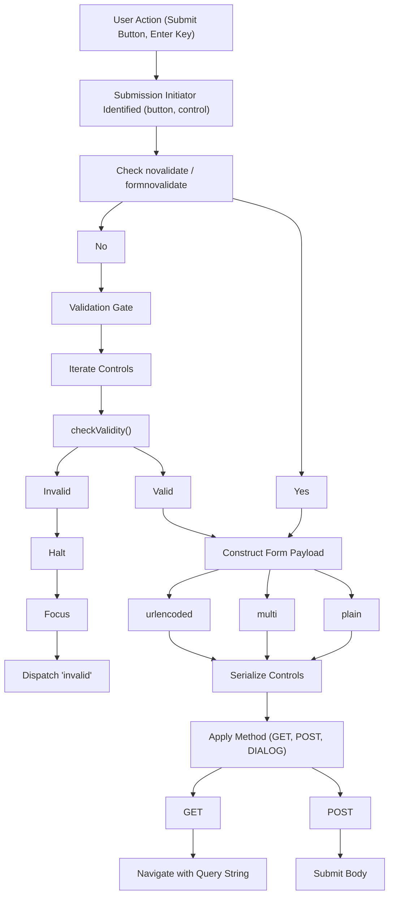

# Lesson 2: Forms, Validation Mechanisms, Input Types

## 1. First-Principles Intuition & Invariants

The HTML5 form subsystem represents one of the most sophisticated client-side state machines in the web platform, bridging the declarative markup layer with imperative validation logic and browser-native user interface components. At its core, a form element operates as a transactional boundary for user input, collecting heterogeneous data types—text, numbers, dates, files, selections—and marshaling them into a structured payload suitable for HTTP transmission or client-side JavaScript processing. Unlike earlier HTML4 forms that relied entirely on server-side validation and custom JavaScript for any meaningful input constraints, HTML5 elevated form validation to a first-class browser primitive, embedding type-safe input semantics, pattern-based validation, and a comprehensive Constraint Validation API directly into the DOM.

The architectural shift from untyped text inputs to strongly typed input elements fundamentally altered the contract between markup authors and user agents. When a developer declares `<input type="email">`, they are not merely suggesting a presentational hint to the browser; they are invoking a formal specification that mandates email syntax validation according to RFC 5322 token grammar, triggers specialized mobile keyboards with "@" symbols prominently displayed, and exposes programmatic validity states through the `ValidityState` interface. This declarative constraint model follows a fail-fast philosophy: invalid data is detected at the earliest possible moment—during user interaction—rather than requiring a full round-trip to the server. The browser becomes a validating parser, maintaining invariants about data shape and content before the form ever reaches the network layer.

The form submission algorithm itself operates as a multi-phase pipeline, beginning with an implicit validation gate. When a user triggers submission via a submit button or programmatic `form.submit()` call, the browser first traverses all form-associated elements, evaluating their validity constraints. Any constraint violation halts the submission, dispatches an `invalid` event on the offending element, and typically scrolls the first invalid control into viewport focus. This gating mechanism ensures that malformed data never escapes the client boundary unless explicitly bypassed through the `novalidate` attribute or by calling `form.submit()` directly rather than invoking a submit button's click handler. The submission phase then serializes the form data according to the specified encoding type—`application/x-www-form-urlencoded`, `multipart/form-data`, or `text/plain`—each with distinct byte-level serialization rules for names, values, and boundaries.

Understanding the form state machine requires recognizing that every form control maintains both a value and a validity state, and these states evolve through a combination of user interaction, programmatic mutation, and validation rule evaluation. The validity state is not a simple boolean but a structured `ValidityState` object exposing granular constraint flags: `valueMissing`, `typeMismatch`, `patternMismatch`, `tooLong`, `tooShort`, `rangeUnderflow`, `rangeOverflow`, `stepMismatch`, `badInput`, and `customError`. Each flag corresponds to a specific validation rule derived from element attributes or imperative API calls. The browser maintains these flags incrementally, re-evaluating constraints as the user types, pastes, or otherwise mutates the input value. This incremental validation model avoids the latency and complexity of server-side validation loops while providing immediate, actionable feedback.

The autofill mechanism, often underestimated in its complexity, operates as a secondary control channel between the browser's credential store, payment vault, address book, and the form's semantic structure. When a developer annotates an input with `autocomplete="email"` or `autocomplete="cc-number"`, they are signaling to the browser's autofill heuristics that this field should be pre-populated from a specific credential domain. The `autocomplete` attribute vocabulary is extensive, covering shipping addresses, billing details, authentication credentials, and even one-time password fields for SMS-based 2FA workflows. Browsers implement sophisticated machine learning classifiers to infer autofill semantics even when the `autocomplete` attribute is absent, analyzing label text, input names, and surrounding DOM context. However, explicit `autocomplete` tokens provide deterministic control, particularly critical for security-sensitive fields where autofill behavior must be precisely controlled or disabled entirely via `autocomplete="off"`.

The form-associated custom element specification introduced in HTML5 extends the form participation contract to arbitrary Web Components, allowing developers to implement custom input widgets—date pickers, rich text editors, color wheels—that integrate seamlessly with native form validation and submission. A custom element can attach itself to a form's internal element list by declaring a static `formAssociated` property and calling `attachInternals()` to obtain an `ElementInternals` object. This object exposes methods like `setFormValue()` and `setValidity()`, allowing the custom element to participate in constraint validation and serialization as if it were a native input. This extension point preserves the declarative validation model while enabling rich, domain-specific input controls that exceed the capabilities of native HTML5 input types.

The critical invariant underpinning all form behavior is that the browser enforces a separation of concerns between data collection, validation, and submission. Markup authors declare constraints; the browser enforces them; JavaScript observes and optionally augments the validation logic. This separation enables progressive enhancement strategies where forms remain functional even when JavaScript fails to load or execute, falling back to browser-native validation and server-side checks. The `required`, `pattern`, `min`, `max`, and `type` attributes are not merely hints for JavaScript libraries—they are enforceable contracts that the browser will uphold regardless of client-side scripting capabilities.

## 2. Core Architecture & Mechanics

The form element itself, `HTMLFormElement`, serves as the root of a form control tree, maintaining an internal live collection of all associated form controls regardless of their DOM position. This collection is not limited to direct descendants; a control can associate with a form via the `form` attribute, referencing the form's `id` even if the control is rendered in a distant subtree for layout purposes. This indirect association model supports complex responsive layouts where form controls must be visually positioned outside the form's DOM boundary while maintaining logical membership. The form maintains a directed graph of these associations, enabling efficient traversal during validation and serialization.

Each input type—`text`, `email`, `url`, `tel`, `number`, `range`, `date`, `datetime-local`, `month`, `week`, `time`, `color`, `checkbox`, `radio`, `file`, `submit`, `reset`, `button`, `hidden`, `image`, `search`—carries distinct validation semantics and user agent rendering behavior. The `email` type, for instance, applies a regular expression pattern derived from the HTML5 specification's simplified email grammar, which intentionally permits a broader set of addresses than RFC 5322 to accommodate real-world email address diversity. The pattern roughly matches `[a-z0-9._%+-]+@[a-z0-9.-]+\.[a-z]{2,}` but with unicode support and case-insensitivity. When the `multiple` attribute is present on an email input, the browser expects a comma-separated list and validates each token independently.

The `number` input type introduces a critical subtlety: its value is constrained to a floating-point number, but the browser's internal representation and the value accessible via the `value` property differ. The `value` property returns a string representation of the number, while the `valueAsNumber` property exposes the parsed numeric value as a JavaScript `Number`. If the input contains non-numeric text or is empty, `valueAsNumber` returns `NaN`, and the `badInput` validity flag is set. The `step` attribute further constrains the numeric value to multiples of a specified increment, with the default step of `1` for integers. The step base defaults to the `min` value if specified, otherwise `0`, and the browser computes validity as `(value - stepBase) % step === 0` modulo floating-point epsilon tolerance.

Date and time inputs—`date`, `datetime-local`, `month`, `week`, `time`—serialize their values in ISO 8601 formats, ensuring unambiguous temporal representation independent of locale. A `date` input requires the format `YYYY-MM-DD`, while `datetime-local` expects `YYYY-MM-DDTHH:mm` or `YYYY-MM-DDTHH:mm:ss.sss`. These inputs expose `valueAsDate` and `valueAsNumber` properties, providing parsed `Date` objects or millisecond timestamps for programmatic manipulation. The user agent presents a locale-appropriate picker interface, but the underlying value representation remains ISO 8601, isolating serialization concerns from presentation.

The `pattern` attribute accepts a JavaScript-compatible regular expression that the input value must fully match, equivalent to anchoring the pattern with `^(?:pattern)$`. Unlike server-side regex engines that may support extended features or alternate syntaxes, the pattern is evaluated by the browser's JavaScript regex engine, ensuring consistent behavior with client-side validation scripts. The `title` attribute provides the validation error message displayed when a pattern mismatch occurs, allowing developers to convey the expected format to users. Critically, the pattern is only enforced when the input is non-empty; an empty value passes pattern validation unless the `required` attribute is also present.

The Constraint Validation API exposes a rich set of methods and properties on form controls and the form element itself. The `checkValidity()` method triggers validation on a control or all controls within a form, returning a boolean and dispatching `invalid` events on any failing controls. The `reportValidity()` method extends `checkValidity()` by also displaying native validation error UI, such as popover tooltips indicating the constraint violation. The `setCustomValidity(message)` method allows imperative validation logic to inject custom error states that integrate with the native validation UI. Setting a non-empty message flags the control as invalid with `customError` set to true; clearing the message with an empty string removes the custom error.

The form submission algorithm follows a deterministic sequence, beginning with the submission initiation phase triggered by activating a submit button, pressing Enter in a text field, or calling `form.requestSubmit(submitter)`. The algorithm first checks for the `novalidate` attribute on the form or `formnovalidate` on the submitter; if absent, it invokes the validation gate. Validation iterates through the form's control collection, invoking `checkValidity()` on each control. The first invalid control halts submission, receives focus, and dispatches a cancelable `invalid` event. If all controls are valid, the algorithm proceeds to construct the form payload.

The payload construction phase selects an encoding algorithm based on the `enctype` attribute: `application/x-www-form-urlencoded` percent-encodes names and values as `name=value` pairs joined by `&`, replacing spaces with `+`; `multipart/form-data` constructs a MIME multipart message with boundary delimiters, essential for file uploads; `text/plain` produces a human-readable but non-standard format unsuitable for reliable parsing. For `application/x-www-form-urlencoded`, each control contributes its `name` and `value`, with special handling for radio groups (only the checked radio), checkboxes (only checked checkboxes contribute their values), and file inputs (filename only, not file content). The `multipart/form-data` encoding writes each control as a separate MIME part with a `Content-Disposition: form-data; name="..."` header, and file inputs include `filename="..."` and a `Content-Type` header inferred from the file's MIME type.

The form-associated lifecycle for custom elements introduces an `attachInternals()` method that returns an `ElementInternals` object, providing privileged access to form participation APIs. The custom element must declare `static formAssociated = true` to enable this capability. The `ElementInternals` object exposes `setFormValue(value, state)`, allowing the custom element to contribute a simple value or a complex `FormData` object to form submission. The `setValidity(flags, message, anchor)` method mirrors the `setCustomValidity()` API but accepts a structured `ValidityStateFlags` dictionary, enabling the custom element to signal specific constraint violations like `rangeOverflow` or `patternMismatch`. The `anchor` parameter references a DOM element within the custom element's shadow DOM that should receive focus when validation fails, ensuring keyboard navigation and assistive technology compatibility.

The `FormData` interface provides an imperative alternative to declarative form serialization, allowing JavaScript to construct and manipulate form payloads programmatically. Constructing a `FormData` object from a form element via `new FormData(formElement)` captures a snapshot of the form's current state, serializing all controls according to their type and attributes. The `FormData` interface exposes `append()`, `set()`, `delete()`, `get()`, and `getAll()` methods for manipulating entries, and `entries()`, `keys()`, `values()` for iteration. This interface is particularly valuable for AJAX-based form submission, where `fetch(url, { method: 'POST', body: new FormData(form) })` automatically applies the correct `Content-Type: multipart/form-data` header with boundary.

The autofill specification defines a controlled vocabulary for the `autocomplete` attribute, categorizing fields into sections, addressing components, and autofill categories. The syntax follows `section-* shipping|billing|* category-* type`, where `section` groups related fields, `shipping` and `billing` distinguish address types, and `type` specifies the semantic category like `name`, `email`, `tel`, `street-address`, `postal-code`, `cc-number`, `cc-exp`, `cc-csc`. The `one-time-code` token signals that the field expects a short-lived OTP delivered via SMS or email, prompting browsers to integrate with platform APIs that extract OTP codes from messages. The `new-password` and `current-password` tokens guide password managers to generate or retrieve credentials, while `username` identifies the corresponding username field.

The input sanitization and parsing behavior varies significantly by type. A `url` input accepts a valid URL according to the URL Standard, requiring a scheme, but browsers are permissive, often prepending `http://` if the scheme is omitted during user entry. A `tel` input performs no validation by default, as international telephone number formats are too diverse to enforce a single pattern, but developers can layer a `pattern` attribute for region-specific validation. The `search` input is functionally equivalent to `text` but may render with search-specific UI affordances like a clear button or magnifying glass icon. The `hidden` input type bypasses all validation and UI rendering, contributing its name-value pair directly to the form payload without user interaction.

## 3. High-Performance Optimization & Failure Modes

Form performance optimization begins with understanding the validation recomputation cost. Each keystroke in an input field can trigger validation evaluation, which for complex regular expressions in `pattern` attributes may introduce measurable latency, particularly on low-end mobile devices. Browsers implement debouncing and throttling strategies internally, but developers can further optimize by deferring custom validation logic—invoked via `setCustomValidity()`—until the `blur` event or an explicit "Check" button, rather than executing on every `input` event. For forms with dozens of controls, batching validation updates and rendering feedback in a single microtask reduces layout thrashing and improves responsiveness.

The autofill mechanism's performance characteristics depend heavily on the browser's heuristic confidence. When `autocomplete` tokens are explicit and match the credential store's schema, autofill presentation is near-instantaneous. However, when the browser must infer semantics from label text or input names, classification latency increases, and the autofill UI may appear after a delay or not at all. Providing explicit `autocomplete` attributes eliminates this inference overhead, ensuring deterministic autofill behavior across browsers and locales. For payment forms, annotating card number, expiration, and CVV fields with `cc-number`, `cc-exp`, and `cc-csc` enables instant autofill from the browser's payment vault, reducing checkout friction and abandonment rates.

A common failure mode arises from misunderstanding the interaction between `required` and empty string values. An input with `required` is invalid if its value is the empty string, but a `pattern` is only evaluated when the value is non-empty. This asymmetry means a field can be invalid due to `valueMissing` without ever evaluating its `pattern`, leading to confusing validation messages if the custom `title` attribute assumes the pattern was tested. The solution is to compose validation constraints carefully, ensuring that `title` messages are generic enough to cover both `valueMissing` and `patternMismatch` states, or to use custom validation logic that sets distinct messages based on the specific `ValidityState` flags.

File input handling introduces unique edge cases related to file size, type, and security constraints. The `accept` attribute restricts the file picker to specified MIME types or extensions, but this is a presentational hint, not a security boundary; client-side JavaScript must re-validate the file's type and size before upload. The `multiple` attribute on file inputs allows selecting multiple files, accessible via the `files` property, which returns a `FileList`. Large files can block the UI thread during `FileReader` operations or during `fetch()` body serialization if not handled asynchronously. Modern APIs like the Streams API allow chunked uploads, but form submission with `multipart/form-data` buffers the entire payload in memory before transmission, creating a practical size limit around tens of megabytes before memory exhaustion risks arise.

Cross-browser compatibility remains a challenge for newer input types like `date`, `datetime-local`, `month`, `week`, and `color`. Browsers that lack native support for these types gracefully degrade to `text`, but this fallback loses the specialized validation and UI affordances. Polyfills can detect the degradation by testing `input.type` after setting it; if `input.type === 'text'` despite setting `type='date'`, the browser does not support native date inputs. Feature detection enables progressive enhancement, where a JavaScript date picker library is loaded only when native support is absent. However, polyfill implementations must replicate the ISO 8601 serialization format and expose `valueAsDate` and `valueAsNumber` properties to maintain API compatibility with code expecting native behavior.

The form submission algorithm's navigation behavior can conflict with single-page application (SPA) architectures. By default, submitting a form with `method="GET"` or `method="POST"` and an `action` URL triggers full-page navigation, destroying the current JavaScript execution context. SPAs intercept form submissions by listening for the `submit` event, calling `event.preventDefault()`, and handling serialization and submission manually via `fetch()` or `XMLHttpRequest`. The `FormData` constructor simplifies this pattern: `fetch(form.action, { method: form.method, body: new FormData(form) })` preserves the form's configuration while preventing navigation. However, developers must ensure that `novalidate` is not set if they rely on browser validation, or explicitly call `form.reportValidity()` before submission.

The `dialog` method value, a lesser-known form submission mode, causes the form to close its containing `<dialog>` element instead of navigating. When a submit button within a dialog form specifies `formmethod="dialog"`, clicking it sets the dialog's `returnValue` property to the button's `value` and dispatches a `close` event, but does not serialize or transmit the form data. This mechanism enables modal dialogs with OK/Cancel buttons, where the button's `value` indicates user intent without requiring manual event handlers. The pattern is particularly useful for confirmation dialogs that need to distinguish between multiple affirmative actions or capture a reason code.

Custom validity messages must be carefully localized and accessible. The `setCustomValidity()` message is displayed in the browser's native validation UI, which varies by platform and user agent. The message should be concise, actionable, and avoid technical jargon, as it is presented to end users. For internationalization, the message should be dynamically generated based on the user's locale, drawing from a localization dictionary. Accessibility requires that the validation message be associated with the input via `aria-describedby` or similar ARIA attributes, and that the error state be announced to screen readers via `aria-invalid="true"` and live regions.

The constraint validation timing model introduces a subtle race condition when programmatically mutating input values. Setting `input.value = newValue` does not immediately recompute validity; the browser schedules validation for the next microtask. Calling `input.checkValidity()` immediately after setting the value may return stale validity state. The workaround is to await a microtask via `await Promise.resolve()` or to trigger validation explicitly by calling `input.reportValidity()` or `form.reportValidity()`, which forces synchronous recomputation. This timing subtlety affects unit tests and dynamic form generation logic that assumes immediate validity updates.

The form reset algorithm, triggered by a reset button or `form.reset()` call, restores all controls to their default values as specified by their `value` or `checked` attributes in the HTML source, not to their initial runtime state. This behavior can surprise users if JavaScript has dynamically populated the form after page load, as reset will not return to that populated state but to the static markup defaults. The `reset` event is cancelable, allowing JavaScript to intercept and implement custom reset logic, such as clearing to empty values rather than reverting to markup defaults.

Security considerations for forms extend beyond validation. The `autocomplete="off"` attribute, once a reliable mechanism to disable credential autofill, is now often ignored by browsers to improve user experience, under the assumption that users benefit from autofill more than they are harmed by it. For truly sensitive fields like one-time passwords, the `autocomplete="one-time-code"` token signals that autofill is appropriate but the value should not be persisted. The `readonly` attribute prevents user editing but allows programmatic modification and includes the field in form submission, useful for displaying computed values. The `disabled` attribute removes the control from the form entirely, excluding it from validation and submission, and disabling focus and interaction.

The form encoding edge cases warrant careful attention. In `application/x-www-form-urlencoded`, the plus sign `+` represents a space, but in URLs, spaces are encoded as `%20`. This inconsistency means that form-encoded data cannot be trivially decoded by URL percent-decoding alone; a proper decoder must replace `+` with space before percent-decoding. Additionally, the character encoding of the form payload is determined by the document's character set, typically UTF-8, but older systems may expect ISO-8859-1 or other encodings. The `accept-charset` attribute on the form element can specify the expected encoding, but server-side code must detect and handle the encoding correctly, as no explicit encoding declaration is transmitted with `application/x-www-form-urlencoded` payloads.

For maximum performance in dynamic forms with hundreds of controls, consider using a single change listener on the form element, leveraging event delegation to capture `input`, `change`, and `invalid` events from all descendant controls. This approach reduces memory overhead compared to attaching individual listeners to each control. Similarly, debouncing validation updates—particularly for computationally expensive custom validation—improves perceived responsiveness. The Intersection Observer API can defer validation of off-screen controls until they are scrolled into view, reducing initial page load validation overhead in long forms.

The ultimate invariant for production form systems is that client-side validation is a user experience optimization, not a security boundary. Every constraint enforced in the browser must be replicated on the server, as malicious actors can trivially bypass client-side checks by modifying HTTP requests directly. The browser's validation machinery ensures that well-intentioned users receive immediate feedback and prevents accidental submission of malformed data, but server-side validation remains the authoritative gatekeeper, enforcing data integrity, type safety, and business logic constraints before persisting or processing form data.
