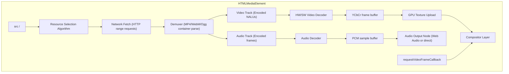

# Lesson 3: Multimedia Elements, Canvas Graphics, Media APIs

## 1. First-Principles Intuition & Invariants

The browser is, at its lowest level, a rendering pipeline fused to a network client. For the first decade of the web's existence, media was a foreign object injected into that pipeline through plugin boundaries — Flash, QuickTime, RealPlayer — each running in a separate process with its own security context, its own rendering surface, and its own idea of time. The page could not query the plugin's playback position. JavaScript could not manipulate individual video frames. Synchronizing a caption to a spoken word required either a Flash timeline or a server-side hack. HTML5 dissolved those boundaries by promoting audio and video to first-class DOM citizens governed by the same event loop, the same JavaScript heap, and the same compositor that moves every other pixel on screen.

Understanding the multimedia APIs correctly requires holding three invariants simultaneously. First, media time is not wall-clock time. The `currentTime` property of an `HTMLMediaElement` is a floating-point offset measured in seconds against the media timeline, which is an abstract coordinate system defined by the container format and potentially resampled by the browser's clock-recovery algorithm. Network jitter, decoder stalls, and explicit seeks all move `currentTime` discontinuously, and code that assumes monotonic advancement will produce subtle synchronization bugs at scale. Second, decoding is not rendering. A video frame is decoded from an encoded bitstream into a YCbCr or RGB pixel buffer in a worker thread, potentially on a hardware decode engine, and that buffer is uploaded to a GPU texture long before the compositor presents it to the screen. The gap between decode completion and display introduction is real and measurable, and the `requestVideoFrameCallback` API exists specifically to give applications a hook timed to the actual display moment rather than the decode moment. Third, the Canvas 2D API is a retained command-buffer abstraction over a software rasterizer (or its GPU-accelerated equivalent) that the browser flushes on its own schedule. Every call to `fillRect`, `arc`, or `drawImage` appends a command to an internal display list; the browser's compositing thread decides when to execute that list against a backing texture. Code that treats canvas operations as immediate pixel mutations will misunderstand why off-screen reads via `getImageData` are synchronous and expensive while draws are deferred and cheap.

The HTML media pipeline and the Canvas API share one crucial substrate: the HTML compositor. Both produce textures that the compositor assembles into the final layer tree. This is not incidental — it is what makes `drawImage(videoElement, 0, 0)` legal and efficient. The video frame that the decoder placed into a GPU texture can be blitted to the canvas backing texture without a round trip through CPU memory, provided both live in the same GPU memory domain and the browser's security checks (specifically the cross-origin clean flag on the canvas) permit the transfer.

---

## 2. Core Architecture & Mechanics

### The HTMLMediaElement State Machine

The `HTMLMediaElement` interface is specified in WHATWG HTML as a formal state machine with two orthogonal dimensions: network state and ready state. Network state tracks the resource fetch lifecycle: `NETWORK_EMPTY` (no source has been set), `NETWORK_IDLE` (source is set but nothing is loading), `NETWORK_LOADING` (a resource is actively being fetched), and `NETWORK_NO_SOURCE` (all candidate sources failed). Ready state tracks decoder readiness: `HAVE_NOTHING`, `HAVE_METADATA`, `HAVE_CURRENT_DATA`, `HAVE_FUTURE_DATA`, and `HAVE_ENOUGH_DATA`. The browser's internal resource selection algorithm walks `<source>` children in document order, probing each `type` attribute against the browser's MIME type registry before attempting any network request. The `canPlayType()` method exposes a slice of that registry to JavaScript, returning the strings `""`, `"maybe"`, or `"probably"` — a deliberately conservative vocabulary that reflects genuine uncertainty about whether a byte range the browser has not yet seen will ultimately be decodable.

The following diagram captures the signal path from resource selection through rendering:



The browser maintains two internal queues between the decoder and the compositor: a decoded video frame queue and a PCM audio render buffer. The audio/video synchronization algorithm works by designating audio as the master clock. The browser measures the difference between the audio renderer's presentation timestamp and the video frame's composition timestamp (DTS vs. PTS), and either drops video frames (if video is running behind) or inserts repetitions (if video is ahead). This design means that audio glitches propagate to visible video drift, not the reverse.

### Media Source Extensions and the SourceBuffer Model

`MediaSource` and `SourceBuffer` invert the browser's normal resource-loading model. Rather than handing the browser a URL and letting it drive the fetch, the application takes responsibility for all byte-range requests and feeds raw media segments into a `SourceBuffer` that the browser's demuxer consumes. This is the foundation of adaptive bitrate streaming implementations like DASH and HLS in pure JavaScript.

```javascript
const video = document.getElementById('player');
const ms    = new MediaSource();

video.src = URL.createObjectURL(ms);

ms.addEventListener('sourceopen', () => {
  // The codec string must precisely match what the segments contain.
  // An incorrect codec string causes immediate QuotaExceededError or
  // NotSupportedError; there is no graceful fallback.
  const mime = 'video/mp4; codecs="avc1.64001f,mp4a.40.2"';

  if (!MediaSource.isTypeSupported(mime)) {
    throw new Error(`MIME type not supported: ${mime}`);
  }

  const sb = ms.addSourceBuffer(mime);

  sb.addEventListener('updateend', () => {
    // updateend fires when the SourceBuffer has finished appending
    // and the demuxer has ingested the segment. It is now safe to
    // append the next segment or call endOfStream().
    if (allSegmentsFetched) {
      ms.endOfStream();
    } else {
      fetchAndAppendNextSegment(sb);
    }
  });

  sb.addEventListener('error', (e) => {
    // Decode errors, out-of-order timestamps, and buffer eviction
    // all surface here. The SourceBuffer enters an error state and
    // must be removed; the MediaSource may need to be rebuilt.
    console.error('SourceBuffer error:', e);
  });

  fetchAndAppendNextSegment(sb);
});

async function fetchAndAppendNextSegment(sb) {
  const segment = await fetchNextSegment();   // returns ArrayBuffer
  // appendBuffer is asynchronous; calling it while sb.updating === true
  // throws an InvalidStateError. Always gate on updateend or check the flag.
  if (!sb.updating) {
    sb.appendBuffer(segment);
  }
}
```

The `SourceBuffer` maintains an internal `buffered` `TimeRanges` object that records which media time intervals have been successfully demuxed. An adaptive bitrate controller queries `buffered` to determine how far ahead of `currentTime` the buffer extends (the buffer health metric), then decides whether to fetch a higher or lower quality segment. The browser itself may evict buffered data from the beginning of the timeline when total buffer size approaches an implementation-defined quota (typically 150–300 MB on desktop browsers), so a production ABR implementation must monitor both forward buffer depth and backward buffer retention.

### TextTrack and Synchronized Cue Delivery

The `TextTrack` model sits above the media timeline as a sorted sequence of `VTTCue` objects, each carrying a `startTime`, `endTime`, and payload. The browser fires `cuechange` events on the `TextTrack` object when the set of active cues changes relative to `currentTime`. This mechanism is not polling — the browser's internal timeline management schedules the event at the exact media time boundary. The critical engineering point is that `cuechange` fires on the `TextTrack`, not on the video element, so application code must hold a reference to the track object:

```javascript
const video   = document.querySelector('video');
const track   = video.addTextTrack('metadata', 'Chapter Markers', 'en');
track.mode    = 'hidden';   // 'hidden' parses cues but suppresses rendering

// Programmatically injected cues for frame-accurate chapter navigation
const chapters = [
  { start: 0,    end: 30,   text: JSON.stringify({ id: 'intro',   label: 'Introduction' }) },
  { start: 30,   end: 120,  text: JSON.stringify({ id: 'arch',    label: 'Architecture Deep Dive' }) },
  { start: 120,  end: 300,  text: JSON.stringify({ id: 'perf',    label: 'Performance Analysis' }) },
];

chapters.forEach(({ start, end, text }) => {
  track.addCue(new VTTCue(start, end, text));
});

track.addEventListener('cuechange', () => {
  const activeCues = Array.from(track.activeCues ?? []);
  activeCues.forEach(cue => {
    const data = JSON.parse(cue.text);
    document.getElementById('chapter-title').textContent = data.label;
  });
});
```

The same `TextTrack` machinery powers WebVTT subtitle rendering, caption accessibility, and chapter navigation — the payload format is the application's choice, while the timing engine is the browser's.

### Canvas 2D Rendering: The State Machine and Path Algebra

The `CanvasRenderingContext2D` is a stateful 2D graphics API modeled on PostScript's imaging model. Its state includes a current transformation matrix (CTM), a clip region, a fill and stroke style, compositing parameters, font metrics, and a shadow specification. That state is managed as an explicit stack via `save()` and `restore()`. Critically, the path is **not** part of the saved state — `beginPath()` resets the global path regardless of stack depth, which is a common source of rendering bugs.

The path algebra follows the even-odd or nonzero winding rule (selectable via the `fillRule` parameter of `fill()`) inherited from PostScript and SVG. A path is a sequence of subpaths, each composed of line segments, Bézier curves, arcs, and ellipse segments. `moveTo` starts a new subpath without implicitly closing the previous one; `closePath` draws a straight line back to the subpath's start point and marks the subpath as closed, which affects how `lineJoin` and `lineCap` are rendered at that junction.

```javascript
const canvas = document.getElementById('surface');
const ctx    = canvas.getContext('2d', {
  alpha: false,          // Opaque canvas; browser can skip alpha compositing
  desynchronized: true,  // Low-latency hint: skip synchronization with page compositor
                         // Useful for drawing tablet / real-time annotation applications
});

// Establish device-pixel-ratio-aware dimensions to prevent blurring on
// HiDPI displays. Physical pixels = logical pixels * devicePixelRatio.
const dpr = window.devicePixelRatio ?? 1;
canvas.width  = canvas.clientWidth  * dpr;
canvas.height = canvas.clientHeight * dpr;
ctx.scale(dpr, dpr);

function drawRoundedPolygon(vertices, radius) {
  ctx.beginPath();

  // For each vertex, the corner is replaced by an arc tangent to both
  // adjacent edges. arcTo() computes the tangent arc automatically.
  const n = vertices.length;
  const last = vertices[n - 1];
  ctx.moveTo(
    (last[0] + vertices[0][0]) / 2,
    (last[1] + vertices[0][1]) / 2
  );

  for (let i = 0; i < n; i++) {
    const curr = vertices[i];
    const next = vertices[(i + 1) % n];
    const mid  = [(curr[0] + next[0]) / 2, (curr[1] + next[1]) / 2];
    ctx.arcTo(curr[0], curr[1], mid[0], mid[1], radius);
    ctx.lineTo(mid[0], mid[1]);
  }

  ctx.closePath();
}

ctx.save();
ctx.fillStyle   = '#1a1a2e';
ctx.strokeStyle = '#e94560';
ctx.lineWidth   = 2;

drawRoundedPolygon(
  [[100, 50], [200, 80], [220, 180], [100, 220], [30, 160]],
  12
);

ctx.fill();
ctx.stroke();
ctx.restore();
```

The transformation matrix forms a 3×3 affine matrix in homogeneous coordinates:

```text
[ a  c  e ]   [ scaleX  skewX   translateX ]
[ b  d  f ] = [ skewY   scaleY  translateY ]
[ 0  0  1 ]   [   0       0         1     ]
```

`setTransform(a, b, c, d, e, f)` replaces the CTM absolutely; `transform(a, b, c, d, e, f)` multiplies the current CTM by the given matrix. For high-frequency animation loops, prefer `setTransform` over accumulated `translate`/`rotate`/`scale` calls to avoid floating-point drift over thousands of frames.

### Compositing Modes and Porter-Duff Algebra

The `globalCompositeOperation` property selects a Porter-Duff compositing operator that defines how incoming source pixels combine with existing destination pixels in the backing buffer. The 26 available modes fall into two categories: Porter-Duff alpha compositing operators (like `source-over`, `destination-in`, `xor`) and photographic blending modes borrowed from CSS Compositing Level 1 and Photoshop (like `multiply`, `screen`, `overlay`, `hard-light`).

`source-over` is the default and handles the most common case: paint source pixels over destination pixels weighted by source alpha. `destination-in` is the workhorse of mask operations — it multiplies destination alpha by source alpha, producing a result whose shape is the intersection of the two layers. The following pattern implements a texture-masked shape without an intermediate canvas:

```javascript
function drawTexturedShape(ctx, shapeFn, pattern) {
  ctx.save();

  // 1. Draw the shape as an opaque mask in destination space.
  ctx.globalCompositeOperation = 'source-over';
  shapeFn(ctx);
  ctx.fill();

  // 2. Switch to 'source-atop': paint the texture only where destination
  //    has nonzero alpha — i.e., inside the shape just drawn.
  ctx.globalCompositeOperation = 'source-atop';
  ctx.fillStyle = pattern;
  ctx.fillRect(0, 0, ctx.canvas.width, ctx.canvas.height);

  ctx.restore();
}

const img     = new Image();
img.src       = 'grain-texture.png';
img.onload    = () => {
  const pattern = ctx.createPattern(img, 'repeat');
  drawTexturedShape(ctx, (c) => {
    c.beginPath();
    c.arc(300, 300, 150, 0, Math.PI * 2);
  }, pattern);
};
```

Understanding `save()`/`restore()` semantics is critical here. `globalCompositeOperation` is part of the saved state, so the `restore()` call correctly reverts the compositing mode without an explicit assignment. Forgetting to restore after a non-default composite mode contaminates all subsequent draw calls, which produces bugs that are notoriously difficult to bisect because the visual artifact appears in entirely unrelated code paths.

### Pixel Manipulation: ImageData and the Pixel Buffer

`getImageData(x, y, width, height)` performs a synchronous GPU-to-CPU readback, copies the canvas backing buffer region into a `Uint8ClampedArray` laid out as interleaved RGBA bytes in row-major order, and returns an `ImageData` object wrapping that array. The synchronous readback stalls the GPU pipeline — Chrome's DevTools GPU trace will show a `ReadPixels` stall that can cost 2–10 ms on a dense canvas. For applications that need per-pixel processing at frame rate, the correct architecture is to perform the manipulation in a WebGL shader or in a `OffscreenCanvas` running in a `Worker`, then `transferToImageBitmap()` and post the bitmap back to the main thread.

The layout of the pixel buffer is deterministic: pixel at logical position `(x, y)` occupies bytes at index `(y * width + x) * 4` through `(y * width + x) * 4 + 3` for channels R, G, B, A respectively. `Uint8ClampedArray` automatically clamps any assigned value to the range [0, 255], which makes it safe to write arithmetic results directly without manual clamping.

The following implements a separable Gaussian blur using two-pass convolution directly on `ImageData`. It is intentionally written for correctness rather than peak performance to illustrate the pixel addressing model clearly:

```javascript
function gaussianBlur(ctx, x, y, w, h, radius) {
  const imageData = ctx.getImageData(x, y, w, h);
  const src       = imageData.data;
  const tmp       = new Uint8ClampedArray(src.length);
  const dst       = new Uint8ClampedArray(src.length);

  // Build a 1D Gaussian kernel of length (2*radius+1).
  const kLen   = 2 * radius + 1;
  const kernel = new Float32Array(kLen);
  const sigma  = radius / 3.0;
  let   kSum   = 0;

  for (let i = 0; i < kLen; i++) {
    const x = i - radius;
    kernel[i] = Math.exp(-(x * x) / (2 * sigma * sigma));
    kSum += kernel[i];
  }
  for (let i = 0; i < kLen; i++) kernel[i] /= kSum;

  // Horizontal pass: src → tmp
  for (let row = 0; row < h; row++) {
    for (let col = 0; col < w; col++) {
      let r = 0, g = 0, b = 0, a = 0;
      for (let k = 0; k < kLen; k++) {
        const srcCol = Math.min(w - 1, Math.max(0, col + k - radius));
        const idx    = (row * w + srcCol) * 4;
        const wt     = kernel[k];
        r += src[idx]     * wt;
        g += src[idx + 1] * wt;
        b += src[idx + 2] * wt;
        a += src[idx + 3] * wt;
      }
      const dstIdx  = (row * w + col) * 4;
      tmp[dstIdx]   = r;
      tmp[dstIdx+1] = g;
      tmp[dstIdx+2] = b;
      tmp[dstIdx+3] = a;
    }
  }

  // Vertical pass: tmp → dst
  for (let row = 0; row < h; row++) {
    for (let col = 0; col < w; col++) {
      let r = 0, g = 0, b = 0, a = 0;
      for (let k = 0; k < kLen; k++) {
        const srcRow = Math.min(h - 1, Math.max(0, row + k - radius));
        const idx    = (srcRow * w + col) * 4;
        const wt     = kernel[k];
        r += tmp[idx]     * wt;
        g += tmp[idx + 1] * wt;
        b += tmp[idx + 2] * wt;
        a += tmp[idx + 3] * wt;
      }
      const dstIdx  = (row * w + col) * 4;
      dst[dstIdx]   = r;
      dst[dstIdx+1] = g;
      dst[dstIdx+2] = b;
      dst[dstIdx+3] = a;
    }
  }

  imageData.data.set(dst);
  ctx.putImageData(imageData, x, y);
}
```

`putImageData` does not respect the current transformation matrix or compositing mode — it writes pixels directly into the backing buffer at absolute canvas coordinates. This is a deliberate specification decision that makes `putImageData` a raw memory write rather than a draw command. Applications that need a transformed `putImageData` must draw the `ImageData` to an `OffscreenCanvas` and then `drawImage` the result.

### requestVideoFrameCallback and Frame-Accurate Synchronization

The `requestVideoFrameCallback` API, now shipping in all major browsers, provides a callback timed to the display of a specific video frame rather than to the browser's animation frame schedule. The callback receives a `VideoFrameCallbackMetadata` object containing `mediaTime` (the frame's presentation timestamp on the media timeline), `presentedFrames` (a monotonically increasing frame counter useful for detecting dropped frames), `expectedDisplayTime` (the wall-clock time the frame will appear on screen), and `width`/`height` (the frame's encoded resolution, which may differ from the element's CSS dimensions).

```javascript
const video  = document.getElementById('source-video');
const canvas = document.getElementById('frame-canvas');
const ctx    = canvas.getContext('2d');

let   lastPresentedFrames = 0;

function processFrame(now, metadata) {
  const dropped = metadata.presentedFrames - lastPresentedFrames - 1;
  if (dropped > 0) {
    console.warn(`${dropped} frame(s) dropped before media time ${metadata.mediaTime.toFixed(3)}s`);
  }
  lastPresentedFrames = metadata.presentedFrames;

  // Resize canvas to match the actual encoded video resolution,
  // not the CSS layout size, for pixel-accurate processing.
  if (canvas.width !== metadata.width || canvas.height !== metadata.height) {
    canvas.width  = metadata.width;
    canvas.height = metadata.height;
  }

  // drawImage of a video element transfers the GPU-decoded frame texture
  // directly to the canvas backing buffer in supported browser+GPU combinations.
  ctx.drawImage(video, 0, 0, metadata.width, metadata.height);

  // Apply a custom overlay keyed on precise media time
  renderAnnotationsAtTime(ctx, metadata.mediaTime);

  // Schedule the next callback. Each call to rVFC registers exactly one
  // callback; it must be re-registered to continue.
  video.requestVideoFrameCallback(processFrame);
}

video.requestVideoFrameCallback(processFrame);
video.play();
```

The distinction between `requestVideoFrameCallback` and `requestAnimationFrame` is architecturally significant. `requestAnimationFrame` fires at the display refresh rate (nominally 60 Hz or 120 Hz) irrespective of media state. If the video is playing at 24 fps, `rAF` fires 2–3 times per video frame, and naive code that calls `drawImage` in an `rAF` loop will upload the same decoded texture 2–3 times and may read stale frame data between decode boundaries. `rVFC` fires exactly once per new frame, synchronized to its display introduction, eliminating both redundant uploads and stale reads.

---

## 3. High-Performance Optimization & Failure Modes

### Canvas Layer Promotion and GPU Memory Pressure

The browser's compositor manages a layer tree, and each `<canvas>` element occupies a compositor layer backed by a GPU texture. When a canvas is updated via any draw command, the browser must re-upload the CPU-side backing buffer to the GPU texture. This upload is the dominant cost in canvas-heavy applications, and its latency scales with canvas area. A 4K canvas (3840×2160) with 4 bytes per pixel occupies 31.6 MB of CPU memory; re-uploading it 60 times per second requires 1.9 GB/s of CPU-to-GPU memory bandwidth, which saturates the PCIe bus on a laptop with an integrated GPU.

The mitigation strategy is strict spatial decomposition. Rather than a single large canvas that redraws entirely on each frame, decompose the scene into static and dynamic layers. A background canvas holding the static scene graph — grid lines, labels, axis ticks — never receives draw commands during animation and therefore never triggers a re-upload. The overlay canvas holding the animated elements (a moving cursor, a real-time graph line, a dragged object) is small, occupies only the bounding region of the animation, and pays only the upload cost proportional to its area.

`OffscreenCanvas` enables an additional decomposition: pushing rendering work to a `Worker` thread removes rasterization from the main thread entirely, eliminating jank caused by JavaScript parsing, layout, or style recalculation interrupting an in-progress frame. The transfer model is explicit: the main thread creates an `OffscreenCanvas` from a placeholder `<canvas>` via `transferControlToOffscreen()`, which transfers ownership (and the right to issue draw commands) to the worker. The worker renders into the `OffscreenCanvas`; the browser compositor reads that texture directly on its own schedule without any structured clone or postMessage overhead.

```javascript
// main.js
const placeholder = document.getElementById('offscreen-canvas');
const offscreen   = placeholder.transferControlToOffscreen();

const worker = new Worker('renderer-worker.js');
// transferring ownership: main thread can no longer call getContext() on placeholder
worker.postMessage({ canvas: offscreen }, [offscreen]);
```

```javascript
// renderer-worker.js
self.onmessage = ({ data: { canvas } }) => {
  const ctx = canvas.getContext('2d');

  function frame(ts) {
    ctx.clearRect(0, 0, canvas.width, canvas.height);
    // ... render scene based on worker-local state ...
    requestAnimationFrame(frame);  // available in Worker context
  }

  requestAnimationFrame(frame);
};
```

### MediaSource Buffer Management and Stall Prevention

The most common failure mode in `MediaSource`-based players is the buffer underrun: the application fetches the next segment too late, `currentTime` advances past the end of the buffered range, and the browser fires a `waiting` event while the video element stalls in `HAVE_CURRENT_DATA`. The correct architecture is a feedback-loop controller that monitors buffer health every 500 ms and initiates segment fetches when the forward buffer depth drops below a configured threshold.

The second failure mode is buffer overflow. Browsers enforce a quota on total `SourceBuffer` buffer size (the WHATWG spec refers to this as "coded frame eviction"). When the quota is exceeded, the browser evicts frames from the beginning of the buffered range. If the application does not track which ranges remain buffered and attempts to seek backward into an evicted region, the seek stalls permanently because the browser has no data for that time range and the application has no code path to re-fetch it. A robust player calls `sb.remove(start, end)` proactively to trim data behind `currentTime` by a configurable margin (typically 30 seconds), and maintains a segment availability map keyed on time range to know which segments to re-fetch on backward seek.

### Cross-Origin Media and the Canvas Clean Flag

A canvas becomes "origin-tainted" when any image, video, or bitmap drawn into it originated from a cross-origin resource that was fetched without appropriate CORS headers. Tainted canvases block `getImageData`, `toDataURL`, `toBlob`, and `createPattern` — any operation that would extract pixel data. The error message is a `SecurityError: The operation is insecure.` The mechanism is the browser's defense against pixel-stealing attacks where a cross-origin image is drawn to canvas and its contents exfiltrated to a foreign server.

The fix is straightforward but requires coordination with the asset server. The ``, `<video>`, or `fetch()` request must carry a `crossOrigin` attribute set to `"anonymous"` or `"use-credentials"`, and the asset server must respond with `Access-Control-Allow-Origin: *` (or the specific origin). Setting `crossOrigin` without the corresponding server header causes the fetch to fail entirely; setting the header without `crossOrigin` on the client causes the browser to fetch the resource without CORS mode and taint the canvas anyway.

```javascript
const video         = document.createElement('video');
video.crossOrigin   = 'anonymous';   // Must be set before src is assigned
video.src           = 'https://cdn.example.com/clip.mp4';
// The CDN must serve: Access-Control-Allow-Origin: https://app.example.com
```

### Compositing Mode Contamination and State Stack Discipline

A subtle failure mode that frequently appears in composite canvas rendering pipelines is compositing mode leakage. Because `globalCompositeOperation` is changed by direct property assignment and affects every subsequent draw call, any code path that sets a non-`source-over` mode and then throws an exception, or returns early, or is called from within a `requestAnimationFrame` callback where exception handling is weak, leaves the context in a corrupted state for the remainder of that frame and all subsequent frames until the page is reloaded. The correct discipline is to treat any non-default compositing mode as a critical section: always bracket it with `save()` before the mode change and `restore()` after the last draw that requires it, with no exception-throwing operations between them. Combined with `try/finally` for cleanup when errors are genuinely possible, this guarantees the compositor state invariant across all code paths:

```javascript
function drawWithMode(ctx, mode, drawFn) {
  ctx.save();
  ctx.globalCompositeOperation = mode;
  try {
    drawFn(ctx);
  } finally {
    ctx.restore();   // restore() is always reached, even if drawFn throws
  }
}
```

### Decoded Frame Pipeline Latency and `desynchronized` Canvas

By default, the browser synchronizes the canvas compositor layer with the page compositor — a canvas update is not visible until the page compositor's next frame cycle, which guarantees visual coherence between canvas content and DOM content (overlapping text, borders, shadows). For applications like drawing tablets, music sequencer visualizers, or low-latency annotation tools, this synchronization introduces an additional frame of latency that is perceptible as stylus lag. The `{ desynchronized: true }` context hint instructs the browser to bypass page compositor synchronization and present canvas updates as early as the GPU pipeline allows. The trade-off is that the canvas may visually tear against overlapping DOM elements for one frame during simultaneous updates. For full-screen canvas applications with no overlapping DOM, this trade-off is unambiguously worth taking; for a canvas embedded in a document layout, measure the actual perceived latency improvement first.

The choice of context alpha mode interacts directly with compositing cost. `{ alpha: false }` signals that the canvas will never produce transparent pixels, allowing the browser to skip the per-pixel alpha blending step when compositing the canvas layer over page background content. For a 1920×1080 canvas, skipping the alpha blend eliminates roughly 2 million multiply-add operations per frame — a meaningful saving on a constrained device even with GPU acceleration.

### Web Audio Integration and Synchronized Tracks

The Web Audio API's `AudioContext` maintains its own high-precision timeline via `AudioContext.currentTime`, measured in seconds since the context was created with sub-millisecond resolution. When an `HTMLMediaElement` is connected to an `AudioContext` via `createMediaElementSource()`, the audio renderer reads PCM data from the media element's decoded audio queue and delivers it to the `AudioContext`'s processing graph. This creates a dependency between the media element's clock and the `AudioContext`'s clock that must be respected when scheduling events. The `AudioContext.currentTime` does not reset on seek; the media element's `currentTime` does. Code that attempts to synchronize a synthesized audio cue (scheduled via `AudioBufferSourceNode.start(ctx.currentTime + delay)`) with a video seek must account for the fact that the two clocks are not the same coordinate system and must compute the wall-clock gap between them explicitly.

A correct synchronization pattern uses the `seeked` event on the video element to reschedule all pending `AudioBufferSourceNode` events relative to the new `ctx.currentTime` offset, discarding any nodes whose scheduled play time has already passed and creating new nodes for cues that fall within the upcoming playback window. This rebuild-on-seek architecture is simpler and less error-prone than attempting to maintain a continuously updated delta between the two timelines, and it handles all edge cases — backward seek, rate change, pause/resume — with a single consistent code path.
