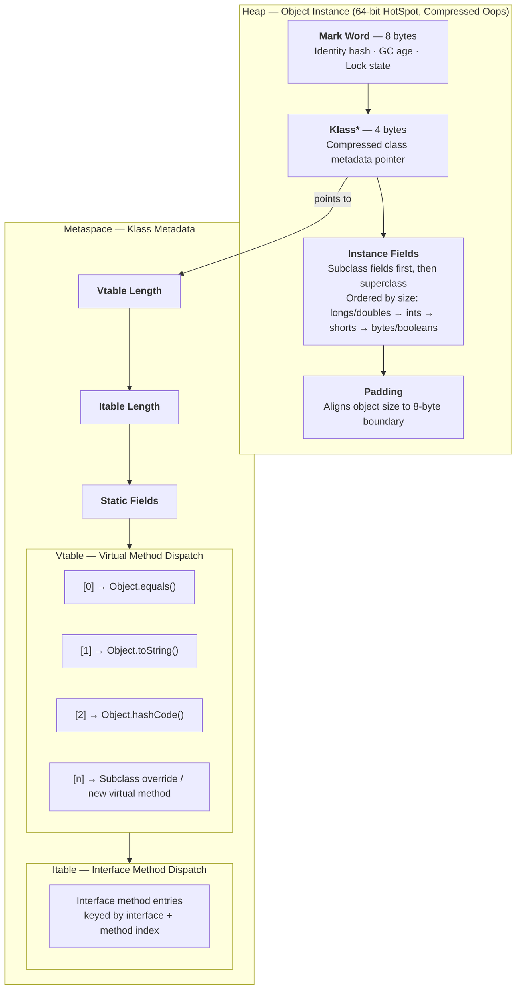

# Lesson 2: Object Model, Inheritance Mechanics

## 1. First-Principles Intuition & Invariants

The Java object model represents one of the most carefully engineered compromises in programming language design, balancing expressiveness, type safety, and runtime performance within constraints imposed by both the Java Virtual Machine architecture and the realities of cache-coherent multiprocessor systems. Unlike languages that expose raw memory layouts or permit arbitrary multiple inheritance, Java constructs a deterministic, single-rooted type hierarchy where every reference type descends from `java.lang.Object` and where method dispatch semantics remain predictable even in the presence of dynamic class loading and just-in-time compilation.

At its foundation, the Java object model enforces single inheritance for classes while permitting multiple inheritance of interface contracts. This asymmetry reflects a fundamental tension in object-oriented design: class inheritance couples both behavioral implementation and structural layout, creating fragile base class problems and ambiguous method resolution in languages like C++ that permit unrestricted multiple inheritance. Interface inheritance, by contrast, establishes only behavioral contracts—pure abstract specifications devoid of instance state—thereby avoiding the diamond problem's structural ambiguities while preserving polymorphic substitutability. The Java Language Specification formalizes this distinction through precise subtyping rules: a class `C` is a subtype of class `D` if and only if `C` extends `D` either directly or transitively, while a class or interface `T` is a subtype of interface `I` if `T` implements `I` or inherits from a type that does.

The runtime representation of Java objects consists of two critical memory regions: the object header and the instance data payload. Every object header contains a mark word encoding synchronization state (thin lock ownership, biased locking metadata, or hash code identity), a class metadata pointer (compressed or full depending on heap configuration), and optional array length for array objects. The class metadata pointer references a Klass structure in the metaspace—a region distinct from the Java heap—that maintains the virtual method table (vtable), interface method table (itable), static field storage, and type hierarchy information. This indirection through metadata pointers enables polymorphic dispatch while maintaining type safety: when invoking a virtual method on reference `obj`, the JVM dereferences the class pointer, indexes into the vtable at a compile-time-determined offset, and executes the most-derived implementation without requiring full method lookup at each call site.

Method dispatch in Java manifests through three distinct mechanisms, each with precise semantic guarantees and performance characteristics. Static method invocation resolves at compile time through symbolic references that the verifier confirms against the class file constant pool, producing `invokestatic` bytecode that directly jumps to the target method's code. Private instance methods and constructor calls similarly compile to `invokespecial` instructions that bypass dynamic dispatch, while virtual method calls on class instances produce `invokevirtual` bytecode that indexes the receiver's vtable. Interface method invocation generates `invokeinterface` instructions that perform more expensive lookups through the itable, as interface method offsets cannot be statically determined due to the arbitrary ordering of interface implementations across unrelated class hierarchies.

The abstract class mechanism in Java provides a controlled relaxation of the instantiation prohibition: an abstract class may declare abstract methods (contracts without implementations) while simultaneously providing concrete method implementations and maintaining instance state. This duality permits partial specification of class behavior while deferring certain implementation decisions to subclasses, establishing what the Gang of Four design patterns catalog termed the Template Method pattern as a first-class language construct. Abstract classes occupy the same single-inheritance hierarchy as concrete classes—each abstract class extends exactly one superclass and may be extended by at most one direct subclass per declaring class—but the verifier rejects any `new` bytecode attempting to instantiate an abstract type, enforcing the contract at both compile time and link time.

Java 8's introduction of default methods fundamentally altered interface semantics by permitting interfaces to carry concrete method implementations, blurring the previously crisp distinction between interfaces (pure contracts) and abstract classes (partial implementations). A default method provides a fallback implementation that implementing classes inherit unless they explicitly override it, enabling interface evolution without breaking binary compatibility with existing implementations. When multiple interfaces supply conflicting default methods for the same signature, Java enforces explicit disambiguation: the implementing class must override the method and may selectively invoke superinterface implementations through qualified `InterfaceName.super.methodName()` syntax, preserving determinism in the face of the previously avoided diamond inheritance scenario.

Sealed types, formalized in Java 17, impose exhaustive enumeration constraints on inheritance hierarchies by explicitly restricting which classes may extend a sealed class or implement a sealed interface. Where traditional Java classes permit arbitrary extension by any accessible class, a sealed type declaration enumerates its permitted subtypes through a `permits` clause, enabling the compiler and verifier to reason about type exhaustiveness. This constraint proves particularly powerful in conjunction with pattern matching and switch expressions, as the compiler can verify that pattern coverage is complete across all permitted subtypes, transforming runtime type checks into compile-time verified structural analyses. Sealed hierarchies effectively encode algebraic data types within Java's nominal type system, providing guarantees about type coverage that enable more aggressive optimization by the JIT compiler and more precise static analysis by verification tools.

## 2. Core Architecture & Mechanics

The in-memory layout of a Java object begins with the object header, a data structure whose size and format vary by platform and JVM configuration but universally serves to anchor the object's identity, locking state, and type information. On 64-bit HotSpot JVM with compressed pointers enabled (the default for heaps under 32GB), the header consists of an 8-byte mark word followed by a 4-byte compressed class pointer. The mark word encodes multiple overlapping interpretations: in its unlocked state, it stores the object's identity hash code in the upper bits and age information for generational garbage collection in the lower bits; when locked, it pivots to encode thin lock ownership through a thread identifier or a pointer to a displaced mark word for heavyweight monitor locks. This polymorphic encoding of the mark word epitomizes space-efficient design, as objects rarely require simultaneous representation of locking state and hash code identity.



The virtual method table construction follows a deterministic algorithm that preserves method offset stability across inheritance hierarchies. When a class `B` extends class `A`, the JVM constructs `B`'s vtable by first copying all entries from `A`'s vtable, then appending new virtual methods declared in `B`, and finally overwriting inherited entries with overriding implementations. This ensures that a method `m()` declared in `A` occupies the same vtable offset in all subclasses of `A`, enabling `invokevirtual` to use a fixed offset computed at compile time regardless of the receiver's runtime type. Consider a three-level hierarchy where `Object` declares `equals()`, `toString()`, and `hashCode()` at vtable offsets 0, 1, and 2; class `A extends Object` inherits these offsets and adds `foo()` at offset 3; class `B extends A` overrides `toString()` at offset 1 and adds `bar()` at offset 4. An `invokevirtual` calling `toString()` on a reference statically typed as `Object` always uses offset 1, dispatching to `Object.toString()` for `Object` instances, to `A`'s inherited `Object.toString()` for `A` instances, and to `B.toString()` for `B` instances.

Interface method dispatch operates through a fundamentally different mechanism because interfaces impose no constraints on the ordering of their implementations within a class's type hierarchy. Where vtable offsets remain stable across class inheritance, a class implementing interfaces `I1` and `I2` in that order might implement them in the reverse order from a sibling class, preventing the use of fixed offsets. The HotSpot JVM constructs an interface method table (itable) as a two-level structure: an array of interface-offset pairs mapping each implemented interface to a starting offset, followed by a flat array of method implementations. When executing `invokeinterface I.method()` on receiver `obj`, the JVM searches `obj`'s itable for the interface `I`, retrieves the associated offset, adds the method's index within that interface, and dispatches to the resulting function pointer. Modern JVMs optimize this search through inline caching: after the first invocation for a given call site, the JIT compiler embeds a fast-path type check that compares the receiver's class against the cached class and directly jumps to the cached method implementation if the types match, falling back to the full itable search only on type mismatches.

```java
// Concrete demonstration of vtable mechanics
class VehicleBase {
    public void start() {
        System.out.println("VehicleBase: Ignition sequence");
    }
    
    public void accelerate(int delta) {
        System.out.println("VehicleBase: Accelerating by " + delta);
    }
    
    public final void emergencyStop() {
        System.out.println("VehicleBase: Emergency stop protocol");
    }
}

class ElectricVehicle extends VehicleBase {
    @Override
    public void start() {
        System.out.println("ElectricVehicle: Battery precharge");
    }
    
    @Override
    public void accelerate(int delta) {
        System.out.println("ElectricVehicle: Torque vectoring at " + delta);
    }
    
    public void regenerativeBrake(int intensity) {
        System.out.println("ElectricVehicle: Regen braking at " + intensity);
    }
}

// Vtable structure (conceptual):
// VehicleBase vtable:
//   [0] Object.equals
//   [1] Object.toString  
//   [2] Object.hashCode
//   [3] VehicleBase.start
//   [4] VehicleBase.accelerate
//   (emergencyStop is final, resolved statically via invokespecial)
//
// ElectricVehicle vtable:
//   [0] Object.equals (inherited)
//   [1] Object.toString (inherited)
//   [2] Object.hashCode (inherited)
//   [3] ElectricVehicle.start (overridden, replaces slot 3)
//   [4] ElectricVehicle.accelerate (overridden, replaces slot 4)
//   [5] ElectricVehicle.regenerativeBrake (new method, new slot)

public class VtableDispatchDemo {
    public static void main(String[] args) {
        VehicleBase vehicle = new ElectricVehicle();
        
        // Compiles to invokevirtual at vtable offset 3
        // Runtime: dereference vehicle -> Klass* -> vtable[3] -> ElectricVehicle.start
        vehicle.start();
        
        // Compiles to invokevirtual at vtable offset 4
        vehicle.accelerate(50);
        
        // Compiles to invokespecial (final method, no dispatch)
        vehicle.emergencyStop();
    }
}
```

Abstract classes enable partial implementation through selective abstract method declarations while maintaining full access to instance state and constructor initialization semantics. The JVM enforces abstraction at multiple verification points: during class loading, the verifier confirms that abstract classes are never instantiated directly; during compilation, the Java compiler rejects attempts to invoke `new` on abstract types; during method resolution, the verifier ensures that all concrete subclasses provide implementations for inherited abstract methods. This multi-layered enforcement guarantees type soundness without runtime overhead, as the abstract-or-concrete distinction disappears entirely after class loading completes.

```java
// Abstract class demonstrating partial specification
abstract class PersistentStore {
    private final String storageIdentifier;
    private volatile boolean isShutdown = false;
    
    protected PersistentStore(String identifier) {
        this.storageIdentifier = identifier;
    }
    
    // Concrete implementation shared by all subclasses
    public final String getIdentifier() {
        return storageIdentifier;
    }
    
    // Template method: concrete algorithm delegating to abstract primitives
    public final void shutdown() {
        if (isShutdown) {
            throw new IllegalStateException("Already shut down");
        }
        
        beforeShutdown();
        flushPendingWrites();
        releaseLocks();
        closeResources();
        isShutdown = true;
        afterShutdown();
    }
    
    // Abstract contracts for subclass specialization
    protected abstract void flushPendingWrites();
    protected abstract void releaseLocks();
    protected abstract void closeResources();
    
    // Hook methods with default no-op behavior
    protected void beforeShutdown() {}
    protected void afterShutdown() {}
}

class FilesystemStore extends PersistentStore {
    private final java.nio.channels.FileChannel channel;
    private final java.nio.file.Path dataPath;
    
    public FilesystemStore(String identifier, java.nio.file.Path path) 
            throws java.io.IOException {
        super(identifier);
        this.dataPath = path;
        this.channel = java.nio.channels.FileChannel.open(
            path,
            java.nio.file.StandardOpenOption.CREATE,
            java.nio.file.StandardOpenOption.WRITE,
            java.nio.file.StandardOpenOption.SYNC
        );
    }
    
    @Override
    protected void flushPendingWrites() {
        try {
            channel.force(true);
        } catch (java.io.IOException e) {
            throw new RuntimeException("Flush failed", e);
        }
    }
    
    @Override
    protected void releaseLocks() {
        // File locks released implicitly on channel close
    }
    
    @Override
    protected void closeResources() {
        try {
            channel.close();
        } catch (java.io.IOException e) {
            throw new RuntimeException("Channel close failed", e);
        }
    }
    
    @Override
    protected void afterShutdown() {
        System.out.println("FilesystemStore shutdown complete: " + dataPath);
    }
}
```

Default methods in interfaces introduce a controlled form of implementation inheritance that preserves binary compatibility during interface evolution. When an interface `I` declares a default method `default void process() { ... }`, any class implementing `I` inherits this implementation unless it explicitly overrides the method. The JVM resolves default method calls through the same invokeinterface mechanism used for abstract interface methods, but instead of requiring an implementation in the class, it walks the interface hierarchy to locate the default implementation. This search follows a most-specific default rule: if multiple inherited interfaces provide conflicting defaults, the JVM selects the implementation from the most derived interface in the type hierarchy, or reports a compilation error if no single most-specific implementation exists.

```java
interface TimestampedEvent {
    long getTimestamp();
    
    // Default implementation available to all implementors
    default java.time.Instant getInstant() {
        return java.time.Instant.ofEpochMilli(getTimestamp());
    }
    
    default String formatTimestamp() {
        return java.time.format.DateTimeFormatter.ISO_INSTANT
            .format(getInstant());
    }
}

interface PrioritizedEvent {
    int getPriority();
    
    default boolean isHighPriority() {
        return getPriority() >= 7;
    }
}

interface AuditableEvent extends TimestampedEvent {
    String getUserId();
    String getAction();
    
    // Override superinterface default with more specific implementation
    @Override
    default String formatTimestamp() {
        return String.format("[%s] %s by %s",
            TimestampedEvent.super.formatTimestamp(),
            getAction(),
            getUserId()
        );
    }
}

class SecurityEvent implements AuditableEvent, PrioritizedEvent {
    private final long timestamp;
    private final String userId;
    private final String action;
    private final int priority;
    
    public SecurityEvent(long ts, String user, String act, int pri) {
        this.timestamp = ts;
        this.userId = user;
        this.action = act;
        this.priority = pri;
    }
    
    @Override
    public long getTimestamp() { return timestamp; }
    
    @Override
    public String getUserId() { return userId; }
    
    @Override
    public String getAction() { return action; }
    
    @Override
    public int getPriority() { return priority; }
    
    // Inherits AuditableEvent.formatTimestamp() default
    // Inherits PrioritizedEvent.isHighPriority() default
    
    public void report() {
        String classification = isHighPriority() ? "CRITICAL" : "INFO";
        System.out.printf("[%s] %s%n", classification, formatTimestamp());
    }
}

// Demonstration of default method resolution
public class DefaultMethodDemo {
    public static void main(String[] args) {
        SecurityEvent event = new SecurityEvent(
            System.currentTimeMillis(),
            "admin",
            "PRIVILEGE_ESCALATION",
            9
        );
        
        event.report();
        // Output: [CRITICAL] [2024-01-15T10:30:45.123Z] PRIVILEGE_ESCALATION by admin
    }
}
```

Sealed types enforce closed-world reasoning about type hierarchies by explicitly enumerating permitted subtypes, transforming the open extension model of traditional Java classes into an algebraic data type discipline. When a class or interface declaration includes a `sealed` modifier and a `permits` clause, the compiler enforces that only the listed types may extend or implement the sealed type, and those permitted types must themselves be either `final` (terminating the hierarchy), `sealed` (extending the closed enumeration), or `non-sealed` (reopening unrestricted extension). This three-way partition enables precise control over inheritance boundaries while preserving the ability to extend hierarchies when necessary.

```java
// Sealed hierarchy modeling transport-layer protocol state machine
sealed interface ConnectionState 
    permits Closed, Opening, Established, Closing {
    
    String getStateIdentifier();
    
    default boolean allowsDataTransfer() {
        return false;
    }
}

final class Closed implements ConnectionState {
    @Override
    public String getStateIdentifier() {
        return "CLOSED";
    }
}

final class Opening implements ConnectionState {
    private final long handshakeInitiatedAt;
    
    public Opening(long timestamp) {
        this.handshakeInitiatedAt = timestamp;
    }
    
    @Override
    public String getStateIdentifier() {
        return "OPENING";
    }
    
    public long getHandshakeTimestamp() {
        return handshakeInitiatedAt;
    }
}

final class Established implements ConnectionState {
    private final java.net.InetSocketAddress remoteAddress;
    private final long establishedAt;
    
    public Established(java.net.InetSocketAddress remote, long timestamp) {
        this.remoteAddress = remote;
        this.establishedAt = timestamp;
    }
    
    @Override
    public String getStateIdentifier() {
        return "ESTABLISHED";
    }
    
    @Override
    public boolean allowsDataTransfer() {
        return true;
    }
    
    public java.net.InetSocketAddress getRemoteAddress() {
        return remoteAddress;
    }
}

final class Closing implements ConnectionState {
    private final String closeReason;
    
    public Closing(String reason) {
        this.closeReason = reason;
    }
    
    @Override
    public String getStateIdentifier() {
        return "CLOSING";
    }
    
    public String getCloseReason() {
        return closeReason;
    }
}

// Pattern matching with exhaustiveness checking
class ConnectionHandler {
    public void processState(ConnectionState state) {
        // Compiler verifies exhaustiveness: all permitted types covered
        String description = switch (state) {
            case Closed c -> 
                "Connection is closed";
            case Opening o -> 
                String.format("Handshake in progress (started %d ms ago)",
                    System.currentTimeMillis() - o.getHandshakeTimestamp());
            case Established e -> 
                String.format("Connected to %s", e.getRemoteAddress());
            case Closing c -> 
                String.format("Closing due to: %s", c.getCloseReason());
            // No default case needed: compiler proves exhaustiveness
        };
        
        System.out.println(description);
    }
    
    // Type narrowing enables safe downcasting without instanceof chains
    public void sendData(ConnectionState state, byte[] data) {
        if (state instanceof Established established) {
            // Type narrowed: established is Established, not ConnectionState
            transmit(established.getRemoteAddress(), data);
        } else {
            throw new IllegalStateException(
                "Cannot send data in state: " + state.getStateIdentifier()
            );
        }
    }
    
    private void transmit(java.net.InetSocketAddress remote, byte[] data) {
        // Actual network transmission logic
    }
}
```

The sealed type mechanism integrates with the verifier to enforce permitted-subtype constraints at class loading time. When the JVM loads a class claiming to extend or implement a sealed type, the verifier consults the sealed type's permitted-subtype list and rejects the class if it does not appear in that list, preventing unauthorized extension even by bytecode generated outside the Java compiler. This verification barrier proves essential for security-sensitive code that relies on type exhaustiveness guarantees, as it prevents malicious or buggy code from injecting new subtypes that would invalidate switch exhaustiveness or downcast safety assumptions.

## 3. High-Performance Optimization & Failure Modes

The JIT compiler leverages type hierarchy information to perform aggressive devirtualization optimizations that eliminate virtual dispatch overhead in hot code paths. When a virtual method call site observes only a single receiver type during profiling, the JIT compiler emits a guarded inline sequence: a type check comparing the receiver's class against the observed monomorphic type, followed by a direct jump to the inlined method body if the check succeeds, and a fallback to the full virtual dispatch path if the check fails. For bimorphic call sites observing two receiver types, the JIT emits a cascaded check-and-inline sequence testing both types before falling back to virtual dispatch. These speculative optimizations transform polymorphic abstractions into efficiently-inlined code while preserving correctness through deoptimization: if the runtime later encounters a receiver type not covered by the optimized code, the JVM invalidates the compiled method and returns to interpreted execution or recompiles with updated type profiles.

```java
// Demonstrating JIT devirtualization with monomorphic and megamorphic call sites
abstract class DataEncoder {
    public abstract void encode(java.nio.ByteBuffer buffer, Object value);
}

class IntegerEncoder extends DataEncoder {
    @Override
    public void encode(java.nio.ByteBuffer buffer, Object value) {
        buffer.putInt((Integer) value);
    }
}

class LongEncoder extends DataEncoder {
    @Override
    public void encode(java.nio.ByteBuffer buffer, Object value) {
        buffer.putLong((Long) value);
    }
}

class StringEncoder extends DataEncoder {
    @Override
    public void encode(java.nio.ByteBuffer buffer, Object value) {
        byte[] bytes = ((String) value).getBytes(java.nio.charset.StandardCharsets.UTF_8);
        buffer.putInt(bytes.length);
        buffer.put(bytes);
    }
}

public class DevirtualizationBenchmark {
    // Monomorphic call site: JIT will inline IntegerEncoder.encode
    public static void encodeMonomorphic(DataEncoder encoder, 
                                         java.nio.ByteBuffer buffer,
                                         int iterations) {
        // Profiling reveals encoder is always IntegerEncoder
        for (int i = 0; i < iterations; i++) {
            encoder.encode(buffer, i);
        }
        // JIT generates:
        //   if (encoder.getClass() == IntegerEncoder.class) {
        //       buffer.putInt((Integer) value);  // inlined
        //   } else {
        //       encoder.encode(buffer, value);   // fallback
        //   }
    }
    
    // Bimorphic call site: JIT will emit dual type check and inline both
    public static void encodeBimorphic(DataEncoder[] encoders,
                                       java.nio.ByteBuffer buffer,
                                       int iterations) {
        // Profiling reveals alternating IntegerEncoder/LongEncoder
        for (int i = 0; i < iterations; i++) {
            encoders[i % 2].encode(buffer, i);
        }
        // JIT generates cascaded checks:
        //   if (encoder.getClass() == IntegerEncoder.class) {
        //       buffer.putInt((Integer) value);
        //   } else if (encoder.getClass() == LongEncoder.class) {
        //       buffer.putLong((Long) value);
        //   } else {
        //       encoder.encode(buffer, value);
        //   }
    }
    
    // Megamorphic call site: JIT cannot effectively optimize
    public static void encodeMegamorphic(DataEncoder[] encoders,
                                         java.nio.ByteBuffer buffer,
                                         int iterations) {
        // Profiling reveals >2 distinct types (IntegerEncoder, LongEncoder, StringEncoder)
        for (int i = 0; i < iterations; i++) {
            encoders[i % 3].encode(buffer, i);
        }
        // JIT emits virtual dispatch via vtable/itable
        // Performance penalty: ~3-5 ns per call vs 0.5 ns for inlined
    }
    
    public static void main(String[] args) {
        java.nio.ByteBuffer buffer = java.nio.ByteBuffer.allocate(1024 * 1024);
        
        // Warmup to trigger JIT compilation
        DataEncoder intEncoder = new IntegerEncoder();
        for (int i = 0; i < 20000; i++) {
            encodeMonomorphic(intEncoder, buffer, 1000);
            buffer.clear();
        }
        
        // Benchmark monomorphic path (fully inlined)
        long start = System.nanoTime();
        for (int i = 0; i < 10000; i++) {
            encodeMonomorphic(intEncoder, buffer, 1000);
            buffer.clear();
        }
        long monomorphicNanos = System.nanoTime() - start;
        
        // Benchmark megamorphic path (virtual dispatch)
        DataEncoder[] megamorphicEncoders = {
            new IntegerEncoder(),
            new LongEncoder(),
            new StringEncoder()
        };
        buffer.clear();
        for (int i = 0; i < 20000; i++) {
            encodeMegamorphic(megamorphicEncoders, buffer, 1000);
            buffer.clear();
        }
        
        start = System.nanoTime();
        for (int i = 0; i < 10000; i++) {
            encodeMegamorphic(megamorphicEncoders, buffer, 1000);
            buffer.clear();
        }
        long megamorphicNanos = System.nanoTime() - start;
        
        System.out.printf("Monomorphic: %d ns%n", monomorphicNanos);
        System.out.printf("Megamorphic: %d ns%n", megamorphicNanos);
        System.out.printf("Slowdown: %.2fx%n", 
            (double) megamorphicNanos / monomorphicNanos);
    }
}
```

Interface method dispatch suffers from fundamental performance limitations due to the impossibility of using fixed vtable offsets. The itable search constitutes a linear scan through the receiver's implemented interfaces, with search time proportional to the number of interfaces implemented by the receiver's class. For classes implementing dozens of interfaces—common in enterprise frameworks employing fine-grained interface segregation—itable lookup overhead can dominate execution time in tight loops. The JIT compiler mitigates this through inline caching and monomorphic specialization, but megamorphic interface call sites degrade to full itable search, incurring cache misses and branch mispredictions. Engineers optimizing performance-critical code should prefer abstract classes over interfaces when inheritance hierarchies remain shallow and single-inheritance constraints do not prove limiting, as abstract class methods dispatch through vtables with O(1) constant-time lookup.

The introduction of default methods created a subtle binary compatibility hazard known as the diamond default problem. When a class implements two interfaces that both inherit a default method from a common superinterface but one of those interfaces overrides the default with its own implementation, the implementing class must disambiguate which default to inherit. If library maintainers add default method overrides to existing interfaces, previously-compiling client code may suddenly fail with ambiguous method errors upon recompilation, even though no source changes occurred in the client code. The Java Language Specification addresses this through the most-specific default rule, but library designers must exercise caution when evolving interface hierarchies to avoid forcing clients into mandatory disambiguation.

```java
// Demonstrating diamond default ambiguity and resolution
interface DataSource {
    default String getDescription() {
        return "Generic data source";
    }
}

interface CachedDataSource extends DataSource {
    @Override
    default String getDescription() {
        return "Cached data source with TTL";
    }
}

interface ReplicatedDataSource extends DataSource {
    @Override
    default String getDescription() {
        return "Replicated data source with consensus";
    }
}

// Compilation error: ambiguous default method inherited from both
// CachedDataSource and ReplicatedDataSource
class DistributedCache implements CachedDataSource, ReplicatedDataSource {
    // Must explicitly resolve ambiguity
    @Override
    public String getDescription() {
        // Option 1: Select one superinterface default
        return CachedDataSource.super.getDescription();
        
        // Option 2: Combine both defaults
        // return CachedDataSource.super.getDescription() + " + " +
        //        ReplicatedDataSource.super.getDescription();
        
        // Option 3: Provide entirely new implementation
        // return "Distributed cache with replication and caching";
    }
}
```

Sealed types impose a verification burden that increases class loading time proportionally to the depth of the sealed hierarchy. When loading a class claiming to extend a sealed type, the verifier must walk the entire sealed chain to confirm that every ancestor's permitted-subtype list includes the appropriate descendant. For deeply nested sealed hierarchies—particularly those modeling complex state machines or AST node types—this verification cost can manifest as measurable slowdowns during application startup, especially in frameworks that dynamically generate and load large numbers of classes. Engineers should flatten sealed hierarchies when possible and avoid sealing types that will be extended by generated code, as the verification overhead compounds with the number of loaded classes.

The most pernicious failure mode in inheritance-heavy codebases emerges from fragile base class problems where changes to superclass internals break subclass invariants. When a superclass method invokes another overridable method, subclass overrides can observe the superclass in a partially initialized or inconsistent state. Consider a superclass constructor that calls an overridable method before its own constructor completes: the subclass override executes before the subclass constructor runs, accessing uninitialized fields and violating invariants. The Java Language Specification explicitly warns against this pattern, but the compiler cannot detect all instances due to transitive calls through private helper methods. Defensive engineering practices dictate that superclass constructors should invoke only final or private methods, abstract classes should document which methods subclasses may safely override, and template methods should be marked final to prevent unexpected override interactions.

```java
// Demonstrating fragile base class problem and defensive design
class FragileBase {
    private final String identifier;
    
    // DANGEROUS: calls overridable method from constructor
    public FragileBase(String id) {
        this.identifier = id;
        initialize();  // Subclass override executes before subclass constructor
    }
    
    // Overridable method called during construction
    protected void initialize() {
        System.out.println("FragileBase initializing: " + identifier);
    }
}

class FragileSubclass extends FragileBase {
    private final int capacity;
    
    public FragileSubclass(String id, int cap) {
        super(id);  // Calls FragileBase constructor
        this.capacity = cap;
        System.out.println("FragileSubclass constructor: capacity=" + capacity);
    }
    
    @Override
    protected void initialize() {
        // BUG: capacity not yet initialized when this executes
        System.out.println("FragileSubclass initialize: capacity=" + capacity);
        // Prints: FragileSubclass initialize: capacity=0
    }
}

// CORRECT: defensive abstract base class design
abstract class RobustBase {
    private final String identifier;
    private boolean isInitialized = false;
    
    protected RobustBase(String id) {
        this.identifier = id;
        // Only call final methods from constructor
        performInitialization();
    }
    
    // Final method: cannot be overridden
    private final void performInitialization() {
        System.out.println("RobustBase initializing: " + identifier);
        isInitialized = true;
    }
    
    // Template method: final to prevent override, delegates to hooks
    public final void execute() {
        if (!isInitialized) {
            throw new IllegalStateException("Not initialized");
        }
        beforeExecution();
        performExecution();
        afterExecution();
    }
    
    // Hook methods for subclass customization
    protected void beforeExecution() {}
    protected abstract void performExecution();
    protected void afterExecution() {}
}

class RobustSubclass extends RobustBase {
    private final int capacity;
    
    public RobustSubclass(String id, int cap) {
        super(id);
        this.capacity = cap;
        // Subclass fully initialized before any overridable method executes
    }
    
    @Override
    protected void performExecution() {
        // Safe: capacity is always initialized when this executes
        System.out.println("RobustSubclass executing with capacity=" + capacity);
    }
}
```

Memory layout optimizations in the HotSpot JVM attempt to minimize object size and maximize cache efficiency through field reordering and alignment. The JVM sorts instance fields by size—longs and doubles first, then ints and floats, then shorts and chars, then bytes and booleans, finally references—to minimize internal padding required for natural alignment. Subclass fields follow superclass fields in the layout, creating potential cache inefficiencies when frequently-accessed subclass fields reside far from the object header. Engineers implementing performance-critical inheritance hierarchies should measure object sizes via JOL (Java Object Layout) and consider flattening hierarchies or moving hot fields to superclasses when profiling reveals cache miss penalties.

The final modifier provides the JIT compiler with optimization opportunities beyond devirtualization by guaranteeing that a class has no subclasses. When a class is declared final, the JIT can eliminate type checks, inline method calls without guards, and perform aggressive escape analysis that stack-allocates objects when no references escape the allocating method. Value types proposed in Project Valhalla extend this notion further by enabling inline layout of object fields within their containers, eliminating pointer indirection and improving cache locality, but require immutability and identity-free semantics that fundamentally constrain object model expressiveness. Current Java engineers optimizing for allocation-heavy workloads should make leaf classes final whenever possible to enable scalar replacement and lock elision optimizations.
