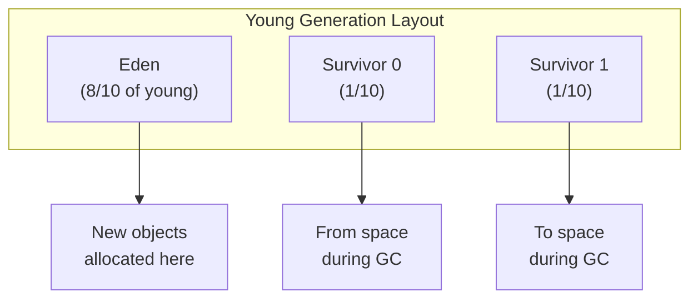
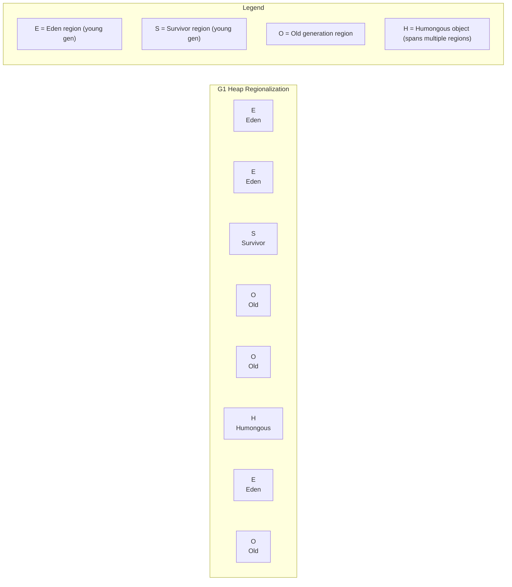
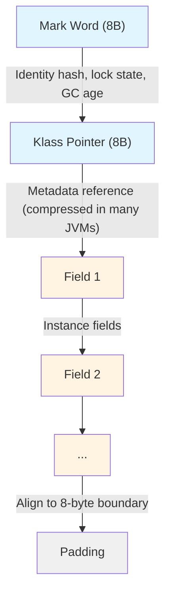

# Lesson 3: Memory Model, Garbage Collection

## 1. First-Principles Intuition & Invariants

The Java Virtual Machine memory model represents one of software engineering's most sophisticated attempts to abstract hardware memory semantics while maintaining predictable performance characteristics across heterogeneous architectures. At its core, the JVM memory subsystem must reconcile three fundamental tensions: the need for automatic memory management to eliminate entire classes of memory safety bugs, the imperative to deliver predictable low-latency performance for production workloads, and the requirement to expose a coherent memory consistency model across concurrent threads executing on modern weakly-ordered multiprocessor systems.

Unlike systems languages such as C or Rust where memory allocation and deallocation remain explicit programmer responsibilities, Java delegates memory reclamation to the garbage collector, a runtime subsystem that automatically identifies and reclaims objects no longer reachable through any chain of references from program roots. This delegation creates a profound architectural tradeoff: the programmer surrenders fine-grained control over allocation timing and object placement in exchange for elimination of use-after-free vulnerabilities, double-free corruption, and memory leaks stemming from forgotten deallocations. The garbage collector becomes a perpetual background actor, observing object graphs, tracking mutator activity, and periodically reclaiming dead objects through sophisticated graph traversal algorithms.

The Java Memory Model, formalized in JSR-133 and refined through subsequent specifications, establishes ordering guarantees and visibility semantics for shared memory operations across concurrent threads. At the hardware level, modern processors employ store buffers, invalidation queues, and multilevel cache hierarchies that permit observable instruction reordering—a load may complete before an earlier store becomes globally visible, or two stores may reach main memory in an order contradicting program sequence. The JMM provides happens-before edges, synchronization primitives, and volatile semantics that let programmers reason about memory visibility without requiring deep knowledge of specific CPU memory ordering models. A happens-before relationship between operation A and operation B guarantees that all memory writes performed by A become visible to B, creating a partial ordering over program execution that constrains compiler and hardware optimizations.

The heap itself divides into regions reflecting generational hypotheses validated across decades of empirical measurement: most objects die young, surviving only briefly after allocation, while objects that survive multiple collection cycles tend to remain live for extended periods. This generational insight permits collectors to focus reclamation effort on young regions where mortality rates exceed ninety percent, amortizing the cost of tracing the entire live object graph by concentrating work where payoff remains highest. The young generation typically subdivides into an Eden space where fresh allocations occur and two survivor spaces that hold objects surviving initial collections. The old generation or tenured space accumulates long-lived objects promoted from survivor regions after weathering multiple young collections.

Thread stacks, in contrast to heap memory, follow a deterministic allocation and deallocation discipline governed by method invocation semantics. Each thread receives a private stack storing activation records or frames for method calls, local variables, operand stacks for bytecode execution, and return addresses. Stack frames grow and shrink in strict last-in-first-out order as methods invoke and return, permitting trivial deallocation without graph tracing—when a method returns, its entire frame vanishes atomically, reclaiming all local variable storage. The JVM specification mandates stack storage for primitive local variables and object references, while actual object bodies always reside in heap space, creating a clean separation between stack-discipline memory and graph-structured heap memory requiring collection.

Object lifecycle begins at allocation, proceeds through an initialization phase where constructors execute, continues through a reachable phase where references exist from GC roots or other live objects, transitions to a finalizable state if the object implements finalization logic, executes finalization at most once, and ultimately reaches a reclaimable state where memory may be returned to the allocator. The JVM maintains distinct reference strength categories—strong references that prevent collection, soft references reclaimed only under memory pressure, weak references cleared before finalization, and phantom references queued after finalization—permitting nuanced cache implementations and resource cleanup patterns beyond simple reachability.

The fundamental invariant underlying all garbage collection algorithms states that the collector must never reclaim live objects while ensuring eventual reclamation of all dead objects. Liveness, defined through reachability from GC roots comprising thread stacks, static fields, JNI references, and internal JVM structures, creates a conservative approximation of true program semantics—an object may be unreachable yet still live from the program's perspective if it holds resources requiring cleanup. Collectors must trace object graphs atomically with respect to mutator activity or employ write barriers and incremental techniques to maintain correctness as application threads concurrently mutate the heap. The stop-the-world pause, wherein all application threads suspend to permit collection, represents the simplest correctness strategy but inflicts latency spikes that modern collectors strive to minimize through concurrent and incremental designs.

## 2. Core Architecture & Mechanics

The HotSpot JVM, Oracle's reference implementation and the foundation for OpenJDK distributions, partitions heap memory into generational regions optimized for different object lifetimes and collection strategies. The young generation, typically sized between one quarter and one third of total heap space, receives all new object allocations into its Eden region. Each thread maintains a Thread-Local Allocation Buffer or TLAB, a contiguous chunk of Eden space carved out for lock-free bump-pointer allocation. When a thread exhausts its TLAB, it requests a fresh buffer from the global Eden allocator, minimizing contention on the allocation fast path. This design transforms allocation into a pointer arithmetic operation—incrementing a thread-local allocation pointer by the object size and returning the previous pointer value—achieving allocation latencies measured in nanoseconds.



Young generation collection, termed minor GC, employs a copying collector that traces live objects from GC roots, copying survivors into one of two symmetric survivor spaces and promoting tenured objects to the old generation. The algorithm begins by identifying root references from thread stacks, scanning each frame's local variable slots and operand stack positions for object references. It then performs a breadth-first traversal of the object graph, copying each reachable object from Eden or the from-survivor space into the to-survivor space, updating references to point to new locations, and recording objects that have survived sufficient collections for promotion. After copying completes, the entire Eden and from-survivor regions become dead space available for immediate reuse—no explicit deallocation pass is required because all live objects have been evacuated.

Each object header carries a mark word, a machine-word-sized field encoding identity hash code, lock state, garbage collection age, and forwarding pointers during collection. During copying collection, when the collector encounters an already-copied object, it finds a forwarding pointer in the old location's mark word directing it to the new location, preventing duplicate copies and enabling cycle handling. The age field increments with each collection survived; when age exceeds a promotion threshold, typically fifteen collections, the object graduates to the old generation. This aging mechanism implements the generational hypothesis, quickly promoting survivors while giving genuinely temporary objects multiple chances to die young.

The old generation, occupying the majority of heap space, accumulates promoted objects and may undergo full garbage collection using mark-sweep-compact or concurrent algorithms depending on collector selection. The serial collector performs a three-phase stop-the-world collection: marking live objects by graph traversal from roots, sweeping dead objects into free lists, and compacting live objects to eliminate fragmentation. Compaction slides objects toward the heap's start, closing gaps left by dead objects, then updates all references to reflect new addresses. This sliding compaction eliminates fragmentation but requires touching every live object and scanning every reference field, scaling poorly to multi-gigabyte heaps.

The Garbage-First or G1 collector, introduced in Java 7 and made default in Java 9, abandons strict generational boundaries in favor of heap regionalization. G1 partitions the entire heap into fixed-size regions, typically 1MB to 32MB depending on heap size, and dynamically assigns region roles as Eden, survivor, old, or humongous object storage. Each region tracks a remembered set or RSet, a data structure recording cross-region references pointing into that region from elsewhere in the heap. These RSets, maintained through write barriers inserted by the JIT compiler, permit G1 to collect individual regions independently without scanning the entire heap for incoming references.



G1's evacuation pause selects a collection set of regions based on predicted collection efficiency—regions with high garbage ratios yield more reclaimed space per unit collection time. During a mixed collection, G1 evacuates both young and selected old regions concurrently, copying live objects to survivor or old regions while application threads continue executing. The concurrent marking cycle runs alongside mutator threads, using Snapshot-At-The-Beginning semantics to maintain consistency. SATB preserves the object graph as it existed when marking began by logging overwrites to reference fields into per-thread saturation buffers. The marker processes these logged references to ensure no live objects become unreachable due to concurrent mutation.

The Z Garbage Collector, productionized in Java 15 and optimized in subsequent releases, achieves sub-millisecond pause times independent of heap size through concurrent relocation and colored pointers. ZGC divides the heap into pages ranging from 2MB small pages to 32MB large pages, dynamically allocating pages to threads as needed. Unlike traditional collectors that halt application threads during object copying, ZGC relocates objects concurrently with running Java threads by exploiting virtual memory remapping and load barriers. Each object reference carries metadata bits encoding reference states: marked, remapped, and finalization status. Load barriers, inserted by the JIT compiler before every object reference load, examine these metadata bits and perform fixup operations—remapping references from old locations to new locations—transparently to application code.

```java
// Simplified load barrier concept in ZGC
Object readReference(Object* field) {
    Object ref = *field;  // Read reference bits
    if (needsRemap(ref)) {
        ref = remap(ref);  // Fix up old address
        *field = ref;      // Self-heal reference
    }
    return ref;
}
```

ZGC's concurrent relocation operates by marking live objects, selecting pages to reclaim based on garbage density, allocating fresh pages, copying live objects to new locations, and finally remapping virtual memory to atomically flip from old to new pages. The load barrier ensures that application threads always observe valid object locations even as relocation proceeds. When a thread accesses an object in a page undergoing relocation, the load barrier transparently redirects to the new location, creating a self-healing reference pattern where each access progressively updates stale pointers. This design trades increased load path latency—typically a few nanoseconds per barrier check—for elimination of stop-the-world relocation pauses.

Write barriers, complementary to load barriers, intercept reference field updates to maintain collector metadata. Card marking, the simplest write barrier form, divides the heap into 512-byte cards and marks a card dirty when application threads write references into that card's region. Young generation collectors scan marked cards in the old generation to find references into young space, avoiding a full old generation scan during minor GC. G1's write barriers maintain remembered sets by logging cross-region references into per-thread buffers later processed into region RSets. These barriers introduce overhead on every reference store but permit incremental and partial collections essential for low-latency operation.

Reference objects, inhabiting the `java.lang.ref` package, provide controlled interaction with garbage collection for implementing caches and cleanup patterns. A `SoftReference` allows the collector to reclaim its referent when memory pressure mounts, but guarantees retention until memory shortage threatens. Cache implementations wrap values in `SoftReference` instances, permitting the collector to evict cache entries automatically when heap space becomes scarce. `WeakReference` provides even weaker retention—the collector reclaims weakly referenced objects during any collection cycle if no strong references exist. `WeakHashMap` employs weak keys so that map entries vanish automatically when keys become unreachable, implementing canonical weak canonicalization maps.

`PhantomReference`, the weakest reference type, never provides access to its referent through `get()`, instead queuing to a `ReferenceQueue` after the referent's finalization. Phantom references enable post-mortem cleanup of non-heap resources without finalization's reliability hazards. A typical pattern allocates a phantom reference to track an object, associates cleanup state with the reference, and polls the queue on a dedicated thread to perform cleanup when objects become phantom-reachable. This mechanism provides deterministic resource cleanup without finalization's delayed and unreliable execution semantics.

Finalization, the legacy cleanup mechanism, allows classes to override `finalize()` to perform cleanup before collection. When an object becomes unreachable but finalizable, the collector places it on a finalization queue serviced by dedicated finalizer threads. These threads invoke `finalize()` at unspecified future times, then mark the object as finalized, permitting collection during a subsequent cycle. Finalization suffers from profound reliability issues: finalizers may never run if the JVM terminates abruptly, finalizer exceptions are silently swallowed, and finalizers can resurrect objects by storing `this` references, creating zombie objects that have been finalized yet remain live. Modern Java deprecates finalization in favor of `Cleaner`, introduced in Java 9, which provides more reliable cleanup through explicit cleanup actions executed by background threads.

Object layout in memory reflects JVM object model requirements and hardware alignment constraints. Each object begins with a two-word header: a mark word encoding lock state, identity hash, and GC metadata, and a class pointer referencing the object's metadata structure. Instance fields follow the header, padded to respect alignment requirements—eight-byte fields align to eight-byte boundaries, four-byte fields to four-byte boundaries. The JVM may reorder fields to minimize padding waste, packing smaller fields into alignment gaps. Array objects carry an additional length field after the header, followed by array elements stored contiguously in memory.



Compressed ordinary object pointers or Compressed Oops, enabled by default for heaps below 32GB, represent references using 32-bit offsets rather than full 64-bit pointers. The JVM assumes heap base alignment and three-bit zero padding—all objects align to eight-byte boundaries, leaving the low three bits unused—permitting 32-bit values to address 32GB of heap space. This compression halves reference storage overhead and improves cache utilization, at the cost of slightly increased load and store latency for pointer compression and decompression arithmetic.

The thread stack, separate from heap regions, grows downward from a high memory address, storing activation frames for method invocations. Each frame contains local variable slots sized to hold primitive values or object references, an operand stack for bytecode expression evaluation, a frame data area with method metadata and exception tables, and return address linkage to the calling frame. When a method invokes another method, the JVM pushes a new frame onto the thread stack, initializing local variables from arguments and beginning bytecode execution in the new frame. Method return pops the frame, restoring the caller's operand stack and resuming execution at the return address.

Stack overflow occurs when frame allocation exceeds the thread stack's fixed size limit, typically 1MB on 64-bit systems but configurable via `-Xss` flag. Deep recursion or allocation of large local arrays on the stack precipitates overflow, terminating the thread with `StackOverflowError`. Tail call optimization, which would prevent overflow in recursive algorithms by reusing the caller's frame, remains absent from the JVM specification despite decades of proposals, forcing recursive algorithms to either maintain explicit stacks or impose depth limits.

## 3. High-Performance Optimization & Failure Modes

Garbage collection tuning begins with selecting the collector appropriate to application latency and throughput requirements. The parallel collector maximizes throughput for batch processing applications tolerating occasional long pauses by parallelizing all collection phases across multiple threads. Flag `-XX:+UseParallelGC` activates parallel young and old collections, while `-XX:ParallelGCThreads=N` controls collection thread count, defaulting to CPU core count. The parallel collector achieves minimal total GC overhead—often under one percent of execution time—but incurs stop-the-world pauses spanning hundreds of milliseconds to seconds for large heaps, rendering it unsuitable for latency-sensitive services.

G1 balances throughput and latency through incremental collection and pause time goals. The `-XX:MaxGCPauseMillis=N` flag expresses a soft target for maximum pause duration, typically set between 100ms and 500ms for interactive applications. G1 adaptively sizes young generation regions and selects old regions for mixed collections to honor this target, trading off garbage reclamation completeness for pause time predictability. However, G1 cannot guarantee hard pause bounds—allocation failures forcing full collections or humongous object fragmentation may trigger long stop-the-world compactions. Monitoring GC logs for "to-space exhausted" events signals insufficiently sized survivor regions or overly aggressive pause time targets requiring adjustment.

ZGC, designed for ultra-low latency, targets sub-millisecond pause times regardless of heap size, achieving single-digit millisecond pauses for heaps spanning hundreds of gigabytes. Enabling ZGC requires `-XX:+UseZGC` and at minimum Java 15, with significant optimizations landing in Java 17 and 21. ZGC benefits from large heap allocations—operating at 10GB to 100GB heaps where concurrent relocation amortizes load barrier overhead—and thrives on machines with substantial core counts permitting aggressive concurrent thread scaling. The `-XX:ConcGCThreads=N` flag tunes concurrent marker and relocation thread counts, while `-XX:ZAllocationSpikeTolerance=N` adjusts allocation rate headroom, defaulting to 2.0 and accommodating bursty workloads by oversizing allocation reserves.

Heap sizing directly impacts collection frequency and pause times. The `-Xms` flag sets initial heap size while `-Xmx` establishes maximum heap, typically set equal in production to avoid dynamic resizing overhead. Undersized heaps force frequent collections, consuming CPU cycles and increasing latency variance. Oversized heaps extend time between collections but increase individual collection pause durations as collectors trace larger live sets. A general heuristic sizes heap to maintain thirty to forty percent occupancy after full collection, providing headroom for allocation spikes while limiting collection overhead.

Young generation sizing, controlled by `-XX:NewRatio=N` or explicit `-Xmn` flag, critically affects minor GC frequency. Larger young generations reduce minor GC frequency—extending time between collections—but increase minor GC pause durations as collectors copy more survivors. Smaller young generations trigger frequent fast minor GCs. For throughput-oriented workloads, sizing young generation to accommodate application working set between collections minimizes promotion into old generation. For latency-sensitive services, smaller young generations produce frequent predictable pauses preferred over infrequent large pauses.

Allocation rate, measured in megabytes per second, determines GC pressure and collector throughput requirements. High allocation rates exhaust TLAB buffers rapidly, forcing frequent global allocation lock acquisition and triggering minor collections at high frequency. Object pooling and allocation reuse patterns reduce allocation rate but complicate code and often deliver marginal benefit given modern allocator efficiency. Profiling allocation sites using JFR or allocation profilers identifies hotspots—constructor call sites or factory methods allocating at high rates—permitting targeted optimization.

Premature promotion, wherein young objects promote to old generation before dying, poisons old generation with short-lived garbage and forces frequent full collections. Symptoms include old generation occupancy rising steadily despite application steady state, mixed GCs failing to reclaim significant space, and eventual full GC pauses. Premature promotion stems from survivor space undersizing—survivors evicted to old generation because survivor space lacks capacity—or overly aggressive promotion thresholds. Increasing survivor space via `-XX:SurvivorRatio=N`, raising promotion age threshold with `-XX:MaxTenuringThreshold=N`, or enlarging young generation ameliorates premature promotion at the cost of longer minor GC pauses.

Humongous objects, defined as any object consuming more than half a region in G1, bypass normal young generation allocation and directly allocate into old generation, or more precisely, into dedicated humongous regions. Large arrays, oversized string builders, or bulk deserialization buffers frequently trigger humongous allocations. Each humongous object consumes a contiguous sequence of regions, fragmenting the heap and preventing those regions' reuse until the humongous object dies. Frequent humongous allocations induce full GC cycles to defragment the heap. Mitigation strategies include reducing object sizes below humongous threshold, streaming large datasets rather than buffering entirely into memory, or explicitly increasing region size via `-XX:G1HeapRegionSize=N`, which raises the humongous threshold proportionally but coarsens collection granularity.

Memory leaks, despite automatic garbage collection, persist in Java applications through unintended reference retention. A canonical leak pattern accumulates objects in collections—adding elements without corresponding removal—causing unbounded growth and eventual OutOfMemoryError. Static field collections, listener registrations without deregistration, and cache implementations lacking eviction policies commonly leak memory. Thread-local variables accumulating in long-lived thread pools represent another leak vector, as thread-local maps hold strong references to values until thread termination. Detecting leaks requires heap dump analysis using tools like Eclipse Memory Analyzer or JProfiler, identifying retention paths from GC roots to unexpectedly live objects.

OutOfMemoryError manifests in multiple forms, each signaling distinct failure modes. "Java heap space" indicates heap exhaustion from insufficient `-Xmx` sizing or memory leaks. "GC overhead limit exceeded" triggers when the JVM spends more than ninety-eight percent of time in garbage collection reclaiming less than two percent of heap, signaling thrashing—insufficient memory to make forward progress. "Metaspace" failures stem from class metadata exhaustion, typically from classloader leaks in dynamic code generation or excessive class loading. "unable to create new native thread" reflects operating system thread limits, addressable by reducing thread count or increasing OS limits via `ulimit -u`.

Finalizer queue saturation occurs when finalizable objects accumulate faster than finalizer threads process them, eventually exhausting heap memory with objects pending finalization. Monitoring finalizer queue depth via `jmap -finalizerinfo` reveals saturation. Finalization delays are unbounded—finalizers may execute seconds or minutes after objects become unreachable, or never if the JVM terminates first. Modern code eschews finalization entirely, preferring `try-with-resources` for AutoCloseable implementations or explicit cleanup methods invoked in finally blocks. The `Cleaner` API, when finalization unavoidance proves impossible, provides more reliable cleanup by decoupling cleanup actions from object finalization.

Soft reference clearing during memory pressure can unexpectedly evict critical caches, inducing performance cliffs as applications recompute or re-fetch expensive data. The `-XX:SoftRefLRUPolicyMSPerMB=N` flag controls soft reference retention, specifying milliseconds per free megabyte that soft references survive. Higher values retain soft references longer, preserving caches during transient allocation spikes but risking OutOfMemoryError if sustained pressure mounts. Lower values eagerly clear soft references, preventing memory exhaustion but sacrificing cache benefits.

Safe points, positions in generated code where the JVM may safely stop threads for garbage collection or deoptimization, introduce bounded latency into stop-the-world pauses. Threads executing non-safepoint code—tight counted loops lacking backward branch safepoint polls—delay collection pauses until reaching the next safepoint. The `-XX:+UseCountedLoopSafepoints` flag, enabled by default in modern JVMs, inserts safepoint polls into counted loops, preventing pathological delays. Time to safepoint, measurable via GC logs with `-Xlog:safepoint`, should remain under single-digit milliseconds; longer times indicate safepoint poll issues requiring code inspection.

NUMA awareness, critical for multi-socket servers, ensures that memory allocates local to the CPU accessing it, minimizing cross-socket memory latency. Enabling `-XX:+UseNUMA` activates NUMA-aware allocation in parallel and G1 collectors, directing allocations to memory nodes local to the allocating thread's CPU. ZGC implements NUMA awareness by default, maintaining per-NUMA-node allocation pools. Properly configured NUMA allocation delivers thirty to fifty percent throughput improvements on multi-socket machines compared to default interleaved allocation.

JIT compilation interacts profoundly with garbage collection through allocation removal and escape analysis. Scalar replacement eliminates allocations for objects whose lifetime and scope remain confined to a single method, decomposing objects into stack-allocated fields. Escape analysis determines that object references never escape the allocating method—passed to other methods or stored in fields—permitting stack allocation or scalar replacement. Monitoring allocation rates before and after warm-up reveals JIT optimization effectiveness; rates declining by fifty percent or more as JIT compilers optimize hot paths indicate successful scalar replacement.

Reference processing, wherein the JVM discovers and clears weak, soft, and phantom references during collection, contributes significantly to pause time, often consuming ten to thirty percent of total pause duration. The `-XX:+ParallelRefProcEnabled` flag parallelizes reference processing across GC threads, substantially reducing reference processing overhead in applications maintaining large reference object populations. Applications employing soft reference caches or weak canonicalization maps should enable parallel reference processing to maintain pause time goals.

String deduplication, available in G1 and ZGC via `-XX:+UseStringDeduplication`, identifies duplicate string contents and consolidates backing char arrays, reducing heap footprint. Applications parsing substantial text data or maintaining many identical string constants benefit significantly, observing twenty to fifty percent heap reductions. String deduplication operates concurrently, examining strings in old generation regions and deduplicating identical content without stop-the-world pauses. The `-XX:StringDeduplicationAgeThreshold=N` flag controls how many GC cycles a string must survive before deduplication consideration, balancing overhead against benefit.

Native memory leaks, invisible to the garbage collector, arise from JNI code, direct byte buffers, or internal JVM allocations. Direct byte buffers, allocated via `ByteBuffer.allocateDirect()`, consume native memory outside the Java heap, exempted from heap size limits. Applications allocating substantial direct buffer capacity must ensure explicit release via `DirectByteBuffer.cleaner().clean()` or suffer native memory exhaustion. Monitoring native memory requires JVM-specific tools—Native Memory Tracking enabled via `-XX:NativeMemoryTracking=summary` or `-XX:NativeMemoryTracking=detail` instruments native allocations, queryable via `jcmd <pid> VM.native_memory`.

The memory consistency model's subtleties emerge in concurrent code employing unsynchronized shared state. Non-volatile field reads may observe stale values indefinitely due to CPU cache coherence protocols and compiler reordering. The `volatile` keyword establishes happens-before edges, ensuring that writes to volatile fields become visible to subsequent reads by any thread, and that all writes preceding the volatile write become visible as well. However, volatile does not provide atomicity—compound operations like increment require explicit synchronization via `synchronized` blocks or atomic classes from `java.util.concurrent.atomic`.

Data races, occurring when threads concurrently access shared state without proper synchronization and at least one access is a write, produce undefined behavior under the JMM. The specification permits aggressive compiler optimizations assuming race-free execution, potentially causing bewildering bugs—variables appearing to change between consecutive reads, updates vanishing entirely, or objects observed in partially constructed states. Static analysis tools like Thread Sanitizer detect data races through dynamic instrumentation, logging unsynchronized conflicting accesses during test execution.

Publication safety issues arise when object construction completes but other threads observe the object before constructor completion. The Java Language Specification guarantees safe publication only for final fields—threads observing a reference to an object after construction completes see correct final field values. Non-final fields lack publication guarantees unless explicit synchronization or volatile semantics establish happens-before edges. Immutable objects containing only final fields thus provide inherent thread safety without synchronization overhead.

In production systems, comprehensive GC logging via `-Xlog:gc*:file=gc.log:time,uptime,level,tags` captures detailed collection metrics for post-mortem analysis. Modern unified logging, introduced in Java 9, replaces legacy `-XX:+PrintGCDetails` flags with flexible structured logging. Log parsers like GCeasy or GCViewer visualize collection patterns, identifying throughput degradation, pause time regressions, and allocation anomalies. Monitoring GC metrics via JMX permits runtime observability integration, exposing collection counts, pause durations, and heap occupancy to time-series databases and alerting systems.

Ultimately, mastering Java memory management demands synthesizing garbage collection theory with empirical profiling and iterative tuning. No universal configuration optimizes all workloads; collectors suitable for high-throughput batch processing incur unacceptable latency for real-time trading systems, while ultra-low-latency collectors sacrifice throughput to minimize pauses. Engineers must measure actual application behavior under representative load, identify bottlenecks through systematic profiling, hypothesize configuration changes addressing root causes, validate hypotheses through controlled experiments, and iterate toward convergence on appropriate heap sizing, collector selection, and tuning parameters. This discipline, combining systems knowledge with scientific method, separates competent Java engineers from those merely invoking incantations copied from Stack Overflow.
