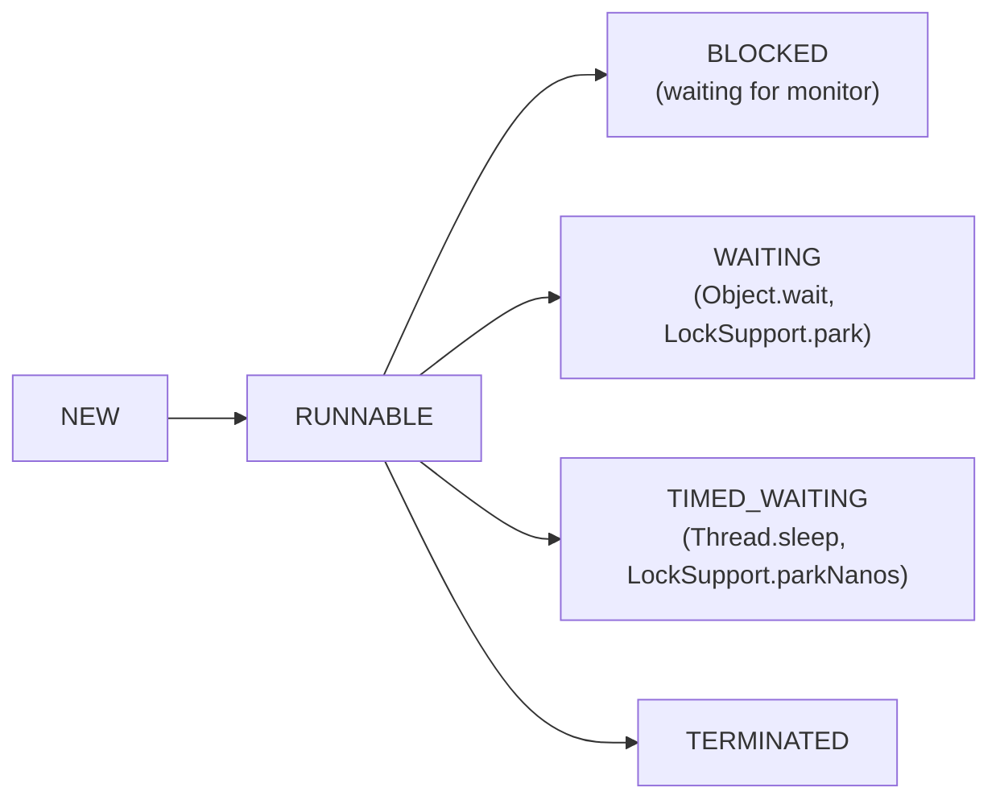
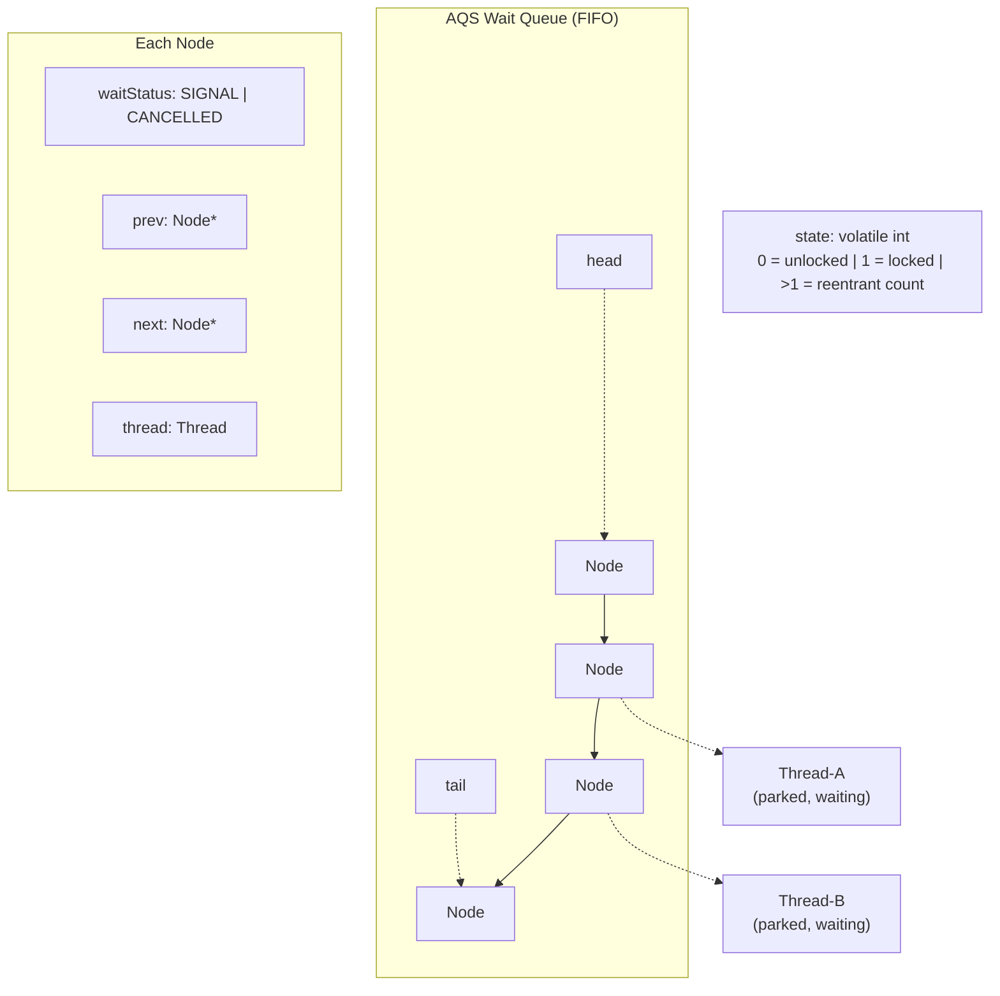

# Lesson 4: Concurrency Primitives, Java Memory Model

## 1. First-Principles Intuition & Invariants

Modern processors do not execute code the way programmers write it. This is the central, uncomfortable truth that makes concurrent programming so treacherous. A CPU core reorders memory operations to keep its execution pipeline saturated. The compiler rearranges instructions to eliminate redundant loads and exploit register allocation opportunities. DRAM controllers batch writes into cache-line-sized bursts that propagate to other cores only when coherence protocols demand it. Each of these optimizations is correct in isolation—provably so, within a single thread of execution—but the moment two or more threads share mutable state, every assumption about instruction order, memory visibility, and atomic indivisibility becomes a liability.

Java's answer to this chaos is the Java Memory Model (JMM), introduced formally in JSR-133 and refined through the Java 5 release. The JMM is not a description of hardware. It is a specification of legal program behaviors: a contract between the programmer and the runtime that defines, with mathematical precision, which values a read operation is permitted to observe. The JMM achieves this through the central concept of *happens-before* (HB), a partial order over program actions. If action A happens-before action B, then all memory writes performed by A and everything causally preceding A are guaranteed to be visible to B. Without a happens-before relationship, the JMM makes no visibility guarantees whatsoever—not even for reads and writes of fields that look adjacent in source code.

The practical consequences are stark. Consider two threads, one writing a boolean flag `ready = true` and subsequently writing `data = 42`, while a second thread spins on `ready` and then reads `data`. Without synchronization, the JMM permits the reader to observe `ready == true` while still seeing the stale value `data == 0`. The compiler may have reordered the writer's stores. The CPU's store buffer may not have flushed. The reader's core may be consulting a cache line that predates the write. The flag and the data value have no happens-before relationship between the two threads, so any interleaving is legal. This is not a theoretical edge case; it is the class of bug responsible for some of the most expensive production incidents in the industry.

The happens-before relation is established through a closed set of synchronization actions. A write to a `volatile` field happens-before every subsequent read of that same field. An unlock of a monitor happens-before every subsequent lock of that same monitor. A call to `Thread.start()` happens-before any action in the started thread. A thread's actions happen-before any other thread successfully returns from `Thread.join()` on that thread. These rules are not conventions—they are the complete normative basis for reasoning about memory visibility in Java. Everything else, including `java.util.concurrent` locks, `AtomicInteger`, and `CountDownLatch`, is built as a strict extension of these primitives, and the JMM guarantees their correctness precisely because their implementations are grounded in these foundational synchronization actions.

The concept of *atomicity* is orthogonal to visibility. An operation is atomic if it appears to execute instantaneously with respect to all threads—no other thread can observe the operation in a partially-complete state. In the JVM, reads and writes of `int`, `byte`, `short`, `char`, `float`, and reference types are guaranteed to be atomic. Crucially, reads and writes of `long` and `double` are *not* guaranteed atomic on 32-bit JVMs, because these 64-bit values may be written as two separate 32-bit operations, allowing a reader to see a word-torn value. The `volatile` keyword restores this atomicity guarantee even on 32-bit platforms.

The `synchronized` keyword is the oldest and most familiar synchronization primitive in Java. Every Java object possesses an intrinsic lock—a monitor—and the `synchronized` keyword acquires and releases this lock at block entry and exit. The JMM guarantees that all actions within a synchronized block happen-before all actions in any subsequent block synchronized on the same monitor. This provides both mutual exclusion (at most one thread holds the lock at a time) and the happens-before relationship necessary for memory visibility. It is essential to understand that `synchronized` buys you *both* guarantees simultaneously. Using `volatile` alone provides visibility but not mutual exclusion for compound actions like `check-then-act` or `read-modify-write`. Using `synchronized` alone would be sufficient for both, but its coarser granularity often makes it a suboptimal choice compared to the richer primitives in `java.util.concurrent`.

---

## 2. Core Architecture & Mechanics

### The Thread Lifecycle and JVM Thread Mapping

A Java thread begins its existence as an instance of `java.lang.Thread`, but the work of actually executing bytecode falls to a platform (OS) thread, to which the JVM binds the Java thread on startup. Prior to virtual threads (Project Loom, Java 21), this was a strict one-to-one relationship: each Java `Thread` object corresponded to exactly one kernel-scheduled thread of execution, consuming stack memory (typically 512 KB to 1 MB per thread on most JVM configurations) and a kernel thread control block. The implications for throughput were severe—a server handling 10,000 concurrent connections with one thread per connection would exhaust available memory and kernel scheduling capacity long before exhausting network bandwidth.

The thread state machine that governs a Java thread's lifecycle reflects the interaction between JVM and OS scheduler:



A thread in `RUNNABLE` state may be either actually running on a CPU core or sitting in the OS run queue waiting for a scheduler timeslice. The JVM makes no distinction between these two substates from the perspective of `Thread.getState()`. A thread enters `BLOCKED` specifically when it is attempting to acquire an intrinsic monitor that another thread holds. It enters `WAITING` when it voluntarily suspends via `Object.wait()`, `LockSupport.park()`, or `Thread.join()` without a timeout. These distinctions matter when interpreting thread dumps from production systems.

### Monitor Internals and Lock Inflation

The JVM's implementation of intrinsic locks undergoes a progressive optimization path that dramatically affects throughput for lightly-contended code. This mechanism, standardized in the HotSpot JVM, is called lock inflation.

When an object is first locked by a single thread with no competition, the JVM uses a *biased lock*. The lock is marked with the acquiring thread's ID in the object header's mark word. Subsequent lock acquisitions by the same thread require no atomic operations at all—they are essentially free. If a second thread attempts to acquire the lock, the JVM revokes the bias, requiring a stop-the-world pause to inspect and update the mark word. For this reason, biased locking was disabled by default in Java 15 and deprecated in Java 18; workloads with many threads competing for objects initialized on a single thread suffered from high bias revocation overhead.

When threads contend for a lock but hold it only briefly, the JVM escalates to a *thin lock* (also called a lightweight lock), stored directly in the object's mark word using a CAS (compare-and-swap) instruction. If the CAS succeeds, the acquiring thread owns the lock with minimal overhead. If it fails, indicating contention, the lock inflates to a *fat lock* backed by an OS mutex and a full wait queue. At this point, sleeping threads are managed by the OS scheduler, and lock acquisition carries the full cost of a context switch and syscall.

The mark word of an object on a 64-bit HotSpot JVM is a 64-bit field whose layout shifts depending on lock state:

```text
Unlocked:   [hashcode:31 | age:4 | bias_flag:1 | 00]
Biased:     [thread_id:54 | epoch:2 | age:4 | 1 | 01]
Thin lock:  [lock_record_ptr:62 | 00]
Fat lock:   [monitor_ptr:62 | 10]
GC marked:  [forwarding_ptr:62 | 11]
```

Understanding this layout is critical when profiling lock contention. The diagnostic command `java -XX:+PrintBiasedLockingStatistics` (pre-Java 18) and async-profiler's lock profiling mode expose contention at this level.

### Volatile: Memory Fences in Practice

A `volatile` field declaration instructs the JIT compiler to emit memory barrier instructions around accesses to that field. The semantics are precise: every write to a `volatile` field is immediately flushed to main memory (or more precisely, every read of a `volatile` field cannot be served from a thread-local cache; the JMM requires that the read observe the most recent write), and writes and reads of `volatile` fields cannot be reordered with respect to other memory accesses in the program order of a single thread.

On x86-64 architecture, which maintains a relatively strong Total Store Order (TSO) memory model, `volatile` reads compile to ordinary `MOV` instructions—no fence required—because TSO already prevents load-load and store-load reordering. Volatile writes compile to `MOV` followed by `MFENCE` or `LOCK XCHG`, which drains the store buffer and ensures global visibility. On ARM64, which has a weaker memory model, volatile reads compile to `LDAR` (load-acquire) and writes to `STLR` (store-release), which enforce acquire-release semantics at the hardware level.

The following example demonstrates the canonical use of `volatile` for a flag-based handoff pattern, which is correct precisely because of the HB guarantee it establishes:

```java
import java.util.concurrent.TimeUnit;

/**
 * Demonstrates the canonical volatile-flag handoff pattern.
 *
 * The volatile write to `ready` in the writer thread establishes a
 * happens-before edge with the volatile read of `ready` in the reader.
 * Through transitivity, the write to `payload` (which precedes the
 * volatile write) is also visible to the reader after it observes
 * ready == true.
 */
public class VolatileHandoff {

    private int payload = 0;
    private volatile boolean ready = false;

    public void writer() {
        payload = 42;          // (1) write payload
        ready = true;          // (2) volatile write — establishes HB edge
    }

    public void reader() throws InterruptedException {
        while (!ready) {       // (3) volatile read — spins until HB edge observed
            Thread.onSpinWait(); // CPU PAUSE hint, reduces memory bus contention
        }
        // Guaranteed: payload == 42 due to HB transitivity: (1) -> (2) HB (3)
        assert payload == 42 : "Invariant violated: payload=" + payload;
        System.out.println("Read payload: " + payload);
    }

    public static void main(String[] args) throws InterruptedException {
        VolatileHandoff h = new VolatileHandoff();
        Thread t1 = Thread.ofPlatform().start(h::writer);
        Thread t2 = Thread.ofPlatform().start(() -> {
            try { h.reader(); } catch (InterruptedException e) { Thread.currentThread().interrupt(); }
        });
        t1.join();
        t2.join();
    }
}
```

The `Thread.onSpinWait()` call, introduced in Java 9, emits a `PAUSE` instruction on x86 that reduces power consumption and alleviates memory-order buffer pressure in spin loops—a meaningful throughput improvement under contention.

### The java.util.concurrent Lock Framework

`java.util.concurrent.locks.ReentrantLock` exposes the same mutual exclusion semantics as `synchronized` but adds critical operational capabilities: timed lock acquisition, interruptible lock acquisition, and the ability to implement non-blocking `tryLock()` with fallback logic. Its implementation is built on `AbstractQueuedSynchronizer` (AQS), one of the most elegant data structures in the Java standard library.

AQS maintains a single `volatile int state` field and a CLH-variant (Craig, Landin, Hagersten) queue of blocked threads. The CLH queue is a lock-free FIFO queue of nodes, where each node contains a reference to the waiting thread and a status flag. Lock acquisition attempts a CAS on `state` from 0 to 1. On failure, the thread enqueues itself at the tail via another CAS and then parks itself using `LockSupport.park()`. On release, the lock holder sets `state` back to 0 and calls `LockSupport.unpark()` on the head node's thread.



`ReentrantReadWriteLock` extends this model by encoding both reader count and writer presence in the single `state` integer: the high 16 bits hold the shared (read) count, and the low 16 bits hold the exclusive (write) count. This packing enables the read-lock acquisition path to perform a single CAS for the common case with no writer present, delivering significantly higher throughput for read-heavy workloads. Java 8 added `StampedLock`, which introduces an *optimistic read* mode: the reader acquires a stamp without locking, performs its read, and then validates the stamp afterward. If a concurrent writer has intervened, validation fails and the reader falls back to a pessimistic read lock. Under low-write workloads, optimistic reads approach the performance of non-synchronized code.

```java
import java.util.concurrent.locks.StampedLock;

public class StampedPoint {
    private double x, y;
    private final StampedLock lock = new StampedLock();

    public void move(double deltaX, double deltaY) {
        long stamp = lock.writeLock();
        try {
            x += deltaX;
            y += deltaY;
        } finally {
            lock.unlockWrite(stamp);
        }
    }

    public double distanceFromOrigin() {
        // Optimistic read: attempt without acquiring a lock
        long stamp = lock.tryOptimisticRead();
        double currentX = x;
        double currentY = y;

        // Validate that no write occurred between tryOptimisticRead and now
        if (!lock.validate(stamp)) {
            // Fall back to a full read lock
            stamp = lock.readLock();
            try {
                currentX = x;
                currentY = y;
            } finally {
                lock.unlockRead(stamp);
            }
        }
        return Math.sqrt(currentX * currentX + currentY * currentY);
    }
}
```

### Lock-Free Structures: CAS and the ABA Problem

The `java.util.concurrent.atomic` package provides the building blocks for lock-free algorithms: `AtomicInteger`, `AtomicLong`, `AtomicReference`, and their array and field-updater variants. All are implemented via `VarHandle` (Java 9+) or `sun.misc.Unsafe` (internally), which expose `compareAndSet`, `getAndAdd`, and `getAndSet` as direct intrinsics that the JIT compiles to hardware CAS instructions (`LOCK CMPXCHG` on x86, `LDXR`/`STXR` on ARM).

Lock-free programming with CAS is subject to the ABA problem: a thread reads value A, is preempted, another thread changes the value to B and back to A, and the first thread's CAS succeeds despite the field having undergone two intermediate mutations. For pointer-based structures, this can corrupt the data structure's invariants. The standard mitigation is `AtomicStampedReference`, which pairs the reference with an integer version counter. The CAS succeeds only when both the reference and the stamp match.

```java
import java.util.concurrent.atomic.AtomicStampedReference;

/**
 * ABA-safe Treiber stack using AtomicStampedReference.
 * Each push/pop increments the stamp, preventing ABA-induced
 * double-pop of the same node.
 */
public class ABAFreeStack<T> {

    private static class Node<T> {
        final T value;
        Node<T> next;
        Node(T value, Node<T> next) {
            this.value = value;
            this.next = next;
        }
    }

    private final AtomicStampedReference<Node<T>> top =
            new AtomicStampedReference<>(null, 0);

    public void push(T value) {
        int[] stampHolder = new int[1];
        while (true) {
            Node<T> currentTop = top.get(stampHolder);
            Node<T> newNode = new Node<>(value, currentTop);
            if (top.compareAndSet(currentTop, newNode, stampHolder[0], stampHolder[0] + 1)) {
                return;
            }
            // CAS failed: another thread modified top; retry
        }
    }

    public T pop() {
        int[] stampHolder = new int[1];
        while (true) {
            Node<T> currentTop = top.get(stampHolder);
            if (currentTop == null) return null;
            if (top.compareAndSet(currentTop, currentTop.next, stampHolder[0], stampHolder[0] + 1)) {
                return currentTop.value;
            }
        }
    }
}
```

`ConcurrentLinkedQueue` in the JDK uses a variant of the Michael-Scott non-blocking queue algorithm, which advances `head` and `tail` pointers via CAS with sentinel nodes to allow concurrent enqueue and dequeue operations without any locking whatsoever—at the cost of a brief period where `tail` can lag behind the actual last node, requiring the enqueuing thread to help advance it.

### The Executor Framework and ForkJoinPool

Managing raw `Thread` objects directly in application code is an antipattern in modern Java. Thread creation is expensive (stack allocation, kernel registration), and thread lifecycle management under varying load conditions requires careful logic that is error-prone to implement correctly. The Executor framework, introduced in Java 5, decouples task submission from thread management. A task is any implementation of `Callable<T>` or `Runnable`, and an `ExecutorService` accepts tasks and returns `Future<T>` handles for retrieving results.

The standard thread pool implementation, `ThreadPoolExecutor`, is parameterized by a core pool size, a maximum pool size, a keep-alive time for idle threads above the core count, and a work queue. The interaction between these parameters governs its behavior under load: if fewer than `corePoolSize` threads exist, a new thread is always spawned for an incoming task regardless of idle threads. If the core pool is full, the task is queued. If the queue is full, new threads up to `maximumPoolSize` are created. If the pool is at maximum and the queue is also full, the configured `RejectedExecutionHandler` is invoked. Choosing the right queue type—bounded `ArrayBlockingQueue` for back-pressure, unbounded `LinkedBlockingQueue` for buffering, `SynchronousQueue` for direct handoff—has first-order consequences for latency and stability under overload.

`ForkJoinPool`, introduced in Java 7, implements a work-stealing scheduler optimized for recursive divide-and-conquer tasks. Each worker thread maintains its own double-ended deque (deque) of tasks. The thread pushes and pops from its own deque's tail (LIFO, maximizing cache locality), while idle threads steal from the heads of other threads' deques (FIFO, minimizing contention on the target deque). This results in near-linear scaling for tree-structured parallel computations—matrix multiplication, merge sort, recursive graph traversal—where the common thread pool's FIFO work queue would serialize the task graph. `ForkJoinPool` is the backing executor for parallel streams and `CompletableFuture.supplyAsync()` when no custom executor is provided.

```java
import java.util.concurrent.*;

/**
 * Parallel recursive merge sort using ForkJoinPool.
 * Tasks below THRESHOLD sort sequentially to avoid
 * task-creation overhead overwhelming the gains.
 */
public class ParallelMergeSort extends RecursiveAction {

    private static final int THRESHOLD = 4096;
    private final int[] array;
    private final int lo, hi;

    public ParallelMergeSort(int[] array, int lo, int hi) {
        this.array = array;
        this.lo = lo;
        this.hi = hi;
    }

    @Override
    protected void compute() {
        if (hi - lo <= THRESHOLD) {
            sequentialSort(array, lo, hi);
            return;
        }
        int mid = lo + (hi - lo) / 2;
        ParallelMergeSort left  = new ParallelMergeSort(array, lo, mid);
        ParallelMergeSort right = new ParallelMergeSort(array, mid, hi);
        // Fork right subtask asynchronously; compute left inline (stack-local)
        right.fork();
        left.compute();
        right.join();
        merge(array, lo, mid, hi);
    }

    private static void sequentialSort(int[] a, int lo, int hi) {
        java.util.Arrays.sort(a, lo, hi);
    }

    private static void merge(int[] a, int lo, int mid, int hi) {
        int[] temp = java.util.Arrays.copyOfRange(a, lo, mid);
        int i = 0, j = mid, k = lo;
        while (i < temp.length && j < hi) {
            a[k++] = (temp[i] <= a[j]) ? temp[i++] : a[j++];
        }
        while (i < temp.length) a[k++] = temp[i++];
    }

    public static void main(String[] args) {
        int[] data = new java.util.Random().ints(1_000_000).toArray();
        ForkJoinPool pool = new ForkJoinPool(Runtime.getRuntime().availableProcessors());
        pool.invoke(new ParallelMergeSort(data, 0, data.length));
        pool.shutdown();
        System.out.println("Sorted. First element: " + data[0]);
    }
}
```

### Virtual Threads: Project Loom's Continuation Model

Virtual threads, made production-stable in Java 21, fundamentally change the threading cost model. A virtual thread is a `Thread` instance backed by a *continuation*: a heap-allocated capture of the thread's call stack and execution state. When a virtual thread blocks on an I/O operation or `LockSupport.park()`, the JVM *unmounts* the virtual thread from its carrier (a platform thread managed by an internal `ForkJoinPool`), saves the continuation to the heap, and allows the carrier thread to run a different virtual thread. When the blocking operation completes, the virtual thread is rescheduled on any available carrier thread and its continuation is restored.

The result is that you can create millions of virtual threads with idiomatic blocking code, and the JVM scheduler achieves throughput comparable to reactive/async code with none of the callback complexity. The critical caveat is *pinning*: a virtual thread that holds a `synchronized` monitor while blocking cannot unmount, because the JVM cannot currently separate the monitor from the carrier thread's native frame. This pins the carrier and negates the multiplexing benefit. The mitigation is to replace `synchronized` blocks with `ReentrantLock` in code expected to run on virtual threads, as `ReentrantLock`'s `park()`-based blocking is fully unmountable.

```java
import java.net.URI;
import java.net.http.*;
import java.time.Duration;
import java.util.List;
import java.util.concurrent.*;

/**
 * Fetches 1000 URLs concurrently using virtual threads.
 * Each virtual thread issues a blocking HTTP call.
 * The JVM scheduler multiplexes them onto a small pool
 * of carrier threads without blocking any carrier during I/O.
 */
public class VirtualThreadCrawler {

    public static void main(String[] args) throws InterruptedException {
        List<String> urls = generateUrls(1000);
        HttpClient client = HttpClient.newBuilder()
                .connectTimeout(Duration.ofSeconds(5))
                .build();

        try (ExecutorService executor = Executors.newVirtualThreadPerTaskExecutor()) {
            List<Future<Integer>> futures = urls.stream()
                    .map(url -> executor.submit(() -> fetchStatusCode(client, url)))
                    .toList();

            int successCount = 0;
            for (Future<Integer> future : futures) {
                try {
                    if (future.get(10, TimeUnit.SECONDS) == 200) successCount++;
                } catch (ExecutionException | TimeoutException ignored) {}
            }
            System.out.println("Successful responses: " + successCount);
        }
    }

    private static int fetchStatusCode(HttpClient client, String url) throws Exception {
        HttpRequest request = HttpRequest.newBuilder(URI.create(url))
                .GET()
                .timeout(Duration.ofSeconds(5))
                .build();
        HttpResponse<Void> response = client.send(request, HttpResponse.BodyHandlers.discarding());
        return response.statusCode();
    }

    private static List<String> generateUrls(int count) {
        return java.util.stream.IntStream.range(0, count)
                .mapToObj(i -> "https://httpbin.org/status/200")
                .toList();
    }
}
```

---

## 3. High-Performance Optimization & Failure Modes

### Diagnosing Lock Contention

Lock contention is the most common cause of concurrency-related throughput degradation in production JVMs. When threads queue for the same monitor, the OS scheduler controls their wake order, introducing latency that dwarfs any computation the locked region performs. The first tool for diagnosing this is a thread dump: `kill -3 <pid>` on Linux or `jcmd <pid> Thread.print` will produce a snapshot showing every thread's state and, for BLOCKED threads, the monitor they are waiting on and the thread holding it.

For continuous profiling, `async-profiler` (the de facto standard for production Java profiling) provides lock profiling mode via `-e lock`, which uses `AsyncGetCallTrace` to record stack traces at every lock acquisition attempt exceeding a configurable threshold. This produces a flame graph with lock contention attributed to call sites, making it straightforward to identify which code paths create the hot monitor. The JFR (Java Flight Recorder) event `jdk.JavaMonitorWait` and `jdk.JavaMonitorEnter` capture similar information with sub-microsecond timestamps when recording via:

```bash
# Start a 60-second JFR recording targeting lock events
jcmd <pid> JFR.start duration=60s filename=/tmp/recording.jfr \
  settings=profile name=lock_profiling

# Dump and analyze with JDK Mission Control or jfr CLI
jfr print --events jdk.JavaMonitorEnter /tmp/recording.jfr | head -100
```

### False Sharing and Cache Line Alignment

A subtler performance failure is false sharing. Modern CPUs transfer memory between cache levels in units of cache lines, typically 64 bytes on x86-64. If two independently-updated fields happen to reside in the same cache line, writes to one field cause the other's cache line to be invalidated across all cores, forcing the second thread to reload the line from L3 or main memory. The fields are logically independent, but the hardware treats them as shared because they share a cache line. For high-frequency counters, false sharing can reduce throughput by an order of magnitude.

The JVM's `@Contended` annotation (in `jdk.internal.vm.annotation`, exposed publicly for user code with `--add-opens`; or via `jdk.internal.misc.Unsafe.objectFieldOffset` patterns) instructs the JVM to pad the annotated field with 128 bytes of surrounding padding, placing it on its own cache line. `LongAdder` and `LongAccumulator` use this internally: they maintain a `Cell[]` array of padded counter shards, one per contending thread, and sum them on read. Under high write concurrency, this reduces coherence traffic from O(N) to O(1) per increment.

```java
import java.util.concurrent.atomic.LongAdder;

/**
 * LongAdder vs AtomicLong throughput comparison.
 * Under high write concurrency, LongAdder's Cell[] striping
 * eliminates CAS retry loops by distributing writes across
 * cache-line-isolated counters.
 */
public class CounterBenchmark {

    private static final int THREADS = 16;
    private static final int OPS_PER_THREAD = 10_000_000;

    public static void main(String[] args) throws InterruptedException {
        LongAdder adder = new LongAdder();
        long start = System.nanoTime();

        Thread[] threads = new Thread[THREADS];
        for (int i = 0; i < THREADS; i++) {
            threads[i] = Thread.ofPlatform().start(() -> {
                for (int j = 0; j < OPS_PER_THREAD; j++) adder.increment();
            });
        }
        for (Thread t : threads) t.join();

        long elapsed = System.nanoTime() - start;
        System.out.printf("LongAdder: sum=%d, time=%.2fms%n",
                adder.sum(), elapsed / 1e6);
    }
}
```

To detect false sharing empirically without instrumentation, run the target workload under `perf stat -e cache-misses,LLC-load-misses` (Linux) and compare the LLC-miss rate before and after adding `@Contended` padding. A significant drop in LLC misses confirms false sharing as the root cause.

### Deadlock, Livelock, and Lock Ordering

Deadlock arises when thread A holds lock X and waits for lock Y while thread B holds lock Y and waits for lock X. The JVM cannot recover from deadlock automatically, but it can detect it: `jcmd <pid> Thread.print` will include the text `Found one Java-level deadlock` and the cycle in its output. `ThreadMXBean.findDeadlockedThreads()` provides programmatic detection from within the JVM.

The canonical prevention strategy is a *global lock ordering*: all code that acquires multiple locks must acquire them in the same predetermined order, defined by an arbitrary but consistent criterion such as `System.identityHashCode()` or an application-assigned numeric ID. Tieing lock acquisition order to object identity hash codes handles the case where a natural ordering does not exist:

```java
public static void transferFunds(Account from, Account to, double amount) {
    // Establish a consistent lock acquisition order using identity hash codes
    // to prevent deadlock when two threads call transferFunds(A, B) and
    // transferFunds(B, A) simultaneously.
    Account first  = (System.identityHashCode(from) <= System.identityHashCode(to)) ? from : to;
    Account second = (first == from) ? to : from;

    synchronized (first) {
        synchronized (second) {
            if (from.getBalance() < amount) throw new IllegalStateException("Insufficient funds");
            from.debit(amount);
            to.credit(amount);
        }
    }
}
```

Livelock is structurally different from deadlock: threads are not blocked but continually respond to each other's actions in a way that prevents progress. The classic example is two threads repeatedly detecting a conflict and backing off simultaneously, then retrying simultaneously, indefinitely. The standard mitigation is randomized exponential backoff—each retry waits for a random duration drawn from an exponentially growing window, breaking the symmetry between contending threads.

### CompletableFuture Composition and Cancellation Semantics

`CompletableFuture` enables non-blocking, composable asynchronous pipelines without callbacks. Its dependency graph is encoded as a DAG of completion stages, where each stage registers a continuation that fires when its upstream dependency completes. The JMM guarantees that actions in a stage happen-before actions in any stage that depends on it, so values passed between stages require no additional synchronization.

A critical failure mode in `CompletableFuture` pipelines is *thread pool contamination*: stages that perform blocking I/O or acquire locks that block must not run on the common `ForkJoinPool`. The `thenApplyAsync(fn, executor)` overloads accept an explicit executor, allowing blocking stages to be routed to a dedicated bounded thread pool rather than starving the common pool's carrier threads.

Cancellation in `CompletableFuture` is *cooperative*: calling `future.cancel(true)` completes the future exceptionally with `CancellationException` and interrupts the thread running the stage only if it was submitted as a plain `Future`-backed computation. For long-running stages that check `Thread.interrupted()`, proper cooperative cancellation requires checking the interrupt flag explicitly:

```java
import java.util.concurrent.*;

public class CancellablePipeline {

    private static final ExecutorService ioPool =
            Executors.newFixedThreadPool(4, Thread.ofVirtual().factory());

    public static CompletableFuture<String> fetchAndProcess(String resourceId) {
        return CompletableFuture
            .supplyAsync(() -> fetchResource(resourceId), ioPool)
            .thenApplyAsync(CancellablePipeline::parseResource, ioPool)
            .thenApplyAsync(CancellablePipeline::enrichResource, ioPool)
            .orTimeout(5, TimeUnit.SECONDS)              // fail fast after 5s
            .exceptionally(ex -> "fallback-for-" + resourceId);
    }

    private static String fetchResource(String id) {
        if (Thread.currentThread().isInterrupted()) throw new CancellationException();
        // Simulate I/O
        return "raw:" + id;
    }

    private static String parseResource(String raw) {
        return "parsed:" + raw;
    }

    private static String enrichResource(String parsed) {
        return "enriched:" + parsed;
    }

    public static void main(String[] args) throws Exception {
        CompletableFuture<String> result = fetchAndProcess("resource-42");
        System.out.println(result.get());
        ioPool.shutdown();
    }
}
```

### Memory Leaks in Concurrent Structures and ThreadLocal

`ThreadLocal` is the standard mechanism for maintaining per-thread state without synchronization—database connection pools, SimpleDateFormat instances, and request-scoped security contexts are common examples. Each `ThreadLocal` stores its value in the `Thread` object's internal `ThreadLocalMap`, keyed by a weakly-referenced `ThreadLocal` instance. If the `ThreadLocal` variable itself becomes unreachable but the thread remains alive (as in a thread pool), the entry's key becomes a stale weak reference while the value remains strongly reachable through the `ThreadLocalMap`. The result is a memory leak that persists for the lifetime of the thread—which in a long-lived server thread pool means effectively forever.

The invariant is mechanical: every `ThreadLocal` used in a thread pool context must be explicitly cleared in a `finally` block at task completion. Frameworks like Jakarta EE application servers enforce this by clearing all `ThreadLocal` state at the end of every request processing cycle. With virtual threads, this discipline becomes even more important because the JVM may create and destroy virtual threads at high rates, and accumulated `ThreadLocal` state across millions of threads creates significant GC pressure. Java 20 introduced `ScopedValue` as a superior alternative: a `ScopedValue` is bound for a delimited scope and automatically becomes unreachable when the scope exits, with no manual cleanup required.

The behavior of `ConcurrentHashMap` under sustained insertion with large key spaces provides another subtle failure mode. `ConcurrentHashMap` maintains a table of `Node` buckets that is resized when the load factor (default 0.75) is exceeded. Resizing is a cooperative operation: threads that arrive during a resize help migrate entries, so there is no single-threaded bottleneck. However, if many threads insert keys simultaneously and trigger a resize, they compete to claim migration responsibility for each table bin via CAS, creating a brief but measurable spike in CPU utilization. Under extremely high insertion rates, pre-sizing the map via the `initialCapacity` constructor argument—set to `expectedEntries / 0.75 + 1`—eliminates resize events entirely.

### Virtual Thread Pinning and Structured Concurrency

The pinning limitation of virtual threads requires careful attention in codebases that mix `synchronized` with blocking I/O. The JVM emits a diagnostic event `jdk.VirtualThreadPinned` (capturable via JFR) when pinning occurs. As a systematic mitigation strategy, the `-Djdk.tracePinnedThreads=full` system property causes the JVM to print a stack trace to stdout whenever a virtual thread is pinned, identifying every `synchronized` block or native frame responsible. The upgrade path is straightforward: replace each identified `synchronized` block with an equivalent `ReentrantLock` guarded region.

Structured concurrency, introduced as a preview API in Java 21 (`java.util.concurrent.StructuredTaskScope`), enforces a disciplined relationship between parent and child tasks: the parent scope waits for all forked subtasks and handles their results or failures before exiting the scope block. This eliminates the entire class of bugs arising from fire-and-forget task submission—lost exceptions, partial completion, resource leaks from tasks that outlive their context—by encoding lifetime relationships as lexical scope:

```java
import java.util.concurrent.*;

/**
 * StructuredTaskScope.ShutdownOnFailure cancels all subtasks
 * if any one of them fails, and re-throws the first exception.
 * This prevents partial state from propagating when any
 * component of a composite operation fails.
 */
public class StructuredFetch {

    record UserProfile(String name) {}
    record OrderHistory(int count) {}
    record DashboardData(UserProfile profile, OrderHistory orders) {}

    public static DashboardData fetchDashboard(String userId) throws Exception {
        try (var scope = new StructuredTaskScope.ShutdownOnFailure()) {
            StructuredTaskScope.Subtask<UserProfile> profileTask =
                    scope.fork(() -> fetchProfile(userId));
            StructuredTaskScope.Subtask<OrderHistory> ordersTask =
                    scope.fork(() -> fetchOrders(userId));

            scope.join().throwIfFailed(); // blocks until both complete or either fails

            return new DashboardData(profileTask.get(), ordersTask.get());
        }
    }

    private static UserProfile fetchProfile(String id) {
        return new UserProfile("User-" + id);   // in production: blocking DB/HTTP call
    }

    private static OrderHistory fetchOrders(String id) {
        return new OrderHistory(42);             // in production: blocking DB/HTTP call
    }

    public static void main(String[] args) throws Exception {
        DashboardData data = fetchDashboard("user-7");
        System.out.printf("Dashboard: %s, %d orders%n",
                data.profile().name(), data.orders().count());
    }
}
```

The happens-before semantics of `StructuredTaskScope` are guaranteed by its specification: all actions performed by subtasks happen-before `scope.join()` returns in the parent, so reading subtask results after `join()` requires no additional synchronization.

Taken together, these primitives form a coherent progression: from raw `synchronized` and `volatile` at the foundation, through the AQS-based locks and lock-free atomics of `java.util.concurrent`, up through the scheduling model of `ForkJoinPool`, the composition model of `CompletableFuture`, the multiplexing model of virtual threads, and the lifetime-discipline model of structured concurrency. Each layer is not a replacement for the layer beneath it but a higher-level encoding of the same invariants—visibility, ordering, mutual exclusion, and lifetime—expressed at a level of abstraction appropriate to the problem at hand. The engineer who understands all of these layers, and can read the JMM's happens-before rules as a first-principles framework rather than a collection of folklore, is equipped to build correct concurrent systems and to diagnose the ones that aren't.
