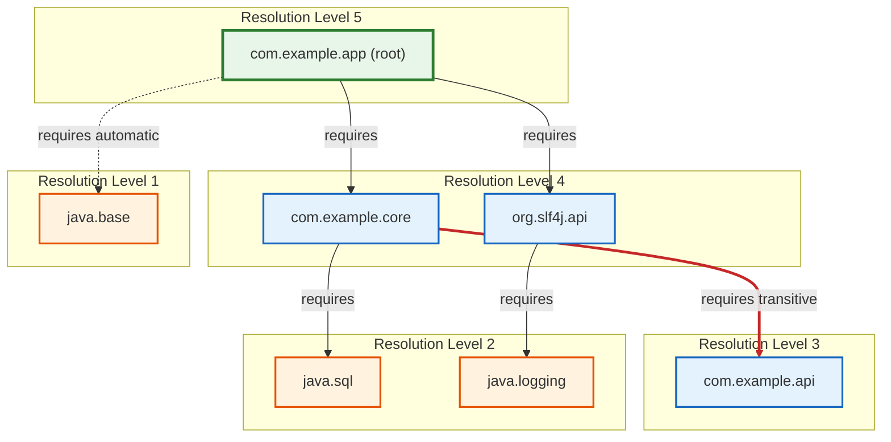

# Lesson 6: Module System, Reflection, Serialization

## 1. First-Principles Intuition & Invariants

The Java Platform Module System (JPMS), introduced in Java 9 as Project Jigsaw, represents a fundamental shift in how the JVM enforces encapsulation boundaries at compile time, link time, and runtime. Before modules, Java's class visibility operated purely through access modifiers (`public`, `protected`, package-private, `private`) enforced at compile time, with no runtime mechanism to prevent reflective access or classpath pollution. A `public` class in a JAR was visible to the entire universe of classloaders, creating a flat namespace where internal implementation classes could leak into public APIs, dependencies could conflict through transitive classpath hell, and reflective frameworks could violate intended encapsulation with impunity.

JPMS introduces a module graph—a directed acyclic graph where vertices represent modules and edges represent explicit `requires` dependencies declared in `module-info.java` descriptors. Each module declares which packages it exports to other modules and which modules it requires to function. The module system enforces strong encapsulation: a type in a non-exported package is inaccessible to external modules even if declared `public`, and the JVM's accessibility checks now incorporate module boundaries alongside traditional access control. This creates a three-tier visibility hierarchy: a class must be `public`, its package must be `exports`ed by the owning module, and the accessing module must `requires` the owning module. Reflection does not bypass these boundaries by default; attempts to reflectively access non-exported internals fail with `InaccessibleObjectException` unless the module explicitly `opens` packages for deep reflection or the JVM is launched with `--add-opens` flags.

The module system's design is grounded in the principle of reliable configuration: the JVM resolves the module graph at startup, detecting missing modules, cyclic dependencies, and conflicting exports before any application code executes. This stands in sharp contrast to the classpath model, where `NoClassDefFoundError` or `ClassNotFoundException` could surface at arbitrary points during execution, deep within call stacks, triggered by lazy class loading. Module resolution is deterministic and fails fast. The module graph is constructed by traversing `requires` edges from the root modules (those specified on the command line or implied by the unnamed module), downloading and verifying module descriptors, and ensuring that all constraints are satisfiable. The result is a closed world: the set of observable modules is fixed at startup, and the JVM can optimize class loading and JIT compilation with the knowledge that no new modules will appear dynamically.

Reflection in the JPMS era operates under graduated levels of accessibility. Normal reflective access via `Class.forName()`, `Method.invoke()`, and `Field.get()` respects module boundaries exactly as compile-time access does. Deep reflection—`setAccessible(true)` on non-public members—requires that the target module `opens` the containing package. An `opens` directive grants reflective access without making the package part of the module's exported API, enabling frameworks like Hibernate, Spring, and Jackson to introspect and manipulate private fields for serialization, dependency injection, and ORM mapping. The unnamed module, which encompasses all code on the classpath, has special semantics: it reads all named modules and exports all its packages to all modules, providing a compatibility bridge for legacy code.

Serialization in Java predates modules by two decades and was designed in an era when bytecode manipulation and deep reflection were the norm. The `Serializable` interface is a marker with no methods, and the serialization protocol is defined by the ObjectOutputStream and ObjectInputStream classes, which use reflection to discover fields, invoke private `writeObject` and `readObject` methods, and reconstruct object graphs. Serialization inherently violates encapsulation: it bypasses constructors, can resurrect objects in inconsistent states, and exposes private fields to byte stream manipulation. In the module system, serialization remains functional but is subject to the same `opens` requirements as other deep reflection. A module that contains serializable classes must open the relevant packages to `java.base` (which contains ObjectOutputStream) or to the entire world if third-party serialization frameworks are in use.

The tension between modular encapsulation and reflective frameworks is resolved through explicit configuration. A module descriptor can `opens` packages selectively, granting reflective access only to specific modules via `opens com.example.internal to hibernate.core, spring.beans`. This provides fine-grained control over which frameworks can introspect internals, but it also increases descriptor verbosity and maintenance burden. In practice, many applications use `opens` directives liberally or fall back to JVM command-line flags like `--add-opens` to retrofit legacy code. The module system's designers anticipated this and provided extensive compatibility mechanisms, but the long-term vision is that reflective frameworks will migrate to service provider interfaces, method handles, and `VarHandle`s—lower-level primitives that offer better performance and security properties than traditional reflection.

Annotation processing straddles the boundary between compile time and runtime. Annotations can have `RetentionPolicy.SOURCE` (discarded after compilation), `RetentionPolicy.CLASS` (retained in bytecode but not loaded at runtime), or `RetentionPolicy.RUNTIME` (available for reflective queries). Annotation processors are compiler plugins that run during javac compilation, generating new source files or bytecode based on annotated declarations. In a modular world, annotation processors themselves are packaged as modules, and the `--processor-module-path` option specifies where to find them. Generated code must respect module boundaries: a processor cannot generate classes into a package exported by another module unless the module system permits it. The `javax.annotation.processing` API exposes the module graph to processors via the `Elements` and `Types` utilities, allowing processors to query which modules are observable and what packages they export.

Proxy classes, generated at runtime via `java.lang.reflect.Proxy`, are another reflective mechanism affected by modules. A proxy implements a set of interfaces and forwards method calls to an `InvocationHandler`. The JVM generates bytecode for the proxy class on the fly, defining it in a module and package determined by the accessibility of the target interfaces. If all interfaces are `public` and exported, the proxy is defined in an unnamed dynamic module. If any interface is non-public, the proxy must be defined in the same module and package as that interface, which requires that the module `opens` or `exports` the package. The `Proxy.newProxyInstance()` method fails with `IllegalArgumentException` if the module configuration does not permit proxy generation in the required location.

## 2. Core Architecture & Mechanics

The module descriptor, `module-info.java`, is a special compilation unit placed at the root of a module's source tree. Its compiled form, `module-info.class`, resides in the root of the module's JAR file and contains a `Module` attribute with metadata encoded according to the JVMS. The descriptor syntax is declarative and consists of directives that establish the module's dependencies and accessibility boundaries.

```java
module com.example.core {
    // Dependency declarations
    requires java.sql;                    // Explicit dependency on platform module
    requires transitive com.example.api;  // Transitive dependency: clients also read api
    requires static org.slf4j;            // Optional compile-time dependency
    
    // Exports: public API accessible to all modules
    exports com.example.core.api;
    exports com.example.core.spi to com.example.impl;  // Qualified export
    
    // Opens: allow deep reflection for frameworks
    opens com.example.core.internal to hibernate.core, spring.beans;
    opens com.example.core.model;  // Unqualified open: accessible to all modules
    
    // Service provider interface declarations
    uses com.example.core.spi.DataProvider;
    provides com.example.core.spi.DataProvider with com.example.core.internal.DefaultProvider;
}
```

The `requires` directive establishes a readability edge in the module graph. When module A requires module B, the JVM ensures that B is resolved and that classes in A can access `public` types in packages exported by B. The `transitive` modifier creates implied readability: any module that requires A automatically requires B transitively, propagating the dependency. This is essential for API modules that expose types from their dependencies in public signatures. The `static` modifier indicates a compile-time dependency that is optional at runtime; the module system resolves such dependencies if present but does not fail if they are absent, enabling gradual migration and optional features.

The `exports` directive controls type accessibility at the package level. An exported package's `public` and `protected` types are accessible to any module that requires the exporting module. Qualified exports restrict accessibility to a named set of modules, enabling privileged access for framework integrations or internal testing modules without exposing internals to the world. Non-exported packages are strongly encapsulated: their types are inaccessible even if declared `public`, and reflective access fails unless the package is opened.

The `opens` directive grants reflective access without exporting the package for normal compile-time or runtime access. This is the mechanism by which serialization frameworks, dependency injection containers, and ORM tools access private fields and invoke non-public methods. An unqualified `opens` grants access to all modules; a qualified `opens` restricts access to named modules. The distinction between `exports` and `opens` is critical: `exports` makes a package part of the module's public API contract, while `opens` is an escape hatch for frameworks that require deep introspection.

The `uses` and `provides` directives implement the service provider interface (SPI) pattern at the module system level. A module that declares `uses com.example.Service` signals that it will look up implementations of that interface at runtime via `ServiceLoader`. A module that declares `provides com.example.Service with com.example.impl.ServiceImpl` makes an implementation available to `ServiceLoader`. The module system ensures that provider modules are resolved if they are observable, and `ServiceLoader` can enumerate providers without requiring clients to know implementation class names or manually configure classpath scanning.

The module graph is resolved by the JVM's module system layer, implemented in the `java.lang.module` package. The `ModuleFinder` abstraction locates module descriptors from the module path, the JDK's internal modules, and optionally from custom sources. The `Configuration` class represents a resolved module graph, computed by starting from a set of root modules and recursively resolving their dependencies. The resolution algorithm performs topological sorting, cycle detection, and conflict resolution: if two modules export the same package, resolution fails with a split package error unless one module is `opens`ed or the conflict is explicitly resolved via `--add-reads` and `--patch-module` JVM options.



At runtime, the module system enforces accessibility through modifications to the JVM's class resolution and method linkage logic. When a class in module A references a class in module B, the JVM verifies that A reads B and that B exports the containing package. This check occurs during class loading and is cached in the constant pool resolution metadata. Reflective access via `Class.forName()` performs the same checks; the caller's module must read the target module, and the target package must be exported. The `setAccessible(true)` method on `AccessibleObject` (superclass of `Field`, `Method`, and `Constructor`) performs additional checks: it succeeds only if the target package is opened to the caller's module or if the caller has been granted permission via `--add-opens`.

The `Module` class represents a runtime module and provides introspection APIs: `getDescriptor()` returns a `ModuleDescriptor` with the parsed contents of `module-info.class`, including directives, exports, opens, and service declarations. The `addReads()`, `addExports()`, and `addOpens()` methods allow dynamic modification of module boundaries at runtime, enabling advanced framework scenarios like plugin systems and dynamic code generation. These methods are subject to security manager checks and are typically used only by container frameworks and application servers.

Reflection performance in the module system is generally comparable to pre-module Java, but certain operations have additional overhead. The first reflective access to a member checks module boundaries and caches the result, so repeated accesses are fast. However, `setAccessible(true)` now requires a module boundary check on every invocation unless the JVM can prove that the caller and target are in the same module, which eliminates the check. Frameworks that perform extensive reflection during initialization—such as Hibernate's metamodel construction or Spring's bean graph instantiation—may see measurable startup latency if modules are not configured optimally. The solution is to use `opens` directives liberally during development and narrow them in production, or to migrate to alternative APIs like `MethodHandle` and `VarHandle`, which bypass accessibility checks after initial lookup and offer better JIT optimization.

Serialization mechanics remain unchanged at the protocol level but interact with module boundaries during field discovery. When `ObjectOutputStream` serializes an object, it uses `Class.getDeclaredFields()` to enumerate fields, including private ones. This reflective access requires that the object's package is opened to `java.base` or to the world. If the package is not opened, serialization fails with `InaccessibleObjectException`. The same applies to deserialization: `ObjectInputStream` uses reflection to populate fields, invoke `readObject()`, and call `readResolve()`. The Serialization specification defines a protocol for customizing serialization via private methods: `writeObject(ObjectOutputStream)` and `readObject(ObjectInputStream)` are discovered reflectively and invoked if present. These methods can perform validation, encryption, or transformation, but they must be in an opened package.

```java
// Example: Custom serialization with module boundaries
package com.example.core.model;

import java.io.*;

public class SecureUser implements Serializable {
    private static final long serialVersionUID = 1L;
    
    private String username;
    private transient String password;  // Never serialize plaintext password
    private byte[] passwordHash;
    
    // Custom serialization: invoked reflectively by ObjectOutputStream
    private void writeObject(ObjectOutputStream out) throws IOException {
        out.defaultWriteObject();  // Serialize non-transient fields
        // Password is excluded; passwordHash is included
    }
    
    private void readObject(ObjectInputStream in) throws IOException, ClassNotFoundException {
        in.defaultReadObject();
        // Validate invariants after deserialization
        if (username == null || passwordHash == null) {
            throw new InvalidObjectException("Username and hash required");
        }
    }
    
    // Singleton enforcement during deserialization
    private Object readResolve() throws ObjectStreamException {
        return validateAndReturn(this);
    }
}
```

For this class to be serializable in a modular application, the module descriptor must include:

```java
module com.example.core {
    opens com.example.core.model to java.base;  // Allow ObjectOutputStream reflection
}
```

Annotation processing in modular builds requires coordination between the compiler and processor modules. The annotation processor API, `javax.annotation.processing`, provides the `RoundEnvironment` and `ProcessingEnvironment` interfaces, which expose the program structure as an abstract syntax tree. Processors generate source files via `Filer.createSourceFile()`, which writes files into the annotation processor's output directory. The compiler then compiles these generated files in a subsequent round, repeating until no new files are generated.

```java
// Example: Annotation processor generating builder classes
@SupportedAnnotationTypes("com.example.annotations.GenerateBuilder")
@SupportedSourceVersion(SourceVersion.RELEASE_21)
public class BuilderProcessor extends AbstractProcessor {
    
    @Override
    public boolean process(Set<? extends TypeElement> annotations, RoundEnvironment roundEnv) {
        for (Element element : roundEnv.getElementsAnnotatedWith(GenerateBuilder.class)) {
            if (element.getKind() != ElementKind.CLASS) {
                processingEnv.getMessager().printMessage(
                    Diagnostic.Kind.ERROR,
                    "@GenerateBuilder can only be applied to classes",
                    element
                );
                continue;
            }
            
            TypeElement typeElement = (TypeElement) element;
            String packageName = processingEnv.getElementUtils()
                .getPackageOf(typeElement).getQualifiedName().toString();
            String className = typeElement.getSimpleName() + "Builder";
            
            try {
                JavaFileObject builderFile = processingEnv.getFiler()
                    .createSourceFile(packageName + "." + className);
                
                try (PrintWriter out = new PrintWriter(builderFile.openWriter())) {
                    out.println("package " + packageName + ";");
                    out.println();
                    out.println("public class " + className + " {");
                    
                    // Generate builder fields and methods
                    for (Element enclosed : typeElement.getEnclosedElements()) {
                        if (enclosed.getKind() == ElementKind.FIELD) {
                            VariableElement field = (VariableElement) enclosed;
                            String fieldName = field.getSimpleName().toString();
                            String fieldType = field.asType().toString();
                            
                            out.println("    private " + fieldType + " " + fieldName + ";");
                            out.println();
                            out.println("    public " + className + " " + fieldName + 
                                      "(" + fieldType + " " + fieldName + ") {");
                            out.println("        this." + fieldName + " = " + fieldName + ";");
                            out.println("        return this;");
                            out.println("    }");
                            out.println();
                        }
                    }
                    
                    out.println("    public " + typeElement.getSimpleName() + " build() {");
                    out.println("        return new " + typeElement.getSimpleName() + "(this);");
                    out.println("    }");
                    out.println("}");
                }
            } catch (IOException e) {
                processingEnv.getMessager().printMessage(
                    Diagnostic.Kind.ERROR,
                    "Failed to generate builder: " + e.getMessage(),
                    typeElement
                );
            }
        }
        return true;
    }
}
```

The processor itself must be packaged as a module with a `module-info.java`:

```java
module com.example.processor {
    requires java.compiler;  // For annotation processing APIs
    
    provides javax.annotation.processing.Processor 
        with com.example.processor.BuilderProcessor;
}
```

Compiling code that uses this processor requires the `--processor-module-path` option:

```bash
javac --module-path mods \
      --processor-module-path processor-mods \
      -d out \
      --module-source-path src \
      $(find src -name "*.java")
```

Proxy generation is more subtle in the module system because the JVM must decide which module will own the generated proxy class. The algorithm is defined in the `java.lang.reflect.Proxy` specification: if all interfaces are `public` and from exported packages, the proxy is defined in an unnamed dynamic module that reads all application modules. If any interface is non-public or from a non-exported package, the proxy must be defined in the same module and package as that interface. This ensures that the proxy has access to the interface's members, but it also means the proxy-generating code must have the authority to define classes in that module.

```java
// Example: Dynamic proxy with module constraints
package com.example.core.spi;

import java.lang.reflect.*;

public class ServiceProxyFactory {
    
    public static <T> T createProxy(Class<T> serviceInterface, InvocationHandler handler) {
        // Verify that the current module can create proxies for this interface
        Module currentModule = ServiceProxyFactory.class.getModule();
        Module targetModule = serviceInterface.getModule();
        
        if (!serviceInterface.isInterface()) {
            throw new IllegalArgumentException("Not an interface: " + serviceInterface);
        }
        
        // Check if the interface is accessible
        if (!currentModule.canRead(targetModule)) {
            throw new IllegalAccessError("Module " + currentModule.getName() + 
                                       " cannot read " + targetModule.getName());
        }
        
        @SuppressWarnings("unchecked")
        T proxy = (T) Proxy.newProxyInstance(
            serviceInterface.getClassLoader(),
            new Class<?>[] { serviceInterface },
            handler
        );
        
        return proxy;
    }
}
```

If the `serviceInterface` is from a non-exported package, this code will fail unless the target module opens the package to the module containing `ServiceProxyFactory`. The solution is to use `Proxy.newProxyInstance()` only with exported interfaces or to configure the module system to allow proxy generation via `--add-opens`.

## 3. High-Performance Optimization & Failure Modes

Optimizing modular applications for performance and reliability requires understanding how module resolution, class loading, and reflective access interact with the JVM's runtime optimizations. The most significant performance impact of JPMS is at startup: module resolution is a one-time cost, but it can dominate cold-start latency in microservices and serverless environments where JVM instances are short-lived.

Module resolution performance depends on the size of the module graph and the complexity of dependency constraints. A module graph with hundreds of modules and deep transitive dependencies can take tens to hundreds of milliseconds to resolve on modern hardware. The JVM caches resolved configurations in the `$JAVA_HOME/lib/modules` image for platform modules, but application modules are resolved from the module path on every startup. To reduce resolution time, minimize the number of modules on the module path and avoid unnecessary transitive dependencies. The `jlink` tool can create custom runtime images that include only the required platform and application modules, eliminating resolution overhead entirely for those modules.

```bash
# Create a minimal runtime image with only required modules
jlink --module-path $JAVA_HOME/jmods:mods \
      --add-modules com.example.app \
      --output app-runtime \
      --strip-debug \
      --compress=2 \
      --no-header-files \
      --no-man-pages

# Run the application with the custom runtime
./app-runtime/bin/java -m com.example.app/com.example.app.Main
```

The `jlink` image includes a precomputed module graph and eliminates the need for module path scanning at startup. This reduces startup time by 50-200ms in typical applications and produces a self-contained distribution that includes only the necessary JDK modules, reducing image size from 300MB+ to 50-100MB.

Class loading in modular applications introduces additional checks compared to the classpath model. Every class resolution verifies module readability and package exports, which adds overhead to the first access of a type. The JVM aggressively caches these results in the constant pool and type resolution metadata, so repeated accesses are as fast as pre-module Java. However, applications that dynamically load large numbers of classes—such as plugin systems or bytecode generation frameworks—may see measurable overhead. The solution is to use `ClassValue` or `MethodHandle` caching to avoid repeated reflective lookups.

Reflective access performance is heavily influenced by module boundaries. The `setAccessible(true)` operation now performs a module boundary check on every call unless the JVM can prove at JIT compile time that the caller and target are in the same module. Frameworks that call `setAccessible(true)` in tight loops—such as serialization frameworks processing large object graphs—should cache `Field` and `Method` objects and avoid redundant accessibility checks. The `VarHandle` API, introduced in Java 9, provides a high-performance alternative to reflection for field access: after initial lookup, `VarHandle` operations compile to direct field access bytecode with no reflective overhead.

```java
// Example: High-performance field access with VarHandle
package com.example.core.internal;

import java.lang.invoke.*;

public class OptimizedFieldAccess {
    private static final VarHandle VALUE_HANDLE;
    
    static {
        try {
            MethodHandles.Lookup lookup = MethodHandles.privateLookupIn(
                TargetClass.class, MethodHandles.lookup());
            VALUE_HANDLE = lookup.findVarHandle(TargetClass.class, "value", int.class);
        } catch (NoSuchFieldException | IllegalAccessException e) {
            throw new ExceptionInInitializerError(e);
        }
    }
    
    public static int getValue(TargetClass obj) {
        return (int) VALUE_HANDLE.get(obj);  // Compiles to direct field access
    }
    
    public static void setValue(TargetClass obj, int value) {
        VALUE_HANDLE.set(obj, value);  // Volatile write semantics
    }
    
    public static boolean compareAndSetValue(TargetClass obj, int expected, int newValue) {
        return VALUE_HANDLE.compareAndSet(obj, expected, newValue);  // Atomic CAS
    }
}
```

The `MethodHandles.privateLookupIn()` method requires that the caller's module has access to the target class's module, either through `exports` or `opens`. Once obtained, the `VarHandle` provides field access with performance identical to direct bytecode access, including support for volatile semantics and atomic operations. This is the recommended pattern for frameworks that require high-performance field access without the overhead of traditional reflection.

Serialization performance is similarly affected by module boundaries. The `ObjectOutputStream` and `ObjectInputStream` classes use reflection to discover fields and invoke private `writeObject` and `readObject` methods. Each reflective operation performs a module boundary check, which adds overhead to serialization of complex object graphs. For performance-critical serialization, consider migrating to alternative frameworks like Protocol Buffers, Apache Avro, or Jackson, which use code generation or bytecode manipulation to avoid reflection entirely. If Java serialization is required, ensure that all serializable classes are in opened packages to avoid repeated boundary checks.

```java
// Module descriptor for serialization-heavy application
module com.example.data {
    requires java.base;
    
    // Open all model packages to serialization frameworks
    opens com.example.data.model to java.base, com.fasterxml.jackson.databind;
    opens com.example.data.dto to java.base, com.fasterxml.jackson.databind;
    
    exports com.example.data.api;  // Public API only
}
```

Annotation processing performance can be a bottleneck in large modular builds. Processors run during compilation and can generate thousands of source files, each of which must be compiled in subsequent rounds. The key to fast annotation processing is incremental compilation: only reprocess files that have changed. The `javac` compiler supports incremental builds via the `--module-source-path` option, which tracks dependencies between source files and generated files. Processors should also avoid expensive operations during initialization and cache intermediate results across rounds.

```java
// Example: Incremental annotation processor with caching
@SupportedAnnotationTypes("com.example.annotations.*")
public class IncrementalProcessor extends AbstractProcessor {
    private final Map<String, GeneratedFile> cache = new HashMap<>();
    
    @Override
    public boolean process(Set<? extends TypeElement> annotations, RoundEnvironment roundEnv) {
        if (roundEnv.processingOver()) {
            return false;
        }
        
        for (Element element : roundEnv.getElementsAnnotatedWith(GenerateCode.class)) {
            String cacheKey = computeCacheKey(element);
            
            // Skip if already generated in a previous round
            if (cache.containsKey(cacheKey)) {
                continue;
            }
            
            GeneratedFile generated = generateCode(element);
            cache.put(cacheKey, generated);
            writeGeneratedFile(generated);
        }
        
        return true;
    }
    
    private String computeCacheKey(Element element) {
        // Hash of element signature and annotation values
        return element.toString() + "@" + 
               element.getAnnotationMirrors().stream()
                   .map(Object::toString)
                   .collect(Collectors.joining(","));
    }
}
```

Proxy generation performance is generally excellent because the JVM caches generated proxy classes in a concurrent map keyed by the interface set. Repeated calls to `Proxy.newProxyInstance()` with the same interfaces return new instances of the cached proxy class without regenerating bytecode. However, proxy generation itself is expensive: the JVM must construct a class file, verify it, and load it through the class loader. Applications that generate thousands of unique proxy types—such as dynamic ORM frameworks or RPC stubs—may see memory pressure from the proliferation of generated classes. The solution is to use a shared proxy class with method dispatch in the `InvocationHandler` rather than generating a unique proxy for each service interface.

Failure modes in modular applications are more predictable than classpath-based applications because module resolution is deterministic and fails fast. The most common errors are:

- **Module not found:** A required module is missing from the module path. The JVM reports the missing module name and the requiring module at startup. Fix by adding the missing module to the module path or removing the `requires` directive.

- **Split package:** Two modules export the same package. The JVM reports both modules and the conflicting package. Fix by refactoring one module to use a different package or using `--patch-module` to merge the conflicting packages into a single module.

- **Inaccessible type:** A module attempts to access a type in a non-exported package. The compiler reports the error at build time; the JVM reports it at runtime if the access is reflective. Fix by adding an `exports` or `opens` directive to the target module.

- **InaccessibleObjectException:** Reflective access to a non-opened package fails at runtime. This occurs when frameworks attempt deep reflection without appropriate `opens` directives. Fix by adding `opens` to the module descriptor or using `--add-opens` at startup.

```bash
# Example: Adding runtime opens for legacy frameworks
java --add-opens com.example.core/com.example.core.internal=ALL-UNNAMED \
     --add-opens com.example.data/com.example.data.model=hibernate.core \
     -m com.example.app/com.example.app.Main
```

The `ALL-UNNAMED` target opens the package to all code on the classpath (the unnamed module), which is necessary for frameworks that are not themselves modularized.

Debugging modular applications requires understanding the module graph and runtime accessibility. The `--show-module-resolution` JVM flag logs module resolution decisions, including which modules are resolved, their dependencies, and any conflicts. The `jdeps` tool analyzes compiled modules and reports dependencies, missing modules, and potential split packages.

```bash
# Analyze module dependencies
jdeps --module-path mods --module com.example.app

# Generate DOT graph of module dependencies
jdeps --module-path mods --module com.example.app --dot-output graphs
dot -Tpng graphs/com.example.app.dot -o module-graph.png

# Check for split packages
jdeps --module-path mods --check com.example.app
```

For production deployments, consider using module layers to isolate application modules from framework modules. A module layer is a runtime abstraction that creates a separate module graph with its own class loaders, enabling multiple versions of the same module to coexist in a single JVM. This is essential for application servers and plugin systems that must support tenant isolation or dynamic module loading.

```java
// Example: Creating an isolated module layer for plugins
package com.example.container;

import java.lang.module.*;
import java.nio.file.*;

public class PluginContainer {
    
    public ModuleLayer loadPlugin(Path pluginPath) throws Exception {
        ModuleFinder finder = ModuleFinder.of(pluginPath);
        
        ModuleLayer parentLayer = ModuleLayer.boot();
        Configuration parentConfig = parentLayer.configuration();
        
        // Resolve plugin module and its dependencies
        Configuration pluginConfig = parentConfig.resolve(
            finder,
            ModuleFinder.of(),  // No additional module path
            Set.of("com.example.plugin")  // Root module
        );
        
        // Create a new layer with a custom class loader
        ClassLoader scl = ClassLoader.getSystemClassLoader();
        ModuleLayer pluginLayer = parentLayer.defineModulesWithOneLoader(
            pluginConfig,
            scl
        );
        
        // Load plugin entry point
        Class<?> pluginClass = pluginLayer.findLoader("com.example.plugin")
            .loadClass("com.example.plugin.PluginMain");
        
        return pluginLayer;
    }
}
```

This pattern creates a new module layer that inherits from the boot layer but has its own module graph and class loaders. Plugins can be loaded, executed, and unloaded without affecting the main application's module graph, enabling dynamic reconfiguration and fault isolation.

The module system's interaction with garbage collection is subtle but important. Modules and their class loaders are eligible for garbage collection when no strong references to their classes remain. However, reflective caches—such as those maintained by serialization frameworks, annotation processors, and proxy generators—can inadvertently retain references to classes, preventing module unloading. To enable module unloading in long-lived applications, use weak references or `ClassValue` for caches and ensure that frameworks do not retain strong references to user-supplied classes.

In summary, the Java Platform Module System fundamentally changes how encapsulation, reflection, and serialization operate at the JVM level. Strong encapsulation enforces package boundaries at runtime, reflection respects module accessibility, and serialization requires explicit opens directives. High-performance applications must use `VarHandle`, `MethodHandle`, and service provider interfaces to avoid reflective overhead, while production systems benefit from custom runtime images, incremental compilation, and module layers for isolation. Mastering JPMS requires understanding the module graph, accessibility rules, and the interaction between compile-time and runtime boundaries, enabling senior engineers to build secure, maintainable, and high-performance Java applications in the post-Java 9 era.
