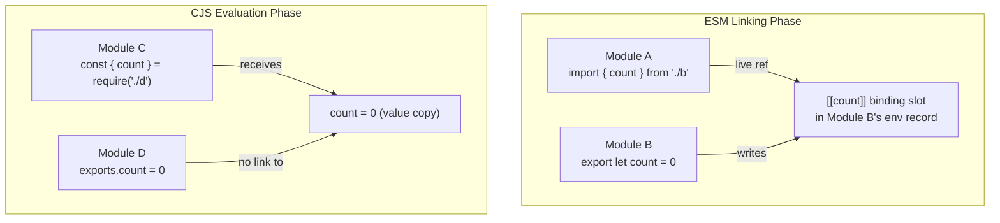

# Lesson 4: Runtime Environments, Module Systems

## 1. First-Principles Intuition & Invariants

JavaScript was not designed with modules. This is one of the most consequential architectural facts in the language's history, and understanding it properly requires going back to 1995, when the language was embedded inside a web page whose entire codebase fit comfortably in a single `<script>` tag. At that scale, the absence of a module system was not a deficiency — it was irrelevant. All scripts shared a single global scope, variables accumulated on the `window` object, and coordination between files was achieved through load order and global naming conventions. The language was executing inside a document, not inside a software system.

The collision between this legacy and the demands of industrial-scale software produced two decades of improvisation: immediately invoked function expressions (IIFEs) to fake encapsulation, hand-crafted module patterns, the AMD specification for asynchronous browser loading, and finally CommonJS — a module system invented not by browser vendors but by server-side JavaScript developers who needed something that worked like Python's `import` or Ruby's `require`. When Node.js adopted CommonJS in 2009, it formalized a module system that was synchronous by design, because on a server, loading a file from disk is a blocking I/O operation you can afford to pay at startup time, and the resulting simplicity of `require()` made it immediately productive.

The critical invariant to internalize is that a module system is not syntactic sugar — it is a contract about identity, resolution, evaluation, and linking. These four concerns determine how the runtime answers four questions: *Where does this specifier resolve to?* *Is this module already evaluated, or does it need to be loaded?* *In what order do module bodies execute?* *How are exported bindings exposed to importing code?* CommonJS and ES Modules answer these questions differently at a mechanical level, and those differences are not stylistic — they produce genuinely distinct runtime behaviors that affect tree-shaking, circular dependency handling, live binding semantics, and interoperability.

The browser and Node.js runtime environments differ not only in their module systems but in their fundamental purpose. A browser runtime is a document-rendering engine that happens to execute JavaScript. Its JavaScript engine — V8 in Chrome, SpiderMonkey in Firefox, JavaScriptCore in Safari — is embedded inside a larger host that provides layout, painting, event dispatch, and a security model organized around origins. The Web APIs exposed to JavaScript (the DOM, Fetch, `requestAnimationFrame`, the Web Workers API, Web Crypto) are not part of the JavaScript language specification; they are host-provided objects whose interfaces are standardized by the WHATWG and W3C. Node.js is the inverse: a server-side I/O platform that embeds V8 as its execution engine and provides its own set of host APIs (`fs`, `net`, `http`, `child_process`, `worker_threads`) governed by the Node.js project. The language is the same; the host is different; and that difference determines which globals exist, which module resolution algorithm runs, and how the event loop is structured.

The event loop is the central invariant of both environments. JavaScript engines are single-threaded. There is exactly one call stack. Concurrency is achieved by deferring work: when an asynchronous operation completes, a callback is placed in a queue, and the event loop moves it onto the call stack only when the stack is empty. This model eliminates whole categories of data races that plague multi-threaded systems, but it introduces its own failure mode — blocking the call stack, even for a few milliseconds, starves all other pending callbacks. Every architectural decision in high-performance JavaScript code is ultimately downstream of this constraint.

V8's execution pipeline sits beneath both environments. When V8 receives JavaScript source text, it parses it into an AST, then compiles it to bytecode via Ignition (the interpreter). Functions that are called frequently are identified by the Sparkplug baseline compiler and then — if they remain hot — by Maglev and finally TurboFan, the optimizing compiler that emits native machine code. This tiered compilation strategy means the performance characteristics of a function are not static: a function's machine code representation changes as V8 accumulates type feedback about how it has been called. The practical implication is that polymorphic call sites — functions called with arguments of varying shapes — will be deoptimized back to interpreted bytecode when V8's speculative assumptions are violated. Writing JavaScript for V8's optimizer means writing code whose runtime type profile is consistent and predictable.

---

## 2. Core Architecture & Mechanics

### CommonJS: Synchronous Resolution and the Module Cache

The CommonJS module system in Node.js is built around three primitives: `require()`, `module.exports`, and `__dirname`/`__filename`. Every CJS module body executes inside a wrapper function that Node injects before evaluation:

```javascript
(function(exports, require, module, __filename, __dirname) {
  // Your module code lives here
});
```

This wrapper is not theoretical — it is the actual mechanism that creates per-module scope. The `exports` reference is initialized to `module.exports`, and `require` is a module-local function bound to the current file's location. When you call `require('./utils')`, Node executes the following resolution algorithm: it checks whether the specifier is a core module (`fs`, `path`, etc.); if not, it treats relative specifiers as file paths and resolves them against `__dirname`; for bare specifiers (like `lodash`), it traverses up the directory tree looking for a `node_modules` directory containing a matching package, stopping when it reaches the filesystem root.

The module cache is the mechanism that makes circular dependencies survivable in CommonJS. The first time a module is `require()`d, Node adds it to `Module._cache` keyed by its resolved absolute path, then begins evaluating it. If module A requires module B, and module B requires module A during its own evaluation, `require('./a')` inside B will find the partially evaluated cache entry for A and return whatever has been exported so far — which may be an incomplete object. This is not a bug in the design; it is a documented invariant that shifts the burden of reasoning about circular dependencies onto the developer.

```
require('./a')
      │
      ▼
  Module._cache lookup
      │
  ┌───┴──────────────┐
  │  Miss             │  Hit
  │                  │
  ▼                  ▼
Allocate module    Return cached
object, begin      module.exports
evaluation         (possibly partial)
      │
  Execute wrapper function
      │
  module.exports populated
      │
  Cache entry finalized
```

The synchronous nature of `require()` has a critical performance implication: every `require()` call at module load time is a blocking file system operation. In a large Node.js application with hundreds of dependencies, startup latency is dominated by the time spent resolving, reading, and evaluating modules. This is why tools like `--require` hooks and bundlers that inline all dependencies into a single file can dramatically reduce cold-start time.

### ES Modules: Static Linking and Live Bindings

ES Modules, introduced in the ECMAScript 2015 specification and stabilized in Node.js with the `.mjs` extension and `"type": "module"` in `package.json`, operate on a fundamentally different execution model. The key architectural difference is that the module graph is built before any module body executes. This is called static linking, and it is the invariant that makes tree-shaking and dead code elimination possible in bundlers.

The ESM loading algorithm runs in three distinct phases. During the **parse** phase, the engine reads the source text and constructs a Module Record for each file. Import and export statements are parsed but not executed — the engine is building a dependency graph. During the **link** phase, the engine allocates memory slots for every export and creates live bindings: references in the importing module that point directly at the memory location in the exporting module's environment record. During the **evaluate** phase, module bodies execute in post-order depth-first traversal of the dependency graph, meaning dependencies execute before the modules that import them.

The live binding invariant is the sharpest behavioral difference from CommonJS. In CJS, when module A does `const { count } = require('./counter')`, it receives a copy of the value at the moment `require()` is called. If the counter module later modifies its `count` export, module A's local variable does not change. In ESM, an exported binding is a live reference into the exporting module's lexical environment. If the exporting module updates its exported variable, every importing module sees the new value immediately through the shared binding. This is not merely a semantic footnote — it changes how you reason about mutable shared state across module boundaries.



Circular dependencies in ESM are handled more gracefully because the link phase establishes all binding slots before any evaluation occurs. When module A imports from module B and B imports from A, both modules' binding slots exist in memory before either body runs. The constraint is that a binding must not be *read* before the module that declares it has executed — doing so produces a `ReferenceError: Cannot access 'x' before initialization`, equivalent to the temporal dead zone behavior of `let` and `const`. This is a stricter contract than CJS's partially-evaluated object, but it makes the error deterministic rather than silent.

### Node.js Runtime Architecture: The Event Loop in Detail

Node.js wraps V8 with libuv, a cross-platform asynchronous I/O library written in C. The event loop that Node.js exposes to JavaScript is implemented inside libuv, and understanding its phase structure is prerequisite knowledge for diagnosing scheduling bugs and performance anomalies.

The loop executes through six ordered phases on each tick. The **timers** phase executes callbacks scheduled by `setTimeout` and `setInterval` whose threshold has been reached. The **pending callbacks** phase executes I/O callbacks deferred from a previous iteration. The **idle/prepare** phases are internal. The **poll** phase is where the loop blocks, waiting for new I/O events, and executes their callbacks when they arrive — this is the phase where most of your application's time is spent. The **check** phase executes `setImmediate` callbacks. The **close callbacks** phase executes callbacks for closed sockets and handles.

```
   ┌─────────────────────────────────────────────┐
   │               Event Loop Tick               │
   │                                             │
   │  ┌──────────┐    ┌────────────┐             │
   │  │  timers  │───▶│  pending   │             │
   │  └──────────┘    │  callbacks │             │
   │                  └─────┬──────┘             │
   │                        │                    │
   │                  ┌─────▼──────┐             │
   │                  │    poll    │◀────────┐   │
   │                  └─────┬──────┘         │   │
   │                        │                │   │
   │                  ┌─────▼──────┐    ┌────┴─┐ │
   │                  │   check    │    │close │ │
   │                  │(setImmed.) │───▶│ cbs  │ │
   │                  └────────────┘    └──────┘ │
   │                                             │
   │  microtask queues (Promises, queueMicrotask)│
   │  drain completely between every phase       │
   └─────────────────────────────────────────────┘
```

Microtasks — resolved Promise callbacks and `queueMicrotask` calls — are not part of the libuv phase structure. They execute between every phase transition, and they drain completely before the next phase begins. This creates a strict priority ordering: microtasks have higher priority than any macro-task callback. If you recursively resolve Promises, you can starve the timer and I/O phases entirely, because the microtask queue never empties. This is a real failure mode in production systems.

`process.nextTick` is a Node.js-specific mechanism that sits even higher than the Promise microtask queue — `nextTick` callbacks drain before Promise callbacks on each inter-phase boundary. This was a historical implementation detail that is now a specified contract, and it means code written with `nextTick` can produce ordering behavior that surprises developers expecting Promise-based semantics.

### Browser APIs and the Host Environment

Inside a browser, the same V8 engine (or SpiderMonkey, or JavaScriptCore) operates under the authority of the HTML specification's event loop model, which the WHATWG defines independently of the ECMAScript specification. The browser's event loop processes task queues (each task source — user events, `setTimeout`, network responses — has its own queue), runs the microtask checkpoint after each task, and may then run rendering update steps that include style recalculation, layout, and painting.

The DOM is the primary interface between JavaScript and the document, but it is not a JavaScript object in the V8 heap in the same way that a plain `{}` literal is. DOM nodes are C++ objects in the renderer process, exposed to JavaScript through Blink's binding layer, which is generated from Web IDL interface definitions. Property access on a DOM object crosses from V8's managed heap into Blink's C++ object graph. This boundary is expensive, which is why touching the DOM in tight loops is a canonical performance anti-pattern — not because of JavaScript overhead, but because of the cross-binding traversal cost and the forced layout thrashing that follows when you interleave DOM reads and writes.

The Web Workers API provides true parallelism within the browser's security model. A worker runs in a separate thread with its own V8 isolate, its own event loop, and no shared memory access to the main thread's heap (except for explicitly transferred `ArrayBuffer`s or `SharedArrayBuffer`s). The `postMessage` API serializes data using the structured clone algorithm, which supports a wider set of types than JSON (including `Map`, `Set`, `TypedArray`, `Blob`, and `ArrayBuffer` transfers) but still copies data across the boundary unless transfer semantics are used. For CPU-intensive work — image processing, cryptography, compression — Web Workers are the correct architectural tool, and the absence of DOM access in workers is a feature, not a constraint.

### The Toolchain Ecosystem: Bundlers, Transpilers, and Runtimes

The modern JavaScript toolchain exists because of two enduring gaps: browser support for new language features lags their specification, and browser environments cannot directly consume Node.js-style `node_modules` trees. Transpilers like Babel and tools like TypeScript's `tsc` lower modern syntax to ES5 or ES2017 targets. Bundlers like webpack, Rollup, esbuild, and Vite resolve the module graph, inline dependencies, and emit one or more output bundles optimized for a target environment.

esbuild deserves particular attention because it demonstrates what happens when the toolchain is rewritten in Go rather than JavaScript. Its parser, bundler, and minifier execute in parallel across all CPU cores, producing bundle times that are 10 to 100 times faster than equivalent webpack configurations. The architectural insight behind esbuild is that most bundler work is embarrassingly parallel: parsing files, transforming syntax, and resolving imports are all operations that can proceed concurrently once the full set of entry points is known. JavaScript-based toolchains serialize much of this work through Node's single-threaded event loop; a compiled multi-threaded program does not.

Vite's development server exposes a different architectural tradeoff. Rather than bundling during development, Vite serves ES modules directly to the browser, using native `<script type="module">` loading. The browser itself resolves the module graph, issuing individual HTTP requests for each file. Vite intercepts these requests and transforms files on demand — TypeScript is compiled, JSX is lowered, `node_modules` dependencies are pre-bundled into single files using esbuild. This eliminates the full rebuild cycle on save, because only the files that actually changed need to be transformed. The tradeoff is that in large projects with hundreds of modules, the waterfall of HTTP requests during initial page load can be slower than loading a single bundle — which is why Vite still uses Rollup for production builds.

Deno and Bun represent alternative Node.js-compatible runtime implementations. Deno was designed from scratch by Node's original creator, addressing several Node.js design decisions he later regretted: the absence of URL-based module resolution, the lack of a permissions model, and the monolithic `node_modules` directory. Deno resolves modules by URL natively, caches them locally, and requires explicit capability flags (`--allow-read`, `--allow-net`, `--allow-env`) before granting access to system resources. Bun is a runtime focused on startup speed and throughput, implemented in Zig and using JavaScriptCore instead of V8. Its built-in bundler, test runner, and package manager are optimized for the common case of building TypeScript web services, and its benchmark numbers on `bun install` versus `npm install` reflect the difference between a purpose-built tool and an ecosystem that grew organically over fifteen years.

---

## 3. High-Performance Optimization & Failure Modes

### Module Load Time and Startup Profiling

In a production Node.js service, startup latency is frequently the first performance problem worth measuring. Node's `--prof` flag enables V8's built-in profiler, and `node --prof-process` processes the resulting isolate log into a human-readable tick report. For startup specifically, `node --require ./trace-load.js` with a custom `Module._resolveFilename` hook can record every `require()` call with its resolution time:

```javascript
// trace-load.js — instrument CJS resolution timing
const Module = require('module');
const { performance } = require('perf_hooks');
const originalResolve = Module._resolveFilename;

Module._resolveFilename = function(request, parent, isMain, options) {
  const start = performance.now();
  const resolved = originalResolve.call(this, request, parent, isMain, options);
  const elapsed = performance.now() - start;
  if (elapsed > 0.5) {
    process.stderr.write(`[load] ${elapsed.toFixed(2)}ms ${resolved}\n`);
  }
  return resolved;
};
```

A more comprehensive approach is `node --trace-event-categories v8,node.async_hooks` combined with Chrome DevTools' Performance panel, which renders the full startup trace including V8 compilation, module evaluation, and libuv I/O initialization as a flame graph. For ESM-based projects, `node --experimental-loader ./loader.mjs` supports custom hooks into the `resolve` and `load` pipeline, enabling the same kind of instrumentation at the native ESM layer.

The correct mitigation for slow startup is almost always lazy loading: deferring `require()` or `import()` calls until the first time the functionality is actually needed. Dynamic `import()` returns a Promise, making it composable with async initialization flows, and V8's module evaluation semantics guarantee that subsequent calls for the same specifier return the cached module from the module map. For CLIs and serverless functions where cold-start time directly impacts user experience, structuring the application so that the hot path avoids loading rarely-used subsystems at startup can reduce initialization time by an order of magnitude.

### V8 Hidden Classes and Polymorphic Deoptimization

V8 compiles JavaScript objects to native machine code by tracking their hidden classes (internally called Maps). Every time you add a property to an object in a consistent order across all instances of a given constructor, V8 assigns those instances the same hidden class and can generate highly optimized property access code. The moment you deviate — adding properties in different orders, deleting properties, adding properties after construction — V8 must transition to a slower dictionary representation for affected objects.

The practical diagnostic tool is `%HaveSameMap(a, b)` via `node --allow-natives-syntax`, which exposes V8 internal functions:

```javascript
// hidden-class-check.js
// Run with: node --allow-natives-syntax hidden-class-check.js

function Point(x, y) {
  this.x = x;
  this.y = y;
}

const p1 = new Point(1, 2);
const p2 = new Point(3, 4);
// p3 adds a property outside the constructor — different hidden class
const p3 = new Point(5, 6);
p3.z = 7;

console.log(%HaveSameMap(p1, p2)); // true — same hidden class
console.log(%HaveSameMap(p1, p3)); // false — p3 transitioned to a new map
```

For a function that accepts a mix of p1-shaped and p3-shaped objects, TurboFan must generate a polymorphic inline cache that handles both shapes, which is slower than a monomorphic one. If more than four distinct hidden classes are observed at a call site, V8 falls back to a megamorphic cache — essentially a full property lookup every time. The fix is always to initialize all properties in the constructor, even those whose initial value is `null` or `undefined`, so that all instances of a type share one stable hidden class throughout their lifetime.

### CommonJS and ESM Interoperability Hazards

The interoperability boundary between CJS and ESM is one of the most reliable sources of subtle production bugs in modern Node.js codebases. The fundamental asymmetry is: ESM can import CJS (Node.js wraps the CJS export as a default export), but CJS cannot `require()` an ESM module synchronously because ESM loading is inherently asynchronous.

Attempting `require('./esm-module.mjs')` from a CJS file throws `Error [ERR_REQUIRE_ESM]`. The correct migration pattern when you need to use an ESM-only package from a CJS codebase is dynamic `import()`, wrapped in an async factory:

```javascript
// cjs-entry.js — consuming an ESM-only package from CommonJS
// The top-level await problem is solved by wrapping in an async IIFE

let chalk;

async function loadDependencies() {
  // chalk v5+ is ESM-only; this is the correct interop pattern
  const { default: chalkModule } = await import('chalk');
  chalk = chalkModule;
}

// Initialize once at startup, then use synchronously
loadDependencies().then(() => {
  console.log(chalk.green('Dependencies loaded'));
  startApplication();
}).catch((err) => {
  console.error('Failed to load ESM dependencies:', err);
  process.exit(1);
});

function startApplication() {
  // chalk is now available synchronously here
  console.log(chalk.blue('Application running'));
}
```

A more systematic solution is to migrate your package entry point to ESM and use top-level `await` for initialization. Node.js has supported top-level `await` in ESM since v14.8.0. The important constraint is that top-level `await` in a module pauses evaluation of that module and all ancestor modules in the import graph — it does not block the event loop, because the module loading machinery itself uses async evaluation under the hood.

### Memory Leaks in Long-Running Processes

Memory leaks in Node.js services most often originate from one of three sources: event emitter listeners that are never removed, closures that hold references to large objects longer than necessary, and module-level caches that grow without bound.

The correct diagnostic workflow begins with `v8.getHeapSnapshot()` to capture heap dumps and diff them across time. Node.js exposes this via the `--heapsnapshot-signal=SIGUSR2` flag, which writes a `.heapsnapshot` file to disk when the process receives `SIGUSR2`, without requiring any code change:

```bash
# Start the process with heap snapshot on signal
node --heapsnapshot-signal=SIGUSR2 server.js &
NODE_PID=$!

# After some load, capture baseline
kill -SIGUSR2 $NODE_PID

# Apply load for N minutes
# ...

# Capture after load
kill -SIGUSR2 $NODE_PID

# Load both snapshots into Chrome DevTools Memory panel
# and use the "Comparison" view to find retained growth
```

In Chrome DevTools' Memory panel, the **Comparison** view between two heap snapshots shows objects allocated between snapshots that were not garbage collected. The **Retainers** pane for any suspect object traces the reference chain holding it in memory — this is how you identify whether the leak is an event listener, a module-level `Map`, or a closure inside an async callback chain.

Event emitter leaks are particularly insidious because Node.js warns you when a single emitter has more than ten listeners (`MaxListenersExceededWarning`), but that warning is easy to suppress and does not fire at all for custom `Map` or `Set` based registries. The discipline is to always pair `on()` with `off()` or `once()` for listeners attached to objects whose lifetime differs from the emitter:

```javascript
// Correct: use once() for listeners that should fire exactly once
server.once('request', handleFirstRequest);

// Correct: clean up listener when component is destroyed
class ConnectionManager extends EventEmitter {
  constructor(socket) {
    super();
    this._onData = this._handleData.bind(this);
    socket.on('data', this._onData);
    this._socket = socket;
  }

  destroy() {
    this._socket.off('data', this._onData);
    this._socket = null;
  }

  _handleData(chunk) {
    this.emit('message', chunk);
  }
}
```

### Bundler Configuration for Production: Tree-Shaking and Code Splitting

Rollup pioneered tree-shaking for JavaScript by exploiting the static linkage guarantee of ES Modules: because imports and exports are declared at parse time and cannot be conditional, a bundler can determine statically which exports are actually used and eliminate the rest. This only works when the entire module graph consists of ESM — a single CJS dependency in the graph disables tree-shaking for that subtree, because CJS exports are dynamic runtime objects that cannot be analyzed statically.

The practical consequence for library authors is that publishing a dual CJS/ESM package with correct `exports` configuration in `package.json` is a correctness issue, not merely a compatibility courtesy:

```json
{
  "name": "my-library",
  "version": "1.0.0",
  "type": "module",
  "exports": {
    ".": {
      "import": {
        "types": "./dist/index.d.ts",
        "default": "./dist/index.js"
      },
      "require": {
        "types": "./dist/index.d.cts",
        "default": "./dist/index.cjs"
      }
    }
  },
  "files": ["dist"]
}
```

The `exports` field is the modern replacement for `main` and `module` and is the authoritative module resolution map for Node.js 12+ and all current bundlers. The `"import"` condition resolves for ESM consumers; `"require"` resolves for CJS consumers. Bundlers use the `"module"` condition (not shown above, but supported by webpack and Rollup) or `"import"` for their tree-shaking build paths.

Code splitting addresses the complementary problem of initial load latency. Rather than bundling all application code into a single file, code splitting produces multiple chunks that load on demand. The entry point loads only the code necessary for the initial render; additional chunks are fetched lazily when the user navigates to a route that requires them. The bundler's job is to determine the optimal chunk boundaries — minimizing total bytes transferred while also minimizing the number of network round trips. Vite and webpack both support dynamic `import()` as the natural split point:

```javascript
// Route-based code splitting with dynamic import
// The bundler emits a separate chunk for each dynamic import boundary

const router = {
  '/dashboard': () => import('./pages/Dashboard.js'),
  '/settings': () => import('./pages/Settings.js'),
  '/profile': () => import('./pages/Profile.js'),
};

async function navigate(path) {
  const loader = router[path];
  if (!loader) {
    throw new Error(`Unknown route: ${path}`);
  }
  const { default: PageComponent } = await loader();
  mount(PageComponent);
}
```

The `import()` call returns a Promise that resolves to the module namespace object. Bundlers recognize this pattern and emit a separate output file per split point, along with a module manifest that maps specifier hashes to chunk URLs. The browser's native module loading machinery (or a module federation runtime in webpack's case) handles fetching the correct chunk and resolving the Promise.

The most significant performance failure in bundler configuration is not a missing optimization — it is an accidental disabling of one. Side-effect annotations in `package.json` via `"sideEffects": false` tell Rollup and webpack that importing but not using a module's exports is safe to eliminate entirely. If your library performs side effects on import (registering globals, patching prototypes, registering service workers), you must list those files explicitly in `"sideEffects": ["./src/polyfills.js"]`. Setting `"sideEffects": false` incorrectly causes bundlers to silently drop CSS imports, global registrations, and other legitimate side-effectful code, producing applications that fail in ways that are difficult to attribute to the bundle configuration.
