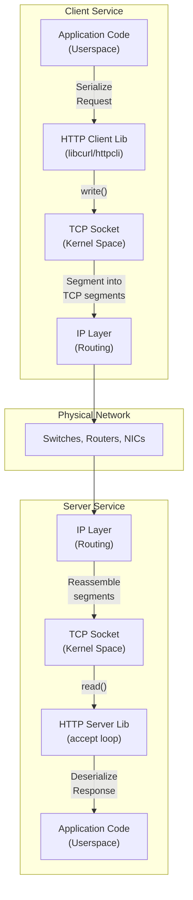
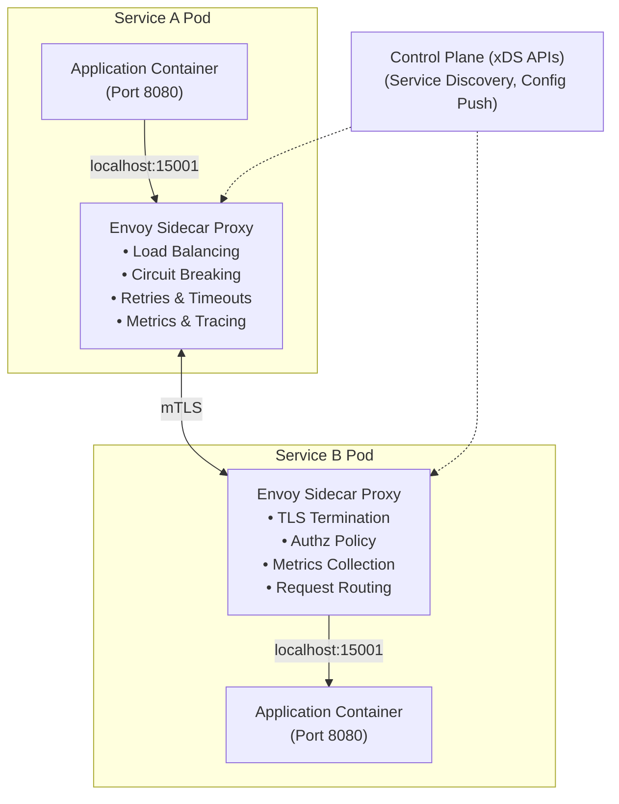

# Lesson 1: Distributed System Foundations for Microservices

## 1. First-Principles Intuition & Invariants

Distributed systems emerged not from theoretical ambition but from the practical reality that single machines face fundamental physical limits. A monolithic application running on a single server can scale vertically only so far before hitting CPU instruction throughput ceilings, memory bus bandwidth constraints, and I/O subsystem saturation. The transition to microservices represents an architectural acknowledgment that horizontal scaling across multiple independent processes and machines is the only viable path to achieving internet-scale reliability and performance. Yet this distribution introduces a new class of problems that simply do not exist in single-process systems: network unreliability, partial failures, clock skew, and the impossibility of instantaneous global state agreement.

The fundamental constraint governing all distributed computation was formalized by Eric Brewer in 2000 as the CAP theorem, which states that any networked shared-data system can provide at most two of three guarantees simultaneously: Consistency (every read receives the most recent write or an error), Availability (every request receives a non-error response, without guarantee of containing the most recent write), and Partition tolerance (the system continues to operate despite arbitrary network partitions that prevent some nodes from communicating with others). This is not a design recommendation but a mathematical inevitability derived from the asynchronous nature of distributed message passing and the unpredictability of network failures.

In practical microservice deployments, partition tolerance is non-negotiable because network failures are not theoretical edge cases but routine operational realities. Switches fail, cables are accidentally unplugged, routing tables become corrupted, and cloud availability zones experience complete regional outages. Given that P must always be preserved, architects face a binary choice between C and A during partition events. Traditional relational databases operating in strong consistency mode will reject writes during a partition to prevent split-brain scenarios where different nodes accept conflicting updates. Meanwhile, eventually consistent systems like Amazon's Dynamo or Cassandra prioritize availability by accepting writes to any reachable replica, deferring conflict resolution until the partition heals through mechanisms like vector clocks, last-write-wins timestamps, or application-specific merge functions.

The CAP theorem's stark tradeoff forces a deeper examination of what "consistency" actually means in distributed contexts. Strict serializability—where all operations appear to execute in some total order consistent with real-time causality—requires expensive coordination protocols that serialize operations across the entire system. Linearizability weakens this slightly by only requiring that operations appear instantaneous at some point between invocation and response, but still demands consensus algorithms like Raft or Multi-Paxos that incur multiple network round-trips per committed operation. These strong consistency models are appropriate for financial ledgers, inventory systems, and other domains where correctness demands atomic visibility of updates, but they impose latency penalties that become unacceptable for high-throughput, geographically distributed applications.

Eventual consistency trades immediate correctness for performance by guaranteeing only that if no new updates are made, all replicas will eventually converge to the same state. This model explicitly tolerates stale reads and temporary inconsistencies, which sounds alarming until we recognize that most real-world systems already operate under relaxed consistency without user-visible problems. When you post a comment on a social media platform and it takes several seconds to appear for other users, you are experiencing eventual consistency. When a shopping cart on an e-commerce site briefly shows outdated inventory counts, that is eventual consistency in action. The key insight is that many business domains have natural tolerance for bounded staleness, and exploiting this tolerance unlocks dramatic improvements in latency, throughput, and fault tolerance.

Latency and throughput represent orthogonal dimensions of performance that often trade against each other in distributed architectures. Latency measures the time elapsed between request submission and response completion, typically expressed in milliseconds or microseconds for individual operations. Throughput quantifies the total volume of operations processed per unit time, measured in requests per second or transactions per second for the entire system. A single-threaded request processor might achieve low latency for each individual request but poor aggregate throughput due to head-of-line blocking. Conversely, a batching system that accumulates requests before processing them in bulk can achieve excellent throughput at the cost of increased per-request latency due to queueing delay.

The tension between latency and throughput manifests physically in how systems manage network communication and computational resources. Synchronous RPC-style microservice calls minimize latency by immediately transmitting each request and blocking until the response arrives, but this pattern limits throughput because the caller cannot perform useful work while waiting. Asynchronous message queues improve throughput by decoupling producers from consumers, allowing both to operate at their natural rates without blocking, but introduce latency because messages spend time buffered in the queue. Batching strategies that amortize protocol overhead across multiple operations further increase throughput by reducing per-operation network round-trips and context switches, but inevitably increase average latency because requests must wait for their batch to fill before processing begins.

Real-world microservice architectures operate under simultaneous constraints from multiple dimensions: network bandwidth limits the total data transfer rate between services, TCP connection establishment overhead dominates latency for short-lived requests, serialization and deserialization consume CPU cycles proportional to payload size, and memory allocation patterns determine garbage collection pressure in managed runtime environments. The aggregate effect is that performance optimization requires holistic reasoning about the entire request lifecycle rather than local optimization of individual components.

Failure modes in distributed systems fall into several distinct categories, each requiring different detection and mitigation strategies. Fail-stop failures occur when a process or machine halts completely, ceasing all communication and computation. These are the easiest failures to handle because other nodes can detect the absence of heartbeats or responses and route traffic elsewhere. Byzantine failures represent the opposite extreme where a node continues operating but produces incorrect or malicious outputs, requiring expensive agreement protocols that tolerate arbitrary behavior. Most real-world microservice failures fall between these extremes: a service might respond slowly rather than not at all, produce subtly corrupted data that passes initial validation checks, or exhibit transient failures that resolve without intervention.

Network partitions represent a particularly insidious failure mode because they create asymmetric reachability where some nodes can communicate while others cannot. A partition can split a cluster into multiple isolated groups, each of which believes it represents the authoritative system state. Without careful coordination, these isolated groups will accept divergent writes that conflict when the partition heals. The traditional solution involves designating a quorum—typically a strict majority of nodes—as the only group authorized to accept writes during a partition. This ensures that at most one partition maintains write availability, preventing split-brain scenarios at the cost of rejecting writes to minority partitions.

Cascading failures occur when a localized problem propagates through dependent services, amplifying into system-wide outages. The classic scenario begins with a single overloaded service that starts responding slowly or timing out. Upstream services calling this degraded service accumulate threads or connections waiting for responses, exhausting their own resource pools. As these upstream services become unresponsive, their own callers experience the same resource exhaustion, creating a cascading wave of failures that spreads throughout the dependency graph. The speed and severity of cascading failures often catch engineering teams off guard because the system topology creates non-obvious failure amplification paths that are invisible during normal operation.

The fundamental lesson from these failure modes is that distributed systems must be designed not just to function correctly when all components work, but to degrade gracefully when components fail. This requires explicit circuit breakers that detect downstream failures and stop sending traffic to unhealthy services, bulkheads that isolate resource pools to prevent one component's resource exhaustion from affecting others, and timeouts configured aggressively enough to detect failures quickly but not so aggressively that transient slowdowns trigger false positives. These patterns collectively form a defensive architecture that assumes failure as the default state rather than an exceptional condition.

## 2. Core Architecture & Mechanics

The physical reality of network communication imposes fundamental constraints on distributed system design that no amount of abstraction can eliminate. When a microservice invokes another service over a network, the request travels through a complex path involving kernel networking stacks, physical network interface cards, switches, routers, and potentially multiple intermediate proxies or load balancers. Each hop introduces latency, and the cumulative effect means that even a local datacenter network adds milliseconds to every request—several orders of magnitude slower than in-process function calls that complete in nanoseconds.

Consider the complete lifecycle of a synchronous HTTP request between two microservices. The calling service's application code invokes a client library that serializes the request payload—typically into JSON or Protocol Buffers—and writes the serialized bytes into a TCP socket. The operating system kernel copies these bytes from userspace into kernel memory buffers, segments them into IP packets sized according to the Maximum Transmission Unit (MTU) of the network interface, and enqueues them for transmission. The network interface card (NIC) fetches packets from the kernel's transmission queue using DMA (Direct Memory Access), prepends Ethernet framing headers, and transmits the electrical or optical signals onto the physical wire.

The network itself introduces variable latency depending on congestion, packet loss requiring retransmission, and routing changes that alter the physical path packets traverse. Once packets arrive at the destination server's NIC, the reverse process occurs: the NIC triggers an interrupt to notify the kernel of packet arrival, the kernel's network stack reassembles TCP segments into a complete stream, and the HTTP server library reads the buffered data from the socket and deserializes it back into structured request objects. Only then does the server's application code begin processing the actual business logic.

This multi-layer traversal explains why microservice architectures pay such a heavy performance penalty compared to monolithic applications where function calls between components execute entirely in CPU cache and registers. The network round-trip time (RTT) between two services in the same datacenter typically ranges from 0.5 to 2 milliseconds, but can spike to 10-50 milliseconds during congestion or packet loss events. For geographically distributed services spanning continents, RTT reaches 50-200 milliseconds due to the speed-of-light propagation delay across fiber optic cables. These latencies are immutable physics constraints that no software optimization can circumvent.

The CAP theorem manifests concretely in how distributed databases replicate data across nodes. A strongly consistent system like Google Spanner uses two-phase commit (2PC) to ensure that all replicas agree on transaction outcomes before acknowledging writes to clients. The protocol begins with a coordinator node sending a prepare message to all participant nodes, asking if they can commit the transaction. Each participant votes by writing a prepare record to durable storage and responding yes or no. If all participants vote yes, the coordinator writes a commit record to its own log and sends commit messages to all participants. Only after receiving acknowledgment of commit completion from a quorum of participants does the coordinator respond success to the client.

This coordination overhead is expensive. Every write requires at least two network round-trips: one for the prepare phase and one for the commit phase. In geographically distributed deployments, this can add hundreds of milliseconds to write latency. Furthermore, if any participant votes no or becomes unreachable, the entire transaction aborts, sacrificing availability to preserve consistency. The participant nodes hold locks on affected rows during the entire 2PC protocol, blocking concurrent transactions and limiting throughput.

Eventually consistent systems like Cassandra take a radically different approach by allowing concurrent writes to succeed immediately on any replica without coordination. Writes are tagged with timestamps (typically microseconds since epoch) and propagated to other replicas asynchronously. When replicas eventually synchronize, they resolve conflicts using last-write-wins (LWW) semantics: the write with the highest timestamp is declared the winner, and all other conflicting writes are discarded. This strategy maximizes availability and throughput because writes never block on coordination, but it accepts that clients might read stale data and that concurrent writes to the same key will silently overwrite each other based on arbitrary timestamp ordering.

Vector clocks provide a more sophisticated conflict resolution mechanism that preserves causality relationships between writes. Each node maintains a vector of logical timestamps, one entry per node in the cluster. When a node performs a write, it increments its own timestamp in the vector and attaches the entire vector to the written value. When two replicas exchange data, they can compare vector clocks to determine if one write causally preceded another (one vector is strictly less than the other), if the writes were concurrent (neither vector is less than the other), or if the writes are identical (vectors match). Concurrent writes create siblings that the system preserves for application-level conflict resolution rather than silently discarding one write.

The replication factor determines how many copies of each data item exist across the cluster, directly influencing both durability and read performance. A replication factor of 3 means each key is stored on three different nodes, so the cluster can tolerate two node failures before data becomes unavailable. During reads, the client can contact any replica and receive a response without coordination, achieving low latency. However, different replicas might return different values if recent writes have not yet propagated. To bound staleness, clients can issue read-repair queries that contact multiple replicas and compare responses, or use quorum reads that require responses from a majority of replicas before returning a value.

Quorum-based replication formalizes this tradeoff through two parameters: the write quorum W (number of replicas that must acknowledge a write) and the read quorum R (number of replicas that must respond to a read). Setting W + R > N (where N is the total replication factor) guarantees that reads and writes overlap on at least one node, providing strong consistency. For example, with N=3, setting W=2 and R=2 ensures that any read contacts at least one node that participated in the most recent write. Reducing the quorums to W=1, R=1 maximizes performance but allows stale reads because reads might contact nodes that have not yet received the latest write.

Consensus algorithms like Raft provide stronger guarantees than simple quorum replication by ensuring that all committed writes are totally ordered and durable across a majority of nodes before acknowledgment. Raft organizes the cluster into a single leader that accepts all writes and a set of followers that replicate the leader's log. When a client submits a write, the leader appends it to its log and replicates the log entry to followers. Once a majority of followers acknowledge replication, the leader commits the entry and applies it to its state machine. The leader then responds success to the client, guaranteeing that the write is durable even if the leader fails and a follower is elected as the new leader.

Leader election in Raft uses randomized timeouts to prevent split votes. Each node maintains an election timeout (typically 150-300 milliseconds) and transitions to candidate state if it does not receive heartbeats from the current leader within that timeout. The candidate increments its term (a logical clock that increases monotonically), votes for itself, and requests votes from all other nodes. A node grants its vote to the first candidate it hears from in a given term, provided the candidate's log is at least as up-to-date as the voter's log. If a candidate receives votes from a majority of nodes, it becomes the leader for that term. If no candidate achieves a majority (due to split votes), nodes wait for their randomized timeouts to expire and start a new election with incremented terms.

This consensus mechanism ensures that the cluster always has at most one leader per term and that all committed writes are preserved across leader changes. However, it sacrifices write availability during leader elections: while the cluster is electing a new leader after a failure, no writes can be accepted. This unavailability window typically lasts 150-300 milliseconds (one election timeout), but can extend to several seconds if split votes occur. For read-heavy workloads, Raft allows reads from followers without contacting the leader, trading consistency for lower latency since follower data might be slightly stale.

Service mesh architectures like Istio or Linkerd externalize these distributed system concerns into sidecar proxies that run alongside each microservice instance. Instead of embedding retry logic, circuit breakers, and load balancing into application code, the service mesh intercepts all network traffic through the sidecar proxy, which implements these patterns uniformly across the entire cluster. The application makes a local socket connection to the sidecar proxy, which handles service discovery, connection pooling, TLS termination, request routing, and telemetry collection before forwarding the request to the destination service's sidecar proxy.

The sidecar proxy communicates with a central control plane that maintains the service registry and pushes configuration updates using the xDS (Discovery Service) protocol suite. When a new service instance starts, it registers with the control plane, which updates the service discovery data and pushes the new endpoint information to all relevant sidecar proxies. This indirection allows services to be added, removed, or reconfigured without application code changes, and enables sophisticated traffic management like canary deployments where a small percentage of traffic is routed to a new version while the majority continues hitting the stable version.

The latency overhead of the sidecar proxy is non-trivial, typically adding 1-5 milliseconds per hop due to the extra socket traversal and proxy processing. For latency-sensitive services making dozens of downstream calls per request, this overhead compounds linearly. Some service mesh implementations mitigate this through eBPF-based acceleration that bypasses userspace entirely for certain operations, but even these optimized paths cannot eliminate the fundamental network latency between services.

## 3. High-Performance Optimization & Failure Modes

The brutal reality of microservice performance is that network I/O dominates end-to-end latency, and the only way to achieve acceptable performance is through aggressive caching, connection reuse, and parallelization strategies that mask latency through concurrency. A single synchronous RPC call taking 2 milliseconds might seem acceptable in isolation, but a request handler that makes ten sequential downstream calls accumulates 20 milliseconds of network latency before performing any actual business logic. User-facing applications demanding sub-100-millisecond response times cannot afford this serial dependency chain.

Connection pooling addresses part of this problem by amortizing TCP handshake and TLS negotiation overhead across multiple requests. Establishing a new TCP connection requires a three-way handshake (SYN, SYN-ACK, ACK) that adds one full network round-trip, and TLS 1.3 handshakes add another round-trip for key exchange and certificate validation. For short-lived requests, this connection establishment time can exceed the actual request processing time. Connection pools maintain a set of pre-established connections that are reused across requests, eliminating handshake overhead entirely for warm connections.

However, connection pools introduce their own complexities around connection lifecycle management. Connections can break silently when intermediate network equipment like load balancers or firewalls close idle connections without notifying endpoints, leading to write errors when the application attempts to reuse a broken connection from the pool. The pool must implement health checking that periodically validates connections or eagerly retries failed requests on fresh connections. Pool sizing becomes a critical tuning parameter: too few connections create head-of-line blocking when concurrent requests exceed pool capacity, while too many connections waste memory and overwhelm downstream services with excessive open file descriptors.

Parallel request execution transforms latency into throughput by issuing multiple downstream calls concurrently rather than sequentially. If a request handler needs data from three independent services, issuing all three calls simultaneously reduces end-to-end latency from 3×2ms=6ms to max(2ms, 2ms, 2ms)=2ms plus a small overhead for concurrency coordination. This pattern requires careful error handling because partial failures become the common case: two services might succeed while the third times out, forcing a decision about whether to return incomplete data, fail the entire request, or retry the failed call.

Request hedging takes parallelization further by sending duplicate requests to multiple replicas and accepting the first successful response, canceling the slower duplicates. This strategy makes sense when tail latency variation is high: if 99% of requests complete in 10 milliseconds but 1% take 500 milliseconds due to garbage collection pauses or packet loss, hedging can achieve p99 latency close to the median by always having a backup request in flight. The cost is increased load on backend services since every hedged request increases traffic by a factor equal to the hedging factor (sending to two replicas doubles traffic).

Circuit breakers prevent cascading failures by detecting when a downstream service is unhealthy and immediately rejecting new requests without attempting the network call. The pattern operates as a state machine with three states: closed (requests pass through normally), open (requests fail immediately without attempting the call), and half-open (a single probe request is allowed to test if the downstream service has recovered). The circuit transitions from closed to open when failures exceed a configured threshold (e.g., 50% of requests failing over a 10-second window), stays open for a backoff period (e.g., 30 seconds), then transitions to half-open to test recovery. If the probe succeeds, the circuit closes and normal traffic resumes; if it fails, the circuit reopens for another backoff period.

The critical challenge with circuit breakers is configuring thresholds that distinguish transient failures from sustained outages without triggering false positives. Setting the failure threshold too low causes unnecessary circuit opening during brief network hiccups, while setting it too high allows cascading failures to propagate before the circuit opens. Similarly, the backoff period must balance fast recovery (short backoff) against preventing thundering herd scenarios where many circuit breakers simultaneously transition to half-open and overwhelm a recovering service with probe traffic.

Bulkhead patterns isolate resource pools to contain failures within bounded domains rather than allowing them to consume all available resources. A microservice handling requests from multiple upstream clients can allocate separate thread pools per client, ensuring that if one client sends a flood of slow requests that exhaust its thread pool, other clients can still receive service from their dedicated pools. This isolation prevents a single misbehaving client from causing a denial-of-service condition that affects all traffic through the service.

The tradeoff inherent in bulkheading is resource efficiency versus isolation strength. Separate thread pools waste memory when some pools are idle while others are saturated, compared to a single shared pool that dynamically allocates threads to whichever client needs them. The right balance depends on traffic patterns and isolation requirements: services handling traffic from untrusted or unpredictable sources benefit from strong isolation, while services with homogeneous trusted clients can optimize for resource efficiency with shared pools.

Timeout configuration represents one of the most consequential and error-prone aspects of microservice reliability engineering. Every network call must have an explicit timeout that determines how long the caller will wait before declaring failure and freeing resources. The timeout must be long enough to accommodate legitimate slow responses under normal load, but short enough to detect actual failures quickly and prevent resource exhaustion. Timeout values propagate through dependency chains: if service A calls service B which calls service C, A's timeout must exceed B's timeout by enough margin to account for B's processing time and retry attempts.

Deadline propagation formalizes this timeout chain by attaching a single absolute deadline timestamp to each request as it flows through the system. Every service checks the deadline before starting work and aborts immediately if the deadline has already passed, preventing wasted computation on requests that have already timed out at the originating client. The deadline must be encoded in a header or context object that crosses service boundaries, and all downstream calls must inherit or tighten (but never loosen) the deadline.

Load shedding protects services from overload by rejecting requests when resource utilization exceeds safe thresholds. A service tracking its CPU usage, memory consumption, and request queue depth can start rejecting new requests with HTTP 503 (Service Unavailable) responses once these metrics exceed configured limits, preventing the complete collapse that occurs when services accept more work than they can handle. The rejected clients can retry against other replicas or back off exponentially, distributing load across the remaining healthy instances.

Adaptive load shedding improves upon static thresholds by measuring actual request processing latency and probing capacity dynamically. Under this approach, a service continuously measures the latency distribution of successfully completed requests and rejects new requests when the system is at a point where accepting more work would degrade latency beyond acceptable bounds. This technique automatically adapts to traffic patterns and resource availability without requiring manual threshold tuning.

Rate limiting controls request volume at service boundaries to enforce usage quotas and prevent individual clients from overwhelming shared infrastructure. Token bucket algorithms provide the standard implementation: a bucket holds tokens that replenish at a constant rate, and each incoming request consumes one token. When the bucket is empty, new requests are rejected or queued until tokens become available. This allows burst traffic up to the bucket capacity while enforcing a steady-state rate limit equal to the token replenishment rate.

Distributed rate limiting across multiple service replicas requires coordination to enforce global quotas rather than per-instance quotas. A simple approach uses a shared Redis instance to maintain token counts, but this introduces latency and availability concerns. More sophisticated implementations use local token buckets with periodic synchronization: each replica maintains a local bucket with a fraction of the global quota and periodically reconciles with a central coordinator to redistribute unused tokens from under-utilized replicas to saturated replicas.

Retry logic must be implemented carefully to avoid amplifying failures. Immediate retries after transient network failures are often counterproductive because they hit the same unhealthy backend that just failed, waste resources, and contribute to cascading overload. Exponential backoff with jitter provides a better strategy: after a failure, wait before retrying, doubling the wait time after each subsequent failure and adding random jitter to desynchronize retry attempts across multiple clients. The jitter prevents thundering herds where many clients retry simultaneously after a shared timeout, overwhelming the recovering service.

Idempotency guarantees allow safe retries by ensuring that executing the same request multiple times produces the same result as executing it once. Read operations are naturally idempotent, but write operations require explicit idempotency keys that clients generate and include with each request. The service stores these keys alongside written data and checks for duplicates before processing writes: if a retry arrives with a key that was already processed, the service returns the cached response without re-executing the write. This deduplication window must be large enough to cover realistic retry intervals (typically minutes to hours) but small enough that storing keys does not exhaust memory.

Metrics and observability become existential requirements in distributed systems because the lack of a single execution trace makes debugging nearly impossible without comprehensive instrumentation. Every service must emit metrics tracking request rate, error rate, and latency distribution (minimum, median, p95, p99, maximum), broken down by endpoint, client, and response code. These metrics enable rapid detection of anomalies: a sudden spike in p99 latency or error rate signals degradation even if the median latency remains acceptable.

Distributed tracing reconstructs request flows across service boundaries by propagating trace contexts that link related operations. When a request enters the system, the ingress service generates a trace ID and attaches it to all downstream calls. Each service along the path logs its processing time associated with the trace ID, and a central collector aggregates these spans into a complete trace showing the end-to-end request timeline. This visibility exposes serialization bottlenecks, retry storms, and cascade failure patterns that would be invisible from aggregate metrics alone.

The most insidious performance pathology in microservice architectures is the interaction between queuing theory and high utilization levels. Under light load, services respond with minimal latency because requests are processed immediately without queueing. As utilization increases toward capacity, queue length grows nonlinearly: at 50% utilization, average queue length is modest, but at 90% utilization, queue length explodes and latency degrades catastrophically. This nonlinear behavior means that systems must maintain substantial headroom—typically 20-30% idle capacity—to absorb traffic spikes without latency degradation. Operating services near 100% utilization is a false economy that trades marginal resource savings for brittleness and poor user experience.
