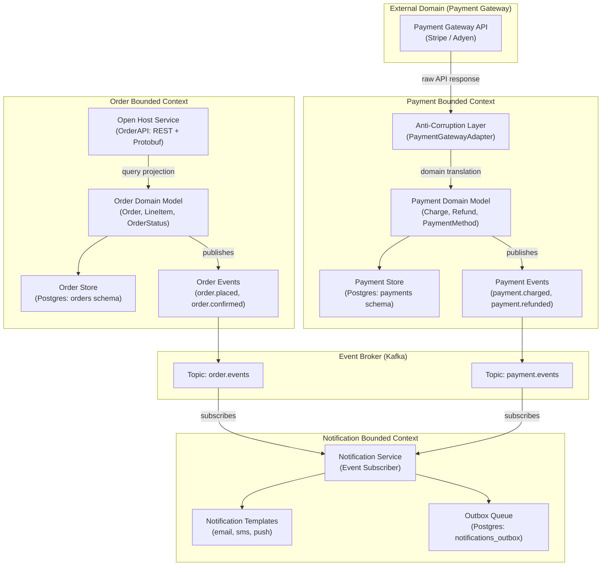

# Lesson 2: Service Decomposition and Bounded Contexts

## 1. First-Principles Intuition & Invariants

The central tension in microservices architecture is not technical — it is epistemological. Before you write a single line of service code, you must answer a question that has nothing to do with programming languages, network protocols, or deployment topologies: *where does one concept end and another begin?* This is the problem of decomposition, and it is fundamentally a question about how human organizations model the world.

Eric Evans introduced Domain-Driven Design in 2003 not as a software methodology, but as a philosophy of knowledge management. His central insight was that large software systems fail not because of poor engineering, but because of linguistic entropy — different teams using the same words to mean different things, the same word "Order" meaning a shopping cart to the checkout team, a fulfillment unit to the warehouse team, and a financial liability to the accounting team. The monolith hides this ambiguity behind a shared codebase. Microservices, because they enforce physical separation, make linguistic inconsistency catastrophically expensive. This is why service decomposition must start with language, not code.

A **Bounded Context** is the solution to this problem. It is a linguistic boundary — a region within which a single, unambiguous model of a domain concept applies. Inside the Inventory bounded context, a `Product` has a SKU, a stock level, a bin location, and a reorder threshold. Inside the Pricing bounded context, the same real-world product is a `PriceableAsset` with a base cost, margin rules, promotional schedules, and currency variants. These are not the same object. Forcing them into a single `Product` class creates a God Object that serves no context well and every context partially. The bounded context says: define your model rigorously *within* a boundary, and define an explicit translation contract — a **Context Map** — at the boundary.

The practical engineering consequence is profound. A bounded context is not merely a package or a module. It owns its own persistence layer, its own domain vocabulary, and its own lifecycle. When you deploy it as a microservice, you are making a topological commitment: this context's internal model is nobody else's business. Other services do not query your database. They do not share your ORM entities. They communicate through well-defined contracts — events, APIs, or messages — that represent the *interface projection* of your model, not its internals.

Understanding why monoliths accumulate entropy requires thinking about coupling dimensions, because not all coupling is the same, and conflating the dimensions leads to badly motivated decomposition decisions.

**Temporal coupling** is the most insidious form. Two components are temporally coupled when they must be available simultaneously for either to do useful work. A synchronous REST call from Service A to Service B is not just a data dependency — it is a liveness dependency. If B is slow, A is slow. If B is down, A fails. This is the distributed systems equivalent of a spinlock. The monolith has temporal coupling too, but it is hidden: when the inventory check blocks the checkout flow in a single process, you observe it as latency, not as a distributed failure. Microservices expose temporal coupling as a first-class failure mode, which is why asynchronous messaging is not an optimization but a structural requirement for resilient decomposition.

**Logical coupling** occurs when two services change together because they reason about the same underlying concept. If every time you update the `Order` schema in the Order Service, you also update the Notification Service, the Reporting Service, and the Fraud Service, those services are logically coupled regardless of their physical separation. They share an implicit model, and your deployment pipeline will reveal this as coordinated, synchronized releases — the distributed monolith anti-pattern. Logical coupling is the signal that your bounded contexts are wrong. The Order that the Notification Service cares about is not a full order model; it is an event that says "an order was confirmed, here is its ID and the customer's email address." Nothing more. If you are sharing more than that, you are sharing model internals across context boundaries.

**Data coupling** is the third dimension and the one engineers most frequently get wrong during migration. Data coupling exists when two services share a database schema, a table, or even a materialized view managed by another team. This is a schema contract masquerading as infrastructure sharing. When you decompose a monolith, the first instinct is to split the services while leaving the database shared — the strangler fig pattern applied only at the HTTP layer. This solves none of the real problems. Schema migrations remain coordinated, transactional guarantees remain implicit, and the services cannot evolve independently. The database is the monolith. Data coupling must be broken explicitly, through the deliberate duplication of data ownership and eventual consistency.

These three coupling dimensions give you an analytical framework for evaluating any proposed service boundary. A good boundary minimizes all three. A service that can serve requests when its upstream dependencies are unavailable (low temporal coupling), that can evolve its internal model without coordination (low logical coupling), and that owns its schema exclusively (low data coupling) is a well-bounded service.

The invariant that follows from this analysis is clean: **a microservice should be independently deployable, independently scalable, and independently evolvable.** Any decomposition that violates these properties has failed, regardless of how many HTTP servers it runs.

---

## 2. Core Architecture & Mechanics

### Context Mapping and Service Topology

The relationship between bounded contexts is captured in a Context Map, which is not a UML diagram but a set of integration patterns that describe both the technical mechanism and the organizational power dynamic between teams. The patterns Evans defined — Shared Kernel, Customer-Supplier, Conformist, Anti-Corruption Layer, Open Host Service, and Published Language — have direct engineering implications.

The most important pattern for microservices practitioners is the **Anti-Corruption Layer (ACL)**. When your service must integrate with an upstream system whose model is incompatible with yours (a legacy ERP, a third-party payment gateway, a partner API), the ACL is the translation boundary. It is not a thin HTTP adapter. It is a full semantic translation component that maps the upstream model to your domain's vocabulary. If the upstream system sends a `CUSTOMER_PURCHASE_EVENT` with a flat JSON blob of 40 fields, your ACL absorbs that event, validates it, translates it to your domain's `OrderPlaced` event with its own schema, and publishes it internally. The upstream model never crosses the context boundary. This keeps your internal model clean and allows you to swap or upgrade the upstream integration without touching your domain logic.

The following diagram illustrates a canonical three-context topology with an ACL at the external integration boundary and an Open Host Service at the internal contract boundary.



Each service owns exactly one schema in exactly one database (or in separate database instances for stronger isolation). The event broker is the only shared infrastructure, and even here, each service owns its topic's schema via a schema registry contract. No service issues a SQL query against another service's tables. The Notification Service does not join against the orders table to get the customer's email — it receives that data in the event payload at the time the event is emitted.

### Identifying Service Boundaries: The EventStorming Process

Before writing a single service, the most effective engineering practice is **EventStorming**, a collaborative modeling technique introduced by Alberto Brandolini. It is executable on a whiteboard and produces a domain event map from which bounded contexts, aggregates, and service boundaries emerge naturally.

The mechanics are as follows. Gather domain experts and engineers. Use orange sticky notes to represent **Domain Events** — things that happened, expressed in past tense: `OrderPlaced`, `InventoryReserved`, `PaymentCharged`, `ShipmentDispatched`. Place them on a timeline. Use blue notes for **Commands** that trigger events: `PlaceOrder` → `OrderPlaced`. Use yellow notes for **Aggregates** — the domain objects that process commands and emit events. The aggregates cluster naturally, and the clusters reveal your bounded contexts.

The clustering produces a first-pass context map that you can then validate against the three coupling dimensions. If you find that two aggregates always appear together in the same event sequence, they may belong in the same context. If you find that an aggregate in one cluster needs to know about an aggregate in another cluster, you have found a context boundary that requires an integration event and a Context Map relationship.

The output of this process feeds directly into your service topology. Each bounded context becomes a candidate microservice. Each integration event becomes a Kafka topic. Each ACL becomes a translator component in your pipeline.

### The Aggregate as the Unit of Consistency

Inside a bounded context, the aggregate is the fundamental consistency unit. An **Aggregate** is a cluster of domain objects — entities and value objects — with a single root entity whose identity defines the cluster's transactional boundary. The rule is strict: all state changes within an aggregate happen in a single atomic transaction, and no transaction spans aggregate boundaries.

This has a direct consequence for database design. Consider an `Order` aggregate with the following structure in Rust, using a simplified domain model:

```rust
use uuid::Uuid;
use chrono::{DateTime, Utc};
use serde::{Deserialize, Serialize};

#[derive(Debug, Clone, Serialize, Deserialize)]
pub struct OrderId(pub Uuid);

#[derive(Debug, Clone, Serialize, Deserialize)]
pub struct CustomerId(pub Uuid);

#[derive(Debug, Clone, Serialize, Deserialize)]
pub struct Money {
    pub amount_cents: i64,
    pub currency: String,
}

#[derive(Debug, Clone, Serialize, Deserialize)]
pub struct LineItem {
    pub product_id: Uuid,
    pub quantity: u32,
    pub unit_price: Money,
}

#[derive(Debug, Clone, PartialEq, Serialize, Deserialize)]
pub enum OrderStatus {
    Draft,
    Placed,
    PaymentPending,
    Confirmed,
    Cancelled,
}

#[derive(Debug, Clone, Serialize, Deserialize)]
pub struct Order {
    pub id: OrderId,
    pub customer_id: CustomerId,
    pub status: OrderStatus,
    pub line_items: Vec<LineItem>,
    pub placed_at: Option<DateTime<Utc>>,
    pub version: u64,
}

#[derive(Debug, Clone, Serialize, Deserialize)]
pub enum OrderEvent {
    OrderPlaced {
        order_id: Uuid,
        customer_id: Uuid,
        total_cents: i64,
        currency: String,
        placed_at: DateTime<Utc>,
    },
    OrderConfirmed {
        order_id: Uuid,
        confirmed_at: DateTime<Utc>,
    },
    OrderCancelled {
        order_id: Uuid,
        reason: String,
        cancelled_at: DateTime<Utc>,
    },
}

#[derive(Debug, thiserror::Error)]
pub enum OrderError {
    #[error("cannot place order: already in status {0:?}")]
    InvalidStatusTransition(OrderStatus),
    #[error("order must have at least one line item")]
    EmptyOrder,
}

impl Order {
    pub fn place(&mut self) -> Result<OrderEvent, OrderError> {
        if self.status != OrderStatus::Draft {
            return Err(OrderError::InvalidStatusTransition(self.status.clone()));
        }
        if self.line_items.is_empty() {
            return Err(OrderError::EmptyOrder);
        }

        let total_cents: i64 = self
            .line_items
            .iter()
            .map(|li| li.unit_price.amount_cents * li.quantity as i64)
            .sum();

        let currency = self.line_items[0].unit_price.currency.clone();
        let placed_at = Utc::now();

        self.status = OrderStatus::Placed;
        self.placed_at = Some(placed_at);
        self.version += 1;

        Ok(OrderEvent::OrderPlaced {
            order_id: self.id.0,
            customer_id: self.customer_id.0,
            total_cents,
            currency,
            placed_at,
        })
    }

    pub fn confirm(&mut self) -> Result<OrderEvent, OrderError> {
        if self.status != OrderStatus::PaymentPending {
            return Err(OrderError::InvalidStatusTransition(self.status.clone()));
        }

        let confirmed_at = Utc::now();
        self.status = OrderStatus::Confirmed;
        self.version += 1;

        Ok(OrderEvent::OrderConfirmed {
            order_id: self.id.0,
            confirmed_at,
        })
    }
}
```

The `version` field is an optimistic concurrency token. When you load an aggregate from the database, you read its current version. When you write it back, you assert `WHERE id = $1 AND version = $2`. If the row was modified by a concurrent request between your read and write, the assertion fails, and you retry. This prevents lost updates without distributed locks and without cross-service transactions.

The `OrderEvent` variants returned by state-transition methods are domain events that the application layer publishes to the event broker after the database transaction commits. This is the **Outbox Pattern**: you write both the aggregate state and the pending events to the same database transaction, then a background worker reads the outbox and publishes to Kafka. This guarantees at-least-once delivery without requiring distributed transaction coordination between your database and your message broker.

The outbox table schema is straightforward and pairs with the aggregate writes in a single transaction:

```sql
CREATE TABLE order_events_outbox (
    id          UUID PRIMARY KEY DEFAULT gen_random_uuid(),
    aggregate_id UUID NOT NULL,
    event_type  TEXT NOT NULL,
    payload     JSONB NOT NULL,
    created_at  TIMESTAMPTZ NOT NULL DEFAULT now(),
    published_at TIMESTAMPTZ
);

CREATE INDEX idx_outbox_unpublished
    ON order_events_outbox (created_at)
    WHERE published_at IS NULL;
```

The background relay worker polls this table, publishes each event to Kafka, and marks it published. If the relay crashes between publish and mark, the event is re-published, so consumers must be idempotent — they key idempotency on the event's `id` field, skipping events they have already processed.

---

## 3. High-Performance Optimization & Failure Modes

### Migrating a Monolith: The Strangler Fig with Proper Data Separation

The most common migration failure is the **Distributed Monolith**, which appears when teams split services at the HTTP layer but leave the database shared. The result is worse than a monolith: you have all the operational complexity of distributed systems (network latency, partial failures, service discovery) with none of the independence benefits, because a schema migration still requires coordinated deployment of every service, and a slow query in one service's connection pool degrades all others.

The correct migration strategy is the **Strangler Fig**, applied at the data layer, not just the API layer. The pattern works incrementally: you identify one bounded context in the monolith, build its new service with its own schema, migrate data ownership to the new service, and route traffic from the monolith to the new service through a **façade** that acts as a reverse proxy. The monolith's code for that context is progressively replaced by calls to the new service until it can be deleted entirely.

The critical engineering step is the data migration phase, which requires a period of **dual-write synchronization**. While both the monolith and the new service are live, writes to the monolith's legacy table are mirrored to the new service's schema. This can be done synchronously (the monolith writes to both tables in the same transaction, with the new service's schema imported as a dependent schema in the same Postgres instance temporarily) or asynchronously via change data capture using a tool like **Debezium**, which reads Postgres's WAL stream and publishes row-level change events to Kafka, which the new service consumes to keep its schema synchronized.

The dual-write phase ends when you have verified — through shadow traffic comparison or read-path validation — that the new service's data is consistent with the legacy table. You then flip the read path to the new service, drain the dual-write, and drop the legacy table. This sequence makes the migration reversible at every step.

A complete migration sequence looks like this:

```text
Phase 1 — Identify and Isolate:
  - Run EventStorming on the target subdomain.
  - Define the new service's schema and API contract.
  - Deploy the new service with an empty database.

Phase 2 — Dual-Write Synchronization:
  - Configure Debezium to capture WAL events from the legacy table.
  - New service consumes CDC events and writes to its own schema.
  - Validate consistency: row counts, checksums, spot-query comparisons.

Phase 3 — Traffic Migration (Strangler Fig Façade):
  - Deploy a façade (nginx or a thin Go proxy) in front of the monolith.
  - Route write traffic for the target context to the new service (100%).
  - Route read traffic in shadow mode: serve from monolith, compare new service response.
  - Validate read parity for 48–72 hours.
  - Flip read traffic to the new service.

Phase 4 — Decommission:
  - Remove dual-write consumer.
  - Delete legacy table (after backup + 30-day retention period).
  - Remove façade routing rule for this context.
```

### Failure Modes in Service Carving

The most consequential anti-pattern is **Nanoservice Decomposition** — carving services at the entity or even method level rather than the bounded context level. A team that creates a `UserAddressService`, a `UserEmailService`, and a `UserPreferencesService` as separate deployments has not modeled three bounded contexts. They have modeled one context — User Profile — and shattered it into three services that are temporally, logically, and data-coupled by design. Every user-related feature now requires a network call fan-out of three requests, each of which can fail independently, and every schema change requires three coordinated deployments. The correct decomposition is a single `UserProfileService` that owns all user profile data.

The diagnostic test for nanoservice decomposition is simple: if two services always change together when a business requirement changes, they belong in the same bounded context. The unit of independent deployability is the bounded context, not the entity.

The second major anti-pattern is **Chatty Services** — a service topology where processing a single user request requires sequential synchronous calls across four or five services. This manifests as deep call chains where Service A calls B, B calls C, C calls D, all synchronously over HTTP. The latency compounds multiplicatively — if each hop is P99 at 20ms, a four-hop chain is P99 at 80ms plus network jitter — and the failure probability compounds as well. If each service has 99.9% availability, a four-service synchronous chain has 99.6% availability, which is 21.9 hours of downtime per year.

The mitigation is architectural, not operational. Synchronous chains indicate that the services are temporally coupled because they are sharing query-time data that should be shared at event-time. If the Order Service needs the customer's shipping address at the time it processes an order, it should not call the Customer Service synchronously to get it. It should have received and stored a projection of the customer's address when the `CustomerAddressUpdated` event was published. This is the **Event-Carried State Transfer** pattern: downstream services maintain read-side projections of the upstream data they need, updated asynchronously when the upstream context publishes events. The Order Service owns a local copy of the last-known shipping address for each customer, and it consults that local copy without a network call.

The tradeoff is explicit eventual consistency: the local projection may be milliseconds to seconds stale. For the vast majority of business operations, this is acceptable. Where it is not — financial transactions requiring real-time balance checks, inventory operations requiring real-time stock levels — synchronous calls are justified, but they should be narrow and bounded, not deep chains.

A third failure mode is **Shared Domain Libraries** — a package (a `domain-commons` Maven artifact, a `shared-models` Go module) that multiple services import and that contains domain entity definitions. This recreates logical coupling in the guise of code reuse. When the library's `Order` struct changes, every service that imports it must be recompiled and redeployed. The library becomes the implicit shared schema that bounded contexts are meant to eliminate. The rule is strict: share infrastructure libraries (HTTP clients, tracing middleware, circuit breaker wrappers) across services; never share domain model code. Each service defines its own representation of any shared concept, and the translation happens at the context boundary through the ACL.

### Schema Evolution and Contract Governance

As services evolve independently, their API and event schemas must evolve without breaking consumers. This requires a formal **schema evolution strategy** grounded in the following compatibility rules: a producer can add optional fields to an existing event schema without breaking consumers (backward-compatible change); a producer cannot remove or rename fields that consumers depend on without a versioned migration (breaking change). These rules must be enforced mechanically through a **Schema Registry** (Confluent Schema Registry for Kafka, or a custom contract testing setup using Pact for HTTP APIs).

Pact contract testing works by having the consumer write a contract that specifies the minimum payload it needs from the producer. The contract is published to a Pact Broker. The producer's CI pipeline pulls the contract and verifies that its current implementation satisfies it. If a producer change would break a consumer contract, the pipeline fails before the change is merged. This inverts the testing dependency: the consumer defines the contract, and the producer is verified against it, rather than requiring both teams to coordinate an integration test environment.

The following `pact` consumer test in Rust (using the `pact_consumer` crate) specifies the minimum `OrderPlaced` event contract that the Notification Service requires:

```rust
use pact_consumer::prelude::*;
use serde_json::json;

#[tokio::test]
async fn notification_service_order_placed_contract() {
    let pact_builder = PactBuilder::new_v4("NotificationService", "OrderService");

    let pact = pact_builder
        .message_interaction("an order.placed event", |mut i| {
            i.contents_from(json!({
                "pact:content-type": "application/json",
                "order_id": like!("550e8400-e29b-41d4-a716-446655440000"),
                "customer_id": like!("660e8400-e29b-41d4-a716-446655440000"),
                "customer_email": like!("alice@example.com"),
                "total_cents": like!(4999_i64),
                "currency": like!("USD"),
                "placed_at": like!("2024-01-15T10:30:00Z")
            }));
            i
        })
        .build();

    // Verify that the notification handler can process the minimum contract payload.
    let events = pact.messages();
    assert_eq!(events.len(), 1);

    let payload: serde_json::Value =
        serde_json::from_slice(&events[0].contents.value().unwrap()).unwrap();

    assert!(payload["order_id"].is_string());
    assert!(payload["customer_email"].is_string());
    assert!(payload["total_cents"].is_number());
}
```

The `like!()` matcher specifies that the consumer only requires the *type* of the value, not its exact content. The Order Service can change the value of `total_cents` for any given order without breaking the contract. It cannot remove the `total_cents` field or change its type from number to string without the contract test failing.

Together, these practices — bounded context modeling, aggregate-level transactional consistency, the Outbox Pattern for reliable event delivery, the Strangler Fig for safe migration, and Pact contract testing for schema governance — constitute the complete engineering discipline of service decomposition. None of them are optional decorations. Each addresses a specific failure mode that emerges when you operate distributed systems at production scale, and the absence of any one of them creates a surface for the others to fail against.
