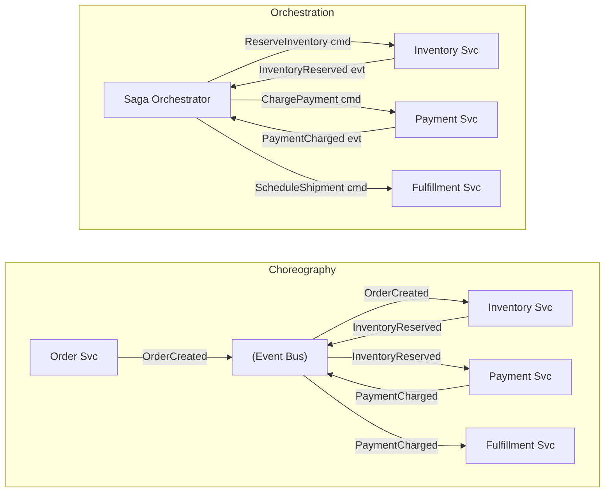
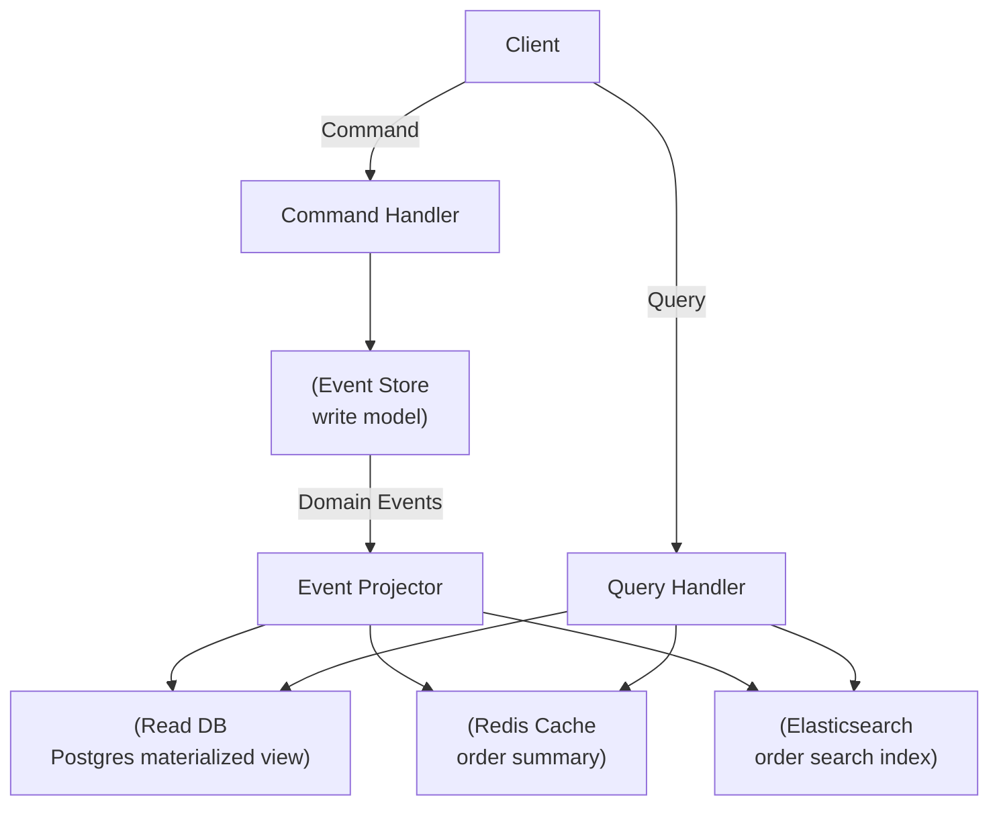

# Lesson 4: Data Consistency and Distributed Transactions

## 1. First-Principles Intuition & Invariants

The moment you decompose a monolith into independent services, each owning its own database, you have made a fundamental trade with the distributed systems gods. You traded the simplicity of a single ACID transaction span—where `BEGIN`, `COMMIT`, and `ROLLBACK` collapse all correctness concerns into a single atom—for the operational autonomy, fault isolation, and independent deployability that microservices promise. That trade is not free. The currency you pay is *coordination complexity*, and understanding precisely what you gave up and what you can recover, at what cost, is the central concern of this lesson.

ACID—Atomicity, Consistency, Isolation, Durability—is a contract your database engine upholds within a single node or a tightly-coupled cluster. When an `ORDER` service writes to its PostgreSQL instance and an `INVENTORY` service writes to a separate MySQL instance, no database engine on earth can atomically commit both writes as a single unit. The two storage engines do not share a WAL, a lock manager, or a commit log. They are, from the perspective of correctness, two independent universes that happen to participate in the same business operation. This is not a PostgreSQL limitation or a MySQL limitation; it is a consequence of the CAP theorem and the physics of message passing across a network that can partition.

Eric Brewer's CAP theorem, formalized by Gilbert and Lynch in 2002, proves that any distributed system can guarantee at most two of Consistency, Availability, and Partition Tolerance simultaneously. Because network partitions are not hypothetical—they are an operational certainty at scale—you must choose between consistency and availability in the presence of a partition. Most microservice architectures choose availability, which means accepting *eventual consistency* as the operational normal. Eventual consistency is not a synonym for "eventually correct if you're lucky." It is a precise liveness guarantee: given no further updates, all replicas will converge to the same value within a bounded time window. The engineering discipline lies in making that window observable, bounded, and tolerable to the business.

The practical consequence of this choice is captured by the BASE model, which Pat Helland articulated as the operationally honest alternative to ACID in distributed systems: **B**asically Available, **S**oft state, **E**ventually consistent. Soft state means the system does not need to be internally consistent at all moments in time—intermediate states exist and are observable. This is a profound shift in how you reason about correctness. In a monolith, a row is either updated or not; a transaction either committed or rolled back. In a distributed system under BASE semantics, an order can be "placed but not yet confirmed," "inventory reserved but payment pending," or "shipped but not yet reconciled"—and all of these are valid, meaningful intermediate states that your system must model explicitly rather than hide behind transaction isolation.

This is the first invariant: **distributed systems do not eliminate intermediate states; they force you to name and handle them.** The engineering discipline of distributed transactions is fundamentally the discipline of making these intermediate states first-class citizens in your domain model, your persistence layer, and your failure recovery logic.

---

## 2. Core Architecture & Mechanics

### Two-Phase Commit: The Cost of Synchronous Consensus

Before understanding why the Saga pattern emerged as the dominant solution for long-lived distributed transactions, you must understand what it replaced and precisely why that replacement was necessary.

Two-Phase Commit (2PC) is a distributed consensus protocol designed to allow multiple independent resource managers to atomically agree on a transaction outcome. The protocol involves a *coordinator* and one or more *participants*. In Phase 1 (the prepare phase), the coordinator sends a `PREPARE` message to all participants; each participant writes the transaction to its local WAL, acquires locks on the rows it will modify, and responds `VOTE_COMMIT` or `VOTE_ABORT`. If all participants vote to commit, the coordinator enters Phase 2 and broadcasts `COMMIT`; it writes the commit record to its own durable log before sending those messages so it can replay them if it crashes mid-broadcast.

The XA specification (X/Open DTP) standardizes this protocol across heterogeneous resource managers. In Java, `javax.transaction.xa.XAResource` exposes `prepare()`, `commit()`, and `rollback()` as the contractual interface. PostgreSQL implements `PREPARE TRANSACTION "txid"` and `COMMIT PREPARED "txid"` to support XA. In theory, you can coordinate an XA transaction across a PostgreSQL order database and a MySQL inventory database through a JTA transaction manager like Atomikos or Narayana.

In practice, 2PC has three failure characteristics that make it untenable for microservices at scale.

The first is *blocking behavior under coordinator failure*. If the coordinator crashes after sending `PREPARE` but before recording its commit decision durably, participants are stuck. They have written their prepare records, locked the rows, and are waiting indefinitely for a resolution they cannot determine on their own. The protocol is said to be *blocking* because participants cannot safely abort without risking a commit from the coordinator that they will have missed. This is not a theoretical edge case; it is a production incident category with its own name: *in-doubt transactions*. `SELECT * FROM pg_prepared_xacts` on a production PostgreSQL instance will show you the graveyard of transactions waiting for coordinators that never came back.

The second is *lock contention amplification*. During the prepare phase, participants hold row-level locks for the duration of the network round trips involved in collecting all votes, persisting the coordinator's decision, and broadcasting the final outcome. In a low-latency internal network, this is a few milliseconds. Across microservices that may live in different availability zones, behind load balancers, calling third-party payment processors, this window expands to hundreds of milliseconds or seconds. Every row locked during this window is unavailable to concurrent transactions. At sufficient throughput, this produces the pathological condition where the transaction rate-limits itself: each in-flight 2PC transaction reduces the available parallelism for subsequent ones.

The third is *operational coupling*. For 2PC to work, every participant must implement the XA protocol. This immediately excludes every service that sits behind an HTTP API, every NoSQL store that lacks XA support, every event stream, and every third-party SaaS endpoint. In a microservices architecture, the overwhelming majority of your transaction participants fall into this category. 2PC doesn't just have performance problems; it is architecturally incompatible with service boundaries.

### The Saga Pattern: Long-Lived Transactions Without Global Locks

The Saga pattern, introduced by Hector Garcia-Molina and Kenneth Salem in their 1987 paper "Sagas," provides a model for long-lived transactions that decomposes them into a sequence of local transactions, each of which can be compensated if a later step fails. A Saga does not achieve atomicity through locking; it achieves *semantic undo* through *compensating transactions*—domain-aware inverse operations that roll back the business effect of a previously committed local transaction.

This distinction is critical. A database rollback is a physical operation: it restores byte-level state to its pre-transaction snapshot using the WAL undo log. A compensating transaction is a *semantic* operation: it encodes the business logic required to reverse the effect of a committed action. Canceling a confirmed order is not the same operation as never having placed it—the cancellation itself is a domain event, it may have side effects (refund emails, restocking notifications), and it must be idempotent so it can be retried safely if the first attempt fails.

A Saga for an e-commerce checkout flow has the following structure, where each step is a local transaction with a corresponding compensation:

```
Step 1: ORDER SERVICE      → Create Order (status: PENDING)
         Compensation      → Cancel Order (status: CANCELLED)

Step 2: INVENTORY SERVICE  → Reserve Items
         Compensation      → Release Reservation

Step 3: PAYMENT SERVICE    → Charge Card
         Compensation      → Issue Refund

Step 4: FULFILLMENT SVC    → Schedule Shipment
         Compensation      → Cancel Shipment

Step 5: ORDER SERVICE      → Confirm Order (status: CONFIRMED)
         Compensation      → (terminal success, no compensation)
```

If Step 4 fails, the Saga executor must run the compensations for Steps 3, 2, and 1 in reverse order. This produces a consistent business outcome—no charge without fulfillment, no reservation without an order—not through ACID isolation but through explicit, ordered semantic reversal.

#### Choreography vs. Orchestration

There are two fundamentally different execution models for Sagas, and the choice between them has deep consequences for observability, coupling, and failure reasoning.

**Choreography** is a decentralized model where each service listens for domain events and decides, based on its local context, what action to take and what event to emit next. There is no central coordinator. The Order service emits `OrderCreated`, the Inventory service listens for it, reserves stock, and emits `InventoryReserved`. The Payment service listens for `InventoryReserved` and charges the card. The chain of causality exists only implicitly in the event sequence—it is enforced by the event contracts between services.

**Orchestration** is a centralized model where a dedicated Saga orchestrator (often called a Process Manager) explicitly commands each participant to execute its local step and waits for a reply event before proceeding. The orchestrator holds the state machine for the Saga's lifecycle and is the single source of truth about which step is currently active, which compensations have been executed, and what the terminal outcome was.



Choreography keeps services loosely coupled and avoids a single point of failure in the coordinator, but it distributes the saga state machine across all participants, making it extremely difficult to answer the question "what is the current state of order #12345?" without querying every service. Debugging a failure requires reconstructing the causal chain from event logs across multiple services, often correlating by a shared `correlationId` header.

Orchestration concentrates the Saga's state machine in one place, making it easy to query, monitor, and reason about. The orchestrator's state table is a direct audit log of every Saga in every state. The cost is that the orchestrator becomes a central coordination hub—not a synchronous chokepoint like a 2PC coordinator, since it communicates asynchronously, but a service that must be deployed with high availability and whose database becomes critical infrastructure.

For production systems of moderate to high complexity, orchestration is the operationally safer choice. The state machine is explicit, testable, and observable. Choreography is appropriate for simple, two-to-three-step Sagas or for domain events that are truly broadcast in nature (audit logging, analytics, search indexing) rather than multi-step workflows with compensation requirements.

#### Implementing an Orchestrated Saga in Java with the Outbox Pattern

The deepest operational challenge in Saga implementation is not the state machine itself—it is ensuring that the state machine's transitions and the outgoing commands it generates are written atomically. If the orchestrator updates its state table to "step 2 executing" and then crashes before publishing the `ReserveInventory` command to the message broker, the Saga is stuck in an intermediate state with no mechanism for recovery.

The **Transactional Outbox Pattern** solves this by co-locating the state update and the outgoing message in the same local database transaction. Instead of writing directly to the message broker, the orchestrator writes the message to an `outbox` table in the same ACID transaction that updates the Saga state. A separate **Message Relay** process (or a Debezium CDC connector reading the WAL) polls the outbox table and forwards pending messages to the broker, marking them as sent on successful delivery.

```java
// SagaOrchestrator.java
@Service
@Transactional
public class OrderSagaOrchestrator {

    private final SagaStateRepository sagaRepo;
    private final OutboxRepository outboxRepo;
    private final ObjectMapper mapper;

    public OrderSagaOrchestrator(
            SagaStateRepository sagaRepo,
            OutboxRepository outboxRepo,
            ObjectMapper mapper) {
        this.sagaRepo = sagaRepo;
        this.outboxRepo = outboxRepo;
        this.mapper = mapper;
    }

    public void startSaga(String orderId, OrderDetails details) throws JsonProcessingException {
        SagaState state = new SagaState();
        state.setSagaId(UUID.randomUUID().toString());
        state.setOrderId(orderId);
        state.setCurrentStep(SagaStep.RESERVE_INVENTORY);
        state.setStatus(SagaStatus.IN_PROGRESS);
        state.setPayload(mapper.writeValueAsString(details));
        sagaRepo.save(state);

        ReserveInventoryCommand cmd = new ReserveInventoryCommand(
            state.getSagaId(), orderId, details.getItems()
        );
        OutboxMessage msg = new OutboxMessage();
        msg.setId(UUID.randomUUID().toString());
        msg.setAggregateId(orderId);
        msg.setTopic("inventory.commands");
        msg.setPayload(mapper.writeValueAsString(cmd));
        msg.setCreatedAt(Instant.now());
        msg.setSent(false);
        outboxRepo.save(msg);
        // Both writes commit atomically within @Transactional.
        // The relay picks up the outbox message and delivers it to Kafka.
    }

    public void onInventoryReserved(InventoryReservedEvent event) throws JsonProcessingException {
        SagaState state = sagaRepo.findBySagaId(event.getSagaId())
            .orElseThrow(() -> new IllegalStateException("Saga not found: " + event.getSagaId()));

        if (state.getCurrentStep() != SagaStep.RESERVE_INVENTORY) {
            return; // Idempotency guard: duplicate event delivery.
        }

        state.setCurrentStep(SagaStep.CHARGE_PAYMENT);
        sagaRepo.save(state);

        ChargePaymentCommand cmd = new ChargePaymentCommand(
            state.getSagaId(), state.getOrderId(), event.getReservationId()
        );
        OutboxMessage msg = new OutboxMessage();
        msg.setId(UUID.randomUUID().toString());
        msg.setAggregateId(state.getOrderId());
        msg.setTopic("payment.commands");
        msg.setPayload(mapper.writeValueAsString(cmd));
        msg.setCreatedAt(Instant.now());
        msg.setSent(false);
        outboxRepo.save(msg);
    }

    public void onInventoryReservationFailed(InventoryReservationFailedEvent event) throws JsonProcessingException {
        SagaState state = sagaRepo.findBySagaId(event.getSagaId())
            .orElseThrow(() -> new IllegalStateException("Saga not found: " + event.getSagaId()));

        state.setStatus(SagaStatus.COMPENSATING);
        state.setCurrentStep(SagaStep.CANCEL_ORDER);
        sagaRepo.save(state);

        CancelOrderCommand cmd = new CancelOrderCommand(
            state.getSagaId(), state.getOrderId(), "Inventory reservation failed"
        );
        OutboxMessage msg = new OutboxMessage();
        msg.setId(UUID.randomUUID().toString());
        msg.setAggregateId(state.getOrderId());
        msg.setTopic("order.commands");
        msg.setPayload(mapper.writeValueAsString(cmd));
        msg.setCreatedAt(Instant.now());
        msg.setSent(false);
        outboxRepo.save(msg);
    }
}
```

```sql
-- Schema for the saga state machine and outbox table
CREATE TABLE saga_state (
    saga_id       VARCHAR(36) PRIMARY KEY,
    order_id      VARCHAR(36) NOT NULL,
    current_step  VARCHAR(64) NOT NULL,
    status        VARCHAR(32) NOT NULL,
    payload       JSONB,
    version       BIGINT NOT NULL DEFAULT 0,
    updated_at    TIMESTAMPTZ NOT NULL DEFAULT NOW()
);

CREATE TABLE outbox_message (
    id            VARCHAR(36) PRIMARY KEY,
    aggregate_id  VARCHAR(36) NOT NULL,
    topic         VARCHAR(255) NOT NULL,
    payload       JSONB NOT NULL,
    created_at    TIMESTAMPTZ NOT NULL DEFAULT NOW(),
    sent          BOOLEAN NOT NULL DEFAULT FALSE,
    sent_at       TIMESTAMPTZ
);

CREATE INDEX idx_outbox_unsent ON outbox_message (created_at) WHERE sent = FALSE;
```

The `version` column in `saga_state` enables optimistic locking. When concurrent event handlers both attempt to advance the same Saga, the second writer will receive a `OptimisticLockException` from JPA, preventing split-brain state machine transitions. The `WHERE sent = FALSE` partial index on the outbox table keeps the relay query efficient as the table grows; the relay uses `SELECT ... FOR UPDATE SKIP LOCKED` to allow multiple relay instances to drain the table in parallel without contention.

### Event Sourcing: The Append-Only Ledger

Event sourcing is an architectural pattern where the state of an aggregate is derived not from a current-value snapshot row, but from the complete, ordered history of domain events that led to that state. The aggregate's current state is a *fold* over its event log. This is not an exotic idea—it is the same model your database's WAL uses internally, your version control system uses for file history, and your accounting ledger uses for account balances.

In a microservices context, event sourcing serves as the natural persistence layer for Saga participants because it eliminates the dual-write problem entirely. Rather than writing to a state table and an outbox table as two separate concerns, an event-sourced aggregate writes a single domain event (e.g., `OrderPlaced`, `InventoryReserved`) to its event store. That event is both the source of truth for the aggregate's state *and* the message that downstream consumers receive. The event store is simultaneously the database and the message log.

```java
// EventSourcedOrder.java
public class Order {

    private String orderId;
    private OrderStatus status;
    private List<OrderItem> items;
    private String reservationId;
    private List<DomainEvent> uncommittedEvents = new ArrayList<>();

    // Private constructor: reconstitute from event history.
    private Order() {}

    public static Order reconstitute(List<DomainEvent> history) {
        Order order = new Order();
        for (DomainEvent event : history) {
            order.apply(event);
        }
        return order;
    }

    public static Order place(String orderId, List<OrderItem> items, String customerId) {
        Order order = new Order();
        OrderPlacedEvent event = new OrderPlacedEvent(orderId, items, customerId, Instant.now());
        order.apply(event);
        order.uncommittedEvents.add(event);
        return order;
    }

    public void confirmInventory(String reservationId) {
        if (this.status != OrderStatus.PENDING) {
            throw new IllegalStateException("Cannot confirm inventory for order in state: " + this.status);
        }
        InventoryConfirmedEvent event = new InventoryConfirmedEvent(this.orderId, reservationId, Instant.now());
        this.apply(event);
        this.uncommittedEvents.add(event);
    }

    public void cancel(String reason) {
        if (this.status == OrderStatus.SHIPPED) {
            throw new IllegalStateException("Cannot cancel a shipped order.");
        }
        OrderCancelledEvent event = new OrderCancelledEvent(this.orderId, reason, Instant.now());
        this.apply(event);
        this.uncommittedEvents.add(event);
    }

    private void apply(DomainEvent event) {
        if (event instanceof OrderPlacedEvent e) {
            this.orderId = e.getOrderId();
            this.items = e.getItems();
            this.status = OrderStatus.PENDING;
        } else if (event instanceof InventoryConfirmedEvent e) {
            this.reservationId = e.getReservationId();
            this.status = OrderStatus.INVENTORY_RESERVED;
        } else if (event instanceof OrderCancelledEvent e) {
            this.status = OrderStatus.CANCELLED;
        }
    }

    public List<DomainEvent> getUncommittedEvents() {
        return Collections.unmodifiableList(uncommittedEvents);
    }

    public void markEventsAsCommitted() {
        this.uncommittedEvents.clear();
    }
}
```

The `EventStore` persists these events using optimistic concurrency control via an expected version check. The append operation is atomic within the event store's local transaction boundary; if two concurrent commands both attempt to append to stream `order-12345` at version 3, one will succeed and the other will receive a `ConcurrencyException` and must retry with a fresh aggregate reconstitution.

```java
// EventStore interface and PostgreSQL implementation
public interface EventStore {
    void appendToStream(String streamId, long expectedVersion, List<DomainEvent> events);
    List<DomainEvent> readStream(String streamId);
    List<DomainEvent> readStreamFrom(String streamId, long fromVersion);
}

@Repository
public class PostgresEventStore implements EventStore {

    private final JdbcTemplate jdbc;
    private final ObjectMapper mapper;

    public PostgresEventStore(JdbcTemplate jdbc, ObjectMapper mapper) {
        this.jdbc = jdbc;
        this.mapper = mapper;
    }

    @Override
    @Transactional
    public void appendToStream(String streamId, long expectedVersion, List<DomainEvent> events) {
        long currentVersion = jdbc.queryForObject(
            "SELECT COALESCE(MAX(stream_position), -1) FROM event_store WHERE stream_id = ?",
            Long.class, streamId
        );

        if (currentVersion != expectedVersion) {
            throw new ConcurrencyException(
                "Expected version " + expectedVersion + " but stream " + streamId +
                " is at version " + currentVersion
            );
        }

        long nextPosition = expectedVersion + 1;
        for (DomainEvent event : events) {
            try {
                jdbc.update(
                    "INSERT INTO event_store (stream_id, stream_position, event_type, payload, created_at) " +
                    "VALUES (?, ?, ?, ?::jsonb, ?)",
                    streamId,
                    nextPosition++,
                    event.getClass().getSimpleName(),
                    mapper.writeValueAsString(event),
                    Instant.now()
                );
            } catch (JsonProcessingException e) {
                throw new RuntimeException("Failed to serialize event", e);
            }
        }
    }

    @Override
    public List<DomainEvent> readStream(String streamId) {
        return jdbc.query(
            "SELECT event_type, payload FROM event_store " +
            "WHERE stream_id = ? ORDER BY stream_position ASC",
            (rs, rowNum) -> deserialize(rs.getString("event_type"), rs.getString("payload")),
            streamId
        );
    }

    private DomainEvent deserialize(String eventType, String payload) {
        try {
            Class<?> clazz = Class.forName("com.example.orders.events." + eventType);
            return (DomainEvent) mapper.readValue(payload, clazz);
        } catch (Exception e) {
            throw new RuntimeException("Cannot deserialize event type: " + eventType, e);
        }
    }
}
```

```sql
CREATE TABLE event_store (
    id              BIGSERIAL PRIMARY KEY,
    stream_id       VARCHAR(255) NOT NULL,
    stream_position BIGINT NOT NULL,
    event_type      VARCHAR(255) NOT NULL,
    payload         JSONB NOT NULL,
    created_at      TIMESTAMPTZ NOT NULL DEFAULT NOW(),
    UNIQUE (stream_id, stream_position)
);

CREATE INDEX idx_event_store_stream ON event_store (stream_id, stream_position);
```

The `UNIQUE (stream_id, stream_position)` constraint is the database-level enforcement of optimistic concurrency: two concurrent appends at the same position will cause a unique constraint violation, and only one will succeed. This is cheaper and more reliable than relying solely on application-level version checks.

### CQRS: Separating the Write Model from the Read Model

Command Query Responsibility Segregation (CQRS), articulated by Greg Young building on Bertrand Meyer's Command-Query Separation principle, recognizes that the data shape required to process a command and the data shape required to serve a query are fundamentally different concerns that benefit from separate models optimized for each purpose.

In a traditional layered architecture, your `Order` entity serves both purposes: it is the write model (the ORM entity you lock, modify, and save) and the read model (the data you serialize into API responses, dashboard views, and reports). These two concerns have directly opposing requirements. The write model benefits from normalization, transactional integrity, and domain invariant enforcement. The read model benefits from denormalization, pre-joined projections, and read-optimized storage layouts.

CQRS separates these by maintaining a *command side* (the write model, typically an event-sourced aggregate) and a *query side* (one or more read models, also called projections or views, built by consuming the event stream and materializing denormalized data into read-optimized stores).



The Event Projector is a consumer of the event store's change stream (via Debezium CDC, Kafka, or EventStoreDB's subscription API) that maintains the read models. Because projections are derived from the event log, they are *rebuildable from scratch* at any time by replaying the event history. This is the killer operational feature of event sourcing combined with CQRS: you can add a new read model retroactively, replay all historical events through it, and have a fully populated projection without any ETL pipelines, data migrations, or business logic re-execution. The event log is the ground truth; projections are just caches derived from it.

```java
// OrderProjector.java - builds the read model from domain events
@Component
public class OrderProjector {

    private final OrderSummaryRepository summaryRepo;
    private final RedisTemplate<String, OrderSummaryView> redis;

    public OrderProjector(
            OrderSummaryRepository summaryRepo,
            RedisTemplate<String, OrderSummaryView> redis) {
        this.summaryRepo = summaryRepo;
        this.redis = redis;
    }

    @KafkaListener(topics = "order-events", groupId = "order-projector")
    @Transactional
    public void project(ConsumerRecord<String, String> record) throws JsonProcessingException {
        ObjectMapper mapper = new ObjectMapper();
        DomainEvent event = mapper.readValue(record.value(), DomainEvent.class);

        if (event instanceof OrderPlacedEvent e) {
            OrderSummaryView view = new OrderSummaryView();
            view.setOrderId(e.getOrderId());
            view.setCustomerId(e.getCustomerId());
            view.setStatus("PENDING");
            view.setItemCount(e.getItems().size());
            view.setPlacedAt(e.getOccurredAt());
            summaryRepo.save(view);
            redis.opsForValue().set("order:" + e.getOrderId(), view, Duration.ofMinutes(30));

        } else if (event instanceof InventoryConfirmedEvent e) {
            summaryRepo.updateStatus(e.getOrderId(), "INVENTORY_RESERVED");
            redis.delete("order:" + e.getOrderId()); // Invalidate stale cache entry.

        } else if (event instanceof OrderCancelledEvent e) {
            summaryRepo.updateStatus(e.getOrderId(), "CANCELLED");
            redis.delete("order:" + e.getOrderId());
        }
    }
}
```

The read model and write model are now separate codepaths with separate failure domains. A bug in the projector does not corrupt the event store; you fix the projector and replay. A slow query against the read model does not lock the aggregate's write path. The two models scale independently: the write path scales with transaction throughput, the read path scales with query fan-out.

---

## 3. High-Performance Optimization & Failure Modes

### Idempotency: The Load-Bearing Invariant

Every component in a distributed transaction chain—Saga orchestrators, event handlers, projectors, compensating transactions—must be *idempotent*: producing the same outcome whether the operation is executed once or N times. This is not a nice-to-have property. It is structurally necessary because message brokers like Kafka guarantee *at-least-once* delivery, not exactly-once, and network retries are unavoidable. Any non-idempotent handler will corrupt state under the operational conditions that production systems routinely encounter.

The idempotency key pattern is the standard implementation: each command or event carries a unique `idempotencyKey` (typically a UUID derived from the saga ID and step name). The handler's first action is to check whether this key has already been processed; if so, it returns the cached result without re-executing. The idempotency check and the state update are committed in the same local transaction.

```java
@Transactional
public void handleChargePayment(ChargePaymentCommand cmd) {
    if (idempotencyStore.hasBeenProcessed(cmd.getIdempotencyKey())) {
        return; // Already processed; safe to ignore.
    }

    PaymentResult result = paymentGateway.charge(cmd.getCardToken(), cmd.getAmount());

    PaymentChargedEvent event = new PaymentChargedEvent(
        cmd.getSagaId(), cmd.getOrderId(), result.getChargeId(), Instant.now()
    );
    eventStore.appendToStream("order-" + cmd.getOrderId(), cmd.getExpectedVersion(), List.of(event));
    idempotencyStore.markProcessed(cmd.getIdempotencyKey(), result.getChargeId());
    // Both writes commit atomically.
}
```

Compensating transactions require the same idempotency treatment. An `IssueRefund` compensation may be delivered multiple times if the Saga orchestrator retries after the compensation command was published but before the `RefundIssued` event was received. The refund handler must check whether the refund for this saga and charge ID has already been issued before calling the payment gateway again.

### The Read-Your-Own-Writes Problem

CQRS introduces an observable consistency lag between the command side and the query side. A user places an order (a command is processed, an `OrderPlaced` event is emitted), and immediately navigates to their order list (a query against the read model). If the event projector has not yet consumed and applied the `OrderPlaced` event, the order list does not show the new order. The user sees a stale view and is alarmed.

The standard mitigation is a *causal consistency* token: the command handler returns the event's sequence number (or a Kafka offset) to the client as part of the command response. The query handler accepts this token as a parameter and either blocks until the read model has processed events up to that sequence number, or returns the stale result with a metadata field indicating the read model's current watermark. GraphQL subscriptions, long-polling endpoints, and WebSocket push notifications are all mechanisms for bridging this gap in user-facing products.

For internal service-to-service queries within a Saga, the orchestrator should not query the read model immediately after issuing a command. Instead, it waits for the reply event (the `InventoryReserved` event in response to the `ReserveInventory` command) before proceeding. The reply event carries all the data the orchestrator needs; a secondary read model query is unnecessary and would be subject to the consistency lag anyway.

### Saga Failure Taxonomy and Recovery Procedures

Sagas fail in four distinct ways that require different recovery strategies.

A *compensatable failure* occurs during the forward-executing phase: a step fails and all previously committed steps must be compensated. The orchestrator detects the failure event, transitions the Saga to `COMPENSATING` state, and runs the compensation chain in reverse order. Each compensation is itself a local transaction with idempotency protection. This is the common case and the one the Saga pattern directly addresses.

A *pivot failure* occurs at the step designated as the *pivot transaction*—the step beyond which compensation becomes impossible or prohibitively expensive. In the checkout flow, charging the payment card is often the pivot: once a card is charged and the charge is settled (not just authorized), issuing a refund has regulatory and fee implications that make it a materially different operation from never having charged. Services must designate their pivot transaction explicitly and treat failures beyond it differently from failures before it—typically escalating to a manual review queue or a dead letter event rather than automatic compensation.

An *orphaned step* occurs when a command is delivered and executed by a participant after the Saga's orchestrator has already decided to compensate. The inventory service reserves stock *after* the orchestrator has sent `ReleaseReservation` to it. Because the orchestrator sends commands asynchronously, the `ReserveInventory` command may arrive at the inventory service after the `ReleaseReservation` command if the two commands are on different Kafka partitions or if the inventory service processed them out of order. The mitigation is *Saga state fencing*: the orchestrator includes the Saga's current expected step in every command, and the participant rejects commands whose expected step does not match the Saga state from the orchestrator's perspective, treating them as stale.

A *zombie Saga* occurs when the orchestrator itself crashes and restarts while a Saga is in-flight. The orchestrator must recover all in-progress Sagas from its state table on startup and resume them from their current step. Because the outbox pattern guarantees the command was written atomically with the state update, the relay will have already delivered (or will deliver on recovery) the pending command. The orchestrator only needs to wait for the reply event, which may already be in the message broker's consumer queue waiting to be processed.

```java
// SagaRecoveryService.java - runs on application startup
@Component
public class SagaRecoveryService implements ApplicationRunner {

    private final SagaStateRepository sagaRepo;
    private final OrderSagaOrchestrator orchestrator;

    public SagaRecoveryService(SagaStateRepository sagaRepo, OrderSagaOrchestrator orchestrator) {
        this.sagaRepo = sagaRepo;
        this.orchestrator = orchestrator;
    }

    @Override
    public void run(ApplicationArguments args) {
        List<SagaState> staleSagas = sagaRepo.findByStatusAndUpdatedAtBefore(
            SagaStatus.IN_PROGRESS,
            Instant.now().minus(Duration.ofMinutes(5))
        );
        // Sagas that have been IN_PROGRESS for more than 5 minutes without
        // advancing have likely had their orchestrator instance crash.
        // Log them and trigger a timeout compensation if they exceed the SLA.
        for (SagaState saga : staleSagas) {
            orchestrator.onTimeout(saga);
        }
    }
}
```

### Snapshot Optimization for Long Event Streams

As an event-sourced aggregate accumulates history, reconstituting it from scratch by replaying every event becomes increasingly expensive. An `Order` aggregate for a heavily modified order might have hundreds of events; reconstituting it for every command requires reading and applying all of them. The standard mitigation is *aggregate snapshotting*: periodically (every N events, or every M minutes), the aggregate's current state is serialized and written to a snapshot store alongside its current stream position. On reconstitution, the system reads the most recent snapshot and replays only the events that occurred after the snapshot's stream position.

```java
@Transactional
public Order loadOrder(String orderId) {
    Optional<OrderSnapshot> snapshot = snapshotStore.findLatest(orderId);
    List<DomainEvent> events;

    if (snapshot.isPresent()) {
        long snapshotVersion = snapshot.get().getStreamPosition();
        events = eventStore.readStreamFrom("order-" + orderId, snapshotVersion + 1);
        Order order = snapshot.get().reconstitute();
        for (DomainEvent event : events) {
            order.applyHistorical(event);
        }
        return order;
    } else {
        events = eventStore.readStream("order-" + orderId);
        return Order.reconstitute(events);
    }
}
```

Snapshots are advisory: they can always be ignored and the aggregate can always be fully reconstituted from the event log. This means snapshot corruption or deletion is not a data loss event—you lose performance, not correctness. Take snapshots every 50 to 100 events as a sensible default; adjust based on the measured p99 latency of your command handlers.

### Database-Per-Service: Schema Ownership and Migration Discipline

The database-per-service principle—each microservice owns its data store and no other service directly queries or writes to it—is what makes Saga compensation necessary and what gives each service its operational autonomy. Without it, services share a schema and can reach into each other's tables, recreating monolith-style coupling at the data layer even when the application layer is decomposed.

Enforcing this boundary in production requires explicit governance. Network policies in Kubernetes should restrict direct database connections to the service's own pods. Each service's CI pipeline must own its own migration tooling (Flyway or Liquibase), running migrations as part of the deployment pipeline with backward-compatible schema changes deployed before the new application version.

The most common violation of this principle is reporting: an analytics team needs to join data from the orders table and the inventory table in a single SQL query. The correct architectural response is not to give the analytics system direct access to both databases—that couples the analytics workload to the operational databases' schemas and performance envelopes. Instead, both services publish their domain events to a data warehouse (via Kafka Connect sinks to Snowflake, BigQuery, or a Redshift cluster), and the analytics team queries the warehouse. The warehouse is a read-only replica of the event streams, owned by the analytics team, evolving at their pace. The operational services retain full schema autonomy.

The deepest consistency challenge in a database-per-service architecture is not the Saga pattern itself—it is accepting that the Saga's intermediate states are *observable by the system's users*. An order that is `PENDING` while awaiting inventory confirmation is in a valid but incomplete state. Your API contracts, your UI states, your SLA definitions, and your customer support runbooks must all acknowledge that this intermediate state exists and is normal. The engineering discipline of distributed transactions ultimately reduces to this: model your domain states honestly, name your intermediate states explicitly, and build the compensation and recovery machinery that makes your eventual consistency guarantees durable. The alternative—pretending that distributed transactions are atomic—produces systems that corrupt silently instead of failing visibly.
