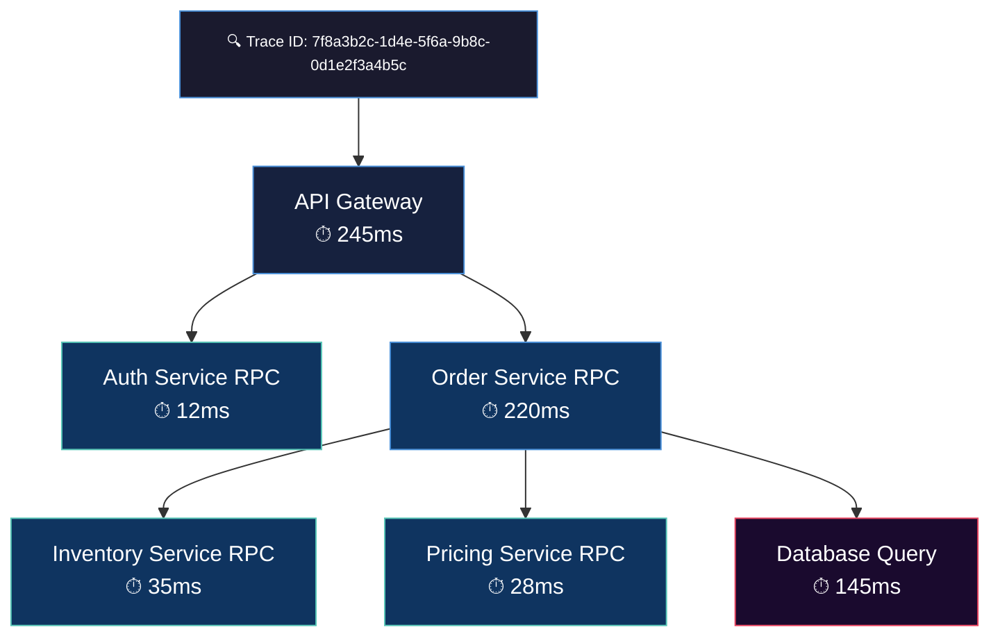
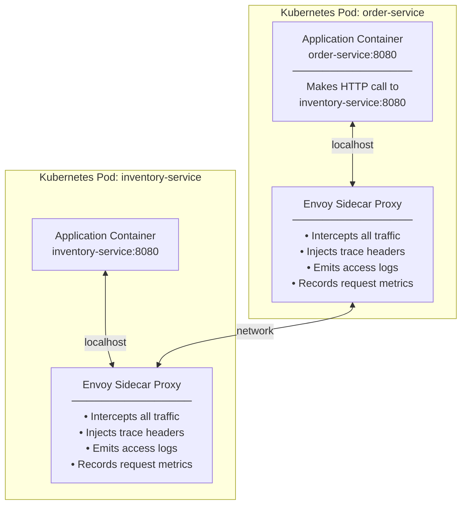

# Lesson 5: Observability and Operational Concerns

## 1. First-Principles Intuition & Invariants

The transition from monolithic architectures to microservices fundamentally transforms the nature of operational visibility. In a monolithic application, the execution path of a user request exists within a single address space, traversing function call stacks that modern debuggers can inspect with breakpoints, stack traces, and memory watches. The entire state machine resides in one process, observable through standard profiling tools and application performance monitoring agents. When failures occur, the crash dump or exception stack trace provides a complete narrative of causality.

Microservices shatter this consolidated visibility into dozens or hundreds of independent processes, each with its own address space, runtime lifecycle, and failure domain. A single user request now triggers a cascade of inter-service remote procedure calls across network boundaries, each hop introducing latency variance, packet loss probability, and independent failure modes. The execution context that was once a contiguous call stack becomes a distributed graph of network interactions, with causality chains spanning multiple hosts, containers, and even data centers. Traditional debugging techniques—attaching a debugger, setting breakpoints, inspecting local variables—cease to function when the execution state is distributed across autonomous processes communicating through asynchronous message passing.

This distributed execution model introduces fundamental observability challenges that stem from the CAP theorem's constraints and the physical realities of network communication. Time itself becomes ambiguous in distributed systems; without perfect clock synchronization, establishing precise causality between events on different nodes requires careful protocol design. A request that appears to complete successfully from the client's perspective may have triggered cascading failures in downstream services that only manifest minutes later as background job failures or data inconsistencies. The traditional stack trace is replaced by a distributed trace—a reconstructed graph of causal relationships inferred from correlation identifiers propagated through request headers and logged at each service boundary.

The observability triad—metrics, logs, and traces—emerges as the fundamental primitive for reasoning about distributed system behavior. Metrics provide aggregate statistical signals about system health: request rates, error percentages, latency percentiles, resource utilization. These time-series measurements enable real-time alerting and capacity planning but sacrifice individual request granularity. Logs capture discrete events and state transitions within each service, providing detailed forensic information for post-mortem analysis but lacking the structured context needed to reconstruct cross-service causality. Distributed traces bridge this gap by explicitly modeling the request propagation graph, capturing timing information and causal relationships that span service boundaries.

The conceptual model underlying modern observability platforms treats each service as a black box that emits telemetry signals—structured events tagged with metadata that enable correlation, aggregation, and querying. The critical invariant is that telemetry emission must impose minimal performance overhead on the production system; excessive instrumentation that degrades request latency or throughput defeats the purpose of maintaining system reliability. This constraint drives the adoption of sampling strategies, asynchronous batch emission, and high-performance serialization protocols optimized for telemetry workloads.

Service mesh architectures abstract the observability instrumentation layer into a dedicated sidecar proxy that intercepts all network traffic entering and leaving each service container. This architectural pattern shifts telemetry collection from application code into infrastructure, enabling uniform observability across polyglot services written in different languages and frameworks. The sidecar proxy becomes a transparent interception point that can inject trace context headers, emit structured access logs, and record request/response metrics without requiring application-level instrumentation changes.

The operational complexity of microservices manifests in the explosion of failure modes and the difficulty of capacity planning in a system where resource requirements are dynamic and interdependent. A monolithic application scales vertically—adding CPU cores and memory to a single large instance. Microservices scale horizontally—adding replicas of individual services based on observed load patterns. This introduces the challenge of autoscaling policies that must balance responsiveness against flapping (rapid scale-up/scale-down cycles that waste resources and destabilize the system). The distributed nature of microservices also introduces cascading failure modes where the overload or failure of one service triggers back-pressure that propagates upstream, potentially taking down the entire system through resource exhaustion or timeout cascades.

Circuit breaker patterns and bulkhead isolation emerge as essential defensive mechanisms. A circuit breaker monitors the error rate of requests to a downstream service and transitions to an "open" state when failures exceed a threshold, immediately rejecting new requests without attempting network communication. This prevents thread pool exhaustion and allows the downstream service time to recover. Bulkhead isolation enforces resource limits—thread pools, connection pools, memory allocations—that prevent a single misbehaving service from consuming all available resources in a shared environment. These patterns acknowledge the fundamental reality that in distributed systems, partial failure is the normal operating mode rather than an exceptional condition.

The polyglot nature of modern microservice architectures—services written in Java, Go, Python, Rust, Node.js, each with different runtime characteristics and failure modes—compounds operational complexity. Language-specific behaviors like garbage collection pauses, memory leak patterns, and thread scheduling policies must be understood in the context of distributed system behavior. A JVM service experiencing frequent old-generation garbage collection pauses may appear to downstream clients as intermittent timeout failures, triggering cascading effects that are invisible in the GC logs of the affected service itself.

## 2. Core Architecture & Mechanics

The distributed tracing architecture rests on a foundational data model that represents each request as a directed acyclic graph of spans. A span represents a single unit of work within the system—typically a service handling an incoming request, making a downstream RPC call, or executing a database query. Each span captures timing information (start timestamp and duration), service identity metadata, and optionally key-value tags that provide semantic context about the operation. The parent-child relationships between spans encode the causality graph, reconstructing the execution flow across service boundaries.

The OpenTelemetry specification, which has emerged as the industry-standard telemetry framework, defines a context propagation mechanism based on a trace identifier and span identifier pair. When Service A makes an RPC call to Service B, it generates a new span identifier for the outgoing request and injects both the trace ID and the new span ID into the request headers. Service B extracts these identifiers from the incoming request headers, records them in its own span as the parent span context, and continues propagating them to any downstream calls it makes. This header propagation protocol enables the reconstruction of the full request graph even though each service only has local knowledge of its immediate parent and children.



The context propagation mechanism must handle both synchronous request/response patterns and asynchronous message queue patterns. For synchronous HTTP or gRPC calls, the trace context travels in standard headers (`traceparent` and `tracestate` in W3C Trace Context specification). For message queue systems like Kafka or RabbitMQ, the trace context is typically embedded in message metadata or headers, allowing consumer services to continue the trace even when processing events published hours or days earlier. This creates a unified observability model that spans both real-time request paths and eventual-consistency background processing workflows.

The sampling decision represents a critical tradeoff between telemetry completeness and system overhead. Head-based sampling makes the sampling decision at the trace root—the first service that receives an external request—and propagates that decision downstream through the trace context headers. If a trace is sampled, all services in the request path emit their spans; if not sampled, all services suppress span emission. This approach ensures complete traces when sampled but cannot retroactively sample traces that later encounter errors or performance anomalies. Tail-based sampling defers the sampling decision until after the trace completes, allowing intelligent policies like "sample all traces with errors" or "sample the slowest 1% of traces." However, tail-based sampling requires buffering all spans temporarily before making the retention decision, increasing memory pressure and operational complexity.

The metrics collection architecture in modern observability stacks centers on time-series databases optimized for high-cardinality dimensional data. Prometheus, the de facto standard in cloud-native environments, models metrics as labeled time series identified by a metric name and a set of key-value label pairs. A metric like `http_requests_total{service="order-service", method="POST", status="200"}` can be aggregated, filtered, and queried across any dimension. The Prometheus pull model operates on a fundamentally different philosophy than push-based systems: each service exposes a metrics endpoint that Prometheus scrapers poll at regular intervals. This inversion of control simplifies service deployment—services don't need to know the metrics backend location—and provides automatic service discovery integration with Kubernetes.

The metric types—counters, gauges, histograms, and summaries—encode different semantic meanings that affect aggregation behavior. A counter represents a monotonically increasing value (total requests processed) and should be queried using rate functions that calculate the per-second increase. A gauge represents a snapshot of current state (active connections, memory usage) and can be averaged or sampled. Histograms bucket observations into configurable ranges, enabling percentile calculations like p95 latency, but require careful bucket boundary selection to balance precision and cardinality. The histogram aggregation property is critical: individual service histograms can be summed across replicas to compute cluster-wide percentiles, unlike summaries which pre-calculate percentiles locally and cannot be meaningfully aggregated.

```bash
# Counter: total requests, always increasing
http_requests_total{service="api", endpoint="/users"} 15234

# Gauge: current value, can increase or decrease
process_resident_memory_bytes{service="api"} 524288000

# Histogram: request duration bucketed by latency ranges
http_request_duration_seconds_bucket{service="api", le="0.1"} 8543
http_request_duration_seconds_bucket{service="api", le="0.5"} 12098
http_request_duration_seconds_bucket{service="api", le="1.0"} 14876
http_request_duration_seconds_bucket{service="api", le="+Inf"} 15234
```

The centralized logging architecture aggregates logs from distributed services into a queryable data store, typically using a log shipping pipeline that reads container stdout/stderr streams and forwards them to a backend like Elasticsearch or Loki. The challenge lies in correlating log lines across services when debugging a specific user request. Structured logging—emitting logs as JSON objects rather than unstructured text—enables programmatic parsing and querying, but the critical requirement is including the trace ID and span ID in every log statement. This creates a bidirectional link between traces and logs: when examining a slow trace, engineers can pivot to the detailed logs emitted during that request's execution, filtered precisely to the relevant time window and service instances.

The log volume problem becomes acute in high-throughput microservice environments. A system processing 10,000 requests per second, with each request touching 10 services that emit 5 log lines each, generates 500,000 log lines per second—over 40 billion log lines per day. Naive log retention quickly exceeds storage budgets and query performance constraints. Sampling strategies become necessary, but unlike traces, logs cannot be sampled with simple probabilistic algorithms because the most valuable logs—those documenting errors and anomalies—are precisely the rare events that sampling would discard. Intelligent log-level filtering based on severity, combined with full retention of error-level logs and sampled retention of info-level logs, provides a practical compromise.

The service mesh data plane architecture implements observability through transparent proxies deployed as sidecars in each pod. Envoy proxy, the most widely deployed service mesh data plane, intercepts every TCP connection using iptables rules that redirect traffic through the local proxy. This interception layer can read and modify request/response headers, emit access logs with detailed timing information, and record connection-level metrics—all without application code changes. The sidecar proxy becomes the authoritative source for network-level observability, measuring actual bytes transmitted, TCP retransmissions, and TLS handshake latency that are invisible to application-layer instrumentation.



The service mesh control plane manages the configuration of these distributed proxies through a centralized API, allowing operators to define traffic policies, circuit breaker thresholds, and retry behaviors without modifying application code. The observability implications are profound: the control plane can enable detailed tracing for specific services or endpoints dynamically, increasing sampling rates when investigating a production incident and reducing them afterward to minimize overhead. This operational flexibility decouples observability instrumentation from application deployment cycles.

The telemetry pipeline architecture requires careful attention to backpressure and failure isolation. If the telemetry backend—the metrics database or log aggregator—becomes unavailable or overloaded, the telemetry emission layer must gracefully degrade rather than blocking application requests. Asynchronous buffering with bounded queues provides the necessary isolation: telemetry events are written to an in-memory ring buffer that a background thread drains and flushes to the backend. When the queue fills, the oldest events are dropped rather than blocking the critical request path. This design acknowledges that observability telemetry is valuable but not critical-path functionality; dropping some telemetry data is acceptable if it prevents cascading failures in the production system.

The OpenTelemetry Collector embodies this pipeline architecture as a standalone agent that receives telemetry from instrumented services, batches and buffers it, and exports to multiple backends. The Collector runs as a sidecar or node-level daemonset, accepting telemetry over OTLP (OpenTelemetry Protocol), a gRPC-based protocol optimized for low-latency, high-throughput telemetry transmission. The Collector's processor pipeline can enrich spans with additional metadata (Kubernetes labels, cloud provider tags), sample traces based on configurable rules, and route telemetry to different backends based on service or environment. This intermediary layer provides crucial operational flexibility and failure isolation between application services and observability backends.

## 3. High-Performance Optimization & Failure Modes

The performance overhead of observability instrumentation must be ruthlessly minimized in production systems where every millisecond of added latency directly impacts user experience and infrastructure cost. The primary cost centers are span creation and serialization in distributed tracing, metric aggregation and exposition in Prometheus exporters, and structured log formatting and emission. Modern instrumentation libraries employ zero-allocation techniques, pre-allocated object pools, and lock-free data structures to reduce the performance footprint.

The span creation overhead stems from allocating memory for span objects, capturing timing information (which requires system calls to read high-resolution clocks), and copying trace context from incoming request headers. High-performance tracing implementations use thread-local storage to maintain the current span context, avoiding lock contention when concurrent requests are processed by the same service instance. The span serialization cost dominates in high-throughput services; converting span objects to wire format (typically Protocol Buffers or JSON) and transmitting them over the network can consume significant CPU cycles. Batching multiple spans into a single gRPC call amortizes the per-request overhead, but introduces latency between span emission and backend ingestion.

Adaptive sampling strategies dynamically adjust sampling rates based on observed system behavior and telemetry backend capacity. When error rates spike or latency exceeds thresholds, the sampling rate automatically increases to capture more diagnostic information. When the system is healthy and the telemetry backend is under pressure, sampling rates decrease to reduce load. This closed-loop control requires exposing telemetry system health metrics—backend ingestion lag, data loss rates—and making them available to the adaptive sampling decision logic running in each service instance or Collector agent.

The cardinality explosion problem in metrics systems arises when label values have unbounded or high cardinality. A metric labeled with `user_id` creates a separate time series for every user, potentially millions of series that exhaust memory and query performance in the metrics backend. Best practices dictate limiting labels to bounded enumerations (service names, HTTP status codes, database table names) and avoiding high-cardinality values like request IDs or user-specific identifiers. When per-entity metrics are necessary, aggregation at query time (using histograms or summaries) or external systems like time-series databases designed for high cardinality (VictoriaMetrics, M3DB) become necessary.

The metrics scraping latency introduces a fundamental observability delay: Prometheus scrapes endpoints every 15-60 seconds, meaning short-lived events may be missed entirely. A service that crashes and restarts between scrape intervals will not have its failure captured in time-series metrics. This limitation drives the need for complementary event-based alerting through log monitoring or real-time event streams. The trade-off is between real-time visibility and the operational complexity of running a push-based event streaming infrastructure.

Circuit breaker implementation requires careful tuning of failure thresholds, timeout durations, and half-open retry logic. An overly aggressive circuit breaker that opens after a single timeout can trigger cascading failures as upstream services interpret the circuit breaker rejections as additional failures. A conservative circuit breaker that requires many consecutive failures before opening may fail to protect the system during genuine overload conditions. The optimal configuration depends on the expected failure rate of the downstream service and the cost of timeout-induced latency. Adaptive circuit breakers that adjust thresholds based on observed baseline error rates provide more robust protection but require sophisticated failure detection algorithms.

The bulkhead isolation pattern manifests in containerized environments through Kubernetes resource limits and requests. Each service container declares CPU and memory requests (guaranteed allocation) and limits (maximum allowed before throttling or OOM-killing). Setting these values requires empirical measurement of service resource consumption under typical and peak load, combined with safety margins for unexpected spikes. Underprovisioned limits cause frequent OOM kills and container restarts; overprovisioned limits waste cluster capacity and increase infrastructure costs. The tension between efficiency and reliability drives the adoption of vertical pod autoscaling, which observes actual resource usage and automatically adjusts requests and limits.

The debugging workflow in polyglot microservice environments requires a mental model that spans multiple runtime ecosystems. When investigating a timeout between a Go service and a Java service, the engineer must consider Go's goroutine scheduling and context cancellation semantics alongside JVM garbage collection pauses and thread pool exhaustion. The distributed trace provides the high-level narrative—which service timed out, which upstream service was waiting—but root cause analysis requires diving into language-specific profiling tools and runtime metrics.

The memory leak diagnosis pattern differs fundamentally across languages. In Java, heap dumps and GC logs reveal objects that should have been collected but are retained by references from long-lived data structures. In Go, pprof heap profiles show allocation call stacks and can identify goroutine leaks—long-lived goroutines that never terminate and accumulate memory. In Rust, memory safety guarantees eliminate most traditional leaks, but reference cycles in `Rc<RefCell<T>>` can create unreclaimable memory, and forgetting to drop resources can accumulate file handles or network sockets. The unified telemetry layer captures memory usage metrics, but interpreting them requires runtime-specific knowledge.

The operational complexity of maintaining observability infrastructure rivals that of the application services themselves. The metrics backend requires persistent storage, backup strategies, and query performance optimization. The logging backend demands index management, retention policies, and query rate limiting to prevent expensive wildcard searches from impacting production investigations. The tracing backend needs trace sampling and aggregation logic to prevent storage costs from growing linearly with request volume. These operational concerns drive the adoption of managed observability platforms (Datadog, New Relic, Honeycomb) that offload the infrastructure burden but introduce vendor dependencies and data egress costs.

The alert fatigue problem emerges from poorly calibrated alerting policies that fire on transient anomalies or expected system behavior. An alert on "service error rate exceeds 1%" may fire constantly if the baseline error rate is naturally 0.5-2% due to client-side errors and retries. Effective alerting requires establishing baselines from historical data and alerting on statistically significant deviations rather than absolute thresholds. Percentile-based alerts (p99 latency exceeds threshold) are often more actionable than mean or median alerts, as they capture tail latency degradation that affects a subset of users without being masked by the majority of fast requests.

The observability cost optimization challenge becomes critical at scale. Storing full-fidelity traces for every request in a system processing millions of requests per day quickly exceeds petabyte-scale storage requirements. Intelligent retention policies—full traces retained for 7 days, sampled traces retained for 30 days, aggregated metrics retained for 1 year—balance forensic capability against storage costs. The emerging trend toward streaming analytics and real-time aggregation processes traces at ingestion time, extracting summary statistics and discarding the raw spans, reducing storage requirements by orders of magnitude while preserving the ability to detect anomalies and performance regressions.

The chaos engineering integration with observability systems validates that telemetry accurately captures failure modes before they occur naturally in production. Deliberately injecting latency, dropping packets, or killing service instances while observing the resulting traces, metrics, and logs verifies that the observability stack provides sufficient signal to diagnose the induced failures. This practice uncovers blind spots—failure modes that are not adequately instrumented or alert policies that fail to trigger when they should. The iterative refinement of observability instrumentation in response to chaos experiments builds confidence that production incidents will be quickly detected and diagnosed.
