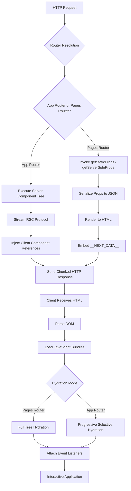

# Lesson 1: Rendering Strategies, Server Components, the Execution Model

## 1. First-Principles Intuition & Invariants

The web application rendering problem reduces to a fundamental tension between client-side interactivity and server-side data coherence. Every web framework must reconcile three competing constraints: the time-to-first-byte latency budget, the JavaScript bundle size transmitted over the network, and the computational cost of hydrating a static DOM tree into an interactive React component tree. Next.js emerged as a production-grade solution to this trilemma by decomposing the rendering decision into orthogonal strategies—Static Site Generation (SSG), Server-Side Rendering (SSR), Incremental Static Regeneration (ISR), and Client-Side Rendering (CSR)—each optimized for distinct latency, caching, and data freshness trade-offs.

The canonical mental model for Next.js rendering begins with the recognition that a React component tree is not a monolithic artifact but a directed acyclic graph of data dependencies. Each node in this graph may demand distinct rendering semantics: a marketing landing page benefits from build-time prerendering with CDN edge caching, a user dashboard requires per-request server rendering with session-specific data, and a real-time chat interface necessitates client-side WebSocket streaming. The brilliance of Next.js lies in its file-system-based routing convention coupled with declarative data-fetching primitives (`getStaticProps`, `getServerSideProps`, `getStaticPaths` in the Pages Router; async Server Components and `fetch` caching in the App Router) that allow engineers to encode these rendering decisions at the page and component granularity without constructing a separate build configuration.

React Server Components (RSC), introduced in Next.js 13 with the App Router, fundamentally restructure the execution model by partitioning the component tree into server-only and client-interactive subtrees. This architecture exploits a key insight: most components in a production application are purely presentational data transformations—mapping database rows to HTML, formatting timestamps, conditionally rendering UI based on feature flags—and do not require client-side JavaScript. By executing these components on the server and streaming their serialized virtual DOM output to the client, RSC eliminates tens or hundreds of kilobytes from the initial JavaScript bundle while preserving the compositional elegance of React's component model.

The RSC wire protocol operates as a streaming serialization format that encodes React elements, props, and async suspense boundaries into a compact JSON-like representation transmitted over HTTP chunked transfer encoding. Server Components execute within a Node.js runtime on each incoming request, invoke async data fetching directly within component bodies (no separate `getServerSideProps` boundary), and serialize their output into this protocol. Client Components, demarcated by the `"use client"` directive, are bundled as separate JavaScript modules and referenced by manifest IDs in the server stream. When the client runtime encounters a Client Component reference, it resolves the module, instantiates the component, and grafts it into the server-rendered tree, completing the hydration process.

Hydration—the process of attaching event listeners and React state to a pre-rendered HTML document—represents the most critical performance boundary in server-rendered applications. The browser parses the initial HTML, constructs the DOM tree, and begins rendering pixels to the screen before any JavaScript executes. When the React bundle loads, the hydration algorithm traverses the DOM tree in lockstep with the component tree, matching pre-rendered HTML structure against the virtual DOM output of each component. Any mismatch triggers a warning and often a full client-side re-render, degrading performance. The App Router's streaming architecture extends this model by progressively hydrating the page as chunks arrive, unblocking interactivity for above-the-fold content while deeper components continue streaming from the server.

The rendering decision matrix can be formalized as a function of three variables: data volatility (how frequently the underlying data changes), request personalization (whether the output depends on per-request context like cookies or authentication tokens), and traffic distribution (the cardinality of unique URL paths and the frequency of access per path). SSG collapses to an optimal strategy when data volatility is low, personalization is absent, and traffic is broadly distributed—think documentation sites, marketing pages, and blog posts. SSR becomes necessary when personalization is required or data changes unpredictably, trading CPU cycles on each request for data freshness. ISR bridges the gap by allowing pages to be statically generated at build time but revalidated on a time-based or on-demand schedule, providing 90th percentile cache hit rates while ensuring eventual consistency with the data layer.

The App Router execution model introduces a fourth axis: the server-client boundary within a single page. Traditional SSR treats the entire page as a server-rendered unit, streaming HTML and then hydrating the full component tree on the client. RSC decouples this by allowing Server Components to stream data continuously while Client Components hydrate independently. This enables patterns like streaming server-rendered database query results directly into a virtualized table component, where the table header and first rows render immediately while subsequent rows stream in, all while preserving client-side sort and filter interactivity.

Build-time versus runtime rendering decisions cascade through the entire deployment pipeline. SSG and ISR pages are generated during the `next build` phase, producing static HTML files that can be deployed to a CDN edge network with zero compute cost per request. The Next.js build process executes each `getStaticProps` function, invokes any Server Components, bundles Client Components into optimized JavaScript chunks, and writes the output to the `.next` directory. SSR pages, conversely, require a persistent Node.js process to execute on each request, introducing architectural dependencies on process managers, load balancers, and horizontal scaling policies.

The fundamental invariant undergirding all Next.js rendering strategies is the preservation of React's unidirectional data flow and declarative component model while optimizing for the constraints of network latency and parse-execute-paint performance budgets. Every rendering decision represents a carefully calibrated trade-off between server compute cost, network transfer size, client-side parse and execution time, and data freshness guarantees. The framework's genius lies in encoding these trade-offs as declarative primitives—async Server Components, `fetch` caching policies, the `"use client"` directive—that compose naturally within the React component model while compiling to highly optimized execution paths.


## 2. Core Architecture & Mechanics

The Next.js rendering pipeline begins with the router layer, which intercepts incoming HTTP requests and resolves them against the file-system routing table. In the Pages Router, each file in the `pages/` directory corresponds to a route, with dynamic segments denoted by bracket notation (`[id].js`). The router invokes the appropriate data-fetching function—`getStaticProps` for SSG, `getServerSideProps` for SSR—executes it within a sandboxed Node.js context, and passes the resulting props to the page component. The component renders to a React element tree, which the server serializes to HTML via `ReactDOMServer.renderToString()` or the newer streaming `renderToPipeableStream()` API. The HTML document includes embedded JSON payloads containing the serialized props, injected into `<script>` tags with `id="__NEXT_DATA__"`, which the client-side React runtime consumes during hydration.

The App Router fundamentally restructures this pipeline by eliminating the artificial boundary between data fetching and component rendering. Server Components execute as async functions, allowing direct `await fetch()` calls within the component body. The Next.js runtime intercepts these fetch invocations, applying configurable caching policies specified via options like `{ cache: 'force-cache' }` (equivalent to SSG), `{ cache: 'no-store' }` (equivalent to SSR), or `{ next: { revalidate: 3600 } }` (equivalent to ISR with one-hour revalidation). This architecture collapses the previous two-phase model—data fetching followed by rendering—into a single async component execution pass.

The RSC wire protocol serializes the component tree into a compact stream format that encodes three primitive types: serialized React elements (containing tag name, props, and children), references to Client Component modules (identified by manifest chunk IDs), and async suspense boundaries (which stream subsequent chunks as promises resolve). A simplified representation of the protocol might look like this:

```
M1:{"id":"./components/Header.client.js","name":"Header","chunks":["client:123"]}
S2:"div"
J0:{"children":[["$","$L1",null,{"userId":"abc123"}],["$","$2",null,{"children":"Welcome"}]]}
```

Here, `M1` declares a Client Component module, `S2` introduces a server-rendered div element, and `J0` encodes a JSON subtree with references (`$L1` resolves to the module declared in `M1`, `$2` resolves to the div). The client runtime parses this stream incrementally, resolving module references by loading the corresponding JavaScript chunks and instantiating Client Components as the stream arrives.

The hydration algorithm operates as a depth-first traversal that reconciles pre-rendered DOM nodes against the React element tree. For Server Components, the server output is authoritative—the client does not re-execute Server Component code but trusts the serialized elements from the stream. For Client Components, the client executes the component function, generates a virtual DOM tree, and compares it against the server-rendered HTML. React uses heuristics like element type, key, and position to match nodes, marking any mismatches as hydration errors. The App Router's streaming model extends this by allowing React to hydrate incrementally: above-the-fold Client Components hydrate immediately when their JavaScript chunks load, while below-the-fold components remain deferred until their stream chunks arrive or the user scrolls.



Static Site Generation executes this pipeline at build time rather than request time. During `next build`, Next.js invokes `getStaticProps` for each page, caching the returned props and rendering the page to HTML. For dynamic routes like `[id].js`, the build process first calls `getStaticPaths` to enumerate all possible `id` values, then generates a static HTML file for each. The build output directory (`.next/`) contains these prerendered HTML files, which the Next.js server or a CDN can serve directly with aggressive caching headers. The build process also generates an optimized JavaScript bundle containing only the code required for client-side navigation and interactivity, applying tree-shaking, minification, and code-splitting.

Incremental Static Regeneration extends SSG by introducing a time-based revalidation policy. When a request arrives for an ISR page and the cached HTML exceeds the revalidation interval, Next.js serves the stale cached version immediately (maintaining low latency) and asynchronously triggers a background regeneration. The regeneration process re-executes `getStaticProps`, renders the page to fresh HTML, and atomically replaces the cached version. Subsequent requests receive the updated content. This stale-while-revalidate pattern combines the latency benefits of CDN caching with the data freshness guarantees of SSR, achieving 99th percentile response times under 50 milliseconds while ensuring content staleness remains bounded by the revalidation interval.

The App Router introduces on-demand revalidation via `revalidatePath()` and `revalidateTag()` functions, callable from Server Actions or API Routes. These functions immediately purge the cached static page or tagged fetch responses, forcing the next request to regenerate. This mechanism enables event-driven cache invalidation: when a content editor publishes a new blog post, the API endpoint handling the publish action calls `revalidatePath('/blog')`, ensuring the blog index page reflects the new post on the next request without waiting for the time-based revalidation interval.

Client-Side Rendering in Next.js operates as a fallback mode for components that cannot execute on the server—typically those that access browser-only APIs like `window`, `localStorage`, or the Geolocation API. In the Pages Router, wrapping such code in a dynamic import with `{ ssr: false }` instructs Next.js to skip server rendering for that component, leaving a placeholder in the initial HTML and rendering the component only after the JavaScript bundle loads on the client. In the App Router, any component within a `"use client"` subtree can access browser APIs, but the entire subtree becomes part of the client bundle. Judicious placement of the `"use client"` boundary minimizes bundle size: placing it at the leaf components that genuinely need interactivity keeps ancestor Server Components server-rendered, reducing the total JavaScript transferred.

The execution model for Server Actions—callable functions that run on the server but can be invoked from Client Components—leverages the same RSC protocol. A Server Action is declared by marking an async function with `"use server"` and passing it as a prop to a Client Component. Next.js generates a unique function ID, embeds it in the client bundle as a reference, and establishes an RPC endpoint. When the client invokes the function, the runtime sends an HTTP POST request containing the function ID and serialized arguments. The server executes the function, serializes the result, and streams it back. This enables patterns like progressive form submission: a Client Component renders a form, the `onSubmit` handler invokes a Server Action to persist data to the database, and the server returns updated UI as a streamed RSC response, all without a full page navigation.

The fundamental data structure underpinning the App Router is the React Flight protocol, which extends the React reconciliation algorithm to support streaming and async component execution. Flight introduces a new React element type, the Server Component, which never instantiates on the client. During server rendering, React traverses the component tree, executing Server Components and buffering their output into the Flight stream. When the traversal encounters a Client Component boundary, React suspends that subtree, records the module reference, and continues. The client receives this stream, reconstructs the tree by replacing module references with hydrated Client Components, and commits the result to the DOM. Suspense boundaries in the tree allow React to commit partial updates: a page can render its layout and header immediately while a slow database query streams in later, filling a Suspense fallback with actual content as it arrives.


## 3. High-Performance Optimization & Failure Modes

Optimizing Next.js rendering performance begins with minimizing the critical path to first contentful paint (FCP) and time to interactive (TTI). For SSG pages, this reduces to aggressive CDN edge caching with long-lived cache headers (`Cache-Control: public, max-age=31536000, immutable` for hashed static assets) and optimal image compression via Next.js's `next/image` component, which generates responsive srcsets, applies lazy loading, and serves modern formats like WebP or AVIF. The build process should leverage parallel static generation for large sites: `next build` supports the `--experimental-worker` flag, which parallelizes `getStaticProps` execution across multiple Node.js worker threads, reducing total build time from hours to minutes for sites with thousands of pages.

SSR performance hinges on database query latency and server compute capacity. Instrumenting SSR pages with distributed tracing (using OpenTelemetry or similar) exposes the per-request breakdown: time spent in `getServerSideProps`, database round-trip latency, React render time, and network transfer time. Common bottlenecks include N+1 query patterns—where a parent component fetches a list of IDs and each child component issues a separate database query—and synchronous third-party API calls. The solution involves batching queries using DataLoader-style request coalescing, implementing server-side caching layers (Redis for session data, in-memory LRU caches for frequently accessed reference data), and moving slow API calls to background jobs with eventual consistency.

ISR tuning requires careful selection of the revalidation interval based on data volatility and traffic patterns. Setting the interval too low (e.g., one second) degrades performance to near-SSR levels, as most requests trigger background regeneration. Setting it too high (e.g., one day) causes stale content to persist long after updates. Empirical tuning involves analyzing content update frequency and acceptable staleness: a product catalog might tolerate five-minute staleness, while a stock ticker demands real-time updates via WebSocket streaming. Combining ISR with on-demand revalidation provides the best of both worlds—time-based revalidation handles organic content updates, while event-driven `revalidatePath()` calls ensure critical updates propagate immediately.

Hydration mismatches represent the most insidious failure mode in server-rendered applications. Common causes include server-client data inconsistencies (e.g., timestamps formatted with server timezone on the server but client timezone on the client), random values generated during render (use a seed or derive from props), and browser extensions that inject DOM nodes. Debugging hydration errors requires comparing the server-rendered HTML (visible in the initial network response) against the client-rendered virtual DOM (inspectable via React DevTools). Next.js logs detailed hydration warnings to the console, pinpointing the component and attribute that diverged. Fixes involve extracting non-deterministic logic into `useEffect` hooks (which only execute on the client) or using `suppressHydrationWarning` for unavoidable mismatches like timestamps.

The App Router's streaming architecture introduces new performance considerations around suspense boundary placement. Wrapping an entire page in a single Suspense boundary with a loading spinner delays FCP until all async data fetching completes, negating the benefits of streaming. Optimal boundary placement involves identifying the slowest data dependencies and isolating them in nested Suspense boundaries, allowing the page shell and fast-loading sections to render immediately while slower sections stream in. This requires profiling actual data fetching latencies in production and iteratively refining boundaries—a dashboard might stream the header and sidebar immediately while the main chart panel shows a skeleton loader until the time-series query completes.

Client bundle size remains a critical optimization target. Every kilobyte of JavaScript delays TTI, as the browser must download, parse, compile, and execute the bundle before the page becomes interactive. Next.js automatically code-splits by route, ensuring each page only loads its required JavaScript. Further optimization involves dynamic imports for heavy components (date pickers, markdown editors, data visualization libraries), moving them behind user interaction or viewport visibility checks. The App Router's Server Components eliminate entire categories of dependencies from the client bundle—date formatting libraries, markdown parsers, syntax highlighters—by executing them on the server and streaming HTML.

Memory leaks in Server Components can crash the Node.js process under high traffic. Common sources include unclosed database connections, event emitters without proper cleanup, and caching layers that grow unbounded. Production deployments should monitor process memory via metrics like `process.memoryUsage().heapUsed` and restart processes periodically or when memory exceeds thresholds. Profiling memory usage involves capturing heap snapshots with the Node.js inspector and analyzing object retention trees to identify leaks.

The RSC protocol's streaming nature exposes edge cases around error handling. If a Server Component throws an error midstream, the server has already sent partial HTML and RSC chunks to the client. Next.js handles this by wrapping the error in an Error Boundary, rendering the fallback UI, and terminating the stream. However, the partial output remains in the DOM, potentially leaving the UI in an inconsistent state. Production applications should implement granular Error Boundaries around components that access external systems, providing user-facing error messages and logging detailed context to observability platforms.

Caching misconfigurations represent a frequent production failure mode. The App Router's default fetch caching behavior—`cache: 'force-cache'` for all fetch requests—can cause stale data to persist indefinitely if not explicitly configured. Teams transitioning from the Pages Router often expect SSR-like behavior but encounter cached responses because they omitted `{ cache: 'no-store' }`. Establishing a team convention—such as explicitly specifying cache policy for every fetch call—prevents silent bugs. The Next.js development server disables caching by default, so these issues only surface in production, making staging environments with production-like caching essential.

Race conditions during ISR revalidation can cause outdated content to overwrite fresh content. If two requests trigger regeneration simultaneously (because both arrived after the revalidation interval elapsed), both background processes execute `getStaticProps` concurrently. If the slower process completes last, it overwrites the faster process's output with stale data. Next.js mitigates this with optimistic locking: the regeneration process checks the cached page's timestamp before writing, aborting if a newer version exists. However, external caching layers (CDNs, reverse proxies) may introduce additional race windows. Using on-demand revalidation with unique cache tags per content version provides stronger consistency guarantees.

The server-client boundary in RSC introduces new security considerations. Accidentally serializing sensitive data—database credentials, internal API keys, personally identifiable information—into the RSC stream exposes it to the client. Next.js does not automatically sanitize Server Component props, so engineers must exercise caution when passing database records or API responses directly to Client Components. Establishing a pattern of explicitly selecting fields for client consumption (`const clientData = { id: user.id, name: user.name }`) reduces this risk.

Performance monitoring for Next.js applications requires instrumenting both server and client metrics. Server-side observability should capture request duration distributions (p50, p95, p99), error rates, and cache hit rates for ISR pages. Client-side Real User Monitoring (RUM) should track Core Web Vitals—Largest Contentful Paint (LCP), First Input Delay (FID), and Cumulative Layout Shift (CLS)—as these directly impact SEO and user experience. Next.js integrates with Web Vitals reporting via the `reportWebVitals` function in `_app.js`, which can forward metrics to analytics platforms.

Horizontal scaling of Next.js SSR deployments demands careful orchestration of stateless server processes behind a load balancer. Each Node.js process maintains in-memory caches (fetch responses, ISR page data), so distributing traffic across multiple processes dilutes cache effectiveness. Introducing a shared caching layer like Redis centralizes ISR metadata and fetch caches, ensuring consistent cache behavior across the fleet. Container orchestration platforms like Kubernetes can autoscale Next.js pods based on CPU utilization or request queue depth, automatically provisioning capacity during traffic spikes and reclaiming resources during lulls.

The build-time versus runtime decision matrix should inform deployment architecture. Teams deploying primarily SSG or ISR pages can adopt a static hosting model—uploading build artifacts to S3 or Vercel, serving HTML from a CDN edge network, and running a small Node.js cluster solely for API routes and on-demand revalidation. Teams with significant SSR usage require full compute infrastructure—autoscaling server clusters, database connection pooling, distributed tracing, and robust error handling. Hybrid architectures are common: marketing pages and documentation use SSG, user dashboards use SSR with per-request personalization, and content pages use ISR with event-driven revalidation.

Debugging production rendering issues requires correlation between server logs, client-side error reports, and distributed traces. A hydration mismatch might manifest as a client-side React error, but the root cause could be a database query returning inconsistent data between the server render and client hydration. Distributed tracing tools like OpenTelemetry capture the full request lifecycle—from incoming HTTP request through database queries, external API calls, React rendering, and final HTTP response—providing the causal chain needed to diagnose subtle bugs.

The ultimate rendering strategy optimization involves continuous profiling and iteration. Production telemetry reveals which pages dominate server CPU usage (candidates for ISR), which pages have high cache miss rates (tune revalidation intervals), and which pages have slow client-side hydration (move logic to Server Components). This data-driven approach replaces guesswork with empirical evidence, guiding incremental improvements that compound into substantial performance gains. The discipline of treating rendering decisions as tunable parameters within a feedback loop—measure, hypothesize, optimize, validate—transforms Next.js from a framework into a performance engineering platform.
