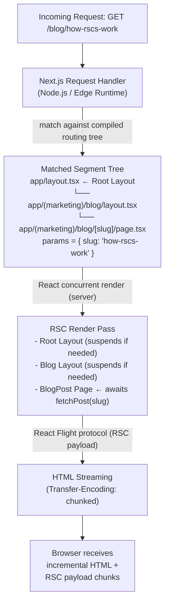

# Lesson 2: File-based Routing, Data Fetching Patterns, and the Request Lifecycle

## 1. First-Principles Intuition & Invariants

The fundamental proposition that Next.js makes to a software engineer is deceptively simple: the filesystem *is* the router. What appears on its surface to be a convenience—no route registration, no manifest file, no central switch statement—is actually a profound architectural commitment. When the shape of your URL space is isomorphic with the shape of your directory tree, the routing system becomes statically analyzable at build time. The compiler can traverse the tree, identify every leaf, classify each node as static or dynamic, and derive the complete rendering strategy for the application before a single HTTP request arrives. This is not a configuration convenience; it is the load-bearing axiom on which Next.js's build-time optimization, Partial Prerendering, and incremental static regeneration all depend.

To appreciate why this matters, consider the alternative. Express.js routes are imperative, registered at runtime in arbitrary order, and can be generated dynamically from database lookups or feature flags. This flexibility is real, but it has a cost: the framework cannot know, prior to receiving a request, which handler will respond or what data it will need. It cannot precompute output, cannot split bundles by route, and cannot apply differential caching strategies per-segment. The filesystem router trades that runtime flexibility for compile-time omniscience, and for the overwhelming majority of web applications, this is an excellent trade.

The App Router, introduced as the production-stable default in Next.js 13.4, represents a second-generation articulation of this idea. Its predecessor, the Pages Router, used the filesystem to map `.js` files in `pages/` directly to routes, but each page was a monolithic unit: one component, one data-fetching function (`getServerSideProps` or `getStaticProps`), one HTML document. The App Router restructures this around *layouts*, *segments*, and *React Server Components*, and understanding why requires a brief detour into the React execution model.

React Server Components (RSCs) execute exclusively on the server. They have no client-side JavaScript bundle, no event listeners, no `useState` or `useEffect`. They can `await` asynchronous operations directly in their function bodies—database queries, remote API calls, filesystem reads—and stream the resulting UI to the client as a serialized component tree. This changes the unit of data fetching from the page boundary to the component boundary. In the Pages Router, one page meant one `getServerSideProps` waterfall. In the App Router, every Server Component in the tree can fetch its own data independently. The framework then coordinates these fetches through React's concurrent rendering engine and its own fetch-layer deduplication, assembling the full tree without the developer having to orchestrate a waterfall manually.

The core invariants that govern the App Router can be stated precisely. First: every segment of a URL maps to a directory in the `app/` tree, and that directory's `page.tsx` is the publicly addressable leaf at that segment. Without a `page.tsx`, the directory exists in the routing tree as a layout node but produces no accessible URL. Second: `layout.tsx` files are persistent across navigations within their subtree; they are instantiated once and their state survives route changes among their children, which is how the framework supports persistent sidebars, shell UIs, and scroll-position preservation without lifting state manually. Third: `loading.tsx` and `error.tsx` are implicit React Suspense and Error Boundary wrappers; the framework inserts them automatically, so the developer declares intent (show this skeleton while this segment loads; show this UI if this segment throws) rather than constructing the boundary machinery directly.

The third invariant is worth dwelling on. React's Suspense model allows a component that is awaiting asynchronous work to *suspend*, bubbling up to the nearest `<Suspense>` boundary in the tree. The browser receives the already-rendered portions of the page via HTTP streaming immediately, and the suspended portions arrive as they resolve, injected into the already-painted shell using a small inline `<script>` that React uses to hydrate the correct position in the DOM. This is the mechanism behind Next.js's streaming Server-Side Rendering: the initial HTTP response begins before all data is ready, the browser starts parsing and painting immediately, and the page populates incrementally. The `loading.tsx` convention is the developer-facing knob that controls what the user sees in the meantime.

## 2. Core Architecture & Mechanics

### The Routing Tree and Segment Classification

The App Router builds an internal routing tree at startup and at build time by walking the `app/` directory recursively. Each directory that contains a `page.tsx` or `layout.tsx` becomes a *route segment*. Segments fall into three structural categories that the compiler identifies by naming convention.

A *static segment* is any directory named with a plain string, such as `app/dashboard/settings/`. Its URL is fixed and its output can potentially be precomputed entirely at build time, subject to whether it contains any dynamic data fetching. A *dynamic segment* is a directory whose name is wrapped in square brackets, such as `app/blog/[slug]/`. At request time, Next.js binds the actual URL token at that position to a parameter named `slug` and makes it available to the segment's Server Components through the `params` prop. A *catch-all segment* uses the spread syntax, `app/docs/[...path]/`, and matches any number of trailing segments, binding them as an array. The optional variant, `[[...path]]`, additionally matches the case where no trailing segments are present.

The routing tree for a typical application looks like this:

```text
app/
├── layout.tsx                 # Root layout (always rendered)
├── page.tsx                   # Route: /
├── (marketing)/               # Route group: excluded from URL
│   ├── about/
│   │   └── page.tsx           # Route: /about
│   └── blog/
│       ├── layout.tsx         # Layout for /blog and descendants
│       ├── page.tsx           # Route: /blog
│       └── [slug]/
│           └── page.tsx       # Route: /blog/:slug
├── dashboard/
│   ├── layout.tsx             # Persistent dashboard shell
│   ├── page.tsx               # Route: /dashboard
│   └── settings/
│       └── page.tsx           # Route: /dashboard/settings
└── api/
    └── webhooks/
        └── route.ts           # API Route: POST /api/webhooks
```

Route groups—directories whose names are wrapped in parentheses, like `(marketing)`—are a purely organizational convention. The compiler strips them from the URL space entirely, so they affect neither the generated paths nor the routing logic. Their value is layout isolation: you can wrap `(marketing)` pages in a marketing-specific layout without that layout bleeding into the dashboard routes, even though both live under the same `app/` root.

The segment rendering pipeline, from inbound request to streamed HTTP response, proceeds as follows:



The RSC payload is a compact, React-specific serialization format (sometimes called the React Flight wire format) that describes the component tree in terms of component references, props, and rendered output. It is not HTML; it is transmitted alongside the HTML stream and used by the React client runtime to construct the virtual DOM, enable client-side navigation without a full page reload, and correctly reconcile any Client Components embedded in the tree.

### The `fetch()` API and Its Caching Semantics

Next.js extends the native `fetch()` Web API at the framework level by wrapping it in a caching and memoization layer. This is not monkey-patching in the crude sense; it is a first-class instrumentation of the fetch lifecycle that runs in the Node.js or Edge runtime during rendering. Every `fetch()` call made within a Server Component render pass is intercepted, and its response is eligible for two independent caching mechanisms: the *Data Cache* and the *Request Memoization* (deduplication) cache.

The Data Cache is a persistent, cross-request cache that lives on the server. It maps fetch URLs and their options to cached response bodies. Its behavior is controlled through the second argument to `fetch()`, specifically the `cache` and `next` fields. Consider this call:

```typescript
// app/(marketing)/blog/[slug]/page.tsx

import { notFound } from 'next/navigation';

interface Post {
  id: string;
  slug: string;
  title: string;
  content: string;
  publishedAt: string;
}

interface PageProps {
  params: { slug: string };
}

async function fetchPost(slug: string): Promise<Post | null> {
  const res = await fetch(`https://api.example.com/posts/${slug}`, {
    next: { revalidate: 3600, tags: ['posts', `post-${slug}`] },
  });

  if (res.status === 404) return null;
  if (!res.ok) throw new Error(`Failed to fetch post: ${res.status}`);

  return res.json();
}

export default async function BlogPostPage({ params }: PageProps) {
  const post = await fetchPost(params.slug);

  if (!post) notFound();

  return (
    <article>
      <h1>{post.title}</h1>
      <time dateTime={post.publishedAt}>
        {new Date(post.publishedAt).toLocaleDateString('en-US', {
          year: 'numeric',
          month: 'long',
          day: 'numeric',
        })}
      </time>
      <div dangerouslySetInnerHTML={{ __html: post.content }} />
    </article>
  );
}
```

The `next: { revalidate: 3600 }` option instructs the Data Cache to serve this response from cache for up to 3600 seconds (one hour) before treating the entry as stale and triggering a background revalidation on the next request that hits it. This is Time-based Incremental Static Regeneration (ISR). The semantics are stale-while-revalidate: the stale response is served immediately while the revalidation fetch runs asynchronously, so no request ever blocks on revalidation latency. The cache entry is updated atomically once the new response arrives.

The `tags` field is the hook for on-demand revalidation. Each cache entry can be annotated with one or more string tags, and calling `revalidateTag('posts')` from a Server Action or Route Handler will immediately invalidate every cache entry carrying that tag, regardless of when it was last revalidated. This is how you implement webhook-driven cache invalidation: your CMS calls your Next.js deployment's `/api/revalidate` endpoint, which calls `revalidateTag`, and the next request for any tagged page fetches fresh data.

The three canonical caching modes for `fetch()` are:

```typescript
// 1. Force static: cache forever, never revalidate automatically.
//    Equivalent to build-time static generation.
await fetch(url, { cache: 'force-cache' });

// 2. Time-based ISR: revalidate after N seconds.
await fetch(url, { next: { revalidate: 60 } });

// 3. Force dynamic: never cache, always fetch fresh.
//    Equivalent to per-request SSR.
await fetch(url, { cache: 'no-store' });
```

A single `no-store` fetch anywhere in a segment's render tree opts the entire segment into dynamic rendering—the framework marks the segment as uncacheable and renders it on every request. This is a critically important implication: the caching strategy of a segment is not configured in one central place but emerges from the aggregate behavior of every fetch it performs. If you embed a `no-store` fetch in a component that you later add to a layout intended to be statically cached, you have silently degraded that entire layout segment to dynamic rendering. The Next.js compiler will warn about this in some cases, but the engineer must understand the propagation rule to reason about it reliably.

### Request Deduplication

Request deduplication addresses a specific problem that arises when multiple components in the same render tree independently fetch the same resource. Consider a layout that fetches the current user's profile to render a navigation bar, and a page within that layout that also fetches the user's profile to render an account summary. Without deduplication, the same HTTP request would fire twice per render pass.

Next.js solves this with per-request memoization, implemented as a `Map` keyed on the fetch URL and serialized options, scoped to the lifetime of a single React render pass. The first component to call `fetch(url)` initiates the actual HTTP request; every subsequent call with an identical URL and options within the same render receives the same in-flight Promise, deduplicated synchronously before the network layer. This memoization cache is entirely ephemeral: it is created when the render begins and discarded when the render completes. It does not persist across requests, unlike the Data Cache.

For data-fetching logic that bypasses `fetch()`—direct database queries via an ORM, calls to a service layer, Redis lookups—you apply the same deduplication manually using React's `cache()` function:

```typescript
// lib/data/user.ts
import { cache } from 'react';
import { db } from '@/lib/db';

export interface User {
  id: string;
  name: string;
  email: string;
  role: 'admin' | 'member';
}

// React cache() wraps the function in per-render memoization.
// Multiple Server Components calling getUser(id) in the same
// render pass will execute the database query exactly once.
export const getUser = cache(async (id: string): Promise<User | null> => {
  const user = await db.user.findUnique({
    where: { id },
    select: { id: true, name: true, email: true, role: true },
  });
  return user;
});
```

```typescript
// app/dashboard/layout.tsx
import { getUser } from '@/lib/data/user';
import { NavBar } from '@/components/NavBar';
import { auth } from '@/lib/auth';

export default async function DashboardLayout({
  children,
}: {
  children: React.ReactNode;
}) {
  const session = await auth();
  const user = await getUser(session.userId);

  return (
    <div className="dashboard-shell">
      <NavBar user={user} />
      <main>{children}</main>
    </div>
  );
}
```

```typescript
// app/dashboard/page.tsx
import { getUser } from '@/lib/data/user';
import { auth } from '@/lib/auth';

export default async function DashboardPage() {
  const session = await auth();
  // This call hits the React cache, not the database,
  // because DashboardLayout already called getUser(session.userId)
  // in this render pass.
  const user = await getUser(session.userId);

  return (
    <section>
      <h1>Welcome back, {user?.name}</h1>
    </section>
  );
}
```

This pattern allows every component to declare its own data dependencies without coupling to a parent's prop-drilling or introducing a global data-fetching orchestration layer. The memoization contract makes the colocation correct and efficient simultaneously.

### Server Functions versus Route Handlers

The App Router provides two distinct mechanisms for server-side logic that the client can invoke: Server Functions (commonly called Server Actions) and Route Handlers. They serve different purposes and operate under different execution contracts, and conflating them produces either over-engineered or under-secured applications.

A Server Function is a TypeScript `async` function defined in a `.ts` or `.tsx` file that bears the `'use server'` directive, either at the top of the file or as the first line of the function body. The Next.js compiler transforms it into a remotely callable procedure: the function's body is stripped from the client bundle entirely, and in its place, the compiler injects a stub that serializes its arguments and dispatches an HTTP POST to an internal framework endpoint. From the developer's perspective, calling a Server Function from a Client Component looks like calling a local async function; under the hood, it is an RPC over HTTP with serialization handled by the React Flight protocol.

```typescript
// app/actions/posts.ts
'use server';

import { revalidateTag } from 'next/cache';
import { redirect } from 'next/navigation';
import { z } from 'zod';
import { db } from '@/lib/db';
import { auth } from '@/lib/auth';

const CreatePostSchema = z.object({
  title: z.string().min(1).max(200),
  content: z.string().min(1),
  slug: z
    .string()
    .min(1)
    .max(200)
    .regex(/^[a-z0-9-]+$/),
});

export async function createPost(formData: FormData) {
  const session = await auth();

  if (!session || session.user.role !== 'admin') {
    throw new Error('Unauthorized');
  }

  const parsed = CreatePostSchema.safeParse({
    title: formData.get('title'),
    content: formData.get('content'),
    slug: formData.get('slug'),
  });

  if (!parsed.success) {
    return { error: parsed.error.flatten().fieldErrors };
  }

  const { title, content, slug } = parsed.data;

  await db.post.create({
    data: { title, content, slug, authorId: session.user.id },
  });

  revalidateTag('posts');
  redirect(`/blog/${slug}`);
}
```

```typescript
// app/dashboard/posts/new/page.tsx
'use client';

import { useActionState } from 'react';
import { createPost } from '@/app/actions/posts';

export default function NewPostPage() {
  const [state, formAction, isPending] = useActionState(createPost, null);

  return (
    <form action={formAction}>
      <div>
        <label htmlFor="title">Title</label>
        <input id="title" name="title" type="text" required />
        {state?.error?.title && (
          <p role="alert">{state.error.title[0]}</p>
        )}
      </div>
      <div>
        <label htmlFor="slug">Slug</label>
        <input id="slug" name="slug" type="text" required />
        {state?.error?.slug && (
          <p role="alert">{state.error.slug[0]}</p>
        )}
      </div>
      <div>
        <label htmlFor="content">Content</label>
        <textarea id="content" name="content" required />
        {state?.error?.content && (
          <p role="alert">{state.error.content[0]}</p>
        )}
      </div>
      <button type="submit" disabled={isPending}>
        {isPending ? 'Publishing...' : 'Publish Post'}
      </button>
    </form>
  );
}
```

A Route Handler, defined in a `route.ts` file, is a conventional HTTP endpoint that explicitly handles specific HTTP methods. It is the App Router equivalent of a classic REST API endpoint: it owns its request and response objects, sets its own headers, and can respond with arbitrary content types. Route Handlers are appropriate when you need to expose a URL that external systems will call—webhook receivers, OAuth callback endpoints, file download streams, third-party API integrations—or when you need explicit control over HTTP semantics that the Server Function abstraction abstracts away.

```typescript
// app/api/webhooks/cms/route.ts
import { headers } from 'next/headers';
import { revalidateTag } from 'next/cache';
import crypto from 'crypto';

const WEBHOOK_SECRET = process.env.CMS_WEBHOOK_SECRET!;

function verifySignature(payload: string, signature: string): boolean {
  const expected = crypto
    .createHmac('sha256', WEBHOOK_SECRET)
    .update(payload)
    .digest('hex');
  // Constant-time comparison to prevent timing attacks.
  return crypto.timingSafeEqual(
    Buffer.from(expected, 'hex'),
    Buffer.from(signature, 'hex'),
  );
}

export async function POST(request: Request): Promise<Response> {
  const rawBody = await request.text();
  const headersList = await headers();
  const signature = headersList.get('x-cms-signature') ?? '';

  if (!verifySignature(rawBody, signature)) {
    return new Response('Unauthorized', { status: 401 });
  }

  let event: { type: string; data: { slug?: string } };

  try {
    event = JSON.parse(rawBody);
  } catch {
    return new Response('Invalid JSON', { status: 400 });
  }

  switch (event.type) {
    case 'post.published':
    case 'post.updated':
      revalidateTag('posts');
      if (event.data.slug) {
        revalidateTag(`post-${event.data.slug}`);
      }
      break;
    case 'post.deleted':
      revalidateTag('posts');
      break;
    default:
      // Unknown event type; acknowledge without acting.
      break;
  }

  return new Response(null, { status: 204 });
}
```

The practical decision rule is straightforward: if the caller is your own application's client-side code and the operation is a mutation tied to user interaction, use a Server Function. If the caller is an external system, another service, or any context where you need explicit HTTP method handling, status codes, or custom headers, use a Route Handler. Server Functions and Route Handlers are not interchangeable; the security model of Server Functions assumes they are called by authenticated application sessions, and they are not designed to serve as general API surfaces.

## 3. High-Performance Optimization & Failure Modes

### Parallelizing Data Fetches to Eliminate Waterfalls

The most significant performance failure mode in Server Component trees is the sequential data-fetching waterfall. Because Server Components can `await` directly in their render functions, it is natural to write code that awaits one piece of data before fetching another. When these fetches are independent, that sequentiality is pure waste: each awaited fetch blocks the render of everything beneath it in the tree while the network round-trip completes.

The idiomatic correction is `Promise.all()` for independent fetches within a single component, and strategic *parallel segment rendering* for independent subtrees:

```typescript
// app/dashboard/page.tsx
// BAD: Sequential waterfall. Total latency = t(user) + t(stats) + t(activity).
export default async function DashboardPage() {
  const session = await auth();
  const user = await getUser(session.userId);        // waits for user
  const stats = await getUserStats(session.userId);  // waits for stats
  const activity = await getRecentActivity(session.userId); // waits for activity

  return <DashboardView user={user} stats={stats} activity={activity} />;
}
```

```typescript
// app/dashboard/page.tsx
// GOOD: Parallel fetches. Total latency = max(t(user), t(stats), t(activity)).
export default async function DashboardPage() {
  const session = await auth();

  const [user, stats, activity] = await Promise.all([
    getUser(session.userId),
    getUserStats(session.userId),
    getRecentActivity(session.userId),
  ]);

  return <DashboardView user={user} stats={stats} activity={activity} />;
}
```

For subtrees that are genuinely independent and of varying latency, Suspense boundaries combined with parallel component rendering offer even finer-grained streaming. Rather than awaiting all three fetches before rendering anything, you render the page shell immediately and stream each section as its data resolves:

```typescript
// app/dashboard/page.tsx
import { Suspense } from 'react';
import { UserSummary } from '@/components/UserSummary';
import { StatsPanel } from '@/components/StatsPanel';
import { ActivityFeed } from '@/components/ActivityFeed';
import { CardSkeleton } from '@/components/skeletons';

export default async function DashboardPage() {
  const session = await auth();

  return (
    <div className="dashboard-grid">
      <Suspense fallback={<CardSkeleton />}>
        <UserSummary userId={session.userId} />
      </Suspense>
      <Suspense fallback={<CardSkeleton />}>
        <StatsPanel userId={session.userId} />
      </Suspense>
      <Suspense fallback={<CardSkeleton />}>
        <ActivityFeed userId={session.userId} />
      </Suspense>
    </div>
  );
}
```

Each of `UserSummary`, `StatsPanel`, and `ActivityFeed` is an `async` Server Component that fetches its own data. React renders all three concurrently, and the browser receives each section's HTML as soon as that section's fetch resolves, independent of the others. The user sees content progressively rather than a blank screen followed by a full page. This pattern is the practical realization of React's concurrent server rendering model and is one of the strongest arguments for the colocation approach that RSCs enable.

### `generateStaticParams` and Build-Time Precomputation

For dynamic segments whose parameter space is enumerable at build time—blog slugs, product IDs, documentation pages—the `generateStaticParams` export opts those routes into full static precomputation. The build process calls `generateStaticParams` once, iterates over the returned parameter objects, renders each combination as a static HTML+RSC payload, and stores the output in the deployment's output directory. At runtime, these routes are served from the CDN edge with zero server compute per request.

```typescript
// app/(marketing)/blog/[slug]/page.tsx
import { notFound } from 'next/navigation';

export async function generateStaticParams(): Promise<Array<{ slug: string }>> {
  const res = await fetch('https://api.example.com/posts?fields=slug', {
    cache: 'force-cache',
  });
  const posts: Array<{ slug: string }> = await res.json();
  return posts.map((post) => ({ slug: post.slug }));
}

// dynamicParams controls behavior for slugs NOT returned by generateStaticParams.
// true (default): render on-demand and cache. false: return 404 immediately.
export const dynamicParams = true;

interface PageProps {
  params: { slug: string };
}

export default async function BlogPostPage({ params }: PageProps) {
  const res = await fetch(`https://api.example.com/posts/${params.slug}`, {
    next: { revalidate: 3600, tags: ['posts', `post-${params.slug}`] },
  });

  if (res.status === 404) notFound();
  if (!res.ok) throw new Error(`API error: ${res.status}`);

  const post = await res.json();

  return (
    <article>
      <h1>{post.title}</h1>
      <div dangerouslySetInnerHTML={{ __html: post.content }} />
    </article>
  );
}
```

With `dynamicParams: true`, any slug not precomputed at build time falls back to on-demand rendering and is then cached for subsequent requests, converging toward full static coverage over time as new posts are published and visited. Setting it to `false` turns unknown slugs into hard 404s, which is appropriate for truly closed parameter spaces like a fixed set of documentation versions.

### Revalidation Strategy Selection

Choosing the wrong revalidation strategy for a given route is one of the more consequential configuration mistakes in a Next.js deployment. The strategies form a spectrum from full static to full dynamic, and the choice should be driven by two axes: how frequently the underlying data changes, and what the cost of serving stale data is.

Time-based revalidation (`next: { revalidate: N }`) is appropriate when data freshness is acceptable within a known bound. A news homepage that revalidates every sixty seconds will serve content that is at most sixty seconds stale, which is acceptable for most editorial contexts and far cheaper than per-request SSR. The degenerate case is setting a revalidation interval that is too short relative to your traffic volume: at high request rates, your revalidation fetches can produce a thundering herd against your upstream API. The stale-while-revalidate semantics protect against this to a degree—only one revalidation request fires per stale cache entry, not one per request—but you should still consider whether the interval makes sense relative to your content update frequency.

Tag-based on-demand revalidation is the highest-fidelity strategy. It couples content freshness directly to content mutations, so the cache is stale for exactly as long as it takes your CMS or data source to notify your application via webhook. The operational cost is the webhook infrastructure itself, but for applications where data correctness is important—e-commerce inventory, user-generated content, any personalized data—it is the correct default.

Dynamic rendering via `cache: 'no-store'` or the `export const dynamic = 'force-dynamic'` segment configuration should be reserved for genuinely per-request data: authenticated user sessions, real-time dashboards, A/B test bucket assignments. Applying it broadly because it is the simplest mental model is a performance regression that eliminates the entire caching infrastructure Next.js provides.

### Failure Modes in Server Action Security

Server Functions are, beneath the React abstraction, public HTTP endpoints that accept POST requests. The framework provides no automatic authentication gate; that is the developer's responsibility. The most common security failure mode is a Server Function that mutates data without verifying the caller's session and authorization level, which is functionally equivalent to an unauthenticated API endpoint wrapped in a React abstraction.

Every Server Function that performs a write operation must call your authentication layer at its entry point, before any database interaction, as demonstrated in the `createPost` example above. Additionally, Server Functions should validate all input against a schema before processing it. The serialization layer that the React Flight protocol provides does not sanitize or type-check values on your behalf; it transmits what the client sends. An attacker who understands the internal RPC endpoint format can send arbitrary payloads that bypass your form's client-side validation entirely. The `zod` parse-then-validate pattern shown earlier is the correct response to this: treat every Server Function input as untrusted data from an arbitrary network client, because that is exactly what it is.

A subtler failure mode involves CSRF. Server Functions are POST requests, and browsers will not automatically cross-origin POST to them with cookie credentials. However, if your authentication relies on a cookie-based session and your CORS policy is too permissive, cross-origin requests carrying those cookies remain possible. The framework includes origin-checking for Server Action requests as of Next.js 14.1—it validates that the `Origin` header matches the deployment's known host—but you should understand this mechanism rather than relying on it passively, and you should not disable it through overly broad `cors` configurations in your Route Handlers.

### Cold Start Latency and Edge Runtime Trade-offs

Next.js supports two server runtimes: the Node.js runtime and the Edge runtime. The Node.js runtime is a full Node.js environment; it has access to the complete standard library, native addons, and the filesystem. The Edge runtime is a lightweight V8 isolate that deliberately excludes Node.js APIs, restricts available globals, and enforces a strict subset of Web Platform APIs. The payoff for this restriction is cold start latency: an Edge Function starts in single-digit milliseconds, while a Node.js serverless function can take hundreds of milliseconds to cold-start in a typical cloud environment.

For route segments that perform simple data fetching and produce HTML, the Edge runtime is frequently the better choice. For segments that require Node.js-specific dependencies—native modules, full filesystem access, ORM clients that use Node.js crypto internals—the Node.js runtime is mandatory. The misconfiguration failure mode is deploying a segment to the Edge runtime that imports a Node.js-only dependency, which produces a build error or a runtime failure that is straightforward to diagnose but costly to discover in production. The correct practice is to default to the Node.js runtime and opt specific segments into the Edge runtime deliberately, with knowledge of what their import graph requires:

```typescript
// app/(marketing)/blog/[slug]/page.tsx
// Opt this segment into the Edge runtime.
// Valid only if the entire import graph is Edge-compatible.
export const runtime = 'edge';
```

Understanding the full routing tree, the caching layer's invalidation semantics, and the execution contract of Server Functions as public HTTP endpoints is what separates a Next.js application that is merely functional from one that is fast, correct, and secure under production conditions. The filesystem routing model provides the structural backbone; the fetch caching infrastructure provides the performance leverage; the RSC component model provides the data colocation that makes both manageable at scale.
