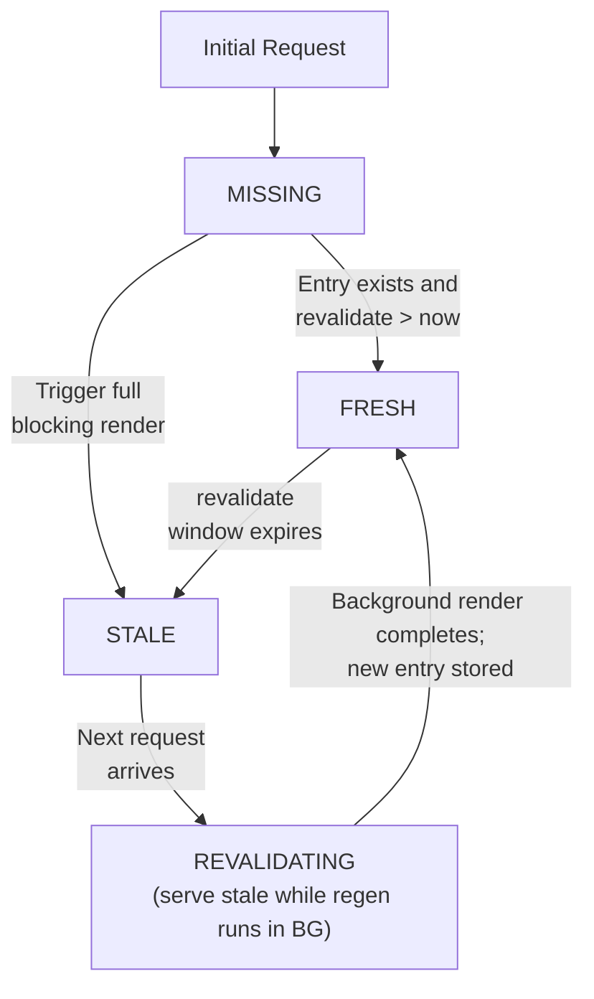

# Lesson 3: Middleware, Edge Computing, Request Interception, Performance Optimization

## 1. First-Principles Intuition & Invariants

Every HTTP request arriving at a Next.js application passes through a layered decision stack before a byte of rendered HTML reaches the client. For most of the web's history, this stack was coarse: a reverse proxy at the network edge, an application server in a data center, and whatever logic the developer embedded inside route handlers. The gap between "edge of the network" and "application logic" was both physical and semantic. Requests traveled hundreds of milliseconds to reach compute, and the only way to intercept them before they hit the origin was to write Nginx Lua scripts or vendor-specific CDN rules, divorced entirely from the application's type system, shared utilities, or deployment pipeline.

Next.js Middleware collapses that gap by treating request interception as a first-class primitive of the framework, expressed in the same JavaScript or TypeScript codebase as the rest of the application. But the architecture is not merely a syntactic convenience. It encodes a set of hard invariants rooted in the runtime constraints of the V8 Isolate model that powers Vercel's Edge Network, Cloudflare Workers, and any conforming edge runtime.

Understanding those invariants begins with understanding what an edge runtime actually is. The edge is not a traditional Node.js process. It is a V8 Isolate: a lightweight, sandboxed JavaScript execution context that starts in under a millisecond, imposes a strict memory ceiling (typically 128 MB per request), and forbids any API that requires operating-system-level access. There is no `fs` module, no arbitrary TCP socket, no `child_process`, and no native addon. What remains is a carefully specified subset of the web platform API: `fetch`, `Request`, `Response`, `URL`, `Headers`, `ReadableStream`, `crypto.subtle`, `TextEncoder`, and a small handful of others. This subset is deliberate. It enables the runtime to be instantiated at every Point of Presence (PoP) in a CDN's global network simultaneously, without the overhead of spinning up a full Node.js event loop, allocating heap memory for a module registry, or establishing long-lived connections to a central process manager.

The Next.js Edge Runtime enforces this subset at build time. When you declare a middleware file, the bundler instruments the compilation pass to verify that no imported module transitively requires a Node.js built-in. If it does, the build fails with a diagnostic identifying the offending import path. This is not a runtime guard — it is a compile-time invariant. The implication for systems programmers is profound: the dependency graph of your middleware must be topologically free of any Node.js-specific leaf. This pushes you toward pure-function utilities, web-standard cryptography, and carefully audited third-party packages that explicitly declare edge-runtime compatibility.

Middleware itself executes on every matched request before the request reaches any Next.js route — whether that route is a Server Component, an API Route, or a statically generated page. The execution position is upstream of the page rendering pipeline entirely, which gives it three well-defined powers: it can rewrite the request URL (changing which route handles the request without issuing an HTTP redirect), redirect the client to a different URL (emitting a 3xx response from the edge), or mutate request and response headers. It cannot, by contract, return a fully rendered HTML body for a page — that responsibility belongs to the rendering pipeline downstream. This constraint is not a limitation of ambition; it is a load distribution invariant. The edge layer is stateless and ephemeral. Render work, which may involve React Server Component trees, database queries, and streaming HTML, belongs on the origin, where it has access to the full Node.js runtime, persistent connections, and larger memory budgets.

Incremental Static Regeneration (ISR) operates on a completely different axis of the architecture, one that is perpendicular to the request interception layer. Where middleware intercepts before rendering, ISR manages when rendering happens at all. The core invariant of ISR is stale-while-revalidate semantics: a cached static page is served immediately (zero compute latency) while a background process triggers a fresh render. The key insight is that "freshness" is defined not by wall-clock expiration alone but by a combination of the `revalidate` interval and optionally an on-demand revalidation signal. Understanding ISR requires understanding that Next.js maintains an internal page cache as a persistent data structure. Each entry in this cache carries a generation timestamp and a staleness threshold. The serving logic compares these on every request, and when the threshold is exceeded, the entry transitions from `fresh` to `stale` without being evicted — serving the stale page while enqueuing a revalidation job.

## 2. Core Architecture & Mechanics

### Middleware Execution Flow

The request lifecycle inside a Next.js deployment can be represented as a linear pipeline with a branch point at the middleware layer:

```
                        ┌─────────────────────────────────────────────────┐
                        │           EDGE NETWORK (PoP)                    │
                        │                                                 │
  Client HTTP Request ──►  CDN Cache Check                                │
                        │       │                                         │
                        │       ├──(HIT)──► Serve Cached Response         │
                        │       │                                         │
                        │       └──(MISS)──► Middleware Runtime           │
                        │                        │                        │
                        │            ┌───────────┴────────────┐           │
                        │            │  NextRequest assembled  │           │
                        │            │  - url, method, headers │           │
                        │            │  - geo, ip metadata     │           │
                        │            └───────────┬────────────┘           │
                        │                        │                        │
                        │            ┌───────────▼────────────┐           │
                        │            │  middleware.ts executes │           │
                        │            │  NextResponse.rewrite() │           │
                        │            │  NextResponse.redirect()│           │
                        │            │  NextResponse.next()    │           │
                        │            └───────────┬────────────┘           │
                        │                        │                        │
                        └────────────────────────┼────────────────────────┘
                                                 │
                        ┌────────────────────────▼────────────────────────┐
                        │           ORIGIN (Node.js Runtime)              │
                        │                                                 │
                        │   Router ──► Page / API Route / App Dir Handler │
                        │               │                                 │
                        │               ▼                                 │
                        │   RSC Rendering / getServerSideProps / ISR     │
                        │               │                                 │
                        │               ▼                                 │
                        │       Response assembled and streamed           │
                        └─────────────────────────────────────────────────┘
```

The `NextRequest` object wraps the standard Web API `Request` with Next.js-specific extensions. The `geo` property provides IP geolocation data populated by the edge infrastructure (city, country, region). The `ip` property is the client's originating IP. Both are read-only. These fields allow middleware to make routing decisions based on geography without any external API call, which is critical given the microsecond latency budget of edge functions.

The `NextResponse` class is the middleware's primary output mechanism. Its three static factory methods encode the three possible execution outcomes. `NextResponse.next()` signals the pipeline to proceed to the origin unchanged, though you can attach header mutations to this response object before returning it. `NextResponse.rewrite(url)` instructs the edge to forward the request to a different internal URL while preserving the original URL that the browser sees — the client is entirely unaware of the rewrite. `NextResponse.redirect(url, status)` issues an actual HTTP redirect, consumed by the browser. The distinction between rewrite and redirect is architecturally significant: rewrites enable transparent A/B testing, feature flagging, and locale routing without round-trip cost; redirects are visible in browser history and add one full RTT.

A production middleware implementation for locale detection and authentication gating demonstrates these mechanics concisely:

```typescript
// middleware.ts
import { NextRequest, NextResponse } from "next/server";
import { jwtVerify, importSPKI } from "jose";

const PUBLIC_KEY_PEM = process.env.AUTH_PUBLIC_KEY!;
const SUPPORTED_LOCALES = ["en", "fr", "de", "ja"] as const;
type Locale = (typeof SUPPORTED_LOCALES)[number];

function detectLocale(request: NextRequest): Locale {
  const acceptLanguage = request.headers.get("accept-language") ?? "";
  const preferred = acceptLanguage
    .split(",")
    .map((tag) => tag.split(";")[0].trim().slice(0, 2).toLowerCase())
    .find((lang): lang is Locale =>
      SUPPORTED_LOCALES.includes(lang as Locale)
    );
  return preferred ?? "en";
}

async function verifyToken(token: string): Promise<boolean> {
  try {
    const publicKey = await importSPKI(PUBLIC_KEY_PEM, "RS256");
    await jwtVerify(token, publicKey, {
      issuer: "https://auth.example.com",
      audience: "https://app.example.com",
    });
    return true;
  } catch {
    return false;
  }
}

export async function middleware(request: NextRequest): Promise<NextResponse> {
  const { pathname } = request.nextUrl;

  // Locale rewrite: transparently prefix unlocalized paths
  const pathnameHasLocale = SUPPORTED_LOCALES.some(
    (locale) => pathname.startsWith(`/${locale}/`) || pathname === `/${locale}`
  );

  if (!pathnameHasLocale) {
    const locale = detectLocale(request);
    const rewriteUrl = request.nextUrl.clone();
    rewriteUrl.pathname = `/${locale}${pathname}`;
    // Attach the detected locale as a request header for downstream RSCs
    const response = NextResponse.rewrite(rewriteUrl);
    response.headers.set("x-detected-locale", locale);
    return response;
  }

  // Auth gate: protect all /dashboard routes
  if (pathname.includes("/dashboard")) {
    const token = request.cookies.get("auth_token")?.value;
    if (!token || !(await verifyToken(token))) {
      const loginUrl = request.nextUrl.clone();
      loginUrl.pathname = "/en/login";
      loginUrl.searchParams.set("callbackUrl", pathname);
      return NextResponse.redirect(loginUrl, { status: 302 });
    }
  }

  return NextResponse.next();
}

export const config = {
  matcher: [
    /*
     * Match all paths except:
     * - _next/static (static assets)
     * - _next/image (image optimization)
     * - favicon.ico
     * - Public files with extension
     */
    "/((?!_next/static|_next/image|favicon.ico|.*\\.(?:svg|png|jpg|jpeg|gif|webp)$).*)",
  ],
};
```

The `jose` library is used here deliberately rather than `jsonwebtoken`, because `jose` is built against the Web Crypto API (`crypto.subtle`) and therefore edge-runtime compatible. `jsonwebtoken` depends on Node.js's `crypto` module and would fail the build-time invariant check. This is exactly the kind of dependency substitution that edge development demands: functionality is preserved, but the implementation must conform to the web platform API surface.

The `config.matcher` export deserves careful attention. This is not a runtime filter — it is a build-time directive that tells the Next.js bundler and the edge infrastructure which URL patterns should trigger middleware invocation at all. Patterns that do not match are routed directly past the middleware layer, reducing cold-start overhead and unnecessary compute consumption. Writing an overly broad matcher (such as the catch-all `"/(.*)"`) means the middleware function is invoked even for `.js` chunks and `.png` files, which is wasteful and can interfere with static asset caching.

### ISR Internal State Machine

ISR's caching behavior is best understood as a per-route state machine with four states: `MISSING` (no cache entry exists), `FRESH` (a cache entry exists and is within its revalidation window), `STALE` (a cache entry exists but has exceeded its revalidation window), and `REVALIDATING` (a stale entry is being regenerated in the background).



In the Next.js App Router, ISR is configured through the `revalidate` export from a Server Component or layout:

```typescript
// app/products/[id]/page.tsx
import { notFound } from "next/navigation";

interface Product {
  id: string;
  name: string;
  price: number;
  inventory: number;
}

async function getProduct(id: string): Promise<Product | null> {
  const response = await fetch(`https://api.example.com/products/${id}`, {
    // This fetch call participates in Next.js's extended fetch cache.
    // The cache: "force-cache" combined with the route-level revalidate
    // means this response is memoized and reused across all fetches
    // within a single render pass, then invalidated on the route's schedule.
    next: { revalidate: 60 },
  });

  if (!response.ok) return null;
  return response.json();
}

// Route segment config: all fetches in this segment inherit this revalidation
// window unless they specify a shorter one, in which case the shortest wins.
export const revalidate = 60;

export async function generateStaticParams() {
  const response = await fetch("https://api.example.com/products?limit=100");
  const products: Product[] = await response.json();
  return products.map((p) => ({ id: p.id }));
}

export default async function ProductPage({
  params,
}: {
  params: { id: string };
}) {
  const product = await getProduct(params.id);
  if (!product) notFound();

  return (
    <article>
      <h1>{product.name}</h1>
      <p>${product.price.toFixed(2)}</p>
      <span>In stock: {product.inventory}</span>
    </article>
  );
}
```

On-demand revalidation provides an escape hatch from the time-based model. Rather than waiting for the revalidation window to expire, your backend can call Next.js's `revalidatePath` or `revalidateTag` API when it knows data has changed:

```typescript
// app/api/revalidate/route.ts
import { revalidatePath, revalidateTag } from "next/cache";
import { NextRequest, NextResponse } from "next/server";

export async function POST(request: NextRequest): Promise<NextResponse> {
  const authHeader = request.headers.get("authorization");
  const expectedToken = `Bearer ${process.env.REVALIDATION_SECRET}`;

  if (authHeader !== expectedToken) {
    return NextResponse.json({ error: "Unauthorized" }, { status: 401 });
  }

  const body = await request.json();
  const { type, target } = body as { type: "path" | "tag"; target: string };

  if (type === "path") {
    revalidatePath(target);
  } else if (type === "tag") {
    revalidateTag(target);
  } else {
    return NextResponse.json({ error: "Invalid type" }, { status: 400 });
  }

  return NextResponse.json({ revalidated: true, target, type });
}
```

Your CMS or e-commerce backend can call this endpoint on a webhook event (product updated, article published) and the specific cache entries are invalidated surgically, without touching the rest of the cache. The `revalidateTag` mechanism is particularly powerful: you can tag a `fetch` call with `{ next: { tags: ["product-123"] } }` and then invalidate all pages that rendered using that fetch with a single `revalidateTag("product-123")` call, regardless of how many URL paths those pages occupied.

### Bundle Splitting and Code-Splitting Mechanics

Next.js's webpack (and, increasingly, Turbopack) configuration performs several layers of chunk splitting. The entry-point split places framework code, vendor code, and application code into distinct chunks. The route-based split creates one JavaScript bundle per page or layout segment, so navigating from `/` to `/about` only downloads the code that `/about` requires. The dynamic import split handles explicit `import()` calls within your application code.

Understanding what lands in which chunk requires tracing the module graph. The `@next/bundle-analyzer` plugin wraps `webpack-bundle-analyzer` and renders an interactive treemap of every module in every chunk. It is an indispensable diagnostic tool:

```javascript
// next.config.js
const withBundleAnalyzer = require("@next/bundle-analyzer")({
  enabled: process.env.ANALYZE === "true",
});

/** @type {import('next').NextConfig} */
const nextConfig = {
  experimental: {
    turbo: {
      // Turbopack-specific rules can be defined here when migrating
    },
  },
};

module.exports = withBundleAnalyzer(nextConfig);
```

Running `ANALYZE=true next build` opens two treemaps in your browser: one for the client-side bundle and one for the server-side bundle. The most common pathology this reveals is a heavy third-party library (a date picker, a rich text editor, a charting library) being pulled into the main entry chunk because it was imported at the top of a component file rather than through a dynamic import.

The fix is mechanical. Dynamic imports with `next/dynamic` are the Next.js idiomatic form:

```typescript
// components/RichTextEditor.tsx - Heavy component: TipTap + ProseMirror ~350KB
import dynamic from "next/dynamic";
import type { ComponentProps } from "react";

// The loading fallback renders immediately; the actual editor chunk is fetched
// only when this component mounts in the browser. The `ssr: false` flag
// prevents Next.js from attempting to render TipTap on the server, which
// would fail because TipTap relies on DOM APIs unavailable in Node.js.
const TipTapEditor = dynamic(
  () => import("./TipTapEditorCore").then((mod) => mod.TipTapEditorCore),
  {
    ssr: false,
    loading: () => (
      <div className="h-64 w-full animate-pulse rounded-md bg-gray-200" />
    ),
  }
);

type EditorProps = ComponentProps<typeof TipTapEditor>;

export function RichTextEditor(props: EditorProps) {
  return <TipTapEditor {...props} />;
}
```

The `ssr: false` option is worth examining at the mechanical level. When Next.js server-renders a page, it executes the React component tree in a Node.js context. If a component imports a library that accesses `window`, `document`, or any DOM API during module initialization, the render throws a reference error. `ssr: false` instructs the renderer to substitute the `loading` fallback during server-side execution and defer the actual dynamic import to the browser's hydration phase. This is not simply a performance hint — it is a correctness constraint for DOM-dependent libraries.

## 3. High-Performance Optimization & Failure Modes

### Image Optimization Internals

The `next/image` component is a contract, not a convenience wrapper. It enforces several invariants at both build time and request time. When a request arrives for a Next.js-optimized image URL (of the form `/_next/image?url=...&w=...&q=...`), the image optimization server decodes the query parameters, fetches the source image (from local disk or a remote URL, subject to the `remotePatterns` allowlist), and runs it through a Sharp-based transformation pipeline. Sharp is a Node.js binding to libvips, a C library that processes images in a streaming pipeline with significantly lower memory overhead than ImageMagick.

The transformation pipeline produces a resized, format-converted image (WebP or AVIF based on the `Accept` header negotiation with the requesting browser) and writes it to the persistent disk cache at `.next/cache/images`. Subsequent requests for the same `url`, `w`, and `q` combination are served directly from this cache without re-running the transformation. The cache entries carry HTTP cache headers derived from the source image's response, bounded by the `minimumCacheTTL` configured in `next.config.js`.

The production configuration of image optimization requires deliberate choices:

```javascript
// next.config.js
/** @type {import('next').NextConfig} */
module.exports = {
  images: {
    // Define allowed remote domains with precise pattern matching.
    // A broad wildcard here creates an open redirect/SSRF vector —
    // an attacker can craft /_next/image?url=http://internal-host/secrets
    // and cause your image server to fetch arbitrary internal URLs.
    remotePatterns: [
      {
        protocol: "https",
        hostname: "cdn.example.com",
        port: "",
        pathname: "/assets/**",
      },
      {
        protocol: "https",
        hostname: "**.cloudinary.com",
        pathname: "/**",
      },
    ],

    // Format negotiation order. AVIF is ~50% smaller than WebP but
    // encoding is CPU-intensive. For pages with many images, WebP-first
    // reduces origin CPU load while still delivering modern formats.
    formats: ["image/webp", "image/avif"],

    // Device size breakpoints used to generate the srcset attribute.
    // These should match your CSS breakpoints to avoid downloading
    // images significantly larger than the display container.
    deviceSizes: [640, 750, 828, 1080, 1200, 1920, 2048, 3840],

    // Image size breakpoints for fixed-layout images (the `sizes` prop).
    imageSizes: [16, 32, 48, 64, 96, 128, 256, 384],

    // Cache TTL floor. Images are served from disk cache for at least
    // this duration in seconds, regardless of upstream Cache-Control headers.
    minimumCacheTTL: 86400,
  },
};
```

The `priority` prop on `next/image` controls whether the image is preloaded. For the Largest Contentful Paint (LCP) element — invariably the hero image or above-the-fold product photo — `priority={true}` injects a `<link rel="preload" as="image" ...>` tag into the document `<head>`, directing the browser to fetch the image before it has even parsed the `` element in the body. The delta between a preloaded and non-preloaded hero image is typically 200–600ms of LCP improvement on median connections, which frequently crosses the Core Web Vitals thresholds.

### Font Optimization and Layout Shift

`next/font` solves the web font loading problem through a build-time transformation rather than a runtime strategy. During `next build`, the font loader fetches the specified Google Font (or processes a local font file), generates an optimal subset based on the Unicode ranges declared, and rewrites the font metadata to self-host the files from `/_next/static/media`. The `<link>` preconnect to `fonts.googleapis.com` and `fonts.gstatic.com` is eliminated entirely, removing two DNS lookups and two TLS handshakes from the critical path.

More importantly, `next/font` computes a CSS `size-adjust` value that compensates for the metric differences between the web font and the fallback system font. This is the mechanical fix for Cumulative Layout Shift (CLS) caused by font swapping. When a browser renders text with a fallback font and then swaps it for the loaded web font, the glyph widths and line heights often differ enough to cause the text block to reflow, shifting surrounding elements. By adjusting the fallback font's metrics to match the web font's metrics, the layout is visually stable even before the web font loads.

```typescript
// app/layout.tsx
import { Inter, JetBrains_Mono } from "next/font/google";
import { GeistSans } from "geist/font/sans";

// Subset to only Latin characters. Including all Unicode ranges
// for a Latin-script application adds 300-900KB of unnecessary font data.
const inter = Inter({
  subsets: ["latin"],
  variable: "--font-inter",
  display: "swap",
});

const jetbrainsMono = JetBrains_Mono({
  subsets: ["latin"],
  variable: "--font-mono",
  display: "swap",
  // Weight variants that are actually used in the application.
  // Specifying every weight ("100 900") defeats subsetting and downloads
  // a variable font file containing the full weight axis range.
  weight: ["400", "500"],
});

export default function RootLayout({
  children,
}: {
  children: React.ReactNode;
}) {
  return (
    <html
      lang="en"
      className={`${inter.variable} ${jetbrainsMono.variable}`}
    >
      <body className="font-sans">{children}</body>
    </html>
  );
}
```

### Failure Modes and Mitigations

The most consequential middleware failure mode is a cold-start cascade. If your middleware performs an async operation (a JWT verification, a feature-flag lookup) and that operation depends on an external service, a latency spike in that service adds to every single request's response time, because middleware executes on every matched request at the edge, before any caching layer can absorb the load. The mitigation is to design middleware for near-zero I/O. JWT verification using an asymmetric public key (as in the example above) is entirely local — `crypto.subtle.verify` is a CPU operation on the edge node, with no network dependency. Feature flag decisions that require an RPC call belong in the page-level rendering logic, not in middleware.

ISR's most dangerous failure mode is thundering herd on cache expiry. If a high-traffic page has a 60-second revalidation window, and every page cache entry was populated simultaneously (at a cold deployment), all entries will expire simultaneously 60 seconds later. Every request that hits the stale entry during the brief revalidation window is served the stale page (correctly), but the revalidation background jobs all enqueue at once, potentially saturating your origin's database connection pool. The mitigation is revalidation jitter: stagger the revalidation windows across pages by adding a small deterministic random offset derived from the page's path. This distributes cache expiry events across time and prevents synchronized origin stampedes.

The bundle-splitting failure mode is chunk proliferation. An aggressive `splitChunks` configuration, or many small dynamic import boundaries, can produce hundreds of tiny JavaScript chunks. Each chunk requires a separate HTTP request (even over HTTP/2, where head-of-line blocking is per-stream, not per-connection), and the browser's main thread pays a parse-and-compile cost for each one. The optimal chunk size for HTTP/2 delivery sits between 20 KB and 100 KB compressed. Chunks smaller than 20 KB are dominated by HTTP overhead; chunks larger than 100 KB delay Time-to-Interactive by blocking the main thread for extended parse cycles. The bundle analyzer treemap is the instrument for identifying this pathology: a large grid of uniformly tiny rectangles is the visual signature of chunk over-splitting.

The image optimization SSRF vector mentioned in the configuration section deserves explicit treatment. A permissive `remotePatterns` configuration — particularly one that allows arbitrary hostnames or uses a broad `**` wildcard — transforms your Next.js image endpoint into an SSRF proxy. An attacker who controls the `url` query parameter can direct your image optimization server to fetch from internal metadata endpoints (AWS instance metadata at `169.254.169.254`, internal Kubernetes service IPs, or private RDS hostnames), potentially extracting credentials or probing internal network topology. The correct configuration enumerates specific, trusted hostnames and path prefixes, keeping the allowlist as narrow as the application's actual requirements.

Middleware error handling requires equal care. An unhandled exception in `middleware.ts` causes the edge runtime to return a 500 response without invoking the downstream route handler. Because middleware matches every request (within the matcher pattern), a bug that causes consistent exceptions will take down the entire application, not just a single page. Wrapping the middleware body in a top-level try/catch that falls back to `NextResponse.next()` on error is a minimum viable safety net: it degrades gracefully by passing the request through rather than failing closed. For production deployments, pair this with structured logging to your observability pipeline so that the fallback path generates alerts rather than silently degrading auth or locale behavior.

```typescript
// middleware.ts — production error boundary pattern
export async function middleware(request: NextRequest): Promise<NextResponse> {
  try {
    return await handleRequest(request);
  } catch (error) {
    // Log structured error for observability. console.error in edge runtimes
    // is captured by Vercel's log drain or equivalent infrastructure logging.
    console.error(
      JSON.stringify({
        level: "error",
        message: "Middleware uncaught exception",
        path: request.nextUrl.pathname,
        error: error instanceof Error ? error.message : String(error),
        timestamp: new Date().toISOString(),
      })
    );
    // Fail open: pass the request through rather than returning 500.
    // Downstream auth checks will still run at the page level.
    return NextResponse.next();
  }
}

async function handleRequest(request: NextRequest): Promise<NextResponse> {
  // Core middleware logic lives here, isolated from the error boundary.
  // This separation makes the happy path readable and the error boundary explicit.
  const { pathname } = request.nextUrl;

  if (pathname.startsWith("/dashboard")) {
    const token = request.cookies.get("auth_token")?.value;
    if (!token || !(await verifyToken(token))) {
      return NextResponse.redirect(new URL("/login", request.url));
    }
  }

  return NextResponse.next();
}
```

The discipline of keeping middleware lean, deterministic, and defensively bounded is not merely good engineering hygiene. It is the operational requirement of a function that participates in the critical path of every single HTTP transaction your application serves.
