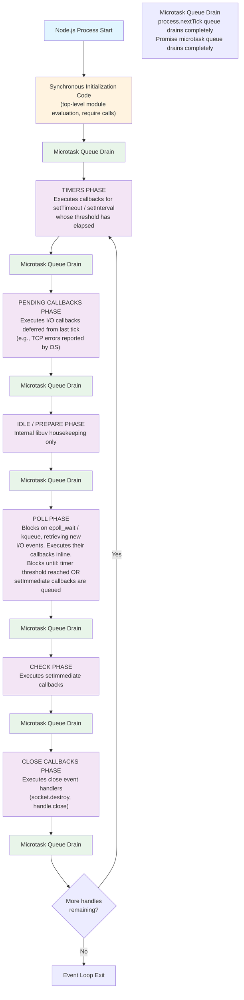
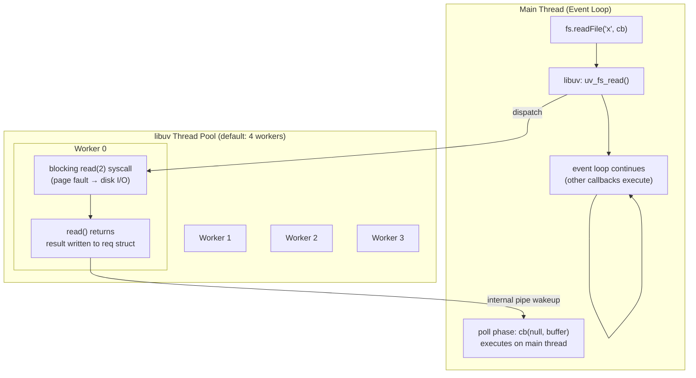

# Lesson 1: Runtime Architecture, Event Loop, Non-Blocking I/O

## 1. First-Principles Intuition & Invariants

To understand Node.js at the level this lesson demands, you must first discard the marketing abstraction — "JavaScript on the server" — and instead ask a sharper question: what is the minimum computational machinery required to execute JavaScript asynchronously on a single thread without blocking the process on slow I/O? The answer to that question is the architecture of Node.js itself.

JavaScript was designed for the browser, an environment where the UI thread cannot stall waiting for a network response without freezing the entire page. This constraint produced a language with no native blocking I/O primitives, no threading model in the standard library, and a callback-first execution model baked into its DNA. When Ryan Dahl extracted this model in 2009 to build Node.js, he was not inventing a new paradigm — he was recognizing that the browser's forced constraint was actually the correct default for server I/O workloads. The key insight is that most server processes spend the overwhelming majority of their wall-clock time waiting: waiting for disk reads, waiting for network packets, waiting for database cursors. A thread blocked on `read(2)` is a thread consuming a file descriptor, kernel stack memory, and a scheduler slot while doing no useful work. Multiply that by ten thousand concurrent connections and you have the C10K problem, the defining systems challenge of the early 2000s.

Node.js resolves this through the composition of three distinct engines: the **V8 JavaScript engine**, which compiles and executes JavaScript; **libuv**, a cross-platform asynchronous I/O library that wraps the native event notification mechanisms of each OS (`epoll` on Linux, `kqueue` on macOS and BSD, IOCP on Windows); and the **Node.js core bindings layer**, a set of C++ bridges that expose libuv's capabilities to JavaScript-land through V8's API. These three layers are not loosely coupled — they share memory, exchange function pointers, and coordinate control flow through a precisely defined protocol. Understanding where V8 ends and libuv begins, and how the bindings layer negotiates between them, is the central mechanical knowledge this lesson builds.

The fundamental invariant of the entire system is this: **the V8 heap and the JavaScript call stack live on exactly one OS thread, and that thread must never block**. Every operation that could take non-deterministic time — file system access, DNS resolution, network I/O, cryptographic operations — must be dispatched off this thread and return its result through a notification mechanism that the event loop can observe and schedule. When this invariant is violated — when synchronous cryptography, synchronous file I/O via `fs.readFileSync`, or a CPU-bound computation runs on the main thread — the event loop stalls, and every other pending callback waits for that work to complete. This is not a theoretical concern; it is the most common production failure mode in Node.js services.

The V8 engine itself warrants a first-principles treatment before examining how it integrates with libuv. V8 is an optimizing JIT compiler organized around a multi-tier execution pipeline. When V8 first encounters a JavaScript function, it parses the source into an Abstract Syntax Tree and compiles it directly to bytecode via **Ignition**, V8's register-based bytecode interpreter. Ignition executes the bytecode immediately while simultaneously collecting type-feedback data: which operations see integers, which see doubles, which see objects of a particular hidden class shape. Once a function becomes "hot" — once it has been called enough times that V8's heuristics classify it as worth optimizing — the **Turbofan** optimizing compiler takes the Ignition bytecode and the accumulated type-feedback profile and emits highly optimized native machine code. If the type assumptions embedded in that optimized code are later violated (a function previously called only with integers is now called with a string), V8 performs a **deoptimization**, discarding the optimized code and falling back to Ignition bytecode. For systems programmers, this feedback-and-speculate pipeline is directly analogous to branch prediction and speculative execution in CPUs: the gains are significant when predictions hold, but mispredictons incur a real cost.

V8's memory model divides the heap into distinct spaces. The **new space** (also called the young generation) is a small, fixed-size semi-space where most allocations occur. It is collected by **Scavenge**, a Cheney-algorithm semi-space collector that evacuates live objects by copying them to a "to-space," inverting the roles of the two halves on each cycle. Objects that survive two Scavenge collections are promoted to the **old space**, collected by a Mark-Sweep-Compact algorithm that runs incrementally to reduce pause times. The **large object space** holds objects exceeding a threshold (typically 512 KB) that would be too expensive to copy. For Node.js performance, the new space is the critical region: excessive object allocation pressure causes frequent Scavenge cycles, and if objects have short lifetimes but are promoted before they die (because a Scavenge cycle didn't happen quickly enough to catch them), they pollute the old space and force more expensive major GC cycles. The practical consequence is that high-throughput Node.js code should minimize ephemeral allocations in hot paths — object pooling and buffer reuse are not premature optimizations at this level.

## 2. Core Architecture & Mechanics

### The libuv Event Loop: Phase Topology

libuv's event loop is not a simple "while true, check for events" loop. It is a structured state machine with discrete phases executed in a fixed sequence on each iteration, commonly called a **tick**. The sequence is deterministic and ordered, and understanding which phase each type of callback executes in is essential for predicting the behavior of any non-trivial asynchronous program.



The **timers phase** does not execute a callback "at" the specified delay — it executes callbacks whose minimum delay threshold has elapsed. `setTimeout(fn, 1)` guarantees that `fn` will not execute before 1 millisecond has passed, but makes no upper-bound guarantee. The actual delay depends on what work was executing when the timer threshold was crossed. This distinction matters: if the poll phase is blocked processing I/O callbacks when a timer's threshold elapses, the timer callback will not run until the poll phase completes and the loop cycles back to the timers phase.

The **poll phase** is the operational heart of the system. This is where libuv calls into the OS kernel's I/O readiness notification mechanism. On Linux, this is `epoll_wait(2)`, a syscall that blocks the calling thread until one or more of the registered file descriptors become ready for reading or writing, or until a timeout expires. The timeout value that libuv passes to `epoll_wait` is computed at the start of each poll phase: if there are pending timers, the timeout is set to the minimum time until the next timer fires; if there are `setImmediate` callbacks queued, the timeout is zero (non-blocking); if neither condition holds, the loop blocks indefinitely waiting for I/O. This computed timeout is what makes the event loop CPU-idle when a Node.js process has nothing to do — it is genuinely blocked in the kernel, consuming no CPU, until the OS wakes it with an I/O event.

The **check phase** (the `setImmediate` queue) executes after the poll phase, giving library authors a reliable mechanism to schedule work that runs after I/O callbacks in the current iteration but before any timers in the next. This is why `setImmediate` is preferred over `setTimeout(fn, 0)` when the intent is "run this after the current I/O event callback completes": `setImmediate` has a deterministic phase position, whereas `setTimeout(fn, 0)` with a zero delay may or may not fire before `setImmediate` depending on where in the loop the registration occurred and OS timer resolution jitter.

### Microtasks and the nextTick Queue

Superimposed on libuv's phase structure is V8's microtask queue and Node.js's own `process.nextTick` queue. These two queues operate outside of libuv's phase model entirely — they are drained by the Node.js runtime between every phase transition, before the loop is permitted to advance to the next phase. This creates a priority hierarchy with four distinct levels, ordered from highest to lowest scheduling priority:

1. `process.nextTick` callbacks drain completely.
2. The Promise microtask queue (resolved `.then` and `await` continuations) drains completely.
3. The current libuv phase's callbacks execute.
4. The loop advances to the next phase and the nextTick/microtask queues drain again.

The critical word in the first two items is "completely." If a `process.nextTick` callback schedules another `process.nextTick`, that new callback will execute before the loop is permitted to advance. This means a recursive `process.nextTick` chain will starve the event loop indefinitely — a subtle but real denial-of-service risk in production code. The same starvation risk applies to promise chains that resolve synchronously in a tight loop.

The distinction between `process.nextTick` and `Promise.resolve().then()` is frequently misunderstood. Both are microtasks from the perspective of "runs before the next I/O phase," but `process.nextTick` has higher priority than the Promise microtask queue, and they are drained as separate queues. This became the source of a correctness debate in the Node.js core team: `process.nextTick` predates the ECMAScript specification's formalization of the microtask queue, and its scheduling semantics do not align perfectly with the WHATWG HTML specification's Job queue model. The practical takeaway is that `process.nextTick` should be reserved for cases where code genuinely needs to defer execution until after the current synchronous operation completes but before any I/O, and `queueMicrotask()` or Promise resolution should be used when ECMAScript-compliant microtask scheduling is required.

### The libuv Thread Pool

The event loop's non-blocking model works directly for I/O that the OS can represent as a file descriptor and report via `epoll`/`kqueue` — sockets, pipes, and character devices. Regular file system operations on Linux, however, are not guaranteed to be non-blocking even when the file descriptor is opened with `O_NONBLOCK`. Linux's POSIX file I/O does not integrate cleanly with `epoll` for buffered file reads: `read(2)` on a regular file will block the calling thread until the kernel populates the page cache from disk. If libuv called `read(2)` directly on the event loop thread, file reads would block the entire JavaScript runtime.

libuv's solution is the **thread pool**: a fixed-size pool of OS threads, default size 4, configurable via the `UV_THREADPOOL_SIZE` environment variable up to a maximum of 1024 threads. File system operations, DNS resolution via `getaddrinfo(3)` (not the c-ares async resolver), and certain cryptographic operations from the Node.js `crypto` module execute on thread pool workers. The event loop thread dispatches the work, blocks nothing, and receives a completion notification via libuv's internal pipe-based wakeup mechanism when a worker thread finishes. The result is then packaged as a callback and queued for execution in the poll phase of the next appropriate event loop iteration.



The thread pool size is a critical tuning parameter that most Node.js deployments leave at its default of 4. For a service that is I/O-bound on file system operations — an asset server, a log processor, a file format transformer — 4 workers means that only 4 file system operations can proceed concurrently regardless of how many are queued. The remaining requests block in libuv's work queue, adding latency. Setting `UV_THREADPOOL_SIZE=16` or higher in the process environment before the event loop starts (it cannot be changed at runtime) is often the correct fix when `fs` latency is anomalously high under load. However, increasing the thread pool size increases memory consumption and OS scheduler pressure proportionally, and for services whose I/O is dominated by sockets and network (the common case for HTTP APIs), increasing the thread pool size provides no benefit because socket I/O does not use the thread pool at all.

### V8–libuv Integration: The Binding Layer

The integration between V8 and libuv is not automatic — it is mediated by the Node.js binding layer, written in C++ and exposed to JavaScript through V8's C++ API. When JavaScript calls `fs.readFile`, the call path traverses multiple layers:

The JavaScript `fs` module in `lib/fs.js` validates arguments and calls into `binding('fs').read`, which is a binding exported from `src/node_file.cc`. The binding creates a `FSReqCallback` object (a C++ structure that wraps a libuv `uv_fs_t` request and holds a reference to the JavaScript callback function as a V8 persistent handle), then calls `uv_fs_read()` to dispatch the work to the thread pool. The main thread returns to the event loop immediately.

When the thread pool worker completes the read, it posts a completion notification to the event loop via an internal `uv_async_t` handle. During the next poll phase, libuv calls the `FSReqCallback`'s C++ completion function. This function retrieves the result, constructs JavaScript arguments from the raw byte buffer (using `v8::ArrayBuffer::NewBackingStore` to avoid copying when possible), looks up the stored JavaScript callback via the V8 persistent handle, and calls `node::MakeCallback`, which invokes the JavaScript callback within V8's context while also draining the nextTick and microtask queues after the callback returns. The microtask draining in `node::MakeCallback` is what ensures that `process.nextTick` and `Promise` continuations registered inside any callback execute before the event loop returns to libuv for the next event.

A concrete program that makes this phase topology visible at runtime:

```javascript
// phase_probe.js
// Run with: node phase_probe.js
// Demonstrates execution ordering across all queue types.

const { readFile } = require('fs');

// Schedules work in the timers phase (next iteration, after poll)
setTimeout(() => console.log('[setTimeout]  timers phase'), 0);

// Schedules work in the check phase (after poll, this iteration)
setImmediate(() => console.log('[setImmediate] check phase'));

// Schedules a resolved Promise microtask (drains after current phase, before poll)
Promise.resolve().then(() => console.log('[Promise.then] microtask queue'));

// Schedules on the nextTick queue (highest priority, drains before microtasks)
process.nextTick(() => console.log('[nextTick]     nextTick queue'));

// Real async I/O: executes in poll phase when the OS delivers the read result
readFile('/etc/hostname', () => {
  console.log('[fs.readFile]  poll phase I/O callback');

  // Inside an I/O callback, setImmediate fires before setTimeout
  setTimeout(() => console.log('[setTimeout inside I/O]  next timers phase'), 0);
  setImmediate(() => console.log('[setImmediate inside I/O] check phase this tick'));
});

console.log('[synchronous]  call stack (runs first, always)');
```

Executing this program produces the following output with consistent ordering:

```text
[synchronous]  call stack (runs first, always)
[nextTick]     nextTick queue
[Promise.then] microtask queue
[setTimeout]   timers phase
[setImmediate] check phase
[fs.readFile]  poll phase I/O callback
[setImmediate inside I/O] check phase this tick
[setTimeout inside I/O]  next timers phase
```

The output confirms every invariant established in the narrative above. The synchronous call stack completes first. The nextTick queue drains before Promise microtasks. At the top level, `setTimeout(fn, 0)` and `setImmediate` race (the top-level case is the one place their ordering is non-deterministic due to startup timer overhead), but inside an I/O callback, `setImmediate` reliably precedes `setTimeout` because the loop is already past the timers phase and must reach the check phase before cycling back.

## 3. High-Performance Optimization & Failure Modes

### Diagnosing Event Loop Lag

The most operationally important metric for a Node.js service is **event loop lag**: the delta between when a timer or callback was scheduled to execute and when it actually executed. In a healthy process under light load, this delta is sub-millisecond. In a process with a blocked event loop, it can grow to seconds. Measuring it requires nothing more than comparing scheduled versus actual execution time:

```javascript
// event_loop_monitor.js
// Production-grade event loop lag sampler.
// Runs a 1-second interval timer and measures actual vs expected delay.
// Suitable for embedding in a metrics exporter or health check endpoint.

'use strict';

const SAMPLE_INTERVAL_MS = 1000;

function measureEventLoopLag() {
  const start = process.hrtime.bigint();

  const timer = setTimeout(() => {
    const actual = process.hrtime.bigint();
    const expectedNs = BigInt(SAMPLE_INTERVAL_MS) * 1_000_000n;
    const lagNs = actual - start - expectedNs;
    const lagMs = Number(lagNs) / 1_000_000;

    // In production, replace console.log with your metrics client
    // e.g., prometheus.histogram.observe(lagMs)
    console.log(`[EL Lag] ${lagMs.toFixed(3)} ms`);

    measureEventLoopLag();
  }, SAMPLE_INTERVAL_MS);

  // Prevent this timer from holding the process open if nothing else is pending
  timer.unref();
}

measureEventLoopLag();
```

Node.js 16 and later expose `perf_hooks.monitorEventLoopDelay()`, which uses a libuv high-resolution timer to sample lag at configurable intervals and computes percentile distributions via an HDR histogram. This is the production-grade approach for embedding event loop metrics into an observability pipeline:

```javascript
// event_loop_perf_hooks.js
// Uses the native monitorEventLoopDelay API introduced in Node.js 11.10.0.
// Resolution is in nanoseconds; percentiles expose tail latency behavior.

'use strict';

const { monitorEventLoopDelay } = require('perf_hooks');

const histogram = monitorEventLoopDelay({ resolution: 10 }); // 10ms sampling
histogram.enable();

// Sample and reset the histogram every 10 seconds
const reporter = setInterval(() => {
  const p50Ms  = histogram.percentile(50)  / 1e6;
  const p95Ms  = histogram.percentile(95)  / 1e6;
  const p99Ms  = histogram.percentile(99)  / 1e6;
  const maxMs  = histogram.max            / 1e6;
  const meanMs = histogram.mean           / 1e6;

  console.log(
    `EL Delay — p50: ${p50Ms.toFixed(2)}ms  ` +
    `p95: ${p95Ms.toFixed(2)}ms  ` +
    `p99: ${p99Ms.toFixed(2)}ms  ` +
    `max: ${maxMs.toFixed(2)}ms  ` +
    `mean: ${meanMs.toFixed(2)}ms`
  );

  histogram.reset();
}, 10_000);

reporter.unref();
```

A p99 event loop lag above 100 ms in a production HTTP service indicates that something is consuming the main thread for multi-millisecond stretches. The diagnostic progression is to first determine whether the lag is caused by a CPU-bound computation, a synchronous I/O call, or a GC pause.

### Identifying and Offloading CPU-Bound Work

A common architectural error is running CPU-bound transformations — JSON parsing of large payloads, cryptographic operations, image dimension calculations, compression — directly on the event loop thread. The correct diagnostic tool is the V8 CPU profiler, accessible via Node.js's built-in `--prof` flag or the `inspector` module for programmatic sampling:

```javascript
// cpu_profiler.js
// Programmatic CPU profile capture using the V8 inspector session.
// Writes a Chromium-compatible .cpuprofile JSON file for analysis
// in Chrome DevTools or the VS Code profiler.

'use strict';

const inspector = require('inspector');
const fs        = require('fs');
const path      = require('path');
const session   = new inspector.Session();

session.connect();

function startCpuProfile(profileName) {
  return new Promise((resolve, reject) => {
    session.post('Profiler.enable', (err) => {
      if (err) return reject(err);
      session.post('Profiler.start', (startErr) => {
        if (startErr) return reject(startErr);
        resolve(profileName);
      });
    });
  });
}

function stopCpuProfile(profileName) {
  return new Promise((resolve, reject) => {
    session.post('Profiler.stop', (err, { profile }) => {
      if (err) return reject(err);
      const outputPath = path.join(process.cwd(), `${profileName}.cpuprofile`);
      fs.writeFileSync(outputPath, JSON.stringify(profile));
      console.log(`Profile written to: ${outputPath}`);
      session.post('Profiler.disable', () => resolve(outputPath));
    });
  });
}

// --- Demonstration: profile a deliberately expensive synchronous operation ---

async function main() {
  await startCpuProfile('expensive-op-profile');

  // Simulate a CPU-bound task that blocks the event loop
  // In production, this would be replaced with Worker thread offloading
  const result = Array.from({ length: 5_000_000 }, (_, i) => i * 2)
    .reduce((acc, val) => acc + val, 0);

  console.log(`Computed sum: ${result}`);

  const outputPath = await stopCpuProfile('expensive-op-profile');
  console.log(`Open ${outputPath} in Chrome DevTools > Performance > Load Profile`);
}

main().catch(console.error);
```

Once the profile confirms that the event loop is blocked by CPU work, the correct remediation is to offload that work to a **Worker thread** via the `worker_threads` module. Workers run V8 isolates in separate OS threads with their own event loops and heaps, communicating with the main thread via structured clone or SharedArrayBuffer. This is the Node.js architecture for CPU parallelism:

```javascript
// worker_pool.js
// A minimal but production-correct fixed-size Worker thread pool.
// Accepts tasks as serializable payloads, distributes them round-robin,
// and resolves Promises when workers post results back.

'use strict';

const { Worker, isMainThread, parentPort, workerData } = require('worker_threads');
const path = require('path');
const os   = require('os');

// ─── Worker Entry Point ───────────────────────────────────────────────────────
// When this file is loaded as a worker (isMainThread === false),
// it listens for tasks and posts results back to the main thread.
if (!isMainThread) {
  parentPort.on('message', ({ taskId, payload }) => {
    try {
      // CPU-bound work executes here, isolated from the event loop thread
      const result = performCpuWork(payload);
      parentPort.postMessage({ taskId, result, error: null });
    } catch (err) {
      parentPort.postMessage({ taskId, result: null, error: err.message });
    }
  });

  function performCpuWork(payload) {
    // Example: compute sum of a large range.
    // In production, replace with JSON parsing, compression, crypto, etc.
    const { start, end } = payload;
    let sum = 0n;
    for (let i = BigInt(start); i <= BigInt(end); i++) {
      sum += i;
    }
    return sum.toString();
  }

  // Worker setup complete; do not execute pool code below
  return; // eslint-disable-line no-useless-return
}

// ─── Pool Implementation (main thread only) ───────────────────────────────────
class WorkerPool {
  constructor(size = os.availableParallelism()) {
    this.size       = size;
    this.workers    = [];
    this.taskQueue  = [];
    this.pending    = new Map(); // taskId → { resolve, reject }
    this.taskIdSeq  = 0;
    this.workerLoad = new Array(size).fill(0);

    for (let i = 0; i < size; i++) {
      this._spawnWorker(i);
    }
  }

  _spawnWorker(index) {
    const worker = new Worker(__filename);

    worker.on('message', ({ taskId, result, error }) => {
      this.workerLoad[index]--;
      const { resolve, reject } = this.pending.get(taskId);
      this.pending.delete(taskId);

      if (error !== null) {
        reject(new Error(error));
      } else {
        resolve(result);
      }

      // Drain the task queue if work is waiting
      if (this.taskQueue.length > 0) {
        const { taskId: queuedId, payload } = this.taskQueue.shift();
        this.workerLoad[index]++;
        worker.postMessage({ taskId: queuedId, payload });
      }
    });

    worker.on('error', (err) => {
      console.error(`Worker ${index} error: ${err.message}. Respawning.`);
      this._spawnWorker(index);
    });

    this.workers[index] = worker;
  }

  run(payload) {
    return new Promise((resolve, reject) => {
      const taskId = this.taskIdSeq++;
      this.pending.set(taskId, { resolve, reject });

      // Find the least-loaded worker
      const leastBusy = this.workerLoad.indexOf(Math.min(...this.workerLoad));

      if (this.workerLoad[leastBusy] < 8) { // max 8 in-flight tasks per worker
        this.workerLoad[leastBusy]++;
        this.workers[leastBusy].postMessage({ taskId, payload });
      } else {
        // All workers saturated; queue the task
        this.taskQueue.push({ taskId, payload });
      }
    });
  }

  async shutdown() {
    await Promise.all(this.workers.map((w) => w.terminate()));
  }
}

// ─── Example Usage ────────────────────────────────────────────────────────────
async function main() {
  const pool = new WorkerPool(4);

  const tasks = [
    { start: 1,          end: 10_000_000 },
    { start: 10_000_001, end: 20_000_000 },
    { start: 20_000_001, end: 30_000_000 },
    { start: 30_000_001, end: 40_000_000 },
  ];

  console.time('parallel-computation');
  const results = await Promise.all(tasks.map((t) => pool.run(t)));
  console.timeEnd('parallel-computation');

  results.forEach((r, i) => console.log(`Task ${i} result: ${r}`));

  await pool.shutdown();
}

main().catch(console.error);
```

### Thread Pool Starvation and DNS Resolution

A subtle failure mode that surfaces under load is thread pool starvation caused by DNS lookups. When a Node.js application makes outbound HTTP requests to hostnames rather than IP addresses, Node.js resolves those hostnames using `dns.lookup()`, which calls `getaddrinfo(3)` via the thread pool rather than the asynchronous c-ares resolver used by `dns.resolve()`. Under high concurrency, an application making many simultaneous outbound requests (to a third-party API, to a database cluster, to microservices) can exhaust all 4 default thread pool workers with pending `getaddrinfo` calls, causing file system operations and all other thread pool work to queue behind them.

The diagnosis is straightforward: if thread pool starvation is occurring, event loop lag will spike even when CPU usage is moderate, and the CPU profile will show threads blocked in `getaddrinfo`. The remediation options are, in order of preference: increase `UV_THREADPOOL_SIZE`, use `dns.resolve()` or the `dns.promises.resolve4()` API (which uses c-ares and does not consume thread pool workers), or pre-resolve hostnames at startup and cache the IP addresses while using the `family` option in `net.connect` to bypass DNS entirely.

### GC Pressure and Heap Tuning

V8's garbage collector runs on the event loop thread during certain phases. Mark-Sweep-Compact GC cycles on the old generation can pause the event loop for tens to hundreds of milliseconds in applications with large heaps and high allocation rates. The first diagnostic step is to enable GC tracing:

```bash
# Start the process with GC pause logging.
# Output lines show pause type, duration, heap before/after each collection.
node --trace-gc \
     --trace-gc-verbose \
     --max-old-space-size=4096 \
     your-app.js
```

The `--max-old-space-size` flag sets the V8 heap limit in megabytes. By default, V8 uses a heuristic that starts conservatively (around 1.5 GB on 64-bit systems) and grows the heap limit as the application demands more memory, up to roughly half the available system RAM. For long-running services with predictable memory footprints, setting an explicit limit prevents unbounded heap growth that would eventually exhaust physical memory and trigger the OOM killer. Setting the limit too low, however, forces V8 to run major GC cycles more frequently, trading memory for latency.

The fundamental principle connecting all three failure modes — event loop starvation, thread pool exhaustion, and GC pressure — is the same invariant established at the opening of this lesson: the event loop thread must do work in bounded, short increments. Every optimization technique, every architectural pattern, and every diagnostic tool in the Node.js performance toolkit exists to enforce that invariant under the realistic conditions of production traffic.
