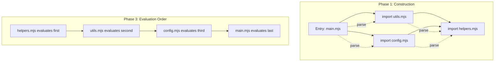

# Lesson 2: Module System, Dependency Resolution, Package Mechanics

## 1. First-Principles Intuition & Invariants

Every programming environment must solve the same fundamental problem: how does one unit of code find and consume another? In a browser, the original answer was global scope pollution — scripts loaded sequentially, variables leaked onto `window`, and load order was the developer's burden to manage manually. Node.js, arriving in 2009, inherited the V8 engine but not the browser's constraints, and Ryan Dahl had the opportunity to build something better. The result was an implementation of the CommonJS specification, a module system that wraps every file in a function closure and resolves dependencies through a deterministic file-system walk. That decision — made in the first weeks of Node's existence — shaped the entire JavaScript ecosystem for over a decade, produced npm, and created patterns that ESM is still working to supersede.

The core invariant of any module system is *isolation with controlled sharing*. A module must have private scope by default, must be able to export a deliberate public surface, and the runtime must guarantee that two separate `require()` calls to the same resolved path return the same object — not two copies. This last property, the module cache, is not a performance optimization bolted on afterward. It is a semantic guarantee: modules are singletons within a process, and anything that depends on that singleton contract (connection pools, event emitters, registries of any kind) will break if the cache is bypassed or duplicated.

Understanding why Node needs two distinct module systems requires understanding what CommonJS cannot do. `require()` is synchronous and imperative: it executes the target file immediately, in-line, and returns the result. This is fine on a local file system but fundamentally incompatible with the browser, where modules arrive over the network and must be fetched before they can be parsed. TC39 designed ECMAScript Modules (ESM) to be statically analyzable: the import graph is determined at parse time, before any code executes. This static structure is what enables tree-shaking, top-level `await`, and native browser loading. When Node.js added ESM support (stabilized in Node 12, fully mature by Node 16), it did not replace CommonJS — it added a second, parallel module system with different semantics, a different loader pipeline, and a boundary between the two that behaves in ways that surprise engineers who have not internalized the mechanical differences.

The invariant that governs everything in this lesson is: **module identity is a resolved absolute path, not a specifier string**. When you write `require('lodash')`, the string `'lodash'` is not the identity of the module. The identity is the absolute path that the resolution algorithm eventually produces, something like `/project/node_modules/lodash/lodash.js`. Two different specifier strings that resolve to the same path yield the same cached module. Two identical specifier strings that resolve to different paths — because they appear in files at different directory depths in a monorepo — yield different module instances. Every pathology in Node module systems, from singleton violations to peer dependency conflicts, traces back to this identity rule.

---

## 2. Core Architecture & Mechanics

### The CommonJS Wrapper and Module Object

Before Node executes any `.js` file loaded via CommonJS, it wraps the file's source text in a function. The actual wrapper template, visible in Node's source as `Module.wrapper`, looks like this:

```javascript
(function(exports, require, module, __filename, __dirname) {
  // your file's source code here
});
```

This is not conceptual abstraction — it is a literal string concatenation that happens inside `Module._compile()`. The implications are concrete. `exports` is initially an empty object, identical to `module.exports`. The `require` function bound here is not the global `require`; it is a closure specific to this module's resolved path, so that relative specifiers like `./utils` are resolved relative to `__dirname`. The `module` object carries the module's `id` (the resolved filename), its `parent` (deprecated but still populated), its `children` array, and critically, `module.loaded` — a boolean that is `false` during execution and flips to `true` only after the wrapper function returns.

The distinction between `exports` and `module.exports` trips up engineers who do not read the wrapper carefully. Inside the wrapper, `exports` is a reference to `module.exports`. If you do `exports.foo = 1`, you are mutating the shared object through one reference. If you do `exports = { foo: 1 }`, you are rebinding the local variable `exports` to a new object while `module.exports` still points to the original empty object — and it is `module.exports`, not `exports`, that Node places in the cache and returns to callers. Any code that assigns a new value to `exports` directly is therefore silently broken, returning an empty object to consumers.

### The `require()` Resolution Algorithm

The algorithm Node uses to convert a specifier string to an absolute path is specified formally as `LOAD_AS_FILE`, `LOAD_AS_DIRECTORY`, and `LOAD_NODE_MODULES` in the Node documentation, and it executes synchronously via blocking file-system calls. Understanding each branch is essential for diagnosing resolution failures in production monorepos.

When `require(X)` is called from a file at directory `Y`, Node first checks whether `X` is a core module name like `'fs'`, `'path'`, or `'http'`. If it is, resolution short-circuits immediately and returns the built-in. No file system access occurs. This is why shadowing a core module name with a local package is dangerous — the shadow only takes effect in environments where the lookup order places `node_modules` before the core module check, which standard Node does not do.

If `X` begins with `./`, `../`, or `/`, it is a relative or absolute specifier. Node attempts to load it as a file first, trying `X` exactly as given, then `X.js`, then `X.json`, then `X.node` (a compiled native addon). If none of those resolve to an existing file, Node treats `X` as a directory and looks for `X/index.js`, `X/index.json`, and `X/index.node`. Before the file extensions are tried, if `X` is a directory path, Node reads `X/package.json` and checks for a `"main"` field; if present, it uses that path as the entry point.

If `X` is a bare specifier — no leading dot or slash — Node enters the node_modules walk. Starting from `dirname(Y)`, it looks for `dirname(Y)/node_modules/X`, then `dirname(dirname(Y))/node_modules/X`, and so on up to the filesystem root. At each candidate directory, the same file-then-directory resolution applies. The walk stops at the filesystem root or at a directory boundary marked by a `package.json` with `"workspaces"`, though workspace boundaries are a Yarn/npm convention Node itself does not enforce at the loader level — Node simply walks the tree.

```text
require('chalk') from /project/src/server/routes/api.js

Walk sequence:
  /project/src/server/routes/node_modules/chalk  → not found
  /project/src/server/node_modules/chalk          → not found
  /project/src/node_modules/chalk                 → not found
  /project/node_modules/chalk                     → FOUND
    → check package.json "main": "./source/index.js"
    → resolve to /project/node_modules/chalk/source/index.js
    → compile and cache under that absolute path
```

This walk is the reason `node_modules` hoisting exists. npm and Yarn hoist packages to the highest directory where they can live without causing version conflicts. Hoisting reduces disk usage and speeds up the walk by placing shared packages closer to the root, where most files will find them quickly. When hoisting is impossible — two packages require incompatible versions of the same dependency — npm places a private copy of the conflicting package inside the dependent package's own `node_modules` directory, creating a nested tree.

### The Module Cache

The cache lives on `Module._cache`, a plain object whose keys are resolved absolute paths and whose values are `Module` instances. When `require()` resolves a specifier to an absolute path, it checks this cache before doing any work. If a cached entry exists and `module.loaded` is true, the cached `module.exports` is returned immediately. This makes repeated `require()` calls O(1) after the first load.

The cache is mutable from userspace, which is occasionally useful and frequently dangerous:

```javascript
// Force a module to reload on the next require() — useful in test harnesses
delete require.cache[require.resolve('./config')];

// Inspect what is currently loaded
console.log(Object.keys(require.cache).length); // total modules in process
```

Deleting a cache entry does not destroy the previously-exported object. Any code that already holds a reference to the old `module.exports` continues to hold it. The next `require()` call for that path will execute the file again and produce a new object. If the module exports a singleton (a database connection pool, a logger instance), you now have two distinct singletons in the same process — a state that will produce subtle, difficult-to-reproduce bugs.

### Circular Dependencies in CommonJS

Circular dependencies in CommonJS do not throw errors. Node resolves them by returning a *partially-constructed* `module.exports` object. The sequence of events makes this concrete.

Suppose `a.js` requires `b.js`, and `b.js` requires `a.js`. Node begins executing `a.js`. Before calling into `b.js`, it places an incomplete `Module` instance for `a.js` in the cache with `module.exports = {}`. Now `b.js` executes and calls `require('./a')`. The cache check succeeds, and `b.js` receives the current value of `a.js`'s `module.exports` — an empty object, because `a.js` has not finished executing yet. When `b.js` finishes and control returns to `a.js`, `a.js` populates its `module.exports`. But `b.js` already captured a reference to the empty object; it does not receive the updated exports.

```javascript
// a.js
const b = require('./b');
console.log('In a, b.value is:', b.value); // prints: In a, b.value is: 2

exports.value = 1;

// b.js
const a = require('./a');
console.log('In b, a.value is:', a.value); // prints: In b, a.value is: undefined

exports.value = 2;
```

The `undefined` is not a bug in Node — it is the correct result of a correct implementation of a flawed graph. The only safe resolution strategy for circular dependencies is to defer the reference: access `a.value` inside a function body rather than at module scope, so the reference is resolved lazily, after all modules have finished initializing. The deeper lesson is that circular dependency graphs are a design smell indicating insufficient separation of concerns. In a well-factored codebase, the dependency graph is a DAG.

### ESM Architecture: Static Linking and the Module Record

ESM operates through a fundamentally different pipeline. Where CJS uses imperative, synchronous execution, ESM uses a three-phase process: **construction**, **instantiation**, and **evaluation**.

During construction, the JavaScript engine parses the source of every module in the import graph, following `import` declarations recursively, and builds a **Module Record** for each file. No code executes during this phase. The engine creates *import bindings* — live references that will point into the exporting module's lexical environment. These bindings are not copies of values; they are aliases.

During instantiation, the engine allocates memory for all exported names and links the import bindings to those memory slots. At this point, all exported variables exist in memory but are uninitialized — their values are the temporal dead zone. This is why accessing an ESM export before the exporting module evaluates throws a `ReferenceError` rather than returning `undefined` as CJS would.

During evaluation, modules execute in post-order depth-first traversal of the dependency graph — leaves first, dependents last. Each module runs exactly once. The critical difference from CJS is that ESM bindings are *live*: if a module exports `let count = 0` and later executes `count++`, all importers see the updated value. This is impossible in CJS, where `exports.count` is a snapshot value copied at require-time.



The `.mjs` extension, or `"type": "module"` in `package.json`, is the signal that tells Node's loader to use the ESM pipeline rather than CJS. This is a file-level static declaration, not a runtime decision. The Node loader determines the module system before it reads a byte of the file's content.

### The `package.json` Exports Map

The `"exports"` field, introduced in Node 12 and widely adopted by Node 16, is the most significant change to package authoring since `"main"`. It replaces `"main"` with a precise, declarative map that controls not just the package entry point but every accessible path within the package.

```json
{
  "name": "my-library",
  "version": "2.0.0",
  "type": "module",
  "exports": {
    ".": {
      "import": "./dist/index.mjs",
      "require": "./dist/index.cjs",
      "types": "./dist/index.d.ts"
    },
    "./utils": {
      "import": "./dist/utils.mjs",
      "require": "./dist/utils.cjs"
    },
    "./package.json": "./package.json"
  }
}
```

The `"exports"` map has two critical enforcement properties that `"main"` lacked. First, it establishes an *encapsulation boundary*: any path not listed in the exports map is inaccessible to consumers. `require('my-library/dist/internal/secret.js')` throws an `ERR_PACKAGE_PATH_NOT_EXPORTED` error even if that file exists on disk. This is a hard boundary, not a convention, and it finally gives library authors the ability to refactor internal paths without breaking consumers. Second, the conditional export keys — `"import"`, `"require"`, `"node"`, `"browser"`, `"default"` — allow a single package to serve dual-module builds. When a CJS consumer calls `require('my-library')`, Node resolves to the `.cjs` build. When an ESM consumer writes `import 'my-library'`, Node resolves to the `.mjs` build. The resolution happens at the Node loader level, not through any userspace shim.

The `"imports"` field (note: plural, not `"exports"`) provides package-internal path aliases, prefixed with `#`. Where `"exports"` controls what the outside world can see, `"imports"` controls what code inside the package can import using short names:

```json
{
  "imports": {
    "#db": {
      "node": "./src/db/real-client.js",
      "default": "./src/db/mock-client.js"
    },
    "#utils/*": "./src/utils/*.js"
  }
}
```

Code inside the package can then write `import db from '#db'` and get the real or mock client depending on the environment condition. This pattern replaces most of what module aliases plugins for Webpack and ts-paths hacks accomplish, natively, without any bundler involvement.

### CJS-ESM Interoperability Mechanics

The boundary between the two module systems is asymmetric, and understanding the asymmetry prevents an entire class of runtime errors. ESM can import CJS modules, but the import is treated as a default import of whatever `module.exports` is — there is no named export destructuring from CJS modules in Node's native loader (bundlers like esbuild and Rollup perform static analysis to fake named imports, but Node itself does not). CJS cannot `require()` an ESM module at all: because ESM loading is asynchronous (even on the file system, to maintain symmetry with the browser's network model), and `require()` is synchronous, there is no way to block the CJS event loop waiting for ESM initialization. Attempting to `require()` an `.mjs` file throws `ERR_REQUIRE_ESM`. The correct bridge is to use `import()`, the dynamic import expression, which returns a Promise and works from CJS:

```javascript
// In a CJS module that needs to consume an ESM package
async function loadEsmModule() {
  const { default: chalk } = await import('chalk');
  return chalk;
}
```

This is not merely a stylistic concern. The `chalk` package dropped CJS in version 5. Any CJS codebase that upgrades chalk from v4 to v5 will get `ERR_REQUIRE_ESM` at runtime. The fix requires either pinning chalk at v4, dynamically importing chalk with the Promise pattern above, or migrating the consuming module to ESM. This is a real migration pattern that plays out across hundreds of packages in the ecosystem.

---

## 3. High-Performance Optimization & Failure Modes

### Startup Latency and Require Graphs

For long-running servers, module load time is a one-time cost amortized over millions of requests. For Lambda functions, CLI tools, and edge compute runtimes, it is a recurring cost paid on every cold start. `require()` is synchronous, so deep require graphs serialize the CPU: each module must fully execute before the caller continues. A naive application that requires fifty packages at startup, each of which transitively requires dozens more, can easily spend 500ms to 1,500ms in module initialization before handling a single request.

The diagnostic tool for this is Node's built-in `--require` timing or the `v8-compile-cache` pattern. For direct measurement, the fastest approach is instrumentation at the `Module._load` level:

```javascript
// profile-requires.js — run with: node --require ./profile-requires.js app.js
const Module = require('module');
const originalLoad = Module._load;
const times = new Map();

Module._load = function(request, parent, isMain) {
  const start = process.hrtime.bigint();
  const result = originalLoad.apply(this, arguments);
  const duration = process.hrtime.bigint() - start;
  const resolved = Module._resolveFilename(request, parent, isMain);
  times.set(resolved, (times.get(resolved) || 0n) + duration);
  return result;
};

process.on('exit', () => {
  const sorted = [...times.entries()]
    .sort(([, a], [, b]) => (b > a ? 1 : -1))
    .slice(0, 20);
  
  console.log('\n--- Top 20 Slowest Module Loads ---');
  for (const [path, ns] of sorted) {
    console.log(`${(Number(ns) / 1e6).toFixed(2)}ms  ${path}`);
  }
});
```

This monkey-patch intercepts `Module._load`, which is called for every `require()` including transitive ones. It accumulates time per resolved path and reports on process exit. Running this against a production application reveals which packages dominate startup cost and are therefore candidates for lazy loading, dynamic importing, or replacement.

The fix for most startup latency is **lazy loading**: defer `require()` calls to the first point of actual use rather than the top of the file. The tradeoff is that the first request to exercise a lazy-loaded code path pays the load cost. For Lambda, this often means the first invocation after a cold start is unacceptably slow. The correct strategy for Lambda is **selective preloading**: eagerly load modules on the critical path for the most common request types during the initialization phase (before the handler is ready), and lazily load modules for rare code paths.

### Duplicate Module Instances from Broken Deduplication

The module identity rule — identity is the resolved absolute path — has a corollary failure mode in monorepos and workspaces. Consider two packages in a workspace, `pkg-a` and `pkg-b`, both depending on `react`. If the workspace manager cannot hoist `react` to a single location (because `pkg-a` requires React 17 and `pkg-b` requires React 18), or if the dependency was installed inside each package's own `node_modules` for some other reason, then `pkg-a`'s `require('react')` resolves to `/workspace/packages/pkg-a/node_modules/react/index.js` and `pkg-b`'s resolves to `/workspace/packages/pkg-b/node_modules/react/index.js`. These are two different absolute paths. The module cache considers them two different modules. React's internal state lives on the module's cached exports object; with two instances, React's context system cannot work correctly because a context created by one React instance is not recognized by components using the other.

The diagnostic command for this scenario is:

```bash
# From the workspace root — find all resolved paths for a given package
node -e "
const req = require;
const paths = require.resolve.paths('react');
console.log('Search paths:', paths);
console.log('Resolved to:', require.resolve('react'));
"

# More comprehensive: find duplicates across the entire node_modules tree
find . -path '*/node_modules/react/package.json' \
  -not -path '*/node_modules/*/node_modules/react/package.json' \
  | xargs -I {} sh -c 'echo {}; node -e "console.log(require(\"{}\").version)"' \
  2>/dev/null
```

The correct fix depends on the package manager. With npm workspaces, adding the conflicting package to the root `package.json` as a peer dependency forces hoisting. With Yarn Berry (PnP), the resolution is controlled explicitly in `.yarnrc.yml` using `packageExtensions`. With pnpm, the `overrides` or `resolutions` field in the root `package.json` enforces a single resolved version across the entire workspace.

### ESM Caching Differences and Cache-Busting

ESM modules are cached by URL, not by POSIX path. This matters when `import()` is used with file URLs. The cache key for a dynamic import is the full URL string including query parameters. This fact, inadvertent in design but widely exploited in practice, enables ESM cache-busting in environments where module hot-reloading is needed without a full process restart:

```javascript
// Force a fresh evaluation of a module by appending a cache-busting query param
// This works because the URL is different, so the ESM cache misses
async function reloadModule(modulePath) {
  const url = new URL(`file://${modulePath}`);
  url.searchParams.set('t', Date.now().toString());
  return import(url.href);
}
```

This technique has a memory cost: each reloaded version remains in the ESM cache because the cache keys are distinct. For a development hot-reload server, this is acceptable because the process restarts periodically. For a production system, cache-busting ESM imports is a memory leak. Use this pattern only in controlled, process-bounded development tooling.

### Exports Map Encapsulation Failures

A common failure mode when migrating a package from `"main"` to `"exports"` is forgetting to expose `package.json` itself. Some tooling — particularly bundlers, TypeScript resolution, and runtime introspection code — reads `package.json` directly via `require('some-pkg/package.json')`. With a strict `"exports"` map, this path is blocked unless explicitly listed. The fix is always to include `"./package.json": "./package.json"` as an export condition, as shown in the exports map example above.

A subtler failure occurs with TypeScript. Unless the `"types"` condition is listed in the exports map (and TypeScript's `moduleResolution` is set to `"bundler"` or `"node16"`), TypeScript may resolve the type declarations incorrectly or fall back to the `"main"` field, defeating the dual-module build. The correct TypeScript configuration for a dual-module package requires `"moduleResolution": "node16"` or `"nodeNext"` in `tsconfig.json` and type conditions in every exports entry.

### Semver Resolution and Dependency Hell

npm's resolution algorithm selects package versions using SemVer ranges and builds a logical dependency tree. When two packages in the tree require overlapping ranges of a dependency, npm attempts to deduplicate by selecting the highest version that satisfies both ranges. When ranges are incompatible, it installs separate copies. The `npm dedupe` command re-runs deduplication after installation to collapse any redundant copies that accumulated through incremental installs.

The `package-lock.json` file records the exact resolved version and content-hash for every package in the tree. It is the ground truth for reproducible installs. When `npm ci` is used (the correct command for CI/CD environments), npm validates that `package-lock.json` matches `package.json` and installs exactly the locked versions without any resolution step. `npm install`, by contrast, re-runs resolution and may update the lockfile. Committing `package-lock.json` and using `npm ci` in pipelines is not optional discipline — it is the only way to guarantee that the binary artifact tested in CI is built from the same dependency graph as production.

```bash
# Audit the full resolved dependency tree
npm ls --all 2>/dev/null | head -100

# Find why a specific package version was chosen
npm explain lodash

# Check for packages that have multiple versions installed
npm ls --all 2>/dev/null | grep -E '^\S' | sort | uniq -d

# Clean install from lockfile only — never re-resolves
npm ci

# After adding/removing packages, re-deduplicate
npm dedupe
```

### The `exports` Condition Priority Ordering

When multiple conditions match in an exports map, Node evaluates them in the order they appear in the map object — not in any priority order based on the condition name. This is an easy source of bugs when conditions are listed in the wrong order:

```json
{
  "exports": {
    ".": {
      "default": "./dist/index.cjs",
      "import": "./dist/index.mjs"
    }
  }
}
```

This exports map is broken. `"default"` matches everything, so `"import"` is never reached regardless of whether the consumer uses ESM. The correct order places the most specific conditions first and `"default"` last:

```json
{
  "exports": {
    ".": {
      "import": "./dist/index.mjs",
      "require": "./dist/index.cjs",
      "default": "./dist/index.cjs"
    }
  }
}
```

Node processes conditions top-to-bottom and stops at the first match. Placing `"default"` last makes it a true fallback rather than a universal match that swallows all conditional resolution. This ordering rule applies equally to `"node"`, `"browser"`, `"development"`, `"production"`, and any custom conditions passed via the `--conditions` CLI flag.

The module system is not a commodity feature. It is the foundational infrastructure on which every import, every package boundary, and every deployment artifact rests. Mastering its mechanics — the resolution walk, the cache semantics, the CJS-ESM boundary, the exports map — means you can reason about production failures that read only as module-not-found errors or mysteriously duplicated singletons to engineers who treat the module system as a black box. Treat it as a compiler: understand its input (specifier strings, file system state, `package.json` declarations), understand its output (resolved absolute paths, module records, live bindings), and the entire surface area of dependency problems becomes tractable.
