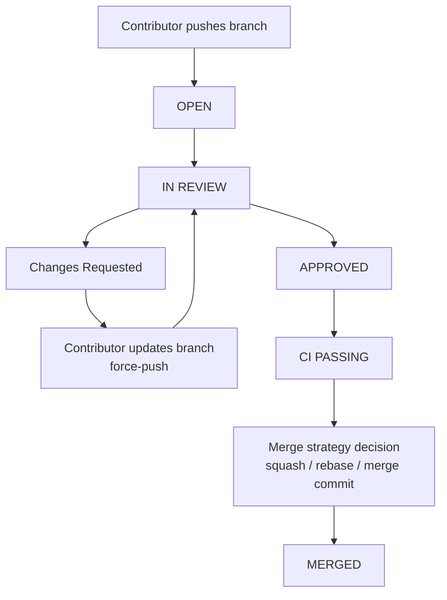

# Lesson 2: Collaboration Models

## 1. First-Principles Intuition & Invariants

Every version control system encodes a theory of collaboration. CVS and early SVN encoded a pessimistic theory: developers would conflict constantly, so the system serialized commits through a central authority and treated concurrent edits as exceptional. Git encodes an optimistic theory: conflicts are rare, most work happens independently, and the system should make branching and merging so cheap that parallel development becomes the norm rather than the exception. That shift in underlying philosophy is not cosmetic. It produced an entirely different model of how open source projects are structured, governed, and grown.

The distributed nature of Git means that every clone is a complete, first-class repository. No server holds a privileged copy of history that clients merely reflect. This invariant is what makes the fork model possible. When a contributor forks a project on GitHub or GitLab, they are not creating a lightweight alias or a checked-out working copy—they are creating a full peer repository with its own independent object store, its own refs, and its own right to diverge permanently from the upstream. The platform-level fork is a social construct layered on top of this technical reality: it records the relationship between the two repositories so that tooling can propose integration of changes, but the two repos are, from Git's perspective, simply remotes that share a common ancestry.

Understanding collaboration models at this level of fidelity matters because it shapes every decision that follows. The governance structure a project adopts, the contributor agreement it demands, the merge strategy its maintainers enforce—all of these are expressions of invariants about trust, history, and authorship. Getting those invariants wrong produces either a project that is impossible to contribute to or one whose history is so tangled that bisection and attribution become unreliable.

### The Trust Hierarchy and Contributor Agreements

Before any code moves, a project must solve a legal problem: who owns the copyright to each commit, and under what terms can the project redistribute it? This is not bureaucratic overhead—it is the legal foundation on which the entire collaboration rests.

There are two dominant instruments. A **Contributor License Agreement** (CLA) is a contract in which the contributor either assigns copyright to the project's steward or grants the steward a broad, irrevocable license to use, sublicense, and distribute the contribution. The Apache Software Foundation's Individual CLA is the canonical example. It does not transfer copyright; instead it grants the ASF a perpetual, worldwide, royalty-free license with the right to sublicense. This is strategically important: the ASF can relicense contributions under future Apache License versions without tracking down every contributor for consent. The Linux kernel uses a lighter-weight instrument, the **Developer Certificate of Origin** (DCO), which is simply a signed-off-by assertion that the contributor has the right to submit the code under the project's existing license. DCO requires no contract, no account registration, just a `git commit --signoff` flag that appends a `Signed-off-by:` trailer to the commit message. Many modern projects prefer DCO precisely because its friction is lower and it is sufficient when the project has no intention of relicensing or dual-licensing.

The practical consequence of this choice flows into tooling. Projects requiring a CLA typically integrate a bot—the Linux Foundation's EasyCLA, Google's CLA Assistant, or a custom GitHub App—that checks every pull request and blocks merge until the contributor's GitHub identity is matched against a signed agreement in a backend database. The DCO path is lighter: a CI job runs `git log --format='%s%n%b' origin/main..HEAD` and checks that every commit message contains a `Signed-off-by:` line matching the author's name and email. Getting either mechanism wrong in your CI pipeline means either blocking legitimate contributors indefinitely or silently merging unverified contributions.

### Fork Semantics at the Object Level

A Git repository is fundamentally a content-addressed object store. Every object—blob, tree, commit, tag—is identified by the SHA-1 or SHA-256 hash of its content. When you fork a repository, the platform typically performs a server-side clone. GitHub calls this a "network," and repositories in the same fork network share object storage at the infrastructure level to avoid redundant data. From your perspective as a developer, though, the fork is entirely independent: its `main` branch points to whatever commit you designate, and nothing the upstream does will change your refs unless you explicitly fetch and merge.

The relationship between your fork and the upstream is tracked through Git remotes, and convention is load-bearing here. The standard setup gives the name `origin` to your fork and `upstream` to the original project. This is not enforced by Git itself but by shared convention among contributors:

```bash
git clone git@github.com:yourname/project.git
cd project
git remote add upstream git@github.com:org/project.git
git remote -v
# origin    git@github.com:yourname/project.git (fetch)
# origin    git@github.com:yourname/project.git (push)
# upstream  git@github.com:org/project.git (fetch)
# upstream  git@github.com:org/project.git (push)
```

Keeping your fork synchronized requires fetching from `upstream` and integrating those changes into your local tracking branches. The critical discipline here is to never commit directly to your fork's `main` or `master` branch. That branch should always be a clean mirror of `upstream/main`, serving as the base from which you cut feature branches. If you let commits accumulate on `main`, rebasing becomes painful and your pull requests will forever carry spurious merge commits.

```bash
git fetch upstream
git checkout main
git merge --ff-only upstream/main
git push origin main
```

The `--ff-only` flag is not optional discipline—it is a correctness invariant. If `upstream/main` has diverged from your local `main` in a way that requires a merge commit, something has gone wrong in your workflow and you need to understand why before proceeding. A fast-forward failure here is a signal, not an obstacle to route around.

---

## 2. Core Architecture & Mechanics

### The Pull Request as a Distributed State Machine

A pull request is not simply a notification that code is ready. It is a stateful artifact that tracks the full lifecycle of a proposed change: from initial submission through review, revision, approval, and integration. Modeling it as a state machine makes the workflow tractable and reveals where the common failure modes live.



The state transition from APPROVED to MERGED is where maintainers make a decision that permanently shapes project history. This deserves careful first-principles reasoning.

### Merge Strategies: History as an Engineering Artifact

Three merge strategies are available on every major Git hosting platform, and each encodes a different philosophy about what project history is for.

A **merge commit** (`git merge --no-ff`) preserves the full topology of the development graph. Every feature branch remains visible as a distinct parallel track that rejoins the mainline at a specific point. The history is maximally complete: you can see exactly when work diverged, how long it ran in parallel, and where it landed. The cost is noise. In a large project with many contributors, the mainline history becomes a dense tangle of merge commits that makes `git log --oneline` nearly unreadable and `git bisect` slower because it must traverse a non-linear graph.

A **squash merge** (`git merge --squash`) collapses all commits on the feature branch into a single new commit on the mainline. The resulting history is linear and clean. Each logical change occupies exactly one commit, and `git bisect` can proceed in O(log n) steps without topology detours. The cost is that the internal development history of the branch is permanently discarded. If a contributor made ten commits with meaningful intermediate states—useful for understanding why a particular design decision was made—that information is gone. For most feature branches, this is an acceptable trade. For work whose intermediate commits carry investigative or archaeological value, it is a real loss.

A **rebase merge** (`git rebase` followed by a fast-forward) replays each commit from the feature branch individually onto the tip of `main`, rewriting their parent pointers and therefore their SHA hashes. The result is a linear history that preserves every individual commit, but the commits' positions in history are synthetic: they appear to have been made directly on `main` even though they were originally made in a branch. This gives the best of both worlds for bisection and blame, but it creates a subtle correctness hazard. If the original commits were signed with the contributor's GPG key, the rewritten commits have different hashes and the signatures are invalidated. Projects that mandate signed commits must use merge commits to preserve signature integrity.

The correct strategy for a project depends on what invariants its maintainers care about most. The Linux kernel uses merge commits extensively because Linus Torvalds values the ability to see exactly which subsystem maintainer merged which tree and when—the topology itself encodes governance. Projects like the Go standard library prefer a linear history because their contributors use `git blame` and `git bisect` as primary debugging tools and the linear invariant makes those tools faster and more predictable.

### Code Review Protocols: The Two-Pass Model

Code review in a high-functioning open source project operates on two distinct levels that most reviewers conflate to their detriment. The first pass is **semantic correctness**: does the code do what it claims to do? Are the invariants maintained? Are the edge cases handled? This requires the reviewer to build a mental model of the change's execution and verify it against the stated intent. The second pass is **systemic coherence**: does the change fit the project's architecture, naming conventions, and performance contracts? Could it be expressed more simply? Does it introduce a dependency that creates future maintenance burden?

Conflating these passes produces reviews that are simultaneously too pedantic about style and too shallow about correctness. A reviewer who catches a one-character typo in a variable name but misses a data race in the concurrent path has optimized for the wrong level.

GitHub's review model gives reviewers three responses: `COMMENT` (non-blocking feedback), `REQUEST_CHANGES` (blocking), and `APPROVE`. Many projects add a convention layer on top of this. The Rust compiler project uses `r+` and `r-` comments as explicit signals to their `bors` merge bot, which will only merge a PR after a designated reviewer posts `@bors r+`. This separates the human approval signal from the mechanical merge action and allows merge batching and serialization through a queue. Chromium uses a similar pattern with `LGTM` and `CQ+2` signals gated by Gerrit's Code Review tooling. The underlying invariant is the same: no code reaches the mainline without at least one human reviewer who is authorized by the project's trust hierarchy to approve that category of change.

```bash
# Practical reviewer workflow using the GitHub CLI
gh pr checkout 4821
# read the diff with full context
git log --oneline main..HEAD
git diff main...HEAD -- '*.rs'

# run the test suite locally against the PR branch
cargo test --workspace

# check for unsafe blocks that weren't in the original
git diff main...HEAD | grep -n "unsafe"

# file a review with inline comments
gh pr review 4821 --comment --body "nit: see inline" \
  --comment-body "src/parser.rs:142: this unwrap will panic on empty input"
```

### Conflict Resolution at the Merge Layer

A merge conflict in Git is a precise technical event: two commits that share a common ancestor have both modified the same region of the same file, and the three-way merge algorithm cannot determine which change takes precedence without human judgment. The file is annotated with conflict markers that identify the ours side (the branch being merged into) and the theirs side (the branch being merged), along with the common base.

```text
<<<<<<< HEAD
    let result = parse_header(buf)?;
||||||| base
    let result = parse_header(buf);
=======
    let result = parse_header(buf).expect("header parse failed");
>>>>>>> feature/strict-errors
```

The three-way diff—enabled by `git config merge.conflictstyle diff3`—adds the `|||||||` section showing the original common ancestor text. This is not the default but should be, because without it you are trying to resolve a conflict without knowing what either side was changing from. The ancestor context is frequently the decisive piece of information: in the example above, the ancestor used an infallible parse, one side made it fallible and propagated the error, and the other side made it fallible and panicked on failure. Resolving this correctly requires understanding which approach the project's error handling policy mandates—information that neither conflict marker alone provides.

For large-scale structural conflicts, semantic merge tools like `git mergetool` with `vimdiff` or the IntelliJ three-way merge panel are faster than editing conflict markers by hand. But the tools only help once you understand the semantic intent of both sides. No merge tool can tell you whether the correct resolution is propagating the error or panicking. That judgment belongs to the humans who understand the project's contracts.

---

## 3. High-Performance Optimization & Failure Modes

### Scaling the Review Pipeline

The most common bottleneck in open source projects is not the rate at which contributors submit code—it is the rate at which maintainers can review it. As a project grows, the review queue becomes the critical path, and unreviewed PRs accumulate latency measured in weeks. Several structural interventions address this directly.

CODEOWNERS files, introduced by GitHub and supported by most platforms, map file paths to reviewer groups and automatically request reviews from the right people when a PR touches their domain. A well-structured CODEOWNERS file distributes review load proportionally to expertise and prevents the common failure mode where every PR ends up in the queue of two or three overloaded core maintainers.

```bash
# .github/CODEOWNERS
# Global default owners
*                   @org/core-team

# Compiler frontend
/src/frontend/      @org/compiler-frontend-team

# Runtime and GC
/src/runtime/       @org/runtime-team
/src/gc/            @org/runtime-team

# Platform-specific code
/src/platform/linux/   @jsmith @kwilliams
/src/platform/macos/   @alopez
```

Branch protection rules complement CODEOWNERS by enforcing the review invariants mechanically. Requiring a minimum number of approving reviews, requiring that all conversations be resolved, and requiring that the branch be up to date with the base before merge—these rules transform aspirational guidelines into enforced constraints. The up-to-date requirement in particular prevents a subtle failure mode: a PR is approved against an old version of `main`, then `main` advances with a change that is semantically incompatible with the PR, and the PR is merged without anyone noticing the conflict because CI only ran against the old base.

### Rebasing vs. Merging in Long-Running Feature Branches

Feature branches that run for days or weeks accumulate base drift: the mainline advances while the branch was in development, and the branch's merge base grows increasingly stale. This creates two distinct risks. First, the branch's CI results become less predictive of post-merge behavior because the branch is being tested against a code base that no longer matches `main`. Second, when the branch is eventually merged, the conflict surface area has grown large enough that resolution requires careful semantic reasoning about changes that the branch author may no longer have fresh context on.

The standard mitigation is periodic rebase onto the current `main`, keeping the branch's merge base fresh throughout development. This should be done at a cadence aligned with the rate of change in the files the branch touches—daily for active files, weekly for stable ones. The mechanical procedure requires care:

```bash
# fetch latest upstream state
git fetch upstream

# rebase the feature branch onto current upstream main
git checkout feature/my-change
git rebase upstream/main

# if conflicts arise, resolve them file by file
# then continue
git add src/affected_file.c
git rebase --continue

# force-push to update the PR branch
# --force-with-lease is mandatory here, not optional
git push origin feature/my-change --force-with-lease
```

The `--force-with-lease` flag verifies that your local ref for the remote branch matches the actual remote state before overwriting it. A plain `--force` would blindly overwrite any commits that a collaborator might have pushed to your branch since your last fetch. `--force-with-lease` fails fast in that scenario, requiring you to reconcile before destroying their work. This is not a stylistic preference—it is the difference between a safe and an unsafe history rewrite.

### The Stacked PR Pattern for Large Changes

A single PR that changes 2,000 lines across 40 files is effectively unreviewable. No reviewer can hold that much context simultaneously, and the probability of significant review feedback requiring structural rework is high, meaning the entire large PR may need to be revised. The stacked PR pattern addresses this by decomposing the large change into a linear sequence of small, independently reviewable PRs, each building on the previous.

```text
main
 │
 ├── PR1: add trait definitions and public API surface
 │        base: main
 │
 ├── PR2: implement core algorithm
 │        base: PR1 branch
 │
 ├── PR3: add integration tests
 │        base: PR2 branch
 │
 └── PR4: update documentation and changelog
          base: PR3 branch
```

Each PR in the stack can be reviewed in isolation, since reviewers only see the incremental delta from the previous PR's branch. When PR1 is approved and merged, the other PRs are rebased down: PR2's base becomes `main`, PR3's base becomes PR2's branch, and so on. Tools like `git-stack`, Graphite, and Phabricator's Differential interface automate this bookkeeping. Without tooling, maintaining a stack manually requires the following rebase discipline:

```bash
# After PR1 is merged to main, fetch and update
git fetch upstream
git checkout pr2-branch
git rebase upstream/main   # PR2 now sits directly on updated main
git push origin pr2-branch --force-with-lease

git checkout pr3-branch
git rebase pr2-branch      # PR3 rebased onto updated PR2
git push origin pr3-branch --force-with-lease
```

The stacked PR pattern requires upfront decomposition discipline and is not appropriate for genuinely atomic changes that cannot be meaningfully separated. But for large features or refactors, the reduction in review latency and rework probability typically outweighs the bookkeeping overhead by a wide margin.

### Failure Modes and Their Structural Causes

The most common collaboration failure mode in open source is the **abandoned PR**: a contribution that received no response or a discouraging first review and was never followed up on. The structural cause is almost always a mismatch between the contributor's expectations (review in days) and the maintainer's capacity (bandwidth measured in hours per week). The mitigation is explicit SLA communication in the project's `CONTRIBUTING.md`, automated triage bots that acknowledge new PRs within 24 hours, and a formal triage process that either schedules review or politely closes PRs that do not meet contribution prerequisites.

The second most common failure mode is **merge conflicts created by CI-green PRs**. This happens when two PRs both modify adjacent regions of the same file, both pass CI on their respective bases, and merging the first causes the second to have a conflict that was invisible during review. The mitigation is the up-to-date branch requirement described above, combined with merge queues—a feature available in GitHub's "Merge Queue" and GitLab's "Merge Trains"—that serialize merge candidates and re-run CI against the actual post-merge state before committing the integration.

A subtler failure mode is **history corruption through force-pushes to protected branches**. If a maintainer has local `main` checked out, runs `git commit --amend` to fix a typo in a recent merge commit, and pushes with `--force`, any contributor who has already fetched and based work on the original commit hash now has a detached history that will require manual reconciliation. The technical prevention is branch protection rules that forbid force-pushes to `main` absolutely. The cultural prevention is treating the mainline history as immutable the moment a commit lands, with a strong norm that amendment of merged commits is never acceptable regardless of how trivial the fix seems.

Understanding these failure modes in terms of their structural causes—trust hierarchy mismatches, merge base staleness, force-push hazards, review bandwidth constraints—allows maintainers to address them with architectural interventions rather than policy memos. Policies are ignored; CI gates and branch protection rules are enforced by the platform regardless of whether any human is paying attention. The most resilient collaboration models are those where the correct behavior is also the path of least resistance, enforced by the tooling rather than the honor system.
