# Lesson 3: Governance Structures

## 1. First-Principles Intuition & Invariants

Every software project of meaningful complexity eventually confronts a question that no amount of technical elegance can defer: who decides? The source code may be open, the repository public, and the license permissive, but the moment two contributors disagree about a direction and neither will back down, the project has arrived at its governance problem. This is not a social inconvenience layered on top of real engineering work. It *is* engineering work, in the same sense that a distributed consensus algorithm is engineering: you are designing a decision-making system that must behave correctly under partial failure, conflicting inputs, and adversarial conditions.

The intuition underlying all open source governance derives from a fundamental tension. Software development benefits from coherent vision. A project that accepts every patch from every contributor without editorial judgment becomes incoherent — the architectural equivalent of a committee-designed programming language where every feature request ships because no constituency can be told no. Yet a project controlled too tightly by a single authority becomes a single point of failure, both technically and socially: when the authority loses interest, burns out, or makes catastrophic errors in judgment, the project has no recovery mechanism. Governance structures exist to navigate this tension, and understanding them requires treating them as what they actually are — decision-routing protocols with explicit and implicit conflict-resolution semantics.

The historical arc of open source governance is an experiment in discovering which of these protocols survive contact with scale. Linus Torvalds created the Linux kernel under what Eric Raymond famously labeled the "bazaar" model, but the kernel is not actually ungoverned chaos: it has a strict maintainer hierarchy, a lieutenant system where trusted subsystem owners filter patches before they ever reach Torvalds, and an implicit constitutional norm that Torvalds' judgment is final. That is not a bazaar. It is a highly structured federated meritocracy with a benevolent dictator at the apex. The Python language, governed for years by Guido van Rossum as BDFL (Benevolent Dictator For Life), demonstrated both the power and the brittleness of that model when van Rossum resigned in 2018 following a contentious PEP process, handing the language's future to a Steering Council. The Apache Software Foundation institutionalized a committee model so rigorously that it has successfully bootstrapped dozens of projects through contributor lifecycles without depending on any single individual's sustained engagement.

Before dissecting these models, establish the invariants every governance structure must satisfy if the project is to remain healthy over a horizon of years rather than months.

**The legitimacy invariant** holds that contributors will only accept decisions they view as having been produced by a legitimate process, regardless of whether they agree with the outcome. A BDFL can make a decision that half the community dislikes, and that half will still comply if they trust the dictator's judgment and believe the process was fair. The same decision made by an ad-hoc committee with no defined authority will produce a fork. Legitimacy is not popularity; it is perceived procedural validity.

**The reversibility invariant** holds that governance structures must be able to evolve. Projects that codify their governance in documents that cannot be amended without heroic effort tend to calcify into forms that served the project at age two but are actively harmful at age ten. The Rust language's governance — originally driven by a small Mozilla-employed core team — has gone through at least three major restructurings as the project grew and Mozilla's role changed. Each restructuring required the community to deliberately revisit the question of authority, which is uncomfortable but necessary.

**The accountability invariant** holds that decision-making authority must be traceable. When a decision is made, every stakeholder should be able to identify who made it, by what process, and on what grounds. This invariant is violated constantly in informal projects where decisions appear to emerge from IRC conversations or private emails and then materialize as merged pull requests with no public record of deliberation. Accountability is not about blame; it is about enabling trust in the system rather than requiring trust in specific individuals.

**The scalability invariant** holds that the governance overhead of a decision should be roughly proportional to its impact. A project that routes every two-line documentation fix through a formal steering committee vote will ship nothing. A project that allows individual maintainers to merge fundamental API changes without review will accumulate irreversible technical debt. Tiered authority — where low-impact decisions are delegated as far down the hierarchy as possible and high-impact decisions escalate to the appropriate level — is the design response to this invariant.

These four invariants do not describe any particular governance model. They describe the fitness criteria against which every governance model must be evaluated.

---

## 2. Core Architecture & Mechanics

### The Benevolent Dictator Model

The BDFL model is the simplest governance structure in the design space and also the most common for projects in their first several years. Its architecture is a star topology: one trusted individual holds final authority over all decisions, with all other contributors' authority derived from and bounded by what the dictator delegates. The critical word in the name is "benevolent." The model works not because the dictator has coercive power — in open source, anyone can fork — but because the community has conferred legitimacy on that person's judgment, usually on the basis of demonstrated technical excellence and the historical fact that the dictator created or substantially bootstrapped the project.

The BDFL's operational mechanics are worth examining carefully because they are often misunderstood as autocratic. In practice, a BDFL spends very little time overriding contributor decisions. The vast majority of governance work involves setting direction by example — through the patches the BDFL writes, the design discussions the BDFL engages with, and the decisions the BDFL makes visible. Contributors internalize the dictator's aesthetic and architectural sensibilities, which means that most pull requests that reach the BDFL are already pre-filtered by community norms that the BDFL originally established. The dictator's most common exercise of authority is not "no" but "not yet" and "not this way, here's why."

The authority boundary of the BDFL is architecturally significant. Linus Torvalds has final authority over what enters the mainline Linux kernel, but he does not have authority over what a downstream distribution ships, what a corporate Linux fork does internally, or what any subsystem maintainer does in their own development tree before it reaches mainline. This bounded authority is what makes the model survivable: the dictator cannot make decisions outside their defined scope without stepping outside the structural role, and the community can exit (fork) if the dictator exceeds norms consistently.

The failure mode of the BDFL model is well-documented. When the dictator is unavailable — through burnout, illness, life circumstances, or simply the passage of time — the project stalls. When the dictator makes a decision the community views as fundamentally illegitimate, the project forks. Python's `asyncio` story is instructive here: van Rossum's design decisions around async syntax generated years of community friction, and when he resigned, one of the first acts of the new Steering Council was to revisit several decisions that contributors had accepted under BDFL authority but would not have accepted from a peer.

The transition out of BDFL governance is a first-class engineering problem. The BDFL model contains no intrinsic succession mechanism. Some projects handle this by designating a co-dictator early; some by establishing a committee that takes over when the BDFL steps back; some by simply allowing the project to stagnate until a motivated party forks and re-establishes governance under a new model.

### Committee-Based Governance

Committee governance distributes decision-making authority across multiple individuals, typically weighted by demonstrated contribution and community trust. The Python Steering Council, the Rust Core Team (in its successive forms), and the Node.js Technical Steering Committee all represent variants of this model. The fundamental data structure is a fixed-size elected or appointed body with defined term limits, explicit voting procedures, and documented scope of authority.

The mechanics of effective committee governance require precision on three points: quorum, voting semantics, and escalation paths.

Quorum is the minimum participation threshold for a decision to be valid. Without a quorum requirement, a committee can be captured by a motivated minority that shows up consistently while other members are distracted. The Python Steering Council operates on a majority-of-seated-members basis. The Apache Software Foundation requires that lazy consensus — where a proposal is considered approved if no binding veto is received within a defined window — counts as a valid committee decision for most routine matters, reserving explicit votes for significant changes.

Voting semantics encode the threshold for approval. Simple majority (N/2 + 1) works for most operational decisions. Supermajority (typically 2/3) is appropriate for governance changes themselves, since governance amendments that could be reversed by a simple majority provide no stability guarantee. The Rust governance model uses a variation where any single team member can raise a concern that escalates a decision from implicit approval to explicit discussion, with consensus required before proceeding.

Escalation paths define what happens when the committee cannot reach a decision. Some models allow the committee chair to cast a tie-breaking vote. Others implement a time-boxed discussion period after which the status quo prevails (conservative default). Still others escalate to a broader community vote, though this introduces its own problems: community votes on technical decisions are easily distorted by people with strong opinions and no technical context.

The committee model scales better than BDFL for projects that must survive individual contributor turnover, but it introduces coordination overhead that the BDFL model eliminates. A committee that communicates asynchronously across time zones will routinely take weeks to decide things that a BDFL decides in hours. For projects under competitive pressure — where a competing project can ship a feature before the committee has finished deliberating — this latency is a real cost.

### Foundation Structures

When a project becomes significant infrastructure — meaning that dozens of organizations have built production systems on top of it and multiple corporations employ engineers to contribute to it — informal governance becomes inadequate. The project needs a legal entity that can hold intellectual property, sign contracts, accept donations, and employ staff. This is the foundation model, and it introduces an organizational layer that most purely technical contributors find opaque until they need it.

The Apache Software Foundation (ASF), the Linux Foundation, the Cloud Native Computing Foundation (CNCF), and the Software Freedom Conservancy each represent distinct approaches to institutionalizing open source governance. Understanding their structural differences matters for a senior engineer who might become a maintainer of a project that is being incubated or graduated through one of these bodies.

The ASF model is the most philosophically distinctive. Its central invariant is that the ASF itself owns all trademarks and legally hosts all projects, but the individual Project Management Committees (PMCs) govern their own technical direction with near-total autonomy. The ASF provides legal cover, infrastructure, and process standards (the Apache Way) while deliberately not interfering in technical decisions. A project must demonstrate that it has a healthy, diverse PMC — not dependent on any single company for the majority of commits — before it can graduate from the incubator. This diversity requirement is structural: it ensures that no corporate sponsor can capture the project by employing all the active contributors.

The Linux Foundation model is more heterogeneous. It hosts everything from the Linux kernel itself (through the kernel maintainer hierarchy) to Kubernetes (through the CNCF) to hundreds of smaller projects. Each project retains its own governance structure; the Linux Foundation provides legal, event, and financial infrastructure without imposing a uniform governance template. This flexibility means that the quality and rigor of governance varies enormously across Linux Foundation projects.

The CNCF specifically has developed a maturity model — Sandbox, Incubating, Graduated — that functions as a governance quality signal. Projects applying for graduation must demonstrate a documented governance model, multiple corporate contributors, a code of conduct, and a clear contribution ladder. The technical oversight committee (TOC) evaluates these criteria, which means that the CNCF's governance requirements function as a forcing function: projects must formalize their governance structures to advance through the maturity model.

The following diagram captures the authority layering across these three major governance archetypes, mapping decision types to the appropriate authority level in each model:

```mermaid
graph TD
    subgraph BDFL["BDFL Model"]
        BD_D[BDFL] -->|"final authority"| BD_M["Maintainers/Lieutenants"]
        BD_M -->|"delegate review"| BD_C[Contributors]
        BD_C -->|"submit patches"| BD_M
        BD_D -->|architecture\ndirection| BD_M
    end

    subgraph Committee["Committee Model"]
        SC["Steering Council\n/ Core Team"] -->|"scope authority"| TL["Team Leads\n/ Working Groups"]
        TL -->|"merge authority"| CM[Committers]
        CM -->|review| CO[Contributors]
        SC -->|governance\namendments| SC
    end

    subgraph Foundation["Foundation Model"]
        F["Foundation Board\n/ Legal Entity"] -->|"trademark\n+ IP policy"| PMC["PMC / TSC\n/ Governance Body"]
        PMC -->|"technical direction"| Comitters2[Committers]
        Comitters2 -->|review| Contributors2[Contributors]
        F -->|budget\napproval| PMC
    end
```

### Decision-Making Protocols in Practice

The day-to-day machinery of governance runs on a small set of protocols that most projects reinvent independently and most contributors encounter for the first time only after they have already violated them. Understanding these protocols as a practitioner means being able to operate within them effectively and to recognize when they are breaking down.

**Lazy consensus** is the workhorse protocol. A proposal is posted to the project's decision-making channel (a mailing list, a GitHub Discussion, a discourse forum). Contributors have a defined window — commonly 72 hours for routine matters, one week for significant changes — to object. Silence is counted as consent. If no objections arrive by the deadline, the proposal is considered approved. This protocol is efficient precisely because most proposals are uncontroversial: it routes only genuinely contentious decisions into the synchronous deliberation path, where they belong.

The failure mode of lazy consensus is the low-participation trap. If the community is small or contributors are disengaged, lazy consensus produces decisions that only the proposer cared about, with no genuine community input. The Apache Software Foundation guards against this by requiring that a certain number of binding votes (from PMC members, as opposed to non-binding votes from the broader community) be cast in favor of releases and significant changes. The binding/non-binding distinction is architecturally important: it means that community participation is encouraged without giving every stakeholder veto power.

**RFC processes** (Requests for Comments, institutionalized by the Rust, Swift, and Python communities among others) are the protocol for high-impact decisions that require deep deliberation before implementation begins. An RFC is a structured document proposing a change, typically covering motivation, detailed design, drawbacks, alternatives considered, and unresolved questions. The document is submitted to a repository and enters a comment period during which any community member can provide feedback. A designated shepherd guides the RFC through revision. The final decision to merge or close the RFC belongs to the relevant governing body — the Rust Lang Team, the Python Steering Council, the Swift Evolution Core Team.

The RFC process is a forcing function for quality of reasoning. Because the proposer must articulate drawbacks and alternatives, the process systematically raises the cost of motivated reasoning and partial analysis. Engineers who have lived through the Rust RFC process for language features understand that a well-executed RFC is indistinguishable from a software design document produced by a senior engineer at a large technology company — it is a thorough artifact, not a casual suggestion. The process also creates a durable record of why decisions were made, satisfying the accountability invariant directly.

A key operational skill for maintainers navigating RFC processes is managing the transition from discussion to decision. RFC discussions frequently accumulate hundreds of comments, reaching a point where the volume of feedback itself becomes an obstacle: the shepherd and the governing body must synthesize divergent opinions into a coherent direction without leaving significant stakeholders feeling unheard. Experienced maintainers time-box deliberation periods, write explicit summaries of the major concerns and design tradeoffs after a discussion has matured, and move decisively to a resolution rather than waiting for consensus to spontaneously emerge. Consensus rarely emerges spontaneously from large discussions; it is built through active facilitation.

---

## 3. High-Performance Optimization & Failure Modes

### Scaling Maintainer Authority Without Degrading Coherence

The most common governance failure in growing projects is not corruption or bad actors but legitimate authority fragmentation. As a project adds subsystems, the natural response is to appoint subsystem maintainers and delegate authority over their domains. This is correct. The failure occurs when those domains are defined imprecisely, so that every cross-cutting change — a performance optimization that touches five subsystems, a security fix that requires coordinated modification across the network stack and the filesystem layer — requires negotiating authority across multiple maintainers with no defined protocol for resolving disagreements.

The Linux kernel solves this through an explicit MAINTAINERS file that defines not just who maintains each subsystem but how patches touching multiple subsystems should be routed. When a patch touches both the networking subsystem and a specific driver, both maintainers review it, with the convention that the more specific maintainer (the driver maintainer) signs off first and the broader maintainer (the networking maintainer) signs off second. Linus pulls from the networking maintainer's tree, not directly from the driver maintainer. This creates a directed acyclic graph of authority that is explicit, queryable, and resistant to deadlock because the DAG has a single root.

For projects that do not have the kernel's volume of contributions but are growing past the point where a single maintainer can review everything, the most effective scaling intervention is the contribution ladder: a formally documented progression from contributor to reviewer to committer to maintainer, with explicit criteria for each transition and explicit scopes of authority at each level. The CNCF's governance templates provide a reasonable starting point. The key design insight is that authority should be granted in proportion to demonstrated judgment, not tenure or volume of contribution alone. A contributor who has submitted fifty straightforward bug fixes has not demonstrated the judgment required to merge architectural changes; a contributor who has successfully reviewed ten complex PRs and provided consistently high-quality feedback has begun to demonstrate it.

### Handling Conflict at the Boundary of Authority

Governance structures are most severely tested not by external attacks but by disputes among trusted contributors who disagree in good faith about project direction. These disputes follow predictable patterns, and recognizing the pattern early is the most effective mitigation.

The **scope creep dispute** arises when a contributor proposes a change that falls outside what other maintainers consider the project's scope. This dispute is fundamentally about project identity, and it cannot be resolved by technical argument alone because it is not a technical question. The resolution requires the governing body to make an explicit statement about scope, which many informal projects have never done. The practical intervention is to invest in a formal scope document — not a marketing description of what the project does, but an engineering specification of what problems the project is responsible for solving and which adjacent problems it explicitly defers to other tools — before the dispute arises rather than after.

The **architectural capture dispute** arises when a large corporate contributor begins submitting changes that advance that company's interests at the expense of the broader community. This is a more sophisticated failure mode because individual changes may each be technically sound and legitimate; the harm is in the aggregate direction they produce. The Apache diversity requirement is a structural defense against this: by requiring that no single employer control a majority of commits or PMC votes, the ASF ensures that no company can achieve architectural capture through legitimate contribution alone. Projects that lack this structural protection must rely on their governance body recognizing the pattern and naming it explicitly, which requires both political sophistication and genuine authority.

The **burnout vacuum** is the most common and least dramatic failure mode: a maintainer who has been carrying disproportionate load quietly reduces their engagement, reviews slow down, issues accumulate, the project develops a reputation for being hard to contribute to, new contributors stop arriving, and remaining maintainers burn out in turn. This is a governance failure because healthy governance structures distribute load across multiple maintainers and have explicit mechanisms for identifying and recruiting new ones. The intervention is not encouragement or appreciation (though both matter); it is structural redistribution of review responsibility, explicit rotation of maintainer roles, and time-bounded delegation to prevent single points of failure from reconstituting themselves.

### The Fork as a Governance Instrument

The fork is simultaneously the most extreme and the most legitimate governance instrument available to an open source community, and treating it as a failure state rather than a design feature produces systematically worse governance decisions. Because the license guarantees the right to fork, every governance decision is made in the shadow of that right. A BDFL who makes decisions in ways the community finds systematically unjust will face a fork. A committee that captures a project for corporate interests will face a fork. The existence of this right disciplines governance bodies in ways that have no corporate analog.

The historical record of consequential forks is a governance case study archive. The LibreOffice fork from OpenOffice arose from community dissatisfaction with the pace of Oracle's stewardship following the Sun acquisition. The Hadoop ecosystem fragmentation into multiple competing distributions reflects a failure of the ASF governance model to prevent commercial interests from pulling subsystems in incompatible directions. The Node.js / io.js fork and subsequent reunification is perhaps the most instructive case: the fork was driven by governance dissatisfaction (specifically, dissatisfaction with Joyent's control and the pace of V8 upgrades), and the reunification was possible only after the Node.js project adopted the Technical Steering Committee model that io.js had implemented during the split. The fork functioned as a governance reform mechanism.

A senior engineer evaluating a project's health should read fork activity not as evidence of community dysfunction but as evidence that the governance legitimacy invariant is under stress. A single high-profile fork by a credible team is a governance signal that demands a structural response, not a PR response. The correct response is to identify what legitimacy failure caused the fork and repair the governance structure, not to dismiss the fork as disruptive or politically motivated. It may be both of those things and still be pointing at a real problem.

### Governance Documentation as Engineering Artifact

Governance documentation is not a bureaucratic overhead imposed on technical work. It is a specification of the decision-making system that runs the project, and it should be treated with the same rigor applied to any other system specification. A governance document that is ambiguous about authority boundaries will produce exactly the bugs that any ambiguous specification produces: undefined behavior at the boundaries, behavior that varies depending on who you ask, and cascading failures when the ambiguous case is exercised under stress.

Effective governance documentation specifies the following with precision: the composition and selection mechanism of every governing body, the scope of authority of each body, the voting and quorum rules for each decision class, the escalation path when a decision exceeds a body's authority, the amendment procedure for the governance document itself, and the code of conduct enforcement mechanism including who has authority to act on violations. Each of these is a parameter in the governance protocol, and leaving any of them unspecified is equivalent to leaving an uninitialized variable in production code.

The practical exercise for a maintainer taking over or reforming a project's governance is to write that specification as a `GOVERNANCE.md` document in the repository, treating each gap in the specification as a bug to be fixed through deliberate community decision rather than assumed convention. Projects governed by assumed conventions fail when contributors arrive who do not share those assumptions, which is to say, when the project succeeds in attracting a diverse contributor base. Governance documentation is not evidence that a project has become too bureaucratic; it is evidence that the project has taken seriously the obligation to be legible to new contributors and to remain coherent as it scales.

The CNCF governance repository at `github.com/cncf/project-template` and the Apache Software Foundation's governance documentation at `apache.org/foundation/governance/` provide production-grade templates that a practitioner can adapt rather than author from scratch. The Rust project's governance documents, versioned in `github.com/rust-lang/rfcs`, demonstrate what a mature committee-based governance structure looks like when its evolution is tracked through the same RFC process it governs — a self-referential coherence that itself reflects the depth of the community's commitment to treating governance as a first-class engineering concern.
